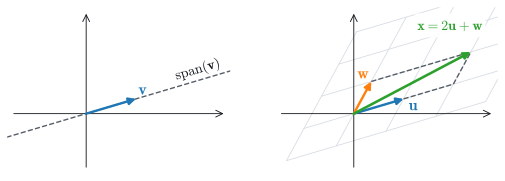

# Vectors, Angles, and Projections
:label:`sec_mdl-geometry-linear-algebraic-ops`

:numref:`sec_linear-algebra` introduced the notation and operations needed to
express deep learning models. Their geometric interpretation connects vectors,
angles, projections, hyperplanes, and matrix transformations.
We study vectors, angles, projections, hyperplanes, and the action of matrices
on space. This viewpoint prepares two decompositions used in the following
sections: eigendecomposition (:numref:`sec_mdl-eigendecompositions`) for
stability, PCA, and Hessian analysis, and singular value decomposition
(:numref:`sec_mdl-svd-low-rank`) for low-rank approximation, conditioning, and
LoRA.

We first develop vector geometry and subspaces, then examine high-dimensional
similarity and a linear-classifier example. Next, we interpret matrices as
maps and study rank and determinants. The final part introduces tensor index
notation. The part headings provide natural stopping points; later sections
require the geometric and matrix-map material but not the classifier example.

## Vectors and Their Geometry

### Points and Directions

A vector admits two common geometric readings, as a point or as a direction
in space. We use the following imports throughout the section.

```{.python .input #geometry-linear-algebraic-ops-imports}
#@tab mxnet
%matplotlib inline
from d2l import mxnet as d2l
from mxnet import gluon, np, npx
npx.set_np()
```

```{.python .input #geometry-linear-algebraic-ops-imports}
#@tab pytorch
%matplotlib inline
from d2l import torch as d2l
import torch
import torchvision
from torchvision import transforms
```

```{.python .input #geometry-linear-algebraic-ops-imports}
#@tab tensorflow
%matplotlib inline
from d2l import tensorflow as d2l
import tensorflow as tf
```

```{.python .input #geometry-linear-algebraic-ops-imports}
#@tab jax
%matplotlib inline
from d2l import jax as d2l
import jax
from jax import numpy as jnp
import numpy as np
import tensorflow as tf
```

Read as a *point*, a vector's components give its location relative to a
fixed reference called the *origin*: $\mathbf{v} = [3,2]^\top$ is the point
$3$ units to the right of the origin and $2$ units up. This reading turns a
dataset into a cloud of points, and a task such as telling pictures of cats
from pictures of dogs into geometry: find a way to separate two clusters of
points in space.

Read as a *direction*, the same vector says "take $3$ steps to the right and
$2$ steps up." An arrow with that displacement can start anywhere, so all the
parallel arrows in :numref:`fig_mdl-la-vectors` are the same vector. (On
notation: a single vector is by default a *column*, while in a matrix holding
a tabular dataset each data example is conventionally a *row*, as described in
:numref:`sec_linear-algebra`.)


:label:`fig_mdl-la-vectors`

The direction view makes vector addition visual: follow one arrow, then the
other, tip to tail, as in :numref:`fig_mdl-la-vector-add`.


:label:`fig_mdl-la-vector-add`

Vector subtraction has a similar interpretation: from the identity
$\mathbf{u} = \mathbf{v} + (\mathbf{u}-\mathbf{v})$, the vector
$\mathbf{u}-\mathbf{v}$ is the direction that takes us from the point
$\mathbf{v}$ to the point $\mathbf{u}$.


### Dot Products and Angles
As described in :numref:`sec_linear-algebra`, the dot product of two column
vectors $\mathbf{u}$ and $\mathbf{v}$ is

$$\mathbf{u}^\top\mathbf{v} = \sum_i u_i\cdot v_i.$$
:eqlabel:`eq_mdl-dot_def`

Because :eqref:`eq_mdl-dot_def` is symmetric, we use the notation

$$
\mathbf{u}\cdot\mathbf{v} = \mathbf{u}^\top\mathbf{v} = \mathbf{v}^\top\mathbf{u},
$$

which makes the symmetry explicit.

The dot product :eqref:`eq_mdl-dot_def` also has a geometric interpretation
in terms of the angle between two vectors, as shown in
:numref:`fig_mdl-la-angle`.


:label:`fig_mdl-la-angle`

Consider two vectors

$$
\mathbf{v} = (r,0) \; \textrm{and} \; \mathbf{w} = (s\cos(\theta), s \sin(\theta)).
$$

The vector $\mathbf{v}$ is length $r$ and runs parallel to the $x$-axis,
and $\mathbf{w}$ has length $s$ and forms angle $\theta$ with the $x$-axis.
Their dot product is

$$
\mathbf{v}\cdot\mathbf{w} = rs\cos(\theta) = \|\mathbf{v}\|\|\mathbf{w}\|\cos(\theta).
$$

For these vectors, the dot product and norms determine the angle between them.
The same identity holds for **any** pair of vectors in a finite-dimensional
space.

The first argument is purely planar. Any two vectors $\mathbf{v}$ and
$\mathbf{w}$, however many coordinates they have, both lie in the
two-dimensional plane they span, and the angle $\theta$ between them lives in
that plane. So we lose nothing by reasoning in two dimensions. Expanding
$\|\mathbf{v} - \mathbf{w}\|^2$ with the dot product gives

$$
\|\mathbf{v} - \mathbf{w}\|^2
 = (\mathbf{v}-\mathbf{w})\cdot(\mathbf{v}-\mathbf{w})
 = \|\mathbf{v}\|^2 - 2\,\mathbf{v}\cdot\mathbf{w} + \|\mathbf{w}\|^2,
$$

while the planar law of cosines applied to the triangle with sides
$\mathbf{v}$, $\mathbf{w}$, and $\mathbf{v}-\mathbf{w}$ gives

$$
\|\mathbf{v} - \mathbf{w}\|^2
 = \|\mathbf{v}\|^2 + \|\mathbf{w}\|^2 - 2\,\|\mathbf{v}\|\|\mathbf{w}\|\cos\theta.
$$

Equating the two and cancelling $\|\mathbf{v}\|^2 + \|\mathbf{w}\|^2$ leaves the
**geometric formula for the dot product**,

$$
\mathbf{v}\cdot\mathbf{w} = \|\mathbf{v}\|\|\mathbf{w}\|\cos\theta,
$$
:eqlabel:`eq_mdl-dot_geom`

which we may solve for the angle:

$$\theta = \arccos\left(\frac{\mathbf{v}\cdot\mathbf{w}}{\|\mathbf{v}\|\|\mathbf{w}\|}\right).$$
:eqlabel:`eq_mdl-angle_formula`

The computation is independent of the ambient dimension, so
:eqref:`eq_mdl-angle_formula` holds in every finite dimension.

The function $\arccos$ is defined only on $[-1, 1]$, so
:eqref:`eq_mdl-angle_formula` requires its argument to lie in that interval.
The following inequality provides this guarantee in every dimension.

**Proposition (Cauchy–Schwarz).** *For any vectors $\mathbf{v}, \mathbf{w}$,*

$$
|\mathbf{v}\cdot\mathbf{w}| \le \|\mathbf{v}\|\,\|\mathbf{w}\|,
$$
:eqlabel:`eq_mdl-cauchy-schwarz`

*with equality if and only if $\mathbf{v}$ and $\mathbf{w}$ are collinear
(one is a scalar multiple of the other).*

**Proof.** If $\mathbf{w} = \mathbf{0}$ both sides are zero and there is
nothing to prove, so assume $\mathbf{w} \neq \mathbf{0}$. Consider the
squared length of $\mathbf{v} - t\mathbf{w}$ as a function of the real number
$t$. A squared length is never negative, so

$$
q(t) = \|\mathbf{v} - t\mathbf{w}\|^2
     = \|\mathbf{w}\|^2\, t^2 - 2(\mathbf{v}\cdot\mathbf{w})\, t + \|\mathbf{v}\|^2
     \;\ge\; 0
     \quad\textrm{for every } t.
$$

This is a quadratic in $t$ with positive leading coefficient $\|\mathbf{w}\|^2$.
A quadratic that stays non-negative cannot have two distinct real roots, so its
discriminant must be $\le 0$:

$$
\bigl(2\,\mathbf{v}\cdot\mathbf{w}\bigr)^2 - 4\,\|\mathbf{w}\|^2\,\|\mathbf{v}\|^2 \le 0,
\qquad\textrm{i.e.}\qquad
(\mathbf{v}\cdot\mathbf{w})^2 \le \|\mathbf{v}\|^2\,\|\mathbf{w}\|^2.
$$

Taking square roots gives :eqref:`eq_mdl-cauchy-schwarz`. Equality forces the
discriminant to vanish, which means $q$ has a (repeated) real root $t^\star$
with $q(t^\star) = \|\mathbf{v} - t^\star\mathbf{w}\|^2 = 0$, that is
$\mathbf{v} = t^\star \mathbf{w}$. $\blacksquare$

The argument uses only the nonnegativity of a squared length. Dividing
:eqref:`eq_mdl-cauchy-schwarz` by
$\|\mathbf{v}\|\|\mathbf{w}\|$ for nonzero $\mathbf{v}, \mathbf{w}$ yields the
**well-definedness of the angle**:

$$
-1 \;\le\; \frac{\mathbf{v}\cdot\mathbf{w}}{\|\mathbf{v}\|\,\|\mathbf{w}\|} \;\le\; 1,
$$

so the $\arccos$ in :eqref:`eq_mdl-angle_formula` is defined and
$\theta$ lies in $[0, \pi]$ in every dimension. The
equality cases are exactly the familiar ones: $\cos\theta = +1$ ($\theta = 0$)
when the vectors point the same way, and $\cos\theta = -1$ ($\theta = \pi$)
when they point in opposite directions, precisely the collinear cases of the
proposition.

Cauchy–Schwarz also has the geometric interpretation shown in
:numref:`fig_mdl-la-projection`. This picture illustrates the inequality
rather than proving it, because it assumes the angle $\theta$ and
:eqref:`eq_mdl-dot_geom`, whose validity Cauchy–Schwarz establishes. On the
left, the projection of $\mathbf{v}$
onto $\mathbf{w}$ has signed length $\|\mathbf{v}\|\cos\theta$, and the residual
$\mathbf{r} = \mathbf{v} - \operatorname{proj}_{\mathbf{w}}\mathbf{v}$ meets
$\mathbf{w}$ at a right angle (we prove both facts in the next section). Because
the right triangle's hypotenuse $\mathbf{v}$ can be no shorter than its leg,
$\|\mathbf{v}\|\,|\cos\theta| \le \|\mathbf{v}\|$, which is exactly
$|\mathbf{v}\cdot\mathbf{w}| \le \|\mathbf{v}\|\|\mathbf{w}\|$. On the right is
the equality case: when $\mathbf{v}$ is collinear with $\mathbf{w}$ the residual
vanishes and the inequality becomes an equality.


:label:`fig_mdl-la-projection`

Cauchy–Schwarz immediately gives the **triangle inequality**, which bounds
the length of a sum by the sum of the lengths.

**Corollary (triangle inequality).** *For any $\mathbf{v}, \mathbf{w}$,*
$\|\mathbf{v} + \mathbf{w}\| \le \|\mathbf{v}\| + \|\mathbf{w}\|$.

**Proof.** Expand and apply :eqref:`eq_mdl-cauchy-schwarz`:

$$
\|\mathbf{v} + \mathbf{w}\|^2
 = \|\mathbf{v}\|^2 + 2\,\mathbf{v}\cdot\mathbf{w} + \|\mathbf{w}\|^2
 \le \|\mathbf{v}\|^2 + 2\,\|\mathbf{v}\|\|\mathbf{w}\| + \|\mathbf{w}\|^2
 = \bigl(\|\mathbf{v}\| + \|\mathbf{w}\|\bigr)^2.
$$

Taking square roots gives the claim. $\blacksquare$

The following function computes the angle between a pair of vectors:

```{.python .input #geometry-linear-algebraic-ops-dot-products-and-angles}
import numpy as onp
def angle(v, w):
    return onp.arccos(v.dot(w) / (onp.linalg.norm(v) * onp.linalg.norm(w)))

angle(onp.array([0, 1, 2]), onp.array([2, 3, 4]))
```

Two vectors whose angle is $\pi/2$ (equivalently $90^{\circ}$) are called
*orthogonal*. From :eqref:`eq_mdl-dot_geom`, the angle is $\pi/2$ exactly when
$\cos\theta = 0$, and since $\|\mathbf{v}\|\|\mathbf{w}\| \neq 0$ for nonzero
vectors, this happens if and only if the dot product itself vanishes. We
therefore *define* two vectors to be **orthogonal when**
$\mathbf{v}\cdot\mathbf{w} = 0$. (We take this as the definition because it
extends gracefully to the zero vector, which is orthogonal to everything even
though no angle is defined for it.) We will use this condition throughout the
chapter.

### Projection and Orthogonality

Cauchy–Schwarz answers "how aligned are two vectors?"; the closely related
operation of *projection* answers "how much of $\mathbf{v}$ points along
$\mathbf{w}$?" Geometrically, we look for the point on the line
$\{t\mathbf{w} : t \in \mathbb{R}\}$ that is closest to $\mathbf{v}$.

**Proposition (orthogonal projection).** *Let $\mathbf{w} \neq \mathbf{0}$. The
closest multiple of $\mathbf{w}$ to $\mathbf{v}$ is*

$$
\operatorname{proj}_{\mathbf{w}}\mathbf{v}
 = \frac{\mathbf{v}\cdot\mathbf{w}}{\mathbf{w}\cdot\mathbf{w}}\,\mathbf{w},
$$
:eqlabel:`eq_mdl-projection`

*and the residual $\mathbf{r} = \mathbf{v} - \operatorname{proj}_{\mathbf{w}}\mathbf{v}$
is orthogonal to $\mathbf{w}$.*

**Proof.** We minimize the squared distance
$f(t) = \|\mathbf{v} - t\mathbf{w}\|^2
 = \|\mathbf{w}\|^2 t^2 - 2(\mathbf{v}\cdot\mathbf{w})\,t + \|\mathbf{v}\|^2$.
This is a convex parabola in $t$; setting $f'(t) = 2\|\mathbf{w}\|^2 t -
2(\mathbf{v}\cdot\mathbf{w}) = 0$ gives the unique minimizer
$t^\star = \dfrac{\mathbf{v}\cdot\mathbf{w}}{\mathbf{w}\cdot\mathbf{w}}$, which
is :eqref:`eq_mdl-projection`. For orthogonality of the residual, compute

$$
\mathbf{r}\cdot\mathbf{w}
 = \mathbf{v}\cdot\mathbf{w}
   - \frac{\mathbf{v}\cdot\mathbf{w}}{\mathbf{w}\cdot\mathbf{w}}\,(\mathbf{w}\cdot\mathbf{w})
 = 0. \qquad \blacksquare
$$

Because $\mathbf{r}$ is orthogonal to $\operatorname{proj}_{\mathbf{w}}\mathbf{v}$
(which is a multiple of $\mathbf{w}$), the decomposition
$\mathbf{v} = \operatorname{proj}_{\mathbf{w}}\mathbf{v} + \mathbf{r}$ splits
$\mathbf{v}$ into two perpendicular pieces, and **Pythagoras** applies:

$$
\|\mathbf{v}\|^2 = \|\operatorname{proj}_{\mathbf{w}}\mathbf{v}\|^2 + \|\mathbf{r}\|^2 .
$$
:eqlabel:`eq_mdl-pythagoras`

Two observations connect this result to the rest of the section. First, the *signed
length* of the projection is

$$
\frac{\mathbf{v}\cdot\mathbf{w}}{\|\mathbf{w}\|} = \|\mathbf{v}\|\cos\theta ,
$$

which is the quantity used in the hyperplane discussion below. Second, this is
a one-dimensional *least-squares* problem: it finds the best approximation of
$\mathbf{v}$ from the subspace spanned by $\mathbf{w}$. We state the general
version below, as soon as the vocabulary of subspaces and bases is in hand.

### Span, Bases, and Subspaces

The projection result used the one-dimensional subspace spanned by
$\mathbf{w}$, and the dot-product argument used the plane spanned by two
vectors. The concepts of *span*, *subspace*, and *basis* organize the
decompositions developed later in this chapter.

Given vectors $\mathbf{v}_1, \ldots, \mathbf{v}_k$, their **span** is the set
of everything reachable by scaling and adding them:

$$
\operatorname{span}(\mathbf{v}_1, \ldots, \mathbf{v}_k)
 = \bigl\{ a_1\mathbf{v}_1 + \cdots + a_k\mathbf{v}_k
   : a_1, \ldots, a_k \in \mathbb{R} \bigr\}.
$$

A weighted sum $a_1\mathbf{v}_1 + \cdots + a_k\mathbf{v}_k$ is called a
*linear combination*, so the span is the set of all linear combinations. In
$\mathbb{R}^2$, the possibilities have a simple geometric interpretation
(:numref:`fig_mdl-la-span`): the span of a single nonzero vector is the line
through the origin in its direction, while the span of two vectors that do not
lie on a common line is the entire plane. A span is closed under further
addition and scaling, and any set of vectors with that closure property is
called a **subspace**. The complete list of subspaces of $\mathbb{R}^2$ is
short: the origin alone, the lines through the origin, and $\mathbb{R}^2$
itself; in $\mathbb{R}^3$, the planes through the origin join the list. Note
that every subspace contains the origin (scale any of its elements by zero),
so a line that misses the origin is not a subspace.


:label:`fig_mdl-la-span`

A spanning set can be redundant. If one of the vectors already lies in the span
of the others, deleting it shrinks the list without shrinking the span. A
collection with no such redundancy (equivalently, one where the only linear
combination producing $a_1\mathbf{v}_1 + \cdots + a_k\mathbf{v}_k = \mathbf{0}$
is the trivial one with every $a_i = 0$) is called **linearly independent**.
(We return to the redundant case, *linear dependence*, when we study matrices
and rank below.) A **basis** of a subspace is a linearly independent set that
spans it. The coordinate
vectors $\mathbf{e}_1 = [1, 0]^\top$ and $\mathbf{e}_2 = [0, 1]^\top$ form the
*standard basis* of $\mathbb{R}^2$, but the slanted pair in
:numref:`fig_mdl-la-span` is an equally valid basis. A fundamental theorem,
which we use without proof, says that every basis of a given subspace has
the same number of elements and that any linearly independent set can be
extended to a basis.
The common count of basis elements is the subspace's
**dimension**. That gives, at last, a precise meaning to the $d$ in
"$d$-dimensional space": $\mathbb{R}^d$ has dimension $d$ because
$\mathbf{e}_1, \ldots, \mathbf{e}_d$ is a basis for it.

Linear independence also guarantees unique coordinates.

**Proposition (coordinates are unique).** *Let $\mathbf{v}_1, \ldots,
\mathbf{v}_k$ be a basis of a subspace $S$. Then every $\mathbf{x} \in S$ can
be written as $\mathbf{x} = a_1\mathbf{v}_1 + \cdots + a_k\mathbf{v}_k$ for
exactly one choice of coefficients $a_1, \ldots, a_k$.*

**Proof.** At least one representation exists because the basis spans $S$. If
there were two, say
$\mathbf{x} = \sum_i a_i \mathbf{v}_i = \sum_i b_i \mathbf{v}_i$, then
subtracting gives $\sum_i (a_i - b_i)\,\mathbf{v}_i = \mathbf{0}$, and linear
independence forces $a_i = b_i$ for every $i$. $\blacksquare$

A basis therefore identifies an abstract subspace with $\mathbb{R}^k$: once
the basis is fixed, the coefficient list $(a_1, \ldots, a_k)$ identifies the
point. Many problems in applied linear algebra become simpler in a suitable
basis. The next two sections use eigenvector and singular-vector bases for
this purpose.

### Projection onto a Subspace

The projection proposition dropped $\mathbf{v}$ onto a line. With subspaces
and bases in hand, we can state the general version promised there: the same
formula, one matrix heavier, drops a vector onto an arbitrary subspace. Call a
basis $\mathbf{q}_1, \ldots, \mathbf{q}_k$ of a subspace $S \subseteq
\mathbb{R}^n$ **orthonormal** when each vector has unit length and distinct
vectors are orthogonal; compactly, $\mathbf{Q}^\top\mathbf{Q} = \mathbf{I}_k$,
where $\mathbf{Q}$ is the $n \times k$ matrix with the $\mathbf{q}_i$ as
columns.

**Proposition (projection onto a subspace).** *Let $\mathbf{Q}$ have
orthonormal columns spanning $S$, and set $\mathbf{P} =
\mathbf{Q}\mathbf{Q}^\top$. Then for every $\mathbf{x} \in \mathbb{R}^n$:*
(i) *$\mathbf{P}\mathbf{x} \in S$, and the residual $\mathbf{x} -
\mathbf{P}\mathbf{x}$ is orthogonal to every vector of $S$;*
(ii) *$\mathbf{P}\mathbf{x}$ is the unique closest point of $S$ to
$\mathbf{x}$;*
(iii) *$\mathbf{P}^2 = \mathbf{P}$ and $\mathbf{P}^\top = \mathbf{P}$.*

**Proof.** For (i), $\mathbf{P}\mathbf{x} = \mathbf{Q}(\mathbf{Q}^\top\mathbf{x})$
is a linear combination of the columns of $\mathbf{Q}$, hence lies in $S$; and
$$\mathbf{Q}^\top(\mathbf{x} - \mathbf{P}\mathbf{x}) = \mathbf{Q}^\top\mathbf{x}
- (\mathbf{Q}^\top\mathbf{Q})\mathbf{Q}^\top\mathbf{x} = \mathbf{0},$$ 
so the
residual is orthogonal to each $\mathbf{q}_i$ and therefore to everything they
span. For (ii), take any $\mathbf{s} \in S$ and split $\mathbf{x} - \mathbf{s}
= (\mathbf{x} - \mathbf{P}\mathbf{x}) + (\mathbf{P}\mathbf{x} - \mathbf{s})$:
the second piece lies in $S$, the first is orthogonal to it, so Pythagoras
:eqref:`eq_mdl-pythagoras` gives 
$$\|\mathbf{x} - \mathbf{s}\|^2 = \|\mathbf{x}
- \mathbf{P}\mathbf{x}\|^2 + \|\mathbf{P}\mathbf{x} - \mathbf{s}\|^2 \ge
\|\mathbf{x} - \mathbf{P}\mathbf{x}\|^2,$$ 
with equality exactly when
$\mathbf{s} = \mathbf{P}\mathbf{x}$. For (iii), $\mathbf{P}^2 =
\mathbf{Q}(\mathbf{Q}^\top\mathbf{Q})\mathbf{Q}^\top = \mathbf{Q}\mathbf{Q}^\top
= \mathbf{P}$, and symmetry is immediate from the form
$\mathbf{Q}\mathbf{Q}^\top$. $\blacksquare$

Property (iii) restates the geometry algebraically: projecting a second time
changes nothing because the first projection already lies in $S$.
For $k = 1$ with the single unit column
$\mathbf{q} = \mathbf{w}/\|\mathbf{w}\|$, the matrix
$\mathbf{P} = \mathbf{q}\mathbf{q}^\top$ reproduces the one-dimensional formula
:eqref:`eq_mdl-projection` exactly.

This proposition is the geometry of **least squares**, the fitting problem
behind linear regression. Given a data matrix $\mathbf{A}$ whose columns are
features and a target vector $\mathbf{b}$, least squares asks for

$$
\min_{\mathbf{x}} \|\mathbf{A}\mathbf{x} - \mathbf{b}\|^2 .
$$
:eqlabel:`eq_mdl-least-squares`

As $\mathbf{x}$ ranges over all coefficient vectors, $\mathbf{A}\mathbf{x}$
ranges over the column space of $\mathbf{A}$, so minimizing
:eqref:`eq_mdl-least-squares` means finding the closest point to $\mathbf{b}$
in that column space, and by property (i) the optimal residual is orthogonal
to every column of $\mathbf{A}$. The singular value decomposition solves
:eqref:`eq_mdl-least-squares` in full generality in
:numref:`sec_mdl-svd-low-rank`.

Where does an orthonormal basis come from? The library's `qr` routine (the
*QR factorization*, a matrix form of the Gram–Schmidt process we describe when
we meet orthogonal matrices below) turns any full-rank matrix into one with
orthonormal columns and the same column space. The following example verifies
the proposition numerically on a random 3-dimensional subspace of
$\mathbb{R}^5$.

```{.python .input #mdl-geometry-linear-algebraic-ops-projection-onto-a-subspace}
import numpy as onp
# A random 5x3 matrix whose columns span a 3-dim subspace of R^5
onp.random.seed(0)
A = onp.random.randn(5, 3)
Q, _ = onp.linalg.qr(A)  # orthonormal basis of the column space
P = Q.dot(Q.T)          # projection matrix onto that subspace
x = onp.random.randn(5)
r = x - P.dot(x)        # residual
(onp.linalg.norm(P.dot(P) - P),  # P^2 = P (idempotent)
 onp.linalg.norm(Q.T.dot(r)))    # residual is orthogonal to the subspace
```

Both numbers are zero up to floating-point roundoff: $\mathbf{P}$ is
idempotent, and the residual is orthogonal to the whole subspace.

### Gram–Schmidt and QR

Where do orthonormal columns come from in the first place? Any linearly
independent collection can be converted into an orthonormal basis of its span
by the *Gram–Schmidt process*: process the vectors in order, subtract
from each one its projection :eqref:`eq_mdl-projection` onto each direction
already produced, and normalize what remains. In matrix form the process
yields the *QR factorization* $\mathbf{A} = \mathbf{Q}\mathbf{R}$, with
orthonormal columns in $\mathbf{Q}$ and an upper triangular $\mathbf{R}$. The
`qr` call that produced the orthonormal basis in our subspace-projection demo
earlier in this section computes the same factorization by a different
algorithm, Householder reflections. We will not need its
inner workings in this chapter; it is enough to know that orthonormal bases
can be computed by standard numerical routines, which makes decompositions
built from them practical.

## Similarity in High Dimensions

Why is the *angle*, rather than the raw distance, so often the right notion
of similarity? The answer is invariance to scale.
Consider an image and a copy of it dimmed to $10\%$ brightness. Pixel by pixel
the two are far apart, so their Euclidean distance is large; yet the content is
identical, and a cat/dog classifier should treat them the same. The angle does:
for any vector $\mathbf{v}$, the angle between $\mathbf{v}$ and $0.1\,\mathbf{v}$
is zero, because scaling changes a vector's length but not its direction. This
is why, when the angle is used to compare two vectors, practitioners work with
its cosine and call it **cosine similarity**,

$$
\cos(\theta) = \frac{\mathbf{v}\cdot\mathbf{w}}{\|\mathbf{v}\|\,\|\mathbf{w}\|}
 \;\in\; [-1, 1],
$$
:eqlabel:`eq_mdl-cosine-sim`

equal to $+1$ when the vectors point the same way, $-1$ when opposite, and $0$
when orthogonal. Cosine similarity is the similarity measure used for nearest-neighbor
retrieval over **embeddings**, the scaled dot products inside **attention**
(:numref:`sec_attention-scoring-functions`), and the alignment objective of
**contrastive learning** :cite:`Oord.Li.Vinyals.2018`: in each case we have
represented objects as vectors and we measure relatedness by direction,
deliberately discarding magnitude.

If we drop two *unrelated* vectors into a high-dimensional space, what cosine
should we expect between them? **In high dimensions, random vectors are almost
always nearly orthogonal**, and the higher the dimension, the more sharply
this holds.

**Proposition (near-orthogonality).** *Fix a unit vector $\mathbf{u} \in
\mathbb{R}^d$ and let $\mathbf{v}$ be drawn uniformly from the unit sphere in
$\mathbb{R}^d$. Then $\cos\theta = \mathbf{u}\cdot\mathbf{v}$ satisfies*

$$
\mathbb{E}[\cos\theta] = 0,
\qquad
\operatorname{Var}(\cos\theta) = \frac{1}{d}.
$$

**Proof.** The uniform distribution on the sphere is invariant under rotations,
so we may rotate coordinates until $\mathbf{u} = \mathbf{e}_1$; then
$\cos\theta = \mathbf{u}\cdot\mathbf{v} = v_1$. By the symmetry $\mathbf{v}
\mapsto -\mathbf{v}$ we have $\mathbb{E}[v_1] = 0$. For the variance, every
coordinate plays the same role by symmetry, so $\mathbb{E}[v_i^2]$ is the same
for all $i$; summing and using $\sum_i v_i^2 = \|\mathbf{v}\|^2 = 1$ gives
$d\,\mathbb{E}[v_1^2] = \mathbb{E}\!\left[\sum_i v_i^2\right] = 1$, hence
$\operatorname{Var}(\cos\theta) = \mathbb{E}[v_1^2] = 1/d$. Chebyshev's
inequality, $\Pr(|X - \mathbb{E}X| \ge \varepsilon) \le
\operatorname{Var}(X)/\varepsilon^2$ (we prove it in :numref:`sec_mdl-random_variables`),
then bounds the chance of a large cosine,

$$
\Pr\bigl(|\cos\theta| \ge \varepsilon\bigr) \le \frac{1}{d\,\varepsilon^2},
$$

which tends to $0$ as $d \to \infty$ for any fixed $\varepsilon > 0$.
$\blacksquare$

So the typical cosine between random directions has standard deviation
$1/\sqrt{d}$, concentrating ever more tightly at $0$. This is a first taste of
*concentration of measure*, the phenomenon that makes high-dimensional geometry
behave very differently from our $2$- and $3$-dimensional intuition; we
quantify it with exponential tail bounds in
:numref:`sec_mdl-concentration-generalization`. Under this isotropic random
reference model, a fixed pair has fluctuations on the scale $1/\sqrt d$.
Whether an observed cosine is unusual depends on the dimension, the number of
candidates searched, and how the representations were trained; a positive
cosine alone is not evidence of semantic relatedness. Embedding retrieval uses
cosine similarity because training makes direction informative, not by chance.

We can watch the concentration happen by sampling random unit vectors and
histogramming their pairwise cosines as the dimension grows, shown in
:numref:`fig_mdl-la-cosine-highd`. Very low dimensions are genuinely
different: in the plane ($d = 2$) the histogram piles up at $\pm 1$ (the
density is arcsine-shaped), so two random directions are *more* likely to be
nearly aligned or nearly opposed than nearly orthogonal. Raising the dimension
reverses the picture: by $d = 10$ the histogram is a bell centered at $0$ with
standard deviation $1/\sqrt{10} \approx 0.32$, and by $d = 1000$ it has
collapsed into a spike of width $\approx 0.03$.


:label:`fig_mdl-la-cosine-highd`

This concentration is the operating environment of **dot-product attention**
(:numref:`sec_attention-scoring-functions`). An
attention layer compares one query $\mathbf{q}$ against thousands of keys
$\mathbf{k}_1, \mathbf{k}_2, \ldots$ by dot product. Under an isotropic reference
model each unrelated score is centered at zero, although the largest among many
scores need not be small. Attention learns the query and key representations;
near-orthogonality alone does not guarantee separation. A short
variance computation also explains the otherwise mysterious $\sqrt{d}$ in the
attention scores $\mathbf{Q}\mathbf{K}^\top/\sqrt{d}$
:cite:`Vaswani.Shazeer.Parmar.ea.2017`. Let the query and key have
independent, mean-zero, unit-variance entries. Each summand of
$\mathbf{q}\cdot\mathbf{k} = \sum_i q_i k_i$ then has mean zero and variance
$\mathbb{E}[q_i^2 k_i^2] = \mathbb{E}[q_i^2]\,\mathbb{E}[k_i^2] = 1$, and
distinct summands are uncorrelated, since independence gives
$\mathbb{E}[(q_i k_i)(q_j k_j)] = 0$ for $i \neq j$. The variances of the $d$
summands therefore add:

$$
\operatorname{Var}(\mathbf{q}\cdot\mathbf{k})
 = \sum_{i=1}^d \operatorname{Var}(q_i k_i) = d.
$$

The raw scores have standard deviation $\sqrt{d}$, growing with the dimension,
and dividing by $\sqrt{d}$ is exactly dividing by that standard deviation: it
standardizes the scores to size $O(1)$ so that the softmax downstream stays in
its responsive range instead of saturating on whichever score happens to be
largest (we study that softmax's derivative in
:numref:`sec_mdl-matrix-calculus`). The sphere proposition gives the
same answer as geometric intuition: each vector has length about $\sqrt{d}$
while the cosine between unrelated directions has typical size $1/\sqrt{d}$,
so the product lands at size $\sqrt{d}$.

## Hyperplanes and Decision Boundaries

A *hyperplane* generalizes a line in two dimensions and a plane in three
dimensions. In a $d$-dimensional vector space, a hyperplane has $d-1$
dimensions and divides the space into two half-spaces.

Consider a column vector $\mathbf{w}=[2,1]^\top$ and a scalar *bias* $b$.
For $b = 1$, the points $\mathbf{v}$ satisfying
$\mathbf{w}\cdot\mathbf{v} = b$ also satisfy, by :eqref:`eq_mdl-angle_formula`,
$$
\|\mathbf{v}\|\|\mathbf{w}\|\cos(\theta) = 1 \; \iff \; \|\mathbf{v}\|\cos(\theta) = \frac{1}{\|\mathbf{w}\|} = \frac{1}{\sqrt{5}}.
$$

Thus, the signed length of the projection of $\mathbf{v}$ onto the direction
of $\mathbf{w}$ is $1/\|\mathbf{w}\|$; recall the
signed projection length $\|\mathbf{v}\|\cos(\theta)$ from
:numref:`fig_mdl-la-projection`.
These points form a line orthogonal to $\mathbf{w}$, with equation
$2x + y = 1$, or equivalently $y = 1 - 2x$.

More generally, the equation $\mathbf{w}\cdot\mathbf{v} = b$ for any scalar
$b$ describes a line (in higher dimensions, a hyperplane) at right angles to
$\mathbf{w}$. The vector $\mathbf{w}$ is called the *normal* to the hyperplane,
and the bias $b$ controls *where along that normal* the hyperplane sits.
By the same projection argument, every point on it has the same signed
projection $\mathbf{w}\cdot\mathbf{v}/\|\mathbf{w}\| = b/\|\mathbf{w}\|$ onto the
direction of $\mathbf{w}$, so the hyperplane passes at (signed) distance
$b/\|\mathbf{w}\|$ from the origin. Changing $b$ slides the hyperplane along
$\mathbf{w}$ without rotating it; the case $b=0$ is the hyperplane through the
origin. More usefully, for *any* point $\mathbf{x}$ the quantity
$$
\frac{\mathbf{w}\cdot\mathbf{x} - b}{\|\mathbf{w}\|}
$$
is the *signed distance* from $\mathbf{x}$ to the hyperplane: positive on the
side $\mathbf{w}$ points toward, negative on the other, and $0$ exactly on it.
Multiplied by the label $y \in \{-1, +1\}$ of $\mathbf{x}$, this signed
distance is the *margin* used by linear classifiers. The
derivation applies the preceding projection result to the displacement of
$\mathbf{x}$ from any point on the hyperplane. These properties are
illustrated in :numref:`fig_mdl-la-hyperplane`.


:label:`fig_mdl-la-hyperplane`

The inequalities $\mathbf{w}\cdot\mathbf{v} > b$ and
$\mathbf{w}\cdot\mathbf{v} < b$ describe the two half-spaces. Their projections
are longer or shorter than $b/\|\mathbf{w}\|$, respectively, and their signed
distances are positive and negative.

In three dimensions, for example, the points satisfying
$\mathbf{w}\cdot\mathbf{v} = b$ for $\mathbf{w} = [1,2,3]^\top$ form a
plane orthogonal to $\mathbf{w}$,
offset from the origin by the signed distance $b/\|\mathbf{w}\|$.
The two inequalities again define the two sides of the plane.

The same construction applies in any finite dimension and, with suitable
extensions, in the infinite-dimensional spaces used by kernel methods.
Linear classifiers such as those in :numref:`sec_softmax` find hyperplanes
that separate target classes. These hyperplanes are *decision boundaries*:
the learned weight vector is the normal $\mathbf{w}$ and the learned bias is
exactly the offset $b$, with the predicted class read off from the sign of
$\mathbf{w}\cdot\mathbf{x} - b$.
Many deep classification models end with a linear layer followed by a
softmax. The preceding network learns a nonlinear representation in which
hyperplanes can separate the target classes.

As a simple example, we classify Fashion-MNIST images of t-shirts and trousers
(:numref:`sec_fashion_mnist`) using the difference between their class means
as the normal to a decision boundary. We first load the data and compute the
means.

```{.python .input #geometry-linear-algebraic-ops-hyperplanes-1}
#@tab mxnet
# Load in the dataset
train = gluon.data.vision.FashionMNIST(train=True)
test = gluon.data.vision.FashionMNIST(train=False)

# In MXNet 2.0 reductions over `float` (== float64) inputs stay float64, but
# many fused kernels still emit float32; pin everything to float32 up front so
# downstream dot products see matching dtypes.
X_train_0 = np.stack([x[0] for x in train if x[1] == 0]).astype('float32')
X_train_1 = np.stack([x[0] for x in train if x[1] == 1]).astype('float32')
X_test = np.stack(
    [x[0] for x in test if x[1] == 0 or x[1] == 1]).astype('float32')
y_test = np.stack(
    [x[1] for x in test if x[1] == 0 or x[1] == 1]).astype('float32')

# Compute averages
ave_0 = np.mean(X_train_0, axis=0)
ave_1 = np.mean(X_train_1, axis=0)
```

```{.python .input #geometry-linear-algebraic-ops-hyperplanes-1}
#@tab pytorch
# Load in the dataset
trans = []
trans.append(transforms.ToTensor())
trans = transforms.Compose(trans)
train = torchvision.datasets.FashionMNIST(root="../data", transform=trans,
                                          train=True, download=True)
test = torchvision.datasets.FashionMNIST(root="../data", transform=trans,
                                         train=False, download=True)

X_train_0 = torch.stack(
    [x[0] * 255 for x in train if x[1] == 0]).type(torch.float32)
X_train_1 = torch.stack(
    [x[0] * 255 for x in train if x[1] == 1]).type(torch.float32)
X_test = torch.stack(
    [x[0] * 255 for x in test if x[1] == 0 or x[1] == 1]).type(torch.float32)
y_test = torch.stack([torch.tensor(x[1]) for x in test
                      if x[1] == 0 or x[1] == 1]).type(torch.float32)

# Compute averages
ave_0 = torch.mean(X_train_0, axis=0)
ave_1 = torch.mean(X_train_1, axis=0)
```

```{.python .input #geometry-linear-algebraic-ops-hyperplanes-1}
#@tab tensorflow
# Load in the dataset
((train_images, train_labels), (
    test_images, test_labels)) = tf.keras.datasets.fashion_mnist.load_data()


X_train_0 = tf.cast(tf.stack(train_images[[i for i, label in enumerate(
    train_labels) if label == 0]]), dtype=tf.float32) * 256
X_train_1 = tf.cast(tf.stack(train_images[[i for i, label in enumerate(
    train_labels) if label == 1]]), dtype=tf.float32) * 256
X_test = tf.cast(tf.stack(test_images[[i for i, label in enumerate(
    test_labels) if label == 0 or label == 1]]),
    dtype=tf.float32) * 256
y_test = tf.cast(tf.stack([label for label in test_labels
    if label == 0 or label == 1]), dtype=tf.float32)

# Compute averages
ave_0 = tf.reduce_mean(X_train_0, axis=0)
ave_1 = tf.reduce_mean(X_train_1, axis=0)
```

```{.python .input #geometry-linear-algebraic-ops-hyperplanes-1}
#@tab jax
# Load in the dataset
((train_images, train_labels), (
    test_images, test_labels)) = tf.keras.datasets.fashion_mnist.load_data()

X_train_0 = jnp.array(train_images[train_labels == 0], dtype=jnp.float32) * 256
X_train_1 = jnp.array(train_images[train_labels == 1], dtype=jnp.float32) * 256
X_test = jnp.array(
    test_images[(test_labels == 0) | (test_labels == 1)], dtype=jnp.float32) * 256
y_test = jnp.array(
    test_labels[(test_labels == 0) | (test_labels == 1)], dtype=jnp.float32)

# Compute averages
ave_0 = jnp.mean(X_train_0, axis=0)
ave_1 = jnp.mean(X_train_1, axis=0)
```

The two class means are blurry but recognizable. The following plots display
them side by side.

```{.python .input #geometry-linear-algebraic-ops-hyperplanes-2}
#@tab mxnet, pytorch
# Plot the two class means side by side
d2l.set_figsize((6, 3))
_, axes = d2l.plt.subplots(1, 2)
axes[0].imshow(ave_0.reshape(28, 28).tolist(), cmap='Greys')
axes[0].set_title('mean t-shirt')
axes[1].imshow(ave_1.reshape(28, 28).tolist(), cmap='Greys')
axes[1].set_title('mean trousers')
d2l.plt.show()
```

```{.python .input #geometry-linear-algebraic-ops-hyperplanes-2}
#@tab tensorflow
# Plot the two class means side by side
d2l.set_figsize((6, 3))
_, axes = d2l.plt.subplots(1, 2)
axes[0].imshow(tf.reshape(ave_0, (28, 28)), cmap='Greys')
axes[0].set_title('mean t-shirt')
axes[1].imshow(tf.reshape(ave_1, (28, 28)), cmap='Greys')
axes[1].set_title('mean trousers')
d2l.plt.show()
```

```{.python .input #geometry-linear-algebraic-ops-hyperplanes-2}
#@tab jax
# Plot the two class means side by side
d2l.set_figsize((6, 3))
_, axes = d2l.plt.subplots(1, 2)
axes[0].imshow(np.array(ave_0.reshape(28, 28)), cmap='Greys')
axes[0].set_title('mean t-shirt')
axes[1].imshow(np.array(ave_1.reshape(28, 28)), cmap='Greys')
axes[1].set_title('mean trousers')
d2l.plt.show()
```

In a fully learned solution, the threshold would be estimated from the
dataset. Here we set it geometrically instead: the normal is the difference of
the two class means $\mathbf{w} = \overline{\mathbf{x}}_1 - \overline{\mathbf{x}}_0$,
and the natural decision boundary is the hyperplane that *bisects* the two
means: $\mathbf{w}\cdot\mathbf{x} = b$ with
$b = \mathbf{w}\cdot\tfrac12(\overline{\mathbf{x}}_0 + \overline{\mathbf{x}}_1)$,
the midpoint of the two means' projections onto $\mathbf{w}$. We classify a test
image as class $1$ when it lands on the class-$1$ side, i.e.
$\mathbf{w}\cdot\mathbf{x} > b$. Deriving $b$ from the data this way is
*scale-equivariant*: it gives the same boundary whatever convention each
framework uses for pixel intensities, which a hand-picked numeric threshold
would not.

```{.python .input #geometry-linear-algebraic-ops-hyperplanes-4}
import numpy as onp
def as_numpy(x):
    if hasattr(x, 'asnumpy'):                   # MXNet
        return x.asnumpy()
    if hasattr(x, 'detach'):                    # PyTorch
        return x.detach().cpu().numpy()
    if hasattr(x, 'numpy'):                     # TensorFlow
        return x.numpy()
    return onp.asarray(x)                       # JAX / NumPy

X_test_np, y_test_np = as_numpy(X_test), as_numpy(y_test)
ave_0_np, ave_1_np = as_numpy(ave_0), as_numpy(ave_1)
# Normal = difference of class means; threshold = midpoint of their projections
w = (ave_1_np - ave_0_np).ravel()
b = onp.dot(w, (ave_0_np + ave_1_np).ravel()) / 2
predictions = X_test_np.reshape(len(X_test_np), -1).dot(w) > b

# Accuracy
onp.mean(predictions.astype(y_test_np.dtype) == y_test_np, dtype=onp.float64)
```

In this run, the rule classifies about $92\%$ of the
$2{,}000$ test images correctly without iterative parameter training. We computed two
class means, took their difference as the normal $\mathbf{w}$, and asked of
each test image only which side of one hyperplane its $784$-dimensional pixel
vector lies on. To see the geometry of why such a crude rule works, project
every test image onto the normal: reduce each image to the single
number $\mathbf{w}\cdot\mathbf{x}$, its (scaled) signed position along the
direction from "mean t-shirt" to "mean trousers", and histogram the two
classes separately.

```{.python .input #geometry-linear-algebraic-ops-projection-histogram}
import numpy as onp
# Histogram of the test images' projections onto the normal direction w
proj = X_test_np.reshape(len(X_test_np), -1).dot(w)
d2l.set_figsize()
d2l.plt.hist(proj[y_test_np == 0], bins=50, alpha=0.6, label='t-shirts')
d2l.plt.hist(proj[y_test_np == 1], bins=50, alpha=0.6, label='trousers')
d2l.plt.axvline(float(b), color='black', linestyle='--', label='threshold')
d2l.plt.xlabel(r'$\mathbf{w}\cdot\mathbf{x}$')
d2l.plt.legend()
d2l.plt.show()
```

This plot summarizes the geometry of hyperplane classifiers. Along the single
direction $\mathbf{w}$, the two classes form two well-separated modes, and the dashed
threshold cuts between them, at the value $\mathbf{w}\cdot\mathbf{x}$ takes at
the midpoint of the two means; the tails that spill across it are exactly the
$\approx 8\%$ of images the rule misclassifies. A *learned* linear classifier, such as the softmax
regression of :numref:`sec_softmax`, improves on this only by moving and
tilting the same kind of boundary to reduce the overlap. A deep network also
learns a representation in which the class distributions are more readily
separated by a hyperplane.

## Summary

* Dot products determine lengths and angles. Orthogonal projection gives the closest point in a subspace and leaves a residual perpendicular to that subspace.
* A basis assigns unique coordinates within a subspace. Hyperplanes are codimension-one subspaces or their affine translates and form linear decision boundaries.

## Exercises

1. **Fitting a line by projection.** Four measurements
   $\mathbf{b} = [0, 8, 8, 20]^\top$ are taken at the times
   $\mathbf{t} = [0, 1, 3, 4]^\top$. Let $\mathbf{1} = [1, 1, 1, 1]^\top$.
    1. Project $\mathbf{b}$ onto the line through $\mathbf{1}$
       with :eqref:`eq_mdl-projection`. Check that the residual is orthogonal
       to $\mathbf{1}$, confirm :eqref:`eq_mdl-pythagoras`, and find the distance
       from $\mathbf{b}$ to the line. Which statistic of the measurements is
       the coefficient of the projection?
    1. Fit the line $C + Dt$ by least squares :eqref:`eq_mdl-least-squares`,
       where $\mathbf{A}$ has the columns $\mathbf{1}$ and $\mathbf{t}$. By
       property (i) of the proposition on projection onto a subspace, the
       optimal residual is orthogonal to every column of $\mathbf{A}$. Turn
       this condition into a $2 \times 2$ linear system for $[C, D]^\top$,
       solve it, and compute the four errors and the sum of their squares.
       Why does $C$ differ from the coefficient of the first part?
    1. Suppose the columns of $\mathbf{A}$ are linearly independent, so that
       the `qr` routine gives $\mathbf{A} = \mathbf{Q}\mathbf{R}$ with
       $\mathbf{Q}^\top\mathbf{Q} = \mathbf{I}$ and an invertible upper
       triangular $\mathbf{R}$. Show that $\mathbf{A}^\top\mathbf{A}$ is
       invertible and that
       $\mathbf{A}(\mathbf{A}^\top\mathbf{A})^{-1}\mathbf{A}^\top =
       \mathbf{Q}\mathbf{Q}^\top$. The system of the second part therefore
       yields the projection $\mathbf{P}$ without an orthonormal basis.

   *Adapted from Gilbert Strang,
   [MIT 18.065 Matrix Methods in Data Analysis, Signal Processing, and Machine Learning, Problem Sets](https://www.ocw.mit.edu/courses/18-065-matrix-methods-in-data-analysis-signal-processing-and-machine-learning-spring-2018/cd4c57b7e61b8ca9fdd3511a30aca052_MIT18_065S18PSets.pdf),
   Problems for Lecture 10, Problems 12 and 17.*
   :exlabel:`ex_mdl-geometry-linear-algebraic-ops-least-squares-line`

1. [code] **Cosines between random vectors.**
    1. Sample $1{,}000$ pairs of independent random unit vectors in
       $d = 10{,}000$ dimensions by drawing Gaussian vectors and normalizing
       them, and compute the cosine of each pair. Compare the empirical
       standard deviation with the prediction $1/\sqrt{d} = 0.01$ of the
       near-orthogonality proposition, and find the largest $|\cos\theta|$
       among the pairs.
    1. A retrieval system compares one query with $n$ keys and returns the
       key of largest cosine. Let the query and the keys be independent
       random unit vectors in $d = 256$ dimensions. Compute the largest of
       the $n$ cosines for $n = 10$, $10^3$, and $10^5$, and compare it with
       $\sqrt{2\ln n / d}$, the approximate maximum of $n$ independent
       Gaussian draws with variance $1/d$. Which cosine does an unrelated key
       reach as the top match among $10^5$ keys? How should a threshold for
       declaring two embeddings related depend on $n$ and $d$?
   :exlabel:`ex_mdl-geometry-linear-algebraic-ops-random-cosines`

1. **Signed distance to a hyperplane.**
    1. Let $\mathbf{x}_0$ be any point of the hyperplane
       $\mathbf{w}\cdot\mathbf{x} = b$. Derive the signed distance
       $(\mathbf{w}\cdot\mathbf{x} - b)/\|\mathbf{w}\|$ of a point
       $\mathbf{x}$ from the signed length of the projection of
       $\mathbf{x} - \mathbf{x}_0$ onto $\mathbf{w}$, and find the point of
       the hyperplane closest to $\mathbf{x}$.
    1. For $\mathbf{w} = [3, 4]^\top$ and $b = 10$, compute the signed
       distance of $\mathbf{x} = [1, 1]^\top$, the side of the hyperplane on
       which $\mathbf{x}$ lies, and the closest point of the hyperplane.
    1. Replace $(\mathbf{w}, b)$ by $(c\mathbf{w}, cb)$ with $c > 0$. Which
       of the hyperplane, the score $\mathbf{w}\cdot\mathbf{x} - b$, and the
       signed distance change? Let training points $\mathbf{x}_i$ with labels
       $y_i \in \{-1, +1\}$ be separable: some $(\mathbf{w}, b)$ gives
       $y_i(\mathbf{w}\cdot\mathbf{x}_i - b) > 0$ for every $i$. A classifier
       chooses $(\mathbf{w}, b)$ to maximize the smallest score
       $\min_i y_i(\mathbf{w}\cdot\mathbf{x}_i - b)$. Why does this
       maximization have no solution unless the scale of $\mathbf{w}$ is
       fixed? Which scale-invariant quantity can be maximized instead?
   :exlabel:`ex_mdl-geometry-linear-algebraic-ops-signed-distance`

1. **Nearest centroids.** The array `predictions` assigns a Fashion-MNIST
   image $\mathbf{x}$ to class $1$ when $\mathbf{w}\cdot\mathbf{x} > b$,
   where `w` is the normal
   $\mathbf{w} = \overline{\mathbf{x}}_1 - \overline{\mathbf{x}}_0$ and `b`
   is the threshold
   $b = \mathbf{w}\cdot\tfrac12(\overline{\mathbf{x}}_0 + \overline{\mathbf{x}}_1)$.
    1. Show that $\mathbf{w}\cdot\mathbf{x} > b$ holds exactly when
       $\|\mathbf{x} - \overline{\mathbf{x}}_1\| <
       \|\mathbf{x} - \overline{\mathbf{x}}_0\|$.
    1. Every training and test image is transformed by the same map
       $\mathbf{x} \mapsto c\mathbf{Q}\mathbf{x} + \mathbf{t}$ with $c > 0$,
       an orthogonal $\mathbf{Q}$, and a vector $\mathbf{t}$, and the class
       means and the threshold are recomputed. Show that no prediction
       changes. How does this extend the scale-equivariance of $b$?
    1. Standardizing every pixel to unit variance replaces $\mathbf{x}$ by
       $\mathbf{D}\mathbf{x}$ for a diagonal $\mathbf{D}$ with positive
       entries. Construct two class means and a point in $\mathbb{R}^2$
       whose prediction changes under such a $\mathbf{D}$.
   :exlabel:`ex_mdl-geometry-linear-algebraic-ops-nearest-centroid`

1. [code] **Tilting the boundary.** ● The mean-difference normal
   $\boldsymbol{\Delta} = \overline{\mathbf{x}}_1 - \overline{\mathbf{x}}_0$
   ignores how the images of each class spread around their mean. Let
   $\boldsymbol{\Sigma}$ be the average of the two within-class covariance
   matrices of the training images. Fisher's linear discriminant
   :cite:`Fisher.1936` chooses the normal $\mathbf{w}$ that maximizes
   $$J(\mathbf{w}) = \frac{(\mathbf{w}\cdot\boldsymbol{\Delta})^2}{\mathbf{w}^\top\boldsymbol{\Sigma}\mathbf{w}},$$
   the squared distance between the projected class means relative to the
   variance of the projections within a class. Its maximizer is
   $\mathbf{w} \propto \boldsymbol{\Sigma}^{-1}\boldsymbol{\Delta}$.
    1. Show that $J(c\mathbf{w}) = J(\mathbf{w})$ for every $c \neq 0$. For
       $\boldsymbol{\Sigma} = s^2\mathbf{I}$, use Cauchy–Schwarz to show that
       $\boldsymbol{\Delta}$ maximizes $J$.
    1. Flatten `as_numpy(X_train_0)` and `as_numpy(X_train_1)` into
       $784$-dimensional rows, compute $\boldsymbol{\Sigma}$, and let
       $\bar s^2 = \textrm{tr}(\boldsymbol{\Sigma})/784$ be the average pixel
       variance. For $\gamma \in \{10^{-4}, 10^{-2}, 1, 10^{2}, 10^{4}\}$,
       take the normal
       $\mathbf{w}_\gamma = (\boldsymbol{\Sigma} + \gamma\bar s^2\mathbf{I})^{-1}\boldsymbol{\Delta}$,
       set the threshold at
       $\mathbf{w}_\gamma\cdot\tfrac12(\overline{\mathbf{x}}_0 + \overline{\mathbf{x}}_1)$,
       and compute the training and test accuracy. Then hold out $1{,}000$
       images of each class from the training images, recompute
       $\boldsymbol{\Sigma}$ and the class means from the rest, and choose
       $\gamma$ by the accuracy on the held-out images. Redraw the histogram
       of `proj` with $\mathbf{w}_\gamma$ for that $\gamma$.
    1. Why does $\mathbf{w}_\gamma$ approach the direction of
       $\boldsymbol{\Delta}$ as $\gamma \to \infty$? Why does the
       regularizer scale with $\bar s^2$ rather than use a fixed multiple of
       $\mathbf{I}$?
   :exlabel:`ex_mdl-geometry-linear-algebraic-ops-fisher-direction`

1. [code] **Gram–Schmidt in floating point.** ● The Gram–Schmidt process
   admits two orderings of the same subtractions. Classical Gram–Schmidt
   (CGS) forms $\mathbf{q}_j$ by normalizing
   $\mathbf{a}_j - \sum_{i<j}(\mathbf{q}_i\cdot\mathbf{a}_j)\,\mathbf{q}_i$.
   Modified Gram–Schmidt (MGS) starts from $\mathbf{v} = \mathbf{a}_j$,
   replaces $\mathbf{v}$ by $\mathbf{v} - (\mathbf{q}_i\cdot\mathbf{v})\,\mathbf{q}_i$
   for $i = 1, \ldots, j-1$ in turn, and normalizes the result.
    1. Show that CGS and MGS produce the same vectors in exact arithmetic.
    1. Implement both and apply them to the Hilbert matrices $\mathbf{H}_n$
       with entries $1/(i + j - 1)$ for $n = 4, 6, 8, 10, 12$, whose columns
       are close to linearly dependent. Plot the Frobenius norm
       $\|\mathbf{Q}^\top\mathbf{Q} - \mathbf{I}\|_F$ against $n$ for CGS,
       MGS, and `onp.linalg.qr`. For each method, from which $n$ on is
       $\mathbf{P} = \mathbf{Q}\mathbf{Q}^\top$ no longer a projection, as
       measured by $\|\mathbf{P}^2 - \mathbf{P}\|_F$?
    1. Run the CGS subtraction twice for every column, the second time on
       the vector that the first pass left. How close to orthonormal are the
       resulting columns, compared with one pass of CGS and with MGS? Explain
       the difference by comparing the size of the components along
       $\mathbf{q}_1, \ldots, \mathbf{q}_{j-1}$ in the vector that enters the
       first pass and in the vector that enters the second.
   :exlabel:`ex_mdl-geometry-linear-algebraic-ops-gram-schmidt`

1. [extended] **Packing nearly orthogonal directions.** ●● $\mathbb{R}^d$
   holds at most $d$ mutually orthogonal directions but many more whose
   pairwise cosines are small. :citet:`Elhage.Hume.Olsson.ea.2022` use this
   fact to explain how a layer of width $d$ can represent more than $d$
   features in *superposition*, as nearly orthogonal directions. Their
   features are *sparse*: each one is active on a small fraction of the
   inputs, so few features have to be read out at the same time. Let
   $\mathbf{u}_1, \ldots, \mathbf{u}_n$ be unit vectors in $\mathbb{R}^d$,
   stacked as the rows of $\mathbf{U} \in \mathbb{R}^{n \times d}$, and let
   $\mu = \max_{i \neq j}|\mathbf{u}_i\cdot\mathbf{u}_j|$ be their largest
   interference.
    1. Use :eqref:`eq_mdl-trace-cyclic` to show that the squared entries of
       $\mathbf{U}\mathbf{U}^\top$ and of $\mathbf{U}^\top\mathbf{U}$ have the
       same sum. Bound the second sum from below by the squared diagonal
       entries of $\mathbf{U}^\top\mathbf{U}$ and Cauchy–Schwarz, and derive
       the *Welch bound* :cite:`Welch.1974`
       $$\mu^2 \ge \frac{n - d}{d\,(n - 1)}.$$
       Evaluate it for $d = 32$ with $n = 64$ and $n = 512$.
    1. A union bound over the pairs shows that independent random directions
       keep $\mu \le \varepsilon$ for $n$ of order
       $e^{d\varepsilon^2/4}$ (:numref:`sec_mdl-concentration-generalization`).
       For $d = 32$ and $n \in \{64, 128, 256, 512\}$, compute $\mu$ for
       random unit vectors and compare it with the Welch bound.
    1. Reduce $\mu$ by optimization: minimize
       $\sum_{i \neq j}(\mathbf{u}_i\cdot\mathbf{u}_j)^{p}$ for an even power
       such as $p = 10$ by gradient steps on $\mathbf{U}$, and renormalize
       every row after each step. For $d \in \{16, 32, 48, 64\}$ and
       $n \in \{d, 2d, 4d, 8d, 16d\}$, plot $\mu$ against $n$ for random
       vectors, for optimized vectors, and for the Welch bound.
    1. Use the curves to estimate, for each $d$, the largest $n$ whose
       optimized directions keep $\mu \le 0.2$. How does this number grow
       with $d$, compared with the rate $e^{d\varepsilon^2/4}$ of random
       directions? Which of your conclusions would change if some features
       mattered more than others, or if many features were active at once?
   :exlabel:`ex_mdl-geometry-linear-algebraic-ops-packing-directions`

:begin_tab:`mxnet`
[Discussions](https://d2l.discourse.group/t/410)
:end_tab:

:begin_tab:`pytorch`
[Discussions](https://d2l.discourse.group/t/1084)
:end_tab:

:begin_tab:`tensorflow`
[Discussions](https://d2l.discourse.group/t/1085)
:end_tab:

:begin_tab:`jax`
[Discussions](https://d2l.discourse.group/t/1085)
:end_tab:

<!-- slides -->

::: {.slide}
::: {.cover}
[Dive into Deep Learning · §22.1]{.kicker}

The geometry under the algebra<br>**angles, projections, hyperplanes, and how matrices move space**.
:::
:::

::: {.slide title="Geometric Interpretation of Linear Algebra"}
[Motivation]{.kicker}

::: {.cols .vc}
::: {.col}
A vector is a list of numbers with a useful geometric interpretation.

- A vector is a **point**, or equally an **arrow** (a direction).
- The **dot product** measures alignment, giving angles and similarity.
- A **hyperplane** is the decision boundary of every linear classifier.
- A **matrix** is a map that skews, rotates, and scales space.

::: {.d2l-note}
These pictures are the foundation for the **eigendecomposition** and the
**SVD** in the sections that follow.
:::
:::

::: {.col .fig}

:::
:::
:::

::: {.slide}
::: {.divider}
[01]{.dnum}

[Vectors and their geometry]{.dtitle}

[points, directions, dot products, projection]{.dsub}
:::
:::

::: {.slide title="Two readings of a vector"}
[Vectors]{.kicker}

::: {.cols .vc}
::: {.col}
The same array denotes a **point** (its coordinates) or a **direction** (an
arrow that may start anywhere). Deep learning often uses the direction view.

Reading a vector as a direction makes **addition** visual: follow one arrow,
then the next, tip to tail.
:::

::: {.col .fig .big}

:::
:::
:::

::: {.slide title="Dot products and the angle"}
[Vectors]{.kicker}

Why is the dot product tied to the **angle**? The two vectors span a plane, so
measure $\|\mathbf{v}-\mathbf{w}\|^2$ two ways and equate.

. . .

Algebra gives $\|\mathbf{v}\|^2 - 2\,\mathbf{v}\cdot\mathbf{w} + \|\mathbf{w}\|^2$; the law of cosines gives $\|\mathbf{v}\|^2 + \|\mathbf{w}\|^2 - 2\,\|\mathbf{v}\|\,\|\mathbf{w}\|\cos\theta$.

. . .

::: {.cols .vc}
::: {.col}
Cancel the common terms: $\;\mathbf{v}\cdot\mathbf{w} = \|\mathbf{v}\|\,\|\mathbf{w}\|\cos\theta$, so $\theta=\arccos\!\big(\mathbf{v}\cdot\mathbf{w}/\|\mathbf{v}\|\,\|\mathbf{w}\|\big)$.

@geometry-linear-algebraic-ops-dot-products-and-angles
:::

::: {.col .fig}

:::
:::
:::

::: {.slide title="Why the angle is always defined"}
[Vectors]{.kicker}

$\arccos$ only accepts inputs in $[-1, 1]$, so we need a guarantee.

::: {.d2l-note .rule}
**Cauchy–Schwarz.** $\;|\mathbf{v}\cdot\mathbf{w}| \le \|\mathbf{v}\|\,\|\mathbf{w}\|$, with equality iff $\mathbf{v}$ and $\mathbf{w}$ are collinear.
:::

. . .

The proof needs only one fact: a squared length is never negative, so
$q(t) = \|\mathbf{v} - t\mathbf{w}\|^2 \ge 0$ is a parabola that cannot dip
below zero, forcing its discriminant $\le 0$. Dividing through shows the
cosine never leaves $[-1, 1]$, so $\theta$ is always a genuine angle.
:::

::: {.slide title="Projection and orthogonality"}
[Vectors]{.kicker}

::: {.cols .vc}
::: {.col}
How much of $\mathbf{v}$ points along $\mathbf{w}$? Drop $\mathbf{v}$ onto the
line through $\mathbf{w}$:

$$\operatorname{proj}_{\mathbf{w}}\mathbf{v}
 = \frac{\mathbf{v}\cdot\mathbf{w}}{\mathbf{w}\cdot\mathbf{w}}\,\mathbf{w}.$$

The residual $\mathbf{r}$ is at a **right angle** to the projection direction,
so Cauchy–Schwarz states that a leg is no longer than the hypotenuse. Two
vectors are **orthogonal** when $\mathbf{v}\cdot\mathbf{w} = 0$.

This is least squares in one dimension (the best fit leaves an orthogonal
residual); the **SVD** scales the same idea to any matrix.
:::

::: {.col .fig}

:::
:::
:::

::: {.slide title="Projection onto a subspace"}
[Vectors]{.kicker}

Stack an **orthonormal** basis of a subspace $S$ as the columns of $\mathbf{Q}$
(so $\mathbf{Q}^\top\mathbf{Q} =
\mathbf{I}$). Then
$\mathbf{P} = \mathbf{Q}\mathbf{Q}^\top$ projects any vector onto $S$.

::: {.d2l-note .rule}
$\mathbf{P}\mathbf{x}$ is the unique **closest point** of $S$; the residual
$\mathbf{x} - \mathbf{P}\mathbf{x}$ is orthogonal to *all* of $S$; and
$\mathbf{P}^2 = \mathbf{P}$: projecting twice changes nothing.
:::

. . .

`qr` manufactures the orthonormal basis. Both claims check to roundoff on a
random 3-dimensional subspace of $\mathbb{R}^5$, and residual-orthogonality
*is* least squares: the optimal fit's error is orthogonal to every feature.

@mdl-geometry-linear-algebraic-ops-projection-onto-a-subspace
:::

::: {.slide title="Span, basis, dimension"}
[Vectors]{.kicker}

::: {.cols .vc}
::: {.col}
- **Span**: everything reachable by scaling and adding a set of vectors.
- **Basis**: an independent spanning set, so every vector gets **unique**
  coordinates.
- **Dimension**: the size of any basis.

::: {.d2l-note}
Two subspaces ride on every matrix: the **column space** is what it can
produce, the **null space** is what it sends to zero.
:::
:::

::: {.col .fig}

:::
:::
:::

::: {.slide}
::: {.divider}
[02]{.dnum}

[Similarity in high dimensions]{.dtitle}

[cosine similarity and near-orthogonality]{.dsub}
:::
:::

::: {.slide title="Cosine similarity"}
[High dimensions]{.kicker}

Comparing direction, not magnitude, is often what we want: an image and a
dimmed copy point the same way, so they should score as identical.

$$\cos\theta = \frac{\mathbf{v}\cdot\mathbf{w}}{\|\mathbf{v}\|\,\|\mathbf{w}\|}
 \;\in\; [-1, 1].$$

. . .

This is the signal behind **embedding retrieval**, the scaled dot products
inside **attention**, and the alignment objective of **contrastive learning**.
:::

::: {.slide title="Random vectors are nearly orthogonal"}
[High dimensions]{.kicker}

::: {.cols .vc}
::: {.col}
Drop two unrelated unit vectors into $\mathbb{R}^d$: what cosine do we expect?

::: {.d2l-note .rule}
For a random unit vector, $\;\mathbb{E}[\cos\theta] = 0$ and
$\operatorname{Var}(\cos\theta) = \tfrac{1}{d}$.
:::

*Why:* rotate so $\mathbf{u}=\mathbf{e}_1$, so $\cos\theta=v_1$. Symmetry
$\mathbf{v}\mapsto-\mathbf{v}$ kills the mean; $\sum_i v_i^2=1$ with all
coordinates alike gives $\mathbb{E}[v_1^2]=\tfrac{1}{d}$.

Thus, the cosine concentrates at $0$ with width $1/\sqrt{d}$. Whether an
observed cosine is meaningful depends on the dimension, candidate set, and
learned representation.
:::

::: {.col .fig}

:::
:::
:::

::: {.slide title="Why attention divides by √d"}
[High dimensions]{.kicker}

Attention compares one query against thousands of keys by dot product, and
near-orthogonality is its operating environment: the many unrelated keys score
near zero, so the few that share structure with the query stand out against a
quiet background.

. . .

The $\sqrt{d}$ factor follows from the variance result. With entries of
typical size $1$, $\|\mathbf{q}\| \approx \|\mathbf{k}\| \approx \sqrt{d}$
while $\operatorname{sd}(\cos\theta) = 1/\sqrt{d}$, so

$$\operatorname{sd}(\mathbf{q}\cdot\mathbf{k})
\approx \sqrt{d}\cdot\sqrt{d}\cdot\tfrac{1}{\sqrt{d}} = \sqrt{d}.$$

::: {.d2l-note .rule}
$\mathbf{Q}\mathbf{K}^\top/\sqrt{d}$ is **standardization**: dividing the raw
scores by their standard deviation keeps them $O(1)$, so the softmax stays in
its responsive range instead of saturating.
:::
:::

::: {.slide}
::: {.divider}
[03]{.dnum}

[Hyperplanes and decision boundaries]{.dtitle}

[the primitive every classifier shares]{.dsub}
:::
:::

::: {.slide title="A hyperplane as a decision boundary"}
[Hyperplanes]{.kicker}

::: {.cols .vc}
::: {.col}
The set $\{\mathbf{x} : \mathbf{w}\cdot\mathbf{x} = b\}$ is a plane with
**normal** $\mathbf{w}$, sitting at distance $b/\|\mathbf{w}\|$ from the
origin. Sliding $b$ translates it without rotating.

For any point, the **signed distance**
$(\mathbf{w}\cdot\mathbf{x} - b)/\|\mathbf{w}\|$ is positive on one side and
negative on the other. That number is exactly a linear classifier's **margin**.
:::

::: {.col .fig}

:::
:::
:::

::: {.slide title="Nearest-Centroid Linear Classifier"}
[Hyperplanes]{.kicker}

::: {.cols .vc}
::: {.col .narrow}
Take Fashion-MNIST t-shirts and trousers. Average each class: the means are
blurry but recognizable. The line between them, $\mathbf{w} = \overline{\mathbf{x}}_1 - \overline{\mathbf{x}}_0$, is our normal.
:::

::: {.col .fig .big}
@!geometry-linear-algebraic-ops-hyperplanes-2
:::
:::
:::

::: {.slide title="Accuracy of the Decision Boundary"}
[Hyperplanes]{.kicker}

Classify each $784$-dimensional image by the side it falls on, with the
threshold at the midpoint of the two means' projections:

@geometry-linear-algebraic-ops-hyperplanes-4

. . .

In this run over $2{,}000$ test images, this rule is correct about **92%** of
the time without iterative parameter training.
:::

::: {.slide title="Projection onto the Decision Normal"}
[Hyperplanes]{.kicker}

::: {.cols .vc}
::: {.col .narrow}
Reduce every image to one number, $\mathbf{w}\cdot\mathbf{x}$, its position
along the normal. The two classes form two modes; the dashed threshold lies
between them.

A *learned* classifier adjusts this boundary to reduce overlap; a deep network
learns features that make the classes more readily separable.
:::

::: {.col .fig .big}
@!geometry-linear-algebraic-ops-projection-histogram
:::
:::
:::

::: {.slide title="Subspaces describe what a linear map preserves and erases"}
[Wrap-up]{.kicker}

::: {.cols}
::: {.col}
- A vector is a **point or a direction**; the **dot product** gives angles.
- **Cauchy–Schwarz** makes the angle well-defined; **projection**
  ($\mathbf{P}=\mathbf{Q}\mathbf{Q}^\top$ for a subspace) leaves an orthogonal
  residual: the geometry of least squares.
- In high dimensions, random directions are **nearly orthogonal**: why cosine
  similarity works and why attention divides by $\sqrt{d}$.
:::

::: {.col}
- A **hyperplane** is the decision boundary of every linear classifier.
:::
:::

::: {.d2l-note}
These geometric ideas extend to the **eigendecomposition**, the **SVD**,
attention, and embeddings.
:::
:::
