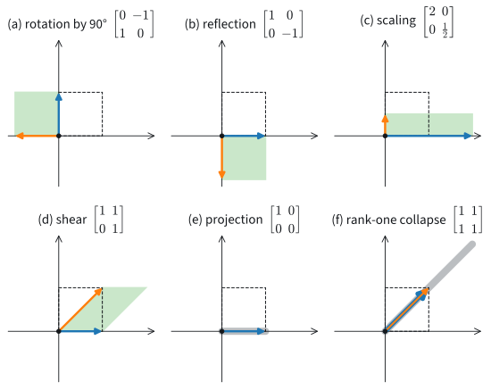
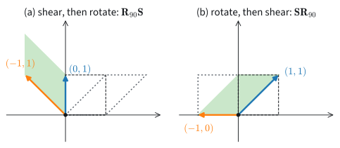
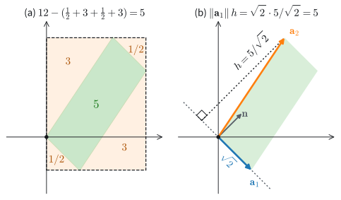

# Matrices as Linear Maps
:label:`sec_mdl-linear-maps`

In :numref:`sec_mdl-geometry-linear-algebraic-ops` we read
$\mathbf{A}\mathbf{x}$ by rows: entry $i$ is the dot product of row $i$ with
$\mathbf{x}$, one hyperplane test per output. That reading says what a matrix
computes for one input. It does not say what the matrix does to all inputs at
once, and in particular whether its effect can be undone.

The question arises as soon as a layer is narrower than its input. A fully
connected layer from the 784 pixels of a Fashion-MNIST image to 256 features
is a $256 \times 784$ matrix. Its output holds fewer numbers than its input.
By a count we make precise below, it sends at least $784 - 256 = 528$
independent input directions to zero, so different images produce the same
features before any nonlinearity sees them. A square matrix may or may not
lose information. The running matrix of this chapter,
$\mathbf{A} = \left(\begin{smallmatrix}1 & 2\\ -1 & 3\end{smallmatrix}\right)$,
sends the vector $(2, -1)$ to $(0, -5)$, and another matrix sends $(0, -5)$
back to $(2, -1)$. That matrix undoes $\mathbf{A}$ on every input, so
$\mathbf{A}$ loses nothing. The matrix
$\mathbf{B} = \left(\begin{smallmatrix}2 & 1\\ 4 & 2\end{smallmatrix}\right)$
sends both $(1, 1)$ and $(0, 3)$ to $(3, 6)$. Seeing the output $(3, 6)$, we
cannot tell which of the two inputs we started from, so no matrix can bring
it back.

Whether a map can be undone decides whether a layer discards information,
whether a linear system has one solution or many, and, through the determinant,
how a probability density changes under a change of variables
(:numref:`subsec_mdl-change-of-variables`). We answer the question by reading a
matrix through its columns. Column $j$ is the image of the $j$-th coordinate
axis, and these images determine the whole map. The number of linearly
independent columns, the *rank*, tells how many input dimensions survive. The
signed volume of the image of the unit cube, the *determinant*, tells in one
number whether any dimension is lost. We work first in two dimensions, where
every statement is a picture, and then in $n$ dimensions.

Three results carry the section: rank--nullity, the equivalence of independent
columns and invertibility for a square matrix, and the multiplicativity of the
determinant. The construction of the determinant in $n$ dimensions
(:numref:`subsec_mdl-determinant-general`) is the most technical part and can
be skimmed on a first reading.

```{.python .input #mdl-linear-maps-matrices-as-linear-maps}
#@tab mxnet
import numpy as np
```

```{.python .input #mdl-linear-maps-matrices-as-linear-maps}
#@tab pytorch
import numpy as np
```

```{.python .input #mdl-linear-maps-matrices-as-linear-maps}
#@tab tensorflow
import numpy as np
```

```{.python .input #mdl-linear-maps-matrices-as-linear-maps}
#@tab jax
import numpy as np
```

## Linear Maps

### Columns as Images of the Axes
:label:`subsec_mdl-column-view`

A matrix acts on infinitely many inputs, yet it is a finite table of numbers.
To see how the table determines every output, take a $2 \times 2$ matrix
$\mathbf{A}$ with entries $a, b, c, d$ and apply it to $\mathbf{x} = (x, y)$.
Collecting the terms that multiply $x$ and those that multiply $y$ gives

$$
\mathbf{A}\mathbf{x} = \begin{bmatrix}a & b \\ c & d\end{bmatrix}\begin{bmatrix}x \\ y\end{bmatrix}
 = \begin{bmatrix}ax+by\\ cx+dy\end{bmatrix}
 = x\begin{bmatrix}a \\ c\end{bmatrix} + y\begin{bmatrix}b \\d\end{bmatrix}
 = x\,\mathbf{A}\mathbf{e}_1 + y\,\mathbf{A}\mathbf{e}_2.
$$

So $\mathbf{A}\mathbf{x}$ is a weighted sum of the two columns of
$\mathbf{A}$, with the entries of $\mathbf{x}$ as weights, and the columns
are the images of the standard basis vectors $\mathbf{e}_1 = (1, 0)$ and
$\mathbf{e}_2 = (0, 1)$. The images of two vectors fix the image of every
vector.

For the running matrix ($a = 1$, $b = 2$, $c = -1$, $d = 3$) the axes go to
$\mathbf{A}\mathbf{e}_1 = (1, -1)$ and $\mathbf{A}\mathbf{e}_2 = (2, 3)$. The
input $\mathbf{v} = (2, -1)$ is $2\mathbf{e}_1 - \mathbf{e}_2$, so its image
is the same combination of the columns,

$$
\mathbf{A}\mathbf{v} = 2\,(1, -1) - (2, 3) = (0, -5).
$$

The row view gives the same numbers: $(1, 2)\cdot(2, -1) = 0$ and
$(-1, 3)\cdot(2, -1) = -5$. Both readings compute the same product. This
section uses the columns, because they show where the map sends the whole
plane. :numref:`fig_mdl-la-linear-map` draws it: the unit square spanned by
$\mathbf{e}_1$ and $\mathbf{e}_2$ goes to the parallelogram spanned by the two
columns, and the grid point $\mathbf{v}$ goes to the grid point
$\mathbf{A}\mathbf{v}$ of the image grid.

![The running matrix $\mathbf{A} = \left(\begin{smallmatrix}1 & 2\\ -1 & 3\end{smallmatrix}\right)$ acting on the plane. (a) The input grid, the shaded unit square, the basis vectors and the input $\mathbf{v} = (2, -1)$. (b) Its image: $\mathbf{e}_1$ goes to $(1, -1)$, $\mathbf{e}_2$ to $(2, 3)$, and $\mathbf{v}$ to $(0, -5)$. The grid is carried along: lines stay lines, the origin stays put, and equally spaced points stay equally spaced. The shaded square goes to the shaded parallelogram, whose area is the subject of the determinant. Panel (b) is drawn at one third the scale of (a).](../img/mdl-la-linear-map.svg)
:label:`fig_mdl-la-linear-map`

The cell below defines $\mathbf{A}$ and $\mathbf{v}$, which the code of this
section reuses, and applies the matrix to $\mathbf{e}_1$, $\mathbf{e}_2$ and
$\mathbf{v}$.

```{.python .input #mdl-linear-maps-columns-as-images-of-the-axes}
A = np.array([[1.0, 2.0], [-1.0, 3.0]])
e1, e2 = np.eye(2)
v = np.array([2.0, -1.0])
A @ e1, A @ e2, A @ v
```

The first two outputs are the columns of $\mathbf{A}$.

The same holds for every size. An $m \times n$ matrix takes vectors with $n$
entries to vectors with $m$ entries, so it is a map from $\mathbb{R}^n$ to
$\mathbb{R}^m$, and this map is *linear*:

$$
\mathbf{A}(\alpha\mathbf{x} + \beta\mathbf{y}) = \alpha\,\mathbf{A}\mathbf{x} + \beta\,\mathbf{A}\mathbf{y}
\quad \textrm{for all } \mathbf{x}, \mathbf{y} \in \mathbb{R}^n \textrm{ and } \alpha, \beta \in \mathbb{R}.
$$

In words, the image of a weighted sum is the same weighted sum of the images.
Writing $\mathbf{x} = \sum_j x_j \mathbf{e}_j$ gives
$\mathbf{A}\mathbf{x} = \sum_j x_j\,\mathbf{A}\mathbf{e}_j$, and multiplying
by the column vector $\mathbf{e}_j$ selects column $j$. Conversely, every map
$f : \mathbb{R}^n \to \mathbb{R}^m$ with this linearity property is given by a
matrix, the one whose column $j$ is $f(\mathbf{e}_j)$, because
$f(\mathbf{x}) = f(\sum_j x_j\mathbf{e}_j) = \sum_j x_j f(\mathbf{e}_j)$.
Linear maps from $\mathbb{R}^n$ to $\mathbb{R}^m$ and $m \times n$ matrices
are therefore the same objects.

Linearity also keeps the grid of :numref:`fig_mdl-la-linear-map` a grid. The
points $\mathbf{p} + t\mathbf{u}$ of a line go to
$\mathbf{A}\mathbf{p} + t\,\mathbf{A}\mathbf{u}$, again a line (or a single
point, when $\mathbf{A}\mathbf{u} = \mathbf{0}$), and
$\mathbf{A}\mathbf{0} = \mathbf{0}$.

Nothing requires the matrix to be square. A $2 \times 3$ matrix sends
$\mathbb{R}^3$ into the span of its three columns, which fills the whole output
plane only when two of the columns are linearly independent. A $3 \times 2$
matrix sends the plane into $\mathbb{R}^3$, and its outputs form a plane
through the origin, a line, or the origin alone, depending on its two columns.
Every fully connected layer of a neural network is such a map between spaces of
different dimensions, followed by a nonlinearity.

The gallery of :numref:`fig_mdl-la-map-gallery` shows six matrices acting on
the plane, each as the image of the unit square, with the two columns drawn.
The rotation by $90^\circ$ sends $\mathbf{e}_1$ to $\mathbf{e}_2$ and
$\mathbf{e}_2$ to $-\mathbf{e}_1$, so its columns are $(0, 1)$ and $(-1, 0)$.
The shear keeps $\mathbf{e}_1$ fixed and tilts $\mathbf{e}_2$ to $(1, 1)$, so
it slides each horizontal line sideways by its height. The last two panels lose
a dimension: the whole square, and with it the whole plane, lands on a line.


:label:`fig_mdl-la-map-gallery`

A matrix records where the axes go. One familiar operation is not of
this kind: the translation $\mathbf{x} \mapsto \mathbf{x} + \mathbf{c}$ with
$\mathbf{c} \neq \mathbf{0}$ moves the origin, so it is not linear. A layer
$\mathbf{W}\mathbf{x} + \mathbf{b}$ is a linear map followed by such a shift.

### Composition
:label:`subsec_mdl-composition`

Two linear layers in a row, with no nonlinearity between them, form a single
map. Which matrix represents it? Take the rotation by $90^\circ$ and the
shear of :numref:`fig_mdl-la-map-gallery`,

$$
\mathbf{R}_{90} = \begin{bmatrix}0 & -1\\ 1 & 0\end{bmatrix},
\qquad
\mathbf{S} = \begin{bmatrix}1 & 1\\ 0 & 1\end{bmatrix}.
$$

Shearing first sends $\mathbf{e}_1$ to $(1, 0)$, and rotating that gives
$(0, 1)$; shearing sends $\mathbf{e}_2$ to $(1, 1)$, and rotating that gives
$(-1, 1)$. The composite map "shear, then rotate" therefore has the columns
$(0, 1)$ and $(-1, 1)$. In the other order, rotating sends $\mathbf{e}_1$ to
$(0, 1)$, which the shear moves to $(1, 1)$, and $\mathbf{e}_2$ to $(-1, 0)$,
which the shear leaves alone. The two composites are

$$
\textrm{shear, then rotate: }\begin{bmatrix}0 & -1\\ 1 & 1\end{bmatrix},
\qquad
\textrm{rotate, then shear: }\begin{bmatrix}1 & -1\\ 1 & 0\end{bmatrix}.
$$

The two orders give different maps, as :numref:`fig_mdl-la-composition`
shows.


:label:`fig_mdl-la-composition`

The matrix product computes such composites. For any two matrices
$\mathbf{A}$ and $\mathbf{B}$ whose sizes fit, apply $\mathbf{B}$ to
$\mathbf{v}$, then $\mathbf{A}$ to the result, and write out entry $i$:

$$
\bigl(\mathbf{A}(\mathbf{B}\mathbf{v})\bigr)_i
 = \sum_j a_{ij} (\mathbf{B}\mathbf{v})_j
 = \sum_j \sum_k a_{ij} b_{jk} v_k
 = \sum_k \Bigl(\sum_j a_{ij} b_{jk}\Bigr) v_k
 = \bigl((\mathbf{A}\mathbf{B})\mathbf{v}\bigr)_i.
$$
:eqlabel:`eq_mdl-composition`

Applying the two maps in turn is the same as applying the single matrix
$\mathbf{A}\mathbf{B}$, whose entry $(i, k)$ is row $i$ of $\mathbf{A}$ times
column $k$ of $\mathbf{B}$. The product $\mathbf{A}\mathbf{B}$ means
"$\mathbf{B}$ first, then $\mathbf{A}$", read from right to left like
$f(g(x))$. Taking $\mathbf{v} = \mathbf{e}_j$ in
:eqref:`eq_mdl-composition` shows that column $j$ of $\mathbf{A}\mathbf{B}$
is $\mathbf{A}\mathbf{b}_j$, the image under $\mathbf{A}$ of column $j$ of
$\mathbf{B}$. We use this fact for the determinant.

Composition explains the multiplication rule. The product is row-times-column
because that is what the composite of two linear maps computes. It is
associative,
$(\mathbf{A}\mathbf{B})\mathbf{C} = \mathbf{A}(\mathbf{B}\mathbf{C})$, because
composing functions is associative: both sides apply $\mathbf{C}$, then
$\mathbf{B}$, then $\mathbf{A}$. And it is not commutative, because composing
two functions in the other order generally gives another function. In code the
product is the operator `@`, and for the shear and the rotation it returns the
two composites that we found by following the axes.

```{.python .input #mdl-linear-maps-composition}
R90 = np.array([[0.0, -1.0], [1.0, 0.0]])  # rotation by 90 degrees
S = np.array([[1.0, 1.0], [0.0, 1.0]])     # shear
print(R90 @ S)
print(S @ R90)
(R90 @ S) @ e1, (S @ R90) @ e1
```

Some pairs of matrices do commute. Two rotations of the plane commute, since
rotating by $\phi$ and then by $\psi$ rotates by $\phi + \psi$ in either order. Two diagonal matrices
commute, since each scales the axes independently. Exercise
:exref:`ex_mdl-linear-maps-commute-rotation` finds every matrix that commutes
with $\mathbf{R}_{90}$.

### Orthogonal Matrices
:label:`subsec_mdl-orthogonal-matrices`

Some maps move space rigidly: every length and every angle comes out unchanged.
Which matrices do this? The rotation by an angle $\phi$ sends $\mathbf{e}_1$ to
$(\cos\phi, \sin\phi)$ and $\mathbf{e}_2$ to $(-\sin\phi, \cos\phi)$, so its
matrix is

$$
\mathbf{R}_\phi = \begin{bmatrix}\cos\phi & -\sin\phi\\ \sin\phi & \cos\phi\end{bmatrix}.
$$

Its columns have length $\sqrt{\cos^2\phi + \sin^2\phi} = 1$ and dot product
$-\cos\phi\sin\phi + \sin\phi\cos\phi = 0$. They are orthonormal, which
:numref:`sec_mdl-geometry-linear-algebraic-ops` wrote as
$\mathbf{R}_\phi^\top\mathbf{R}_\phi = \mathbf{I}$. With $\phi = 90^\circ$ we
get $\mathbf{R}_{90}$, which sends $(3, 2)$ to $(-2, 3)$; both have length
$\sqrt{13}$. The reflection $\operatorname{diag}(1, -1)$ in the $x$-axis
has orthonormal columns as well.

A square matrix $\mathbf{Q}$ is *orthogonal* when its columns are
orthonormal,

$$
\mathbf{Q}^\top\mathbf{Q} = \mathbf{I}.
$$

Columns that are only perpendicular are not enough:
$\operatorname{diag}(1, 10)$ has perpendicular columns of lengths $1$ and $10$,
and it changes the angle between $(1, 1)$ and $(1, -1)$ from $90^\circ$ to
$\arccos(-99/101) \approx 169^\circ$
(:exref:`ex_mdl-geometry-linear-algebraic-ops-angle-preserving`). The name is
also reserved for the square case. A rectangular $n \times k$ matrix with
orthonormal columns, $k < n$, preserves lengths, but it maps $\mathbb{R}^k$
into the larger space $\mathbb{R}^n$ and has no two-sided inverse
(:numref:`subsec_mdl-inverses`).

An orthogonal map preserves every dot product,

$$
(\mathbf{Q}\mathbf{x})\cdot(\mathbf{Q}\mathbf{y})
 = (\mathbf{Q}\mathbf{x})^\top(\mathbf{Q}\mathbf{y})
 = \mathbf{x}^\top\mathbf{Q}^\top\mathbf{Q}\,\mathbf{y}
 = \mathbf{x}^\top\mathbf{y}
 = \mathbf{x}\cdot\mathbf{y}.
$$

Taking $\mathbf{y} = \mathbf{x}$ shows
$\|\mathbf{Q}\mathbf{x}\| = \|\mathbf{x}\|$, and since the angle between two
vectors is computed from their dot product and their lengths, angles are
preserved too. Rotating every embedding by the same orthogonal matrix therefore
leaves all their cosine similarities unchanged. The cell checks this for
$\mathbf{R}_{90}$ with $\mathbf{x} = (3, 2)$ and $\mathbf{y} = (1, 0)$, whose
dot product is $3$, and applies the test
$\mathbf{Q}^\top\mathbf{Q} = \mathbf{I}$ to the rotation and to the reflection
`F`.

```{.python .input #mdl-linear-maps-orthogonal-matrices}
x, y = np.array([3.0, 2.0]), np.array([1.0, 0.0])
F = np.diag([1.0, -1.0])                   # reflection in the x-axis
print(np.allclose(R90.T @ R90, np.eye(2)), np.allclose(F.T @ F, np.eye(2)))
print(R90 @ x, np.linalg.norm(R90 @ x), np.linalg.norm(x))
(R90 @ x) @ (R90 @ y), x @ y
```

The condition $\mathbf{Q}^\top\mathbf{Q} = \mathbf{I}$ says that
$\mathbf{Q}^\top$ undoes $\mathbf{Q}$ when applied after it. For a square
$\mathbf{Q}$, it also undoes $\mathbf{Q}$ when applied before it,
$\mathbf{Q}\mathbf{Q}^\top = \mathbf{I}$, so that the rows are orthonormal too
and $\mathbf{Q}^{-1} = \mathbf{Q}^\top$. The definition does not make this
obvious. It is a corollary of the statement about square matrices that we prove
in :numref:`subsec_mdl-inverses`.

In the plane, rotations and reflections are the only orthogonal matrices. The
first column of an orthogonal $2 \times 2$ matrix is a unit vector
$(\cos\phi, \sin\phi)$, and the second is one of the two unit vectors
perpendicular to it, $\pm(-\sin\phi, \cos\phi)$. The plus sign gives the
rotation $\mathbf{R}_\phi$. The minus sign gives
$\mathbf{R}_\phi\operatorname{diag}(1, -1)$, the reflection in the $x$-axis
followed by a rotation, which is a reflection in a line through the origin. The
determinant will tell the two kinds apart by its sign
(:numref:`subsec_mdl-multiplicativity`).

## Rank and Invertibility

### Column Space and Null Space
:label:`subsec_mdl-column-null-space`

Which outputs can a matrix produce, and which inputs does it erase? The
matrix

$$
\mathbf{B} = \begin{bmatrix} 2 & 1 \\ 4 & 2 \end{bmatrix}
$$

has the columns $\mathbf{b}_1 = (2, 4)$ and $\mathbf{b}_2 = (1, 2)$, and
$\mathbf{b}_1 = 2\mathbf{b}_2$. Every output is a combination of the
columns, and such a combination collapses to a multiple of one column,

$$
a_1\mathbf{b}_1 + a_2\mathbf{b}_2 = (2a_1 + a_2)\,\mathbf{b}_2.
$$

All outputs of $\mathbf{B}$ therefore lie on the line through $(1, 2)$, the
line $y = 2x$. Distinct inputs collide on that line:
$\mathbf{B}(1, 1) = (3, 6)$ and $\mathbf{B}(0, 3) = (3, 6)$. By linearity their
difference $(1, -2)$ goes to the difference of the outputs,
$\mathbf{B}(1, -2) = \mathbf{0}$. The row view shows why: both rows, $(2, 1)$
and $(4, 2)$, are perpendicular to $(1, -2)$, so both hyperplane tests return
zero. :numref:`fig_mdl-la-null-collapse` shows the two lines, and the cell
after it the three products.

![The matrix $\mathbf{B} = \left(\begin{smallmatrix}2 & 1\\ 4 & 2\end{smallmatrix}\right)$ collapsing the plane. (a) The input plane, with the null-space line through $(1, -2)$ dashed and perpendicular to the row direction $(2, 1)$, and three marked inputs: $\mathbf{x}_1 = (1, 1)$, $\mathbf{x}_2 = (0, 3)$, and $\mathbf{x}_3 = (1, -2)$ on the null-space line. (b) The image plane, at the same scale: every output lies on the column space, the line $y = 2x$ spanned by the columns $\mathbf{b}_1$ and $\mathbf{b}_2$; $\mathbf{x}_1$ and $\mathbf{x}_2$ land on the same point $(3, 6)$, and $\mathbf{x}_3$ lands on the origin. Because distinct inputs have the same image, no inverse exists.](../img/mdl-la-null-collapse.svg)
:label:`fig_mdl-la-null-collapse`

```{.python .input #mdl-linear-maps-column-space-and-null-space}
B = np.array([[2.0, 1.0], [4.0, 2.0]])
B @ np.array([1.0, 1.0]), B @ np.array([0.0, 3.0]), B @ np.array([1.0, -2.0])
```

Two subspaces attach to every $m \times n$ matrix $\mathbf{A}$. The *column
space* $\operatorname{col}\mathbf{A}$ is the span of the columns. Since
$\mathbf{A}\mathbf{x}$ is the combination of the columns with weights
$x_1, \ldots, x_n$, the column space is the set of all outputs. The *null
space*, also called the *kernel* and written $\ker\mathbf{A}$, is the set of
inputs sent to zero,

$$
\ker\mathbf{A} = \{\mathbf{x} \in \mathbb{R}^n : \mathbf{A}\mathbf{x} = \mathbf{0}\}.
$$

It is a subspace: if
$\mathbf{A}\mathbf{x} = \mathbf{A}\mathbf{y} = \mathbf{0}$, then
$\mathbf{A}(\alpha\mathbf{x} + \beta\mathbf{y}) = \alpha\mathbf{A}\mathbf{x} +
\beta\mathbf{A}\mathbf{y} =
\mathbf{0}$. For $\mathbf{B}$ the column space is the line $y =
2x$ and the null space is the line through $(1, -2)$. The null space is a line
of inputs and the column space a line of outputs; that both are lines in
$\mathbb{R}^2$ is an accident of the square shape.

Three general facts follow the example.

1. *The null space consists of the inputs perpendicular to every row.* This
   is the row view: $(\mathbf{A}\mathbf{x})_i$ is the dot product of row $i$
   with $\mathbf{x}$, and all of these vanish if and only if $\mathbf{x}$ is
   perpendicular to all rows.
2. *The columns are linearly dependent if and only if the null space contains
   a nonzero vector.* A dependence
   $\sum_j x_j\mathbf{a}_j = \mathbf{0}$ among the columns $\mathbf{a}_j$ of
   $\mathbf{A}$, with coefficients not all zero, says
   $\mathbf{A}\mathbf{x} = \mathbf{0}$, so its coefficients
   form a nonzero null vector, and the converse reads the same equation
   backwards. For $\mathbf{B}$, the dependence
   $\mathbf{b}_1 - 2\mathbf{b}_2 = \mathbf{0}$ has the coefficients
   $(1, -2)$.
3. *Two inputs have the same output if and only if they differ by a null
   vector,* because $\mathbf{A}\mathbf{x} = \mathbf{A}\mathbf{y}$ means
   $\mathbf{A}(\mathbf{x} - \mathbf{y}) = \mathbf{0}$. The inputs that
   $\mathbf{B}$ sends to $(3, 6)$ form the line $(1, 1) + t(1, -2)$, which
   contains $(0, 3)$ at $t = -1$. A nonzero null vector therefore means that
   no inverse can exist.

### Rank
:label:`subsec_mdl-rank`

How many input dimensions survive the map? The *rank* of a matrix is the
dimension of its column space, equivalently the largest number of linearly
independent columns:

$$
\operatorname{rank}\mathbf{A} = \dim\operatorname{col}\mathbf{A}.
$$

The matrix $\mathbf{B}$ has rank one: its two columns are dependent, and each
column is nonzero. As a larger example, consider

$$
\mathbf{C} = \begin{bmatrix}
1& 3 & 0 & -1 & 0 \\
-1 & 0 & 1 & 1 & -1 \\
0 & 3 & 1 & 0 & -1 \\
2 & 3 & -1 & -2 & 1
\end{bmatrix},
$$

which has rank two: the first two columns are linearly independent, while
each of the $\binom{5}{3} = 10$ collections of three columns is linearly
dependent (:exref:`ex_mdl-geometry-linear-algebraic-ops-rank-of-c`).

The dimensions that survive and the dimensions sent to zero add up to the
number of input dimensions.

**Proposition (rank--nullity).** *For an $m \times n$ matrix $\mathbf{A}$,*

$$
\operatorname{rank}\mathbf{A} + \dim\ker\mathbf{A} = n.
$$
:eqlabel:`eq_mdl-rank-nullity`

**Proof.** Choose a basis $\mathbf{w}_1, \ldots, \mathbf{w}_k$ of the null
space and extend it to a basis $\mathbf{w}_1, \ldots, \mathbf{w}_k,
\mathbf{u}_1, \ldots, \mathbf{u}_{n-k}$ of $\mathbb{R}^n$. (That an independent
list extends to a basis is, like the equal size of all bases, a fact we use
without proof.) The images
$\mathbf{A}\mathbf{u}_1, \ldots, \mathbf{A}\mathbf{u}_{n-k}$ span the column
space, since every input is a combination of the basis vectors and the
$\mathbf{w}_i$ contribute nothing. They are also independent: if
$\sum_i c_i \mathbf{A}\mathbf{u}_i = \mathbf{0}$, then
$\sum_i c_i \mathbf{u}_i$ lies in the null space, hence is a combination of the
$\mathbf{w}_j$, which is impossible within a basis unless every $c_i = 0$. So
the column space has dimension $n - k$. $\blacksquare$

For $\mathbf{B}$ the count is $1 + 1 = 2$. For the $256 \times 784$ layer of
the introduction, the rank is at most $256$, the number of output coordinates,
so the null space has dimension at least $784 - 256 = 528$. For $\mathbf{C}$
the null space must have dimension $5 - 2 = 3$, so three independent null
vectors are a basis of it. The cell tests the candidates $(3, -1, 3, 0, 0)$,
$(1, 0, 0, 1, 0)$ and $(0, 0, 1, 0, 1)$: it multiplies them by $\mathbf{C}$ and
computes the rank of the matrix `Z` that holds them as columns.

```{.python .input #mdl-linear-maps-rank}
C = np.array([[1, 3, 0, -1, 0], [-1, 0, 1, 1, -1],
              [0, 3, 1, 0, -1], [2, 3, -1, -2, 1]], dtype=float)
Z = np.array([[3, -1, 3, 0, 0], [1, 0, 0, 1, 0],
              [0, 0, 1, 0, 1]], dtype=float).T   # candidate null vectors
rank_C, rank_Z = np.linalg.matrix_rank(C), np.linalg.matrix_rank(Z)
np.linalg.matrix_rank(B), rank_C, np.abs(C @ Z).max(), rank_Z, rank_C + rank_Z
```

The ranks of $\mathbf{B}$ and $\mathbf{C}$ are $1$ and $2$, and the three
candidates are sent to zero and are independent (rank $3$).

The same matrix can be read by rows. Its *row rank*, the largest number of
linearly independent rows, counts the independent hyperplane tests the matrix
performs. For $\mathbf{C}$, row 3 is row 1 plus row 2 and row 4 is row 1 minus
row 2, so the row rank is two, the same as the rank. This is no coincidence.

**Proposition (row rank equals column rank).** *For every matrix
$\mathbf{A}$, the largest number of linearly independent rows equals the
largest number of linearly independent columns.*

**Proof.** Let $r = \operatorname{rank}\mathbf{A}$ and put a basis of
$\operatorname{col}\mathbf{A}$ into the columns of an $m \times r$ matrix
$\mathbf{G}$. We factor $\mathbf{A}$ through this basis. Every column of
$\mathbf{A}$ is a combination of the columns of $\mathbf{G}$, and writing the
coefficients for column $j$ into column $j$ of an $r \times n$ matrix
$\mathbf{H}$ gives

$$
\mathbf{A} = \mathbf{G}\mathbf{H}.
$$
:eqlabel:`eq_mdl-row-rank`

Now read the same product by rows. Row $i$ of $\mathbf{A}$ is
$\sum_k g_{ik}\,(\textrm{row } k \textrm{ of } \mathbf{H})$, so all rows of
$\mathbf{A}$ lie in the span of the $r$ rows of $\mathbf{H}$, and the row rank
is at most $r$. Applying the same argument to $\mathbf{A}^\top$, whose columns
are the rows of $\mathbf{A}$, shows that the column rank is at most the row
rank. $\blacksquare$

The factorization says that a matrix of rank $r$ first computes $r$ numbers
from its input (the map $\mathbf{H}$) and then spreads them over the $m$
outputs (the map $\mathbf{G}$). With $r$ far below $m$ and $n$ it stores $r(m +
n)$ numbers in place of $mn$, the idea behind the low-rank updates of
:numref:`subsec_mdl-low-rank-updates`.

Finding the rank by checking subsets of columns takes exponentially long. By
hand one uses Gaussian elimination, which this chapter does not teach. The
routine `np.linalg.matrix_rank` instead counts the *singular values*
(:numref:`sec_mdl-svd-low-rank`) that exceed a small threshold. It needs a
threshold because rank is not a continuous function of the entries
(:numref:`subsec_mdl-det-limits`).

### Inverses
:label:`subsec_mdl-inverses`

Given an output $\mathbf{A}\mathbf{x}$, can we recover the input
$\mathbf{x}$? An *inverse* of a square matrix $\mathbf{A}$ is a matrix
$\mathbf{A}^{-1}$ that undoes it from both sides,

$$
\mathbf{A}^{-1}\mathbf{A} = \mathbf{A}\mathbf{A}^{-1} = \mathbf{I},
$$

so that $\mathbf{x} = \mathbf{A}^{-1}(\mathbf{A}\mathbf{x})$. For a
$2 \times 2$ matrix with entries $a, b, c, d$ and $ad - bc \neq 0$, the inverse
is

$$
\mathbf{A}^{-1} = \frac{1}{ad - bc}\begin{bmatrix} d & -b \\ -c & a \end{bmatrix}.
$$
:eqlabel:`eq_mdl-inverse-2x2`

Multiplying out confirms the formula: the matrix
$\left(\begin{smallmatrix}d & -b\\ -c & a\end{smallmatrix}\right)$ times
$\mathbf{A}$, in either order, is $(ad - bc)\,\mathbf{I}$, and dividing by
$ad - bc$ leaves $\mathbf{I}$. The hypothesis cannot be dropped. If
$ad - bc = 0$, the product is the zero matrix, and multiplying it by an
inverse of $\mathbf{A}$ would give
$\left(\begin{smallmatrix}d & -b\\ -c & a\end{smallmatrix}\right) =
\mathbf{0}$, that is, $\mathbf{A} = \mathbf{0}$, which has no inverse. The
number $ad - bc$ returns as an area in
:numref:`subsec_mdl-parallelogram-area`. For the
running matrix, $ad - bc = 3 + 2 = 5$, and

$$
\mathbf{A}^{-1} = \frac{1}{5}\begin{bmatrix} 3 & -2 \\ 1 & 1 \end{bmatrix},
\qquad
\mathbf{A}^{-1}(0, -5) = \tfrac15\,(10, -5) = (2, -1).
$$

The inverse undoes the worked example of :numref:`subsec_mdl-column-view`. The
cell builds `A_inv` from the formula, since later cells need it, and recovers
$\mathbf{v}$ from $\mathbf{A}\mathbf{v}$ twice, with `A_inv` and with the
library solver.

```{.python .input #geometry-linear-algebraic-ops-invertibility}
a, b, c, d = A.ravel()
A_inv = np.array([[d, -b], [-c, a]]) / (a * d - b * c)
print(A_inv)
np.allclose(A_inv @ A, np.eye(2)), A_inv @ (A @ v), np.linalg.solve(A, A @ v)
```

Both routes return $(2, -1)$.

A left inverse and a right inverse of the same matrix always agree, so the
inverse is unique. If $\mathbf{L}\mathbf{A} = \mathbf{I}$ and
$\mathbf{A}\mathbf{X} = \mathbf{I}$, then

$$
\mathbf{L} = \mathbf{L}(\mathbf{A}\mathbf{X}) = (\mathbf{L}\mathbf{A})\mathbf{X} = \mathbf{X},
$$

with associativity in the middle step.

When does an inverse exist? For a square matrix the answer needs only the null
space and rank--nullity, and the rest of the chapter uses it more than any
other result of this section.

**Proposition (invertible matrices).** *For an $n \times n$ matrix
$\mathbf{A}$, the following are equivalent:*
(i) *$\mathbf{A}$ is invertible;*
(ii) *the columns of $\mathbf{A}$ are linearly independent;*
(iii) *$\ker\mathbf{A} = \{\mathbf{0}\}$;*
(iv) *$\operatorname{rank}\mathbf{A} = n$.*

**Proof.** Statements (ii) and (iii) are equivalent by fact 2 of
:numref:`subsec_mdl-column-null-space`, and (iii) and (iv) by rank--nullity.
If $\mathbf{A}$ is invertible and $\mathbf{A}\mathbf{x} = \mathbf{0}$, then
$\mathbf{x} = \mathbf{A}^{-1}\mathbf{A}\mathbf{x} = \mathbf{0}$, so (i)
implies (iii). The converse takes more work, because the inverse has to be
built. By (iv) the column space is an $n$-dimensional subspace of
$\mathbb{R}^n$. Such a subspace is all of $\mathbb{R}^n$: a vector outside
it, appended to its basis, would give $n + 1$ independent vectors, and their
extension to a basis of $\mathbb{R}^n$ would have more than $n$ elements. So
every target is hit. By (iii) and fact 3, no two inputs collide. Let column
$j$ of a matrix $\mathbf{X}$ be the unique solution of $\mathbf{A}\mathbf{x} =
\mathbf{e}_j$. Then $\mathbf{A}\mathbf{X} = \mathbf{I}$ by construction. For
any $\mathbf{x}$, $\mathbf{A}(\mathbf{X}\mathbf{A}\mathbf{x}) =
(\mathbf{A}\mathbf{X})\mathbf{A}\mathbf{x} = \mathbf{A}\mathbf{x}$, and since
no two inputs collide, $\mathbf{X}\mathbf{A}\mathbf{x} = \mathbf{x}$. So
$\mathbf{X}\mathbf{A} = \mathbf{I}$ as well, and $\mathbf{X} =
\mathbf{A}^{-1}$. $\blacksquare$

The claim left open in :numref:`subsec_mdl-orthogonal-matrices` follows. If
$\mathbf{Q}\mathbf{c} = \mathbf{0}$, then
$\mathbf{c} = \mathbf{Q}^\top\mathbf{Q}\mathbf{c} = \mathbf{0}$, so an
orthogonal $\mathbf{Q}$ is invertible. Its left inverse $\mathbf{Q}^\top$ is
then its inverse, and $\mathbf{Q}\mathbf{Q}^\top = \mathbf{I}$.

A square matrix without an inverse is called *singular*; $\mathbf{B}$ is one. A
matrix that is not square has no two-sided inverse at all. The rank of an
$m \times n$ matrix is at most $\min(m, n)$. If $m > n$, the column space has
dimension at most $n < m$, so the matrix is not *onto*: some targets in
$\mathbb{R}^m$ are never hit. If $n > m$, rank--nullity leaves a null space of
dimension at least $n - m > 0$, so the matrix is not *one-to-one*: some
distinct inputs give the same output. The inverse runs the map backwards, and
it exists when no two inputs collide and every target is hit. For a square
matrix, the proposition says that either condition implies the other.

### Solving Linear Systems in Practice
:label:`subsec_mdl-numerical-issues`

The inverse is a tool for reasoning, and in practice we rarely compute it. To
solve $\mathbf{A}\mathbf{x} = \mathbf{b}$, prefer `np.linalg.solve(A, b)` to
`np.linalg.inv(A) @ b`. One reason is cost. `solve` factors
$\mathbf{A}$ once into triangular factors (an *LU factorization*, about
$n^3/3$ multiply--adds) and then solves two triangular systems. Forming the
inverse takes about $n^3$ multiply--adds before the product with $\mathbf{b}$
even starts. The other is accuracy. `solve` is *backward stable*: its answer
is the exact solution of a system whose entries differ from those of
$\mathbf{A}$ and $\mathbf{b}$ only by rounding. Its residual
$\|\mathbf{A}\mathbf{x} - \mathbf{b}\|$ is therefore of the order of machine
precision times $\|\mathbf{A}\|\,\|\mathbf{x}\|$ (with the spectral norm of
:numref:`subsec_lin-algebra-norms`). The product `inv(A) @ b` carries no
such guarantee, and its residual can be larger by a factor up to the
*condition number* $\kappa(\mathbf{A})$, a measure of how close $\mathbf{A}$
is to a singular matrix (:numref:`subsec_mdl-condition-number`).

How close a matrix is to singular is a property of the problem, not of the
method. Both methods can lose up to about $\log_{10}\kappa(\mathbf{A})$ of the
sixteen decimal digits of double precision in the solution itself. This is a
bound for the worst case, not a prediction for a given right-hand side. How
close does an example come to it? The *Hilbert matrix*, with entries
$h_{ij} = 1/(i + j - 1)$, is a classical example of a nearly singular matrix.
We set $\mathbf{x} = \mathbf{1}$, compute the right-hand side
$\mathbf{b} = \mathbf{H}\mathbf{1}$ for the $10 \times 10$ Hilbert matrix
$\mathbf{H}$, and solve for $\mathbf{x}$ again both ways.

```{.python .input #mdl-linear-maps-solving-linear-systems-in-practice}
H = 1 / (np.arange(10)[:, None] + np.arange(10) + 1)   # Hilbert matrix
x_true = np.ones(10)
b = H @ x_true
for x in (np.linalg.solve(H, b), np.linalg.inv(H) @ b):
    print(f'residual {np.linalg.norm(H @ x - b):.1e}, '
          f'error {np.linalg.norm(x - x_true):.1e}')
np.linalg.cond(H)
```

The last output is $\kappa(\mathbf{H}) \approx 1.6 \cdot 10^{13}$, so up to
thirteen digits may be lost. The residual of `solve` is near machine precision,
and that of `inv` is some eleven orders of magnitude larger, within the factor
$\kappa$. A small residual does not mean a good solution, however. Both answers
are wrong after the first few digits: either route loses twelve or more of the
sixteen digits, close to what the bound allows, and in our runs `inv` is the
worse of the two by about an order of magnitude.

Sparse matrices give a further reason to avoid the inverse. A matrix with a
million rows and columns but only five million nonzero entries is cheap to
store, yet its inverse is typically dense, with about $10^{12}$ nonzero
entries.

## The Determinant

### Area of a Parallelogram
:label:`subsec_mdl-parallelogram-area`

By how much does $\mathbf{A}$ scale areas? In
:numref:`fig_mdl-la-linear-map` the unit square, with edges $\mathbf{e}_1$
and $\mathbf{e}_2$ and area one, goes to the parallelogram with edges
$\mathbf{a}_1 = (1, -1)$ and $\mathbf{a}_2 = (2, 3)$ and corners $(0, 0)$,
$(1, -1)$, $(3, 2)$ and $(2, 3)$. The
parallelogram fits in the box $[0, 3] \times [-1, 3]$ of area $12$. The part
of the box outside it consists of four right triangles, with legs $1$ and $1$,
$2$ and $3$, $1$ and $1$, and $2$ and $3$, of total area
$\tfrac12 + 3 + \tfrac12 + 3 = 7$. The parallelogram has area $12 - 7 = 5$
(:numref:`fig_mdl-la-parallelogram-area`, panel (a)). The matrix multiplies
the area of the unit square by five.

![The image of the unit square under $\mathbf{A}$ has area $5$. (a) The bounding box $[0, 3] \times [-1, 3]$, of area $12$, minus four right triangles of total area $7$. (b) Base times height: the base $\mathbf{a}_1 = (1, -1)$ has length $\sqrt{2}$, the unit normal $\mathbf{n} = (1, 1)/\sqrt{2}$ is perpendicular to it, and the height of the corner $\mathbf{a}_2 = (2, 3)$ above the line through $\mathbf{a}_1$ is $\mathbf{a}_2\cdot\mathbf{n} = 5/\sqrt{2}$.](../img/mdl-la-parallelogram-area.svg)
:label:`fig_mdl-la-parallelogram-area`

Counting triangles needs a new picture for every arrangement of the corners.
Base times height works for all of them at once. Let the parallelogram have
the edges $\mathbf{u} = (a, c)$ and $\mathbf{w} = (b, d)$, the two columns of
a $2 \times 2$ matrix with entries $a, b, c, d$. Its base has length
$\|\mathbf{u}\|$. The vector $(-c, a)$ is $\mathbf{u}$ rotated by $90^\circ$,
that is, $\mathbf{R}_{90}\mathbf{u}$, so

$$
\mathbf{n} = \frac{(-c, a)}{\|\mathbf{u}\|}
$$

is a unit vector perpendicular to the base. By
:numref:`sec_mdl-geometry-linear-algebraic-ops`, the component of
$\mathbf{w}$ along a unit vector $\mathbf{n}$ is $\mathbf{w}\cdot\mathbf{n}$.
Here this component is the height of the parallelogram above its base, with a
sign: positive when $\mathbf{w}$ lies on the counter-clockwise side of
$\mathbf{u}$, negative on the clockwise side. Base times signed height is

$$
\|\mathbf{u}\|\,(\mathbf{w}\cdot\mathbf{n})
 = \|\mathbf{u}\|\,\frac{-bc + ad}{\|\mathbf{u}\|}
 = ad - bc.
$$

The lengths cancel, and what remains is a polynomial in the four entries. No
case distinction on signs was needed. For the running matrix,
$\|\mathbf{u}\| = \sqrt{2}$, $\mathbf{n} = (1, 1)/\sqrt{2}$, and
$\mathbf{w}\cdot\mathbf{n} = 5/\sqrt{2}$, so the signed area is $5$, as the
count gave (panel (b)). It is positive because $\mathbf{a}_2$ lies
counter-clockwise from $\mathbf{a}_1$.

The *determinant* of a $2 \times 2$ matrix is this signed area of the image of
the unit square:

$$
\det\begin{bmatrix} a & b \\ c & d \end{bmatrix} = ad - bc.
$$
:eqlabel:`eq_mdl-det-2x2`

Its absolute value is the factor by which the matrix scales area, and its sign
records whether the images of $\mathbf{e}_1$ and $\mathbf{e}_2$ keep their
counter-clockwise order. For $\mathbf{A}$, $1 \cdot 3 - 2 \cdot (-1) = 5$.
Exchanging the two columns of $\mathbf{A}$ gives
$\left(\begin{smallmatrix}2 & 1\\ 3 & -1\end{smallmatrix}\right)$, whose image
is the same parallelogram with its edges in the other order, and the
determinant is $-2 - 3 = -5$. For $\mathbf{B}$ it is
$2 \cdot 2 - 1 \cdot 4 = 0$: the square goes to the segment from $\mathbf{0}$
to $(3, 6)$, which has no area. The library routine `np.linalg.det` returns the
same three values up to rounding in the last digit, printed here after base
times height for $\mathbf{A}$.

```{.python .input #geometry-linear-algebraic-ops-determinant}
u, w = A[:, 0], A[:, 1]
n = np.array([-u[1], u[0]]) / np.linalg.norm(u)   # unit normal to u
(np.linalg.norm(u) * (w @ n), np.linalg.det(A),
 np.linalg.det(A[:, ::-1]), np.linalg.det(B))
```

The three cases are drawn in :numref:`fig_mdl-la-determinant`: a positive
determinant keeps the orientation, a negative one reverses it, and a zero
determinant flattens the square.


:label:`fig_mdl-la-determinant`

Base times height is a formula for the plane. For $n$ columns we need the
volume of a box in $\mathbb{R}^n$.

### The Determinant in General
:label:`subsec_mdl-determinant-general`

What is the signed volume of the box spanned by $n$ vectors in
$\mathbb{R}^n$? Rather than compute volumes in $n$ dimensions directly, we
list three properties of signed volume and let them determine the answer. Stated
for the columns $\mathbf{a}_1, \ldots, \mathbf{a}_n$ of an $n \times n$
matrix, the determinant is

1. **Multilinear**: linear in each column separately, with the other columns
   held fixed. (Scaling one edge of a box scales its volume; splitting one
   edge as a sum splits the volume accordingly.)
2. **Alternating**: zero whenever two columns are equal. (The box then
   flattens into a lower-dimensional slab of zero volume.)
3. **Normalized**: $\det \mathbf{I} = 1$. (The unit cube has volume one.)

The area $ad - bc$ has all three properties: it is linear in $(a, c)$ and in
$(b, d)$, it vanishes when $(a, c) = (b, d)$, and it is $1$ for the identity.
Two consequences follow, a rule for swapping columns and a formula, and the
formula shows that at most one function can have all three properties.

First, **swapping two columns flips the sign of the determinant**. Place the
vector $\mathbf{u}+\mathbf{w}$ in two column slots and expand by
multilinearity:

$$
\begin{aligned}
0 &= \det(\ldots, \mathbf{u}+\mathbf{w}, \ldots, \mathbf{u}+\mathbf{w}, \ldots) \\
  &= \det(\ldots, \mathbf{u}, \ldots, \mathbf{u}, \ldots)
   + \det(\ldots, \mathbf{u}, \ldots, \mathbf{w}, \ldots)
   + \det(\ldots, \mathbf{w}, \ldots, \mathbf{u}, \ldots)
   + \det(\ldots, \mathbf{w}, \ldots, \mathbf{w}, \ldots).
\end{aligned}
$$

The left-hand side, the first term and the last term vanish by the
alternating property, which leaves

$$
\det(\ldots, \mathbf{u}, \ldots, \mathbf{w}, \ldots)
 = -\det(\ldots, \mathbf{w}, \ldots, \mathbf{u}, \ldots).
$$

Exchanging two edges reverses the orientation of the box, as in panel (b) of
:numref:`fig_mdl-la-determinant`.

Second, the three properties pin down a formula. Expand each column in the
standard basis, $\mathbf{a}_j = \sum_i a_{ij}\,\mathbf{e}_i$, and apply
multilinearity column by column. Then $\det\mathbf{A}$ becomes a sum of terms
$a_{i_1 1} a_{i_2 2} \cdots a_{i_n n}\, \det(\mathbf{e}_{i_1}, \ldots,
\mathbf{e}_{i_n})$, one for every choice of a row index in each column.
Whenever two of the chosen row indices coincide, the term vanishes by the
alternating property. When all are distinct, the columns $\mathbf{e}_{i_1},
\ldots, \mathbf{e}_{i_n}$ are those of the identity matrix in another order,
and repeated column swaps turn the factor into $\pm 1$. For a $2 \times 2$
matrix with columns $\mathbf{a}_1 = a\,\mathbf{e}_1 + c\,\mathbf{e}_2$ and
$\mathbf{a}_2 = b\,\mathbf{e}_1 + d\,\mathbf{e}_2$, the expansion has four
terms. The two with a repeated basis vector vanish, and

$$
\det(\mathbf{a}_1, \mathbf{a}_2)
 = ad\,\det(\mathbf{e}_1, \mathbf{e}_2)
 + cb\,\det(\mathbf{e}_2, \mathbf{e}_1)
 = ad - bc,
$$

the area we computed by hand. In general the determinant is a signed sum,
over all ways of picking one entry from each row and each column, of the
product of the picked entries. Writing $\sigma(j)$ for the row picked in
column $j$, this is the *permutation formula*

$$\det\mathbf{A} = \sum_{\sigma} \operatorname{sgn}(\sigma)\, a_{\sigma(1)1}\, a_{\sigma(2)2} \cdots a_{\sigma(n)n},$$
:eqlabel:`eq_mdl-det-permutation`

where $\sigma$ runs over the $n!$ permutations of $\{1, \ldots, n\}$ and
$\operatorname{sgn}(\sigma) = \det(\mathbf{e}_{\sigma(1)}, \ldots,
\mathbf{e}_{\sigma(n)})$ is $+1$ or $-1$ according to whether $\sigma$ is made
of an even or an odd number of swaps. A function with the three properties must
therefore be this one: there is at most one determinant.

That there is one we do not prove in full. The sign is well defined because no
permutation is both an even and an odd number of swaps, a fact we take from
:cite:`Horn.Johnson.2012`. The formula then has the three properties: each term
contains one entry from each column, which gives multilinearity, and for the
identity only one term is nonzero. The alternating property needs the parity
fact once more, and we omit the verification.

The derivation used the normalization only in its last step, which gives a
sharper statement that the next subsection needs. Let $f$ be *any* multilinear
and alternating function of the columns. The swap rule holds for $f$, the
expansion is the same, and each factor
$f(\mathbf{e}_{\sigma(1)}, \ldots, \mathbf{e}_{\sigma(n)})$ equals
$\operatorname{sgn}(\sigma)\,f(\mathbf{I})$. Hence

$$
f(\mathbf{A}) = f(\mathbf{I})\,\det\mathbf{A}.
$$

Every multilinear alternating function of the columns is a multiple of the
determinant.

Grouping the terms of the formula by the row picked in column $1$ gives the
*cofactor expansion* used for hand computation: the entry $a_{i1}$ multiplies
the determinant of the submatrix without row $i$ and column $1$, with the sign
$(-1)^{i+1}$. For the $3 \times 3$ example

$$
\mathbf{M} = \begin{bmatrix}
2 & 1 & 0 \\
1 & 3 & 1 \\
0 & 1 & 2
\end{bmatrix}
$$

it reads

$$
\det \mathbf{M}
 = 2 \det \begin{bmatrix} 3 & 1 \\ 1 & 2 \end{bmatrix}
 - 1 \det \begin{bmatrix} 1 & 0 \\ 1 & 2 \end{bmatrix}
 + 0 \det \begin{bmatrix} 1 & 0 \\ 3 & 1 \end{bmatrix}
 = 2 \cdot 5 - 1 \cdot 2 + 0 = 8.
$$
:eqlabel:`eq_mdl-det-3x3`

So $\mathbf{M}$ maps the unit cube to a box of volume $8$. The cell adds two
cases: $\mathbf{M}$ with two columns swapped, and an upper triangular matrix
with the diagonal $2, 3, 1$.

```{.python .input #mdl-geometry-linear-algebraic-ops-det-3x3}
M = np.array([[2, 1, 0], [1, 3, 1], [0, 1, 2]])
M_swap = M[:, [1, 0, 2]]                         # first two columns swapped
T = np.array([[2, 5, 1], [0, 3, 4], [0, 0, 1]])  # upper triangular
(np.linalg.det(M),       # 8, matching the cofactor expansion
 np.linalg.det(M_swap),  # -8: a column swap flips the sign
 np.linalg.det(T))       # 6 = 2 * 3 * 1, the diagonal product
```

The swap gives $-8$, and the third value is the product of the diagonal
entries. Of all the rules for computing determinants this is the one to
remember. Suppose $\mathbf{T}$ is upper triangular, so $t_{ij} = 0$ whenever
$i > j$. Each term of the permutation formula picks one entry from every
column, all in distinct rows. To be nonzero, the entry picked from column $1$
must come from row $1$, since every lower entry vanishes. The entry from column
$2$ must then come from row $2$, because row $1$ is taken and rows
$3, \ldots, n$ hold zeros. Continuing across the columns, only the diagonal
choice survives, and it needs no swaps, so

$$
\det \mathbf{T} = t_{11} t_{22} \cdots t_{nn}.
$$

The same argument, run from column $n$ backwards, handles lower triangular
matrices, and it extends to blocks. In
$\left(\begin{smallmatrix}\mathbf{T}_1 & *\\ \mathbf{0} &
\mathbf{T}_2\end{smallmatrix}\right)$ with square blocks $\mathbf{T}_1$
and $\mathbf{T}_2$, a nonzero term must pick its entries in the columns of
$\mathbf{T}_1$ from the rows of $\mathbf{T}_1$.
The surviving permutations are pairs, one for each block, the sign of a pair is
the product of the two signs, and the sum factors into
$\det\mathbf{T}_1\,\det\mathbf{T}_2$. Normalizing flows, which need the
logarithm of a Jacobian determinant at every evaluation
(:numref:`subsec_mdl-change-of-variables`), are designed around these two
rules.

Transposing does not change the determinant,
$\det\mathbf{A}^\top = \det\mathbf{A}$. The permutation formula for
$\mathbf{A}^\top$ has the terms
$\operatorname{sgn}(\sigma)\prod_j a_{j\sigma(j)}$. Substituting
$j = \sigma^{-1}(i)$ rewrites the product as $\prod_i a_{\sigma^{-1}(i)\, i}$,
the term of the formula for $\mathbf{A}$ that belongs to $\sigma^{-1}$, and
$\operatorname{sgn}(\sigma^{-1}) = \operatorname{sgn}(\sigma)$, because undoing
a sequence of swaps takes the same number of swaps. The two formulas have the
same terms, so everything the determinant says about columns holds for rows as
well.

The permutation formula has $n!$ terms and is never used beyond tiny sizes.
Libraries factor the matrix into triangular factors, as in `solve`, and
multiply their diagonal entries, with a sign for the row exchanges, at a cost
of about $n^3/3$ multiply--adds.

### Multiplicativity
:label:`subsec_mdl-multiplicativity`

If $\mathbf{B}$ scales areas by $\det\mathbf{B}$ and $\mathbf{A}$ scales them
by $\det\mathbf{A}$, then the composite $\mathbf{A}\mathbf{B}$ should scale
them by the product. For the running matrix, $\mathbf{A}^2 =
\left(\begin{smallmatrix}-1 & 8\\ -4 & 7\end{smallmatrix}\right)$ and
$\det\mathbf{A}^2 = -7 + 32 = 25 = 5^2$. For the composite of
:numref:`subsec_mdl-composition`, $\det(\mathbf{R}_{90}\mathbf{S}) = 0 \cdot
1 - (-1) \cdot 1 = 1$, the product of $\det\mathbf{R}_{90} = 1$ and
$\det\mathbf{S} = 1$.

The intuition comes from tiling. Cover a planar figure with small squares. A
linear map sends each square to a parallelogram, and all of these
parallelograms have the same area, $|\det\mathbf{A}|$ times that of a square,
because the map acts in the same way everywhere. So a linear map scales the
area of every figure by the same factor $|\det\mathbf{A}|$. Applying
$\mathbf{B}$ to a figure of area $V$ gives the area $|\det\mathbf{B}|\,V$, and
applying $\mathbf{A}$ next gives $|\det\mathbf{A}|\,|\det\mathbf{B}|\,V$. The
composite is a single linear map, so its own factor must be this product. The
three properties turn the tiling argument into a proof, signs included.

**Proposition (multiplicativity of the determinant).** *For square matrices
$\mathbf{A}$ and $\mathbf{B}$ of the same size,*

$$
\det(\mathbf{A}\mathbf{B}) = \det(\mathbf{A})\,\det(\mathbf{B}).
$$
:eqlabel:`eq_mdl-det-multiplicative`

**Proof.** Fix $\mathbf{A}$ and view
$D(\mathbf{B}) = \det(\mathbf{A}\mathbf{B})$ as a function of the columns of
$\mathbf{B}$ alone. By :numref:`subsec_mdl-composition`, column $j$ of
$\mathbf{A}\mathbf{B}$ is $\mathbf{A}\mathbf{b}_j$. Because $\mathbf{A}(\cdot)$
is linear and $\det$ is multilinear, $D$ is multilinear in the columns of
$\mathbf{B}$. If two columns of $\mathbf{B}$ are equal, so are the
corresponding columns of $\mathbf{A}\mathbf{B}$, and $D(\mathbf{B}) = 0$; so
$D$ is alternating. Every multilinear alternating function is a multiple of the
determinant (:numref:`subsec_mdl-determinant-general`), so

$$
\det(\mathbf{A}\mathbf{B}) = D(\mathbf{B}) = D(\mathbf{I})\,\det(\mathbf{B})
 = \det(\mathbf{A})\,\det(\mathbf{B}). \qquad \blacksquare
$$

The cell computes $\det(\mathbf{A}^2)$, $(\det\mathbf{A})^2$ and
$\det(\mathbf{R}_{90}\mathbf{S})$, and the determinants of the inverse `A_inv`
and the reflection `F` from earlier cells, whose values $0.2$ and $-1$ are
instances of the consequences listed after it.

```{.python .input #mdl-linear-maps-multiplicativity}
(np.linalg.det(A @ A), np.linalg.det(A) ** 2, np.linalg.det(R90 @ S),
 np.linalg.det(A_inv), np.linalg.det(F))
```

Four consequences of :eqref:`eq_mdl-det-multiplicative` recur in the following
sections.

1. *Determinants commute even when matrices do not.* Since the two
   determinants are scalars, $\det(\mathbf{A}\mathbf{B}) =
   \det\mathbf{A}\,\det\mathbf{B} = \det\mathbf{B}\,\det\mathbf{A} =
   \det(\mathbf{B}\mathbf{A})$. For the rotation and the shear,
   $\mathbf{R}_{90}\mathbf{S} \neq \mathbf{S}\mathbf{R}_{90}$, but both
   products have determinant $1$.
2. *Similarity invariance.* For an invertible $\mathbf{V}$, applying
   consequence 1 to the pair $\mathbf{V}\mathbf{A}$ and $\mathbf{V}^{-1}$
   gives $\det(\mathbf{V}\mathbf{A}\mathbf{V}^{-1}) =
   \det(\mathbf{V}^{-1}\mathbf{V}\mathbf{A}) = \det\mathbf{A}$. The matrix
   $\mathbf{V}\mathbf{A}\mathbf{V}^{-1}$ describes the map $\mathbf{A}$ in
   the coordinates whose axes are the columns of $\mathbf{V}^{-1}$, and a
   change of coordinates does not change the volume factor.
3. *Inverses.* If $\mathbf{A}$ is invertible, taking $\mathbf{B} =
   \mathbf{A}^{-1}$ gives $\det\mathbf{A}\,\det\mathbf{A}^{-1} =
   \det\mathbf{I} = 1$. Hence an invertible matrix has $\det\mathbf{A} \neq
   0$, and $\det\mathbf{A}^{-1} = 1/\det\mathbf{A}$; for the running matrix,
   $1/5 = 0.2$.
4. *Orthogonal matrices.* Combining multiplicativity with $\det\mathbf{Q}^\top
   = \det\mathbf{Q}$ and applying both to $\mathbf{Q}^\top\mathbf{Q} =
   \mathbf{I}$ gives

   $$
   \det(\mathbf{Q})^2 = \det(\mathbf{Q}^\top)\det(\mathbf{Q})
    = \det(\mathbf{Q}^\top\mathbf{Q}) = \det(\mathbf{I}) = 1,
   $$

   so $\det\mathbf{Q} = \pm 1$. A rigid motion leaves the size of every
   volume unchanged, and the sign records whether it keeps the orientation:
   it is $+1$ for the rotations and $-1$ for the reflections of
   the plane (:numref:`subsec_mdl-orthogonal-matrices`).

### Invertibility and the Determinant
:label:`subsec_mdl-invertibility-determinant`

The determinant adds one more equivalent statement to the four of
:numref:`subsec_mdl-inverses`, the only one that is a single number. In two
dimensions it agrees with the others on sight. The signed area $ad - bc$
is zero if and only if the two edges lie on one line through the origin (or
one of them is $\mathbf{0}$), that is, if and only if the columns are
dependent. The same holds in every dimension.

**Proposition (invertibility and the determinant).** *An $n \times n$ matrix
$\mathbf{A}$ is invertible if and only if $\det\mathbf{A} \neq 0$.
Equivalently, $\det\mathbf{A} = 0$ if and only if the columns of $\mathbf{A}$
are linearly dependent.*

**Proof.** An invertible matrix has
$\det\mathbf{A}\,\det\mathbf{A}^{-1} = 1$ by consequence 3 of
multiplicativity, so $\det\mathbf{A} \neq 0$. If $\mathbf{A}$ is not
invertible, its columns are dependent by the proposition of
:numref:`subsec_mdl-inverses`, so one of them is a
combination of the others, $\mathbf{a}_j = \sum_{i \neq j} c_i\mathbf{a}_i$.
Multilinearity in column $j$ gives $\det\mathbf{A} = \sum_{i \neq j}
c_i\det(\ldots, \mathbf{a}_i, \ldots)$, where $\mathbf{a}_i$ now stands in
slot $j$. Every term has two equal columns, so it vanishes by the alternating
property. $\blacksquare$

For the running matrix, $\det\mathbf{A} = 5 \neq 0$, and for $\mathbf{B}$, with
its dependent columns, $\det\mathbf{B} = 0$. A nonzero determinant certifies
that the inverse exists. It does not say that the inverse is safe to compute
(:numref:`subsec_mdl-det-limits`).

## Tensors and Einstein Summation
:label:`subsec_mdl-einsum`

Attention in a transformer compares every query with every key, for every
head and for every sequence in a batch. With a batch index $b$, a head index
$h$, a query position $i$, a key position $t$, and a feature index $j$ that
runs over the width of a head, the scores are

$$
s_{bhit} = \sum_j q_{bhij}\, k_{bhtj},
$$

where $q_{bhij}$ and $k_{bhtj}$ are the entries of the query and key tensors
(arrays with four axes, :numref:`sec_ndarray`). Each score is a dot product
along $j$, computed for every combination of the other four indices. Matrix
notation has no name for this four-index object, and writing it as "a batched
matrix product with a transpose" hides which axis is summed.

The products of this section follow one pattern. The dot product, the
matrix--vector product, the matrix product and the *trace*
$\operatorname{tr}(\mathbf{A})$, the sum of the diagonal entries of a square
matrix, are

$$
\mathbf{v} \cdot \mathbf{w} = \sum_i v_i w_i,
\qquad
(\mathbf{A}\mathbf{v})_i = \sum_j a_{ij} v_j,
\qquad
(\mathbf{A}\mathbf{B})_{ik} = \sum_j a_{ij} b_{jk},
\qquad
\operatorname{tr}(\mathbf{A}) = \sum_i a_{ii}.
$$

The trace is new here. It returns in :numref:`sec_mdl-eigendecompositions` as
the sum of the eigenvalues. Each of the four multiplies entries and sums over
an index that appears twice. *Einstein notation* makes this the whole
definition: write the indexed factors, drop the summation sign, and sum over
every index that is repeated in a term. Thus
$\mathbf{v}\cdot\mathbf{w} = v_i w_i$ and
$(\mathbf{A}\mathbf{B})_{ik} = a_{ij}b_{jk}$. The attention scores show the
limit of this classical rule: the indices $b$ and $h$ also appear in both
factors, but they are kept, not summed. The library function `einsum` therefore
names the kept indices explicitly. Its argument is a string of input indices,
an arrow, and the output indices, and every index that does not appear after
the arrow is summed. The four products become four strings.

```{.python .input #geometry-linear-algebraic-ops-expressing-in-code-2}
(np.einsum('i,i->', v, v),      # dot product: v.v
 np.einsum('ij,j->i', A, v),    # matrix-vector product: Av
 np.einsum('ij,jk->ik', A, A),  # matrix product: AA
 np.einsum('ii->', A))          # trace: tr(A)
```

The values are those computed by hand in the earlier subsections, and
$\operatorname{tr}\mathbf{A} = 1 + 3 = 4$. The attention scores take one line
in the same notation. The cell compares them with the matrix product of the
queries and the transposed keys and counts the multiply--adds.

```{.python .input #mdl-linear-maps-tensors-and-einstein-summation-1}
rng = np.random.default_rng()
queries = rng.standard_normal((2, 3, 4, 8))   # (batch, heads, queries, width)
keys = rng.standard_normal((2, 3, 5, 8))      # (batch, heads, keys, width)
scores = np.einsum('bhij,bhtj->bhit', queries, keys)
(scores.shape, np.allclose(scores, queries @ keys.swapaxes(-1, -2)),
 scores.size * queries.shape[-1])             # multiply-adds
```

The scores have the shape $(2, 3, 4, 5)$, one $4 \times 5$ table per sequence
and head. The two computations agree, and each takes
$2 \cdot 3 \cdot 4 \cdot 5 \cdot 8 = 960$ multiply--adds, the product of the
sizes of all five indices.

Index notation also gives one-line proofs. For $\mathbf{A} \in
\mathbb{R}^{m \times n}$ and $\mathbf{B} \in \mathbb{R}^{n \times m}$, both
products $\mathbf{A}\mathbf{B}$ and $\mathbf{B}\mathbf{A}$ are square, and
their traces are

$$
\operatorname{tr}(\mathbf{A}\mathbf{B}) = a_{ij} b_{ji} = b_{ji} a_{ij}
 = \operatorname{tr}(\mathbf{B}\mathbf{A}).
$$
:eqlabel:`eq_mdl-trace-cyclic`

The middle equality only swaps two scalar factors, and the indices stay where
they are. So the trace of a product does not depend on the order of the two
factors, even when $\mathbf{A}\mathbf{B} \neq \mathbf{B}\mathbf{A}$, and even
when the two products have different sizes. In particular,
$\operatorname{tr}(\mathbf{V}\mathbf{A}\mathbf{V}^{-1}) =
\operatorname{tr}(\mathbf{A}\mathbf{V}^{-1}\mathbf{V}) =
\operatorname{tr}(\mathbf{A})$ for an invertible $\mathbf{V}$: the trace, like
the determinant, is a property of the map, not of the coordinates used to write
it down. For three or more factors, `einsum` fixes the result but not the order
in which the pairwise products are formed, and the order matters: for
$n \times n$ matrices, $(\mathbf{A}\mathbf{B})\mathbf{v}$ costs about $n^3$
multiply--adds and $\mathbf{A}(\mathbf{B}\mathbf{v})$ only $2n^2$.

## Limits of the Determinant
:label:`subsec_mdl-det-limits`

A nonzero determinant says that a matrix can be undone. It does not tell us how
*close* the matrix is to collapsing space, or in which direction. Two examples
show this from opposite sides. The matrix $0.1\,\mathbf{I}_{400}$ is as
harmless as a matrix can be, with inverse $10\,\mathbf{I}_{400}$, yet its
determinant $10^{-400}$ is far below the smallest positive double-precision
number. The shear
$\left(\begin{smallmatrix}1 & 10^8\\ 0 & 1\end{smallmatrix}\right)$ has
determinant $1$, yet a change of $10^{-8}$ in its lower left entry makes it
singular (:exref:`ex_mdl-geometry-linear-algebraic-ops-det-near-singular`). The
cell computes both determinants, the first also through `slogdet`, which
returns the sign and the logarithm of the absolute value. Before running it,
guess the rank that the library reports for the unchanged shear.

```{.python .input #mdl-linear-maps-limits-of-the-determinant}
sign, logdet = np.linalg.slogdet(0.1 * np.eye(400))
print(np.linalg.det(0.1 * np.eye(400)), sign, logdet)
shear = np.array([[1.0, 1e8], [0.0, 1.0]])
print(np.linalg.det(shear), np.linalg.matrix_rank(shear))
shear[1, 0] = 1e-8
print(np.linalg.det(shear), np.linalg.matrix_rank(shear))
```

The determinant of $0.1\,\mathbf{I}_{400}$ underflows to $0.0$, while its
logarithm, $400 \ln 0.1 \approx -921.03$, is computed without trouble. The
shear has determinant $1$, and the changed shear has determinant $0$ up to
rounding. Yet `matrix_rank` reports rank one for both. In exact arithmetic the
shear has rank two, but its singular values are about $10^8$ and $10^{-8}$. The
routine treats a singular value as zero when it is below the largest one times
the matrix size times the machine precision, here
$10^8 \cdot 2 \cdot 2.2 \cdot 10^{-16} \approx 4 \cdot 10^{-8}$. The entries of
the shear are stored exactly, but a computation with them commits rounding
errors of about this size, the machine precision times the largest entry, so
the routine does not tell the shear apart from a singular matrix.

One number cannot describe how a matrix stretches space in different
directions. Eigenvalues and singular values add the directions. For the
running matrix $\mathbf{A}$, the eigenvalues are
$2 \pm i$, whose product is $5 = \det\mathbf{A}$
(:numref:`sec_mdl-eigendecompositions`), and the singular values are about
$3.618$ and $1.382$, whose product is $5 = |\det\mathbf{A}|$
(:numref:`sec_mdl-svd-low-rank`). This holds for every square matrix: the
determinant is the product of the eigenvalues, counted with multiplicity and
possibly complex, and its absolute value is the product of the singular
values. The ratio of the singular values, not the determinant, measures how
close a matrix is to being singular.

## Summary

A matrix is a linear map, fixed by its columns, the images of the coordinate
axes, and the matrix product is the composition of maps. The column space is
the set of outputs, the null space is the set of inputs sent to zero, and
rank--nullity, $\operatorname{rank}\mathbf{A} + \dim\ker\mathbf{A} = n$, ties
their dimensions together: a $256 \times 784$ layer sends at least 528 input
directions to zero. A square matrix is invertible if and only if its columns
are independent, if and only if its determinant is nonzero. The determinant is
the signed factor by which the map scales volume; it is multiplicative under
composition and, for a triangular matrix, the product of the diagonal entries.
It certifies that an inverse exists but not that the matrix is far from
singular, which the singular values measure. Einstein notation and `einsum`
write every product of this section, and the attention scores of a transformer,
as one index rule.

## Exercises

1. **Maps that preserve angles.** Rotating every embedding vector by the same
   orthogonal matrix leaves all cosine similarities unchanged. This problem
   finds every linear map with that property.
    1. Find the condition on the columns of a square matrix $\mathbf{A}$
       under which $\mathbf{A}\mathbf{e}_1$ and $\mathbf{A}\mathbf{e}_2$ are
       orthogonal. Show that $\mathbf{A} = \operatorname{diag}(1, 10)$
       satisfies it but changes the angle between $(1, 1)$ and $(1, -1)$.
    1. Suppose that an invertible $\mathbf{A}$ preserves the angle between
       every pair of nonzero vectors. Apply this to the pairs
       $\mathbf{e}_i, \mathbf{e}_j$ and
       $\mathbf{e}_i + \mathbf{e}_j, \mathbf{e}_i - \mathbf{e}_j$ for
       $i \neq j$ to show that $\mathbf{A}^\top\mathbf{A} = c^2\mathbf{I}$ for
       some $c > 0$, so that $\mathbf{A} = c\mathbf{Q}$ with $\mathbf{Q}$
       orthogonal. Conversely, show that every such matrix preserves all
       cosine similarities.
    1. Suppose instead that $\|\mathbf{A}\mathbf{x}\| = \|\mathbf{x}\|$ for
       every $\mathbf{x}$. Expand $\|\mathbf{x} + \mathbf{y}\|^2$ and
       $\|\mathbf{x} - \mathbf{y}\|^2$ to show that $\mathbf{A}$ preserves
       every dot product, and conclude that $\mathbf{A}$ is orthogonal.
   :exlabel:`ex_mdl-geometry-linear-algebraic-ops-angle-preserving`

1. **Rank and nullity of C.** The $4 \times 5$ matrix $\mathbf{C}$ of
   :numref:`subsec_mdl-rank` has rank two. Write $\mathbf{c}_1, \ldots,
   \mathbf{c}_5$ for its columns.
    1. Express $\mathbf{c}_2$, $\mathbf{c}_4$, and $\mathbf{c}_5$ as linear
       combinations of $\mathbf{c}_1$ and $\mathbf{c}_3$, and check that
       $\mathbf{c}_1$ and $\mathbf{c}_3$ are linearly independent. Why does
       this show that every collection of three columns is linearly
       dependent?
    1. Turn the three relations into three vectors of the null space of
       $\mathbf{C}$. Show that they are linearly independent, and use
       rank--nullity to show that they form a basis of the null space.
    1. Express the third and the fourth row of $\mathbf{C}$ as linear
       combinations of the first two rows, and read off the row rank. Then
       write down the factorization $\mathbf{C} = \mathbf{G}\mathbf{H}$ of
       :eqref:`eq_mdl-row-rank` in which $\mathbf{G}$ has the columns
       $\mathbf{c}_1$ and $\mathbf{c}_3$.
   :exlabel:`ex_mdl-geometry-linear-algebraic-ops-rank-of-c`

1. **Rank of a product.** A linear autoencoder sends a $d$-dimensional input
   through a hidden layer of width $k < d$,
   $\mathbf{x} \mapsto \mathbf{W}_2\mathbf{W}_1\mathbf{x}$ with
   $\mathbf{W}_1 \in \mathbb{R}^{k \times d}$ and
   $\mathbf{W}_2 \in \mathbb{R}^{d \times k}$.
    1. Let $\mathbf{A}$ be an $m \times n$ matrix and $\mathbf{B}$ an
       $n \times p$ matrix. Show that the column space of
       $\mathbf{A}\mathbf{B}$ lies in the column space of $\mathbf{A}$, and
       that the null space of $\mathbf{B}$ lies in the null space of
       $\mathbf{A}\mathbf{B}$. Use the first fact,
       and rank--nullity with the second, to prove
       $\operatorname{rank}(\mathbf{A}\mathbf{B}) \le
       \min(\operatorname{rank}\mathbf{A}, \operatorname{rank}\mathbf{B})$.
    1. Conclude that $\mathbf{W}_2\mathbf{W}_1$ has rank at most $k$. What
       is the smallest possible dimension of its null space? What is the
       largest dimension of a subspace on which the autoencoder reconstructs
       every input exactly?
    1. Construct a $2 \times 3$ matrix and a $3 \times 2$ matrix, both of
       rank two, whose $2 \times 2$ product has rank one.
   :exlabel:`ex_mdl-geometry-linear-algebraic-ops-rank-of-product`

1. [code] **Rank of a sum and of a low-rank update.** Fine-tuning methods
   often change a large weight matrix by adding the product of two thin
   matrices. How much can such an update change the rank?
    1. Show that every column of $\mathbf{A} + \mathbf{B}$ lies in the span
       of the columns of $\mathbf{A}$ and $\mathbf{B}$ together, and conclude
       $\operatorname{rank}(\mathbf{A} + \mathbf{B}) \le
       \operatorname{rank}\mathbf{A} + \operatorname{rank}\mathbf{B}$.
    1. A $4096 \times 4096$ weight matrix $\mathbf{W}$ is changed by adding
       $\boldsymbol{\Delta} = \mathbf{U}\mathbf{V}^\top$ with
       $\mathbf{U}, \mathbf{V} \in \mathbb{R}^{4096 \times 8}$. Show that
       $\boldsymbol{\Delta}$ has rank at most $8$, and that the rank of
       $\mathbf{W} + \boldsymbol{\Delta}$ differs from that of $\mathbf{W}$
       by at most $8$ in either direction (hint: apply the first part also to
       $\mathbf{W} = (\mathbf{W} + \boldsymbol{\Delta}) +
       (-\boldsymbol{\Delta})$).
    1. Give $2 \times 2$ examples with $\operatorname{rank}\mathbf{A} =
       \operatorname{rank}\mathbf{B} = 1$ and
       $\operatorname{rank}(\mathbf{A} + \mathbf{B}) = 0$, and with
       $\operatorname{rank}(\mathbf{A} + \mathbf{B}) = 2$.
    1. Build a $50 \times 50$ matrix of rank $10$ as the product of a
       $50 \times 10$ and a $10 \times 50$ matrix with independent standard
       Gaussian entries, add a rank-$3$ product of the same kind, and check
       that `np.linalg.matrix_rank` returns $13$. Explain why this happens for
       every draw (hint: write the sum as one product of a $50 \times 13$ and
       a $13 \times 50$ matrix, and use that Gaussian columns are linearly
       independent with probability one).
   :exlabel:`ex_mdl-linear-maps-rank-of-sum`

1. **Matrices that commute with a rotation.** Matrix products do not commute
   in general. This problem finds the exceptions for $\mathbf{R}_{90}$.
    1. Find all $2 \times 2$ matrices $\mathbf{X}$ with
       $\mathbf{X}\mathbf{R}_{90} = \mathbf{R}_{90}\mathbf{X}$, and show that
       they are $\left(\begin{smallmatrix}p & -q\\ q & p\end{smallmatrix}\right)
       = p\mathbf{I} + q\mathbf{R}_{90}$.
    1. Using $\mathbf{R}_{90}^2 = -\mathbf{I}$, show that
       $(p\mathbf{I} + q\mathbf{R}_{90})(r\mathbf{I} + s\mathbf{R}_{90}) =
       (pr - qs)\,\mathbf{I} + (ps + qr)\,\mathbf{R}_{90}$, so these matrices
       multiply like the complex numbers $p + qi$.
    1. For $(p, q) \neq (0, 0)$, show that $p\mathbf{I} + q\mathbf{R}_{90} =
       \sqrt{p^2 + q^2}\,\mathbf{R}_\phi$ for the angle $\phi$ with
       $(\cos\phi, \sin\phi) = (p, q)/\sqrt{p^2 + q^2}$, a scaled rotation.
       Compute its determinant, and conclude that it is invertible unless
       $p = q = 0$.
    1. Does the running matrix $\mathbf{A}$ commute with $\mathbf{R}_{90}$?
       Compute both products.
   :exlabel:`ex_mdl-linear-maps-commute-rotation`

1. **Householder reflections.** Let $\mathbf{u}$ be a unit vector in
   $\mathbb{R}^n$ and $\mathbf{H} = \mathbf{I} - 2\mathbf{u}\mathbf{u}^\top$.
    1. Show that $\mathbf{H}$ is symmetric and orthogonal, that
       $\mathbf{H}\mathbf{u} = -\mathbf{u}$, and that $\mathbf{H}\mathbf{x} =
       \mathbf{x}$ for every $\mathbf{x}$ perpendicular to $\mathbf{u}$, so
       that $\mathbf{H}$ reflects in the hyperplane with normal $\mathbf{u}$.
    1. Write $\mathbf{H} = \mathbf{I} - 2\mathbf{P}$ with
       $\mathbf{P} = \mathbf{u}\mathbf{u}^\top$, and explain the formula with
       the projection onto $\mathbf{u}$ from
       :numref:`sec_mdl-geometry-linear-algebraic-ops`: what does
       $\mathbf{x} - 2\mathbf{P}\mathbf{x}$ do to the component of
       $\mathbf{x}$ along $\mathbf{u}$?
    1. Prove $\det\mathbf{H} = -1$. Extend $\mathbf{u}$ to an orthonormal
       basis, the columns of an orthogonal matrix $\mathbf{Q} = [\mathbf{u}\
       \mathbf{q}_2 \cdots \mathbf{q}_n]$, compute
       $\mathbf{Q}^\top\mathbf{H}\mathbf{Q}$, and use multiplicativity.
    1. Find the unit vector $\mathbf{u}$ whose reflection sends $(3, 4)$ to
       $(5, 0)$ (hint: $\mathbf{u}$ is parallel to $(3, 4) - (5, 0)$), write
       down $\mathbf{H}$, and check $\det\mathbf{H} = -1$. Reflections of this
       kind, applied column by column, are how libraries factor a matrix into
       an orthogonal and a triangular factor.
   :exlabel:`ex_mdl-linear-maps-householder`

1. [code] **Determinant and near-singularity.** A square matrix is invertible
   if and only if its determinant is nonzero. How well does the size of the
   determinant measure how close a matrix is to being singular?
    1. Use multilinearity to prove $\det(c\mathbf{A}) = c^n\det\mathbf{A}$
       for an $n \times n$ matrix $\mathbf{A}$ and a scalar $c$, and check
       the identity in code for the matrix $\mathbf{M}$ of
       :eqref:`eq_mdl-det-3x3` with $c = 2$.
    1. Compute `np.linalg.det(0.1 * np.eye(n))` for $n = 100$, $300$, and
       $400$, and compare with the exact values. Is $0.1\,\mathbf{I}$ close
       to singular? What does `np.linalg.slogdet` return for $n = 400$?
    1. The shear $\left(\begin{smallmatrix}1 & 10^8\\ 0 &
       1\end{smallmatrix}\right)$ has determinant $1$. Find the smallest
       change of a single entry that makes it singular.
   :exlabel:`ex_mdl-geometry-linear-algebraic-ops-det-near-singular`

1. [code] **Area of the image of the unit disk.** The determinant scales the
   area of every region, not only of squares.
    1. Use the tiling argument of :numref:`subsec_mdl-multiplicativity` to
       explain why $\mathbf{A}$ maps any region of area $V$ to a region of
       area $|\det\mathbf{A}|\,V$, so that the running matrix maps the unit
       disk to a region of area $5\pi \approx 15.71$.
    1. Show that the image lies in the rectangle
       $[-\sqrt{5}, \sqrt{5}] \times [-\sqrt{10}, \sqrt{10}]$ (hint: by
       Cauchy--Schwarz, $|(\mathbf{A}\mathbf{x})_i|$ is at most the length of
       row $i$ times $\|\mathbf{x}\|$).
    1. Estimate the area by Monte Carlo. Draw $N = 10^5$ points
       $\mathbf{p}$ uniformly in the rectangle with
       `np.random.default_rng()`, count those whose preimage
       $\mathbf{A}^{-1}\mathbf{p}$ lies in the unit disk, and multiply the
       fraction by the area $4\sqrt{50} \approx 28.28$ of the rectangle.
       Show that the standard error of the estimate is about $0.04$, and check
       that the interval of two standard errors around your estimate
       contains $5\pi$, as it will in about 95% of runs.
    1. Why does this method fail for $\mathbf{B}$? What is the area of the
       image of the unit disk under $\mathbf{B}$, and how does it relate to
       $\det\mathbf{B}$?
   :exlabel:`ex_mdl-linear-maps-disk-area`

1. **Determinant of a rank-one update.** ● A *planar flow*
   :cite:`rezende2015variational` transforms
   $\mathbf{z} \in \mathbb{R}^d$ by
   $f(\mathbf{z}) = \mathbf{z} + \mathbf{u}\,h(\mathbf{w}\cdot\mathbf{z} + b)$
   for vectors $\mathbf{u}, \mathbf{w}$, a scalar $b$, and a scalar
   nonlinearity $h$. Computing the density of $f(\mathbf{z})$ requires the
   determinant of the Jacobian
   $\mathbf{I} + h'(\mathbf{w}\cdot\mathbf{z} + b)\,\mathbf{u}\mathbf{w}^\top$.
    1. Use multilinearity and the alternating property to show
       $\det(\mathbf{u}\mathbf{w}^\top) = 0$ for $n \times n$ matrices with
       $n \ge 2$.
    1. Verify the two factorizations
       $$\begin{bmatrix}\mathbf{I} & -\mathbf{u}\\ \mathbf{w}^\top & 1\end{bmatrix} = \begin{bmatrix}\mathbf{I} & \mathbf{0}\\ \mathbf{w}^\top & 1\end{bmatrix}\begin{bmatrix}\mathbf{I} & -\mathbf{u}\\ \mathbf{0}^\top & 1 + \mathbf{w}\cdot\mathbf{u}\end{bmatrix} = \begin{bmatrix}\mathbf{I} & -\mathbf{u}\\ \mathbf{0}^\top & 1\end{bmatrix}\begin{bmatrix}\mathbf{I} + \mathbf{u}\mathbf{w}^\top & \mathbf{0}\\ \mathbf{w}^\top & 1\end{bmatrix}.$$
       Use the permutation formula :eqref:`eq_mdl-det-permutation` to show
       that a matrix whose last column is $\mathbf{e}_{n+1}$ has the
       determinant of its upper-left $n \times n$ block. Deduce
       $\det(\mathbf{I} + \mathbf{u}\mathbf{w}^\top) = 1 + \mathbf{w}\cdot\mathbf{u}$
       from :eqref:`eq_mdl-det-multiplicative` and the triangular rule.
    1. Write the logarithm of the absolute Jacobian determinant of a planar
       flow, and compare the cost of evaluating it with the cost of a
       general $d \times d$ determinant. For $h = \tanh$, which values of
       $\mathbf{u}\cdot\mathbf{w}$ keep the Jacobian invertible at every
       $\mathbf{z}$?
   :exlabel:`ex_mdl-geometry-linear-algebraic-ops-det-rank-one-update`

1. [code] **Einstein summation for attention.** Let the query, key and value
   tensors have the shapes $(n_b, n_h, n_q, d_h)$, $(n_b, n_h, n_k, d_h)$ and
   $(n_b, n_h, n_k, d_h)$.
    1. Write the `einsum` strings for the scores $s_{bhit} = \sum_j
       q_{bhij}k_{bhtj}$ and for the weighted sum of values $o_{bhij} =
       \sum_t p_{bhit}\,v_{bhtj}$, where $p_{bhit}$ are the attention weights,
       and check both against `@` with `swapaxes`.
    1. Count the multiply--adds of each contraction as a product of the
       sizes. Compare them with the multiply--adds of applying one
       $d_h \times d_h$ linear map to every query, and find the number of
       keys $n_k$ beyond which the scores cost more.
    1. Write $\operatorname{tr}(\mathbf{A}^\top\mathbf{A})$,
       $\operatorname{tr}(\mathbf{A}\mathbf{A}^\top)$ and $\sum_{ij}
       a_{ij}^2$ as one `einsum` each for a random $3 \times 5$ matrix, and
       check that they agree. Which of the two equalities is an instance of
       :eqref:`eq_mdl-trace-cyclic`, and why does the other one hold?
   :exlabel:`ex_mdl-linear-maps-einsum-attention`

:begin_tab:`mxnet`
:end_tab:

:begin_tab:`pytorch`
:end_tab:

:begin_tab:`tensorflow`
:end_tab:

:begin_tab:`jax`
:end_tab:

[Discussions](https://d2l.discourse.group/t/36855)

<!-- slides -->

::: {.slide}
::: {.cover}
[Dive into Deep Learning · §24.2]{.kicker}

Matrices as Linear Maps<br>**columns · rank · inverses · the determinant**
:::
:::

::: {.slide title="One Matrix Can Be Undone, Another Cannot"}
[The problem]{.kicker}

- $\mathbf{A} = \left(\begin{smallmatrix}1 & 2\\ -1 & 3\end{smallmatrix}\right)$
  sends $(2, -1)$ to $(0, -5)$, and one matrix sends $(0, -5)$ back.
- $\mathbf{B} = \left(\begin{smallmatrix}2 & 1\\ 4 & 2\end{smallmatrix}\right)$
  sends $(1, 1)$ and $(0, 3)$ both to $(3, 6)$: nothing can bring $(3, 6)$
  back.
- A layer from 784 pixels to 256 features is a $256 \times 784$ matrix: it
  sends at least $784 - 256 = 528$ input directions to zero.

::: {.d2l-note .warn}
Which maps can be undone, and what do they do to volume?
:::
:::

::: {.slide title="By the End of This Deck You Can"}
[Goals]{.kicker}

- read a matrix off its columns, the images of the axes;
- compose two maps, and say why the order matters;
- decide invertibility from the columns, the rank, or the determinant;
- compute a $2 \times 2$ determinant as a signed area, a $3 \times 3$ one by
  cofactors;
- write any product, attention scores included, as one `einsum`.

**The idea:** a matrix is fixed by where it sends the axes; the rank counts
the dimensions that survive, the determinant measures how volume scales.
**Running example:** $\mathbf{A}$ with $\mathbf{v} = (2, -1)$, and the
singular $\mathbf{B}$.
:::

::: {.slide title="Matrices as Maps, between Vectors and Eigenvalues"}
[Where this fits]{.kicker}

| section | adds |
|---|---|
| Vectors, Angles, and Projections | lengths, angles, projections, hyperplanes |
| **Matrices as Linear Maps** | **columns, rank, inverses, determinants** |
| Eigendecompositions | powers of one square map, symmetric matrices |
| Singular Value Decomposition | two bases, best low rank, least squares, $\kappa$ |

Real matrices, square and rectangular; rank and determinants by hand and by
library; no elimination algorithms.
:::

::: {.slide}
::: {.divider}
[01]{.dnum}

[Linear Maps]{.dtitle}

[columns · composition · rigid motions]{.dsub}
:::
:::

::: {.slide title="A Matrix Is Fixed by Where It Sends the Axes"}
[Linear maps]{.kicker}

::: {.cols .vc}
::: {.col}
- Column $j$ is $\mathbf{A}\mathbf{e}_j$:
  $\mathbf{A}\mathbf{e}_1 = (1, -1)$, $\mathbf{A}\mathbf{e}_2 = (2, 3)$.
- $\mathbf{v} = 2\mathbf{e}_1 - \mathbf{e}_2$, so
  $\mathbf{A}\mathbf{v} = 2(1, -1) - (2, 3) = (0, -5)$.
- Rows agree: $(1, 2)\cdot\mathbf{v} = 0$, $(-1, 3)\cdot\mathbf{v} = -5$.

::: {.d2l-note}
Lines stay lines, the origin stays put: the grid is carried along.
:::
:::

::: {.col .fig .big}

:::
:::
:::

::: {.slide title="Six Things a 2×2 Matrix Can Do to the Unit Square"}
[Linear maps]{.kicker}

{width=72%}

- In every panel the arrows are the columns, the images of
  $\mathbf{e}_1$ and $\mathbf{e}_2$.
- Projection and rank-one collapse send the plane onto a line.
:::

::: {.slide title="Matrix Multiplication Is Composition, So Order Matters"}
[Linear maps]{.kicker}

{width=78%}

- $\mathbf{R}_{90} = \left(\begin{smallmatrix}0 & -1\\ 1 & 0\end{smallmatrix}\right)$,
  $\mathbf{S} = \left(\begin{smallmatrix}1 & 1\\ 0 & 1\end{smallmatrix}\right)$:
  $\mathbf{R}_{90}\mathbf{S}\,\mathbf{e}_1 = (0, 1)$ but
  $\mathbf{S}\mathbf{R}_{90}\,\mathbf{e}_1 = (1, 1)$.
- $\mathbf{A}\mathbf{B}$ means $\mathbf{B}$ first, then $\mathbf{A}$; column
  $j$ of $\mathbf{A}\mathbf{B}$ is $\mathbf{A}\mathbf{b}_j$.
:::

::: {.slide title="Orthogonal Matrices Move Space Rigidly"}
[Linear maps]{.kicker}

$\mathbf{Q}$ is orthogonal when its columns are orthonormal,
$\mathbf{Q}^\top\mathbf{Q} = \mathbf{I}$. Then every dot product survives:

$$(\mathbf{Q}\mathbf{x})\cdot(\mathbf{Q}\mathbf{y})
 = \mathbf{x}^\top\mathbf{Q}^\top\mathbf{Q}\,\mathbf{y}
 = \mathbf{x}\cdot\mathbf{y}.$$

- Rotation $\mathbf{R}_\phi = \left(\begin{smallmatrix}\cos\phi & -\sin\phi\\ \sin\phi & \cos\phi\end{smallmatrix}\right)$:
  $\mathbf{R}_{90}(3, 2) = (-2, 3)$, both of length $\sqrt{13}$.
- Reflection $\operatorname{diag}(1, -1)$: $(3, 2) \mapsto (3, -2)$.
- In the plane these are the only kinds; $\operatorname{diag}(1, 10)$, with
  perpendicular but unnormalized columns, bends angles.
:::

::: {.slide title="Check: Do These Two Maps Commute?"}
[Check]{.kicker}

Do $\operatorname{diag}(2, 1)$ and $\mathbf{R}_{90}$ commute? Apply both
products to $\mathbf{e}_1$.

::: {.fragment .fade-up}
::: {.d2l-note}
**Answer.** $\mathbf{R}_{90}\operatorname{diag}(2, 1)\,\mathbf{e}_1 =
\mathbf{R}_{90}(2, 0) = (0, 2)$, but
$\operatorname{diag}(2, 1)\,\mathbf{R}_{90}\,\mathbf{e}_1 =
\operatorname{diag}(2, 1)(0, 1) = (0, 1)$. They do not commute: stretching
before or after the rotation stretches different directions.
:::
:::
:::

::: {.slide}
::: {.divider}
[02]{.dnum}

[Rank and Invertibility]{.dtitle}

[column space · null space · rank--nullity · inverses]{.dsub}
:::
:::

::: {.slide title="Dependent Columns Collapse the Plane onto a Line"}
[Rank and invertibility]{.kicker}

::: {.cols .vc}
::: {.col}
- $\mathbf{B} = \left(\begin{smallmatrix}2 & 1\\ 4 & 2\end{smallmatrix}\right)$:
  $\mathbf{b}_1 = 2\mathbf{b}_2$.
- Column space (all outputs): the line $y = 2x$.
- Null space (inputs sent to $\mathbf{0}$): the line through $(1, -2)$,
  perpendicular to both rows.
- $(1, 1)$ and $(0, 3)$ differ by $-(1, -2)$ and both go to $(3, 6)$.

::: {.d2l-note .rule}
Same output $\iff$ the inputs differ by a null vector.
:::
:::

::: {.col .fig}

:::
:::
:::

::: {.slide title="Rank–Nullity: Dimensions Kept Plus Dimensions Lost Equal n"}
[Rank and invertibility]{.kicker}

::: {.d2l-note .rule}
For an $m \times n$ matrix:
$\operatorname{rank}\mathbf{A} + \dim\ker\mathbf{A} = n$, where
$\operatorname{rank}\mathbf{A} = \dim\operatorname{col}\mathbf{A}$.
:::

- $\mathbf{B}$: $1 + 1 = 2$.
- The $4 \times 5$ example $\mathbf{C}$: rank $2$, null space spanned by
  $(3, -1, 3, 0, 0)$, $(1, 0, 0, 1, 0)$, $(0, 0, 1, 0, 1)$: $2 + 3 = 5$.
- A $256 \times 784$ layer: rank $\le 256$, so $\dim\ker \ge 528$.
- Row rank $=$ column rank: write $\mathbf{A} = \mathbf{G}\mathbf{H}$ with the
  $r$ columns of $\mathbf{G}$ a basis of the column space; the rows of
  $\mathbf{A}$ are combinations of the $r$ rows of $\mathbf{H}$.
:::

::: {.slide title="The Inverse Undoes the Map, and It Is Unique"}
[Rank and invertibility]{.kicker}

If $ad - bc \neq 0$:
$\mathbf{A}^{-1} = \frac{1}{ad - bc}\left(\begin{smallmatrix}d & -b\\ -c & a\end{smallmatrix}\right)$,
so for the running matrix
$\mathbf{A}^{-1} = \frac15\left(\begin{smallmatrix}3 & -2\\ 1 & 1\end{smallmatrix}\right)$
and $\mathbf{A}^{-1}(0, -5) = (2, -1)$.

@!geometry-linear-algebraic-ops-invertibility

- Unique: $\mathbf{L}\mathbf{A} = \mathbf{I} = \mathbf{A}\mathbf{R}$ gives
  $\mathbf{L} = \mathbf{L}(\mathbf{A}\mathbf{R}) = (\mathbf{L}\mathbf{A})\mathbf{R} = \mathbf{R}$.
- No two-sided inverse when $m \neq n$: not onto ($m > n$) or not one-to-one
  ($n > m$).
:::

::: {.slide title="Solve, Do Not Invert"}
[Rank and invertibility]{.kicker}

Solve $\mathbf{H}\mathbf{x} = \mathbf{H}\mathbf{1}$ for the $10 \times 10$
Hilbert matrix, $h_{ij} = 1/(i + j - 1)$, with `solve` and with `inv`:

@!mdl-linear-maps-solving-linear-systems-in-practice

- `solve`: one LU factorization, about $n^3/3$ multiply--adds, residual at
  machine precision.
- `inv(A) @ b`: about $n^3$, residual up to $\kappa$ times larger.
- Both can lose up to $\log_{10}\kappa \approx 13$ digits, a property of
  $\mathbf{H}$, not of the method.
:::

::: {.slide title="Check: Is This Matrix Invertible?"}
[Check]{.kicker}

Is $\left(\begin{smallmatrix}1 & 1\\ 2 & 2\end{smallmatrix}\right)$
invertible? Name a null vector and the column space.

::: {.fragment .fade-up}
::: {.d2l-note}
**Answer.** No. Both columns are $(1, 2)$, so $(1, -1)$ is a null vector, the
column space is the line $y = 2x$, the rank is $1$, and $\det = 2 - 2 = 0$.
:::
:::
:::

::: {.slide}
::: {.divider}
[03]{.dnum}

[The Determinant]{.dtitle}

[signed area · three properties · products · invertibility]{.dsub}
:::
:::

::: {.slide title="The Unit Square Goes to a Parallelogram of Area 5"}
[The determinant]{.kicker}

{width=70%}

- Count: box $12$ minus triangles $7$. Base times height:
  $\sqrt{2}\cdot 5/\sqrt{2} = 5$.
- In general, with $\mathbf{n} = (-c, a)/\|\mathbf{u}\|$:
  $\|\mathbf{u}\|\,(\mathbf{w}\cdot\mathbf{n}) = ad - bc = \det\left(\begin{smallmatrix}a & b\\ c & d\end{smallmatrix}\right)$.
:::

::: {.slide title="Signed Area: Negative When Orientation Flips, Zero When Space Collapses"}
[The determinant]{.kicker}

{width=80%}

Base times height, then `det` for $\mathbf{A}$, $\mathbf{A}$ with its
columns swapped, and $\mathbf{B}$:

@!geometry-linear-algebraic-ops-determinant
:::

::: {.slide title="Three Properties Define the Determinant in Every Dimension"}
[The determinant]{.kicker}

I. **Multilinear** in each column. II. **Alternating**: two equal columns
give $0$. III. **Normalized**: $\det\mathbf{I} = 1$.

- A swap flips the sign; expanding every column gives
  $\det\mathbf{A} = \sum_\sigma \operatorname{sgn}(\sigma)\, a_{\sigma(1)1}\cdots a_{\sigma(n)n}$.
- Triangular: the product of the diagonal; $\det\mathbf{A}^\top = \det\mathbf{A}$.

Cofactors for $\mathbf{M} = \left(\begin{smallmatrix}2 & 1 & 0\\ 1 & 3 & 1\\ 0 & 1 & 2\end{smallmatrix}\right)$:
$2\cdot 5 - 1\cdot 2 = 8$; swapped, $-8$; a triangular example, $6$:

@!mdl-geometry-linear-algebraic-ops-det-3x3
:::

::: {.slide title="Determinants Multiply: det(AB) = det A · det B"}
[The determinant]{.kicker}

- Proof idea: $D(\mathbf{B}) = \det(\mathbf{A}\mathbf{B})$ is multilinear and
  alternating in the columns of $\mathbf{B}$, so
  $D(\mathbf{B}) = D(\mathbf{I})\det\mathbf{B} = \det\mathbf{A}\det\mathbf{B}$.
- $\det\mathbf{A}^2 = 25 = 5^2$, and $\det\mathbf{A}^{-1} = 1/5$.
- $\det(\mathbf{A}\mathbf{B}) = \det(\mathbf{B}\mathbf{A})$ even when
  $\mathbf{A}\mathbf{B} \neq \mathbf{B}\mathbf{A}$.
- Orthogonal: $\det(\mathbf{Q})^2 = \det(\mathbf{Q}^\top\mathbf{Q}) = 1$, so
  $\det\mathbf{Q} = \pm 1$: $+1$ for rotations, $-1$ for reflections.
:::

::: {.slide title="det A ≠ 0 ⟺ Independent Columns ⟺ Invertible"}
[The determinant]{.kicker}

I. Dependent columns $\Rightarrow$ $\det = 0$: expand the dependent column;
every term has two equal columns.

II. Invertible $\Rightarrow$ $\det\mathbf{A}\det\mathbf{A}^{-1} = 1$, so
$\det \neq 0$.

III. Independent columns $\Rightarrow$ $\ker = \{\mathbf{0}\}$ $\Rightarrow$
rank $n$: onto and one-to-one; column $j$ of $\mathbf{A}^{-1}$ solves
$\mathbf{A}\mathbf{x} = \mathbf{e}_j$.

::: {.d2l-note .rule}
$\mathbf{A}$: $\det = 5 \neq 0$, invertible. $\mathbf{B}$: $\det = 0$,
dependent columns, no inverse.
:::
:::

::: {.slide title="einsum: Sum Every Index That Is Not Kept"}
[Einstein summation]{.kicker}

Dot product, $\mathbf{A}\mathbf{v}$, $\mathbf{A}\mathbf{A}$ and the trace on
the running example:

@geometry-linear-algebraic-ops-expressing-in-code-2

Attention scores $s_{bhit} = \sum_j q_{bhij}k_{bhtj}$ are
`'bhij,bhtj->bhit'`: $b$ and $h$ are repeated but kept, $j$ is summed.
:::

::: {.slide title="Check: How Singular Is 0.1·I?"}
[Check]{.kicker}

What does `np.linalg.det(0.1 * np.eye(400))` return? Is the matrix singular?

::: {.fragment .fade-up}
::: {.d2l-note}
**Answer.** $0.0$: the exact value $10^{-400}$ underflows in double precision.
The matrix is not singular; its inverse is $10\,\mathbf{I}$. Conversely,
$\left(\begin{smallmatrix}1 & 10^8\\ 0 & 1\end{smallmatrix}\right)$ has
$\det = 1$ and is a $10^{-8}$ change away from singular. The determinant says
whether a map collapses space, not how close it comes.
:::
:::
:::

::: {.slide title="Recap"}
[Wrap-up]{.kicker}

- **Columns:** $\mathbf{A}\mathbf{e}_1 = (1, -1)$,
  $\mathbf{A}\mathbf{e}_2 = (2, 3)$, $\mathbf{A}\mathbf{v} = (0, -5)$;
  products compose, right to left.
- **Rank:** $\mathbf{B}$ has rank $1$ and nullity $1$, $1 + 1 = 2$; the null
  vector $(1, -2)$ is perpendicular to the rows.
- **Inverse:** $\mathbf{A}^{-1} = \frac15\left(\begin{smallmatrix}3 & -2\\ 1 & 1\end{smallmatrix}\right)$;
  use `solve`, not `inv`.
- **Determinant:** signed area, $\det\mathbf{A} = 5$, $\det\mathbf{B} = 0$;
  multiplicative; nonzero $\iff$ invertible.
- **einsum:** the output string names the kept indices.

**Next:** the directions a matrix stretches. For $\mathbf{A}$, eigenvalues
$2 \pm i$ (product $5$) and singular values $3.618, 1.382$ (product $5$).
:::
