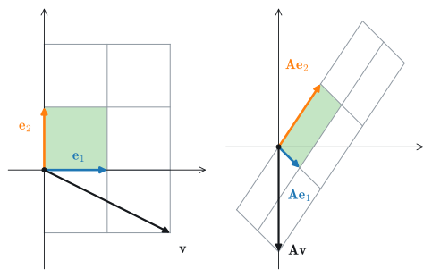
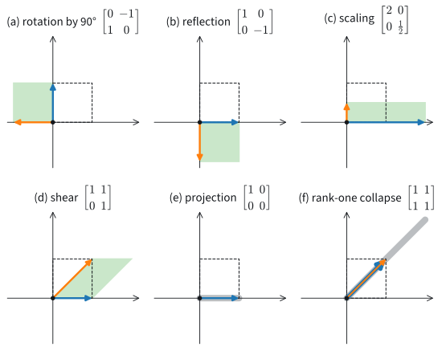
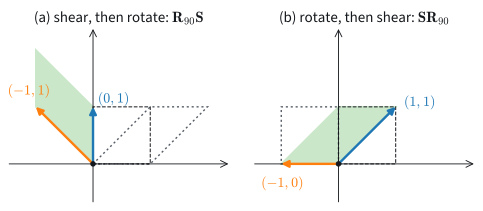
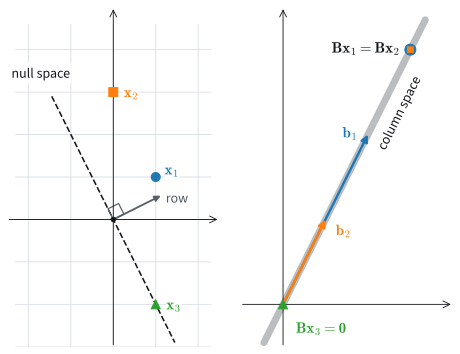
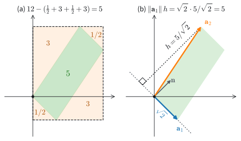
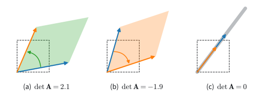

# Matrices as Linear Maps
:label:`sec_mdl-linear-maps`

In :numref:`sec_mdl-geometry-linear-algebraic-ops` we read a matrix--vector
product $\mathbf{A}\mathbf{x}$ one row at a time: entry $i$ is the dot product
of row $i$ with $\mathbf{x}$, a single hyperplane test. That row view tells us
what a matrix computes for one input vector, but it hides what the matrix does
to the entire input space at once. In particular, it does not tell us whether
the map preserves information or throws it away, and whether its effect can ever
be undone.

This question comes up as soon as a neural network layer is narrower than its
input. A fully connected layer mapping the 784 pixels of a Fashion-MNIST image
to 256 hidden features is a $256 \times 784$ matrix. Because its output holds
fewer numbers than its input, it must collapse space: by a count we will make
precise shortly, at least $784 - 256 = 528$ independent input directions are
sent to zero, so distinct images can produce identical features before any
nonlinearity even sees them.

Even a square matrix can lose information. Consider the running matrix of this
chapter,
$\mathbf{A} = \left(\begin{smallmatrix}1 & 2\\ -1 & 3\end{smallmatrix}\right)$.
It sends $(2, -1)$ to $(0, -5)$, and there is another matrix that sends
$(0, -5)$ right back to $(2, -1)$. In fact, that second matrix undoes
$\mathbf{A}$ on every input, so $\mathbf{A}$ loses nothing. Contrast this with
$\mathbf{B} = \left(\begin{smallmatrix}2 & 1\\ 4 & 2\end{smallmatrix}\right)$,
which sends both $(1, 1)$ and $(0, 3)$ to $(3, 6)$. Given only the output
$(3, 6)$, we have no way to tell which input produced it, so no matrix can
reverse $\mathbf{B}$.

Whether a linear map can be undone determines whether a layer discards
information, whether a linear system has a unique solution, and how a
probability density rescales under a change of variables
(:numref:`subsec_mdl-change-of-variables`). To answer this question cleanly, we
shift from rows to columns. Column $j$ of a matrix is simply where it sends the
$j$-th coordinate axis, and those images alone fix the entire map. Counting how
many columns are linearly independent tells us how many input dimensions survive
the map, while measuring the signed volume of the transformed unit cube gives a
single number that detects whether any dimension was lost. We develop both ideas
first in two dimensions, where every statement is a picture, and then extend
them to $n$ dimensions.

Three results organize the section: the balance between surviving and collapsed
dimensions, the exact conditions under which a square matrix has an inverse, and
the rule for how volume scaling behaves when two maps are composed. The general
$n$-dimensional construction of the determinant
(:numref:`subsec_mdl-determinant-general`) is the most technical part and can
be skimmed on a first reading.

```{.python .input #mdl-linear-maps-matrices-as-linear-maps}
#@tab mxnet
import numpy as np
```

```{.python .input #mdl-linear-maps-matrices-as-linear-maps}
#@tab pytorch
import numpy as np
```

```{.python .input #mdl-linear-maps-matrices-as-linear-maps}
#@tab tensorflow
import numpy as np
```

```{.python .input #mdl-linear-maps-matrices-as-linear-maps}
#@tab jax
import numpy as np
```

## Linear Maps

### Columns as Images of the Axes
:label:`subsec_mdl-column-view`

A matrix acts on infinitely many input vectors, yet it is stored as a finite
table of numbers. How can just four numbers fix the output for every vector in
the plane? Take a $2 \times 2$ matrix $\mathbf{A}$ with entries $p, q, r, s$
and apply it to $\mathbf{x} = (x, y)$. Collecting the terms that multiply $x$
and those that multiply $y$ gives

$$
\mathbf{A}\mathbf{x} = \begin{bmatrix}p & q \\ r & s\end{bmatrix}\begin{bmatrix}x \\ y\end{bmatrix}
 = \begin{bmatrix}px+qy\\ rx+sy\end{bmatrix}
 = x\begin{bmatrix}p \\ r\end{bmatrix} + y\begin{bmatrix}q \\s\end{bmatrix}
 = x\,\mathbf{A}\mathbf{e}_1 + y\,\mathbf{A}\mathbf{e}_2.
$$

Thus $\mathbf{A}\mathbf{x}$ is simply a weighted sum of the two columns of
$\mathbf{A}$, using the coordinates of $\mathbf{x}$ as weights. Because
$\mathbf{A}\mathbf{e}_1 = (p, r)$ and $\mathbf{A}\mathbf{e}_2 = (q, s)$, the
columns are the images of the standard basis vectors $\mathbf{e}_1 = (1, 0)$
and $\mathbf{e}_2 = (0, 1)$. Once we know where those two axes land, the image
of every other vector in the plane is completely determined.

For our running matrix ($p = 1$, $q = 2$, $r = -1$, $s = 3$), the two axes go
to $\mathbf{A}\mathbf{e}_1 = (1, -1)$ and $\mathbf{A}\mathbf{e}_2 = (2, 3)$.
Since the input $\mathbf{v} = (2, -1)$ is $2\mathbf{e}_1 - \mathbf{e}_2$, its
image is the exact same combination of the columns:

$$
\mathbf{A}\mathbf{v} = 2\,(1, -1) - (2, 3) = (0, -5).
$$

Checking by rows confirms the result: $(1, 2)\cdot(2, -1) = 0$ and
$(-1, 3)\cdot(2, -1) = -5$. Both views compute the same product, but the column
view lets us see what $\mathbf{A}$ does to the entire plane at once.
:numref:`fig_mdl-la-linear-map` illustrates this geometry: the unit square
spanned by $\mathbf{e}_1$ and $\mathbf{e}_2$ is carried to the parallelogram
spanned by the two columns, and the grid point $\mathbf{v}$ lands on the
corresponding point $\mathbf{A}\mathbf{v}$ of the transformed grid.

![The running matrix $\mathbf{A} = \left(\begin{smallmatrix}1 & 2\\ -1 & 3\end{smallmatrix}\right)$ acting on the plane. (a) The input grid, shaded unit square, basis vectors, and input $\mathbf{v} = (2, -1)$. (b) Its image: $\mathbf{e}_1$ goes to $(1, -1)$, $\mathbf{e}_2$ to $(2, 3)$, and $\mathbf{v}$ to $(0, -5)$. Lines remain lines, the origin stays fixed, and equally spaced points stay equally spaced. The shaded square maps to the shaded parallelogram, whose area leads to the determinant. Panel (b) is drawn at one-third the scale of (a).](../img/mdl-la-linear-map.svg)
:label:`fig_mdl-la-linear-map`

The same column picture holds in any dimension. An $m \times n$ matrix maps
vectors in $\mathbb{R}^n$ to vectors in $\mathbb{R}^m$, and it is *linear*:

$$
\mathbf{A}(\alpha\mathbf{x} + \beta\mathbf{y}) = \alpha\,\mathbf{A}\mathbf{x} + \beta\,\mathbf{A}\mathbf{y}
\quad \textrm{for all } \mathbf{x}, \mathbf{y} \in \mathbb{R}^n \textrm{ and } \alpha, \beta \in \mathbb{R}.
$$

In words, the image of a weighted sum is the same weighted sum of the images.
Writing any input as $\mathbf{x} = \sum_j x_j \mathbf{e}_j$ gives
$\mathbf{A}\mathbf{x} = \sum_j x_j\,\mathbf{A}\mathbf{e}_j$, where multiplying
by $\mathbf{e}_j$ picks out column $j$. Conversely, every map
$f : \mathbb{R}^n \to \mathbb{R}^m$ that satisfies this linearity rule can be
written as a matrix whose $j$-th column is $f(\mathbf{e}_j)$, because
$f(\mathbf{x}) = f(\sum_j x_j\mathbf{e}_j) = \sum_j x_j f(\mathbf{e}_j)$.
Linear maps from $\mathbb{R}^n$ to $\mathbb{R}^m$ and $m \times n$ matrices
are therefore two ways of describing the same object.

Linearity is also what keeps the grid in :numref:`fig_mdl-la-linear-map`
looking like a grid. Every line $\mathbf{p} + t\mathbf{u}$ maps to
$\mathbf{A}\mathbf{p} + t\,\mathbf{A}\mathbf{u}$, which is again a line (or a
single point if $\mathbf{A}\mathbf{u} = \mathbf{0}$), and the origin never
moves: $\mathbf{A}\mathbf{0} = \mathbf{0}$.

Nothing here requires the matrix to be square. A $2 \times 3$ matrix maps
$\mathbb{R}^3$ into the span of its three columns in $\mathbb{R}^2$, filling
the whole output plane as long as at least two columns are linearly
independent. Going the other way, a $3 \times 2$ matrix maps the plane into
$\mathbb{R}^3$, where its outputs form a plane through the origin, a line, or
the origin alone, depending on its two columns. Every fully connected layer in
a neural network is a rectangular map of this kind, followed by a bias shift
and a nonlinearity.

To build visual intuition, :numref:`fig_mdl-la-map-gallery` displays six
$2 \times 2$ matrices through their effect on the unit square. A $90^\circ$
counter-clockwise rotation sends $\mathbf{e}_1$ to $\mathbf{e}_2$ and
$\mathbf{e}_2$ to $-\mathbf{e}_1$, so its columns are $(0, 1)$ and $(-1, 0)$.
A horizontal shear leaves $\mathbf{e}_1$ untouched and tilts $\mathbf{e}_2$ to
$(1, 1)$, sliding every horizontal line sideways in proportion to its height.
The last two panels are qualitatively different: they lose a dimension,
flattening the entire square, and with it the entire plane, onto a single line.


:label:`fig_mdl-la-map-gallery`

One familiar operation is noticeably absent from this gallery: a translation
$\mathbf{x} \mapsto \mathbf{x} + \mathbf{c}$ with $\mathbf{c} \neq \mathbf{0}$.
Because it moves the origin, it is not linear. An affine layer
$\mathbf{W}\mathbf{x} + \mathbf{b}$ in a neural network is therefore a linear
map followed by a translation.

### Composition
:label:`subsec_mdl-composition`

Two linear layers placed back to back, with no nonlinearity between them,
collapse into a single linear map. Which matrix represents that combined map?
Let us test this on two concrete maps from :numref:`fig_mdl-la-map-gallery`:
the $90^\circ$ rotation $\mathbf{R}_{90}$ and the shear $\mathbf{T}$ (named
for how it tilts the vertical axis),

$$
\mathbf{R}_{90} = \begin{bmatrix}0 & -1\\ 1 & 0\end{bmatrix},
\qquad
\mathbf{T} = \begin{bmatrix}1 & 1\\ 0 & 1\end{bmatrix}.
$$

Both matrices will reappear throughout the chapter. Let us track where the
standard basis vectors go under each ordering. If we shear first, $\mathbf{e}_1$
stays at $(1, 0)$ and the rotation sends it to $(0, 1)$; meanwhile
$\mathbf{e}_2$ shears to $(1, 1)$ and rotates to $(-1, 1)$. Thus "shear, then
rotate" has columns $(0, 1)$ and $(-1, 1)$. In the opposite order, rotating
sends $\mathbf{e}_1$ to $(0, 1)$, which the shear moves to $(1, 1)$, and sends
$\mathbf{e}_2$ to $(-1, 0)$, which the shear leaves unchanged. The two
composites are therefore

$$
\textrm{shear, then rotate: }\begin{bmatrix}0 & -1\\ 1 & 1\end{bmatrix},
\qquad
\textrm{rotate, then shear: }\begin{bmatrix}1 & -1\\ 1 & 0\end{bmatrix}.
$$

They are not the same map, as :numref:`fig_mdl-la-composition` makes clear.


:label:`fig_mdl-la-composition`

Matrix multiplication is the algebraic rule that computes such composites. For
any two matrices $\mathbf{A}$ and $\mathbf{B}$ whose dimensions match, apply
$\mathbf{B}$ to $\mathbf{v}$, then $\mathbf{A}$ to the result, and inspect
entry $i$:

$$
\bigl(\mathbf{A}(\mathbf{B}\mathbf{v})\bigr)_i
 = \sum_j a_{ij} (\mathbf{B}\mathbf{v})_j
 = \sum_j \sum_k a_{ij} b_{jk} v_k
 = \sum_k \Bigl(\sum_j a_{ij} b_{jk}\Bigr) v_k
 = \bigl((\mathbf{A}\mathbf{B})\mathbf{v}\bigr)_i.
$$
:eqlabel:`eq_mdl-composition`

Applying the two maps in sequence is identical to applying the single matrix
$\mathbf{A}\mathbf{B}$, whose $(i, k)$ entry is the dot product of row $i$ of
$\mathbf{A}$ with column $k$ of $\mathbf{B}$. Notice the order: the product
$\mathbf{A}\mathbf{B}$ means "apply $\mathbf{B}$ first, then $\mathbf{A}$,"
read from right to left just like function composition $f(g(x))$. Setting
$\mathbf{v} = \mathbf{e}_j$ in :eqref:`eq_mdl-composition` also gives a useful
column rule: column $j$ of $\mathbf{A}\mathbf{B}$ is $\mathbf{A}\mathbf{b}_j$,
the image under $\mathbf{A}$ of column $j$ of $\mathbf{B}$. We will lean on
this fact when we study the determinant.

Seeing multiplication as composition explains its seemingly odd definition.
The row-times-column formula is not an arbitrary convention; it is simply what
composing two linear maps produces. It also makes the algebraic properties
immediate. Matrix multiplication is associative,
$(\mathbf{A}\mathbf{B})\mathbf{C} = \mathbf{A}(\mathbf{B}\mathbf{C})$, because
function composition is associative: both sides apply $\mathbf{C}$, then
$\mathbf{B}$, then $\mathbf{A}$. And it is not commutative in general, because
performing two geometric operations in opposite orders usually leads to
different results. In NumPy, matrix multiplication uses the `@` operator. Let
us check that it reproduces both composites of the rotation and the shear
(stored as `R90` and `S` below).

```{.python .input #mdl-linear-maps-composition}
R90 = np.array([[0.0, -1.0], [1.0, 0.0]])  # rotation by 90 degrees
S = np.array([[1.0, 1.0], [0.0, 1.0]])     # shear
print(R90 @ S)
print(S @ R90)
```

Of course, some pairs of matrices do commute. Two rotations in the plane
commute, since rotating by $\phi$ and then by $\psi$ yields a rotation by
$\phi + \psi$ in either order. Two diagonal matrices commute as well, since
each scales the coordinate axes independently. Exercise
:exref:`ex_mdl-linear-maps-commute-rotation` characterizes every $2 \times 2$
matrix that commutes with $\mathbf{R}_{90}$.

### Orthogonal Matrices
:label:`subsec_mdl-orthogonal-matrices`

Some linear maps move space rigidly, leaving every length and every angle
untouched. Which matrices have this property? Consider a counter-clockwise
rotation by an angle $\phi$ in the plane. It sends $\mathbf{e}_1$ to
$(\cos\phi, \sin\phi)$ and $\mathbf{e}_2$ to $(-\sin\phi, \cos\phi)$, so its
matrix is

$$
\mathbf{R}_\phi = \begin{bmatrix}\cos\phi & -\sin\phi\\ \sin\phi & \cos\phi\end{bmatrix}.
$$

Its columns have unit length, $\sqrt{\cos^2\phi + \sin^2\phi} = 1$, and zero
dot product, $-\cos\phi\sin\phi + \sin\phi\cos\phi = 0$. They are orthonormal,
a condition we wrote in :numref:`sec_mdl-geometry-linear-algebraic-ops` as
$\mathbf{R}_\phi^\top\mathbf{R}_\phi = \mathbf{I}$. Setting $\phi = 90^\circ$
recovers $\mathbf{R}_{90}$, which sends $(3, 2)$ to $(-2, 3)$; both vectors
have length $\sqrt{13}$. The reflection $\operatorname{diag}(1, -1)$ across
the $x$-axis has orthonormal columns as well.

In any dimension, a square matrix $\mathbf{Q}$ is called *orthogonal* when its
columns are orthonormal, that is,

$$
\mathbf{Q}^\top\mathbf{Q} = \mathbf{I}.
$$

Two subtleties in this definition are worth flagging. First, columns that are
merely perpendicular are not enough: $\operatorname{diag}(1, 10)$ has
perpendicular columns of lengths $1$ and $10$, yet it bends the $90^\circ$
angle between $(1, 1)$ and $(1, -1)$ into
$\arccos(-99/101) \approx 169^\circ$
(:exref:`ex_mdl-geometry-linear-algebraic-ops-angle-preserving`). Second, the
name "orthogonal" is reserved for square matrices. A tall $n \times k$ matrix
with $k < n$ orthonormal columns still preserves lengths, but it embeds
$\mathbb{R}^k$ into a larger space $\mathbb{R}^n$ and therefore has no
two-sided inverse (:numref:`subsec_mdl-inverses`).

An orthogonal map preserves every dot product:

$$
(\mathbf{Q}\mathbf{x})\cdot(\mathbf{Q}\mathbf{y})
 = (\mathbf{Q}\mathbf{x})^\top(\mathbf{Q}\mathbf{y})
 = \mathbf{x}^\top\mathbf{Q}^\top\mathbf{Q}\,\mathbf{y}
 = \mathbf{x}^\top\mathbf{y}
 = \mathbf{x}\cdot\mathbf{y}.
$$

Setting $\mathbf{y} = \mathbf{x}$ gives
$\|\mathbf{Q}\mathbf{x}\| = \|\mathbf{x}\|$, so lengths are unchanged; and
because angles depend only on dot products and lengths, angles are unchanged
as well. If you rotate an entire set of embedding vectors by the same
orthogonal matrix, every pairwise cosine similarity stays identical.

The defining equation $\mathbf{Q}^\top\mathbf{Q} = \mathbf{I}$ says that
applying $\mathbf{Q}^\top$ *after* $\mathbf{Q}$ undoes it. For a square matrix
$\mathbf{Q}$, it turns out that $\mathbf{Q}^\top$ also undoes $\mathbf{Q}$
when applied *before* it, $\mathbf{Q}\mathbf{Q}^\top = \mathbf{I}$, meaning
the rows of $\mathbf{Q}$ are orthonormal too and $\mathbf{Q}^{-1} =
\mathbf{Q}^\top$. This is not obvious from the definition alone; it follows
from a general theorem on square matrices that we prove in
:numref:`subsec_mdl-inverses`.

In two dimensions, rotations and reflections are the only orthogonal matrices.
The first column must be a unit vector $(\cos\phi, \sin\phi)$, which leaves
only two unit vectors perpendicular to it for the second column:
$\pm(-\sin\phi, \cos\phi)$. The plus sign gives the rotation
$\mathbf{R}_\phi$. The minus sign gives
$\mathbf{R}_\phi\operatorname{diag}(1, -1)$, a reflection across the $x$-axis
followed by a rotation, which is itself a reflection across a line through the
origin. Later, the sign of the determinant will separate rotations from
reflections at a glance (:numref:`subsec_mdl-multiplicativity`).

### Tensors and Einstein Summation
:label:`subsec_mdl-einsum`

In a transformer, self-attention compares every query with every key, across
every attention head and every sequence in a batch. Labeling the batch by $b$,
the head by $h$, the query position by $i$, the key position by $t$, and the
feature dimension within a head by $j$, the attention scores are

$$
s_{bhit} = \sum_j q_{bhij}\, k_{bhtj},
$$

where $q_{bhij}$ and $k_{bhtj}$ are entries of the four-axis query and key
tensors (:numref:`sec_ndarray`). Each score is a dot product along the feature
axis $j$, evaluated for every combination of the other four indices. Standard
matrix notation has no clean way to write this four-index contraction; calling
it "a batched matrix multiplication with a transpose on the last two axes"
obscures which axis is actually being summed.

Step back, and notice that every product we have met so far follows the exact
same pattern. The dot product, the matrix--vector product, the matrix product,
and the *trace* $\operatorname{tr}(\mathbf{A})$ (the sum of the diagonal
entries of a square matrix) all read

$$
\mathbf{v} \cdot \mathbf{w} = \sum_i v_i w_i,
\qquad
(\mathbf{A}\mathbf{v})_i = \sum_j a_{ij} v_j,
\qquad
(\mathbf{A}\mathbf{B})_{ik} = \sum_j a_{ij} b_{jk},
\qquad
\operatorname{tr}(\mathbf{A}) = \sum_i a_{ii}.
$$

The trace is new here and will return in :numref:`sec_mdl-eigendecompositions`
as the sum of a matrix's eigenvalues. Each of these four formulas multiplies
entries together and sums over an index that appears twice. *Einstein
notation* turns that pattern into a convention: drop the summation sign and
automatically sum over every repeated index. Under this rule,
$\mathbf{v}\cdot\mathbf{w} = v_i w_i$ and
$(\mathbf{A}\mathbf{B})_{ik} = a_{ij}b_{jk}$.

The attention scores reveal where the classical convention falls short: the
batch and head indices $b$ and $h$ appear in both factors, yet we want to keep
them rather than sum them out. Numerical libraries solve this in `einsum` by
having you name the kept indices explicitly. You pass a string listing the
input indices, an arrow `->`, and the output indices; any index omitted from
the right-hand side is summed over. Let us express our four basic products
this way and check them on our running matrices.

```{.python .input #geometry-linear-algebraic-ops-expressing-in-code-2}
A = np.array([[1.0, 2.0], [-1.0, 3.0]])    # the running matrix
v = np.array([2.0, -1.0])
(np.einsum('i,i->', v, v),        # dot product: v.v
 np.einsum('ij,j->i', A, v),      # matrix-vector product: Av
 np.einsum('ij,jk->ik', R90, S),  # matrix product: R90 S
 np.einsum('ii->', A))            # trace: tr(A)
```

Every output matches our hand calculations from earlier, including
$\operatorname{tr}\mathbf{A} = 1 + 3 = 4$. The attention scores take just one
line in the same notation. Below, we compute them with `einsum`, verify that
they agree with a batched matrix product against the transposed keys, and
count the total number of multiply--adds.

```{.python .input #mdl-linear-maps-tensors-and-einstein-summation-1}
rng = np.random.default_rng()
queries = rng.standard_normal((2, 3, 4, 8))   # (batch, heads, queries, width)
keys = rng.standard_normal((2, 3, 5, 8))      # (batch, heads, keys, width)
scores = np.einsum('bhij,bhtj->bhit', queries, keys)
(scores.shape, np.allclose(scores, queries @ keys.swapaxes(-1, -2)),
 scores.size * queries.shape[-1])             # multiply-adds
```

The output has shape $(2, 3, 4, 5)$, giving one $4 \times 5$ score table per
sequence and head. Both expressions agree, and the contraction takes
$2 \cdot 3 \cdot 4 \cdot 5 \cdot 8 = 960$ multiply--adds, which is simply the
product of the sizes of all five indices.

Beyond code, index notation yields effortless one-line proofs. For any
$\mathbf{A} \in \mathbb{R}^{m \times n}$ and
$\mathbf{B} \in \mathbb{R}^{n \times m}$, both $\mathbf{A}\mathbf{B}$ and
$\mathbf{B}\mathbf{A}$ are square, and their traces satisfy

$$
\operatorname{tr}(\mathbf{A}\mathbf{B}) = a_{ij} b_{ji} = b_{ji} a_{ij}
 = \operatorname{tr}(\mathbf{B}\mathbf{A}).
$$
:eqlabel:`eq_mdl-trace-cyclic`

The middle step merely swaps two scalar numbers while leaving the indices
alone. Surprisingly, the trace of a product does not depend on the order of
the two factors, even when $\mathbf{A}\mathbf{B} \neq \mathbf{B}\mathbf{A}$
and even when the two products do not have the same dimensions. One immediate
consequence will matter when we study eigenvalues: if $\mathbf{V}$ has an
inverse $\mathbf{V}^{-1}$ (:numref:`subsec_mdl-inverses`), then
$\operatorname{tr}(\mathbf{V}\mathbf{A}\mathbf{V}^{-1}) =
\operatorname{tr}(\mathbf{A}\mathbf{V}^{-1}\mathbf{V}) =
\operatorname{tr}(\mathbf{A})$. Because $\mathbf{V}\mathbf{A}\mathbf{V}^{-1}$
represents the same linear map $\mathbf{A}$ written in a different coordinate
system, the trace is an intrinsic property of the map rather than an artifact
of the coordinates we chose. The determinant will turn out to share this
invariance (:numref:`subsec_mdl-multiplicativity`).

One practical warning: when an `einsum` expression combines three or more
tensors, the string specifies the mathematical result but not the order in
which pairwise contractions are carried out, and that order can make a huge
difference in speed. For $n \times n$ matrices, computing
$(\mathbf{A}\mathbf{B})\mathbf{v}$ takes roughly $n^3$ multiply--adds, whereas
computing $\mathbf{A}(\mathbf{B}\mathbf{v})$ takes only $2n^2$.

## Rank and Invertibility

### Column Space and Null Space
:label:`subsec_mdl-column-null-space`

Which outputs can a matrix actually produce, and which inputs does it erase?
To see both at once, examine our singular example

$$
\mathbf{B} = \begin{bmatrix} 2 & 1 \\ 4 & 2 \end{bmatrix}.
$$

Its columns are $\mathbf{b}_1 = (2, 4)$ and $\mathbf{b}_2 = (1, 2)$, so one
is simply twice the other: $\mathbf{b}_1 = 2\mathbf{b}_2$. Because every
output of $\mathbf{B}$ is a weighted sum of its columns, every output
collapses to a scalar multiple of $\mathbf{b}_2$:

$$
a_1\mathbf{b}_1 + a_2\mathbf{b}_2 = (2a_1 + a_2)\,\mathbf{b}_2.
$$

Thus $\mathbf{B}$ sends the entire two-dimensional plane onto the single line
$y = 2x$ through $(1, 2)$. Inevitably, distinct inputs collide on that line:
both $(1, 1)$ and $(0, 3)$ land on $(3, 6)$. By linearity, their difference
$(1, -2)$ must map to the difference of their outputs,
$\mathbf{B}(1, -2) = \mathbf{0}$. The row view gives a second way to see why:
both rows of $\mathbf{B}$, $(2, 1)$ and $(4, 2)$, are perpendicular to
$(1, -2)$, so both hyperplane tests return zero.
:numref:`fig_mdl-la-null-collapse` shows both lines side by side.

![The matrix $\mathbf{B} = \left(\begin{smallmatrix}2 & 1\\ 4 & 2\end{smallmatrix}\right)$ collapsing the plane. (a) In the input plane, the dashed null-space line through $(1, -2)$ is perpendicular to the row direction $(2, 1)$; three inputs are marked: $\mathbf{x}_1 = (1, 1)$, $\mathbf{x}_2 = (0, 3)$, and $\mathbf{x}_3 = (1, -2)$ on the null-space line. (b) In the output plane (same scale), every output lands on the column space, the line $y = 2x$ spanned by $\mathbf{b}_1$ and $\mathbf{b}_2$; both $\mathbf{x}_1$ and $\mathbf{x}_2$ map to $(3, 6)$, while $\mathbf{x}_3$ collapses to the origin. Because distinct inputs share the same image, no inverse can exist.](../img/mdl-la-null-collapse.svg)
:label:`fig_mdl-la-null-collapse`

This example illustrates two fundamental subspaces attached to every
$m \times n$ matrix $\mathbf{A}$. The *column space*, written
$\operatorname{col}\mathbf{A}$, is the span of the columns of $\mathbf{A}$.
Since $\mathbf{A}\mathbf{x}$ is a weighted combination of the columns with
weights $x_1, \ldots, x_n$, the column space is precisely the set of all
reachable outputs. The *null space*, also called the *kernel* and written
$\ker\mathbf{A}$, is the set of all inputs that $\mathbf{A}$ sends to zero:

$$
\ker\mathbf{A} = \{\mathbf{x} \in \mathbb{R}^n : \mathbf{A}\mathbf{x} = \mathbf{0}\}.
$$

It is a subspace of $\mathbb{R}^n$: if
$\mathbf{A}\mathbf{x} = \mathbf{A}\mathbf{y} = \mathbf{0}$, then
$\mathbf{A}(\alpha\mathbf{x} + \beta\mathbf{y}) = \alpha\mathbf{A}\mathbf{x} +
\beta\mathbf{A}\mathbf{y} = \mathbf{0}$. For $\mathbf{B}$, the column space is
the line $y = 2x$ in the output plane, and the null space is the line through
$(1, -2)$ in the input plane. (That both live in $\mathbb{R}^2$ is just an
accident of $\mathbf{B}$ being square; in general, $\ker\mathbf{A} \subseteq
\mathbb{R}^n$ and $\operatorname{col}\mathbf{A} \subseteq \mathbb{R}^m$.)

Three general facts carry straight over from this example:

1. *The null space consists of all inputs perpendicular to every row.* In the
   row view, $(\mathbf{A}\mathbf{x})_i$ is the dot product of row $i$ with
   $\mathbf{x}$, so all entries of $\mathbf{A}\mathbf{x}$ vanish if and only
   if $\mathbf{x}$ is orthogonal to every row.
2. *The columns are linearly dependent if and only if the null space contains
   a nonzero vector.* A nontrivial dependence
   $\sum_j x_j\mathbf{a}_j = \mathbf{0}$ among the columns $\mathbf{a}_j$
   simply says $\mathbf{A}\mathbf{x} = \mathbf{0}$ for a nonzero vector
   $\mathbf{x}$, and reading the equation backwards gives the converse. For
   $\mathbf{B}$, the relation $\mathbf{b}_1 - 2\mathbf{b}_2 = \mathbf{0}$
   yields the null vector $(1, -2)$.
3. *Two inputs produce the same output if and only if they differ by a null
   vector.* Indeed, $\mathbf{A}\mathbf{x} = \mathbf{A}\mathbf{y}$ is
   equivalent to $\mathbf{A}(\mathbf{x} - \mathbf{y}) = \mathbf{0}$. The set
   of all inputs that $\mathbf{B}$ maps to $(3, 6)$ is the shifted line
   $(1, 1) + t(1, -2)$, which passes through $(0, 3)$ at $t = -1$. Whenever
   $\ker\mathbf{A}$ contains a nonzero vector, distinct inputs collide and no
   inverse can exist.

### Rank
:label:`subsec_mdl-rank`

How many input dimensions survive a linear map? The *rank* of a matrix is the
dimension of its column space, or equivalently the maximum number of linearly
independent columns:

$$
\operatorname{rank}\mathbf{A} = \dim\operatorname{col}\mathbf{A}.
$$

Our matrix $\mathbf{B}$ has rank $1$: its two columns are dependent, and
neither is zero. For a richer example, consider the $4 \times 5$ matrix

$$
\mathbf{C} = \begin{bmatrix}
1& 3 & 0 & -1 & 0 \\
-1 & 0 & 1 & 1 & -1 \\
0 & 3 & 1 & 0 & -1 \\
2 & 3 & -1 & -2 & 1
\end{bmatrix},
$$

which has rank $2$: its first two columns are linearly independent, yet every
one of the $\binom{5}{3} = 10$ triples of columns is linearly dependent.

Remarkably, the number of dimensions that survive the map and the number of
dimensions crushed to zero always add up to the dimension of the input space.

**Proposition (rank--nullity).** *For an $m \times n$ matrix $\mathbf{A}$,*

$$
\operatorname{rank}\mathbf{A} + \dim\ker\mathbf{A} = n.
$$
:eqlabel:`eq_mdl-rank-nullity`

**Proof.** Pick a basis $\mathbf{w}_1, \ldots, \mathbf{w}_k$ of
$\ker\mathbf{A}$ and extend it to a basis $\mathbf{w}_1, \ldots,
\mathbf{w}_k, \mathbf{u}_1, \ldots, \mathbf{u}_{n-k}$ of $\mathbb{R}^n$.
(That any linearly independent list can be extended to a basis, and that all
bases of a subspace have the same size, are standard facts we use without
proof.) The images $\mathbf{A}\mathbf{u}_1, \ldots,
\mathbf{A}\mathbf{u}_{n-k}$ span $\operatorname{col}\mathbf{A}$, because any
input $\mathbf{x} \in \mathbb{R}^n$ is a combination of the full basis and
the $\mathbf{w}_j$ vanish under $\mathbf{A}$. They are also linearly
independent: if $\sum_i c_i \mathbf{A}\mathbf{u}_i = \mathbf{0}$, then
$\sum_i c_i \mathbf{u}_i$ lies in $\ker\mathbf{A}$ and can therefore be
written as a combination of $\mathbf{w}_1, \ldots, \mathbf{w}_k$. Within a
basis, that is impossible unless every $c_i = 0$. Hence
$\operatorname{col}\mathbf{A}$ has dimension $n - k$. $\blacksquare$

Let us check this conservation of dimensions on our examples. For $\mathbf{B}$
we get $1 + 1 = 2$. For the $256 \times 784$ Fashion-MNIST layer from the
opening, the rank cannot exceed the $256$ output coordinates, so the null
space must have dimension at least $784 - 256 = 528$. For $\mathbf{C}$, the
null space must have dimension $5 - 2 = 3$, meaning any three linearly
independent null vectors form a basis of $\ker\mathbf{C}$. Below, we verify
that $(3, -1, 3, 0, 0)$, $(1, 0, 0, 1, 0)$, and $(0, 0, 1, 0, 1)$ all map to
zero under $\mathbf{C}$ and check the rank of the matrix `Z` holding them as
columns.

```{.python .input #mdl-linear-maps-rank}
B = np.array([[2.0, 1.0], [4.0, 2.0]])
C = np.array([[1, 3, 0, -1, 0], [-1, 0, 1, 1, -1],
              [0, 3, 1, 0, -1], [2, 3, -1, -2, 1]], dtype=float)
Z = np.array([[3, -1, 3, 0, 0], [1, 0, 0, 1, 0],
              [0, 0, 1, 0, 1]], dtype=float).T   # candidate null vectors
rank_C, rank_Z = np.linalg.matrix_rank(C), np.linalg.matrix_rank(Z)
np.linalg.matrix_rank(B), rank_C, np.abs(C @ Z).max(), rank_Z, rank_C + rank_Z
```

The ranks of $\mathbf{B}$ and $\mathbf{C}$ come out to $1$ and $2$, the
maximum entry of $|\mathbf{C}\mathbf{Z}|$ is zero, and the three columns of
`Z` have rank $3$, confirming $2 + 3 = 5$.

What if we read a matrix by rows instead of columns? Its *row rank*, the
maximum number of linearly independent rows, counts how many independent
hyperplane tests the matrix performs. In $\mathbf{C}$, row 3 is row 1 plus
row 2 and row 4 is row 1 minus row 2, so the row rank is $2$, matching the
column rank. That agreement is universal.

**Proposition (row rank equals column rank).** *For every matrix
$\mathbf{A}$, the largest number of linearly independent rows equals the
largest number of linearly independent columns.*

**Proof.** Let $r = \operatorname{rank}\mathbf{A}$, and place a basis of
$\operatorname{col}\mathbf{A}$ into the columns of an $m \times r$ matrix
$\mathbf{G}$. Since every column of $\mathbf{A}$ is a linear combination of
the columns of $\mathbf{G}$, storing the coefficients for column $j$ of
$\mathbf{A}$ in column $j$ of an $r \times n$ matrix $\mathbf{H}$ gives the
factorization

$$
\mathbf{A} = \mathbf{G}\mathbf{H}.
$$
:eqlabel:`eq_mdl-row-rank`

Now read the same product by rows. Row $i$ of $\mathbf{A}$ is
$\sum_k g_{ik}\,(\textrm{row } k \textrm{ of } \mathbf{H})$, so every row of
$\mathbf{A}$ lies in the span of the $r$ rows of $\mathbf{H}$. Thus the row
rank of $\mathbf{A}$ is at most $r$. Repeating the argument for
$\mathbf{A}^\top$, whose columns are the rows of $\mathbf{A}$, shows that the
column rank is at most the row rank, so the two must be equal. $\blacksquare$

The factorization $\mathbf{A} = \mathbf{G}\mathbf{H}$ is more than a proof
device. It reveals that any rank-$r$ matrix passes its input through a
bottleneck of width $r$: $\mathbf{H}$ compresses $\mathbf{x} \in \mathbb{R}^n$
to $r$ numbers, and $\mathbf{G}$ expands those $r$ numbers back to
$\mathbb{R}^m$. When $r$ is much smaller than $m$ and $n$, storing
$\mathbf{G}$ and $\mathbf{H}$ requires only $r(m + n)$ parameters instead of
$mn$, which is the core idea behind the low-rank updates of
:numref:`subsec_mdl-low-rank-updates`.

In practice, finding rank by testing subsets of columns would take
exponentially long. By hand one uses Gaussian elimination (which this chapter
does not cover). Numerical libraries like `np.linalg.matrix_rank` instead
count how many *singular values* (:numref:`sec_mdl-svd-low-rank`) exceed a
small tolerance. A tolerance is unavoidable because rank is not a continuous
function of the matrix entries: a tiny perturbation can jump the rank from
deficient to full (:numref:`subsec_mdl-det-limits`).

### Inverses
:label:`subsec_mdl-inverses`

Given an output $\mathbf{A}\mathbf{x}$, when can we reliably recover the input
$\mathbf{x}$? An *inverse* of a square matrix $\mathbf{A}$ is a matrix
$\mathbf{A}^{-1}$ that undoes $\mathbf{A}$ from both sides:

$$
\mathbf{A}^{-1}\mathbf{A} = \mathbf{A}\mathbf{A}^{-1} = \mathbf{I},
$$

so that $\mathbf{x} = \mathbf{A}^{-1}(\mathbf{A}\mathbf{x})$ for every input
$\mathbf{x}$. For a $2 \times 2$ matrix with entries $p, q, r, s$ satisfying
$ps - qr \neq 0$, there is an explicit formula:

$$
\mathbf{A}^{-1} = \frac{1}{ps - qr}\begin{bmatrix} s & -q \\ -r & p \end{bmatrix}.
$$
:eqlabel:`eq_mdl-inverse-2x2`

A quick multiplication confirms it: multiplying
$\left(\begin{smallmatrix}s & -q\\ -r & p\end{smallmatrix}\right)$ by
$\mathbf{A}$ in either order yields $(ps - qr)\,\mathbf{I}$, and dividing by
$ps - qr$ leaves $\mathbf{I}$. The condition $ps - qr \neq 0$ cannot be
dropped. If $ps - qr = 0$, that product is the zero matrix; multiplying both
sides by a hypothetical inverse $\mathbf{A}^{-1}$ would force
$\left(\begin{smallmatrix}s & -q\\ -r & p\end{smallmatrix}\right) =
\mathbf{0}$, and hence $\mathbf{A} = \mathbf{0}$, which plainly has no
inverse. We will meet the quantity $ps - qr$ again as a signed area in
:numref:`subsec_mdl-parallelogram-area`. For our running matrix,
$ps - qr = 3 + 2 = 5$, so

$$
\mathbf{A}^{-1} = \frac{1}{5}\begin{bmatrix} 3 & -2 \\ 1 & 1 \end{bmatrix},
\qquad
\mathbf{A}^{-1}(0, -5) = \tfrac15\,(10, -5) = (2, -1).
$$

Sure enough, $\mathbf{A}^{-1}$ reverses the worked example of
:numref:`subsec_mdl-column-view`.

Whenever an inverse exists, it is unique. Even better, any left inverse and
any right inverse of the same matrix must coincide: if
$\mathbf{L}\mathbf{A} = \mathbf{I}$ and $\mathbf{A}\mathbf{X} = \mathbf{I}$,
then by associativity,

$$
\mathbf{L} = \mathbf{L}(\mathbf{A}\mathbf{X}) = (\mathbf{L}\mathbf{A})\mathbf{X} = \mathbf{X}.
$$

When does an inverse exist in general? For a square matrix, the answer
requires only the null space and rank--nullity, and the rest of this chapter
relies on it more than on any other result in this section.

**Proposition (invertible matrices).** *For an $n \times n$ matrix
$\mathbf{A}$, the following are equivalent:*
(i) *$\mathbf{A}$ is invertible;*
(ii) *the columns of $\mathbf{A}$ are linearly independent;*
(iii) *$\ker\mathbf{A} = \{\mathbf{0}\}$;*
(iv) *$\operatorname{rank}\mathbf{A} = n$.*

**Proof.** Statements (ii) and (iii) are equivalent by fact 2 of
:numref:`subsec_mdl-column-null-space`, and (iii) and (iv) are equivalent by
rank--nullity. If $\mathbf{A}$ is invertible and $\mathbf{A}\mathbf{x} =
\mathbf{0}$, multiplying on the left by $\mathbf{A}^{-1}$ gives
$\mathbf{x} = \mathbf{A}^{-1}\mathbf{A}\mathbf{x} = \mathbf{0}$, so (i)
implies (iii).

The converse takes more work because we must actually construct the inverse.
By (iv), the column space is an $n$-dimensional subspace of $\mathbb{R}^n$,
which must be all of $\mathbb{R}^n$: appending any vector outside it to a
basis of $\operatorname{col}\mathbf{A}$ would produce $n + 1$ linearly
independent vectors in $\mathbb{R}^n$, which is impossible. Thus every target
vector in $\mathbb{R}^n$ is reached. By (iii) and fact 3, no two inputs map
to the same output. We can therefore define column $j$ of a matrix
$\mathbf{X}$ to be the unique solution of $\mathbf{A}\mathbf{x} =
\mathbf{e}_j$. By construction, $\mathbf{A}\mathbf{X} = \mathbf{I}$. To see
that $\mathbf{X}$ also works on the left, take any $\mathbf{x} \in
\mathbb{R}^n$: since
$\mathbf{A}(\mathbf{X}\mathbf{A}\mathbf{x}) =
(\mathbf{A}\mathbf{X})\mathbf{A}\mathbf{x} = \mathbf{A}\mathbf{x}$ and no two
inputs collide, we must have $\mathbf{X}\mathbf{A}\mathbf{x} = \mathbf{x}$.
Hence $\mathbf{X}\mathbf{A} = \mathbf{I}$ as well, and $\mathbf{X} =
\mathbf{A}^{-1}$. $\blacksquare$

This immediately settles the claim left open in
:numref:`subsec_mdl-orthogonal-matrices`. For a square orthogonal matrix
$\mathbf{Q}$ (satisfying $\mathbf{Q}^\top\mathbf{Q} = \mathbf{I}$), if
$\mathbf{Q}\mathbf{c} = \mathbf{0}$, then
$\mathbf{c} = \mathbf{Q}^\top\mathbf{Q}\mathbf{c} = \mathbf{0}$, so
$\ker\mathbf{Q} = \{\mathbf{0}\}$. By the proposition, $\mathbf{Q}$ is
invertible, its left inverse $\mathbf{Q}^\top$ must equal $\mathbf{Q}^{-1}$,
and therefore $\mathbf{Q}\mathbf{Q}^\top = \mathbf{I}$.

A square matrix that has no inverse is called *singular*; $\mathbf{B}$ is our
standard example. Rectangular matrices never have a two-sided inverse at all.
The rank of an $m \times n$ matrix is at most $\min(m, n)$. When $m > n$, the
column space has dimension at most $n < m$, so the map is not *onto*: some
targets in $\mathbb{R}^m$ can never be hit. When $n > m$, rank--nullity
forces a null space of dimension at least $n - m > 0$, so the map is not
*one-to-one*: distinct inputs collide. Running a map backwards requires both
properties, and the beauty of the proposition above is that for a square
matrix, either one guarantees the other.

### Solving Linear Systems in Practice
:label:`subsec_mdl-numerical-issues`

The matrix inverse is an indispensable tool for algebra and proofs, yet in
numerical computation we almost never form it explicitly. When you need to
solve $\mathbf{A}\mathbf{x} = \mathbf{b}$, use `np.linalg.solve(A, b)` rather
than `np.linalg.inv(A) @ b`.

There are two main reasons: speed and accuracy. First, `solve` factors
$\mathbf{A}$ once into triangular matrices (an *LU factorization*, costing
about $n^3/3$ multiply--adds) and solves two fast triangular systems. Forming
$\mathbf{A}^{-1}$ explicitly costs roughly $n^3$ multiply--adds, three times
as much work, before you even multiply by $\mathbf{b}$. Second, `solve` is
*backward stable*: its computed solution is the exact solution to a slightly
perturbed system whose entries differ from $\mathbf{A}$ and $\mathbf{b}$ only
at the level of floating-point rounding. Consequently, its residual
$\|\mathbf{A}\mathbf{x} - \mathbf{b}\|$ stays on the order of machine
precision times $\|\mathbf{A}\|\,\|\mathbf{x}\|$ (using the spectral norm of
:numref:`subsec_lin-algebra-norms`). Computing `inv(A) @ b` carries no such
guarantee; its residual can be larger by a factor up to the *condition number*
$\kappa(\mathbf{A})$, which measures how close $\mathbf{A}$ is to being
singular (:numref:`subsec_mdl-condition-number`).

How close a matrix sits to singularity is a property of the problem itself,
not of the algorithm. In double precision (roughly sixteen decimal digits),
both methods can lose up to about $\log_{10}\kappa(\mathbf{A})$ digits of
accuracy in the solution $\mathbf{x}$. That is a worst-case bound rather than
an exact prediction for any single right-hand side, so let us see how close a
notorious example comes to it. The *Hilbert matrix*, with entries
$h_{ij} = 1/(i + j - 1)$, is a classic test case of a nearly singular matrix.
We take $\mathbf{x}_{\textrm{true}} = \mathbf{1}$, form
$\mathbf{b} = \mathbf{H}\mathbf{1}$ for the $10 \times 10$ Hilbert matrix
$\mathbf{H}$, and attempt to recover $\mathbf{x}$ both ways.

```{.python .input #mdl-linear-maps-solving-linear-systems-in-practice}
H = 1 / (np.arange(10)[:, None] + np.arange(10) + 1)   # Hilbert matrix
x_true = np.ones(10)
b = H @ x_true
for x in (np.linalg.solve(H, b), np.linalg.inv(H) @ b):
    print(f'residual {np.linalg.norm(H @ x - b):.1e}, '
          f'error {np.linalg.norm(x - x_true):.1e}')
np.linalg.cond(H)
```

The condition number is $\kappa(\mathbf{H}) \approx 1.6 \cdot 10^{13}$,
warning us that up to thirteen digits can vanish. As promised, `solve` keeps
its residual near machine precision, while `inv` suffers a residual roughly
eleven orders of magnitude larger, right in line with the factor $\kappa$.
Notice, however, that a tiny residual does not guarantee an accurate
solution. Both routes lose twelve or more of the sixteen digits, approaching
the worst-case bound, with `inv` still worse by more than an order of
magnitude.

Sparse matrices add a third, decisive reason never to invert. A million-by-million
matrix with only five million nonzero entries fits comfortably in memory,
whereas its inverse is typically completely dense, requiring roughly $10^{12}$
entries.

## The Determinant

### Area of a Parallelogram
:label:`subsec_mdl-parallelogram-area`

By what factor does a matrix scale areas? Look back at
:numref:`fig_mdl-la-linear-map`: our running matrix $\mathbf{A}$ sends the
unit square (edges $\mathbf{e}_1$ and $\mathbf{e}_2$, area $1$) to the
parallelogram with edges $\mathbf{a}_1 = (1, -1)$ and $\mathbf{a}_2 = (2, 3)$
and corners $(0, 0)$, $(1, -1)$, $(3, 2)$, and $(2, 3)$. That parallelogram
sits snugly inside the bounding box $[0, 3] \times [-1, 3]$ of area $12$. The
unused portion of the box consists of four right triangles with legs $1$ and
$1$, $2$ and $3$, $1$ and $1$, and $2$ and $3$, whose areas sum to
$\tfrac12 + 3 + \tfrac12 + 3 = 7$. Subtracting leaves an area of
$12 - 7 = 5$ (:numref:`fig_mdl-la-parallelogram-area`, panel (a)). The matrix
$\mathbf{A}$ multiplies the area of the unit square by $5$.

![The image of the unit square under $\mathbf{A}$ has area $5$. (a) Bounding-box method: the box $[0, 3] \times [-1, 3]$ of area $12$ minus four right triangles of total area $7$. (b) Base times height: the base $\mathbf{a}_1 = (1, -1)$ has length $\sqrt{2}$, the unit normal $\mathbf{n} = (1, 1)/\sqrt{2}$ is perpendicular to it, and the height of $\mathbf{a}_2 = (2, 3)$ above the base line is $\mathbf{a}_2\cdot\mathbf{n} = 5/\sqrt{2}$.](../img/mdl-la-parallelogram-area.svg)
:label:`fig_mdl-la-parallelogram-area`

Carving out triangles works for one picture, but every new arrangement of
corners would need a new diagram. Base times height handles every case in one
stroke. Let the parallelogram have edges $\mathbf{u} = (p, r)$ and
$\mathbf{w} = (q, s)$, the two columns of a general $2 \times 2$ matrix. Its
base has length $\|\mathbf{u}\|$. Rotating $\mathbf{u}$ counter-clockwise by
$90^\circ$ gives $\mathbf{R}_{90}\mathbf{u} = (-r, p)$, so

$$
\mathbf{n} = \frac{(-r, p)}{\|\mathbf{u}\|}
$$

is a unit vector perpendicular to the base. From
:numref:`sec_mdl-geometry-linear-algebraic-ops`, the signed component of
$\mathbf{w}$ along a unit vector $\mathbf{n}$ is the dot product
$\mathbf{w}\cdot\mathbf{n}$. Geometrically, this is the height of the
parallelogram above its base, equipped with a sign: positive when $\mathbf{w}$
lies on the counter-clockwise side of $\mathbf{u}$, and negative when it lies
on the clockwise side. Multiplying base by signed height gives

$$
\|\mathbf{u}\|\,(\mathbf{w}\cdot\mathbf{n})
 = \|\mathbf{u}\|\,\frac{-qr + ps}{\|\mathbf{u}\|}
 = ps - qr.
$$

Conveniently, the lengths $\|\mathbf{u}\|$ cancel out, leaving a clean
polynomial in the four matrix entries with no sign cases to split. For our
running matrix, $\|\mathbf{u}\| = \sqrt{2}$, $\mathbf{n} = (1, 1)/\sqrt{2}$,
and $\mathbf{w}\cdot\mathbf{n} = 5/\sqrt{2}$, giving a signed area of $5$
(panel (b)), positive because $\mathbf{a}_2$ lies counter-clockwise from
$\mathbf{a}_1$.

We define the *determinant* of a $2 \times 2$ matrix to be this signed area of
the image of the unit square:

$$
\det\begin{bmatrix} p & q \\ r & s \end{bmatrix} = ps - qr.
$$
:eqlabel:`eq_mdl-det-2x2`

Its magnitude $|\det\mathbf{A}|$ is the factor by which the map scales area,
and its sign records whether the images of $\mathbf{e}_1$ and $\mathbf{e}_2$
preserve their counter-clockwise orientation. For $\mathbf{A}$, we get
$1 \cdot 3 - 2 \cdot (-1) = 5$. Swapping the two columns of $\mathbf{A}$
produces $\left(\begin{smallmatrix}2 & 1\\ 3 & -1\end{smallmatrix}\right)$,
which spans the exact same parallelogram with its edges listed in the reverse
order, and its determinant flips sign to $-2 - 3 = -5$. For the singular
matrix $\mathbf{B}$, we get $2 \cdot 2 - 1 \cdot 4 = 0$: the unit square
flattens onto the line segment from $\mathbf{0}$ to $(3, 6)$, which has zero
area.

:numref:`fig_mdl-la-determinant` contrasts all three regimes: a positive
determinant preserves orientation, a negative determinant reverses it, and a
zero determinant collapses the square.


:label:`fig_mdl-la-determinant`

Base times height gives us the plane. To move to $n$ dimensions, we need the
signed volume of an $n$-dimensional box.

### The Determinant in General
:label:`subsec_mdl-determinant-general`

How do we define the signed volume of the box spanned by $n$ columns in
$\mathbb{R}^n$? Rather than trying to compute high-dimensional volumes by
chopping up shapes, we take a cleaner route: we write down the three
geometric properties any signed volume must satisfy, and let those properties
uniquely determine the formula. Viewed as a function of the columns
$\mathbf{a}_1, \ldots, \mathbf{a}_n$ of an $n \times n$ matrix, the
determinant is:

1. **Multilinear**: linear in each column separately while the other columns
   are held fixed. (Scaling one edge of a box scales its volume by the same
   factor; writing one edge as a sum splits the volume accordingly.)
2. **Alternating**: equal to zero whenever two columns are identical. (When
   two edges coincide, the box collapses into a lower-dimensional slab of zero
   volume.)
3. **Normalized**: $\det \mathbf{I} = 1$. (The unit cube has volume $1$.)

Check that our $2 \times 2$ formula $ps - qr$ satisfies all three: it is
linear in $(p, r)$ and in $(q, s)$, it vanishes whenever $(p, r) = (q, s)$,
and it equals $1$ on $\mathbf{I}$. Two powerful consequences follow
immediately from these three axioms alone: a rule for swapping columns, and an
explicit formula proving that at most one function can satisfy all three.

First, **swapping any two columns flips the sign of the determinant**. To see
why, place $\mathbf{u} + \mathbf{w}$ in two column slots and expand using
multilinearity:

$$
\begin{aligned}
0 &= \det(\ldots, \mathbf{u}+\mathbf{w}, \ldots, \mathbf{u}+\mathbf{w}, \ldots) \\
  &= \det(\ldots, \mathbf{u}, \ldots, \mathbf{u}, \ldots)
   + \det(\ldots, \mathbf{u}, \ldots, \mathbf{w}, \ldots) \\
  &\quad + \det(\ldots, \mathbf{w}, \ldots, \mathbf{u}, \ldots)
   + \det(\ldots, \mathbf{w}, \ldots, \mathbf{w}, \ldots).
\end{aligned}
$$

The left-hand side, the first term, and the last term all have two identical
columns, so they vanish by the alternating property. What remains is

$$
\det(\ldots, \mathbf{u}, \ldots, \mathbf{w}, \ldots)
 = -\det(\ldots, \mathbf{w}, \ldots, \mathbf{u}, \ldots).
$$

Exchanging two edges of the box reverses its orientation, just as we saw in
panel (b) of :numref:`fig_mdl-la-determinant`.

Second, the three properties completely determine a formula. Expand each
column in the standard basis as $\mathbf{a}_j = \sum_i a_{ij}\,\mathbf{e}_i$
and apply multilinearity column by column. This turns $\det\mathbf{A}$ into a
large sum of terms
$a_{i_1 1} a_{i_2 2} \cdots a_{i_n n}\, \det(\mathbf{e}_{i_1}, \ldots,
\mathbf{e}_{i_n})$, one for every choice of a row index $i_j$ in each column
$j$. Whenever two chosen row indices are equal, the term vanishes by the
alternating property. When all $n$ row indices are distinct, the list
$\mathbf{e}_{i_1}, \ldots, \mathbf{e}_{i_n}$ is just a reordering of the
columns of $\mathbf{I}$, so repeated column swaps reduce
$\det(\mathbf{e}_{i_1}, \ldots, \mathbf{e}_{i_n})$ to $\pm 1$.

In the $2 \times 2$ case, with columns $\mathbf{a}_1 = p\,\mathbf{e}_1 +
r\,\mathbf{e}_2$ and $\mathbf{a}_2 = q\,\mathbf{e}_1 + s\,\mathbf{e}_2$, the
expansion has four terms. The two with a repeated basis vector drop out,
leaving

$$
\det(\mathbf{a}_1, \mathbf{a}_2)
 = ps\,\det(\mathbf{e}_1, \mathbf{e}_2)
 + rq\,\det(\mathbf{e}_2, \mathbf{e}_1)
 = ps - qr,
$$

recovering the signed area we derived by hand. In general, $\det\mathbf{A}$ is
a signed sum over all ways of picking one entry from every row and every
column. Writing $\sigma(j)$ for the row chosen in column $j$, we obtain the
*permutation formula*:

$$
\det\mathbf{A} = \sum_{\sigma} \operatorname{sgn}(\sigma)\, a_{\sigma(1)1}\, a_{\sigma(2)2} \cdots a_{\sigma(n)n},
$$
:eqlabel:`eq_mdl-det-permutation`

where $\sigma$ ranges over all $n!$ permutations of $\{1, \ldots, n\}$, and
$\operatorname{sgn}(\sigma) = \det(\mathbf{e}_{\sigma(1)}, \ldots,
\mathbf{e}_{\sigma(n)})$ is $+1$ if $\sigma$ requires an even number of swaps
and $-1$ if it requires an odd number. Because any function satisfying the
three axioms must equal this formula, there can be at most one determinant.

We do not prove existence in full here. The subtle point is that
$\operatorname{sgn}(\sigma)$ is well defined (no permutation can be built from
both an even and an odd number of swaps), a standard fact we take from
:cite:`Horn.Johnson.2012`. Once that parity fact is in hand, the formula
satisfies all three axioms: each term contains one entry from each column
(giving multilinearity), only the identity permutation survives for
$\mathbf{I}$ (giving normalization), and the alternating property follows
from the same parity argument (which we omit).

Notice that normalization entered only at the very end of the derivation. That
observation gives us a sharper tool that we will use in the next subsection:
if $f$ is *any* multilinear and alternating function of the columns, the same
swap rule and expansion apply, turning every factor
$f(\mathbf{e}_{\sigma(1)}, \ldots, \mathbf{e}_{\sigma(n)})$ into
$\operatorname{sgn}(\sigma)\,f(\mathbf{I})$. Consequently,

$$
f(\mathbf{A}) = f(\mathbf{I})\,\det\mathbf{A}.
$$

In short, every multilinear alternating function of the columns is just a
scalar multiple of the determinant.

For small hand calculations, grouping the terms of
:eqref:`eq_mdl-det-permutation` by the row picked in column $1$ produces the
*cofactor expansion*: each entry $a_{i1}$ multiplies the determinant of the
$(n-1) \times (n-1)$ submatrix formed by deleting row $i$ and column $1$,
weighted by the alternating sign $(-1)^{i+1}$. For the $3 \times 3$ matrix

$$
\mathbf{M} = \begin{bmatrix}
2 & 1 & 0 \\
1 & 3 & 1 \\
0 & 1 & 2
\end{bmatrix},
$$

expanding along the first column gives

$$
\begin{aligned}
\det \mathbf{M}
 &= 2 \det \begin{bmatrix} 3 & 1 \\ 1 & 2 \end{bmatrix}
  - 1 \det \begin{bmatrix} 1 & 0 \\ 1 & 2 \end{bmatrix}
  + 0 \det \begin{bmatrix} 1 & 0 \\ 3 & 1 \end{bmatrix} \\
 &= 2 \cdot 5 - 1 \cdot 2 + 0 = 8.
\end{aligned}
$$
:eqlabel:`eq_mdl-det-3x3`

Thus $\mathbf{M}$ maps the unit cube in $\mathbb{R}^3$ to a box of volume $8$.

For a triangular matrix, the determinant simplifies dramatically: it is just
the product of the diagonal entries. Of all the rules for computing
determinants, this is the one to remember. Suppose $\mathbf{U}$ is upper
triangular, so $u_{ij} = 0$ whenever $i > j$. In the permutation formula, a
nonzero term must pick one entry from every column, all in distinct rows.
From column $1$, the only nonzero entry sits in row $1$. From column $2$, row
$1$ is already taken and rows $3, \ldots, n$ are zero, forcing us to pick row
$2$. Continuing across the columns, only the diagonal permutation survives,
and it requires zero swaps, so

$$
\det \mathbf{U} = u_{11} u_{22} \cdots u_{nn}.
$$

Running the same argument backwards from column $n$ covers lower triangular
matrices. Better still, it extends to blocks. Consider a *block upper
triangular* matrix $\left(\begin{smallmatrix}\mathbf{D}_1 & *\\ \mathbf{0} &
\mathbf{D}_2\end{smallmatrix}\right)$ whose square diagonal blocks
$\mathbf{D}_1$ and $\mathbf{D}_2$ need not be triangular themselves. Any
nonzero permutation term must pick its entries in the columns of
$\mathbf{D}_1$ from the rows of $\mathbf{D}_1$, because everything underneath
is zero. That consumes all rows of $\mathbf{D}_1$, forcing the remaining
columns to pick from the rows of $\mathbf{D}_2$; the off-diagonal block $*$
never contributes at all. Every surviving permutation splits into a pair of
independent permutations on the two blocks, their signs multiply, and the sum
factors cleanly:

$$
\det\begin{bmatrix}\mathbf{D}_1 & *\\ \mathbf{0} & \mathbf{D}_2\end{bmatrix}
 = \det\mathbf{D}_1\,\det\mathbf{D}_2 .
$$

These two rules are essential in modern machine learning, not just in hand
calculations. A normalizing flow transforms a simple random variable through
an invertible neural network and must evaluate the log-determinant of the
network's Jacobian at every step, because a change of variables divides the
probability density by the local volume scaling factor
(:numref:`subsec_mdl-change-of-variables`). Flows are therefore designed so
that each layer has a triangular or block-triangular Jacobian: the
log-determinant then reduces to a sum of $n$ scalar logarithms, avoiding the
roughly $n^3/3$ multiply--adds required for a general matrix.

Another useful symmetry is that transposing leaves the determinant unchanged:
$\det\mathbf{A}^\top = \det\mathbf{A}$. In the permutation formula for
$\mathbf{A}^\top$, each term is
$\operatorname{sgn}(\sigma)\prod_j a_{j\sigma(j)}$. Setting
$j = \sigma^{-1}(i)$ rewrites the product as $\prod_i a_{\sigma^{-1}(i)\, i}$,
which is the term for $\mathbf{A}$ corresponding to the inverse permutation
$\sigma^{-1}$. Since undoing a sequence of swaps takes the exact same number
of swaps, $\operatorname{sgn}(\sigma^{-1}) = \operatorname{sgn}(\sigma)$.
The two sums therefore contain the exact same terms, which means every
statement about columns of a determinant applies equally well to rows.

With $n!$ terms, the permutation formula is strictly a theoretical tool and is
never used numerically beyond tiny matrices. Libraries compute determinants by
factoring the matrix into triangular factors (as in `solve`) and multiplying
their diagonal entries, adjusting the sign for any row exchanges, at a cost
of roughly $n^3/3$ multiply--adds.

### Multiplicativity
:label:`subsec_mdl-multiplicativity`

If $\mathbf{B}$ scales areas by $\det\mathbf{B}$ and $\mathbf{A}$ scales them
by $\det\mathbf{A}$, then applying $\mathbf{B}$ followed by $\mathbf{A}$
should scale areas by the product of the two factors. Let us check two
examples. For our running matrix, $\mathbf{A}^2 =
\left(\begin{smallmatrix}-1 & 8\\ -4 & 7\end{smallmatrix}\right)$, which has
$\det\mathbf{A}^2 = -7 + 32 = 25 = 5^2$. For the composite of
:numref:`subsec_mdl-composition`, $\det(\mathbf{R}_{90}\mathbf{T}) = 0 \cdot
1 - (-1) \cdot 1 = 1$, matching $\det\mathbf{R}_{90} \cdot \det\mathbf{T} =
1 \cdot 1$.

A simple tiling picture explains why this should hold in general. Cover any
planar region with a fine grid of tiny squares. Because a linear map acts
uniformly across space, it carries every square to a parallelogram whose area
is $|\det\mathbf{A}|$ times that of the original square. Consequently, a
linear map scales the area of *every* shape by $|\det\mathbf{A}|$. Applying
$\mathbf{B}$ to a region of area $V$ produces area $|\det\mathbf{B}|\,V$, and
applying $\mathbf{A}$ next scales it to
$|\det\mathbf{A}|\,|\det\mathbf{B}|\,V$. Since the composite
$\mathbf{A}\mathbf{B}$ is itself a single linear map, its scaling factor must
be this product. Using the characterization from
:numref:`subsec_mdl-determinant-general`, we can turn that intuition into a
three-line proof that handles the signs as well.

**Proposition (multiplicativity of the determinant).** *For square matrices
$\mathbf{A}$ and $\mathbf{B}$ of the same size,*

$$
\det(\mathbf{A}\mathbf{B}) = \det(\mathbf{A})\,\det(\mathbf{B}).
$$
:eqlabel:`eq_mdl-det-multiplicative`

**Proof.** Fix $\mathbf{A}$ and treat
$D(\mathbf{B}) = \det(\mathbf{A}\mathbf{B})$ as a function of the columns of
$\mathbf{B}$. By :numref:`subsec_mdl-composition`, column $j$ of
$\mathbf{A}\mathbf{B}$ is $\mathbf{A}\mathbf{b}_j$. Because $\mathbf{A}$ is
linear and $\det$ is multilinear, $D$ is multilinear in the columns of
$\mathbf{B}$. If two columns of $\mathbf{B}$ coincide, the matching columns
of $\mathbf{A}\mathbf{B}$ coincide too, so $D(\mathbf{B}) = 0$ and $D$ is
alternating. Every multilinear alternating function of the columns is a
scalar multiple of the determinant (:numref:`subsec_mdl-determinant-general`),
which gives

$$
\det(\mathbf{A}\mathbf{B}) = D(\mathbf{B}) = D(\mathbf{I})\,\det(\mathbf{B})
 = \det(\mathbf{A})\,\det(\mathbf{B}). \qquad \blacksquare
$$

Four consequences of :eqref:`eq_mdl-det-multiplicative` appear repeatedly
throughout the rest of this chapter:

1. *Determinants commute even when matrices do not.* Because determinants are
   ordinary scalars, $\det(\mathbf{A}\mathbf{B}) =
   \det\mathbf{A}\,\det\mathbf{B} = \det\mathbf{B}\,\det\mathbf{A} =
   \det(\mathbf{B}\mathbf{A})$. For our rotation and shear,
   $\mathbf{R}_{90}\mathbf{T} \neq \mathbf{T}\mathbf{R}_{90}$, yet both
   products have determinant $1$.
2. *Similarity invariance.* For any invertible matrix $\mathbf{V}$, applying
   consequence 1 to the factors $\mathbf{V}\mathbf{A}$ and $\mathbf{V}^{-1}$
   gives $\det(\mathbf{V}\mathbf{A}\mathbf{V}^{-1}) =
   \det(\mathbf{V}^{-1}\mathbf{V}\mathbf{A}) = \det\mathbf{A}$. The matrix
   $\mathbf{V}\mathbf{A}\mathbf{V}^{-1}$ is simply the map $\mathbf{A}$
   written in the coordinate system whose axes are the columns of
   $\mathbf{V}^{-1}$, and changing coordinates cannot alter the volume
   scaling factor.
3. *Inverses.* If $\mathbf{A}$ is invertible, setting $\mathbf{B} =
   \mathbf{A}^{-1}$ yields $\det\mathbf{A}\,\det\mathbf{A}^{-1} =
   \det\mathbf{I} = 1$. Therefore every invertible matrix satisfies
   $\det\mathbf{A} \neq 0$ and $\det\mathbf{A}^{-1} = 1/\det\mathbf{A}$ (for
   our running matrix, $1/5 = 0.2$).
4. *Orthogonal matrices.* Combining multiplicativity with
   $\det\mathbf{Q}^\top = \det\mathbf{Q}$ on $\mathbf{Q}^\top\mathbf{Q} =
   \mathbf{I}$ gives

   $$
   \det(\mathbf{Q})^2 = \det(\mathbf{Q}^\top)\det(\mathbf{Q})
    = \det(\mathbf{Q}^\top\mathbf{Q}) = \det(\mathbf{I}) = 1,
   $$

   so $\det\mathbf{Q} = \pm 1$. Rigid motions never change volume, and the
   sign distinguishes orientation-preserving rotations ($\det = +1$) from
   orientation-reversing reflections ($\det = -1$) in the plane
   (:numref:`subsec_mdl-orthogonal-matrices`).

### Invertibility and the Determinant
:label:`subsec_mdl-invertibility-determinant`

The determinant adds a fifth equivalent condition to the invertibility
theorem of :numref:`subsec_mdl-inverses`, and it is the only one expressed as
a single number. In two dimensions the equivalence is immediate: the signed
area $ps - qr$ vanishes if and only if the two columns lie on the same line
through the origin (or one of them is $\mathbf{0}$), which is to say, if and
only if the columns are linearly dependent. The same holds in every dimension.

**Proposition (invertibility and the determinant).** *An $n \times n$ matrix
$\mathbf{A}$ is invertible if and only if $\det\mathbf{A} \neq 0$.
Equivalently, $\det\mathbf{A} = 0$ if and only if the columns of $\mathbf{A}$
are linearly dependent.*

**Proof.** If $\mathbf{A}$ is invertible, then
$\det\mathbf{A}\,\det\mathbf{A}^{-1} = 1$ by consequence 3 of
multiplicativity, so $\det\mathbf{A} \neq 0$. Conversely, suppose
$\mathbf{A}$ is not invertible. By the proposition in
:numref:`subsec_mdl-inverses`, its columns are linearly dependent, so some
column is a combination of the others:
$\mathbf{a}_j = \sum_{i \neq j} c_i\mathbf{a}_i$. Expanding column $j$ by
multilinearity gives
$\det\mathbf{A} = \sum_{i \neq j} c_i\det(\ldots, \mathbf{a}_i, \ldots)$,
where $\mathbf{a}_i$ now appears both in slot $i$ and in slot $j$. Every term
has two identical columns and therefore vanishes by the alternating property.
$\blacksquare$

For our running matrix, $\det\mathbf{A} = 5 \neq 0$ certifies invertibility;
for $\mathbf{B}$, $\det\mathbf{B} = 0$ confirms singularity. Keep in mind,
however, what this theorem does *not* promise: a nonzero determinant
guarantees that $\mathbf{A}^{-1}$ exists mathematically, not that it is safe
to compute numerically (:numref:`subsec_mdl-det-limits`).

### Limits of the Determinant
:label:`subsec_mdl-det-limits`

Knowing that $\det\mathbf{A} \neq 0$ tells us a matrix can be inverted, but
it says nothing about how *close* the matrix is to collapsing space, or along
which directions. Two stark examples make the point from opposite extremes.
First, the scaled identity $0.1\,\mathbf{I}_{400}$ is as well-behaved as a
matrix can be, with inverse $10\,\mathbf{I}_{400}$, yet its
determinant $10^{-400}$ is so tiny that it underflows beneath the smallest
positive double-precision floating-point number. Second, the extreme shear
$\left(\begin{smallmatrix}1 & 10^8\\ 0 & 1\end{smallmatrix}\right)$ has
determinant $1$, yet changing its lower-left entry by just $10^{-8}$ makes it
singular (:exref:`ex_mdl-geometry-linear-algebraic-ops-det-near-singular`).

Below, we compute both determinants (using `slogdet` for the first to obtain
its sign and log-magnitude safely) along with the singular values of the
shear. Before running the cell, guess what rank NumPy will report for the
*unchanged* shear.

```{.python .input #mdl-linear-maps-limits-of-the-determinant}
sign, logdet = np.linalg.slogdet(0.1 * np.eye(400))
print(np.linalg.det(0.1 * np.eye(400)), sign, logdet)
shear = np.array([[1.0, 1e8], [0.0, 1.0]])
print(np.linalg.det(shear), np.linalg.matrix_rank(shear),
      np.linalg.svd(shear, compute_uv=False))
shear[1, 0] = 1e-8
print(np.linalg.det(shear), np.linalg.matrix_rank(shear))
```

As expected, `det` on $0.1\,\mathbf{I}_{400}$ underflows to `0.0`, while
`slogdet` computes $400 \ln 0.1 \approx -921.03$ effortlessly. The unchanged
shear has determinant $1$, and the perturbed shear has determinant $0$ up to
rounding, yet `matrix_rank` reports rank $1$ for *both*. In exact arithmetic
the unchanged shear has rank $2$, but its two singular values are roughly
$10^8$ and $10^{-8}$. NumPy treats any singular value as zero once it falls
below the largest singular value times the matrix size times machine
precision, here $10^8 \cdot 2 \cdot 2.2 \cdot 10^{-16} \approx 4 \cdot
10^{-8}$. Even though the shear's entries are stored exactly, floating-point
arithmetic with numbers of size $10^8$ introduces rounding errors around
$10^{-8}$, so numerically the shear is indistinguishable from a singular
matrix.

A single number simply cannot capture how a matrix stretches and compresses
space along different directions. To see those directions, we need eigenvalues
and singular values. For our running matrix $\mathbf{A}$, the eigenvalues are
$2 \pm i$, whose product is $5 = \det\mathbf{A}$
(:numref:`sec_mdl-eigendecompositions`), and the singular values are roughly
$3.618$ and $1.382$, whose product is $5 = |\det\mathbf{A}|$
(:numref:`sec_mdl-svd-low-rank`). In fact, for every square matrix, the
determinant is the product of its eigenvalues (counted with multiplicity,
including complex pairs), and $|\det\mathbf{A}|$ is the product of its
singular values. It is the *ratio* of the largest to the smallest singular
value, not the determinant, that measures how close a matrix is to collapsing
space, and finding those directional factors is our next task.

## Summary

A matrix is a linear map completely determined by its columns, which record
where the standard coordinate axes land, and matrix multiplication is simply
the composition of linear maps read from right to left. Einstein notation and
`einsum` unify dot products, matrix products, traces, and multi-axis tensor
contractions such as transformer attention under a single index rule.

Every $m \times n$ matrix defines a column space of reachable outputs and a
null space of inputs sent to zero, linked by the rank--nullity theorem
$\operatorname{rank}\mathbf{A} + \dim\ker\mathbf{A} = n$: a $256 \times 784$
layer necessarily erases at least $528$ input dimensions. For a square matrix,
having independent columns, trivial null space, full rank, a nonzero
determinant, and an inverse are all equivalent. The determinant measures the
signed factor by which a map scales volume; it multiplies under composition
and equals the product of the diagonal entries for any triangular matrix.
Still, while a nonzero determinant guarantees that an inverse exists, it
cannot tell us how close a matrix is to singularity, a question that leads
directly to eigenvalues and singular values.

## Exercises

1. **Maps that preserve angles.** Rotating every embedding vector by the same
   orthogonal matrix leaves all cosine similarities unchanged. This problem
   finds every linear map with that property.
    1. Find the condition on the columns of a square matrix $\mathbf{A}$
       under which $\mathbf{A}\mathbf{e}_1$ and $\mathbf{A}\mathbf{e}_2$ are
       orthogonal. Show that $\mathbf{A} = \operatorname{diag}(1, 10)$
       satisfies it but changes the angle between $(1, 1)$ and $(1, -1)$.
    1. Suppose that an invertible $\mathbf{A}$ preserves the angle between
       every pair of nonzero vectors. Apply this to the pairs
       $\mathbf{e}_i, \mathbf{e}_j$ and
       $\mathbf{e}_i + \mathbf{e}_j, \mathbf{e}_i - \mathbf{e}_j$ for
       $i \neq j$ to show that $\mathbf{A}^\top\mathbf{A} = c^2\mathbf{I}$ for
       some $c > 0$, so that $\mathbf{A} = c\mathbf{Q}$ with $\mathbf{Q}$
       orthogonal. Conversely, show that every such matrix preserves all
       cosine similarities.
    1. Suppose instead that $\|\mathbf{A}\mathbf{x}\| = \|\mathbf{x}\|$ for
       every $\mathbf{x}$. Expand $\|\mathbf{x} + \mathbf{y}\|^2$ and
       $\|\mathbf{x} - \mathbf{y}\|^2$ to show that $\mathbf{A}$ preserves
       every dot product, and conclude that $\mathbf{A}$ is orthogonal.
   :exlabel:`ex_mdl-geometry-linear-algebraic-ops-angle-preserving`

1. **Rank of a product.** A linear autoencoder sends a $d$-dimensional input
   through a hidden layer of width $k < d$,
   $\mathbf{x} \mapsto \mathbf{W}_2\mathbf{W}_1\mathbf{x}$ with
   $\mathbf{W}_1 \in \mathbb{R}^{k \times d}$ and
   $\mathbf{W}_2 \in \mathbb{R}^{d \times k}$.
    1. Let $\mathbf{A}$ be an $m \times n$ matrix and $\mathbf{B}$ an
       $n \times p$ matrix. Show that the column space of
       $\mathbf{A}\mathbf{B}$ lies in the column space of $\mathbf{A}$, and
       that the null space of $\mathbf{B}$ lies in the null space of
       $\mathbf{A}\mathbf{B}$. Use the first fact,
       and rank--nullity with the second, to prove
       $\operatorname{rank}(\mathbf{A}\mathbf{B}) \le
       \min(\operatorname{rank}\mathbf{A}, \operatorname{rank}\mathbf{B})$.
    1. Conclude that $\mathbf{W}_2\mathbf{W}_1$ has rank at most $k$. What
       is the smallest possible dimension of its null space? What is the
       largest dimension of a subspace on which the autoencoder reconstructs
       every input exactly?
    1. Construct a $2 \times 3$ matrix and a $3 \times 2$ matrix, both of
       rank two, whose $2 \times 2$ product has rank one.
   :exlabel:`ex_mdl-geometry-linear-algebraic-ops-rank-of-product`

1. **Matrices that commute with a rotation.** Matrix products do not commute
   in general. This problem finds the exceptions for $\mathbf{R}_{90}$.
    1. Find all $2 \times 2$ matrices $\mathbf{X}$ with
       $\mathbf{X}\mathbf{R}_{90} = \mathbf{R}_{90}\mathbf{X}$, and show that
       they are $\left(\begin{smallmatrix}p & -q\\ q & p\end{smallmatrix}\right)
       = p\mathbf{I} + q\mathbf{R}_{90}$.
    1. Using $\mathbf{R}_{90}^2 = -\mathbf{I}$, show that
       $(p\mathbf{I} + q\mathbf{R}_{90})(r\mathbf{I} + s\mathbf{R}_{90}) =
       (pr - qs)\,\mathbf{I} + (ps + qr)\,\mathbf{R}_{90}$, so these matrices
       multiply like the complex numbers $p + qi$.
    1. For $(p, q) \neq (0, 0)$, show that $p\mathbf{I} + q\mathbf{R}_{90} =
       \sqrt{p^2 + q^2}\,\mathbf{R}_\phi$ for the angle $\phi$ with
       $(\cos\phi, \sin\phi) = (p, q)/\sqrt{p^2 + q^2}$, a scaled rotation.
       Compute its determinant, and conclude that it is invertible unless
       $p = q = 0$.
    1. Does the running matrix $\mathbf{A}$ commute with $\mathbf{R}_{90}$?
       Compute both products.
   :exlabel:`ex_mdl-linear-maps-commute-rotation`

1. **Householder reflections.** Let $\mathbf{u}$ be a unit vector in
   $\mathbb{R}^n$ and $\mathbf{H} = \mathbf{I} - 2\mathbf{u}\mathbf{u}^\top$.
    1. Show that $\mathbf{H}$ is symmetric and orthogonal, that
       $\mathbf{H}\mathbf{u} = -\mathbf{u}$, and that $\mathbf{H}\mathbf{x} =
       \mathbf{x}$ for every $\mathbf{x}$ perpendicular to $\mathbf{u}$, so
       that $\mathbf{H}$ reflects in the hyperplane with normal $\mathbf{u}$.
    1. Write $\mathbf{H} = \mathbf{I} - 2\mathbf{P}$ with
       $\mathbf{P} = \mathbf{u}\mathbf{u}^\top$, and explain the formula with
       the projection onto $\mathbf{u}$ from
       :numref:`sec_mdl-geometry-linear-algebraic-ops`: what does
       $\mathbf{x} - 2\mathbf{P}\mathbf{x}$ do to the component of
       $\mathbf{x}$ along $\mathbf{u}$?
    1. Prove $\det\mathbf{H} = -1$. Extend $\mathbf{u}$ to an orthonormal
       basis, the columns of an orthogonal matrix $\mathbf{Q} = [\mathbf{u}\
       \mathbf{q}_2 \cdots \mathbf{q}_n]$, compute
       $\mathbf{Q}^\top\mathbf{H}\mathbf{Q}$, and use multiplicativity.
    1. Find the unit vector $\mathbf{u}$ whose reflection sends $(3, 4)$ to
       $(5, 0)$ (hint: $\mathbf{u}$ is parallel to $(3, 4) - (5, 0)$), write
       down $\mathbf{H}$, and check $\det\mathbf{H} = -1$. Reflections of this
       kind, applied column by column, are how libraries factor a matrix into
       an orthogonal and a triangular factor.
   :exlabel:`ex_mdl-linear-maps-householder`

1. [code] **Determinant and near-singularity.** A square matrix is invertible
   if and only if its determinant is nonzero. How well does the size of the
   determinant measure how close a matrix is to being singular?
    1. Use multilinearity to prove $\det(c\mathbf{A}) = c^n\det\mathbf{A}$
       for an $n \times n$ matrix $\mathbf{A}$ and a scalar $c$, and check
       the identity in code for the matrix $\mathbf{M}$ of
       :eqref:`eq_mdl-det-3x3` with $c = 2$.
    1. Draw an $n \times n$ lower triangular matrix with independent standard
       Gaussian entries on and below the diagonal, for $n = 20$, $100$, and
       $1000$. Compare the logarithm that `np.linalg.slogdet` returns with
       the sum of the logarithms of the absolute diagonal entries, which the
       triangular rule makes exact up to rounding. From which $n$ on do the
       two disagree, and by how much at $n = 1000$? Compute `np.linalg.cond`
       for $n = 20$ and $n = 100$, and explain the failure. (The routine does
       not know that the matrix is triangular. It factors it with row
       exchanges, like any other matrix.)
    1. The text states that a change of $10^{-8}$ in the lower left entry
       makes the shear $\left(\begin{smallmatrix}1 & 10^8\\ 0 &
       1\end{smallmatrix}\right)$ singular. Verify it, and show that no
       smaller change of a single entry does.
   :exlabel:`ex_mdl-geometry-linear-algebraic-ops-det-near-singular`

1. **Determinant of a rank-one update.** ● A *planar flow*
   :cite:`rezende2015variational` transforms
   $\mathbf{z} \in \mathbb{R}^d$ by
   $f(\mathbf{z}) = \mathbf{z} + \mathbf{u}\,h(\mathbf{w}\cdot\mathbf{z} + b)$
   for vectors $\mathbf{u}, \mathbf{w}$, a scalar $b$, and a scalar
   nonlinearity $h$. Computing the density of $f(\mathbf{z})$ requires the
   determinant of the Jacobian
   $\mathbf{I} + h'(\mathbf{w}\cdot\mathbf{z} + b)\,\mathbf{u}\mathbf{w}^\top$.
    1. Use multilinearity and the alternating property to show
       $\det(\mathbf{u}\mathbf{w}^\top) = 0$ for $n \times n$ matrices with
       $n \ge 2$.
    1. Verify the two factorizations
       $$\begin{aligned}\begin{bmatrix}\mathbf{I} & -\mathbf{u}\\ \mathbf{w}^\top & 1\end{bmatrix} &= \begin{bmatrix}\mathbf{I} & \mathbf{0}\\ \mathbf{w}^\top & 1\end{bmatrix}\begin{bmatrix}\mathbf{I} & -\mathbf{u}\\ \mathbf{0}^\top & 1 + \mathbf{w}\cdot\mathbf{u}\end{bmatrix} \\ &= \begin{bmatrix}\mathbf{I} & -\mathbf{u}\\ \mathbf{0}^\top & 1\end{bmatrix}\begin{bmatrix}\mathbf{I} + \mathbf{u}\mathbf{w}^\top & \mathbf{0}\\ \mathbf{w}^\top & 1\end{bmatrix}.\end{aligned}$$
       Use the permutation formula :eqref:`eq_mdl-det-permutation` to show
       that a matrix whose last column is $\mathbf{e}_{n+1}$ has the
       determinant of its upper-left $n \times n$ block. Deduce
       $\det(\mathbf{I} + \mathbf{u}\mathbf{w}^\top) = 1 + \mathbf{w}\cdot\mathbf{u}$
       from :eqref:`eq_mdl-det-multiplicative` and the triangular rule.
    1. Write the logarithm of the absolute Jacobian determinant of a planar
       flow, and compare the cost of evaluating it with the cost of a
       general $d \times d$ determinant. For $h = \tanh$, which values of
       $\mathbf{u}\cdot\mathbf{w}$ keep the Jacobian invertible at every
       $\mathbf{z}$?
   :exlabel:`ex_mdl-geometry-linear-algebraic-ops-det-rank-one-update`

1. [code] **Einstein summation for attention.** Let the query, key and value
   tensors have the shapes $(n_b, n_h, n_q, d_h)$, $(n_b, n_h, n_k, d_h)$ and
   $(n_b, n_h, n_k, d_h)$.
    1. Write the `einsum` strings for the scores $s_{bhit} = \sum_j
       q_{bhij}k_{bhtj}$ and for the weighted sum of values $o_{bhij} =
       \sum_t p_{bhit}\,v_{bhtj}$, where $p_{bhit}$ are the attention weights,
       and check both against `@` with `swapaxes`.
    1. Count the multiply--adds of each contraction as a product of the
       sizes. Compare them with the multiply--adds of applying one
       $d_h \times d_h$ linear map to every query, and find the number of
       keys $n_k$ beyond which the scores cost more.
    1. Write $\operatorname{tr}(\mathbf{A}^\top\mathbf{A})$,
       $\operatorname{tr}(\mathbf{A}\mathbf{A}^\top)$ and $\sum_{ij}
       a_{ij}^2$ as one `einsum` each for a random $3 \times 5$ matrix, and
       check that they agree. Which of the two equalities is an instance of
       :eqref:`eq_mdl-trace-cyclic`, and why does the other one hold?
   :exlabel:`ex_mdl-linear-maps-einsum-attention`

:begin_tab:`mxnet`
:end_tab:

:begin_tab:`pytorch`
:end_tab:

:begin_tab:`tensorflow`
:end_tab:

:begin_tab:`jax`
:end_tab:

[Discussions](https://d2l.discourse.group/t/36855)

<!-- slides -->

::: {.slide}
::: {.cover}
[Dive into Deep Learning · §33.2]{.kicker}

Matrices as Linear Maps<br>**column geometry · composition & einsum · rank–nullity · invertibility · determinants & volume scaling**
:::
:::

::: {.slide title="When Does a Linear Layer Destroy Information?"}
[Motivation]{.kicker}

::: {.cols .vc}
::: {.col}
- **From Rows to Columns:** Reading $\mathbf{A}\mathbf{x}$ by rows shows $m$ hyperplane tests, while reading by columns shows where the input coordinate axes land.
- **Dimension Bottlenecks:** A $256 \times 784$ Fashion-MNIST layer outputs fewer numbers than it takes in, collapsing at least $784 - 256 = 528$ directions to zero.
- **Invertible vs. Singular:** Running matrix $\mathbf{A} = \left(\begin{smallmatrix}1&2\\-1&3\end{smallmatrix}\right)$ is reversible, whereas $\mathbf{B} = \left(\begin{smallmatrix}2&1\\4&2\end{smallmatrix}\right)$ merges $(1, 1)$ and $(0, 3)$ onto $(3, 6)$.
:::

::: {.col .fig .big}
@fig:ch33-la-row-vs-col-view
:::
:::
:::

::: {.slide title="Columns Are the Images of the Coordinate Axes"}
[Column Geometry]{.kicker}

::: {.cols .vc}
::: {.col}
- **Action on Basis Vectors:** Writing $\mathbf{x} = x\mathbf{e}_1 + y\mathbf{e}_2$ shows that $\mathbf{A}\mathbf{x}$ is a weighted combination of the columns of $\mathbf{A}$:
  $$\mathbf{A}\mathbf{x} = x\,\mathbf{A}\mathbf{e}_1 + y\,\mathbf{A}\mathbf{e}_2$$
- **Running Matrix $\mathbf{A}$:** Column 1 is $\mathbf{A}\mathbf{e}_1 = (1, -1)$ and Column 2 is $\mathbf{A}\mathbf{e}_2 = (2, 3)$, so $\mathbf{v} = (2, -1)$ maps to $2(1, -1) - (2, 3) = (0, -5)$.
- **Grid Preservation:** Because $\mathbf{A}(\alpha\mathbf{x} + \beta\mathbf{y}) = \alpha\mathbf{A}\mathbf{x} + \beta\mathbf{A}\mathbf{y}$, lines remain lines, the origin stays fixed ($\mathbf{A}\mathbf{0} = \mathbf{0}$), and the unit square maps to a parallelogram.
:::

::: {.col .fig}
{.nostretch width=100%}
:::
:::
:::

::: {.slide title="Six Geometric Actions on the Unit Square"}
[Linear Map Gallery]{.kicker}

{.nostretch width=74%}

- **Full-Rank vs. Rank-Deficient Maps:** Scaling, rotation $\mathbf{R}_{90} = \left(\begin{smallmatrix}0&-1\\1&0\end{smallmatrix}\right)$, shear $\mathbf{T} = \left(\begin{smallmatrix}1&1\\0&1\end{smallmatrix}\right)$, and reflection map the unit square to a 2D parallelogram, whereas projection (e) and dependent columns (f) squash the entire plane onto a 1D line.
- **Affine Layers ($\mathbf{W}\mathbf{x} + \mathbf{b}$):** A nonzero bias translation moves the origin ($\mathbf{0} \mapsto \mathbf{b}$), making an affine layer a linear map followed by a shift.
:::

::: {.slide title="Matrix Multiplication Is Map Composition"}
[Composition]{.kicker}

::: {.cols .vc}
::: {.col}
- **Right-to-Left Composition:** Applying $\mathbf{B}$ first and $\mathbf{A}$ second to $\mathbf{v}$ equals applying the product $\mathbf{A}\mathbf{B}$, whose $j$-th column is $\mathbf{A}\mathbf{b}_j$:
  $$\bigl(\mathbf{A}(\mathbf{B}\mathbf{v})\bigr)_i = \sum_k \Bigl(\sum_j a_{ij} b_{jk}\Bigr) v_k = \bigl((\mathbf{A}\mathbf{B})\mathbf{v}\bigr)_i$$
- **Order Matters ($\mathbf{R}_{90}\mathbf{T} \neq \mathbf{T}\mathbf{R}_{90}$):** Shearing then rotating sends $\mathbf{e}_1 \mapsto (0, 1)$, whereas rotating then shearing sends $\mathbf{e}_1 \mapsto (1, 1)$.
- **Associativity:** $(\mathbf{A}\mathbf{B})\mathbf{C} = \mathbf{A}(\mathbf{B}\mathbf{C})$ holds automatically because function composition is associative.
:::

::: {.col .fig}
{.nostretch width=100%}
:::
:::
:::

::: {.slide title="Orthogonal Matrices Preserve Lengths and Angles"}
[Rigid Motions]{.kicker}

::: {.cols .vc}
::: {.col}
- **Orthonormal Columns ($\mathbf{Q}^\top\mathbf{Q} = \mathbf{I}$):** Square $\mathbf{Q}$ preserves dot products $(\mathbf{Q}\mathbf{x})\cdot(\mathbf{Q}\mathbf{y}) = \mathbf{x}^\top\mathbf{Q}^\top\mathbf{Q}\mathbf{y} = \mathbf{x}\cdot\mathbf{y}$, lengths, and angles.
- **Two-Sided Inverse ($\mathbf{Q}^{-1} = \mathbf{Q}^\top$):** In $\mathbb{R}^2$, only rotations $\mathbf{R}_\phi$ and reflections are orthogonal.
- **Equal Lengths Are Essential:** $\operatorname{diag}(1, 10)$ has perpendicular columns but bends $90^\circ$ into $169^\circ$.
:::

::: {.col .fig .big}
@fig:ch33-la-orthogonal-isometry
:::
:::
:::

::: {.slide title="Einstein Summation Unifies Tensor Contractions"}
[Index Notation]{.kicker}

::: {.cols .vc}
::: {.col}
- **One Rule for Every Product:** Multiply entries and sum over indices omitted after `->`.
- **Cyclic Trace Invariance:** $\operatorname{tr}(\mathbf{A}\mathbf{B}) = \sum_{i,j} a_{ij}b_{ji} = \operatorname{tr}(\mathbf{B}\mathbf{A})$, so $\operatorname{tr}(\mathbf{V}\mathbf{A}\mathbf{V}^{-1}) = \operatorname{tr}(\mathbf{A})$.

@geometry-linear-algebraic-ops-expressing-in-code-2
:::

::: {.col .fig}
@fig:ch33-la-einsum-unification
:::
:::
:::

::: {.slide title="Multi-Head Attention Contractions With einsum"}
[Index Notation in Practice]{.kicker}

::: {.cols .vc}
::: {.col}
- **Named Kept vs. Summed Axes:** `'bhij,bhtj->bhit'` keeps batch $b$, head $h$, query $i$, key $t$, and sums feature width $j$.
- **Contraction Order Pitfall:** Evaluating $\mathbf{A}(\mathbf{B}\mathbf{v})$ takes $2n^2$ ops vs. $n^3$ for $(\mathbf{A}\mathbf{B})\mathbf{v}$.

@mdl-linear-maps-tensors-and-einstein-summation-1
:::

::: {.col .fig}
@fig:ch33-la-einsum-attention
:::
:::
:::

::: {.slide title="Column Space and Null Space of a Matrix"}
[Fundamental Subspaces]{.kicker}

::: {.cols .vc}
::: {.col}
- **Column Space ($\operatorname{col}\mathbf{A} \subseteq \mathbb{R}^m$):** The span of the columns of $\mathbf{A}$, which is the exact set of reachable outputs $\{\mathbf{A}\mathbf{x} : \mathbf{x} \in \mathbb{R}^n\}$.
- **Null Space / Kernel ($\ker\mathbf{A} \subseteq \mathbb{R}^n$):** The subspace of inputs crushed to zero, $\{\mathbf{x} \in \mathbb{R}^n : \mathbf{A}\mathbf{x} = \mathbf{0}\}$, consisting of all vectors orthogonal to every row of $\mathbf{A}$.
- **Singular Example $\mathbf{B} = \left(\begin{smallmatrix}2&1\\4&2\end{smallmatrix}\right)$:** Since $\mathbf{b}_1 = 2\mathbf{b}_2$, $\operatorname{col}\mathbf{B}$ is the line $y = 2x$, and $\ker\mathbf{B}$ is the line through $(1, -2)$: inputs $(1, 1)$ and $(0, 3)$ differ by $(1, -2)$ and collide at $(3, 6)$.
:::

::: {.col .fig}
{.nostretch width=100%}
:::
:::
:::

::: {.slide title="The Rank–Nullity Theorem: Dimension Conservation"}
[Rank and Dimension]{.kicker}

::: {.cols .vc}
::: {.col}
- **Dimension Conservation:** For every $\mathbf{A} \in \mathbb{R}^{m \times n}$, $\operatorname{rank}\mathbf{A} + \dim\ker\mathbf{A} = n$.
- **Proof by Basis Extension:** Extending a basis $\mathbf{w}_1, \ldots, \mathbf{w}_k$ of $\ker\mathbf{A}$ with $\mathbf{u}_1, \ldots, \mathbf{u}_{n-k}$ yields independent images $\mathbf{A}\mathbf{u}_i$ spanning $\operatorname{col}\mathbf{A}$.
- **Bottleneck Layers:** A $256 \times 784$ layer has $\operatorname{rank}\mathbf{A} \le 256$, forcing $\dim\ker\mathbf{A} \ge 528$.
:::

::: {.col .fig .big}
@fig:ch33-la-rank-nullity-split
:::
:::
:::

::: {.slide title="Row Rank Equals Column Rank & Bottleneck Factors"}
[Rank and Bottlenecks]{.kicker}

::: {.cols .vc}
::: {.col}
- **Rank-$r$ Factorization ($\mathbf{A} = \mathbf{G}\mathbf{H}$):** $\mathbf{G} \in \mathbb{R}^{m \times r}$ holds a column-space basis and $\mathbf{H} \in \mathbb{R}^{r \times n}$ holds row-space basis coefficients, proving row rank equals column rank.
- **Low-Rank Storage:** $\mathbf{G}\mathbf{H}$ stores $r(m+n)$ numbers instead of $mn$.

@mdl-linear-maps-rank
:::

::: {.col .fig}
@fig:ch33-la-bottleneck-gh
:::
:::
:::

::: {.slide title="Matrix Inverses and the 2×2 Explicit Formula"}
[Invertibility]{.kicker}

::: {.cols .vc}
::: {.col}
- **Two-Sided Inverse ($\mathbf{A}^{-1}\mathbf{A} = \mathbf{A}\mathbf{A}^{-1} = \mathbf{I}$):** Uniquely recovers inputs via $\mathbf{x} = \mathbf{A}^{-1}(\mathbf{A}\mathbf{x})$.
- **Explicit $2 \times 2$ Rule:** When $ps - qr \neq 0$, $\mathbf{A}^{-1} = \frac{1}{ps - qr}\left(\begin{smallmatrix}s & -q \\ -r & p\end{smallmatrix}\right)$.
- **Running Matrix $\mathbf{A}$:** $ps - qr = 5$ gives $\mathbf{A}^{-1} = \frac{1}{5}\left(\begin{smallmatrix}3&-2\\1&1\end{smallmatrix}\right)$, mapping $(0, -5) \mapsto (2, -1)$.
:::

::: {.col .fig .big}
@fig:ch33-la-inverse-2x2-wheel
:::
:::
:::

::: {.slide title="The Invertible Matrix Theorem for Square Maps"}
[Invertibility]{.kicker}

For an $n \times n$ square matrix $\mathbf{A}$, being one-to-one and being onto $\mathbb{R}^n$ are equivalent, tying our subspace conditions together:

::: {.d2l-note .rule}
**Proposition (Invertible Matrices).** For an $n \times n$ matrix $\mathbf{A}$, the following are equivalent:
(i) $\mathbf{A}$ is invertible; (ii) the columns of $\mathbf{A}$ are linearly independent; (iii) $\ker\mathbf{A} = \{\mathbf{0}\}$; (iv) $\operatorname{rank}\mathbf{A} = n$.
:::

- **Constructing $\mathbf{A}^{-1}$ Column by Column:** When $\operatorname{rank}\mathbf{A} = n$, $\operatorname{col}\mathbf{A} = \mathbb{R}^n$ and $\ker\mathbf{A} = \{\mathbf{0}\}$, so $\mathbf{A}\mathbf{x} = \mathbf{e}_j$ has a unique solution $\mathbf{x}_j$ for each axis; assembling $\mathbf{X} = [\mathbf{x}_1 \cdots \mathbf{x}_n]$ gives $\mathbf{A}\mathbf{X} = \mathbf{I}$ and $\mathbf{X}\mathbf{A} = \mathbf{I}$.
- **Why Rectangular Matrices Have No Two-Sided Inverse:** If $m > n$ (tall), $\operatorname{rank}\mathbf{A} \le n < m$ so the map is never onto; if $n > m$ (wide), $\dim\ker\mathbf{A} \ge n - m > 0$ so distinct inputs always collide.
:::

::: {.slide title="Numerical Rule: Solve Linear Systems, Do Not Invert"}
[Numerical Linear Algebra]{.kicker}

- **Speed & Backward Stability:** `np.linalg.solve(A, b)` factors $\mathbf{A}$ via LU in $\sim n^3/3$ operations and guarantees a machine-precision residual $\|\mathbf{A}\hat{\mathbf{x}} - \mathbf{b}\|$, whereas `np.linalg.inv(A) @ b` costs $\sim n^3$ operations and inflates the residual by up to $\kappa(\mathbf{A})$:

@mdl-linear-maps-solving-linear-systems-in-practice

::: {.d2l-note .warn}
**Conditioning vs. Stability:** On the ill-conditioned $10 \times 10$ Hilbert matrix ($\kappa \approx 1.6 \times 10^{13}$), `solve` achieves a $10^{-16}$ residual while `inv` leaves a $10^{-5}$ residual—and for sparse matrices, `inv` destroys sparsity by filling memory with dense entries.
:::
:::

::: {.slide title="The 2×2 Determinant as Signed Parallelogram Area"}
[The Determinant]{.kicker}

::: {.cols .vc}
::: {.col}
- **Base Times Signed Height:** For columns $\mathbf{u} = (p, r)$ and $\mathbf{w} = (q, s)$, rotating $\mathbf{u}$ by $+90^\circ$ gives unit normal $\mathbf{n} = (-r, p)/\|\mathbf{u}\|$.
- **Lengths Cancel Cleanly:** Projecting $\mathbf{w}$ onto $\mathbf{n}$ gives the signed height, so area is:
  $$\det\begin{bmatrix}p & q \\ r & s\end{bmatrix} = \|\mathbf{u}\|(\mathbf{w}\cdot\mathbf{n}) = ps - qr$$
- **Running Matrix ($\det\mathbf{A} = 5$):** Bounding box $12$ minus outer right triangles $7$ equals $5$, matching $1(3) - 2(-1) = 5$.
:::

::: {.col .fig}
{.nostretch width=100%}
:::
:::
:::

::: {.slide title="Orientation Sign and Volume Collapse"}
[Geometric Regimes]{.kicker}

{.nostretch width=82%}

- **Three Geometric Regimes:** $|\det\mathbf{A}|$ is the area scaling factor: $\det > 0$ preserves counter-clockwise orientation (a), $\det < 0$ reverses orientation when columns swap (b), and $\det = 0$ collapses the square onto a line segment of zero area (c).
:::

::: {.slide title="Three Axioms Define the n-Dimensional Determinant"}
[General Determinant]{.kicker}

::: {.cols .vc}
::: {.col}
- **1. Multilinear in Each Column:** Scaling or adding in column $j$ scales or adds signed volume.
- **2. Alternating ($\det = 0$ on Equal Columns):** Coinciding columns flatten the box; swapping any two columns flips the sign.
- **3. Normalized ($\det\mathbf{I} = 1$):** Uniquely forces the $n!$ permutation sum $\det\mathbf{A} = \sum_\sigma \operatorname{sgn}(\sigma)\prod_j a_{\sigma(j)j}$.
:::

::: {.col .fig .big}
@fig:ch33-la-det-axioms
:::
:::
:::

::: {.slide title="Triangular Matrices, Block Rules, and Cofactors"}
[Computing Determinants]{.kicker}

::: {.cols .vc}
::: {.col}
- **Triangular Shortcut:** Only $\sigma(j) = j$ avoids zeros, so $\det\mathbf{U} = \prod_i u_{ii}$ and $\det\left(\begin{smallmatrix}\mathbf{D}_1 & * \\ \mathbf{0} & \mathbf{D}_2\end{smallmatrix}\right) = \det\mathbf{D}_1\det\mathbf{D}_2$.
- **Transpose Symmetry:** $\det\mathbf{A}^\top = \det\mathbf{A}$.
- **Normalizing Flows:** Triangular Jacobians turn $\log|\det\mathbf{J}| = \sum_i \log|J_{ii}|$ into an $O(d)$ sum instead of $O(d^3)$.
:::

::: {.col .fig .big}
@fig:ch33-la-triangular-flow-det
:::
:::
:::

::: {.slide title="Multiplicativity: Volume Scaling Under Composition"}
[Multiplicativity]{.kicker}

::: {.cols .vc}
::: {.col}
- **Multiplicativity ($\det(\mathbf{A}\mathbf{B}) = \det\mathbf{A}\det\mathbf{B}$):** $D(\mathbf{B}) = \det(\mathbf{A}\mathbf{B})$ is multilinear and alternating in columns of $\mathbf{B}$, so $D(\mathbf{B}) = D(\mathbf{I})\det\mathbf{B}$.
- **Key Corollaries:** Scalar commutativity $\det(\mathbf{A}\mathbf{B}) = \det(\mathbf{B}\mathbf{A})$, similarity invariance $\det(\mathbf{V}\mathbf{A}\mathbf{V}^{-1}) = \det\mathbf{A}$, $\det(\mathbf{A}^{-1}) = 1/\det\mathbf{A}$, and $\det\mathbf{Q} = \pm 1$.
:::

::: {.col .fig .big}
@fig:ch33-la-det-multiplicativity
:::
:::
:::

::: {.slide title="Invertibility Criterion: det A ≠ 0"}
[Invertibility & Volume]{.kicker}

::: {.d2l-note .rule}
**Proposition (Invertibility via Determinant).** An $n \times n$ matrix $\mathbf{A}$ is invertible if and only if $\det\mathbf{A} \neq 0$. Equivalently, $\det\mathbf{A} = 0$ if and only if the columns of $\mathbf{A}$ are linearly dependent.
:::

- **Proof (Both Directions):**
  - If $\mathbf{A}$ is invertible, $\det(\mathbf{A})\det(\mathbf{A}^{-1}) = \det\mathbf{I} = 1$, which makes $\det\mathbf{A} = 0$ impossible.
  - If $\mathbf{A}$ is not invertible, one column is a linear combination of the others, $\mathbf{a}_j = \sum_{i \neq j} c_i \mathbf{a}_i$; expanding column $j$ by multilinearity produces a sum of determinants that each have two identical columns $\mathbf{a}_i$ and therefore vanish.
- **Five Unified Equivalences for $n \times n$ Matrices:** Invertible $\iff$ independent columns $\iff$ $\ker\mathbf{A} = \{\mathbf{0}\}$ $\iff$ $\operatorname{rank}\mathbf{A} = n$ $\iff$ $\det\mathbf{A} \neq 0$.
:::

::: {.slide title="Why Determinant Size Does Not Measure Conditioning"}
[Numerical Pitfalls]{.kicker}

- **Two Opposite Failure Modes:** A tiny determinant need not mean a nearly singular matrix, and $\det = 1$ need not mean a well-conditioned matrix:

@mdl-linear-maps-limits-of-the-determinant

- **Underflow vs. Ill-Conditioning:** $0.1\,\mathbf{I}_{400}$ is perfectly conditioned ($\kappa = 1$, inverse $10\,\mathbf{I}_{400}$) yet `det` underflows to `0.0` ($10^{-400}$, requiring `slogdet`), while the extreme shear $\left(\begin{smallmatrix}1&10^8\\0&1\end{smallmatrix}\right)$ has $\det = 1$ yet singular values $10^8$ and $10^{-8}$, just $10^{-8}$ away from singularity!
:::

::: {.slide title="Preview: Eigenvalues vs. Singular Values"}
[Looking Ahead]{.kicker}

- **Why One Scalar Is Not Enough:** The determinant multiplies the directional stretches across all $n$ dimensions into a single product, hiding whether a matrix stretches every axis evenly or crushes one axis while blowing up another.
- **Running Matrix $\mathbf{A} = \left(\begin{smallmatrix}1&2\\-1&3\end{smallmatrix}\right)$:**
  - Its eigenvalues are $\lambda_{1,2} = 2 \pm i$, whose product is $(2+i)(2-i) = 5 = \det\mathbf{A}$ (§33.3).
  - Its singular values are $\sigma_1 \approx 3.618$ and $\sigma_2 \approx 1.382$, whose product is $3.618 \times 1.382 = 5 = |\det\mathbf{A}|$ (§33.5).
- **True Proximity to Singularity:** The ratio $\kappa(\mathbf{A}) = \sigma_1/\sigma_n$—not $\det\mathbf{A}$—measures how close a matrix is to collapsing space.
:::

::: {.slide title="Concept Check: Linear Maps, Rank & Determinants"}
[Concept Check]{.kicker}

1. **Commutativity Check:** Do $\mathbf{D} = \operatorname{diag}(2, 1)$ and the $90^\circ$ rotation $\mathbf{R}_{90} = \left(\begin{smallmatrix}0&-1\\1&0\end{smallmatrix}\right)$ commute? Test both products on $\mathbf{e}_1 = (1, 0)$.
2. **Rank–Nullity in Action:** For $\mathbf{M} = \left(\begin{smallmatrix}1&1\\2&2\end{smallmatrix}\right)$, what are its column space, a basis vector for its null space, its rank, and its determinant?
3. **Autoencoder Bottleneck:** A linear autoencoder $\mathbf{W}_2\mathbf{W}_1$ maps $\mathbb{R}^{100} \to \mathbb{R}^{16} \to \mathbb{R}^{100}$. What is the minimum possible dimension of $\ker(\mathbf{W}_2\mathbf{W}_1)$?

::: {.d2l-note .fragment .fade-up}
**Answers:**
**1.** No: $\mathbf{R}_{90}\mathbf{D}\mathbf{e}_1 = \mathbf{R}_{90}(2, 0) = (0, 2)$, whereas $\mathbf{D}\mathbf{R}_{90}\mathbf{e}_1 = \mathbf{D}(0, 1) = (0, 1)$.
**2.** Both columns are $(1, 2)$, so $\operatorname{col}\mathbf{M}$ is the line $y = 2x$, $\ker\mathbf{M} = \operatorname{span}\{(1, -1)\}$, $\operatorname{rank}\mathbf{M} = 1$, and $\det\mathbf{M} = 2 - 2 = 0$.
**3.** The intermediate space has dimension $16$, so $\operatorname{rank}(\mathbf{W}_2\mathbf{W}_1) \le 16$ and $\dim\ker(\mathbf{W}_2\mathbf{W}_1) \ge 100 - 16 = 84$.
:::
:::

::: {.slide title="Summary: Matrices as Linear Maps"}
[Key Takeaways]{.kicker}

| Concept | Mathematical Rule | Geometric Meaning & Deep Learning Role |
| :--- | :--- | :--- |
| **Column View** | $\mathbf{A}\mathbf{x} = \sum_{j=1}^n x_j \mathbf{a}_j$, $\mathbf{a}_j = \mathbf{A}\mathbf{e}_j$ | Columns are images of coordinate axes; fixes action on the entire input grid |
| **Composition & `einsum`** | $(\mathbf{A}\mathbf{B})_{ik} = \sum_j a_{ij}b_{jk}$ | Applies $\mathbf{B}$ then $\mathbf{A}$; `einsum` generalizes contractions to 4D attention tensors |
| **Orthogonal Matrix** | $\mathbf{Q}^\top\mathbf{Q} = \mathbf{I} \iff \mathbf{Q}^{-1} = \mathbf{Q}^\top$ | Rigid rotation/reflection preserving dot products, Euclidean norms, and angles |
| **Rank–Nullity Theorem** | $\operatorname{rank}\mathbf{A} + \dim\ker\mathbf{A} = n$ | Surviving dimensions ($\operatorname{col}\mathbf{A}$) plus erased dimensions ($\ker\mathbf{A}$) equal input width $n$ |
| **Invertibility & `solve`** | $\ker\mathbf{A} = \{\mathbf{0}\} \iff \operatorname{rank}\mathbf{A} = n \iff \det\mathbf{A} \neq 0$ | Square map is one-to-one and onto; always use `solve(A, b)` ($n^3/3$), never `inv(A)` |
| **Determinant Volume** | $\det(\mathbf{A}\mathbf{B}) = \det\mathbf{A}\det\mathbf{B}$, $\det\mathbf{U} = \prod_i u_{ii}$ | Signed volume scaling factor; triangular Jacobians give $O(n)$ `slogdet` in flows |
:::
