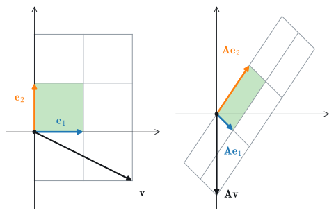
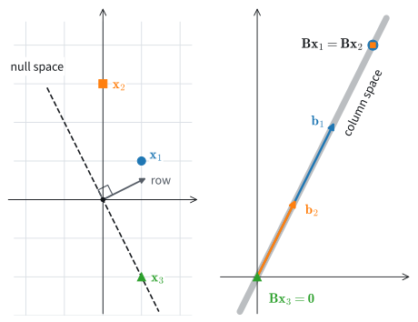
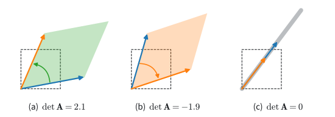

# Matrices as Linear Maps
:label:`sec_mdl-linear-maps`

Placeholder opening: a matrix is fixed by where it sends the coordinate axes; rank counts the dimensions that survive, and the determinant measures how volume scales. (The section writer replaces this paragraph.)

```{.python .input #mdl-linear-maps-matrices-as-linear-maps}
#@tab mxnet
import numpy as onp
```

```{.python .input #mdl-linear-maps-matrices-as-linear-maps}
#@tab pytorch
import numpy as onp
```

```{.python .input #mdl-linear-maps-matrices-as-linear-maps}
#@tab tensorflow
import numpy as onp
```

```{.python .input #mdl-linear-maps-matrices-as-linear-maps}
#@tab jax
import numpy as onp
```

## Linear Maps

### Linear Transformations

As introduced in :numref:`sec_linear-algebra`, matrices represent linear
transformations. We now study their geometry, using two dimensions for
visualization.

Consider the matrix

$$
\mathbf{A} = \begin{bmatrix}
a & b \\ c & d
\end{bmatrix}.
$$

Applying it to an arbitrary vector $\mathbf{v} = [x, y]^\top$ gives

$$
\begin{aligned}
\mathbf{A}\mathbf{v} & = \begin{bmatrix}a & b \\ c & d\end{bmatrix}\begin{bmatrix}x \\ y\end{bmatrix} 
& = \begin{bmatrix}ax+by\\ cx+dy\end{bmatrix} \\
& = x\begin{bmatrix}a \\ c\end{bmatrix} + y\begin{bmatrix}b \\d\end{bmatrix} 
& = x\left\{\mathbf{A}\begin{bmatrix}1\\0\end{bmatrix}\right\} + y\left\{\mathbf{A}\begin{bmatrix}0\\1\end{bmatrix}\right\}.
\end{aligned}
$$

This calculation expresses the image of *any* vector in terms of the images
of two specific vectors, $[1,0]^\top$ and $[0,1]^\top$.
The vectors $[1,0]^\top$ and $[0,1]^\top$ are exactly the standard basis
$\mathbf{e}_1, \mathbf{e}_2$ from our discussion of spans and bases: because
every vector is a (unique) weighted sum of basis vectors, knowing where a
matrix sends a basis determines where it sends everything.

Consider the specific matrix

$$
\mathbf{A} = \begin{bmatrix}
1 & 2 \\
-1 & 3
\end{bmatrix}.
$$

The vector $\mathbf{v} = [2, -1]^\top$ equals
$2\cdot[1,0]^\top - [0,1]^\top$, so $\mathbf{A}$ maps it to
$2\,\mathbf{A}[1,0]^\top - \mathbf{A}[0,1]^\top = 2[1, -1]^\top - [2,3]^\top = [0, -5]^\top$.
Applying the same reasoning to the integer grid shows that matrix multiplication
can shear, rotate, reflect, project, and scale directions while preserving
linear combinations, as shown in :numref:`fig_mdl-la-linear-map`.

![The matrix $\mathbf{A} = \bigl(\begin{smallmatrix}1 & 2 \\ -1 & 3\end{smallmatrix}\bigr)$ acting on the plane. The basis vectors are sent to $\mathbf{A}\mathbf{e}_1 = (1, -1)^\top$ and $\mathbf{A}\mathbf{e}_2 = (2, 3)^\top$, and the entire grid is transported along with them: lines stay lines, the origin stays put, and equally spaced cells stay equally spaced. The shaded unit square maps to the shaded parallelogram, whose area will be the subject of the determinant below. The right panel is drawn at one third the scale of the left, so that the whole image grid fits.](../img/mdl-la-linear-map.svg)
:label:`fig_mdl-la-linear-map`

The defining restriction is position-independent linearity: the same
displacement is transformed identically everywhere, and linear combinations
are preserved.

Some distortions can be severe.  For instance the matrix

$$
\mathbf{B} = \begin{bmatrix}
2 & -1 \\ 4 & -2
\end{bmatrix},
$$

compresses the entire two-dimensional plane down to a single line.
Such transformations differ fundamentally from invertible maps.
The image of $\mathbf{A}$ can be mapped back to the original grid, whereas
$\mathbf{B}$ maps distinct inputs to the same output. For example, both
$[1,1]^\top$ and $[0, -1]^\top$ map to $[1,2]^\top$.

The same reasoning extends beyond $2\times2$ matrices. In any dimension, the
images of the basis vectors determine the action of the matrix on the entire
space. For example, $[1,0, \ldots,0]$ selects the first column.

Nothing requires the matrix to be square, either. An $m \times n$ matrix takes
vectors with $n$ entries to vectors with $m$ entries: it is a linear map
*between* spaces, from $\mathbb{R}^n$ to $\mathbb{R}^m$, and it is still
determined by where it sends the $n$ basis vectors (whose images are its
columns). A $2 \times 3$ matrix has an image of dimension at most two; it
fills the output plane only when its rank is two. A $3 \times 2$ matrix has a
plane through the origin as its image when its rank is two, and a line or the
origin at lower rank. Every fully connected layer of a
neural network is such a map between spaces of different dimensions,
composed with a nonlinearity.

### Orthogonal Matrices

A matrix may skew, rotate, and scale, but a special family does
*only* the rigid part: it rotates or reflects without any stretching. A square
matrix $\mathbf{Q}$ is called **orthogonal** when its columns are orthonormal,
which we can write compactly as $\mathbf{Q}^\top\mathbf{Q} = \mathbf{I}$. The
defining property of such maps is that they **preserve lengths and angles**,
because they preserve every dot product:

$$
(\mathbf{Q}\mathbf{x})\cdot(\mathbf{Q}\mathbf{y})
 = (\mathbf{Q}\mathbf{x})^\top(\mathbf{Q}\mathbf{y})
 = \mathbf{x}^\top\mathbf{Q}^\top\mathbf{Q}\,\mathbf{y}
 = \mathbf{x}^\top\mathbf{y}
 = \mathbf{x}\cdot\mathbf{y}.
$$

Taking $\mathbf{y} = \mathbf{x}$ shows $\|\mathbf{Q}\mathbf{x}\| =
\|\mathbf{x}\|$, so an orthogonal map is a rigid motion of space. Since
$\mathbf{Q}^\top\mathbf{Q} = \mathbf{I}$ means $\mathbf{Q}^{-1} =
\mathbf{Q}^\top$, such maps are invertible, and as we will prove
when we meet the determinant at the end of this section, their volume scaling
is $\det\mathbf{Q} = \pm 1$ (the sign distinguishes orientation-preserving
from orientation-reversing maps). Orthogonal matrices preserve lengths and
angles, and
they will turn out to be the building blocks
of the two decompositions in the sections that follow: the spectral theorem
writes a symmetric matrix as $\mathbf{Q}\boldsymbol\Lambda\mathbf{Q}^\top$
(:numref:`sec_mdl-eigendecompositions`), and the singular value decomposition
writes *any* matrix as orthogonal–diagonal–orthogonal
(:numref:`sec_mdl-svd-low-rank`).

### Linear Dependence, Rank, and Invertibility

Finally, two subspaces attach to every matrix $\mathbf{A}$, and they organize
everything matrices do in the remainder of this chapter. The **column space**
of $\mathbf{A}$ is the span of its columns; since the product
$\mathbf{A}\mathbf{v}$ is exactly the linear combination of the columns of
$\mathbf{A}$ weighted by the entries of $\mathbf{v}$ (a fact we put to work
when we take up matrices as maps below), the column space is the set of all
possible *outputs* of $\mathbf{A}$. The **null space** of $\mathbf{A}$ is the
set of inputs sent to zero, $\{\mathbf{x} : \mathbf{A}\mathbf{x} =
\mathbf{0}\}$; it is a subspace because if $\mathbf{A}\mathbf{x} =
\mathbf{A}\mathbf{y} = \mathbf{0}$ then $\mathbf{A}(a\mathbf{x} + b\mathbf{y})
= a\,\mathbf{A}\mathbf{x} + b\,\mathbf{A}\mathbf{y} = \mathbf{0}$. In words:
the column space records what a matrix can produce, and the null space records
what it destroys. We will measure the first when we define the *rank* below,
and meet both again among the SVD's *four fundamental subspaces* in
:numref:`sec_mdl-svd-low-rank`.

Consider again the matrix

$$
\mathbf{B} = \begin{bmatrix}
2 & -1 \\ 4 & -2
\end{bmatrix}.
$$

This maps the entire plane to the single line $y = 2x$, a property visible
from the matrix itself. Let $\mathbf{b}_1 = [2,4]^\top$ and
$\mathbf{b}_2 = [-1, -2]^\top$ denote the two columns of $\mathbf{B}$.
Every output of $\mathbf{B}$ is a linear combination
$a_1\mathbf{b}_1 + a_2\mathbf{b}_2$;
in the language of spans, the outputs of $\mathbf{B}$ fill out exactly its
column space.
The fact that $\mathbf{b}_1 = -2\cdot\mathbf{b}_2$
means that we can write any linear combination of those two columns
entirely in terms of say $\mathbf{b}_2$ since

$$
a_1\mathbf{b}_1 + a_2\mathbf{b}_2 = -2a_1\mathbf{b}_2 + a_2\mathbf{b}_2 = (a_2-2a_1)\mathbf{b}_2.
$$

Thus, one column is redundant, consistent with the collapse of the plane to a
line. The dependence $\mathbf{b}_1 = -2\cdot\mathbf{b}_2$ can be written
symmetrically as

$$
\mathbf{b}_1  + 2\cdot\mathbf{b}_2 = 0.
$$

The coefficients $(1, 2)$ of this relation say
precisely that $\mathbf{B}[1, 2]^\top = 1\cdot\mathbf{b}_1 + 2\cdot\mathbf{b}_2
= \mathbf{0}$, so the dependence hands us a nonzero vector in the *null space*
of $\mathbf{B}$. :numref:`fig_mdl-la-null-collapse` shows the two subspaces of
$\mathbf{B}$ together: the whole plane is mapped onto the column
space, while the null-space direction is exactly the set of inputs that land
on the origin. (For this particular $\mathbf{B}$ the two subspaces happen to
coincide as sets, both being the line $y = 2x$: a coincidence, equivalent
to $\mathbf{B}^2 = \mathbf{0}$, that makes the picture no less instructive,
since what the matrix *produces* and what it *destroys* are different roles
even when they occupy the same line.)

![The matrix $\mathbf{B} = \left(\begin{smallmatrix}2 & -1 \\ 4 & -2\end{smallmatrix}\right)$ collapsing the plane. Left: the input plane, with three marked points and the null-space direction $(1,2)^\top$ dashed; every input on that line is sent to the origin. Right: the image. The entire grid lands on the column space, the line $y = 2x$ spanned by the columns $\mathbf{b}_1$ and $\mathbf{b}_2$; the marked points land at their images, and the null-space line has collapsed to $\mathbf{0}$. Because distinct inputs have the same image, no inverse exists.](../img/mdl-la-null-collapse.svg)
:label:`fig_mdl-la-null-collapse`

In general, we will say that a collection of vectors
$\mathbf{v}_1, \ldots, \mathbf{v}_k$ are *linearly dependent*
if there exist coefficients $a_1, \ldots, a_k$ *not all equal to zero* so that

$$
\sum_{i=1}^k a_i\mathbf{v}_i = 0.
$$

In this case, one vector can be expressed as a combination of the others and
is therefore redundant. Linear dependence among the columns shows that the
matrix maps the input space to a lower-dimensional subspace.
If there is no linear dependence we say the vectors are *linearly
independent*, the same notion we met when defining bases, now read as a
property of a matrix's columns. If a matrix has linearly independent columns,
the map is injective and its inputs can be recovered
from outputs in its image. A square such matrix is invertible.

#### Rank
:label:`subsec_mdl-rank`

For a general $m\times n$ matrix, the *rank* is the dimension of its image.
Equivalently, the rank of $\mathbf{A}$
is the largest number of linearly independent columns
amongst all subsets of columns. For example, our matrix

$$
\mathbf{B} = \begin{bmatrix}
2 & -1 \\ 4 & -2
\end{bmatrix}
$$

from above has $\textrm{rank}(\mathbf{B})=1$, since the two columns
$[2, 4]^\top$ and $[-1, -2]^\top$ are linearly dependent,
while each column on its own is linearly independent.
As another example, consider

$$
\mathbf{C} = \begin{bmatrix}
1& 3 & 0 & -1 & 0 \\
-1 & 0 & 1 & 1 & -1 \\
0 & 3 & 1 & 0 & -1 \\
2 & 3 & -1 & -2 & 1
\end{bmatrix},
$$

which has rank two: for instance,
the first two columns are linearly independent,
while each of the $\binom{5}{3} = 10$ collections of three columns is
linearly dependent
(exercise :exref:`ex_mdl-geometry-linear-algebraic-ops-rank-of-c`).

Equivalently, the rank is the *dimension of the column space* we defined
alongside spans and bases, and a foundational theorem of linear algebra says
this equals the dimension of the *row space*, the span of the rows. A matrix
"compresses space" into a lower dimension exactly when its rank is smaller
than its number of columns, equivalently, when its null space contains some
nonzero vector.

Checking every subset of columns is potentially exponential in the number of
columns. Later sections introduce more efficient ways to compute rank; the
subset definition is useful here for establishing its meaning.

Rank--nullity quantifies the dimensions mapped to zero and retained in the
image.

**Proposition (rank--nullity).** *For an $m \times n$ matrix $\mathbf{A}$,*

$$
\operatorname{rank}\mathbf{A} + \dim\ker\mathbf{A} = n,
$$

*where $\ker\mathbf{A}$ denotes the null space.*

**Proof.** Choose a basis $\mathbf{w}_1, \ldots, \mathbf{w}_k$ of the null
space and extend it to a basis $\mathbf{w}_1, \ldots, \mathbf{w}_k,
\mathbf{v}_1, \ldots, \mathbf{v}_{n-k}$ of $\mathbb{R}^n$. The images
$\mathbf{A}\mathbf{v}_1, \ldots, \mathbf{A}\mathbf{v}_{n-k}$ span the column
space (the $\mathbf{w}_i$ contribute nothing), and they are independent: if
$\sum_i c_i \mathbf{A}\mathbf{v}_i = \mathbf{0}$ then $\sum_i c_i \mathbf{v}_i$
lies in the null space, hence is a combination of the $\mathbf{w}_j$,
impossible within a basis unless every $c_i = 0$. So the column space has
dimension exactly $n - k$. $\blacksquare$

Of the $n$ input dimensions, $\dim\ker\mathbf{A}$ map to zero and
$\operatorname{rank}\mathbf{A}$ remain in the image. For $\mathbf{B}$ the
count is $1 + 1 = 2$: the column space and null space each have dimension one, as
:numref:`fig_mdl-la-null-collapse` shows. The
singular value decomposition will make this split visible, with orthonormal
bases attached to both halves, in :numref:`sec_mdl-svd-low-rank`.

#### Invertibility

A matrix with linearly dependent columns maps some distinct inputs to the same
output, so no inverse can recover every input. By contrast, a square
*full-rank* matrix $\mathbf{A}$ of size $n \times n$ is both injective and
surjective and therefore invertible. Consider the matrix

$$
\mathbf{I} = \begin{bmatrix}
1 & 0 & \cdots & 0 \\
0 & 1 & \cdots & 0 \\
\vdots & \vdots & \ddots & \vdots \\
0 & 0 & \cdots & 1
\end{bmatrix}.
$$

This *identity* matrix has ones on the diagonal and zeros elsewhere, and it
leaves every vector unchanged. An inverse of $\mathbf{A}$ is a matrix
$\mathbf{A}^{-1}$ satisfying

$$
\mathbf{A}^{-1}\mathbf{A} = \mathbf{A}\mathbf{A}^{-1} =  \mathbf{I}.
$$

Viewed entrywise, $\mathbf{A}^{-1}$ has $n \times n$ unknown entries, and the
product $\mathbf{A}^{-1}\mathbf{A}$ must equal $\mathbf{I}$, imposing
$n \times n$ scalar constraints. Their number alone does not guarantee a
solution; full rank does. When it exists, $\mathbf{A}^{-1}$ is unique for an
$n$-dimensional square map.

The *determinant*, introduced below, gives an equivalent criterion: the inverse
exists exactly when the determinant is nonzero.
As an example, if $\mathbf{A}$ is the general $2 \times 2$ matrix

$$
\mathbf{A} = \begin{bmatrix}
a & b \\
c & d
\end{bmatrix},
$$

then its inverse is

$$
 \frac{1}{ad-bc}  \begin{bmatrix}
d & -b \\
-c & a
\end{bmatrix}.
$$

The following multiplication verifies the formula for a specific matrix.

```{.python .input #geometry-linear-algebraic-ops-invertibility}
import numpy as onp
M = onp.array([[1, 2], [1, 4]])
M_inv = onp.array([[2, -1], [-0.5, 0.5]])
M_inv.dot(M)
```

#### Numerical Issues
:label:`subsec_mdl-numerical-issues`
While the matrix inverse is useful in theory, in practice we rarely want to
*compute* it. To solve the linear system $\mathbf{A}\mathbf{x} = \mathbf{b}$,
prefer `linalg.solve(A, b)` to the tempting but inferior `inv(A) @ b`: the
solver factorizes $\mathbf{A}$ without ever forming its inverse. Like division
by a small number, inversion of a matrix that is close to having low rank can
amplify numerical errors. Sparsity raises the stakes further.
A matrix with a million rows and columns but only $5$ million non-zero entries
is cheap to store, yet its inverse is typically dense, with on the order of
$10^{12}$ non-zero entries. The condition number of
:numref:`subsec_mdl-condition-number` makes "close to low rank" precise, and
measures exactly how much a solve can amplify error.

### The Determinant
The geometric view gives an intuitive interpretation of the *determinant*.
Return to the grid picture of :numref:`fig_mdl-la-linear-map` and watch the
shaded unit square, the square with edges $\mathbf{e}_1 = (1,0)^\top$ and
$\mathbf{e}_2 = (0,1)^\top$, hence with area one. The matrix

$$
\mathbf{A} = \begin{bmatrix}
1 & 2 \\
-1 & 3
\end{bmatrix}
$$

carries it to the shaded parallelogram with edges
$\mathbf{A}\mathbf{e}_1 = [1, -1]^\top$ and $\mathbf{A}\mathbf{e}_2 = [2, 3]^\top$.
There is no reason this parallelogram should have the same area
that we started with, and indeed an exercise in coordinate geometry
shows that its area is exactly $5$: this particular matrix
quintuples areas.

In general, a matrix

$$
\mathbf{A} = \begin{bmatrix}
a & b \\
c & d
\end{bmatrix}
$$

sends the unit square to the parallelogram with edges $(a, c)^\top$ and
$(b, d)^\top$, and we can compute that parallelogram's area directly. Suppose
for the moment that all four entries are positive and that $(a, c)^\top$ makes
the smaller angle with the $x$-axis. The parallelogram has vertices $(0,0)$,
$(a, c)$, $(b, d)$, and $(a+b, c+d)$; enclose it in its bounding rectangle
$[0, a+b] \times [0, c+d]$. The part of the rectangle outside the
parallelogram consists of two $b \times c$ rectangles in the corners, two
right triangles with legs $a$ and $c$, and two right triangles with legs $b$
and $d$. Subtracting all six pieces from the rectangle's area leaves

$$
(a+b)(c+d) - 2bc - 2\cdot\tfrac{1}{2}\,ac - 2\cdot\tfrac{1}{2}\,bd = ad - bc.
$$

Working through the other sign configurations changes only the sign of the
result, never its magnitude: the parallelogram's area is always $|ad - bc|$.
The signed quantity $ad-bc$
is referred to as the *determinant*, written $\det\mathbf{A}$.

The following code confirms the worked example: for the matrix
$\mathbf{A}$ above the determinant should come out to
$1 \cdot 3 - 2 \cdot (-1) = 5$.

```{.python .input #geometry-linear-algebraic-ops-determinant}
import numpy as onp
onp.linalg.det(onp.array([[1, 2], [-1, 3]]))
```

The expression $ad - bc$ can be zero or negative, and
:numref:`fig_mdl-la-determinant` shows the three possible regimes side by
side, each for a different matrix: a positive determinant, where the unit
square maps to a parallelogram of area $\det\mathbf{A}$; a negative
determinant, where the parallelogram has area $|\det\mathbf{A}|$ but the map
has *flipped the orientation* of the plane (the images of $\mathbf{e}_1$ and
$\mathbf{e}_2$ have traded sides); and a zero determinant, where the square is
mapped to a segment. The sign convention records an orientation reversal as
a negative signed area.


:label:`fig_mdl-la-determinant`

A zero determinant reveals a loss of dimension. Consider the matrix

$$
\mathbf{B} = \begin{bmatrix}
2 & -1 \\ 4 & -2
\end{bmatrix}.
$$

If we compute the determinant of this matrix,
we get $2\cdot(-2) - (-1)\cdot 4 = 0$.
$\mathbf{B}$ compresses the unit square
down to a segment of the line $y = 2x$, which has zero area:
the situation of panel (c) in :numref:`fig_mdl-la-determinant`, and exactly
the collapse pictured in :numref:`fig_mdl-la-null-collapse`.
And indeed, being compressed into a lower dimensional space
is the only way to have zero area after the transformation.
Thus, a square matrix $A$ is invertible if and only if
the determinant is not equal to zero. We prove this equivalence below, once
the determinant exists in every dimension.

#### The Determinant in General
:label:`subsec_mdl-determinant-general`

The two-dimensional picture says what the determinant of an $n \times n$
matrix should be: the signed volume of the parallelepiped spanned by its
columns. Rather than wrestle with $n$-dimensional geometry directly, we
distill the three properties of signed volume that determine it completely,
stated for the columns $\mathbf{a}_1, \ldots, \mathbf{a}_n$ of an
$n \times n$ matrix:

1. **Multilinear**: $\det$ is linear in each column separately, with the other
   columns held fixed. (Scaling one edge of a parallelepiped scales its
   volume; splitting one edge as a sum splits the volume accordingly.)
2. **Alternating**: $\det$ is zero whenever two columns are equal. (The
   parallelepiped then flattens into a lower-dimensional slab of zero volume.)
3. **Normalized**: $\det \mathbf{I} = 1$. (The unit cube has volume one.)

We grant one fact here without proof: exactly *one* function of the columns
has these three properties, and it is the determinant (see
:cite:`Horn.Johnson.2012` for the construction and the uniqueness argument).
Uniqueness comes in a sharper form that we will use
below: *every* function $f$ of the columns satisfying (1) and (2) is a
multiple of the determinant, $f = f(\mathbf{I}) \cdot \det$. To see why, set
$g = f - f(\mathbf{I})\cdot\det$; then $g$ satisfies (1) and (2) with
$g(\mathbf{I}) = 0$, so $g + \det$ satisfies all three properties, hence
equals $\det$ by uniqueness, forcing $g = 0$.

The three properties yield several useful identities. First,
**swapping two columns flips the sign of the determinant**. Place the vector
$\mathbf{u}+\mathbf{v}$ in two different column slots and expand by
multilinearity:

$$
\begin{aligned}
0 &= \det(\ldots, \mathbf{u}+\mathbf{v}, \ldots, \mathbf{u}+\mathbf{v}, \ldots) \\
  &= \det(\ldots, \mathbf{u}, \ldots, \mathbf{u}, \ldots)
   + \det(\ldots, \mathbf{u}, \ldots, \mathbf{v}, \ldots)
   + \det(\ldots, \mathbf{v}, \ldots, \mathbf{u}, \ldots)
   + \det(\ldots, \mathbf{v}, \ldots, \mathbf{v}, \ldots).
\end{aligned}
$$

The left-hand side, the first term, and the last term all vanish by the
alternating property, leaving

$$
\det(\ldots, \mathbf{u}, \ldots, \mathbf{v}, \ldots)
 = -\det(\ldots, \mathbf{v}, \ldots, \mathbf{u}, \ldots).
$$

This is where the *sign* of the signed area comes from: exchanging two edges
reverses the orientation of the parallelepiped, and an odd permutation of the
columns negates the determinant.

Second, the three properties pin down a formula. Expand each column in the
standard basis, $\mathbf{a}_j = \sum_i a_{ij}\,\mathbf{e}_i$, and apply
multilinearity column by column: $\det\mathbf{A}$ becomes a sum of terms of
the form $a_{i_1 1} a_{i_2 2} \cdots a_{i_n n}
\det(\mathbf{e}_{i_1}, \ldots, \mathbf{e}_{i_n})$. Whenever two of the chosen
row indices coincide, the term vanishes by the alternating property; when all are
distinct, the columns $\mathbf{e}_{i_1}, \ldots, \mathbf{e}_{i_n}$ are a
reshuffling of the identity matrix's, so repeated column swaps reduce the
determinant factor to $\pm 1$. For a $2 \times 2$ matrix with columns
$\mathbf{a}_1 = a\,\mathbf{e}_1 + c\,\mathbf{e}_2$ and
$\mathbf{a}_2 = b\,\mathbf{e}_1 + d\,\mathbf{e}_2$, the expansion has four
terms; the two with a repeated basis vector vanish and

$$
\det(\mathbf{a}_1, \mathbf{a}_2)
 = ad\,\det(\mathbf{e}_1, \mathbf{e}_2)
 + cb\,\det(\mathbf{e}_2, \mathbf{e}_1)
 = ad - bc,
$$

recovering the parallelogram area we computed by hand. In general the
determinant is a signed sum of the products of the chosen entries, taken over
all ways of picking one entry from each row and each column. Writing
$\sigma(j)$ for the row picked in column $j$, this is the *permutation formula*

$$\det\mathbf{A} = \sum_{\sigma} \operatorname{sgn}(\sigma)\, a_{\sigma(1)1}\, a_{\sigma(2)2} \cdots a_{\sigma(n)n},$$
:eqlabel:`eq_mdl-det-permutation`

where $\sigma$ runs over the permutations of $\{1, \ldots, n\}$ and
$\operatorname{sgn}(\sigma) = \det(\mathbf{e}_{\sigma(1)}, \ldots,
\mathbf{e}_{\sigma(n)}) = \pm 1$. The properties (1)+(2)+(3) leave no other
possibility.

For hand computation the sum is organized as *cofactor expansion*: expanding
the first column in the standard basis splits $\det\mathbf{A}$ into $n$
smaller determinants, with alternating signs, of the submatrices obtained by
deleting the first column and one row. Consider the $3 \times 3$ example

$$
\mathbf{A} = \begin{bmatrix}
2 & 1 & 0 \\
1 & 3 & 1 \\
0 & 1 & 2
\end{bmatrix},
$$

expanding along the first column:

$$
\det \mathbf{A}
 = 2 \det \begin{bmatrix} 3 & 1 \\ 1 & 2 \end{bmatrix}
 - 1 \det \begin{bmatrix} 1 & 0 \\ 1 & 2 \end{bmatrix}
 + 0 \det \begin{bmatrix} 1 & 0 \\ 3 & 1 \end{bmatrix}
 = 2 \cdot 5 - 1 \cdot 2 + 0 = 8.
$$
:eqlabel:`eq_mdl-det-3x3`

Geometrically, $\mathbf{A}$ maps the unit cube to a parallelepiped of volume
$8$, and it scales the volume of every solid by that same factor. The following
code checks :eqref:`eq_mdl-det-3x3` and two consequences of the
properties above: swapping two columns flips the sign, and the determinant of
a triangular matrix is the product of its diagonal entries.

```{.python .input #mdl-geometry-linear-algebraic-ops-det-3x3}
import numpy as onp
A = onp.array([[2, 1, 0], [1, 3, 1], [0, 1, 2]])
A_swap = onp.array([[1, 2, 0], [3, 1, 1], [1, 0, 2]])  # first two columns swapped
T = onp.array([[2, 5, 1], [0, 3, 4], [0, 0, 1]])       # upper triangular
(onp.linalg.det(A),       # 8, matching the cofactor expansion
 onp.linalg.det(A_swap),  # -8: a column swap flips the sign
 onp.linalg.det(T))       # 6 = 2 * 3 * 1, the diagonal product
```

The triangular rule deserves its one-paragraph proof, since the next section
relies on it. Suppose $\mathbf{T}$ is upper triangular, so $t_{ij} = 0$
whenever $i > j$. Each term of the permutation formula picks one entry from
every column, all in distinct rows. To be nonzero, the entry picked from
column $1$ must come from row $1$ (every lower entry vanishes); the entry from
column $2$ must then come from row $2$ (row $1$ is taken and rows $3, \ldots,
n$ hold zeros); continuing across the columns, only the diagonal choice
survives. That single term carries the sign of no swaps at all, so

$$
\det \mathbf{T} = t_{11} t_{22} \cdots t_{nn},
$$

the product of the diagonal entries. The same argument, run from column $n$
backwards, handles lower triangular matrices.

Another useful identity is $\det \mathbf{A}^\top =
\det \mathbf{A}$. For $2 \times 2$ matrices this is visible at a glance, since
transposing swaps $b$ and $c$ and leaves $ad - bc$ unchanged. In general,
transposing merely reindexes the permutation formula: each product of $n$
entries, one from every row and every column, appears in both expansions with
the same sign (see :cite:`Horn.Johnson.2012` for the bookkeeping). One
consequence: everything the determinant says about columns holds verbatim for
rows.

#### The Unifying Theorem

The equivalence between a zero determinant, linearly dependent columns, and
failure of invertibility connects three notions we have met separately. We
state it once, with a proof we can carry out by hand in two dimensions.

**Proposition (the unifying theorem).** *For a square matrix $\mathbf{A}$, the
following are equivalent:*
(i) *$\det\mathbf{A} = 0$;*
(ii) *the columns of $\mathbf{A}$ are linearly dependent;*
(iii) *$\mathbf{A}$ is not invertible.*

**Proof (for the $2 \times 2$ case).** We give the argument for the
$2 \times 2$ matrix
$\mathbf{A} = \bigl[\begin{smallmatrix} a & b \\ c & d \end{smallmatrix}\bigr]$,
where every step is a picture. Write the two
columns as $\mathbf{a}_1 = [a, c]^\top$ and $\mathbf{a}_2 = [b, d]^\top$. As we
saw above, $\det\mathbf{A} = ad - bc$ is the *signed area* of the parallelogram
spanned by $\mathbf{a}_1$ and $\mathbf{a}_2$.

*(i) $\Leftrightarrow$ (ii).* A parallelogram has zero area exactly when its two
spanning edges are collinear, i.e., when one column is a scalar multiple of the
other (including the degenerate case where a column is $\mathbf{0}$). That is
precisely linear dependence of the columns. So $ad - bc = 0$ if and only if
$\mathbf{a}_1$ and $\mathbf{a}_2$ are linearly dependent.

*(ii) $\Leftrightarrow$ (iii).* If the columns are dependent, every output
$\mathbf{A}\mathbf{x} = x_1\mathbf{a}_1 + x_2\mathbf{a}_2$ lies on the single
line spanned by the surviving column, so the whole plane is mapped onto that
line. Distinct inputs collide there (the map is not one-to-one), so no inverse
can recover them, and $\mathbf{A}$ is not invertible. Conversely, if the columns
are independent they span the plane, every target is hit exactly once, and the
map can be undone; concretely, $ad - bc \neq 0$ is exactly the nonvanishing
denominator that made the explicit inverse
$\frac{1}{ad-bc}\bigl[\begin{smallmatrix} d & -b \\ -c & a \end{smallmatrix}\bigr]$
well-defined earlier in this section. $\blacksquare$

In $n$ dimensions the same equivalences hold, and the axiomatic
characterization of :numref:`subsec_mdl-determinant-general` supplies the two
ingredients that generalize: $\det\mathbf{A}$ is the signed factor by which
$\mathbf{A}$ scales $n$-dimensional volume, and that volume vanishes exactly
when the columns are linearly dependent; see :cite:`Horn.Johnson.2012` for the
full argument. The equivalence also proves claims made earlier without proof.
The linear dependence of the columns of $\mathbf{B}$, the missing
$ad - bc \neq 0$ hypothesis under the $2 \times 2$ inverse, and the present
section's "$\det = 0$ means collapse" are equivalent statements.

#### Multiplicativity

Approximating a planar figure by a collection of small squares gives geometric
intuition for the determinant. A linear map sends each square to a
parallelogram with the same signed area-scaling factor. Thus, the determinant
is the signed factor by which the map scales the area of the entire figure.

This "scale every figure's area by the same factor" reading has an immediate
consequence for *composing* two transformations. First, a fact that deserves
its own sentence: **matrix multiplication is composition of linear
maps**. Applying $\mathbf{B}$ and then $\mathbf{A}$ to an input $\mathbf{v}$
produces $\mathbf{A}(\mathbf{B}\mathbf{v})$, and writing out components,

$$
\bigl(\mathbf{A}(\mathbf{B}\mathbf{v})\bigr)_i
 = \sum_j a_{ij} (\mathbf{B}\mathbf{v})_j
 = \sum_j \sum_k a_{ij} b_{jk} v_k
 = \bigl((\mathbf{A}\mathbf{B})\mathbf{v}\bigr)_i,
$$

so applying the two maps in sequence is equivalent to applying the single
matrix $\mathbf{A}\mathbf{B}$. Composition motivates the row-times-column
definition of matrix multiplication and explains why the product is
associative but not commutative: composing functions in the other order
generally gives a different function. With composition in hand, we can prove
that the determinant is multiplicative.

**Proposition (multiplicativity of the determinant).** *For square matrices
$\mathbf{A}$ and $\mathbf{B}$ of the same size,*

$$
\det(\mathbf{A}\mathbf{B}) = \det(\mathbf{A})\,\det(\mathbf{B}).
$$
:eqlabel:`eq_mdl-det-multiplicative`

**Geometric intuition.** Apply $\mathbf{A}\mathbf{B}$ to an arbitrary figure
of area $V$ by running the two maps in turn. First $\mathbf{B}$ acts and
scales the area to $\det(\mathbf{B})\,V$; then $\mathbf{A}$ acts and scales
that by a further factor of $\det(\mathbf{A})$. But the composite map
$\mathbf{A}\mathbf{B}$ is itself a single linear transformation, which scales
area by its own determinant, so the two factors must multiply to
$\det(\mathbf{A}\mathbf{B})$. This argument leans on the tiling picture above
(a linear map scales *every* figure's volume by one common factor), which we
made plausible but did not prove; the axioms of
:numref:`subsec_mdl-determinant-general` turn it into a proof.

**Proof.** Fix $\mathbf{A}$ and consider, as a function of $\mathbf{B}$, the
quantity $D(\mathbf{B}) = \det(\mathbf{A}\mathbf{B})$. The $j$-th column of
$\mathbf{A}\mathbf{B}$ is $\mathbf{A}\mathbf{b}_j$, where $\mathbf{b}_j$ is
the $j$-th column of $\mathbf{B}$. Because $\mathbf{A}(\cdot)$ is linear and
$\det$ is multilinear, $D$ is multilinear in the columns of $\mathbf{B}$; and
if two columns of $\mathbf{B}$ are equal, then so are the corresponding
columns of $\mathbf{A}\mathbf{B}$, making $D(\mathbf{B}) = 0$, so $D$ is
alternating. By the scaling form of uniqueness from
:numref:`subsec_mdl-determinant-general`,

$$
\det(\mathbf{A}\mathbf{B}) = D(\mathbf{B}) = D(\mathbf{I})\,\det(\mathbf{B})
 = \det(\mathbf{A})\,\det(\mathbf{B}). \qquad \blacksquare
$$

Multiplicativity has the following immediate consequence.

**Corollary.** *For square matrices $\mathbf{A}$ and $\mathbf{B}$ of the same
size,*

$$
\det(\mathbf{A}\mathbf{B}) = \det(\mathbf{A})\,\det(\mathbf{B})
 = \det(\mathbf{B})\,\det(\mathbf{A}) = \det(\mathbf{B}\mathbf{A}).
$$

Even though $\mathbf{A}\mathbf{B} \neq \mathbf{B}\mathbf{A}$ in general, their
determinants always agree, because the two determinants are scalars and
scalars commute. Applied to the pair
$\mathbf{W}\mathbf{A}$ and $\mathbf{W}^{-1}$, it gives *similarity
invariance*, $\det(\mathbf{W}\mathbf{A}\mathbf{W}^{-1}) =
\det(\mathbf{W}^{-1}\mathbf{W}\mathbf{A}) = \det(\mathbf{A})$: matrices that
represent the same linear map in different bases have the same determinant,
a fact :numref:`sec_mdl-eigendecompositions` puts to work.

Further consequences follow without any additional work. First, taking
$\mathbf{B} = \mathbf{A}^{-1}$ in :eqref:`eq_mdl-det-multiplicative` and using
$\det(\mathbf{I}) = 1$ (the identity moves no volume) gives

$$
\det(\mathbf{A}^{-1}) = \frac{1}{\det(\mathbf{A})},
$$

which also re-confirms the unifying theorem: an inverse can exist only when
$\det(\mathbf{A}) \neq 0$, since otherwise the right-hand side is undefined.
Second, we can prove the claim made in the orthogonal-matrices
subsection. Combining multiplicativity with $\det\mathbf{Q}^\top =
\det\mathbf{Q}$ from :numref:`subsec_mdl-determinant-general` and applying
both to $\mathbf{Q}^\top\mathbf{Q} = \mathbf{I}$ gives

$$
\det(\mathbf{Q})^2 = \det(\mathbf{Q}^\top)\det(\mathbf{Q})
 = \det(\mathbf{Q}^\top\mathbf{Q}) = \det(\mathbf{I}) = 1,
$$

so $\det\mathbf{Q} = \pm 1$: a rigid motion leaves every area and volume
unchanged in magnitude, and the sign records whether it preserves orientation
($+1$) or reverses orientation ($-1$).
Third, and looking ahead, similarity invariance is exactly what lets the
determinant pass through a diagonalization: once we can write a matrix in
terms of its eigenvalues in :numref:`sec_mdl-eigendecompositions`, the same
identities will show that the determinant is the *product of the
eigenvalues*, $\det(\mathbf{A}) = \prod_i \lambda_i$, the volume scaling
being the product of the per-axis stretch factors.

## Tensors and Einstein Summation

We close with a compact notation for all of these products at once. Every
product in this section (dot products, matrix–vector products,
matrix products, and the *trace* $\textrm{tr}(\mathbf{A}) = \sum_i a_{ii}$,
the sum of the diagonal entries) follows one pattern: multiply entries, then
sum over the index that appears twice,

$$
\mathbf{v} \cdot \mathbf{w} = \sum_i v_i w_i,
\qquad
(\mathbf{A}\mathbf{v})_i = \sum_j a_{ij} v_j,
\qquad
(\mathbf{A}\mathbf{B})_{ik} = \sum_j a_{ij} b_{jk},
\qquad
\textrm{tr}(\mathbf{A}) = \sum_i a_{ii}.
$$

*Einstein notation* makes the pattern the entire definition: write the indexed
factors, drop the summation sign, and sum over each index repeated exactly
twice in a term. Thus $\mathbf{v}\cdot\mathbf{w} = v_i w_i$ and
$(\mathbf{A}\mathbf{B})_{ik} = a_{ij}b_{jk}$. The same rule extends unchanged
to tensors with any number of axes, where a general *tensor contraction* such
as $y_{il} = x_{ijkl}\,a_{jk}$ (summing over $j$ and $k$) has no tidy matrix
notation at all. The rule is exposed directly as
`einsum`: spell out the index pattern as a string, and the library performs
the contraction.

```{.python .input #geometry-linear-algebraic-ops-expressing-in-code-2}
import numpy as onp
A = onp.array([[1.0, 2.0], [-1.0, 3.0]])
v = onp.array([2.0, -1.0])
(onp.einsum('i,i->', v, v),      # dot product: v.v
 onp.einsum('ij,j->i', A, v),    # matrix-vector product: Av
 onp.einsum('ij,jk->ik', A, A),  # matrix product: AA
 onp.einsum('ii->', A))          # trace: tr(A)
```

The matrix here is $\mathbf{A}$ from
:numref:`fig_mdl-la-linear-map` and the vector is $\mathbf{v} = [2, -1]^\top$,
so the second entry of the output reproduces the worked example
$\mathbf{A}\mathbf{v} = [0, -5]^\top$. Index strings like
`'ij,jk->ik'` recur throughout deep learning: batched matrix products
(`'bij,bjk->bik'`), attention scores, and many custom layers can all use
`einsum`. We use the notation whenever a computation is easier to state in
indices than in matrices, starting in
:numref:`sec_mdl-svd-low-rank`, where a one-line `einsum` rebuilds a matrix
from its singular value decomposition.

Index notation also yields one-line proofs. In indices, the trace of a
product is

$$
\textrm{tr}(\mathbf{A}\mathbf{B}) = a_{ij} b_{ji} = b_{ji} a_{ij}
 = \textrm{tr}(\mathbf{B}\mathbf{A}),
$$
:eqlabel:`eq_mdl-trace-cyclic`

The middle equality uses the commutativity of scalar matrix entries; only the
indices change order. In particular,
:eqref:`eq_mdl-trace-cyclic` holds even when $\mathbf{A}\mathbf{B} \neq
\mathbf{B}\mathbf{A}$, as with determinants. A corollary is that the
trace is invariant under a change of basis,

$$
\textrm{tr}(\mathbf{W}\mathbf{A}\mathbf{W}^{-1})
 = \textrm{tr}(\mathbf{A}\mathbf{W}^{-1}\mathbf{W})
 = \textrm{tr}(\mathbf{A}),
$$

the identity behind the trace–eigenvalue formula
$\textrm{tr}(\mathbf{A}) = \sum_i \lambda_i$ in
:numref:`sec_mdl-eigendecompositions`.

## Summary

* A matrix is a linear map. Its range contains attainable outputs; its null space contains inputs it erases. Rank--nullity relates their dimensions.
* Orthogonal matrices preserve lengths and angles. Invertible matrices preserve all dimensions, whereas singular matrices collapse at least one direction.
* The determinant is signed volume scaling. It is nonzero exactly when a square matrix is invertible; singular values, introduced later, measure directional scaling without a sign.
* Einstein notation makes tensor contractions explicit by summing over repeated indices and extends the same bookkeeping from dot products to matrix and tensor products.

## Exercises

1. **Maps that preserve angles.** Rotating every embedding vector by the same
   orthogonal matrix leaves all cosine similarities unchanged. This problem
   finds every linear map with that property.
    1. Find the condition on the columns of a square matrix $\mathbf{A}$
       under which $\mathbf{A}\mathbf{e}_1$ and $\mathbf{A}\mathbf{e}_2$ are
       orthogonal. Show that $\mathbf{A} = \operatorname{diag}(1, 10)$
       satisfies it but changes the angle between $[1, 1]^\top$ and
       $[1, -1]^\top$.
    1. Suppose that an invertible $\mathbf{A}$ preserves the angle between
       every pair of nonzero vectors. Apply this to the pairs
       $\mathbf{e}_i, \mathbf{e}_j$ and
       $\mathbf{e}_i + \mathbf{e}_j, \mathbf{e}_i - \mathbf{e}_j$ for
       $i \neq j$ to show that $\mathbf{A}^\top\mathbf{A} = c^2\mathbf{I}$ for
       some $c > 0$, so that $\mathbf{A} = c\mathbf{Q}$ with $\mathbf{Q}$
       orthogonal. Conversely, show that every such matrix preserves all
       cosine similarities.
    1. Suppose instead that $\|\mathbf{A}\mathbf{x}\| = \|\mathbf{x}\|$ for
       every $\mathbf{x}$. Expand $\|\mathbf{x} + \mathbf{y}\|^2$ and
       $\|\mathbf{x} - \mathbf{y}\|^2$ to show that $\mathbf{A}$ preserves
       every dot product, and conclude that $\mathbf{A}$ is orthogonal.
   :exlabel:`ex_mdl-geometry-linear-algebraic-ops-angle-preserving`

1. **Rank and nullity of C.** The $4 \times 5$ matrix $\mathbf{C}$ of
   :numref:`subsec_mdl-rank` has rank two. Write $\mathbf{c}_1, \ldots,
   \mathbf{c}_5$ for its columns.
    1. Express $\mathbf{c}_2$, $\mathbf{c}_4$, and $\mathbf{c}_5$ as linear
       combinations of $\mathbf{c}_1$ and $\mathbf{c}_3$, and check that
       $\mathbf{c}_1$ and $\mathbf{c}_3$ are linearly independent. Why does
       this show that every collection of three columns is linearly
       dependent? Confirm the rank with `onp.linalg.matrix_rank`.
    1. Turn the three relations into three vectors of the null space of
       $\mathbf{C}$. Show that they are linearly independent, and use
       rank--nullity to show that they form a basis of the null space.
    1. Express the third and the fourth row of $\mathbf{C}$ as linear
       combinations of the first two rows. What is the dimension of the row
       space?
   :exlabel:`ex_mdl-geometry-linear-algebraic-ops-rank-of-c`

1. **Rank of a product.** A linear autoencoder sends a $d$-dimensional input
   through a hidden layer of width $k < d$,
   $\mathbf{x} \mapsto \mathbf{W}_2\mathbf{W}_1\mathbf{x}$ with
   $\mathbf{W}_1 \in \mathbb{R}^{k \times d}$ and
   $\mathbf{W}_2 \in \mathbb{R}^{d \times k}$.
    1. Let $\mathbf{A}$ be an $m \times n$ matrix and $\mathbf{B}$ an
       $n \times p$ matrix. Show that the column space of
       $\mathbf{A}\mathbf{B}$ lies in the column space of $\mathbf{A}$, and
       that the null space of $\mathbf{B}$ lies in the null space of
       $\mathbf{A}\mathbf{B}$. Use the first fact,
       and rank--nullity with the second, to prove
       $\operatorname{rank}(\mathbf{A}\mathbf{B}) \le
       \min(\operatorname{rank}\mathbf{A}, \operatorname{rank}\mathbf{B})$.
    1. Conclude that $\mathbf{W}_2\mathbf{W}_1$ has rank at most $k$. What
       is the smallest possible dimension of its null space? What is the
       largest dimension of a subspace on which the autoencoder reconstructs
       every input exactly?
    1. Construct a $2 \times 3$ matrix and a $3 \times 2$ matrix, both of
       rank two, whose $2 \times 2$ product has rank one.
   :exlabel:`ex_mdl-geometry-linear-algebraic-ops-rank-of-product`

1. [code] **Determinant and near-singularity.** A square matrix is invertible
   exactly when its determinant is nonzero. How well does the size of the
   determinant measure how close a matrix is to being singular?
    1. Use multilinearity to prove $\det(c\mathbf{A}) = c^n\det\mathbf{A}$
       for an $n \times n$ matrix $\mathbf{A}$ and a scalar $c$, and check
       the identity in code for the matrix of :eqref:`eq_mdl-det-3x3` with
       $c = 2$.
    1. Compute `onp.linalg.det(0.1 * onp.eye(n))` for $n = 100$, $300$, and
       $400$, and compare with the exact values. Is $0.1\,\mathbf{I}$ close
       to singular? What does `onp.linalg.slogdet` return for $n = 400$?
    1. The shear $\begin{bmatrix}1 & 10^8\\0 & 1\end{bmatrix}$ has
       determinant $1$. Find the smallest change of a single entry that makes
       it singular.
   :exlabel:`ex_mdl-geometry-linear-algebraic-ops-det-near-singular`

1. **Determinant of a rank-one update.** ● A *planar flow*
   :cite:`rezende2015variational` transforms
   $\mathbf{z} \in \mathbb{R}^d$ by
   $f(\mathbf{z}) = \mathbf{z} + \mathbf{u}\,h(\mathbf{w}\cdot\mathbf{z} + b)$
   for vectors $\mathbf{u}, \mathbf{w}$, a scalar $b$, and a scalar
   nonlinearity $h$. Computing the density of $f(\mathbf{z})$ requires the
   determinant of the Jacobian
   $\mathbf{I} + h'(\mathbf{w}\cdot\mathbf{z} + b)\,\mathbf{u}\mathbf{w}^\top$.
    1. Use multilinearity and the alternating property to show
       $\det(\mathbf{u}\mathbf{v}^\top) = 0$ for $n \times n$ matrices with
       $n \ge 2$.
    1. Verify the two factorizations
       $$\begin{bmatrix}\mathbf{I} & -\mathbf{u}\\ \mathbf{v}^\top & 1\end{bmatrix} = \begin{bmatrix}\mathbf{I} & \mathbf{0}\\ \mathbf{v}^\top & 1\end{bmatrix}\begin{bmatrix}\mathbf{I} & -\mathbf{u}\\ \mathbf{0}^\top & 1 + \mathbf{v}\cdot\mathbf{u}\end{bmatrix} = \begin{bmatrix}\mathbf{I} & -\mathbf{u}\\ \mathbf{0}^\top & 1\end{bmatrix}\begin{bmatrix}\mathbf{I} + \mathbf{u}\mathbf{v}^\top & \mathbf{0}\\ \mathbf{v}^\top & 1\end{bmatrix}.$$
       Use the permutation formula :eqref:`eq_mdl-det-permutation` to show
       that a matrix whose last column is $\mathbf{e}_{n+1}$ has the
       determinant of its upper-left $n \times n$ block. Deduce
       $\det(\mathbf{I} + \mathbf{u}\mathbf{v}^\top) = 1 + \mathbf{v}\cdot\mathbf{u}$
       from :eqref:`eq_mdl-det-multiplicative` and the triangular rule.
    1. Write the logarithm of the absolute Jacobian determinant of a planar
       flow, and compare the cost of evaluating it with the cost of a
       general $d \times d$ determinant. For $h = \tanh$, which values of
       $\mathbf{u}\cdot\mathbf{w}$ keep the Jacobian invertible at every
       $\mathbf{z}$?
   :exlabel:`ex_mdl-geometry-linear-algebraic-ops-det-rank-one-update`

:begin_tab:`mxnet`
[Discussions](https://d2l.discourse.group/)
:end_tab:

:begin_tab:`pytorch`
[Discussions](https://d2l.discourse.group/)
:end_tab:

:begin_tab:`tensorflow`
[Discussions](https://d2l.discourse.group/)
:end_tab:

:begin_tab:`jax`
[Discussions](https://d2l.discourse.group/)
:end_tab:

<!-- slides -->

::: {.slide}
::: {.cover}
[Dive into Deep Learning · §24.2]{.kicker}

Matrices as linear maps<br>**skew, rotate, scale, and the determinant**.
:::
:::

::: {.slide}
::: {.divider}
[01]{.dnum}

[Matrices as linear maps]{.dtitle}

[skew, rotate, scale, and the determinant]{.dsub}
:::
:::

::: {.slide title="Matrices as Linear Maps"}
[Linear maps]{.kicker}

::: {.cols .vc}
::: {.col}
A matrix is fixed by where it sends the **basis vectors**, namely its columns.
Every other vector follows as a weighted sum, so the entire grid is carried
along: lines stay lines, the origin stays put, cells stay evenly spaced.

::: {.d2l-note}
Matrices preserve linear combinations, though they may **shear, rotate,
reflect, project, or scale** directions. Multiplying two matrices
**composes** their maps.
:::
:::

::: {.col .fig .big}

:::
:::
:::

::: {.slide title="Column Space and Null Space"}
[Linear maps]{.kicker}

::: {.cols .vc}
::: {.col}
$\mathbf{B} = \bigl[\begin{smallmatrix}2&-1\\4&-2\end{smallmatrix}\bigr]$ has
dependent columns, $\mathbf{b}_1 + 2\,\mathbf{b}_2 = \mathbf{0}$. The whole
plane lands on one line (the **column space**), and the direction $(1,2)^\top$
is mapped to the origin (the **null space**). Once inputs collide, no inverse
can tell them apart.

::: {.d2l-note .rule}
**Rank--nullity.** $\operatorname{rank}\mathbf{A} + \dim\ker\mathbf{A} = n$:
of the $n$ input dimensions, $\dim\ker\mathbf{A}$ map to zero and
$\operatorname{rank}\mathbf{A}$ remain in the image. For $\mathbf{B}$: $1 + 1 = 2$.
:::
:::

::: {.col .fig .big}

:::
:::
:::

::: {.slide title="Orthogonal matrices: the rigid motions"}
[Linear maps]{.kicker}

A square matrix is **orthogonal** when $\mathbf{Q}^\top\mathbf{Q} = \mathbf{I}$.
Such maps preserve every dot product, hence all **lengths and angles**:

$$(\mathbf{Q}\mathbf{x})\cdot(\mathbf{Q}\mathbf{y})
 = \mathbf{x}^\top\mathbf{Q}^\top\mathbf{Q}\,\mathbf{y}
 = \mathbf{x}\cdot\mathbf{y}.$$

. . .

They are rotations and reflections, and they form the length- and
angle-preserving factors in both the spectral theorem and the SVD.
:::

::: {.slide title="The determinant is signed area"}
[Linear maps]{.kicker}

::: {.cols .vc}
::: {.col}
The unit square maps to a parallelogram; its **signed area** is $\det\mathbf{A}$.
The sign records orientation, and a **zero** determinant means space was
mapped to a lower dimension.

For our grid matrix, $\det = 1\cdot3 - 2\cdot(-1) = 5$:

@geometry-linear-algebraic-ops-determinant

Composed maps multiply their area scalings,
$\det(\mathbf{A}\mathbf{B})=\det\mathbf{A}\,\det\mathbf{B}$. Two payoffs:
$\det\mathbf{Q}=\pm1$ for orthogonal $\mathbf{Q}$, and (next section)
$\det\mathbf{A}=\prod_i\lambda_i$, the per-axis stretches multiplied.
:::

::: {.col .fig}

:::
:::
:::

::: {.slide title="The determinant, defined"}
[Linear maps]{.kicker}

Three properties pin the determinant down in every dimension, as a function
of the columns: **multilinear** (linear in each column), **alternating**
(zero when two columns are equal), **normalized** ($\det\mathbf{I} = 1$).
Exactly one such function exists.

. . .

Consequences: swapping two columns **flips the sign**, and a triangular
determinant is the product of the diagonal:

@mdl-geometry-linear-algebraic-ops-det-3x3

::: {.d2l-note .rule}
$\det(\mathbf{A}\mathbf{B}) = \det\mathbf{A}\,\det\mathbf{B} =
\det(\mathbf{B}\mathbf{A})$: determinants commute even when matrices do not.
:::
:::

::: {.slide title="Equivalent Conditions for Invertibility"}
[Linear maps]{.kicker}

::: {.d2l-note .rule}
For a square matrix: $\det\mathbf{A} = 0$ $\iff$ the columns are linearly
dependent $\iff$ $\mathbf{A}$ is **not** invertible.
:::

For the rank-one matrix $\mathbf{B}$,
$2\cdot(-2) - (-1)\cdot 4 = 0$, as expected.

. . .

When invertible, $\mathbf{A}^{-1}$ undoes the map; the $2\times2$ formula checks out, multiplying back to the identity:

@geometry-linear-algebraic-ops-invertibility

::: {.d2l-note .warn}
Prefer `linalg.solve(A, b)` over `inv(A) @ b`: stabler, and it never forms the inverse.
:::
:::

::: {.slide}
::: {.divider}
[02]{.dnum}

[Einstein summation]{.dtitle}

[one rule for every product]{.dsub}
:::
:::

::: {.slide title="Sum over the repeated index"}
[Einstein notation]{.kicker}

Dot products, matrix–vector, matrix–matrix, and traces are one pattern,
$(\mathbf{A}\mathbf{B})_{ik} = a_{ij}\,b_{jk}$: multiply entries, sum the
repeated index. `einsum` makes that index string the whole definition (the
matrix–vector call recovers our worked $\mathbf{A}\mathbf{v} = [0, -5]^\top$):

@-geometry-linear-algebraic-ops-expressing-in-code-2
:::

::: {.slide title="Subspaces describe what a linear map preserves and erases"}
[Wrap-up]{.kicker}

- A **matrix** skews, rotates, and scales; **rank--nullity** counts what
  survives; the **determinant** is its volume scale, zero exactly when it
  collapses space.
- **Einstein notation** writes every product as one index pattern.

::: {.d2l-note}
These geometric ideas extend to the **eigendecomposition**, the **SVD**,
attention, and embeddings.
:::
:::
