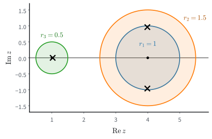
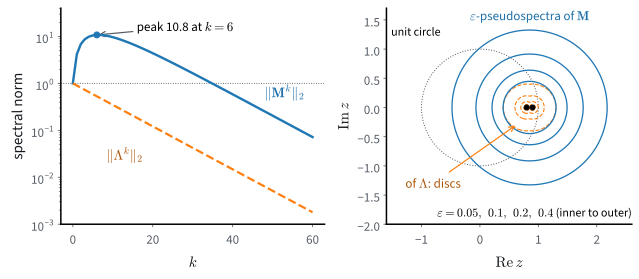

# Spectra in Practice
:label:`sec_mdl-spectra-in-practice`

The matrices of :numref:`sec_mdl-eigendecompositions` were small enough to
solve by hand, and we trusted what their eigenvalues told us: the surfer's
error shrank by the factor $1/4$ at every click, as the second eigenvalue
said it would. Both comforts end outside the textbook. The link matrix of the
web has billions of rows, and nobody writes down its characteristic
polynomial. And eigenvalues promise less than they seem to. A Jordan block
whose eigenvalues are both $0.99$ grew to norm 37 before it decayed
(:numref:`subsec_mdl-jordan`), and backpropagation through a recurrent
network multiplies the gradient by fifty different matrices, where the surfer
applied one matrix fifty times.

This section takes the two problems in turn. First, what can we learn about
the eigenvalues of a matrix that is too large to factor? Surprisingly much:
the entries alone confine the eigenvalues to a few discs, and repeated
multiplication by the matrix, the one operation that stays cheap, finds the
largest eigenvalue and its eigenvector. PageRank was computed this way.
Second, what do eigenvalues leave unsaid about a finite number of steps, or
about a product of different matrices? Here the answer is sobering.
Eigenvalues describe the long run of the powers of one matrix. For anything
else we need norms, and in the end the singular values of
:numref:`sec_mdl-svd-low-rank`.

The topics are not of equal weight. Three recur in deep learning. Power
iteration (:numref:`subsec_mdl-power-iteration`) estimates the largest
stretch of a layer for spectral normalization
(:numref:`subsec_mdl-spectrum-control`). Transient growth and products of
Jacobians (:numref:`subsec_mdl-transient-growth`,
:numref:`subsec_mdl-jacobian-products`) are the mathematics of the exploding
and vanishing gradients of :numref:`sec_bptt`. The random matrices of
:numref:`subsec_mdl-random-matrices` are the weight matrices of
:numref:`sec_numerical_stability` at initialization. Gershgorin's theorem and
PageRank are classical, and deep learning uses them less often; a reader in
a hurry may skim both. Pseudospectra (:numref:`subsec_mdl-pseudospectra`)
are a diagnostic that few readers will compute, and can be skipped as well.
The computations use NumPy.

```{.python .input #mdl-spectra-in-practice-imports}
#@tab mxnet
import numpy as np
```

```{.python .input #mdl-spectra-in-practice-imports}
#@tab pytorch
import numpy as np
```

```{.python .input #mdl-spectra-in-practice-imports}
#@tab tensorflow
import numpy as np
```

```{.python .input #mdl-spectra-in-practice-imports}
#@tab jax
import numpy as np
```

## Locating and Computing Eigenvalues

### Gershgorin Discs
:label:`subsec_mdl-gershgorin`

Can we say where the eigenvalues of a matrix lie without computing them? For
a diagonal matrix they are the diagonal entries. If the off-diagonal entries
are small, the eigenvalues should stay near the diagonal, and the following
theorem says how near.

**Theorem (Gershgorin** :cite:`Gershgorin.1931`**).** *Let
$\mathbf{A}=(a_{ij})$ be any $n\times n$ matrix and let
$r_i=\sum_{j\neq i}|a_{ij}|$ be the sum of the absolute values of the
off-diagonal entries in row $i$. Let $\mathcal{D}_i$ be the disc in the complex
plane with centre $a_{ii}$ and radius $r_i$. Then every eigenvalue of
$\mathbf{A}$ lies in the union $\bigcup_i\mathcal{D}_i$.*

**Proof.** Let $\mathbf{A}\mathbf{v}=\lambda\mathbf{v}$ with
$\mathbf{v}\neq\mathbf 0$, and pick the index $i$ of an entry of largest
magnitude, so that $|v_i|\ge|v_j|$ for all $j$ and $v_i\neq0$. Row $i$ of
$\mathbf{A}\mathbf{v}=\lambda\mathbf{v}$ reads

$$
\sum_j a_{ij}v_j = \lambda v_i
\quad\Longrightarrow\quad
(\lambda - a_{ii})\,v_i = \sum_{j\neq i} a_{ij} v_j .
$$

Divide by $v_i$ and take absolute values; since each $|v_j/v_i|\le1$,

$$
|\lambda - a_{ii}|
  = \Bigl|\sum_{j\neq i} a_{ij}\,\tfrac{v_j}{v_i}\Bigr|
  \le \sum_{j\neq i} |a_{ij}| = r_i ,
$$

so $\lambda\in\mathcal{D}_i$. $\blacksquare$

The proof places each eigenvalue in the disc of the row where its eigenvector
is largest, which we do not know in advance; the theorem therefore guarantees
only the union. Consider the non-symmetric matrix

$$
\mathbf A=\begin{pmatrix}4&1&0\\-1&4&0.5\\0.5&0&1\end{pmatrix}.
$$
:eqlabel:`eq_mdl-gershgorin-example`

The discs have centres 4, 4, 1 and radii 1, 1.5, 0.5. The two discs centred
at 4 overlap (one contains the other), and the disc centred at 1 is disjoint
from them, since $|4-1|=3>1.5+0.5$. The eigenvalues are
$3.99\pm0.96i$ and $1.03$: the complex pair lies inside the two discs centred
at 4, and the real eigenvalue inside the small disc.
:numref:`fig_mdl-la-gershgorin` draws the discs and the eigenvalues.


:label:`fig_mdl-la-gershgorin`

The split, two eigenvalues in the overlapping pair and one in the small disc,
is not a coincidence. *If a union of $m$ discs is connected and disjoint from
the other discs, it contains exactly $m$ eigenvalues*, counted with
multiplicity, because eigenvalues move continuously as the off-diagonal
entries grow from zero and cannot jump the gap between separated groups of
discs :cite:`Horn.Johnson.2012`. The cell computes the centres, radii and
eigenvalues quoted above.

```{.python .input #eigendecomposition-gershgorin-circle-theorem}
A = np.array([[4.0, 1.0, 0.0],
              [-1.0, 4.0, 0.5],
              [0.5, 0.0, 1.0]])
centres = np.diag(A)
radii = np.abs(A).sum(axis=1) - np.abs(centres)
print('centres:', centres, '  radii:', radii)
for z in np.linalg.eigvals(A):
    print(f'eigenvalue {z:.3f}   distances to the centres: '
          f'{np.abs(z - centres).round(2)}')
```

The complex pair is at distance 0.96 from 4, close to the rim of the disc of
radius 1: the theorem is nearly sharp here.

A corollary needs no computation at all. If $\mathbf{A}$ is *strictly
diagonally dominant* with positive diagonal, $a_{ii}>r_i$ for every $i$, then
every disc lies in the open right half-plane, 0 is not an eigenvalue, and
$\mathbf A$ is invertible. If such a matrix is also symmetric, its
eigenvalues are real and positive, so it is positive definite.

### Power Iteration
:label:`subsec_mdl-power-iteration`

A matrix with a billion rows cannot be factored, but it can be multiplied by a
vector if it is sparse. What does $\mathbf A^k\mathbf v_0$ tell us about its
eigenvalues? The expansion :eqref:`eq_mdl-eig-power-expansion` answers this.
Let $\mathbf A$ be diagonalizable with eigenvectors $\mathbf v_i$, ordered by
modulus with a *strictly dominant* eigenvalue,
$|\lambda_1|>|\lambda_2|\ge\cdots\ge|\lambda_n|$. (For a real matrix, strict
dominance forces $\lambda_1$ to be real, since a complex eigenvalue would share
its modulus with its conjugate.) Write $\mathbf v_0=\sum_i c_i\mathbf v_i$ and
factor out $\lambda_1^k$:

$$
\mathbf{A}^k\mathbf{v}_0
  = \sum_{i=1}^{n} c_i\lambda_i^k\mathbf{v}_i
  = \lambda_1^k\Bigl(c_1\mathbf{v}_1
       + \sum_{i\ge2} c_i\Bigl(\tfrac{\lambda_i}{\lambda_1}\Bigr)^{k}\mathbf{v}_i\Bigr).
$$
:eqlabel:`eq_mdl-power-iter`

Every ratio $|\lambda_i/\lambda_1|$ is below 1, so if $c_1\neq0$ the bracket
converges to $c_1\mathbf v_1$. The direction of $\mathbf A^k\mathbf v_0$
therefore approaches the eigenvector $\mathbf v_1$, with an error that decays like
$|\lambda_2/\lambda_1|^k$, and the length grows by a factor approaching
$|\lambda_1|$ per step. Multiplying repeatedly and rescaling to length 1 after
each step, so that the numbers stay in range, is *power iteration*
:cite:`Golub.Van-Loan.1996`. For a symmetric matrix, the Rayleigh quotient
of the iterate estimates $\lambda_1$ and converges faster than the direction,
at the squared rate $|\lambda_2/\lambda_1|^{2k}$. The eigenvectors are
orthogonal, so a misalignment of size $\delta$ changes the Rayleigh quotient
only by an amount of order $\delta^2$
(Exercise :exref:`ex_mdl-eigendecomposition-power-iteration-rates`).

:numref:`sec_linear-algebra` computed the iterates of $\mathbf S$ from $\mathbf e_1$:
$(2,1)$, $(5,4)$, $(14,13)$, in general $\bigl((3^k+1)/2,\,(3^k-1)/2\bigr)$.
The expansion explains them. With the unit eigenvectors
$\mathbf v_1=(1,1)/\sqrt2$ and $\mathbf v_2=(1,-1)/\sqrt2$, we have
$\mathbf e_1=(\mathbf v_1+\mathbf v_2)/\sqrt2$, so

$$
\mathbf S^k\mathbf e_1=\frac{3^k\mathbf v_1+\mathbf v_2}{\sqrt2},
\qquad
\tan\angle(\mathbf S^k\mathbf e_1,\mathbf v_1)=3^{-k},
\qquad
3-R(\mathbf S^k\mathbf e_1)=\frac{2}{9^k+1}.
$$

The direction error falls by the factor $|\lambda_2/\lambda_1|=1/3$ per step:
the sine of the angle to $\mathbf v_1$ is 0.316, 0.110, 0.037 for $k=1,2,3$.
The error of the Rayleigh quotient falls by $1/9$: it is 0.2, 0.024, 0.0027.
:numref:`fig_mdl-la-power-iter` plots both on a logarithmic scale.


:label:`fig_mdl-la-power-iter`

Two conditions can fail. The start needs $c_1\neq0$; a random start satisfies
this with probability one. And the dominance must be strict. If the dominant
eigenvalues are a complex pair of equal modulus, the dominant part of the
iterate keeps rotating. The ratio of consecutive norms then oscillates
forever, as it did for the running matrix of
:numref:`subsec_mdl-complex-rotation`. Even then, the average rate
$\|\mathbf A^k\mathbf v_0\|^{1/k}$ converges to the largest modulus.

A matrix with positive entries is safe: it has a real, simple, strictly
dominant eigenvalue, by the Perron--Frobenius theorem of
:numref:`subsec_mdl-pagerank`. We run 200 steps of power iteration on a
random $5\times5$ matrix with entries uniform in $[0,1]$, from a random
start, and compare the final norm ratio with the largest eigenvalue modulus.

```{.python .input #eigendecomposition-power-iteration}
A = np.random.rand(5, 5)                 # positive entries
v = np.random.randn(5)
for _ in range(200):
    Av = A @ v
    ratio = np.linalg.norm(Av) / np.linalg.norm(v)
    v = Av / np.linalg.norm(Av)
mods = np.sort(np.abs(np.linalg.eigvals(A)))[::-1]
print(f'norm ratio after 200 steps = {ratio:.10f}')
print(f'largest |eigenvalue|       = {mods[0]:.10f}')
print(f'|lambda_2| / |lambda_1|    = {mods[1] / mods[0]:.3f}')
```

The norm ratio agrees with the largest eigenvalue modulus in every printed
digit, on every run. One draw does not show how typical this is, so we
compute the gap ratio $|\lambda_2/\lambda_1|$ for 10,000 such matrices. For
contrast we also take 10,000 matrices with Gaussian entries, which have no
reason to be safe, and count how often their dominant eigenvalues are a
complex pair.

```{.python .input #mdl-spectra-in-practice-power-iteration-1}
mods = np.sort(np.abs(np.linalg.eigvals(np.random.rand(10000, 5, 5))), axis=1)
print('uniform entries, gap ratio |lambda_2| / |lambda_1|, 5% and 95% quantiles:',
      np.quantile(mods[:, -2] / mods[:, -1], [0.05, 0.95]).round(2))
lam = np.linalg.eigvals(np.random.randn(10000, 5, 5))
top = lam[np.arange(10000), np.abs(lam).argmax(axis=1)]   # a dominant eigenvalue
print('Gaussian entries, fraction with a complex dominant pair:',
      np.mean(top.imag != 0).round(2))
```

For uniform entries the gap ratio lies between about 0.14 and 0.37 in nine
draws of ten, so 200 steps shrink the direction error far below rounding
level. With Gaussian entries about four draws in ten have a complex dominant
pair, and for those the norm ratio never settles.

### PageRank
:label:`subsec_mdl-pagerank`

For non-negative matrices the dominant eigenvector is often the quantity we
want, and power iteration is how it is computed. A non-negative matrix is
*irreducible* if, in the graph with an edge $j\to i$ whenever $a_{ij}>0$,
every node reaches every other. The *Perron--Frobenius theorem*
:cite:`Horn.Johnson.2012` states that such a matrix has a real, positive
eigenvalue equal to the largest modulus of its eigenvalues, that this
eigenvalue is simple, and that its eigenvector can be chosen with positive
entries. If every entry of the matrix is positive, this
eigenvalue is also strictly dominant: every other eigenvalue has smaller
modulus.

Google's original PageRank :cite:`Brin.Page.1998` is such an eigenvector.
Consider three pages with links $1\to2$, $2\to1$, and $2\to3$. A surfer
follows a random outgoing link; page 3 has none, so we repair it by letting
the surfer jump from page 3 to a uniformly random page. Here $\mathbf P$ is
the repaired link matrix, column-stochastic with column $j$ holding the click
probabilities from page $j$:

$$
\mathbf P=\begin{pmatrix}0&\tfrac12&\tfrac13\\1&0&\tfrac13\\0&\tfrac12&\tfrac13\end{pmatrix}.
$$

The long-run fraction of time on each page is the stationary distribution
$\boldsymbol\pi$ with $\mathbf P\boldsymbol\pi=\boldsymbol\pi$. By hand, rows 1
and 3 give $\pi_1=\tfrac12\pi_2+\tfrac13\pi_3=\pi_3$, and then row 1 gives
$\pi_2=\tfrac43\pi_3$; normalizing to sum 1 gives
$\boldsymbol\pi=(0.3,0.4,0.3)$. Page 2 ranks first because page 1 sends it
every click, while page 2 splits its clicks between pages 1 and 3. The
eigenvalues of $\mathbf P$ are $1$, $-\tfrac23$ and $0$, so power iteration
from any distribution converges at the rate $2/3$ per step.

Every column-stochastic matrix has 1 as an eigenvalue of largest modulus.
First, because the columns sum to one,
$\mathbf 1^\top\mathbf P=\mathbf 1^\top$, so 1 is an eigenvalue of
$\mathbf P^\top$, and hence of $\mathbf P$: a matrix and its transpose have
the same characteristic polynomial, since $\det\mathbf X^\top=\det\mathbf X$.
Second, Gershgorin's theorem applied to $\mathbf P^\top$, whose rows are the
columns of $\mathbf P$, puts every eigenvalue in a disc with centre
$p_{ii}\ge0$ and radius $1-p_{ii}$, which lies inside the unit disc.

The web contains link cycles and groups of pages from which the surfer
cannot escape. The repaired matrix can then fail to be irreducible or have
several eigenvalues of modulus 1. A cycle of four pages has eigenvalues
$\pm1$ and $\pm i$, and power iteration on it never settles
(Exercise :exref:`ex_mdl-eigendecomposition-pagerank-damping`). PageRank
therefore iterates the *damped* matrix

$$
\mathbf G=\alpha\mathbf P+(1-\alpha)\tfrac1n\mathbf 1\mathbf 1^\top,
\qquad \alpha=0.85,
$$

which models a surfer who, at each click, jumps to a uniformly random page
with probability $0.15$. Every entry of $\mathbf G$ is positive, so
Perron--Frobenius applies by construction. :citet:`Haveliwala.Kamvar.2003`
show that $|\lambda_2(\mathbf G)|\le\alpha$, so the error of power iteration
shrinks by at least the factor $0.85$ per step, whatever the link structure.
This bound is what made the computation feasible for the web: fifty sweeps
reduce the error by a factor of more than 3000
($0.85^{50}\approx3\times10^{-4}$) on a graph of any size.

At web scale $\mathbf P$ is sparse and stored as one entry per link, and the
dense $\mathbf G$ is never formed. For a distribution $\mathbf p$,
$\mathbf 1^\top\mathbf p=1$ gives
$\mathbf G\mathbf p=\alpha\mathbf P\mathbf p+(1-\alpha)\tfrac1n\mathbf 1$, so
each step needs one sparse product. The repair of pages without links is a
rank-one term handled the same way.

## Iteration and Stability

### The Spectral Radius
:label:`subsec_mdl-spectral-radius`

Power iteration measured one number, the largest eigenvalue modulus. It has a
name, the *spectral radius* $\rho(\mathbf A)=\max_i|\lambda_i|$, and it
controls the long-run growth rate of the powers of one fixed matrix. Gelfand's
formula makes this precise: for every square matrix and every matrix norm,

$$
\lim_{k\to\infty}\|\mathbf A^k\|^{1/k}=\rho(\mathbf A).
$$

The easy half, $\rho(\mathbf A)\le\|\mathbf A^k\|^{1/k}$ for every $k$, is
Exercise :exref:`ex_mdl-eigendecomposition-spectral-radius-norms`. The formula
says nothing about a fixed finite $k$, and we have already seen two matrices
where that matters. The shear
$\mathbf T=\left(\begin{smallmatrix}1&1\\0&1\end{smallmatrix}\right)$ has
$\rho=1$, yet its powers
$\mathbf T^k=\left(\begin{smallmatrix}1&k\\0&1\end{smallmatrix}\right)$ grow
without bound, so $\rho\le1$ does not bound the iterates. The Jordan block
$\mathbf J_2(0.99)$ has $\rho<1$, yet its powers reach norm 37 first, so
$\rho<1$ does not bound the transient. When do the eigenvalues control every step, not only the
limit?

### Normal Matrices
:label:`subsec_mdl-normal-matrices`

Both counterexamples, the shear and the Jordan block, have too few
eigenvectors to form a basis. We therefore look first at the opposite
extreme, matrices with an orthonormal basis of eigenvectors. Such a matrix
acts on perpendicular directions independently, so its eigenvalues should
tell the whole story. A matrix is *normal* when it commutes with its
transpose, $\mathbf A^\top\mathbf A=\mathbf A\mathbf A^\top$ (for complex
matrices, with the conjugate transpose $\mathbf A^*$ in place of
$\mathbf A^\top$). Symmetric matrices, orthogonal matrices, and the
rotation--scaling blocks $r\mathbf R_\theta$ of
:numref:`subsec_mdl-complex-rotation` are normal. The running matrix
$\mathbf A=\left(\begin{smallmatrix}1&2\\-1&3\end{smallmatrix}\right)$ is not:
$\mathbf A\mathbf A^\top=\left(\begin{smallmatrix}5&5\\5&10\end{smallmatrix}\right)$
while $\mathbf A^\top\mathbf A=\left(\begin{smallmatrix}2&-1\\-1&13\end{smallmatrix}\right)$.
This is why its iterates did not move on circles.

The *complex spectral theorem* :cite:`Horn.Johnson.2012` states that a matrix
is normal if and only if it has an orthonormal eigenbasis over $\mathbb C$,
$\mathbf A=\mathbf U\boldsymbol\Lambda\mathbf U^*$ with $\mathbf U$ unitary
($\mathbf U^*\mathbf U=\mathbf I$). Its proof follows the induction of
:numref:`subsec_mdl-spectral-theorem`.

Write
$\|\mathbf X\|_2=\max_{\|\mathbf x\|=1}\|\mathbf X\mathbf x\|$ for the
*spectral norm*, the largest factor by which $\mathbf X$ stretches a vector.
Since a unitary change of basis preserves lengths, for a normal matrix

$$
\|\mathbf A^k\|_2
=\|\mathbf U\boldsymbol\Lambda^k\mathbf U^*\|_2
=\max_i|\lambda_i|^k
=\rho(\mathbf A)^k .
$$
:eqlabel:`eq_mdl-normal-power-norm`

For a normal matrix the eigenvalues control the largest possible
amplification at every step, not only its long-run rate. A diagonalizable
matrix that is not normal has a non-orthogonal eigenvector matrix in
$\mathbf A=\mathbf V\boldsymbol\Lambda\mathbf V^{-1}$, and submultiplicativity
of the norm gives only

$$
\|\mathbf A^k\|_2
\le \underbrace{\|\mathbf V\|_2\|\mathbf V^{-1}\|_2}_{\kappa_2(\mathbf V)}
   \rho(\mathbf A)^k .
$$
:eqlabel:`eq_mdl-nonnormal-power-bound`

The factor $\kappa_2(\mathbf V)$, the condition number
(:numref:`subsec_mdl-condition-number`) of the eigenvector matrix, is 1 for
an orthogonal $\mathbf V$ and large when eigenvectors are nearly parallel.
The growth it allows comes from cancellation. When eigenvectors are nearly
parallel, an ordinary input can only be written as a combination of them with
large coefficients that nearly cancel. The modes then decay at different
rates, the cancellation is undone, and the iterate grows before the common
decay takes over.

### Transient Growth
:label:`subsec_mdl-transient-growth`

The smallest example of such growth is the upper-triangular matrix

$$
\mathbf M=\begin{pmatrix}0.9&4\\0&0.8\end{pmatrix}.
$$
:eqlabel:`eq_mdl-nonnormal-example`

Its eigenvalues are its diagonal entries 0.9 and 0.8, both inside the unit
circle, and they are distinct, so $\mathbf M$ is diagonalizable. We find its
eigenvectors and expand $\mathbf e_2=(0,1)$ in them. For $\lambda=0.9$, the
second row of $\mathbf M-0.9\mathbf I$ reads $-0.1v_2=0$, so
$\mathbf v_1=(1,0)$. For $\lambda=0.8$, the first row of $\mathbf M-0.8\mathbf I$
reads $0.1v_1+4v_2=0$, so $\mathbf v_2=(-40,1)$. The two lines are
$\arctan(1/40)\approx1.4^\circ$ apart. The unit input is
$\mathbf e_2=40\mathbf v_1+\mathbf v_2$, and by
:eqref:`eq_mdl-eig-power-expansion`

$$
\mathbf M^k\mathbf e_2=40\cdot0.9^k\,\mathbf v_1+0.8^k\,\mathbf v_2
=\begin{pmatrix}40\,(0.9^k-0.8^k)\\0.8^k\end{pmatrix}.
$$
:eqlabel:`eq_mdl-transient-closed-form`

A vector of length 1 is the difference of two components of length about 40.
Both decay, but at different rates, so their difference first grows. The
first entry $40(0.9^k-0.8^k)$ peaks where its derivative in $k$ vanishes,
where $(9/8)^k=\ln0.8/\ln0.9$, at $k\approx6.4$, with value about 10.8.
:numref:`fig_mdl-la-transient-cancel` draws the two components at $k=0$ and
$k=6$. The bound :eqref:`eq_mdl-nonnormal-power-bound` with unit
eigenvectors has $\kappa_2(\mathbf V)=80$ and gives
$\|\mathbf M^6\|_2\le80\cdot0.9^6\approx42.5$. The bound holds, but it is four
times the actual value 10.8.


:label:`fig_mdl-la-transient-cancel`

The cell checks the derivation and compares $\mathbf M$ with the diagonal
matrix $\boldsymbol\Lambda=\operatorname{diag}(0.9,0.8)$, which has the same
eigenvalues and is normal.

```{.python .input #mdl-eigendecomposition-nonnormal-transient}
M = np.array([[0.9, 4.0], [0.0, 0.8]])
Lam = np.diag([0.9, 0.8])                   # same eigenvalues, normal
lam, V = np.linalg.eig(M)                   # unit eigenvectors as columns
print('eigenvalues:', lam)
print('coefficients of e_2 on the unit eigenvectors:',
      np.linalg.solve(V, [0., 1.]))
ks = np.arange(61)
norm_M = [np.linalg.norm(np.linalg.matrix_power(M, k), 2) for k in ks]
norm_L = [np.linalg.norm(np.linalg.matrix_power(Lam, k), 2) for k in ks]
k_peak = int(np.argmax(norm_M))
print(f'max ||M^k|| = {norm_M[k_peak]:.3f} at k = {k_peak};  '
      f'max ||Lambda^k|| = {max(norm_L):.3f}')
print(f'kappa_2(V) = {np.linalg.cond(V):.1f}')
```

On the unit eigenvectors, $\mathbf e_2$ has two coefficients of size about 40,
the lengths of $40\mathbf v_1$ and $\mathbf v_2$. The largest
$\|\mathbf M^k\|_2$ is 10.8 at $k=6$, while $\boldsymbol\Lambda$ never exceeds
its starting norm 1. With the same eigenvalues, the normal matrix contracts
from the first step, while $\mathbf M$ first grows ten-fold.
:numref:`fig_mdl-la-transient-growth` (left) shows the two curves on a
logarithmic scale; after the peak both fall with the same slope $\log0.9$, as
Gelfand's formula requires.


:label:`fig_mdl-la-transient-growth`

### Pseudospectra
:label:`subsec_mdl-pseudospectra`

This subsection adds a diagnostic, not a new phenomenon, and can be skipped.
The eigenvalues of a matrix that is not normal are also sensitive to
perturbations. The *$\varepsilon$-pseudospectrum* collects every number that
becomes an eigenvalue under a perturbation $\mathbf E$ of size at most
$\varepsilon$, and is computed from the *resolvent*
$(z\mathbf I-\mathbf A)^{-1}$:

$$
\Lambda_\varepsilon(\mathbf A)
=\{z\in\mathbb C:z\text{ is an eigenvalue of }\mathbf A+\mathbf E
       \text{ for some }\|\mathbf E\|_2\le\varepsilon\}
=\{z\in\mathbb C:\|(z\mathbf I-\mathbf A)^{-1}\|_2\ge1/\varepsilon\},
$$
:eqlabel:`eq_mdl-pseudospectrum`

The resolvent norm counts as infinite at an eigenvalue; the equality of the
two sets is Exercise
:exref:`ex_mdl-eigendecomposition-pseudospectra-transient-growth`. For a
normal matrix the resolvent norm is the reciprocal of the distance from $z$
to the nearest eigenvalue. For $\mathbf M$ it is far larger, as the norms at
$z=1$, a point on the unit circle, show.

```{.python .input #mdl-eigendecomposition-pseudospectra}
I = np.eye(2)
print(f'||(I - M)^-1||      = {np.linalg.norm(np.linalg.inv(I - M), 2):.1f}')
print(f'||(I - Lambda)^-1|| = {np.linalg.norm(np.linalg.inv(I - Lam), 2):.1f}')
```

For $\boldsymbol\Lambda$ the norm is 10, the reciprocal of the distance 0.1
to the eigenvalue 0.9. For $\mathbf M$ it is 200.3, so a perturbation of size
$1/200.3\approx0.005$ already puts an eigenvalue of $\mathbf M$ on the unit
circle, where $\boldsymbol\Lambda$ needs 0.1 (right panel of
:numref:`fig_mdl-la-transient-growth`). Rounding errors act as such
perturbations, so the computed eigenvalues of a strongly non-normal matrix
may be inaccurate. :numref:`sec_mdl-linear-algebra-further-reading` continues
with the Kreiss matrix theorem.

### Products of Jacobians
:label:`subsec_mdl-jacobian-products`

A recurrent network (:numref:`sec_bptt`) computes its hidden state as
$\mathbf h_t=\phi(\mathbf W\mathbf h_{t-1}+\cdots)$, with the same weights
$\mathbf W$ at every step, and backpropagation through time
multiplies the per-step Jacobians
$\mathbf D_t=\partial\mathbf h_t/\partial\mathbf h_{t-1}$:

$$
\nabla_{\mathbf{h}_0}\mathcal{L}
   = \mathbf{D}_1^\top\mathbf{D}_2^\top\cdots\mathbf{D}_T^\top
   \,\nabla_{\mathbf{h}_T}\mathcal{L}.
$$

The gradient that reaches the first state is the last one multiplied by $T$
matrices. These matrices differ from step to step, because the nonlinearity
$\phi$ is evaluated at different points, so the theory of powers of one matrix
does not apply. The spectral radii of the factors say nothing about the
product. Take

$$
\mathbf D_1=\begin{pmatrix}0&2\\0&0\end{pmatrix},
\qquad
\mathbf D_2=\begin{pmatrix}0&0\\2&0\end{pmatrix},
\qquad
\mathbf D_2\mathbf D_1=\begin{pmatrix}0&0\\0&4\end{pmatrix}.
$$

Both factors are nilpotent with $\rho=0$, and their product has $\rho=4$:
$\mathbf D_1$ moves the second coordinate into the first, doubled, and
$\mathbf D_2$ moves it back, doubled again.

Three quantities describe iterated linear maps. The spectral radius gives
the asymptotic rate of the powers of one fixed map. The spectral norm bounds
every finite product,
$\|\mathbf D_T\cdots\mathbf D_1\|_2\le\prod_t\|\mathbf D_t\|_2$, here
$4\le2\cdot2$. The *top Lyapunov exponent*

$$
\mu=\lim_{T\to\infty}\frac1T\log\|\mathbf D_T\cdots\mathbf D_1\mathbf x_0\|
$$

gives the average growth rate per step of a long product of changing maps.
For independent, identically distributed random factors the limit exists with
probability one under mild conditions :cite:`Furstenberg.Kesten.1960`.

A gradient that is multiplied by maps with $\mu>0$ explodes, and one with
$\mu<0$ vanishes :cite:`bengio1994learning,Pascanu.Mikolov.Bengio.2013`. The
standard remedies act on these quantities rather than on eigenvalues.
Orthogonal initialization :cite:`Saxe.McClelland.Ganguli.2014` makes the
initial weight matrix orthogonal, so a linear recurrence preserves the length
of every vector, a stronger property than $\rho=1$. Gradient clipping caps
the norm of the gradient after it has been computed. Gates, as in LSTMs and
GRUs, change the Jacobians themselves so that some directions pass through
with factors close to 1 (:numref:`subsec_bptt-gradient-pathologies`).

### Random Matrices at Initialization
:label:`subsec_mdl-random-matrices`

How large are these quantities for the random weight matrices of an
untrained network? Let $\mathbf A$ be $n\times n$ with independent standard
Gaussian entries, the real *Ginibre ensemble* :cite:`Ginibre.1965`. As
$n\to\infty$, the eigenvalues divided by $\sqrt n$ fill the unit disc in the
complex plane uniformly: this is the *circular law*, which
:citet:`Tao.Vu.2010` prove for independent, identically distributed entries
of mean 0 and variance 1. The circular law describes where almost all
eigenvalues are; it does not exclude a few outliers. That none escapes, so
that $\rho(\mathbf A)/\sqrt n\to1$ with probability one, is a separate
theorem :cite:`Geman.1986`. The spectral norm behaves differently:
$\|\mathbf A\|_2/\sqrt n\to2$ :cite:`Yin.Bai.Krishnaiah.1988`. This is the
Marchenko--Pastur law of :numref:`subsec_mdl-sample-covariance-mp` at aspect
ratio $c=1$. The largest eigenvalue of $\tfrac1n\mathbf A^\top\mathbf A$
tends to the upper edge $(1+\sqrt c)^2=4$, and $\|\mathbf A\|_2^2$ is $n$
times that eigenvalue. At $n=1000$ both limits are close.

```{.python .input #mdl-eigendecomposition-random-matrices-at-initialization}
n = 1000
A = np.random.randn(n, n)
print(f'rho(A) / sqrt(n)       = {np.abs(np.linalg.eigvals(A)).max() / n ** 0.5:.3f}')
print(f'sigma_max(A) / sqrt(n) = {np.linalg.norm(A, 2) / n ** 0.5:.3f}')
```

For large $n$ the spectral radius is within a few percent of $\sqrt n$ and
the largest stretch close to $2\sqrt n$: a random matrix stretches some
vectors twice as much as its eigenvalues suggest. Initialization schemes divide
random weights by $\sqrt{\textrm{fan-in}}$ for a different reason: with
entries of variance $1/n$, $\mathbb{E}\|\mathbf A\mathbf x\|^2=\|\mathbf x\|^2$
for every fixed $\mathbf x$, so squared lengths are preserved on average.
A spectral radius near 1 is a side effect, and by
:numref:`subsec_mdl-jacobian-products` it does not control a product of such
matrices. In fact the product of independent factors with this scaling
shrinks a typical vector, $\mu<0$, even though every factor preserves squared
length on average. The logarithm is concave, so for a unit vector the average
of $\log\|\mathbf A\mathbf x\|^2$ lies below the logarithm of the average of
$\|\mathbf A\mathbf x\|^2$, which is zero, and it is the logarithms that add
along a product
(Exercise :exref:`ex_mdl-eigendecomposition-lyapunov-random-products`).

The random matrix and $\mathbf M$ make the same point: eigenvalues say little
about the stretch in a finite number of steps. Nor do they exist for
rectangular matrices. The singular values of :numref:`sec_mdl-svd-low-rank`
measure stretch directly, for every matrix.

## Summary

Without a factorization, Gershgorin discs bound the eigenvalues from the
entries, and power iteration finds the dominant one at the rate
$|\lambda_2/\lambda_1|$, as in PageRank. The spectral radius gives the
long-run rate of the powers of one matrix and nothing more: a matrix that is
not normal can grow before it decays, and the eigenvalues of the factors say
nothing about a product of different matrices. There the spectral norm
bounds every finite product, and the Lyapunov exponent gives the average
rate. A Gaussian $n\times n$ matrix shows the gap between the two at
initialization: its spectral radius is close to $\sqrt n$, its spectral norm
close to $2\sqrt n$.

## Exercises

1. **A defective limit.** For $\varepsilon\ge0$, let

   $$
   \mathbf{A}_\varepsilon=\begin{pmatrix}2&1\\\varepsilon&2\end{pmatrix}.
   $$

    1. Find the eigenvalues and eigenvectors of $\mathbf{A}_\varepsilon$ for
       $\varepsilon>0$ and for $\varepsilon=0$. Which multiplicities differ at
       $\varepsilon=0$?
    1. Collect the unit eigenvectors of $\mathbf{A}_\varepsilon$ in the columns
       of $\mathbf{V}_\varepsilon$. How do the angle between them and the
       condition number $\kappa_2(\mathbf{V}_\varepsilon)$ of
       :eqref:`eq_mdl-nonnormal-power-bound` behave as $\varepsilon\to0$?
       Show that $\sqrt\varepsilon\,\kappa_2(\mathbf V_\varepsilon)$ tends to
       a constant as $\varepsilon\to0$, and find it.
    1. By how much do the eigenvalues of $\mathbf{A}_0$ move when its
       lower-left entry changes from $0$ to $\varepsilon=10^{-10}$? Compare
       with the eigenvalues of the symmetric matrix
       $2\mathbf{I}+\varepsilon\left(\begin{smallmatrix}0&1\\1&0\end{smallmatrix}\right)$.
       This is the smallest case of Exercise
       :exref:`ex_mdl-eigendecomposition-computed-eigenvalue-accuracy`a.
   :exlabel:`ex_mdl-eigendecomposition-defective-limit`

1. **Spectral radius and norms.** The spectral radius bounds every power of
   a matrix from below, and for normal matrices it also bounds them from
   above.
    1. Show that $\rho(\mathbf{A})\le\|\mathbf{A}^k\|_2^{1/k}$ for every
       square matrix $\mathbf{A}$ and every $k\ge1$.
    1. The chain :eqref:`eq_mdl-normal-power-norm` uses two facts without
       proof. Show that $\|\mathbf{U}\mathbf{X}\mathbf{U}^*\|_2=\|\mathbf{X}\|_2$
       for every unitary $\mathbf{U}$ and every square $\mathbf{X}$, and that
       the spectral norm of a diagonal matrix is the largest modulus of its
       diagonal entries.
    1. Show that the converse of :eqref:`eq_mdl-normal-power-norm` fails:
       find a $3\times3$ matrix that is not normal but satisfies
       $\|\mathbf{A}^k\|_2=\rho(\mathbf{A})^k$ for every $k\ge1$.
    1. For a given $t>0$, construct a diagonalizable $2\times2$ matrix
       with spectral radius $1/2$ and $\|\mathbf{A}\|_2>t$.
   :exlabel:`ex_mdl-eigendecomposition-spectral-radius-norms`

1. [code] **Power-iteration rates.** Let $\mathbf{S}$ be the matrix
   of :numref:`fig_mdl-la-power-iter`.
    1. By :eqref:`eq_mdl-power-iter`, the misalignment between the iterate and
       $\mathbf{v}_1$ decays at the rate $|\lambda_2/\lambda_1|=1/3$. How many
       iterations reduce it by a factor of $100$?
    1. Let $\mathbf{A}$ be symmetric with unit eigenvector $\mathbf{v}_1$ for
       $\lambda_1$, and let $\mathbf{x}=\mathbf{v}_1+\delta\mathbf{u}$ for a unit
       vector $\mathbf{u}$ orthogonal to $\mathbf{v}_1$. Show that the Rayleigh
       quotient of :numref:`subsec_mdl-rayleigh` satisfies
       $R(\mathbf{x})-\lambda_1=O(\delta^2)$, with no term linear in $\delta$.
       At which rate does the Rayleigh quotient of the power iterates
       therefore approach $\lambda_1$? Where does the argument use that
       $\mathbf A$ is symmetric?
    1. Repeat the experiment of :numref:`fig_mdl-la-power-iter` for
       $\left(\begin{smallmatrix}1&0.1\\0.1&1\end{smallmatrix}\right)$, which
       has the same eigenvectors as $\mathbf S$ and the eigenvalues 1.1 and
       0.9, from a random start. Plot the sine of the angle to $\mathbf v_1$
       and the error of the Rayleigh quotient on a logarithmic scale for 30
       steps. Predict both slopes and the number of steps each error needs to
       shrink by a factor of 100, and explain why this matrix converges so much
       more slowly than $\mathbf S$.
   :exlabel:`ex_mdl-eigendecomposition-power-iteration-rates`

1. [code] **Pseudospectra and transient growth.** ● Let $\mathbf{M}$ be the
   non-normal matrix :eqref:`eq_mdl-nonnormal-example` and
   $\boldsymbol\Lambda=\operatorname{diag}(0.9,0.8)$ the normal matrix with the
   same eigenvalues, as in :numref:`subsec_mdl-transient-growth`.
    1. Prove the equality of the two sets in :eqref:`eq_mdl-pseudospectrum`.
       First show that $\|(z\mathbf I-\mathbf A)^{-1}\|_2=1/\sigma_{\min}(z\mathbf I-\mathbf A)$,
       where $\sigma_{\min}(\mathbf X)=\min_{\|\mathbf x\|=1}\|\mathbf X\mathbf x\|$.
       For one inclusion, take unit vectors $\mathbf u$, $\mathbf v$ with
       $(z\mathbf{I}-\mathbf{A})\mathbf{v}=\sigma\mathbf{u}$,
       $\sigma=\sigma_{\min}(z\mathbf I-\mathbf A)$, and show that $z$ is an
       eigenvalue of $\mathbf{A}+\sigma\mathbf{u}\mathbf{v}^*$. For the other,
       apply $(z\mathbf I-\mathbf A)\mathbf x=\mathbf E\mathbf x$ to an
       eigenvector $\mathbf x$ of $\mathbf A+\mathbf E$. Using the resolvent
       norms printed in :numref:`subsec_mdl-pseudospectra`, how large a
       perturbation makes $z=1$ an eigenvalue of a perturbed $\mathbf{M}$, and
       how large for $\boldsymbol\Lambda$?
    1. Suppose that $\|\mathbf{A}^k\|_2\le K_0$ for all $k\ge0$. Show that for
       $|z|>1$ the series $\sum_{k\ge0}\mathbf{A}^k/z^{k+1}$ converges to
       $(z\mathbf{I}-\mathbf{A})^{-1}$, and conclude that

       $$
       \sup_{k\ge0}\|\mathbf{A}^k\|_2\;\ge\;K(\mathbf{A})=\sup_{|z|>1}\,(|z|-1)\,\|(z\mathbf{I}-\mathbf{A})^{-1}\|_2 .
       $$

       The quantity $K(\mathbf{A})$ is called the Kreiss constant. Restate the
       bound in terms of pseudospectra: if $\Lambda_\varepsilon(\mathbf{A})$
       contains a point at distance $\delta$ outside the unit circle, how
       large must some power of $\mathbf{A}$ be?
    1. Evaluate $K(\mathbf{M})$ numerically on a grid of points $z$ with
       $|z|>1$, and compare it with the largest $\|\mathbf{M}^k\|_2$ printed
       in :numref:`subsec_mdl-transient-growth`. Find $K(\boldsymbol\Lambda)$
       by hand.
   :exlabel:`ex_mdl-eigendecomposition-pseudospectra-transient-growth`

1. [code] **Shifted inverse iteration.** ● Power iteration finds only the
   dominant eigenvalue. *Inverse iteration* with shift $\mu$ runs power
   iteration with $(\mathbf{A}-\mu\mathbf{I})^{-1}$ instead, solving one linear
   system per step :cite:`Golub.Van-Loan.1996`. Parts (a) to (c) use the
   symmetric matrix

   $$
   \mathbf A_4=\begin{pmatrix}1&0.1&0.1&0.1\\0.1&3&0.2&0.3\\0.1&0.2&5&0.5\\0.1&0.3&0.5&9\end{pmatrix},
   $$

   whose Gershgorin centres are 1, 3, 5, 9 and whose eigenvalues are about
   0.99, 2.97, 4.95, and 9.08.
    1. Show that $(\mathbf{A}-\mu\mathbf{I})^{-1}$ has the same eigenvectors as
       $\mathbf{A}$, and find its eigenvalues. Which eigenpair of $\mathbf{A}$
       does inverse iteration find, and at which rate does it converge?
    1. Run inverse iteration on $\mathbf A_4$ with each of the four disc centres
       as the shift. How many iterations does each run need until the sine of
       the angle between the iterate and the eigenvector returned by
       `np.linalg.eigh` falls below $10^{-10}$? Compare with plain power
       iteration for the largest eigenvalue.
    1. *Rayleigh quotient iteration* replaces the fixed shift by the Rayleigh
       quotient of the current iterate at every step. Repeat (b) with the disc
       centres as initial shifts. Relate the iteration counts to Exercise
       :exref:`ex_mdl-eigendecomposition-power-iteration-rates`b.
    1. Run inverse iteration on the $3\times3$ matrix
       :eqref:`eq_mdl-gershgorin-example` with the real shift $\mu=4$. Why does
       it never converge? Replace the shift by $4+i$ (complex arithmetic) and
       explain the observed rate of about 0.02 per step from the distances
       $|\lambda-\mu|$ of the three eigenvalues.
   :exlabel:`ex_mdl-eigendecomposition-shifted-inverse-iteration`

1. [code] **Damping in PageRank.** ● Let $\mathbf{P}$ be a column-stochastic
   $n\times n$ matrix and
   $\mathbf{G}=\alpha\mathbf{P}+(1-\alpha)\tfrac1n\mathbf{1}\mathbf{1}^\top$
   with $0<\alpha<1$, the damped matrix of :numref:`subsec_mdl-pagerank`.
    1. Let $\mathbf{P}\mathbf{x}=\lambda\mathbf{x}$. Show that
       $\mathbf{1}^\top\mathbf{x}=0$ whenever $\lambda\neq1$, and that
       $\mathbf{G}\mathbf{x}=\alpha\lambda\mathbf{x}$ whenever
       $\mathbf{1}^\top\mathbf{x}=0$.
    1. The eigenvalue $1$ of $\mathbf{P}$ can be repeated, as it is when the
       links split into disconnected pockets. You may use that every
       column-stochastic $\mathbf P$ has a non-negative eigenvector for the
       eigenvalue 1 (a stationary distribution). Show that the vectors
       $\mathbf{x}$ of this eigenspace with $\mathbf{1}^\top\mathbf{x}=0$ form a
       subspace of dimension one less than the eigenspace. Conclude that for
       diagonalizable $\mathbf{P}$ the eigenvalues of $\mathbf{G}$ are $1$ and
       $\alpha\lambda_2(\mathbf{P}),\ldots,\alpha\lambda_n(\mathbf{P})$, which
       gives the bound $|\lambda_2(\mathbf{G})|\le\alpha$ of
       :citet:`Haveliwala.Kamvar.2003`.
    1. Four pages link in a cycle, $1\to2\to3\to4\to1$. Find the eigenvalues
       of their link matrix $\mathbf{P}$. Why does undamped power iteration
       started at page $1$ never converge?
    1. With $\alpha=0.85$ and the cycle of (c), run power iteration on
       $\mathbf{G}$ from page $1$, and count the iterations until the $\ell_1$
       distance to the stationary distribution falls below $10^{-8}$. Compare
       with the prediction $0.85^k\le10^{-8}$ from (b).
    1. Check numerically on the three-page example of
       :numref:`subsec_mdl-pagerank` that the eigenvalues of $\mathbf G$ are
       $\alpha$ times those of $\mathbf P$, apart from the eigenvalue 1, and
       that the stationary distribution moves from $(0.3,0.4,0.3)$ to about
       $(0.303,0.394,0.303)$. Why does damping move it toward uniform?
   :exlabel:`ex_mdl-eigendecomposition-pagerank-damping`

1. [code] **Lyapunov exponents of random products.** ●● Let
   $\mathbf{D}_1,\mathbf{D}_2,\ldots$ be independent $n\times n$ matrices with
   independent $\mathcal{N}(0,1/n)$ entries, a linear model of the Jacobians
   of a deep network at fan-in initialization, and let $\mathbf{x}_0$ be a
   unit vector. By :numref:`subsec_mdl-random-matrices`, each factor has
   spectral radius close to $1$ for large $n$.
   :numref:`subsec_mdl-jacobian-products` summarizes the growth of the
   product by its top Lyapunov exponent

   $$
   \mu=\lim_{T\to\infty}\frac1T\log\|\mathbf{D}_T\cdots\mathbf{D}_1\mathbf{x}_0\|,
   $$

   which exists with probability one by the theorem of Furstenberg and Kesten.
    1. Show that $\mathbb{E}\|\mathbf{D}\mathbf{x}\|^2=\|\mathbf{x}\|^2$ for
       every fixed $\mathbf{x}$, so that this scaling preserves squared norms
       on average.
    1. Let $\mathbf{u}_0=\mathbf{x}_0$ and
       $\mathbf{u}_t=\mathbf{x}_t/\|\mathbf{x}_t\|$ for the iterates
       $\mathbf{x}_t=\mathbf{D}_t\cdots\mathbf{D}_1\mathbf{x}_0$. Given
       $\mathbf{D}_1,\ldots,\mathbf{D}_{t-1}$, what is the distribution of
       $n\|\mathbf{D}_t\mathbf{u}_{t-1}\|^2$? Use the answer to write
       $\log\|\mathbf{D}_T\cdots\mathbf{D}_1\mathbf{x}_0\|$ as a sum of
       independent terms. With $\mathbb{E}\log\chi^2_n=\psi(n/2)+\log2$, where
       $\psi$ is the digamma function, derive the closed form of
       :citet:`Cohen.Newman.1984`

       $$
       \mu=\tfrac12\bigl(\psi(n/2)+\log2-\log n\bigr).
       $$

    1. Show that $\mu<0$ for every $n$, although (a) holds. Evaluate $\mu$ in
       closed form for $n=1$, using $\psi(1/2)=-\gamma_{\textrm{E}}-2\log2$
       with Euler's constant $\gamma_{\textrm{E}}\approx0.5772$. Using
       $\psi(x)=\log x-\tfrac1{2x}+O(x^{-2})$, show that $\mu\approx-1/(2n)$
       for large $n$.
    1. Simulate $T=10^4$ steps with renormalization for
       $n\in\{1,2,5,50\}$, and compare the measured exponent with (b) and with
       the logarithms of the spectral radius and of the largest singular value
       of single factors. By which factor does a typical input shrink in a
       linear network of width $50$ and depth $100$ at this initialization?
       What does the comparison say about the three quantities of
       :numref:`subsec_mdl-jacobian-products`?
   :exlabel:`ex_mdl-eigendecomposition-lyapunov-random-products`

[Discussions](https://d2l.discourse.group/t/36876)

<!-- slides -->

::: {.slide}
::: {.cover}
[Dive into Deep Learning · §33.4]{.kicker}

Spectra in Practice<br>
**eigenvalues of large matrices · and what eigenvalues leave unsaid**
:::
:::

::: {.slide title="A Billion Rows, and Eigenvalues That Promise Too Little"}
[The problem]{.kicker}

The surfer's $2\times2$ matrix was solved by hand, and its eigenvalue $1/4$
gave the error at every click. Outside the textbook:

- The link matrix of the web has billions of rows. No characteristic
  polynomial, no factorization; only products $\mathbf A\mathbf v$ are cheap.
- $\mathbf J_2(0.99)$ has both eigenvalues at $0.99$, yet $\|\mathbf J^k\|_2$
  climbs to 37 before it decays.
- Backpropagation through time multiplies $T$ *different* Jacobians, not one
  matrix $T$ times.

::: {.d2l-note .warn}
What can we learn about eigenvalues without factoring? And how far can they
be trusted for a finite number of steps?
:::
:::

::: {.slide title="By the End of This Deck You Can"}
[Goals]{.kicker}

- bound the eigenvalues of a matrix from its entries (Gershgorin);
- compute the dominant eigenpair by power iteration and predict its rate;
- explain PageRank as an eigenvector, and why damping makes it computable;
- tell the spectral radius, the spectral norm and the Lyapunov exponent
  apart, and say which one bounds what;
- recognize transient growth in a matrix that is not normal.

**Running examples:** the symmetric
$\mathbf S=\left(\begin{smallmatrix}2&1\\1&2\end{smallmatrix}\right)$ for power
iteration, and
$\mathbf M=\left(\begin{smallmatrix}0.9&4\\0&0.8\end{smallmatrix}\right)$ for
transient growth.
:::

::: {.slide title="What Eigenvalues Say, and What They Leave Unsaid"}
[Where this fits]{.kicker}

::: {.cols .vc}
::: {.col}
| section | adds |
|---|---|
| Vectors, Angles, and Projections | lengths, angles, projections, hyperplanes |
| Matrices as Linear Maps | columns, rank, inverses, determinants |
| Eigendecompositions | powers of one square map, symmetric matrices |
| **Spectra in Practice** | **locating and computing eigenvalues, where they mislead** |
| Singular Value Decomposition | two bases, best low rank, least squares, $\kappa$ |
:::

::: {.col .narrow}
- **Uses:** $\mathbf A^k\mathbf x=\sum_i c_i\lambda_i^k\mathbf v_i$ for a
  diagonalizable $\mathbf A$; the spectral theorem.
- **Skips:** production eigensolvers.
- Gershgorin and PageRank are classical; deep learning uses power iteration,
  transient growth and random matrices more.
:::
:::
:::

::: {.slide}
::: {.divider}
[01]{.dnum}

[Locating and Computing Eigenvalues]{.dtitle}

[Gershgorin discs · power iteration · PageRank]{.dsub}
:::
:::

::: {.slide title="Every Eigenvalue Lies in the Union of the Gershgorin Discs"}
[Locating]{.kicker}

::: {.cols .vc}
::: {.col .narrow}
- Disc $i$: centre $a_{ii}$, radius $r_i=\sum_{j\neq i}|a_{ij}|$.
- Proof: in $\mathbf A\mathbf v=\lambda\mathbf v$, read the row where
  $|v_i|$ is largest: $|\lambda-a_{ii}|\le r_i$.
- A connected group of $m$ discs holds $m$ eigenvalues: the pair
  $3.99\pm0.96i$ near 4, and $1.03$.
- $a_{ii}>r_i$ for all $i$: 0 lies in no disc, so $\mathbf A$ is invertible.
:::

::: {.col .fig}

:::
:::
:::

::: {.slide title="Power Iteration Converges at Rate |λ₂/λ₁|"}
[Computing]{.kicker}

$$\mathbf A^k\mathbf v_0=\lambda_1^k\Bigl(c_1\mathbf v_1+\sum_{i\ge2}c_i\bigl(\tfrac{\lambda_i}{\lambda_1}\bigr)^k\mathbf v_i\Bigr)$$

@fig:mdl-la-power-iter

$\mathbf S^k\mathbf e_1=(3^k\mathbf v_1+\mathbf v_2)/\sqrt2$: direction error
$\times\tfrac13$ per step, Rayleigh-quotient error $\times\tfrac19$. Needs
$c_1\neq0$ (almost every start) and a strictly dominant $|\lambda_1|$.
:::

::: {.slide title="Positive Matrices Are Safe; Gaussian Ones Fail Four Times in Ten"}
[Computing]{.kicker}

Is strict dominance typical? Gap ratios of 10,000 random $5\times5$ matrices
with uniform entries, and the dominant eigenvalues of 10,000 Gaussian ones:

@!mdl-spectra-in-practice-power-iteration-1

- Positive entries: a real, simple, strictly dominant eigenvalue
  (Perron--Frobenius); 200 steps are far more than enough.
- Gaussian entries: a complex dominant pair in about four draws of ten. The
  norm ratio then oscillates forever; only $\|\mathbf A^k\mathbf v_0\|^{1/k}$
  converges.
:::

::: {.slide title="PageRank Is the Eigenvector for λ = 1"}
[Computing]{.kicker}

Links $1\to2$, $2\to1$, $2\to3$; page 3 jumps anywhere:
$\mathbf P\boldsymbol\pi=\boldsymbol\pi$ gives $\boldsymbol\pi=(0.3,0.4,0.3)$.

- columns sum to 1, so $\lambda=1$; Gershgorin keeps $|\lambda|\le1$;
- damping $\mathbf G=0.85\,\mathbf P+0.15\cdot\tfrac1n\mathbf 1\mathbf 1^\top$
  has positive entries, so Perron--Frobenius applies;
- $|\lambda_2(\mathbf G)|\le0.85$ (Haveliwala and Kamvar): fifty sweeps cut
  the error by more than 3000, on a graph of any size;
- sparse $\mathbf P$ is stored, dense $\mathbf G$ never formed.
:::

::: {.slide}
::: {.divider}
[02]{.dnum}

[Iteration and Stability]{.dtitle}

[spectral radius · normal matrices · transient growth · products]{.dsub}
:::
:::

::: {.slide title="The Spectral Radius Is the Long-Run Rate, and Only That"}
[Stability]{.kicker}

$\rho(\mathbf A)=\max_i|\lambda_i|$, and
$\lim_{k\to\infty}\|\mathbf A^k\|^{1/k}=\rho(\mathbf A)$ (Gelfand).

- Normal ($\mathbf A^\top\mathbf A=\mathbf A\mathbf A^\top$, an orthonormal
  eigenbasis): $\|\mathbf A^k\|_2=\rho(\mathbf A)^k$ at every step.
- Diagonalizable but not normal:
  $\|\mathbf A^k\|_2\le\kappa_2(\mathbf V)\,\rho(\mathbf A)^k$, with
  $\kappa_2(\mathbf V)=\|\mathbf V\|_2\|\mathbf V^{-1}\|_2$ large when
  eigenvectors are nearly parallel.

::: {.d2l-note .rule}
Nearly parallel eigenvectors: an ordinary input is a difference of large
components. They decay at different rates, and the difference grows first.
:::
:::

::: {.slide title="Same Eigenvalues, Ten-Fold Growth Before Decay"}
[Stability]{.kicker}

$\mathbf M=\left(\begin{smallmatrix}0.9&4\\0&0.8\end{smallmatrix}\right)$:
$\mathbf v_1=(1,0)$, $\mathbf v_2=(-40,1)$, $1.4^\circ$ apart, and
$\mathbf e_2=40\mathbf v_1+\mathbf v_2$.

@fig:mdl-la-transient-cancel

$\mathbf M^k\mathbf e_2=\bigl(40(0.9^k-0.8^k),\,0.8^k\bigr)$: peak
$\|\mathbf M^6\|_2=10.8$, while $\operatorname{diag}(0.9,0.8)$ never exceeds 1.
:::

::: {.slide title="A Perturbation of 0.005 Puts an Eigenvalue of M on the Unit Circle"}
[Stability]{.kicker}

{width=80%}

- $\varepsilon$-pseudospectrum: every $z$ that is an eigenvalue of
  $\mathbf A+\mathbf E$ for some $\|\mathbf E\|_2\le\varepsilon$; equivalently
  $\|(z\mathbf I-\mathbf A)^{-1}\|_2\ge1/\varepsilon$.
- At $z=1$ this norm is 10 for the normal
  $\boldsymbol\Lambda=\operatorname{diag}(0.9,0.8)$, the reciprocal of the
  distance to the eigenvalue 0.9, and 200 for $\mathbf M$.
- Rounding errors are such perturbations. A diagnostic; skip on a first pass.
:::

::: {.slide title="Two Factors with ρ = 0, a Product with ρ = 4"}
[Stability]{.kicker}

$\mathbf D_1=\left(\begin{smallmatrix}0&2\\0&0\end{smallmatrix}\right)$,
$\mathbf D_2=\left(\begin{smallmatrix}0&0\\2&0\end{smallmatrix}\right)$,
$\mathbf D_2\mathbf D_1=\operatorname{diag}(0,4)$.

- spectral radius: rate of powers of one fixed map;
- spectral norm: bounds finite products, $\le\prod_t\|\mathbf D_t\|_2$;
- Lyapunov exponent: average growth of long changing products.

::: {.d2l-note .rule}
Backpropagation through time multiplies $T$ different Jacobians. Orthogonal
initialization preserves every length; clipping caps the gradient norm; gates
change the Jacobians.
:::
:::

::: {.slide title="A Gaussian Matrix Stretches Twice as Far as Its Eigenvalues Suggest"}
[Stability]{.kicker}

$\mathbf A$: $n\times n$, independent standard Gaussian entries, $n=1000$.

@!mdl-eigendecomposition-random-matrices-at-initialization

- Circular law: eigenvalues$/\sqrt n$ fill the unit disc, so
  $\rho(\mathbf A)\approx\sqrt n$.
- Marchenko--Pastur at $c=1$: $\|\mathbf A\|_2\approx2\sqrt n$.
- Entries of variance $1/n$ preserve $\mathbb E\|\mathbf A\mathbf x\|^2$, yet
  a long product of such factors shrinks a typical vector: its Lyapunov
  exponent is negative.
:::

::: {.slide title="Check: Does ρ = 1 Bound the Shear?"}
[Check]{.kicker}

The shear $\mathbf T=\left(\begin{smallmatrix}1&1\\0&1\end{smallmatrix}\right)$
has spectral radius 1. Is $\|\mathbf T^k\|_2$ bounded in $k$?

::: {.fragment .fade-up}
::: {.d2l-note}
**Answer.** No: $\mathbf T^k=\left(\begin{smallmatrix}1&k\\0&1\end{smallmatrix}\right)$
and $\|\mathbf T^k\mathbf e_2\|=\sqrt{k^2+1}$. The shear is defective, so no
eigen-expansion applies.
:::
:::
:::

::: {.slide title="Eigenvalues Give the Long Run of One Matrix"}
[Wrap-up]{.kicker}

- Gershgorin: the $3\times3$ example has the pair $3.99\pm0.96i$ near 4 and $1.03$ near 1.
- Power iteration converges at the rate $|\lambda_2/\lambda_1|$; damping bounds it by 0.85 for PageRank.
- $\mathbf M$: same eigenvalues as $\operatorname{diag}(0.9,0.8)$, peak 10.8.
- Two factors with $\rho=0$, a product with $\rho=4$.
- Gaussian $n\times n$: $\rho\approx\sqrt n$, $\|\mathbf A\|_2\approx2\sqrt n$.

**Next:** singular values measure the stretch of a single application, for
every matrix, square or not.
:::
