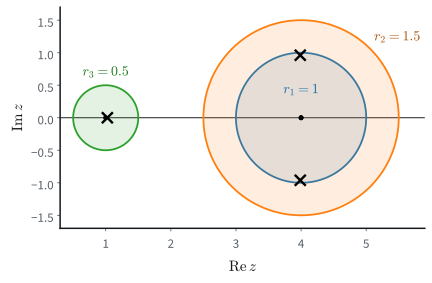
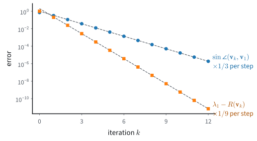
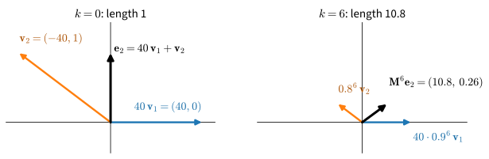
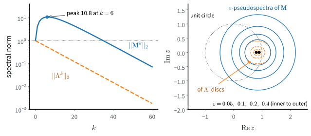

# Spectra in Practice
:label:`sec_mdl-spectra-in-practice`

In :numref:`sec_mdl-eigendecompositions`, our matrices were small enough to
factor by hand, and their eigenvalues delivered on every promise: the surfer's
error shrank by $1/4$ at every click, just as the second eigenvalue predicted.
Outside textbook examples, both comforts vanish. The link matrix of the web
has billions of rows, so nobody writes down its characteristic polynomial or
computes a full eigendecomposition. Even when eigenvalues are known, they
promise less than they appear to. A Jordan block whose eigenvalues are both
$0.99$ still grew to norm 37 before decaying (:numref:`subsec_mdl-jordan`),
and backpropagation through a recurrent network multiplies a gradient by fifty
*different* matrices rather than applying one matrix fifty times.

This section takes up those two problems in turn. First, what can we learn
about the eigenvalues of a matrix that is far too large to factor?
Surprisingly much: the entries alone confine all eigenvalues to a few discs in
the complex plane, and repeated matrix--vector multiplication, the one
operation that remains cheap at scale, finds the largest eigenvalue and its
eigenvector. That is how PageRank was originally computed. Second, what do
eigenvalues leave unsaid about a finite number of steps, or about a product of
changing matrices? Here the answer is sobering. Eigenvalues govern the
long-run behavior of powers of a single matrix; for anything else we need
matrix norms, and ultimately the singular values of
:numref:`sec_mdl-svd-low-rank`.

Not every topic below carries the same weight in deep learning, and it helps
to know where to focus. Three ideas recur throughout the book. Power iteration
(:numref:`subsec_mdl-power-iteration`) estimates the largest stretch of a
layer, which is the workhorse behind spectral normalization
(:numref:`subsec_mdl-spectrum-control`). Transient growth and products of
Jacobians (:numref:`subsec_mdl-transient-growth`,
:numref:`subsec_mdl-jacobian-products`) supply the mathematics behind the
exploding and vanishing gradients of :numref:`sec_bptt`. And the random
matrices of :numref:`subsec_mdl-random-matrices` model the weight matrices of
:numref:`sec_numerical_stability` at initialization. Gershgorin's theorem and
PageRank are classical highlights that appear less often in deep learning, so
a reader in a hurry may skim both; pseudospectra
(:numref:`subsec_mdl-pseudospectra`) are a specialized diagnostic that can
likewise be skipped on a first reading. All numerical examples below use
NumPy.

```{.python .input #mdl-spectra-in-practice-imports}
#@tab mxnet
import numpy as np
```

```{.python .input #mdl-spectra-in-practice-imports}
#@tab pytorch
import numpy as np
```

```{.python .input #mdl-spectra-in-practice-imports}
#@tab tensorflow
import numpy as np
```

```{.python .input #mdl-spectra-in-practice-imports}
#@tab jax
import numpy as np
```

## Locating and Computing Eigenvalues

### Gershgorin Discs
:label:`subsec_mdl-gershgorin`

Can we tell roughly where the eigenvalues of a matrix lie without ever
computing them? For a diagonal matrix, the eigenvalues are simply the diagonal
entries. Intuition suggests that if the off-diagonal entries are small, the
eigenvalues should stay close to those diagonal entries. The following theorem
makes that intuition exact, and its proof takes only three lines.

**Theorem (Gershgorin** :cite:`Gershgorin.1931`**).** *Let
$\mathbf{A}=(a_{ij})$ be any $n\times n$ matrix, and for each row $i$ let
$r_i=\sum_{j\neq i}|a_{ij}|$ be the sum of the absolute values of its
off-diagonal entries. Let $\mathcal{D}_i$ be the closed disc in the complex
plane with centre $a_{ii}$ and radius $r_i$. Then every eigenvalue of
$\mathbf{A}$ lies in the union $\bigcup_i\mathcal{D}_i$.*

**Proof.** Suppose $\mathbf{A}\mathbf{v}=\lambda\mathbf{v}$ with
$\mathbf{v}\neq\mathbf 0$, and pick an index $i$ where $\mathbf{v}$ has its
largest entry in magnitude, so that $|v_i|\ge|v_j|$ for all $j$ and
$v_i\neq0$. Reading off row $i$ of $\mathbf{A}\mathbf{v}=\lambda\mathbf{v}$
gives

$$
\sum_j a_{ij}v_j = \lambda v_i
\quad\Longrightarrow\quad
(\lambda - a_{ii})\,v_i = \sum_{j\neq i} a_{ij} v_j .
$$

Dividing both sides by $v_i$ and taking absolute values, we use the fact that
$|v_j/v_i|\le 1$ for every $j$:

$$
|\lambda - a_{ii}|
  = \Bigl|\sum_{j\neq i} a_{ij}\,\tfrac{v_j}{v_i}\Bigr|
  \le \sum_{j\neq i} |a_{ij}| = r_i ,
$$

which says that $\lambda\in\mathcal{D}_i$. $\blacksquare$

Notice what the proof actually tells us: each eigenvalue falls into the disc
of the row where its eigenvector is largest. Because we do not know that row
in advance, the theorem guarantees only that every eigenvalue lies somewhere
in the union of all $n$ discs. To see this in action, consider the
non-symmetric matrix

$$
\mathbf A=\begin{pmatrix}4&1&0\\-1&4&0.5\\0.5&0&1\end{pmatrix}.
$$
:eqlabel:`eq_mdl-gershgorin-example`

Its three discs have centres $4$, $4$, and $1$, with radii $1$, $1.5$, and
$0.5$. The two discs centred at $4$ overlap (in fact, one sits inside the
other), whereas the disc centred at $1$ is completely separated from them,
because $|4-1|=3>1.5+0.5$. The actual eigenvalues are $3.99\pm0.96i$ and
$1.03$: the complex conjugate pair sits inside the two discs centred at $4$,
and the real eigenvalue sits inside the isolated disc centred at $1$.
:numref:`fig_mdl-la-gershgorin` displays the discs alongside the eigenvalues.


:label:`fig_mdl-la-gershgorin`

That split, with two eigenvalues in the overlapping pair and one in the
isolated disc, is no accident. *If a union of $m$ discs is connected and disjoint from
all the remaining discs, it contains exactly $m$ eigenvalues*, counted with
multiplicity. The reason is continuity: as we scale the off-diagonal entries
from zero up to their actual values, the eigenvalues start at the diagonal
entries and move continuously, so they can never jump across the empty gap
between separated groups of discs :cite:`Horn.Johnson.2012`. Let us verify the
centres, radii, and eigenvalues numerically.

```{.python .input #eigendecomposition-gershgorin-circle-theorem}
A = np.array([[4.0, 1.0, 0.0],
              [-1.0, 4.0, 0.5],
              [0.5, 0.0, 1.0]])
centres = np.diag(A)
radii = np.abs(A).sum(axis=1) - np.abs(centres)
print('centres:', centres, '  radii:', radii)
for z in np.linalg.eigvals(A):
    print(f'eigenvalue {z:.3f}   distances to the centres: '
          f'{np.abs(z - centres).round(2)}')
```

Here the complex pair sits at distance $0.96$ from $4$, right near the rim of
the inner disc of radius $1$, showing that Gershgorin's bound can be nearly
tight.

One immediate corollary requires no computation at all. If $\mathbf{A}$ is
*strictly diagonally dominant* with positive diagonal entries, meaning
$a_{ii}>r_i$ for every $i$, then every disc lies strictly in the open right
half-plane. Zero cannot be an eigenvalue, so $\mathbf{A}$ is automatically
invertible. If $\mathbf{A}$ is also symmetric, its eigenvalues are real and
strictly positive, which makes it positive definite.

### Power Iteration
:label:`subsec_mdl-power-iteration`

Gershgorin discs locate eigenvalues only roughly. What if we want an accurate
eigenvalue of a matrix with a billion rows? Factoring such a matrix is out of
the question, yet if it is sparse we can still multiply it by a vector cheaply.
What happens if we start with a vector $\mathbf{v}_0$ and simply multiply by
$\mathbf{A}$ over and over again?

The power expansion :eqref:`eq_mdl-eig-power-expansion` gives the answer.
Suppose $\mathbf{A}$ is diagonalizable with eigenvectors $\mathbf{v}_i$,
ordered by the magnitude of their eigenvalues, and suppose the largest
eigenvalue is *strictly dominant*, meaning
$|\lambda_1|>|\lambda_2|\ge\cdots\ge|\lambda_n|$. (When $\mathbf{A}$ is real,
strict dominance forces $\lambda_1$ to be real as well, because a complex
eigenvalue would share its modulus with its complex conjugate.) Expanding
$\mathbf{v}_0=\sum_i c_i\mathbf{v}_i$ and factoring out $\lambda_1^k$ yields

$$
\mathbf{A}^k\mathbf{v}_0
  = \sum_{i=1}^{n} c_i\lambda_i^k\mathbf{v}_i
  = \lambda_1^k\Bigl(c_1\mathbf{v}_1
       + \sum_{i\ge2} c_i\Bigl(\tfrac{\lambda_i}{\lambda_1}\Bigr)^{k}\mathbf{v}_i\Bigr).
$$
:eqlabel:`eq_mdl-power-iter`

Every ratio $|\lambda_i/\lambda_1|$ for $i\ge 2$ is strictly less than $1$,
so every trailing term vanishes as $k$ grows. Provided $c_1\neq 0$, the
bracket converges to $c_1\mathbf{v}_1$. Thus the direction of
$\mathbf{A}^k\mathbf{v}_0$ approaches the dominant eigenvector $\mathbf{v}_1$
with an error decaying like $|\lambda_2/\lambda_1|^k$, while its length
scales by a factor approaching $|\lambda_1|$ at each step. To keep the entries
from overflowing or underflowing, we normalize the vector back to unit length
after every multiplication; this simple loop is *power iteration*
:cite:`Golub.Van-Loan.1996`. When $\mathbf{A}$ is symmetric, we can do even
better for the eigenvalue itself: the Rayleigh quotient of the current iterate
converges to $\lambda_1$ at the squared rate $|\lambda_2/\lambda_1|^{2k}$.
Because the eigenvectors of a symmetric matrix are orthogonal, a directional
misalignment of size $\delta$ shifts the Rayleigh quotient only by
$O(\delta^2)$ (Exercise
:exref:`ex_mdl-eigendecomposition-power-iteration-rates`).

We can see both rates in a concrete $2\times 2$ example. In
:numref:`sec_linear-algebra`, we computed the iterates of
$\mathbf{S}=\left(\begin{smallmatrix}2&1\\1&2\end{smallmatrix}\right)$
starting from $\mathbf{e}_1$: $(2,1)$, $(5,4)$, $(14,13)$, and in general
$\bigl((3^k+1)/2,\,(3^k-1)/2\bigr)$. In terms of the unit eigenvectors
$\mathbf{v}_1=(1,1)/\sqrt2$ and $\mathbf{v}_2=(1,-1)/\sqrt2$, we have
$\mathbf{e}_1=(\mathbf{v}_1+\mathbf{v}_2)/\sqrt2$, so

$$
\mathbf S^k\mathbf e_1=\frac{3^k\mathbf v_1+\mathbf v_2}{\sqrt2},
\qquad
\tan\angle(\mathbf S^k\mathbf e_1,\mathbf v_1)=3^{-k},
\qquad
3-R(\mathbf S^k\mathbf e_1)=\frac{2}{9^k+1}.
$$

With $|\lambda_2/\lambda_1|=1/3$, the directional error drops by a factor of
$3$ at every step: the sine of the angle to $\mathbf{v}_1$ is $0.316$,
$0.110$, and $0.037$ for $k=1,2,3$. Meanwhile the Rayleigh-quotient error
drops by a factor of $9$ per step: $0.2$, $0.024$, and $0.0027$.
:numref:`fig_mdl-la-power-iter` plots both curves on a logarithmic scale.


:label:`fig_mdl-la-power-iter`

When can power iteration fail? Two assumptions in :eqref:`eq_mdl-power-iter`
matter. First, the starting vector needs a nonzero component along
$\mathbf{v}_1$ ($c_1\neq 0$); choosing $\mathbf{v}_0$ at random guarantees
this with probability one. Second, the largest eigenvalue must be strictly
dominant. If the largest modulus is shared by a complex conjugate pair, the
dominant component of the iterate rotates indefinitely instead of settling on
a single line. The ratio of consecutive norms then oscillates forever, just as
it did for the running matrix of :numref:`subsec_mdl-complex-rotation`. Even
in that case, however, the geometric average $\|\mathbf A^k\mathbf v_0\|^{1/k}$
still converges to the largest modulus.

Matrices with strictly positive entries avoid this trouble altogether: as we
will see in :numref:`subsec_mdl-pagerank`, the Perron--Frobenius theorem
guarantees a real, simple, strictly dominant eigenvalue. Let us test this by
running 200 steps of power iteration on a random $5\times 5$ matrix with
entries drawn uniformly from $[0,1]$, starting from a random vector, and
comparing the final norm ratio with the true largest eigenvalue modulus.

```{.python .input #eigendecomposition-power-iteration}
A = np.random.rand(5, 5)                 # positive entries
v = np.random.randn(5)
for _ in range(200):
    Av = A @ v
    ratio = np.linalg.norm(Av) / np.linalg.norm(v)
    v = Av / np.linalg.norm(Av)
mods = np.sort(np.abs(np.linalg.eigvals(A)))[::-1]
print(f'norm ratio after 200 steps = {ratio:.10f}')
print(f'largest |eigenvalue|       = {mods[0]:.10f}')
print(f'|lambda_2| / |lambda_1|    = {mods[1] / mods[0]:.3f}')
```

On every draw, the norm ratio matches the largest eigenvalue modulus to all
printed digits. To see how typical this fast convergence is, let us compute
the gap ratio $|\lambda_2/\lambda_1|$ across 10,000 such positive matrices.
For comparison, we also draw 10,000 matrices with standard Gaussian entries,
which have no positivity guarantee, and measure how often their dominant
eigenvalues form a complex conjugate pair.

```{.python .input #mdl-spectra-in-practice-power-iteration-1}
mods = np.sort(np.abs(np.linalg.eigvals(np.random.rand(10000, 5, 5))), axis=1)
print('uniform entries, gap ratio |lambda_2| / |lambda_1|, 5% and 95% quantiles:',
      np.quantile(mods[:, -2] / mods[:, -1], [0.05, 0.95]).round(2))
lam = np.linalg.eigvals(np.random.randn(10000, 5, 5))
top = lam[np.arange(10000), np.abs(lam).argmax(axis=1)]   # a dominant eigenvalue
print('Gaussian entries, fraction with a complex dominant pair:',
      np.mean(top.imag != 0).round(2))
```

For uniform positive entries, the gap ratio falls between roughly $0.14$ and
$0.37$ in nine draws out of ten, so 200 iterations drive the direction error
far below floating-point precision. For Gaussian entries, by contrast, about
four draws in ten have a complex dominant pair, and on those matrices the
norm ratio never settles.

### PageRank
:label:`subsec_mdl-pagerank`

For matrices with non-negative entries, the dominant eigenvector is often the
very object we care about, and power iteration is how we compute it. To state
when that eigenvector is unique and well behaved, call a non-negative matrix
*irreducible* if, in the directed graph that places an edge $j\to i$ whenever
$a_{ij}>0$, every node can reach every other node. The *Perron--Frobenius
theorem* :cite:`Horn.Johnson.2012` guarantees that any irreducible
non-negative matrix has a real, positive eigenvalue equal to the largest
modulus among all its eigenvalues, that this eigenvalue is simple, and that
its eigenvector can be chosen with strictly positive entries. If every entry
of the matrix is strictly positive, this eigenvalue is also strictly dominant,
meaning every other eigenvalue has strictly smaller modulus.

Google's original PageRank algorithm :cite:`Brin.Page.1998` turns web ranking
into exactly such an eigenvector problem. Consider a miniature web of three
pages with links $1\to2$, $2\to1$, and $2\to3$. A random surfer follows an
outgoing link chosen uniformly at random. Page $3$ has no outgoing links, so
we repair that dead end by letting the surfer jump from page $3$ to any page
with equal probability. The repaired transition matrix $\mathbf{P}$ is
column-stochastic, with column $j$ holding the click probabilities out of
page $j$:

$$
\mathbf P=\begin{pmatrix}0&\tfrac12&\tfrac13\\1&0&\tfrac13\\0&\tfrac12&\tfrac13\end{pmatrix}.
$$

In the long run, the fraction of time the surfer spends on each page is the
stationary distribution $\boldsymbol{\pi}$ satisfying
$\mathbf{P}\boldsymbol{\pi}=\boldsymbol{\pi}$. We can solve this by hand:
rows $1$ and $3$ both give $\pi_1=\tfrac12\pi_2+\tfrac13\pi_3=\pi_3$, and
substituting $\pi_1=\pi_3$ back into row $1$ gives $\pi_2=\tfrac43\pi_3$.
Normalizing the entries to sum to $1$ yields
$\boldsymbol{\pi}=(0.3,0.4,0.3)$. Page $2$ ranks first because page $1$ sends
it all of its clicks, whereas page $2$ splits its clicks between pages $1$
and $3$. The eigenvalues of $\mathbf{P}$ are $1$, $-\tfrac23$, and $0$, so
power iteration from any initial distribution converges at the rate $2/3$ per
step.

In fact, *every* column-stochastic matrix has $1$ as an eigenvalue of largest
modulus. First, because every column sums to $1$, we have
$\mathbf{1}^\top\mathbf{P}=\mathbf{1}^\top$, which means $1$ is an eigenvalue
of $\mathbf{P}^\top$, and therefore also of $\mathbf{P}$ (a matrix and its
transpose share the same characteristic polynomial, because
$\det\mathbf{X}^\top=\det\mathbf{X}$). Second, applying Gershgorin's theorem
to $\mathbf{P}^\top$, whose rows are the columns of $\mathbf{P}$, places
every eigenvalue inside a disc with centre $p_{ii}\ge 0$ and radius
$1-p_{ii}$; every such disc sits inside the unit disc.

The real web, however, is messier than our three-page example: it contains
link cycles and isolated pockets of pages from which a surfer cannot escape.
The repaired matrix $\mathbf{P}$ can then fail to be irreducible or can have
several eigenvalues of modulus $1$. For instance, a simple cycle of four pages
has eigenvalues $\pm 1$ and $\pm i$, so undamped power iteration on it never
settles (Exercise :exref:`ex_mdl-eigendecomposition-pagerank-damping`).
PageRank solves both problems at once by iterating the *damped* matrix

$$
\mathbf G=\alpha\mathbf P+(1-\alpha)\tfrac1n\mathbf 1\mathbf 1^\top,
\qquad \alpha=0.85,
$$

which describes a surfer who follows a random link with probability $0.85$
and teleports to a uniformly random page with probability $0.15$. Because
every entry of $\mathbf{G}$ is strictly positive, the Perron--Frobenius
theorem applies by construction. Better still,
:citet:`Haveliwala.Kamvar.2003` show that $|\lambda_2(\mathbf{G})|\le\alpha$,
so the error of power iteration shrinks by at least a factor of $0.85$ at
every step, no matter how tangled the link graph is. That single bound made
web-scale PageRank practical: fifty sweeps cut the error by more than a
factor of $3000$ ($0.85^{50}\approx 3\times 10^{-4}$), regardless of how many
billions of pages are in the graph.

At web scale, $\mathbf{P}$ is stored sparsely as one entry per link, and the
dense matrix $\mathbf{G}$ is never formed explicitly. For any probability
vector $\mathbf{p}$ (where $\mathbf{1}^\top\mathbf{p}=1$), we can evaluate
$\mathbf{G}\mathbf{p}=\alpha\mathbf{P}\mathbf{p}+(1-\alpha)\tfrac1n\mathbf{1}$
using just one sparse matrix--vector product plus a constant shift. The
dead-end repair for pages with no outgoing links is a rank-one term handled
in the same way.

## Iteration and Stability

### The Spectral Radius
:label:`subsec_mdl-spectral-radius`

Power iteration singled out one number: the largest eigenvalue modulus. That
number is called the *spectral radius*, $\rho(\mathbf{A})=\max_i|\lambda_i|$,
and it governs the long-run growth rate of the powers of a single fixed
matrix. Gelfand's formula makes this exact: for every square matrix
$\mathbf{A}$ and every matrix norm,

$$
\lim_{k\to\infty}\|\mathbf A^k\|^{1/k}=\rho(\mathbf A).
$$

The easier half of this statement, $\rho(\mathbf{A})\le\|\mathbf{A}^k\|^{1/k}$
for every $k\ge 1$, is Exercise
:exref:`ex_mdl-eigendecomposition-spectral-radius-norms`.

What Gelfand's formula does *not* tell us is what happens at any fixed, finite
step $k$, and we have already met two matrices where that gap matters. The
shear
$\mathbf{T}=\left(\begin{smallmatrix}1&1\\0&1\end{smallmatrix}\right)$ has
$\rho(\mathbf{T})=1$, yet its powers
$\mathbf{T}^k=\left(\begin{smallmatrix}1&k\\0&1\end{smallmatrix}\right)$ grow
without bound, so $\rho\le 1$ does not even keep the iterates bounded. The
Jordan block $\mathbf{J}_2(0.99)$ has $\rho<1$ and must eventually decay to
zero, yet its powers climb to norm $37$ before turning downward, so $\rho<1$
does not rule out large transient growth. When, then, do the eigenvalues
control *every* step rather than only the distant limit?

### Normal Matrices
:label:`subsec_mdl-normal-matrices`

Both of our counterexamples, the shear and the Jordan block, are defective:
they lack enough eigenvectors to form a basis. Let us go straight to the
opposite extreme and consider matrices that admit an *orthonormal* basis of
eigenvectors. Such a matrix acts independently along mutually perpendicular
directions, so its eigenvalues ought to tell the whole story at every step.

A real matrix is called *normal* if it commutes with its transpose,
$\mathbf{A}^\top\mathbf{A}=\mathbf{A}\mathbf{A}^\top$ (for a complex matrix,
we replace the transpose by the conjugate transpose $\mathbf{A}^*$, requiring
$\mathbf{A}^*\mathbf{A}=\mathbf{A}\mathbf{A}^*$). Symmetric matrices,
orthogonal matrices, and the rotation--scaling blocks $r\mathbf{R}_\theta$ of
:numref:`subsec_mdl-complex-rotation` are all normal. By contrast, our running
example $\mathbf{A}=\left(\begin{smallmatrix}1&2\\-1&3\end{smallmatrix}\right)$
is not normal:
$\mathbf{A}\mathbf{A}^\top=\left(\begin{smallmatrix}5&5\\5&10\end{smallmatrix}\right)$,
whereas
$\mathbf{A}^\top\mathbf{A}=\left(\begin{smallmatrix}2&-1\\-1&13\end{smallmatrix}\right)$.
That failure to commute is the reason its iterates spiraled along ellipses
rather than circles.

The *complex spectral theorem* :cite:`Horn.Johnson.2012` characterizes this
class completely: a matrix is normal if and only if it has an orthonormal
eigenbasis over $\mathbb{C}$, meaning
$\mathbf{A}=\mathbf{U}\boldsymbol{\Lambda}\mathbf{U}^*$ with $\mathbf{U}$
unitary ($\mathbf{U}^*\mathbf{U}=\mathbf{I}$). The proof follows the same
inductive argument as the real spectral theorem in
:numref:`subsec_mdl-spectral-theorem`.

To measure the worst-case amplification in a single step, write
$\|\mathbf{X}\|_2=\max_{\|\mathbf{x}\|=1}\|\mathbf{X}\mathbf{x}\|$ for the
*spectral norm* of $\mathbf{X}$, the largest factor by which $\mathbf{X}$ can
stretch a vector. Because a unitary change of basis preserves Euclidean
lengths, every power of a normal matrix satisfies

$$
\|\mathbf A^k\|_2
=\|\mathbf U\boldsymbol\Lambda^k\mathbf U^*\|_2
=\max_i|\lambda_i|^k
=\rho(\mathbf A)^k .
$$
:eqlabel:`eq_mdl-normal-power-norm`

For a normal matrix, the eigenvalues control the worst-case amplification at
every single step $k$, not just asymptotically.

What happens when $\mathbf{A}$ is diagonalizable,
$\mathbf{A}=\mathbf{V}\boldsymbol{\Lambda}\mathbf{V}^{-1}$, but not normal?
Now the eigenvector matrix $\mathbf{V}$ is no longer orthogonal, and
submultiplicativity of the spectral norm gives only the upper bound

$$
\|\mathbf A^k\|_2
\le \underbrace{\|\mathbf V\|_2\|\mathbf V^{-1}\|_2}_{\kappa_2(\mathbf V)}
   \rho(\mathbf A)^k .
$$
:eqlabel:`eq_mdl-nonnormal-power-bound`

The prefactor $\kappa_2(\mathbf{V})$ is the condition number
(:numref:`subsec_mdl-condition-number`) of the eigenvector matrix. It equals
$1$ when the eigenvectors are orthogonal, and grows arbitrarily large when
two eigenvectors point in nearly the same direction. The transient growth it
permits has a clean geometric cause: cancellation. When eigenvectors are
nearly parallel, an ordinary unit vector can only be expressed as a
combination of huge eigen-components that nearly cancel each other out. As we
apply $\mathbf{A}$ repeatedly, those components decay at different rates, the
delicate cancellation comes undone, and the iterate balloons in length before
the common exponential decay finally takes over.

### Transient Growth
:label:`subsec_mdl-transient-growth`

The simplest matrix that displays this transient growth is the
upper-triangular $2\times 2$ matrix

$$
\mathbf M=\begin{pmatrix}0.9&4\\0&0.8\end{pmatrix}.
$$
:eqlabel:`eq_mdl-nonnormal-example`

Its eigenvalues are its diagonal entries $0.9$ and $0.8$. Both lie safely
inside the unit circle, and because they are distinct, $\mathbf{M}$ is
diagonalizable. Let us compute its eigenvectors by hand and expand the unit
vector $\mathbf{e}_2=(0,1)$ in them. For $\lambda=0.9$, the second row of
$\mathbf{M}-0.9\mathbf{I}$ reads $-0.1v_2=0$, giving $\mathbf{v}_1=(1,0)$.
For $\lambda=0.8$, the first row of $\mathbf{M}-0.8\mathbf{I}$ reads
$0.1v_1+4v_2=0$, giving $\mathbf{v}_2=(-40,1)$. Notice how close these two
directions are: the angle between them is only
$\arctan(1/40)\approx 1.4^\circ$. Expanding $\mathbf{e}_2$ in this nearly
parallel basis gives $\mathbf{e}_2=40\mathbf{v}_1+\mathbf{v}_2$, and applying
:eqref:`eq_mdl-eig-power-expansion` yields

$$
\mathbf M^k\mathbf e_2=40\cdot0.9^k\,\mathbf v_1+0.8^k\,\mathbf v_2
=\begin{pmatrix}40\,(0.9^k-0.8^k)\\0.8^k\end{pmatrix}.
$$
:eqlabel:`eq_mdl-transient-closed-form`

At $k=0$, a vector of length $1$ is formed as the difference of two
eigen-components of length roughly $40$. Both components decay at every step,
yet because $0.8^k$ falls faster than $0.9^k$, their cancellation unravels
and the sum initially grows. The first coordinate $40(0.9^k-0.8^k)$ peaks
where its derivative with respect to $k$ vanishes, namely where
$(9/8)^k=\ln 0.8/\ln 0.9$, which occurs at $k\approx 6.4$ with a height of
about $10.8$. :numref:`fig_mdl-la-transient-cancel` illustrates the two
components at $k=0$ and at $k=6$. For comparison, the general bound
:eqref:`eq_mdl-nonnormal-power-bound` with unit eigenvectors has
$\kappa_2(\mathbf{V})=80$ and predicts
$\|\mathbf{M}^6\|_2\le 80\cdot 0.9^6\approx 42.5$. The bound holds, though it
is conservative by a factor of four compared with the true peak of $10.8$.


:label:`fig_mdl-la-transient-cancel`

Let us check this calculation numerically and compare $\mathbf{M}$ against
the diagonal matrix $\boldsymbol{\Lambda}=\operatorname{diag}(0.9,0.8)$,
which has the exact same eigenvalues but is normal.

```{.python .input #mdl-eigendecomposition-nonnormal-transient}
M = np.array([[0.9, 4.0], [0.0, 0.8]])
Lam = np.diag([0.9, 0.8])                   # same eigenvalues, normal
lam, V = np.linalg.eig(M)                   # unit eigenvectors as columns
print('eigenvalues:', lam)
print('coefficients of e_2 on the unit eigenvectors:',
      np.linalg.solve(V, [0., 1.]))
ks = np.arange(61)
norm_M = [np.linalg.norm(np.linalg.matrix_power(M, k), 2) for k in ks]
norm_L = [np.linalg.norm(np.linalg.matrix_power(Lam, k), 2) for k in ks]
k_peak = int(np.argmax(norm_M))
print(f'max ||M^k|| = {norm_M[k_peak]:.3f} at k = {k_peak};  '
      f'max ||Lambda^k|| = {max(norm_L):.3f}')
print(f'kappa_2(V) = {np.linalg.cond(V):.1f}')
```

Expressed in the unit eigenvectors, $\mathbf{e}_2$ carries two coefficients
of magnitude about $40$, matching the lengths of $40\mathbf{v}_1$ and
$\mathbf{v}_2$. The spectral norm $\|\mathbf{M}^k\|_2$ climbs to $10.8$ at
$k=6$, whereas $\|\boldsymbol{\Lambda}^k\|_2$ never exceeds its starting
value of $1$. Even though both matrices share the same eigenvalues, the normal
matrix contracts from the very first step while the non-normal matrix grows
more than ten-fold before decaying. The left panel of
:numref:`fig_mdl-la-transient-growth` plots both trajectories on a logarithmic
scale; past the peak, both curves eventually descend with the same slope
$\log 0.9$, just as Gelfand's formula guarantees.


:label:`fig_mdl-la-transient-growth`

### Pseudospectra
:label:`subsec_mdl-pseudospectra`

This subsection adds a diagnostic for non-normality rather than a new
phenomenon, and may be skipped on a first pass. Beyond transient growth, a
second symptom of non-normality is extreme sensitivity of the eigenvalues to
small perturbations. To make that sensitivity visible, the
*$\varepsilon$-pseudospectrum* collects every complex number that becomes an
eigenvalue of $\mathbf{A}+\mathbf{E}$ for some perturbation $\mathbf{E}$ of
spectral norm at most $\varepsilon$. Conveniently, the same set can be
computed directly from the *resolvent* $(z\mathbf{I}-\mathbf{A})^{-1}$:

$$
\begin{aligned}
\Lambda_\varepsilon(\mathbf A)
&=\{z\in\mathbb C:z\text{ is an eigenvalue of }\mathbf A+\mathbf E
       \text{ for some }\|\mathbf E\|_2\le\varepsilon\} \\
&=\{z\in\mathbb C:\|(z\mathbf I-\mathbf A)^{-1}\|_2\ge1/\varepsilon\},
\end{aligned}
$$
:eqlabel:`eq_mdl-pseudospectrum`

where the resolvent norm is taken to be infinite at the eigenvalues of
$\mathbf{A}$ itself. Proving the equivalence of these two descriptions is
Exercise :exref:`ex_mdl-eigendecomposition-pseudospectra-transient-growth`.
For a normal matrix, the resolvent norm at $z$ is simply the reciprocal of
the distance from $z$ to the nearest eigenvalue, so
$\Lambda_\varepsilon(\mathbf{A})$ is just the union of discs of radius
$\varepsilon$ around the eigenvalues. For a non-normal matrix like
$\mathbf{M}$, the resolvent norm can be vastly larger, as we can check at
$z=1$ on the unit circle.

```{.python .input #mdl-eigendecomposition-pseudospectra}
I = np.eye(2)
print(f'||(I - M)^-1||      = {np.linalg.norm(np.linalg.inv(I - M), 2):.1f}')
print(f'||(I - Lambda)^-1|| = {np.linalg.norm(np.linalg.inv(I - Lam), 2):.1f}')
```

For $\boldsymbol{\Lambda}$ the resolvent norm is $10$, the reciprocal of the
distance $0.1$ from $1$ to the eigenvalue $0.9$. For $\mathbf{M}$ it jumps to
$200.3$: a tiny perturbation of size $1/200.3\approx 0.005$ already pushes an
eigenvalue of $\mathbf{M}$ onto the unit circle, whereas $\boldsymbol{\Lambda}$
requires a perturbation twenty times larger, of size $0.1$ (right panel of
:numref:`fig_mdl-la-transient-growth`). Because floating-point rounding acts
like a small perturbation to the matrix entries, the numerically computed
eigenvalues of a strongly non-normal matrix can be surprisingly inaccurate.
:numref:`sec_mdl-linear-algebra-further-reading` follows this thread further
with the Kreiss matrix theorem.

### Products of Jacobians
:label:`subsec_mdl-jacobian-products`

So far we have multiplied a vector by the *same* matrix repeatedly. Recurrent
neural networks (:numref:`sec_bptt`) break even that assumption. A recurrent
layer updates its hidden state as
$\mathbf{h}_t=\phi(\mathbf{W}\mathbf{h}_{t-1}+\cdots)$, using the same weight
matrix $\mathbf{W}$ at every step, yet backpropagation through time multiplies
the gradient by the sequence of per-step Jacobians
$\mathbf{D}_t=\partial\mathbf{h}_t/\partial\mathbf{h}_{t-1}$:

$$
\nabla_{\mathbf{h}_0}\mathcal{L}
   = \mathbf{D}_1^\top\mathbf{D}_2^\top\cdots\mathbf{D}_T^\top
   \,\nabla_{\mathbf{h}_T}\mathcal{L}.
$$

Because the nonlinearity $\phi$ is evaluated at a different hidden state at
each time step, the Jacobians $\mathbf{D}_1,\ldots,\mathbf{D}_T$ are
different matrices, and the theory of powers of a single matrix no longer
applies.

In fact, the spectral radii of the individual factors tell us nothing at all
about their product. Consider the two $2\times 2$ matrices

$$
\mathbf D_1=\begin{pmatrix}0&2\\0&0\end{pmatrix},
\qquad
\mathbf D_2=\begin{pmatrix}0&0\\2&0\end{pmatrix},
\qquad
\mathbf D_2\mathbf D_1=\begin{pmatrix}0&0\\0&4\end{pmatrix}.
$$

Both $\mathbf{D}_1$ and $\mathbf{D}_2$ are nilpotent with $\rho=0$, so every
power of either matrix vanishes by the second step. Yet their product has
$\rho=4$: $\mathbf{D}_1$ copies the second coordinate into the first while
doubling it, and $\mathbf{D}_2$ copies it straight back while doubling it
again.

It is therefore helpful to keep three distinct quantities straight when
studying iterated linear maps. The *spectral radius* gives the asymptotic
growth rate of powers of one fixed matrix. The *spectral norm* bounds any
finite product of changing matrices, because submultiplicativity gives
$\|\mathbf{D}_T\cdots\mathbf{D}_1\|_2\le\prod_t\|\mathbf{D}_t\|_2$ (in our
example, $4\le 2\cdot 2$). Finally, the *top Lyapunov exponent*

$$
\mu=\lim_{T\to\infty}\frac1T\log\|\mathbf D_T\cdots\mathbf D_1\mathbf x_0\|
$$

measures the average logarithmic growth rate per step along a long product of
changing matrices. When the factors are independent and identically
distributed random matrices, this limit exists with probability one under
mild conditions :cite:`Furstenberg.Kesten.1960`.

When a gradient passes backward through a sequence of Jacobians with $\mu>0$,
it grows exponentially and explodes; when $\mu<0$, it shrinks exponentially
and vanishes :cite:`bengio1994learning,Pascanu.Mikolov.Bengio.2013`. Notice
that the standard remedies in deep learning target norms and Jacobians rather
than eigenvalues. Orthogonal initialization :cite:`Saxe.McClelland.Ganguli.2014`
chooses an orthogonal weight matrix so that a linear recurrence preserves the
Euclidean length of every vector at every step, a much stronger guarantee
than $\rho=1$. Gradient clipping caps the norm of the gradient directly after
backpropagation. Gated architectures such as LSTMs and GRUs alter the
Jacobians themselves, creating pathways along which selected directions pass
through with factors close to $1$
(:numref:`subsec_bptt-gradient-pathologies`).

### Random Matrices at Initialization
:label:`subsec_mdl-random-matrices`

How large are the spectral radius and spectral norm for the random weight
matrices of a freshly initialized neural network? Consider an $n\times n$
matrix $\mathbf{A}$ with independent standard Gaussian entries, known as the
real *Ginibre ensemble* :cite:`Ginibre.1965`. As $n\to\infty$, the
eigenvalues rescaled by $1/\sqrt{n}$ spread uniformly over the unit disc in
the complex plane. This is the *circular law*, which :citet:`Tao.Vu.2010`
proved in general for independent, identically distributed entries of mean
$0$ and variance $1$. The circular law tells us where almost all eigenvalues
live, though by itself it does not rule out a few stray outliers. A separate
theorem establishes that no outlier escapes the unit circle, so
$\rho(\mathbf{A})/\sqrt{n}\to 1$ with probability one :cite:`Geman.1986`.

The spectral norm behaves quite differently:
$\|\mathbf{A}\|_2/\sqrt{n}\to 2$ :cite:`Yin.Bai.Krishnaiah.1988`. This is a
special case of the Marchenko--Pastur law
(:numref:`subsec_mdl-sample-covariance-mp`) at aspect ratio $c=1$: the
largest eigenvalue of $\tfrac1n\mathbf{A}^\top\mathbf{A}$ converges to the
upper edge $(1+\sqrt{c})^2=4$, and $\|\mathbf{A}\|_2^2$ is simply $n$ times
that eigenvalue. Even at $n=1000$, a single random draw sits right next to
both asymptotic limits.

```{.python .input #mdl-eigendecomposition-random-matrices-at-initialization}
n = 1000
A = np.random.randn(n, n)
print(f'rho(A) / sqrt(n)       = {np.abs(np.linalg.eigvals(A)).max() / n ** 0.5:.3f}')
print(f'sigma_max(A) / sqrt(n) = {np.linalg.norm(A, 2) / n ** 0.5:.3f}')
```

At large $n$, the spectral radius lands within a few percent of $\sqrt{n}$
while the largest stretch sits close to $2\sqrt{n}$: a random Gaussian matrix
stretches certain vectors twice as far as its eigenvalues would lead you to
expect. Standard initialization schemes divide random weights by
$\sqrt{\textrm{fan-in}}$ for a different reason altogether. With entries of
variance $1/n$, we get $\mathbb{E}\|\mathbf{A}\mathbf{x}\|^2=\|\mathbf{x}\|^2$
for every fixed vector $\mathbf{x}$, so squared lengths are preserved on
average. Having a spectral radius near $1$ is merely a side effect, and as
:numref:`subsec_mdl-jacobian-products` showed, it does not control a product
of different matrices. Surprisingly, a long product of independent matrices
with this exact scaling *shrinks* a typical vector, giving $\mu<0$, even
though every individual factor preserves squared length on average. The
reason is the concavity of the logarithm: for a unit vector $\mathbf{x}$,
the expectation of $\log\|\mathbf{A}\mathbf{x}\|^2$ lies strictly below the
logarithm of the expectation of $\|\mathbf{A}\mathbf{x}\|^2$ (which is
$\log 1 = 0$), and it is the logarithms that add up along a deep product
(Exercise :exref:`ex_mdl-eigendecomposition-lyapunov-random-products`).

Both the non-normal matrix $\mathbf{M}$ and the random Gaussian matrix point
to the same conclusion: eigenvalues tell us little about how much a matrix
stretches vectors over a finite number of steps, and for rectangular matrices
eigenvalues do not even exist. To measure stretching directly, for any matrix
of any shape, we turn next to the singular values of
:numref:`sec_mdl-svd-low-rank`.

## Summary

Even without factoring a matrix, Gershgorin discs locate its eigenvalues
directly from its entries, and power iteration extracts the dominant
eigenpair at the geometric rate $|\lambda_2/\lambda_1|$, the mechanism behind
PageRank. The spectral radius $\rho(\mathbf{A})$ governs the long-run rate
of powers of a single fixed matrix and nothing more: a non-normal matrix can
grow dramatically before it decays, and the eigenvalues of individual factors
reveal nothing about a product of changing matrices. For products of changing
maps, the spectral norm bounds finite steps and the top Lyapunov exponent
gives the average long-run rate. A random $n\times n$ Gaussian matrix at
initialization makes the gap between eigenvalues and stretching concrete: its
spectral radius is close to $\sqrt{n}$, whereas its spectral norm is close to
$2\sqrt{n}$.

## Exercises

1. **Spectral radius and norms.** The spectral radius bounds every power of
   a matrix from below, and for normal matrices it also bounds them from
   above.
    1. Show that $\rho(\mathbf{A})\le\|\mathbf{A}^k\|_2^{1/k}$ for every
       square matrix $\mathbf{A}$ and every $k\ge1$.
    1. The chain :eqref:`eq_mdl-normal-power-norm` uses two facts without
       proof. Show that $\|\mathbf{U}\mathbf{X}\mathbf{U}^*\|_2=\|\mathbf{X}\|_2$
       for every unitary $\mathbf{U}$ and every square $\mathbf{X}$, and that
       the spectral norm of a diagonal matrix is the largest modulus of its
       diagonal entries.
    1. Show that the converse of :eqref:`eq_mdl-normal-power-norm` fails:
       find a $3\times3$ matrix that is not normal but satisfies
       $\|\mathbf{A}^k\|_2=\rho(\mathbf{A})^k$ for every $k\ge1$.
    1. For a given $t>0$, construct a diagonalizable $2\times2$ matrix
       with spectral radius $1/2$ and $\|\mathbf{A}\|_2>t$.
   :exlabel:`ex_mdl-eigendecomposition-spectral-radius-norms`

1. [code] **Power-iteration rates.** Let $\mathbf{S}$ be the matrix
   of :numref:`fig_mdl-la-power-iter`.
    1. By :eqref:`eq_mdl-power-iter`, the misalignment between the iterate and
       $\mathbf{v}_1$ decays at the rate $|\lambda_2/\lambda_1|=1/3$. How many
       iterations reduce it by a factor of $100$?
    1. Let $\mathbf{A}$ be symmetric with unit eigenvector $\mathbf{v}_1$ for
       $\lambda_1$, and let $\mathbf{x}=\mathbf{v}_1+\delta\mathbf{u}$ for a unit
       vector $\mathbf{u}$ orthogonal to $\mathbf{v}_1$. Show that the Rayleigh
       quotient of :numref:`subsec_mdl-rayleigh` satisfies
       $R(\mathbf{x})-\lambda_1=O(\delta^2)$, with no term linear in $\delta$.
       At which rate does the Rayleigh quotient of the power iterates
       therefore approach $\lambda_1$? Where does the argument use that
       $\mathbf A$ is symmetric?
    1. Repeat the experiment of :numref:`fig_mdl-la-power-iter` for
       $\left(\begin{smallmatrix}1&0.1\\0.1&1\end{smallmatrix}\right)$, which
       has the same eigenvectors as $\mathbf S$ and the eigenvalues 1.1 and
       0.9, from a random start. Plot the sine of the angle to $\mathbf v_1$
       and the error of the Rayleigh quotient on a logarithmic scale for 30
       steps. Predict both slopes and the number of steps each error needs to
       shrink by a factor of 100, and explain why this matrix converges so much
       more slowly than $\mathbf S$.
   :exlabel:`ex_mdl-eigendecomposition-power-iteration-rates`

1. [code] **Pseudospectra and transient growth.** ● Let $\mathbf{M}$ be the
   non-normal matrix :eqref:`eq_mdl-nonnormal-example` and
   $\boldsymbol\Lambda=\operatorname{diag}(0.9,0.8)$ the normal matrix with the
   same eigenvalues, as in :numref:`subsec_mdl-transient-growth`.
    1. Prove the equality of the two sets in :eqref:`eq_mdl-pseudospectrum`.
       First show that $\|(z\mathbf I-\mathbf A)^{-1}\|_2=1/\sigma_{\min}(z\mathbf I-\mathbf A)$,
       where $\sigma_{\min}(\mathbf X)=\min_{\|\mathbf x\|=1}\|\mathbf X\mathbf x\|$.
       For one inclusion, take unit vectors $\mathbf u$, $\mathbf v$ with
       $(z\mathbf{I}-\mathbf{A})\mathbf{v}=\sigma\mathbf{u}$,
       $\sigma=\sigma_{\min}(z\mathbf I-\mathbf A)$, and show that $z$ is an
       eigenvalue of $\mathbf{A}+\sigma\mathbf{u}\mathbf{v}^*$. For the other,
       apply $(z\mathbf I-\mathbf A)\mathbf x=\mathbf E\mathbf x$ to an
       eigenvector $\mathbf x$ of $\mathbf A+\mathbf E$. Using the resolvent
       norms printed in :numref:`subsec_mdl-pseudospectra`, how large a
       perturbation makes $z=1$ an eigenvalue of a perturbed $\mathbf{M}$, and
       how large for $\boldsymbol\Lambda$?
    1. Suppose that $\|\mathbf{A}^k\|_2\le K_0$ for all $k\ge0$. Show that for
       $|z|>1$ the series $\sum_{k\ge0}\mathbf{A}^k/z^{k+1}$ converges to
       $(z\mathbf{I}-\mathbf{A})^{-1}$, and conclude that

       $$
       \sup_{k\ge0}\|\mathbf{A}^k\|_2\;\ge\;K(\mathbf{A})=\sup_{|z|>1}\,(|z|-1)\,\|(z\mathbf{I}-\mathbf{A})^{-1}\|_2 .
       $$

       The quantity $K(\mathbf{A})$ is called the Kreiss constant. Restate the
       bound in terms of pseudospectra: if $\Lambda_\varepsilon(\mathbf{A})$
       contains a point at distance $\delta$ outside the unit circle, how
       large must some power of $\mathbf{A}$ be?
    1. Evaluate $K(\mathbf{M})$ numerically on a grid of points $z$ with
       $|z|>1$, and compare it with the largest $\|\mathbf{M}^k\|_2$ printed
       in :numref:`subsec_mdl-transient-growth`. Find $K(\boldsymbol\Lambda)$
       by hand.
   :exlabel:`ex_mdl-eigendecomposition-pseudospectra-transient-growth`

1. [code] **Damping in PageRank.** ● Let $\mathbf{P}$ be a column-stochastic
   $n\times n$ matrix and
   $\mathbf{G}=\alpha\mathbf{P}+(1-\alpha)\tfrac1n\mathbf{1}\mathbf{1}^\top$
   with $0<\alpha<1$, the damped matrix of :numref:`subsec_mdl-pagerank`.
    1. Let $\mathbf{P}\mathbf{x}=\lambda\mathbf{x}$. Show that
       $\mathbf{1}^\top\mathbf{x}=0$ whenever $\lambda\neq1$, and that
       $\mathbf{G}\mathbf{x}=\alpha\lambda\mathbf{x}$ whenever
       $\mathbf{1}^\top\mathbf{x}=0$.
    1. The eigenvalue $1$ of $\mathbf{P}$ can be repeated, as it is when the
       links split into disconnected pockets. You may use that every
       column-stochastic $\mathbf P$ has a non-negative eigenvector for the
       eigenvalue 1 (a stationary distribution). Show that the vectors
       $\mathbf{x}$ of this eigenspace with $\mathbf{1}^\top\mathbf{x}=0$ form a
       subspace of dimension one less than the eigenspace. Conclude that for
       diagonalizable $\mathbf{P}$ the eigenvalues of $\mathbf{G}$ are $1$ and
       $\alpha\lambda_2(\mathbf{P}),\ldots,\alpha\lambda_n(\mathbf{P})$, which
       gives the bound $|\lambda_2(\mathbf{G})|\le\alpha$ of
       :citet:`Haveliwala.Kamvar.2003`.
    1. Four pages link in a cycle, $1\to2\to3\to4\to1$. Find the eigenvalues
       of their link matrix $\mathbf{P}$. Why does undamped power iteration
       started at page $1$ never converge?
    1. With $\alpha=0.85$ and the cycle of (c), run power iteration on
       $\mathbf{G}$ from page $1$, and count the iterations until the $\ell_1$
       distance to the stationary distribution falls below $10^{-8}$. Compare
       with the prediction $0.85^k\le10^{-8}$ from (b).
    1. Check numerically on the three-page example of
       :numref:`subsec_mdl-pagerank` that the eigenvalues of $\mathbf G$ are
       $\alpha$ times those of $\mathbf P$, apart from the eigenvalue 1, and
       that the stationary distribution moves from $(0.3,0.4,0.3)$ to about
       $(0.303,0.394,0.303)$. Why does damping move it toward uniform?
   :exlabel:`ex_mdl-eigendecomposition-pagerank-damping`

1. [code] **Lyapunov exponents of random products.** ●● Let
   $\mathbf{D}_1,\mathbf{D}_2,\ldots$ be independent $n\times n$ matrices with
   independent $\mathcal{N}(0,1/n)$ entries, a linear model of the Jacobians
   of a deep network at fan-in initialization, and let $\mathbf{x}_0$ be a
   unit vector. By :numref:`subsec_mdl-random-matrices`, each factor has
   spectral radius close to $1$ for large $n$.
   :numref:`subsec_mdl-jacobian-products` summarizes the growth of the
   product by its top Lyapunov exponent

   $$
   \mu=\lim_{T\to\infty}\frac1T\log\|\mathbf{D}_T\cdots\mathbf{D}_1\mathbf{x}_0\|,
   $$

   which exists with probability one by the theorem of Furstenberg and Kesten.
    1. Show that $\mathbb{E}\|\mathbf{D}\mathbf{x}\|^2=\|\mathbf{x}\|^2$ for
       every fixed $\mathbf{x}$, so that this scaling preserves squared norms
       on average.
    1. Let $\mathbf{u}_0=\mathbf{x}_0$ and
       $\mathbf{u}_t=\mathbf{x}_t/\|\mathbf{x}_t\|$ for the iterates
       $\mathbf{x}_t=\mathbf{D}_t\cdots\mathbf{D}_1\mathbf{x}_0$. Given
       $\mathbf{D}_1,\ldots,\mathbf{D}_{t-1}$, what is the distribution of
       $n\|\mathbf{D}_t\mathbf{u}_{t-1}\|^2$? Use the answer to write
       $\log\|\mathbf{D}_T\cdots\mathbf{D}_1\mathbf{x}_0\|$ as a sum of
       independent terms. With $\mathbb{E}\log\chi^2_n=\psi(n/2)+\log2$, where
       $\psi$ is the digamma function, derive the closed form of
       :citet:`Cohen.Newman.1984`

       $$
       \mu=\tfrac12\bigl(\psi(n/2)+\log2-\log n\bigr).
       $$

    1. Show that $\mu<0$ for every $n$, although (a) holds. Evaluate $\mu$ in
       closed form for $n=1$, using $\psi(1/2)=-\gamma_{\textrm{E}}-2\log2$
       with Euler's constant $\gamma_{\textrm{E}}\approx0.5772$. Using
       $\psi(x)=\log x-\tfrac1{2x}+O(x^{-2})$, show that $\mu\approx-1/(2n)$
       for large $n$.
    1. Simulate $T=10^4$ steps with renormalization for
       $n\in\{1,2,5,50\}$, and compare the measured exponent with (b) and with
       the logarithms of the spectral radius and of the largest singular value
       of single factors. By which factor does a typical input shrink in a
       linear network of width $50$ and depth $100$ at this initialization?
       What does the comparison say about the three quantities of
       :numref:`subsec_mdl-jacobian-products`?
   :exlabel:`ex_mdl-eigendecomposition-lyapunov-random-products`

[Discussions](https://d2l.discourse.group/t/36876)

<!-- slides -->

::: {.slide}
::: {.cover}
[Dive into Deep Learning · §33.4]{.kicker}

Spectra in Practice<br>**Gershgorin discs · power iteration & PageRank · non-normal transient growth · Jacobian products · random matrices**
:::
:::

::: {.slide title="Billion-Row Matrices and Misleading Eigenvalues"}
[Motivation]{.kicker}

::: {.cols .vc}
::: {.col}
- **Scale Prohibits $O(n^3)$ Factoring:** At web or LLM scale, only matrix–vector products $\mathbf{A}\mathbf{v}$ are affordable.
- **Finite-Step Transient Growth:** Even when all $|\lambda_i| < 1$, non-normal powers $\|\mathbf{M}^k\|_2$ can balloon ten-fold before decaying.
- **Changing BPTT Jacobians:** Recurrent backprop multiplies $T$ different matrices $\mathbf{D}_1^\top\cdots\mathbf{D}_T^\top$ where individual eigenvalues promise nothing.
:::

::: {.col .fig .big}
@fig:ch33-la-three-challenges
:::
:::
:::

::: {.slide title="Gershgorin Discs Bound Eigenvalues From Entries"}
[Locating Eigenvalues]{.kicker}

::: {.cols .vc}
::: {.col}
- **Row-Sum Discs:** For each row $i$ of $\mathbf{A}$, define disc $\mathcal{D}_i$ with center $a_{ii}$ and radius $r_i = \sum_{j \neq i} |a_{ij}|$.
- **Three-Line Proof:** If $\mathbf{A}\mathbf{v} = \lambda\mathbf{v}$ and $|v_i| = \max_j |v_j| > 0$, row $i$ gives $(\lambda - a_{ii})v_i = \sum_{j \neq i} a_{ij}v_j$, so:
  $$|\lambda - a_{ii}| \le \sum_{j \neq i} |a_{ij}|\,\frac{|v_j|}{|v_i|} \le r_i$$
- **Connected Components & Diagonal Dominance:** A disjoint union of $m$ discs traps $m$ eigenvalues; if $a_{ii} > r_i$ for all $i$, $0 \notin \bigcup_i \mathcal{D}_i$ so $\mathbf{A}$ is invertible (and PD if symmetric).
:::

::: {.col .fig}
{.nostretch width=100%}
:::
:::
:::

::: {.slide title="Verifying Gershgorin Discs on a 3×3 Matrix"}
[Locating Eigenvalues]{.kicker}

For $\mathbf{A} = \left(\begin{smallmatrix}4&1&0\\-1&4&0.5\\0.5&0&1\end{smallmatrix}\right)$, the two overlapping discs around $4$ trap the complex pair $3.99 \pm 0.96i$, while the isolated disc around $1$ traps $1.03$:

@eigendecomposition-gershgorin-circle-theorem

::: {.d2l-note}
**Near-Tightness:** The complex eigenvalues sit at distance $0.96$ from center $4$, almost touching the radius-$1$ boundary of the first disc.
:::
:::

::: {.slide title="Power Iteration Extracts the Dominant Eigenpair"}
[Computing Eigenvalues at Scale]{.kicker}

::: {.cols .vc}
::: {.col}
- **Repeated Multiplication & Normalization:** When $|\lambda_1| > |\lambda_2| \ge \cdots \ge |\lambda_n|$ and $\mathbf{v}_0 = \sum_i c_i\mathbf{v}_i$ has $c_1 \neq 0$, factoring out $\lambda_1^k$ gives:
  $$\mathbf{A}^k\mathbf{v}_0 = \lambda_1^k\Bigl(c_1\mathbf{v}_1 + \sum_{i \ge 2} c_i\Bigl(\frac{\lambda_i}{\lambda_1}\Bigr)^k \mathbf{v}_i\Bigr)$$
- **Linear Direction Rate ($|\lambda_2/\lambda_1|^k$):** Normalizing $\mathbf{v}_{k+1} = \mathbf{A}\mathbf{v}_k / \|\mathbf{A}\mathbf{v}_k\|$ aligns $\mathbf{v}_k$ with $\mathbf{v}_1$ at geometric rate $|\lambda_2/\lambda_1|$ ($1/3$ per step on $\mathbf{S} = \left(\begin{smallmatrix}2&1\\1&2\end{smallmatrix}\right)$).
- **Squared Rayleigh Rate ($|\lambda_2/\lambda_1|^{2k}$):** For symmetric $\mathbf{A}$, orthogonal eigenvectors make a $\delta$ angle error shift $R(\mathbf{v}_k)$ by only $O(\delta^2)$ ($1/9$ per step on $\mathbf{S}$).
:::

::: {.col .fig}
{.nostretch width=100%}
:::
:::
:::

::: {.slide title="Power Iteration in Code and When It Fails"}
[Power Iteration]{.kicker}

On a positive $5 \times 5$ matrix, 200 power-iteration steps recover $|\lambda_1|$ to 10 decimal places, whereas matrices with a complex conjugate top pair never settle in direction:

@eigendecomposition-power-iteration

::: {.d2l-note .warn}
**Positive vs. Gaussian Matrices:** Across $10{,}000$ random $5 \times 5$ draws, uniform positive matrices have a real strictly dominant eigenvalue $100\%$ of the time (gap ratio $0.14$–$0.37$), whereas standard Gaussian matrices have a complex dominant pair $\sim 40\%$ of the time, causing the norm ratio to oscillate forever.
:::
:::

::: {.slide title="PageRank and the Perron–Frobenius Theorem"}
[Web-Scale Eigenvectors]{.kicker}

::: {.cols .vc}
::: {.col}
- **Perron–Frobenius:** Any strictly positive matrix has a unique, real, strictly dominant eigenvalue $\lambda_1 = \rho(\mathbf{A})$ with a positive eigenvector.
- **Damped Google Matrix ($\alpha = 0.85$):** Mixing column-stochastic $\mathbf{P}$ with uniform teleportation $\mathbf{G} = \alpha\mathbf{P} + (1-\alpha)\tfrac{1}{n}\mathbf{1}\mathbf{1}^\top$ breaks dead ends and cycles, bounding $|\lambda_2(\mathbf{G})| \le 0.85$.
- **Sparse Sweep:** Evaluates $\mathbf{G}\mathbf{p} = \alpha\mathbf{P}\mathbf{p} + \tfrac{1-\alpha}{n}\mathbf{1}$ in $O(\text{edges})$.
:::

::: {.col .fig .big}
@fig:ch33-la-pagerank-damping
:::
:::
:::

::: {.slide title="The Spectral Radius Governs Only the Distant Limit"}
[Iteration & Stability]{.kicker}

::: {.cols .vc}
::: {.col}
- **Gelfand's Formula:** $\rho(\mathbf{A}) = \max_i |\lambda_i| = \lim_{k\to\infty} \|\mathbf{A}^k\|^{1/k}$ sets only the asymptotic $k \to \infty$ rate.
- **Why $\rho \le 1$ Fails at Finite $k$:** The shear $\mathbf{T}$ has $\rho = 1$ yet $\|\mathbf{T}^k\|_2 \sim k \to \infty$, and $\mathbf{J}_2(0.99)$ has $\rho = 0.99 < 1$ yet climbs to $37$ at $k = 100$.
:::

::: {.col .fig .big}
@fig:ch33-la-gelfand-vs-finite
:::
:::
:::

::: {.slide title="Normal Matrices vs. Non-Normal Amplification"}
[Normal vs. Non-Normal Maps]{.kicker}

::: {.cols .vc}
::: {.col}
- **Normal ($\mathbf{A}^\top\mathbf{A} = \mathbf{A}\mathbf{A}^\top$):** Unitary eigenbasis $\mathbf{A} = \mathbf{U}\boldsymbol{\Lambda}\mathbf{U}^*$ guarantees $\|\mathbf{A}^k\|_2 = \rho(\mathbf{A})^k$ at every step $k$.
- **Non-Normal Bound:** When eigenvectors are non-orthogonal, $\|\mathbf{A}^k\|_2 \le \kappa_2(\mathbf{V})\rho(\mathbf{A})^k$.
- **Unraveling Cancellation:** Nearly parallel eigenvectors ($\kappa_2(\mathbf{V}) \gg 1$) cause huge cancelling components at $k = 0$ to decouple at finite $k$.
:::

::: {.col .fig .big}
@fig:ch33-la-normal-vs-nonnormal
:::
:::
:::

::: {.slide title="Transient Growth From Nearly Parallel Eigenvectors"}
[Non-Normal Dynamics]{.kicker}

::: {.cols .vc}
::: {.col}
- **Distinct Eigenvalues Inside the Unit Disc:** $\mathbf{M} = \left(\begin{smallmatrix}0.9&4\\0&0.8\end{smallmatrix}\right)$ has $\lambda_1 = 0.9$ and $\lambda_2 = 0.8$, with eigenvectors $\mathbf{v}_1 = (1, 0)$ and $\mathbf{v}_2 = (-40, 1)$ separated by only $1.4^\circ$.
- **Unraveling Cancellation:** Writing $\mathbf{e}_2 = (0, 1) = 40\mathbf{v}_1 + \mathbf{v}_2$ gives:
  $$\mathbf{M}^k\mathbf{e}_2 = \begin{bmatrix}40(0.9^k - 0.8^k) \\ 0.8^k\end{bmatrix}$$
- **Ten-Fold Peak at $k = 6$:** Because $0.8^k$ decays faster than $0.9^k$, the difference peaks at $\|\mathbf{M}^6\|_2 \approx 10.8$ before decaying.
:::

::: {.col .fig}
{.nostretch width=100%}
:::
:::
:::

::: {.slide title="Comparing Non-Normal M Against Normal Λ in Code"}
[Non-Normal Dynamics]{.kicker}

Even though $\mathbf{M} = \left(\begin{smallmatrix}0.9&4\\0&0.8\end{smallmatrix}\right)$ and $\boldsymbol{\Lambda} = \operatorname{diag}(0.9, 0.8)$ share the exact same eigenvalues, $\boldsymbol{\Lambda}^k$ contracts monotonically from step 1 while $\mathbf{M}^k$ amplifies ten-fold:

@mdl-eigendecomposition-nonnormal-transient
:::

::: {.slide title="Pseudospectra and Eigenvalue Sensitivity"}
[Non-Normal Diagnostics]{.kicker}

::: {.cols .vc}
::: {.col}
- **$\varepsilon$-Pseudospectrum $\Lambda_\varepsilon(\mathbf{A})$:** The set of all $z \in \mathbb{C}$ that are eigenvalues of $\mathbf{A} + \mathbf{E}$ for some perturbation $\|\mathbf{E}\|_2 \le \varepsilon$, equivalently where the resolvent norm satisfies:
  $$\|(z\mathbf{I} - \mathbf{A})^{-1}\|_2 \ge \frac{1}{\varepsilon}$$
- **Normal Discs vs. Non-Normal Bulge:** At $z = 1$, $\|(\mathbf{I} - \boldsymbol{\Lambda})^{-1}\|_2 = 1/(1 - 0.9) = 10$, whereas $\|(\mathbf{I} - \mathbf{M})^{-1}\|_2 = 200.3$: a tiny perturbation of size $\varepsilon \approx 0.005$ pushes an eigenvalue of $\mathbf{M}$ onto the unit circle!
:::

::: {.col .fig}
{.nostretch width=100%}
:::
:::
:::

::: {.slide title="Products of Changing Jacobians in Recurrent Networks"}
[Backpropagation Through Time]{.kicker}

::: {.cols .vc}
::: {.col}
- **Changing Jacobians in BPTT:** Backprop multiplies $T$ distinct per-step matrices $\nabla_{\mathbf{h}_0}\mathcal{L} = \mathbf{D}_1^\top\mathbf{D}_2^\top\cdots\mathbf{D}_T^\top\nabla_{\mathbf{h}_T}\mathcal{L}$.
- **Zero Spectral Radius Can Still Explode:** Nilpotent $\mathbf{D}_1 = \left(\begin{smallmatrix}0&2\\0&0\end{smallmatrix}\right)$ and $\mathbf{D}_2 = \left(\begin{smallmatrix}0&0\\2&0\end{smallmatrix}\right)$ both have $\rho = 0$, yet $\mathbf{D}_2\mathbf{D}_1 = \operatorname{diag}(0, 4)$ has $\rho = 4$ and explodes as $4^{T/2}$!
:::

::: {.col .fig .big}
@fig:ch33-la-bptt-nilpotent
:::
:::
:::

::: {.slide title="Three Quantities for Iterated Linear Maps"}
[Stability Hierarchy]{.kicker}

::: {.cols .vc}
::: {.col}
- **Spectral Radius $\rho(\mathbf{A})$:** Asymptotic $k \to \infty$ growth rate of powers of *one fixed* matrix.
- **Spectral Norm $\|\mathbf{A}\|_2 = \sigma_1$:** Worst-case 1-step stretch; bounds finite products $\|\mathbf{D}_T\cdots\mathbf{D}_1\|_2 \le \prod_t \|\mathbf{D}_t\|_2$.
- **Top Lyapunov Exponent $\mu$:** Long-run exponential rate $\lim_{T\to\infty}\frac{1}{T}\log\|\mathbf{D}_T\cdots\mathbf{D}_1\mathbf{x}_0\|$ of changing matrices.
:::

::: {.col .fig .big}
@fig:ch33-la-stability-hierarchy
:::
:::
:::

::: {.slide title="Random Weight Matrices at Initialization"}
[Random Matrix Theory]{.kicker}

::: {.cols .vc}
::: {.col}
- **Circular Law vs. $2\times$ Stretch:** An $n \times n$ Gaussian matrix has $\rho(\mathbf{A}) \approx \sqrt{n}$ but maximum stretch $\|\mathbf{A}\|_2 \approx 2\sqrt{n}$.
- **Deep Product Paradox ($\mu < 0$):** Fan-in scaling $\mathcal{N}(0, 1/n)$ preserves $\mathbb{E}\|\mathbf{D}\mathbf{x}\|^2 = \|\mathbf{x}\|^2$, yet concavity of $\log$ causes deep products to shrink at rate $\mu \approx -1/(2n)$.

@mdl-eigendecomposition-random-matrices-at-initialization
:::

::: {.col .fig}
@fig:ch33-la-random-matrix-gap
:::
:::
:::

::: {.slide title="Why Deep Learning Needs Singular Values Next"}
[Bridge to SVD]{.kicker}

::: {.cols .vc}
::: {.col}
- **Four Gaps Eigenvalues Cannot Fill:** Rectangular layers ($m \neq n$), defective shears, non-normal transient growth, and the $2\times$ stretch gap in random Gaussian weights.
- **The SVD Remedy (§33.5):** Separate orthonormal input ($\mathbf{V}$) and output ($\mathbf{U}$) bases decompose *every* matrix into non-negative stretches $\sigma_1 \ge \sigma_2 \ge \cdots \ge 0$.
:::

::: {.col .fig .big}
@fig:ch33-la-eigen-to-svd-bridge
:::
:::
:::

::: {.slide title="Concept Check: Discs, Power Iteration & Stability"}
[Concept Check]{.kicker}

1. **Gershgorin Invertibility:** Use Gershgorin discs to explain at a glance why $\mathbf{A} = \left(\begin{smallmatrix}5&-1&1\\2&6&-1\\0&1&4\end{smallmatrix}\right)$ is guaranteed to be invertible without computing its determinant.
2. **Power Iteration Rate:** For symmetric $\mathbf{S}$ with eigenvalues $\lambda_1 = 3$ and $\lambda_2 = 1$, by what factor does the Rayleigh quotient error $3 - R(\mathbf{v}_k)$ shrink per power-iteration step?
3. **Spectral Radius vs. Norm:** Does $\rho(\mathbf{A}) \le 1$ guarantee that $\|\mathbf{A}^k\|_2$ stays bounded for all $k \ge 1$? Give a $2 \times 2$ counterexample.

::: {.d2l-note .fragment .fade-up}
**Answers:**
**1.** The three row discs have centers $5, 6, 4$ and radii $2, 3, 1$; since $a_{ii} > r_i$ in every row, all discs lie strictly in $\operatorname{Re}(z) \ge 3 > 0$, so $0$ cannot be an eigenvalue and $\mathbf{A}$ is invertible.
**2.** Direction error shrinks by $|\lambda_2/\lambda_1| = 1/3$ per step, while the Rayleigh quotient error shrinks at the squared rate $(1/3)^2 = 1/9$ per step.
**3.** No: the defective shear $\mathbf{T} = \left(\begin{smallmatrix}1&1\\0&1\end{smallmatrix}\right)$ has $\rho(\mathbf{T}) = 1$, yet $\mathbf{T}^k = \left(\begin{smallmatrix}1&k\\0&1\end{smallmatrix}\right)$ has $\|\mathbf{T}^k\|_2 \sim k \to \infty$.
:::
:::

::: {.slide title="Summary: Spectra in Practice"}
[Key Takeaways]{.kicker}

::: {.cols .vc}
::: {.col}
- **Locating & Extracting Eigenvalues:** Gershgorin discs bound spectra in $O(n^2)$, power iteration converges at $|\lambda_2/\lambda_1|^k$, and PageRank damping caps $|\lambda_2(\mathbf{G})| \le 0.85$.
- **Stability Beyond Eigenvalues:** Non-normal matrices grow up to $\kappa_2(\mathbf{V})\rho(\mathbf{A})^k$, changing BPTT Jacobians require spectral norms and gates, and Gaussian matrices stretch by $2\sqrt{n}$.
:::

::: {.col .fig .big}
@fig:ch33-la-spectra-summary
:::
:::
:::
