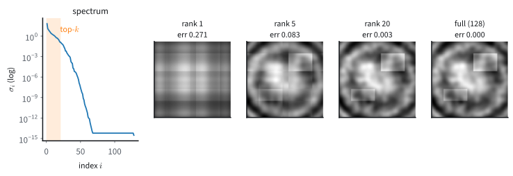
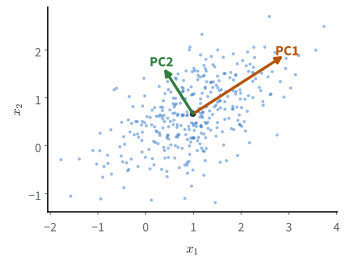
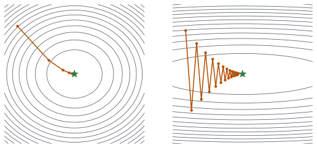
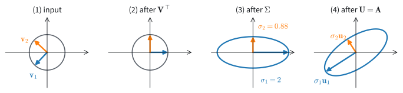
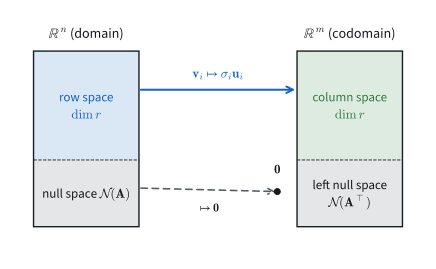

# Singular Value Decomposition and Low-Rank Approximation
:label:`sec_mdl-svd-low-rank`

Eigendecomposition applies to square matrices, and a general square matrix may
not possess an eigenbasis. The *singular value decomposition* (SVD) instead
applies to every matrix, including rectangular, rank-deficient, and defective
ones. It factors a matrix into two orthogonal transformations and a diagonal
scaling, whose non-negative scale factors are the *singular values*. The
construction applies the spectral theorem of
:numref:`subsec_mdl-spectral-theorem` to the symmetric positive semidefinite
matrix $\mathbf{A}^\top\mathbf{A}$. We use the resulting factorization to study
rank and the four fundamental subspaces, optimal low-rank approximation, PCA,
the pseudoinverse, least squares, and conditioning. We then discuss its use in
LoRA, the Muon optimizer, and spectral diagnostics of learned weights.

We use the following imports throughout the section.

```{.python .input #svd-imports}
#@tab mxnet
%matplotlib inline
from d2l import mxnet as d2l
import numpy as np
```

```{.python .input #svd-imports}
#@tab pytorch
%matplotlib inline
from d2l import torch as d2l
import numpy as np
import torch
```

```{.python .input #svd-imports}
#@tab tensorflow
%matplotlib inline
from d2l import tensorflow as d2l
import numpy as np
import tensorflow as tf
```

```{.python .input #svd-imports}
#@tab jax
%matplotlib inline
from d2l import jax as d2l
import numpy as np
import jax
jax.config.update("jax_enable_x64", True)  # honor explicit float64 (else JAX
# silently truncates to float32, hurting the least-squares / SVD precision)
from jax import numpy as jnp
```

## The Singular Value Decomposition

### Rotate--Scale--Rotate
:label:`subsec_mdl-svd-rotate-scale-rotate`

Recall the central picture of :numref:`sec_mdl-eigendecompositions`: a matrix
sends the unit circle to an ellipse. For a *symmetric* matrix, the ellipse's axes
lie along the eigenvectors, so the same orthonormal frame describes both input
and output directions. A
general matrix maps the circle to an ellipse too, but now the input directions
that undergo pure stretching and the output directions they land on are *two
different* orthonormal frames. The SVD names both.

**Theorem (Singular Value Decomposition).** *Every real $m\times n$ matrix
$\mathbf{A}$ can be written as*

$$
\mathbf{A} = \mathbf{U}\,\boldsymbol{\Sigma}\,\mathbf{V}^\top,
$$
:eqlabel:`eq_mdl-svd`

*where $\mathbf{U}\in\mathbb{R}^{m\times m}$ and $\mathbf{V}\in\mathbb{R}^{n\times
n}$ are orthogonal ($\mathbf{U}^\top\mathbf{U}=\mathbf{I}$,
$\mathbf{V}^\top\mathbf{V}=\mathbf{I}$) and $\boldsymbol{\Sigma}\in\mathbb{R}^{m\times
n}$ is "diagonal" with non-negative entries
$\sigma_1\ge\sigma_2\ge\cdots\ge0$ on its main diagonal and zeros elsewhere.* The
columns $\mathbf{v}_i$ of $\mathbf{V}$ are the *right singular vectors*, the
columns $\mathbf{u}_i$ of $\mathbf{U}$ are the *left singular vectors*, and the
$\sigma_i$ are the *singular values*.

We prove existence in :numref:`subsec_mdl-svd-via-ata`. First consider the
geometric interpretation. Because $\mathbf{V}$ and $\mathbf{U}$ are orthogonal, they are pure
rotations (possibly with a reflection), and :eqref:`eq_mdl-svd` decomposes the
action of $\mathbf{A}$ on a vector $\mathbf{x}$ into three stages applied right to
left:

1. $\mathbf{V}^\top$ **rotates** the input so that the right singular vectors
   $\mathbf{v}_i$ land on the coordinate axes;
2. $\boldsymbol{\Sigma}$ **scales** axis $i$ by $\sigma_i$ (and, if
   $m\neq n$, embeds into or projects onto the output dimension);
3. $\mathbf{U}$ **rotates** the scaled axes into the output frame, placing the
   stretched axis $i$ along the left singular vector $\mathbf{u}_i$.

Equivalently, reading off column $i$ of $\mathbf{A}\mathbf{V}=\mathbf{U}\boldsymbol{\Sigma}$,

$$
\mathbf{A}\mathbf{v}_i = \sigma_i\,\mathbf{u}_i .
$$
:eqlabel:`eq_mdl-svd-action`

The orthonormal input direction $\mathbf{v}_i$ is sent to the orthonormal output
direction $\mathbf{u}_i$, stretched by $\sigma_i$. The unit circle (sphere) of
right singular vectors becomes an ellipse (ellipsoid) whose semi-axes are the
$\sigma_i\mathbf{u}_i$. This is exactly the eigen-picture of
:numref:`sec_mdl-eigendecompositions`, generalized: there one frame served as both
input and output axes because the map was symmetric; here input frame $\mathbf{V}$
and output frame $\mathbf{U}$ are allowed to differ, which is precisely what lets
the SVD handle every matrix. :numref:`fig_mdl-la-svd-action` traces this for a
non-symmetric $2\times2$ matrix, so that $\mathbf{U}\neq\mathbf{V}$ is visible: the
unit circle and its right singular vectors $\mathbf{v}_1,\mathbf{v}_2$ are rotated
by $\mathbf{V}^\top$ onto the axes, scaled by $\boldsymbol{\Sigma}$, then rotated
by $\mathbf{U}$ so the semi-axes land along the output frame
$\sigma_1\mathbf{u}_1,\sigma_2\mathbf{u}_2$, a different orientation than the
input frame, because the matrix rotates as well as stretches.


:label:`fig_mdl-la-svd-action`

**The polar decomposition: rotate--scale--rotate, rigorously.** The phrase
"rotate--scale--rotate" can be made precise. For square
$\mathbf{A}$, insert $\mathbf{V}\mathbf{V}^\top=\mathbf{I}$:

$$
\mathbf{A}
  = \mathbf{U}\boldsymbol{\Sigma}\mathbf{V}^\top
  = (\mathbf{U}\mathbf{V}^\top)\,(\mathbf{V}\boldsymbol{\Sigma}\mathbf{V}^\top)
  = \mathbf{Q}\,\mathbf{P}.
$$
:eqlabel:`eq_mdl-polar`

Here $\mathbf{Q}=\mathbf{U}\mathbf{V}^\top$ is orthogonal (a product of
orthogonal matrices) and $\mathbf{P}=\mathbf{V}\boldsymbol{\Sigma}\mathbf{V}^\top$
is symmetric positive semidefinite (its eigendecomposition has the non-negative
$\sigma_i$ as eigenvalues). This *polar decomposition* says every linear map is a
positive-semidefinite stretch $\mathbf{P}$ followed by a rigid rotation
$\mathbf{Q}$: the exact matrix analog of writing a complex number as
$z=re^{i\theta}$, modulus times phase. It justifies the rotate--scale--rotate
slogan: the "scale" is $\mathbf{P}$ and the net "rotate" is $\mathbf{Q}$.

**Thin SVD and the dyadic sum.** If $r=\operatorname{rank}\mathbf{A}$, only the
first $r$ singular values are nonzero. Discarding the zero columns of
$\boldsymbol{\Sigma}$ and the matching singular vectors gives the *thin* (or
*economy*) SVD $\mathbf{A}=\mathbf{U}_r\boldsymbol{\Sigma}_r\mathbf{V}_r^\top$ with
$\mathbf{U}_r\in\mathbb{R}^{m\times r}$, $\mathbf{V}_r\in\mathbb{R}^{n\times r}$.
Multiplying out, the SVD is a sum of rank-one *dyads*,

$$
\mathbf{A} = \sum_{i=1}^{r} \sigma_i\,\mathbf{u}_i\mathbf{v}_i^\top,
$$
:eqlabel:`eq_mdl-svd-dyadic`

each term a single outer product weighted by its singular value, ordered from
largest to smallest. This ordered list of rank-one terms is the key to the
low-rank approximation of :numref:`subsec_mdl-eckart-young`: retain the
leading terms and discard the smaller ones.

The dyadic sum is also a one-line `einsum` in the Einstein notation of
:numref:`sec_mdl-geometry-linear-algebraic-ops`.
Summing $\sigma_i\,\mathbf{u}_i\mathbf{v}_i^\top$ over $i$ is the index pattern
`'i,mi,in->mn'` (row $i$ of `Vt` *is* $\mathbf{v}_i^\top$), and it rebuilds the
matrix exactly:

```{.python .input #mdl-svd-low-rank-rotate-scale-rotate}
rng = np.random.default_rng(5)
A = rng.standard_normal((4, 3))
U, s, Vt = np.linalg.svd(A, full_matrices=False)   # thin SVD
A_dyads = np.einsum('i,mi,in->mn', s, U, Vt)       # sum_i sigma_i u_i v_i^T
print('dyadic rebuild error:', round(float(np.linalg.norm(A_dyads - A)), 12))
```

### Existence via $\mathbf{A}^\top\mathbf{A}$
:label:`subsec_mdl-svd-via-ata`

The SVD is the spectral theorem of :numref:`subsec_mdl-spectral-theorem` applied
to the symmetric PSD matrix $\mathbf{A}^\top\mathbf{A}$. A central part of the
construction is that the $\mathbf{u}_i$ are automatically orthonormal.

**Proof of :eqref:`eq_mdl-svd` (existence).** The matrix
$\mathbf{A}^\top\mathbf{A}$ is symmetric and positive semidefinite (recall
:numref:`subsec_mdl-psd`:
$\mathbf{x}^\top(\mathbf{A}^\top\mathbf{A})\mathbf{x} = \|\mathbf{A}\mathbf{x}\|^2 \ge 0$).
By the spectral theorem it has an orthonormal eigenbasis
$\mathbf{v}_1,\ldots,\mathbf{v}_n$ with real eigenvalues, non-negative by
positive semidefiniteness; order them
$\lambda_1\ge\cdots\ge\lambda_n\ge0$ and set

$$
\sigma_i = \sqrt{\lambda_i}, \qquad r = \#\{i : \sigma_i > 0\} .
$$

For each $i\le r$ define $\mathbf{u}_i = \mathbf{A}\mathbf{v}_i/\sigma_i$. These
left singular vectors are automatically orthonormal, and this single line is why:

$$
\mathbf{u}_i^\top\mathbf{u}_j
  = \frac{1}{\sigma_i\sigma_j}\,\mathbf{v}_i^\top\mathbf{A}^\top\mathbf{A}\,\mathbf{v}_j
  = \frac{1}{\sigma_i\sigma_j}\,\mathbf{v}_i^\top(\lambda_j\mathbf{v}_j)
  = \frac{\lambda_j}{\sigma_i\sigma_j}\,\delta_{ij}
  = \delta_{ij} .
$$

Orthonormality of the *output* frame is inherited from orthonormality of the
*input* frame, routed through $\mathbf{A}^\top\mathbf{A}$. Extend
$\mathbf{u}_1,\ldots,\mathbf{u}_r$ to an orthonormal basis
$\mathbf{u}_1,\ldots,\mathbf{u}_m$ of $\mathbb{R}^m$ (Gram--Schmidt on any
completion). For the remaining right singular vectors, $i>r$, we have
$\|\mathbf{A}\mathbf{v}_i\|^2=\mathbf{v}_i^\top\mathbf{A}^\top\mathbf{A}\mathbf{v}_i=\lambda_i=0$,
so $\mathbf{A}\mathbf{v}_i=\mathbf 0$. In all cases, then,
$\mathbf{A}\mathbf{v}_i=\sigma_i\mathbf{u}_i$ (with $\sigma_i=0$ for $i>r$).
Collecting these columns gives $\mathbf{A}\mathbf{V}=\mathbf{U}\boldsymbol{\Sigma}$,
and right-multiplying by $\mathbf{V}^\top=\mathbf{V}^{-1}$ yields
$\mathbf{A}=\mathbf{U}\boldsymbol{\Sigma}\mathbf{V}^\top$. $\blacksquare$

This proof also gives a direct construction of the SVD: diagonalize the symmetric
matrix $\mathbf{A}^\top\mathbf{A}$, take square roots for the singular values, and
push the eigenvectors through $\mathbf{A}$ for the left singular vectors.

**Uniqueness.** The singular *values* are unique: they are the square roots of
the eigenvalues of $\mathbf{A}^\top\mathbf{A}$, which are determined by
$\mathbf{A}$. The singular *vectors* are unique only up to the same ambiguities we
met for eigenvectors in :numref:`sec_mdl-eigendecompositions`: a sign flip on a
pair $(\mathbf{u}_i,\mathbf{v}_i)$ for a simple $\sigma_i$, and an arbitrary
orthonormal rotation within the subspace belonging to a repeated singular value.

**Variational characterization of $\sigma_1$.** There is a second route to the
top singular value that needs no eigendecomposition and
makes the *meaning* of $\sigma_1$ plain. It is the Rayleigh quotient of
:numref:`subsec_mdl-rayleigh` in disguise:

$$
\sigma_1 = \max_{\|\mathbf{x}\|=1}\|\mathbf{A}\mathbf{x}\| = \|\mathbf{A}\|_2 ,
$$
:eqlabel:`eq_mdl-sigma1-variational`

because $\|\mathbf{A}\mathbf{x}\|^2=\mathbf{x}^\top\mathbf{A}^\top\mathbf{A}\mathbf{x}$
is maximized over unit $\mathbf{x}$ by the Rayleigh proposition at
$\lambda_1=\sigma_1^2$, attained at $\mathbf{x}=\mathbf{v}_1$. So **$\sigma_1$ is
the most the matrix can stretch any unit vector**: its operator (spectral) norm
$\|\mathbf{A}\|_2$. The remaining singular values come from the same problem with
deflation: $\sigma_k=\max\{\|\mathbf{A}\mathbf{x}\| : \|\mathbf{x}\|=1,\ \mathbf{x}\perp\mathbf{v}_1,\ldots,\mathbf{v}_{k-1}\}$,
the Courant--Fischer min-max principle of :numref:`subsec_mdl-rayleigh` translated
from Rayleigh quotients to singular values.
This "maximum stretch" reading is the one that recurs in Eckart--Young, PCA,
conditioning, and Lipschitz/spectral-norm arguments. The constructive proof is the
better *first* proof (concrete, reusing results already established); the variational one
explains better what $\sigma_1$ *means*.

**Relationship to the eigendecomposition.** Substituting :eqref:`eq_mdl-svd` into
the two Gram matrices gives, since $\mathbf{U}$ and $\mathbf{V}$ are orthogonal,

$$
\mathbf{A}^\top\mathbf{A} = \mathbf{V}\,\boldsymbol{\Sigma}^\top\boldsymbol{\Sigma}\,\mathbf{V}^\top,
\qquad
\mathbf{A}\mathbf{A}^\top = \mathbf{U}\,\boldsymbol{\Sigma}\boldsymbol{\Sigma}^\top\,\mathbf{U}^\top .
$$
:eqlabel:`eq_mdl-svd-gram`

These are *eigendecompositions*: the right singular vectors are the eigenvectors
of $\mathbf{A}^\top\mathbf{A}$, the left singular vectors are the eigenvectors of
$\mathbf{A}\mathbf{A}^\top$, and the squared singular values $\sigma_i^2$ are the
shared eigenvalues. For a symmetric PSD matrix the SVD and the eigendecomposition
coincide. In general they differ, and the warning example against conflating
singular values with eigenvalues is the scaled rotation

$$
\mathbf{A} = \begin{bmatrix} 0 & -2\\ 1 & \phantom{-}0\end{bmatrix},
\qquad
\mathbf{A}^\top\mathbf{A} = \begin{bmatrix} 1 & 0\\ 0 & 4\end{bmatrix},
$$

whose singular values are $\{2,1\}$ (the square roots of $\{4,1\}$), while its
eigenvalues are $\pm i\sqrt2$ with modulus $|\lambda|=\sqrt2$. The singular values
are *not* the eigenvalue magnitudes; here even their *geometric mean*
$\sqrt{\sigma_1\sigma_2}=\sqrt2$ equals $|\lambda|$, which is no accident: it is
the matrix analog of the rotation-with-scaling reading from
:numref:`subsec_mdl-complex-rotation`, with $|\det\mathbf{A}|=\sigma_1\sigma_2=|\lambda_1\lambda_2|=2$.
The determinant identity holds in general: for any square $\mathbf{A}$,
$|\det\mathbf{A}|=\prod_i\sigma_i$, because orthogonal factors have determinant
$\pm1$, so the volume scaling of
:numref:`sec_mdl-geometry-linear-algebraic-ops` is carried entirely by the
diagonal stretch $\boldsymbol{\Sigma}$.

**The defective shear, finally decomposed.** The shear of
:numref:`sec_mdl-eigendecompositions`

$$
\mathbf{A} = \begin{bmatrix} 1 & 1\\ 0 & 1\end{bmatrix}
$$

is *defective*: $\lambda=1$ has algebraic multiplicity $2$ but only a
one-dimensional eigenspace, so it has no eigenbasis and hence no diagonal
eigendecomposition. The SVD instead permits distinct input and output bases. Form

$$
\mathbf{A}^\top\mathbf{A} = \begin{bmatrix} 1 & 1\\ 1 & 2\end{bmatrix},
$$

a symmetric PSD matrix. Its characteristic polynomial is
$\lambda^2-3\lambda+1$, with roots $\lambda_{1,2}=(3\pm\sqrt5)/2$. Hence the
singular values are

$$
\sigma_1 = \sqrt{\tfrac{3+\sqrt5}{2}} = \frac{1+\sqrt5}{2} = \varphi \approx 1.618,
\qquad
\sigma_2 = \sqrt{\tfrac{3-\sqrt5}{2}} = \frac{1}{\varphi} = \varphi-1 \approx 0.618,
$$

the golden ratio and its reciprocal (consistent with
$\sigma_1\sigma_2=|\det\mathbf{A}|=1$). Both are positive, so the shear has rank
$2$ and an SVD $\mathbf{A}=\mathbf{U}\boldsymbol{\Sigma}\mathbf{V}^\top$ with
orthonormal factors. The obstruction to eigendecomposition was the requirement
for one basis that serves on both sides of the map. The SVD avoids that
requirement by choosing orthonormal input directions $\mathbf v_i$ and output
directions $\mathbf u_i$ separately. The following calculation verifies the
singular values against the golden ratio.

```{.python .input #svd-defective-shear}
A = np.array([[1., 1.], [0., 1.]])
s = np.linalg.svd(A, compute_uv=False)
phi = (1 + np.sqrt(5)) / 2
print('singular values of the shear:', s.round(6))
print('golden ratio phi, 1/phi:    ', np.array([phi, 1 / phi]).round(6))
print('product sigma_1 * sigma_2 = |det A| =', round(float(s[0] * s[1]), 6))
```

### The Four Fundamental Subspaces
:label:`subsec_mdl-svd-subspaces`

Because $\mathbf{U}$ and $\mathbf{V}$ are invertible, multiplying by them changes
no dimensions, so $\operatorname{rank}\mathbf{A}=\operatorname{rank}\boldsymbol{\Sigma}$,
which is the number of nonzero diagonal entries:

$$
\operatorname{rank}\mathbf{A} = \#\{i : \sigma_i > 0\} = r .
$$
:eqlabel:`eq_mdl-rank-sigma`

This is the *efficient* characterization of rank promised in
:numref:`sec_mdl-geometry-linear-algebraic-ops`, where counting independent
columns by elimination was the only tool on offer. The dyadic form
:eqref:`eq_mdl-svd-dyadic` makes the four fundamental subspaces equally explicit.
Splitting the singular vectors at the index $r$,

* the **range** (column space) of $\mathbf{A}$ is
  $\operatorname{span}\{\mathbf{u}_1,\ldots,\mathbf{u}_r\}$, since every output
  $\mathbf{A}\mathbf{x}=\sum_{i\le r}\sigma_i(\mathbf{v}_i^\top\mathbf{x})\mathbf{u}_i$
  is a combination of these;
* the **null space** of $\mathbf{A}$ is
  $\operatorname{span}\{\mathbf{v}_{r+1},\ldots,\mathbf{v}_n\}$, the input
  directions sent to zero;
* the **row space** (range of $\mathbf{A}^\top$) is
  $\operatorname{span}\{\mathbf{v}_1,\ldots,\mathbf{v}_r\}$;
* the **left null space** (null space of $\mathbf{A}^\top$) is
  $\operatorname{span}\{\mathbf{u}_{r+1},\ldots,\mathbf{u}_m\}$.

The picture is a clean bijection: $\mathbf{A}$ maps the row space to the column
space, sending each $\mathbf{v}_i\mapsto\sigma_i\mathbf{u}_i$ ($i\le r$) one-to-one
and onto, while mapping the null space to zero. Input space splits orthogonally
as row space $\oplus$ null space; output space splits orthogonally as column space
$\oplus$ left-null space. :numref:`fig_mdl-la-svd-subspaces` draws this two-plane
map; the pseudoinverse of :numref:`subsec_mdl-pseudoinverse` will run the bijection
backwards.


:label:`fig_mdl-la-svd-subspaces`

**Numerical rank.** In floating-point arithmetic, a matrix that is mathematically
rank-deficient rarely has exact zero singular values; rounding leaves tiny
$\sigma_i$ of size around $\epsilon_{\text{mach}}\,\sigma_1$ instead. In practice,
then, rank is set by a *threshold*: count the singular values above a
tolerance, which is exactly what `np.linalg.matrix_rank` does; its default cutoff is
$\sigma_1\,\max(m,n)\,\epsilon_{\text{mach}}$, scaled by both the largest singular
value and the matrix size. Building a deliberately rank-2
matrix in $\mathbb{R}^{4\times4}$ shows two singular values collapse to near
machine zero, so a tolerance recovers the true rank where a test for exact zeros
would fail.

```{.python .input #svd-numerical-rank}
rng = np.random.default_rng(0)
A = rng.standard_normal((4, 2)) @ rng.standard_normal((2, 4))  # rank <= 2
s = np.linalg.svd(A, compute_uv=False)
print('singular values:', s.round(6))
print('numerical rank :', int(np.linalg.matrix_rank(A)))
```

## Low-Rank Approximation

### Eckart--Young
:label:`subsec_mdl-eckart-young`

The dyadic sum
:eqref:`eq_mdl-svd-dyadic` lists the rank-one pieces of $\mathbf{A}$ in order of
importance. Keeping only the top $k$,

$$
\mathbf{A}_k = \sum_{i=1}^{k}\sigma_i\,\mathbf{u}_i\mathbf{v}_i^\top,
$$
:eqlabel:`eq_mdl-truncated-svd`

is a best rank-$k$ approximation of $\mathbf{A}$, provably, in both the
spectral and Frobenius norms. Eckart and Young proved the
Frobenius case :cite:`Eckart.Young.1936` and Mirsky extended it to every
*unitarily invariant* norm (one unchanged by orthogonal multiplication on either
side) :cite:`Mirsky.1960`; we give the spectral-norm statement and proof
in full.

**Theorem (Eckart--Young--Mirsky).** *For every $k<r$,*

$$
\min_{\operatorname{rank}\mathbf{B}\le k}\|\mathbf{A}-\mathbf{B}\|_2 = \sigma_{k+1},
$$
:eqlabel:`eq_mdl-eckart-young`

*and the minimum is attained at $\mathbf{B}=\mathbf{A}_k$. In the Frobenius norm,
$\min_{\operatorname{rank}\mathbf{B}\le k}\|\mathbf{A}-\mathbf{B}\|_F^2=\sum_{i>k}\sigma_i^2$,
again attained at $\mathbf{A}_k$.*

**Proof.** *The truncation achieves $\sigma_{k+1}$.* The error
$\mathbf{A}-\mathbf{A}_k=\sum_{i>k}\sigma_i\mathbf{u}_i\mathbf{v}_i^\top$ is itself
a (sub-)SVD whose largest singular value is $\sigma_{k+1}$, so by the variational
identity :eqref:`eq_mdl-sigma1-variational`,
$\|\mathbf{A}-\mathbf{A}_k\|_2=\sigma_{k+1}$. (And
$\|\mathbf{A}-\mathbf{A}_k\|_F^2=\sum_{i>k}\sigma_i^2$, by the identity
$\|\mathbf{A}\|_F^2=\operatorname{tr}(\mathbf{A}^\top\mathbf{A})=\sum_i\sigma_i^2$:
the Frobenius norm is the root-sum-of-squares of the singular values. Exercise :exref:`ex_mdl-svd-low-rank-norms-singular-values`a
asks you to prove this in two lines.)

*No rank-$k$ matrix does better (the dimension-counting argument).* Let
$\mathbf{B}$ be any matrix with $\operatorname{rank}\mathbf{B}\le k$. Its null
space has dimension at least $n-k$. Consider also the
$(k{+}1)$-dimensional subspace
$\mathcal{V}=\operatorname{span}\{\mathbf{v}_1,\ldots,\mathbf{v}_{k+1}\}$ spanned by
the top $k{+}1$ right singular vectors. Two subspaces of $\mathbb{R}^n$ whose
dimensions add to more than $n$ must intersect nontrivially:

$$
\dim(\ker\mathbf{B}\cap\mathcal{V}) \ge (n-k) + (k+1) - n = 1 .
$$

So there is a *unit* vector $\mathbf{x}\in\ker\mathbf{B}\cap\mathcal{V}$. Write it
in the top singular basis, $\mathbf{x}=\sum_{i\le k+1}c_i\mathbf{v}_i$ with
$\sum c_i^2=1$. Because $\mathbf{x}\in\ker\mathbf{B}$ we have $\mathbf{B}\mathbf{x}=\mathbf 0$,
and because $\mathbf{A}\mathbf{v}_i=\sigma_i\mathbf{u}_i$ with the $\mathbf{u}_i$
orthonormal,

$$
\|\mathbf{A}\mathbf{x}\|^2 = \Bigl\|\sum_{i\le k+1}c_i\sigma_i\mathbf{u}_i\Bigr\|^2
   = \sum_{i\le k+1} c_i^2\sigma_i^2
   \ge \sigma_{k+1}^2 \sum_{i\le k+1} c_i^2
   = \sigma_{k+1}^2 ,
$$

using $\sigma_i\ge\sigma_{k+1}$ for $i\le k+1$. Therefore

$$
\|\mathbf{A}-\mathbf{B}\|_2^2
  \ge \|(\mathbf{A}-\mathbf{B})\mathbf{x}\|^2
  = \|\mathbf{A}\mathbf{x}\|^2 \ge \sigma_{k+1}^2 ,
$$

so $\|\mathbf{A}-\mathbf{B}\|_2\ge\sigma_{k+1}$ for every rank-$k$ $\mathbf{B}$,
with equality at $\mathbf{A}_k$. $\blacksquare$

The kernel of $\mathbf{B}$ and the top-$(k{+}1)$ singular subspace are subspaces
of $\mathbb{R}^n$ whose dimensions sum to more than the ambient dimension, so
they must share a direction. On that direction, $\mathbf{B}$ vanishes:
$\mathbf{B}\mathbf{x}=\mathbf 0$, while $\mathbf{A}$ still stretches by at
least $\sigma_{k+1}$, so no rank-$k$ $\mathbf{B}$ can approximate
$\mathbf{A}$ more closely in every direction.

For the Frobenius norm, the case PCA relies on, the same conclusion follows from
a one-line singular-value inequality, which we state as a lemma and cite rather
than prove.

**Lemma (Weyl's inequality for singular values** :cite:`Horn.Johnson.2012`**).**
*For matrices $\mathbf{X},\mathbf{Y}$ of the same shape and all valid indices
$i,j$,*

$$
\sigma_{i+j-1}(\mathbf{X}+\mathbf{Y})\le\sigma_i(\mathbf{X})+\sigma_j(\mathbf{Y}) .
$$
:eqlabel:`eq_mdl-weyl-singular`

**Proof (Frobenius case).** The lemma
applied with $\mathbf{X}=\mathbf{A}-\mathbf{B}$, $\mathbf{Y}=\mathbf{B}$ and
$j=k{+}1$ gives
$\sigma_{k+i}(\mathbf{A})\le\sigma_i(\mathbf{A}-\mathbf{B})+\sigma_{k+1}(\mathbf{B})=\sigma_i(\mathbf{A}-\mathbf{B})$,
since $\mathbf{B}$ has rank $\le k$ and so $\sigma_{k+1}(\mathbf{B})=0$. Squaring
and summing over $i\ge1$,

$$
\|\mathbf{A}-\mathbf{B}\|_F^2=\sum_{i\ge1}\sigma_i(\mathbf{A}-\mathbf{B})^2
  \ge\sum_{i\ge1}\sigma_{k+i}(\mathbf{A})^2=\sum_{j>k}\sigma_j(\mathbf{A})^2 ,
$$

again with equality at the truncation $\mathbf{A}_k$. $\blacksquare$

The error formulas provide a criterion for choosing the rank. The fraction of "energy" retained
by the rank-$k$ truncation is the *energy ratio*

$$
\frac{\sum_{i\le k}\sigma_i^2}{\sum_{i}\sigma_i^2}
  = 1 - \frac{\|\mathbf{A}-\mathbf{A}_k\|_F^2}{\|\mathbf{A}\|_F^2} ,
$$
:eqlabel:`eq_mdl-energy-ratio`

so choosing $k$ to capture, say, 95% of the energy is a principled way to set the
rank. When the singular values decay quickly (as they do for images with
large-scale structure and, empirically, for many trained weight matrices), a small
$k$ captures most of the Frobenius norm, and low-rank compression is then
effective.

**Truncation as denoising.** There is a second, statistical reason to truncate.
Suppose the observed matrix is a low-rank signal plus noise,
$\mathbf{A}=\mathbf{B}+\mathbf{N}$, where $\mathbf{A}\in\mathbb R^{m\times n}$,
$\operatorname{rank}\mathbf{B}=r$, and the entries of $\mathbf N$ are
independent, mean zero, and have standard deviation
$\sigma_{\text{noise}}$. In the large-dimensional iid model, the noise singular
values lie below an edge near
$(\sqrt{m}+\sqrt{n})\sigma_{\text{noise}}$. A sufficiently strong signal can
produce singular values beyond this edge; weak components need not separate
from the noise bulk. Truncation above an appropriate threshold can therefore
reduce error, but the location of that threshold depends on the model.

Under the square-matrix model with known noise level, Gavish and Donoho derive the
asymptotically optimal hard threshold
$\tfrac{4}{\sqrt3}\sqrt n\,\sigma_{\text{noise}}\approx2.309\sqrt n\,\sigma_{\text{noise}}$
:cite:`Gavish.Donoho.2014`. Applying this constant to a different aspect ratio,
noise distribution, normalization, or unknown-noise setting requires the
corresponding version of the theory. Exercise :exref:`ex_mdl-svd-low-rank-denoising-truncation` illustrates the spectral
separation, and exercise :exref:`ex_mdl-svd-low-rank-optimal-hard-threshold`
derives the constant $4/\sqrt3$ from the asymptotic behavior of a single
signal component.

The same low-rank premise, with *missing* rather than noisy entries, is *matrix
completion*: recommender systems fill in a sparsely observed ratings matrix by
seeking the lowest-rank matrix consistent with the observed entries, in practice
by minimizing the *nuclear norm* $\|\mathbf{A}\|_*=\sum_i\sigma_i$, the convex
stand-in for rank :cite:`Candes.Recht.2009`. The nuclear norm plays the role for
rank that the $\ell_1$ norm plays for sparsity.

:numref:`fig_mdl-la-eckart-young` makes this concrete on a grayscale image. The
left panel plots the singular-value spectrum on a log scale (note the rapid decay);
the remaining panels reconstruct the image at ranks $k=1,5,20$ and full, each
labeled with its relative Frobenius error

$$
\|\mathbf{A}-\mathbf{A}_k\|_F/\|\mathbf{A}\|_F=\sqrt{\sum_{i>k}\sigma_i^2/\sum_i\sigma_i^2}.
$$

For this image, the rank-20 truncation has small relative Frobenius error and
retains the visually dominant structure. The panels illustrate the approximation
theorem; the algebraic argument above supplies its proof.


:label:`fig_mdl-la-eckart-young`

### Principal Component Analysis
:label:`subsec_mdl-pca`

Principal component analysis is a direct application of the SVD and the
Eckart--Young theorem. Given data points as the
rows of $\mathbf{X}\in\mathbb{R}^{n\times d}$, first *center* them by subtracting
the mean row, $\tilde{\mathbf{X}}=\mathbf{X}-\mathbf 1\bar{\mathbf{x}}^\top$. The
empirical covariance is the symmetric PSD matrix
$\mathbf{C}=\tfrac1n\tilde{\mathbf{X}}^\top\tilde{\mathbf{X}}$ from
:numref:`subsec_mdl-psd` (we use the maximum-likelihood $\tfrac1n$ covariance; the
unbiased $\tfrac1{n-1}$ version rescales every eigenvalue by the same factor and so
changes neither the principal directions nor the explained-variance ratio). PCA
asks: which unit direction $\mathbf{w}$ captures the most variance of the projected
data?

**Proposition (PCA via Rayleigh).** *The projected variance
$\tfrac1n\|\tilde{\mathbf{X}}\mathbf{w}\|^2=\mathbf{w}^\top\mathbf{C}\mathbf{w}$ is
maximized over unit $\mathbf{w}$ by the top eigenvector of $\mathbf{C}$, which is
the top right singular vector $\mathbf{v}_1$ of $\tilde{\mathbf{X}}$, with maximal
variance $\sigma_1^2/n$.*

**Proof.** The projection of a centered point onto $\mathbf{w}$ has coordinate
$\tilde{\mathbf{x}}^\top\mathbf{w}$; the variance of these coordinates is
$\tfrac1n\sum_i(\tilde{\mathbf{x}}_i^\top\mathbf{w})^2=\tfrac1n\|\tilde{\mathbf{X}}\mathbf{w}\|^2=\mathbf{w}^\top\mathbf{C}\mathbf{w}$.
Maximizing this Rayleigh quotient over unit $\mathbf{w}$ gives, by
:numref:`subsec_mdl-rayleigh`, the top eigenvector of $\mathbf{C}$ and the value
$\lambda_1(\mathbf{C})$. By :eqref:`eq_mdl-svd-gram`,
$\mathbf{C}=\tfrac1n\mathbf{V}\boldsymbol{\Sigma}^\top\boldsymbol{\Sigma}\mathbf{V}^\top$,
so its eigenvectors are the right singular vectors $\mathbf{v}_i$ of
$\tilde{\mathbf{X}}$ and its eigenvalues are $\sigma_i^2/n$. $\blacksquare$

Iterating with deflation, the top-$k$ principal directions are
$\mathbf{v}_1,\ldots,\mathbf{v}_k$, and the variance *explained* by component $i$
is $\sigma_i^2/n$. The ranked list of these variances is the *scree plot*, and the
explained-variance ratio is exactly the energy ratio
:eqref:`eq_mdl-energy-ratio` of $\tilde{\mathbf{X}}$. Moreover the rank-$k$
projection $\mathbf{z}=\mathbf{V}_k^\top(\mathbf{x}-\bar{\mathbf{x}})$ is the
*optimal* linear dimensionality reduction: minimizing reconstruction error over
all rank-$k$ linear maps is Eckart--Young--Frobenius applied to $\tilde{\mathbf{X}}$,
whose solution is the top-$k$ truncation. **Centering matters**: skip it and,
once the cloud lies far from the origin, the first singular vector is dominated
by that offset, capturing where the data *is* rather than how it *varies*.

:numref:`fig_mdl-la-pca` draws a 2-D correlated cloud with its two principal axes
scaled by the per-axis standard deviation $\sigma_i/\sqrt{n}$: the first axis
aligns with the long direction of the cloud, exactly the direction of maximal
variance the proposition predicts. The cell below cross-checks the SVD principal
axes against the eigenvectors of the covariance and reports the
explained-variance ratio; the two routes agree, as :eqref:`eq_mdl-svd-gram`
guarantees.


:label:`fig_mdl-la-pca`

```{.python .input #svd-pca}
rng = np.random.default_rng(1)
theta = np.pi / 5
rot = np.array([[np.cos(theta), -np.sin(theta)],
                [np.sin(theta),  np.cos(theta)]])
X = rng.standard_normal((300, 2)) * np.array([3.0, 0.8]) @ rot.T  # correlated
Xc = X - X.mean(0)                                                # center
s = np.linalg.svd(Xc, compute_uv=False)
eigval = np.linalg.eigvalsh((Xc.T @ Xc) / len(Xc))[::-1]          # descending
print('explained variance (sigma^2/n):', (s ** 2 / len(Xc)).round(4))
print('eigenvalues of covariance     :', eigval.round(4))
print('explained-variance ratio      :', (s ** 2 / (s ** 2).sum()).round(4))
```

## Solving Linear Systems with the SVD

### The Pseudoinverse and Least Squares
:label:`subsec_mdl-pseudoinverse`

When $\mathbf{A}\mathbf{x}=\mathbf{b}$ has no solution (too many equations) or
infinitely many (too few), the right formulation is the least-squares problem
:eqref:`eq_mdl-least-squares` of :numref:`sec_mdl-geometry-linear-algebraic-ops`,
and the SVD solves it in full generality. Define the
*Moore--Penrose pseudoinverse* by inverting the nonzero singular values and
transposing the rotations,

$$
\mathbf{A}^{+} = \mathbf{V}\boldsymbol{\Sigma}^{+}\mathbf{U}^\top,
\qquad
\boldsymbol{\Sigma}^{+}_{ii} = \begin{cases} 1/\sigma_i & \sigma_i>0,\\ 0 & \sigma_i=0.\end{cases}
$$
:eqlabel:`eq_mdl-pseudoinverse`

**Proposition (min-norm least squares).** *Among all minimizers of
$\|\mathbf{A}\mathbf{x}-\mathbf{b}\|_2$, the one of smallest norm is
$\hat{\mathbf{x}}=\mathbf{A}^{+}\mathbf{b}$.*

**Proof.** Rotate both the input and the target into the singular bases:
$\mathbf{y}=\mathbf{V}^\top\mathbf{x}$ and $\mathbf{c}=\mathbf{U}^\top\mathbf{b}$.
Since $\mathbf{U}$ is orthogonal it preserves norms, so

$$
\|\mathbf{A}\mathbf{x}-\mathbf{b}\|^2
   = \|\mathbf{U}^\top(\mathbf{A}\mathbf{x}-\mathbf{b})\|^2
   = \|\boldsymbol{\Sigma}\mathbf{y}-\mathbf{c}\|^2
   = \sum_{i\le r}(\sigma_i y_i - c_i)^2 + \sum_{i> r} c_i^2 .
$$

The rotation has *decoupled* the problem into independent scalar problems. The
first sum is minimized term by term at $y_i=c_i/\sigma_i$ for $i\le r$; the second
sum is a constant we cannot touch (it is the irreducible residual, the part of
$\mathbf{b}$ outside the column space). The coordinates $y_i$ for $i>r$ are *free*:
they do not appear in the residual at all. Setting them to zero gives the unique
solution of *smallest* norm (since $\|\mathbf{x}\|=\|\mathbf{y}\|$). That choice is
exactly $\mathbf{y}=\boldsymbol{\Sigma}^{+}\mathbf{c}$, i.e.
$\hat{\mathbf{x}}=\mathbf{V}\boldsymbol{\Sigma}^{+}\mathbf{U}^\top\mathbf{b}=\mathbf{A}^{+}\mathbf{b}$.
$\blacksquare$

Rotating into the SVD basis turns a coupled
least-squares problem into a list of one-dimensional problems, and "small residual"
and "small norm" occupy *disjoint* coordinate blocks ($i\le r$ versus $i>r$), so
both can be satisfied at once. Two corollaries follow. When $\mathbf{A}$ is
square and invertible, all $\sigma_i>0$ and
$\mathbf{A}^{+}=\mathbf{V}\boldsymbol{\Sigma}^{-1}\mathbf{U}^\top=\mathbf{A}^{-1}$.
And *truncating* the pseudoinverse (dropping terms with tiny $\sigma_i$ instead of
dividing by them) caps the large $1/\sigma_i$ factor; this is a form of
regularization, closely related to ridge regression, which we revisit when we
discuss weight decay in :numref:`sec_weight_decay`.

The classical alternative, the *normal equations*
$\mathbf{A}^\top\mathbf{A}\mathbf{x}=\mathbf{A}^\top\mathbf{b}$, is mathematically
equivalent for full-rank $\mathbf{A}$ but numerically worse: forming
$\mathbf{A}^\top\mathbf{A}$ *squares* the condition number
(:numref:`subsec_mdl-condition-number`), so an SVD- or QR-based solve is preferred.
The cell below solves an overdetermined system via `pinv` and via the library
`lstsq` (the two agree on the same minimum-residual fit) and prints `cond(A)`
alongside `cond(A^T A)` to show the normal-equations matrix is far worse
conditioned.

```{.python .input #svd-least-squares}
A = np.array([[1., 1.], [1., 2.], [1., 3.], [1., 4.]])  # 4 eqns, 2 unknowns
b = np.array([6., 5., 7., 10.])
x_pinv = np.linalg.pinv(A) @ b
x_lstsq, *_ = np.linalg.lstsq(A, b, rcond=None)
print('pinv :', x_pinv.round(4), ' residual',
      round(float(np.linalg.norm(A @ x_pinv - b)), 4))
print('lstsq:', x_lstsq.round(4), ' residual',
      round(float(np.linalg.norm(A @ x_lstsq - b)), 4))
print('cond(A)     =', round(float(np.linalg.cond(A)), 3))
print('cond(A^T A) =', round(float(np.linalg.cond(A.T @ A)), 3), '= cond(A)^2')
```

### The Condition Number
:label:`subsec_mdl-condition-number`

The *condition number* is the single SVD-derived scalar that predicts numerical
error amplification. For an invertible (or full-rank) matrix it is the ratio of
the largest to the smallest nonzero singular value,

$$
\kappa(\mathbf{A}) = \frac{\sigma_1}{\sigma_r} .
$$
:eqlabel:`eq_mdl-condition-number`

It measures how much a linear solve can amplify input error.

**Proposition (error amplification, with tightness).** *Let $\mathbf{A}$ be square
invertible, $\mathbf{A}\mathbf{x}=\mathbf{b}$, and let a perturbation
$\delta\mathbf{b}$ change the solution to $\mathbf{x}+\delta\mathbf{x}$. Then*

$$
\frac{\|\delta\mathbf{x}\|}{\|\mathbf{x}\|}
   \le \kappa(\mathbf{A})\,\frac{\|\delta\mathbf{b}\|}{\|\mathbf{b}\|},
$$
:eqlabel:`eq_mdl-condition-bound`

*and the bound is attained for suitable $\mathbf{b},\delta\mathbf{b}$.*

**Proof.** From $\mathbf{A}\,\delta\mathbf{x}=\delta\mathbf{b}$ we get
$\delta\mathbf{x}=\mathbf{A}^{-1}\delta\mathbf{b}$, and the largest singular value
of $\mathbf{A}^{-1}$ is $1/\sigma_n$, so by :eqref:`eq_mdl-sigma1-variational`
$\|\delta\mathbf{x}\|\le\sigma_n^{-1}\|\delta\mathbf{b}\|$. From
$\mathbf{b}=\mathbf{A}\mathbf{x}$ we get $\|\mathbf{b}\|\le\sigma_1\|\mathbf{x}\|$.
Multiplying the two inequalities,

$$
\frac{\|\delta\mathbf{x}\|}{\|\mathbf{x}\|}
   \le \frac{\sigma_1}{\sigma_n}\,\frac{\|\delta\mathbf{b}\|}{\|\mathbf{b}\|}
   = \kappa(\mathbf{A})\,\frac{\|\delta\mathbf{b}\|}{\|\mathbf{b}\|} .
$$

It is *tight*: align the signal with the direction the inverse amplifies least by
taking $\mathbf{b}=\mathbf{u}_1$, so that $\mathbf{x}=\sigma_1^{-1}\mathbf{v}_1$ is
the *smallest*-norm solution any unit right-hand side can produce (a small
$\|\mathbf{x}\|$ in the denominator is exactly what maximizes the relative-error
ratio), and align the error with the most-amplified direction
$\delta\mathbf{b}=\mathbf{u}_n$ (so $\delta\mathbf{x}=\sigma_n^{-1}\mathbf{v}_n$ is
as large as a perturbation of its size can get);
then both inequalities are equalities. $\blacksquare$

Three consequences follow. An orthogonal matrix has all singular
values equal to $1$, so $\kappa=1$: rotations and reflections are perfectly
conditioned, which is *why* the SVD's $\mathbf{U},\mathbf{V}$ never amplify error
and why orthogonal initialization is attractive. At the other extreme, forming the
normal-equations matrix squares the conditioning, $\kappa(\mathbf{A}^\top\mathbf{A})=\kappa(\mathbf{A})^2$
(its singular values are the $\sigma_i^2$), which is the quantitative reason to
prefer an SVD/QR least-squares solve over the normal equations
(:numref:`subsec_mdl-pseudoinverse`).

Geometrically, a large $\kappa$ means very *elongated* level sets. For a quadratic
bowl $f(\mathbf{x})=\tfrac12\mathbf{x}^\top\mathbf{M}\mathbf{x}$ with $\mathbf{M}$
symmetric positive definite, the contours are ellipses whose axis ratio is exactly
$\sqrt{\kappa(\mathbf{M})}=\sqrt{\lambda_{\max}/\lambda_{\min}}$; when
$\kappa\gg1$ the bowl is a narrow valley, and gradient descent zig-zags across
the steep walls while crawling along the flat floor. (For a least-squares
objective $\tfrac12\|\mathbf{A}\mathbf{x}-\mathbf{b}\|^2$ the bowl's matrix
is $\mathbf{M}=\mathbf{A}^\top\mathbf{A}$, so its geometric axis ratio is
$\kappa(\mathbf A)$ while the Hessian condition number that controls gradient
descent is $\kappa(\mathbf A)^2$.) This is the same picture that ended
the Rayleigh discussion in :numref:`subsec_mdl-rayleigh`, and it is no coincidence:
with the best fixed step size, gradient descent's error contracts like
$(\kappa(\mathbf{M})-1)/(\kappa(\mathbf{M})+1)$ per step on such a bowl. *One number, two consequences*:
error amplification in a solve and slow convergence in optimization. We make this
precise when we analyze gradient descent in :numref:`sec_mdl-gradient-based-optimization`
and study numerical conditioning in :numref:`sec_mdl-numerical-stability-conditioning`.
:numref:`fig_mdl-la-condition` contrasts a well-conditioned bowl ($\kappa\approx1$,
near-circular contours, gradient descent heads almost straight to the minimum) with
an ill-conditioned one ($\kappa\gg1$, elongated contours, a zig-zag trajectory). In
the narrow valley, the step size is throttled by the steep direction (to stay
stable) while the flat direction needs many such small steps to make progress;
the zig-zag is the visible cost of a large condition number.


:label:`fig_mdl-la-condition`

## The SVD in Modern Deep Learning
:label:`sec_mdl-svd-modern-dl`

Low-rank structure is everywhere in
contemporary models, and Eckart--Young is the reason it can be exploited cheaply.

**Low-rank adapters (LoRA).** Fine-tuning a large pretrained model by updating
every weight is expensive. LoRA :cite:`Hu.Shen.Wallis.ea.2021` freezes a
pretrained weight $\mathbf{W}\in\mathbb{R}^{m\times n}$ and learns only a low-rank
correction $\Delta\mathbf{W}=\mathbf{B}\mathbf{A}$ with
$\mathbf{B}\in\mathbb{R}^{m\times r}$, $\mathbf{A}\in\mathbb{R}^{r\times n}$, and
$r\ll\min(m,n)$. This trades $mn$ trainable parameters for $r(m+n)$, a ratio of

$$
\frac{r(m+n)}{mn} ,
$$
:eqlabel:`eq_mdl-lora-ratio`

which for a $4096\times4096$ layer at rank $r=8$ is $8\cdot8192/4096^2\approx0.39\%$
of the parameters. :numref:`fig_mdl-la-lora` shows the architecture: the frozen
weight and the trainable low-rank bypass act on the same input, and their outputs
add. The hypothesis that fine-tuning updates are *intrinsically low
rank* is what makes this work.

![The LoRA architecture for one layer. The pretrained $\mathbf{W}$ (all $mn = 16.8$M parameters for $m=n=4096$) stays frozen; a parallel bypass first compresses the input to $r=8$ dimensions with $\mathbf{A}$ and then expands back with $\mathbf{B}$, so only $r(m+n) \approx 65.5$K parameters (about $0.39\%$) are trained. The two branches add: $\mathbf{h} = \mathbf{W}\mathbf{x} + \mathbf{B}\mathbf{A}\mathbf{x}$. After training, $\mathbf{B}\mathbf{A}$ can be merged into $\mathbf{W}$, so deployment costs nothing extra.](../img/mdl-la-lora.svg)
:label:`fig_mdl-la-lora`

Note what Eckart--Young does and does not say here:
LoRA *learns* $\mathbf{B}$ and $\mathbf{A}$ by gradient descent rather than
truncating a known matrix, so the theorem promises nothing about the learned
adapter itself. What it quantifies is the *ceiling*: if the update that full
fine-tuning would have made has singular values $\sigma_1\ge\sigma_2\ge\cdots$,
then no rank-$r$ adapter can approximate it with error below $\sigma_{r+1}$ in spectral
norm ($\sum_{i>r}\sigma_i^2$ in squared Frobenius norm), so the approach can only succeed when
the true update's spectrum decays fast, which is exactly the empirical finding
that motivated LoRA. PiSSA makes the link to the SVD literal: it *initializes*
$\mathbf{B}$ and $\mathbf{A}$ from the truncated SVD of the pretrained weight
$\mathbf{W}$ itself, so that fine-tuning starts by adapting the principal
components :cite:`Meng.Wang.Zhang.2024`.

**Orthogonalized updates (Muon).** The polar decomposition
:eqref:`eq_mdl-polar` underlies Muon :cite:`Jordan.Jin.Boza.ea.2024`, an
optimizer adopted in recent large-scale language-model training. Write the
*momentum* matrix of a weight as
$\mathbf{M}=\mathbf{U}\boldsymbol{\Sigma}\mathbf{V}^\top$; the momentum is the
running average of gradients that optimizers keep per weight (see the
optimization chapters). A standard momentum
step moves along $\mathbf{M}$, which is dominated by its few largest dyads; Muon
instead steps along the *polar factor*
$\mathbf{Q}=\mathbf{U}\mathbf{V}^\top$, the rotation part of the update with
every stretch factor equalized to $1$, so rare-but-consistent gradient
directions are not drowned out by the dominant ones. (Equivalently, $\mathbf{U}\mathbf{V}^\top$
is the steepest-descent direction when distances between weight matrices are
measured in the spectral norm rather than the Euclidean one
:cite:`Bernstein.Newhouse.2024`.) Computing an SVD of every weight at every step
would be hopeless; instead Muon runs a handful of *Newton--Schulz* iterations
$\mathbf{X}\leftarrow\tfrac12(3\mathbf{X}-\mathbf{X}\mathbf{X}^\top\mathbf{X})$
starting from $\mathbf{X}=\mathbf{M}/\|\mathbf{M}\|_F$. Each iteration leaves
$\mathbf{U}$ and $\mathbf{V}$ untouched and applies the odd polynomial
$p(\sigma)=\tfrac12(3\sigma-\sigma^3)$ to every singular value, driving each
nonzero $\sigma_i$ toward the fixed point $1$. The Frobenius normalization is
what makes that convergence guaranteed rather than lucky: it puts every singular
value into $(0, 1]$, comfortably inside $(0, \sqrt3\,)$, the cubic's basin of
attraction of $1$. Start a singular value beyond $\sqrt3$ and the cubic maps it
negative. From there, for most starting values, the iterates converge to the
spurious fixed point $-1$ or diverge, and the polar factor is lost. So the iterates converge to
$\mathbf{U}\mathbf{V}^\top$ using nothing but matrix multiplications (in practice
Muon tunes the polynomial's coefficients so that about five iterations suffice).
Like the power iteration used for spectral normalization below, this procedure
requires only matrix multiplications and is efficient on GPUs.

The following calculation illustrates the iteration. After Frobenius
normalization, repeated application of the cubic maps every nonzero singular
value toward $1$ while preserving the singular vectors. The iterate therefore
approaches the polar factor $\mathbf{U}\mathbf{V}^\top$ computed by a direct
SVD. With the plain $\tfrac12(3\sigma-\sigma^3)$ coefficients, the
smallest singular value (which starts closest to $0$, where $p$ only multiplies
it by $\tfrac32$) converges slowest, needing about ten iterations here; Muon's
tuned polynomials accelerate exactly that small-$\sigma$ regime.

```{.python .input #mdl-svd-low-rank-the-svd-in-modern-deep-learning-1}
rng = np.random.default_rng(3)
M = rng.standard_normal((6, 4))          # a stand-in momentum matrix
X = M / np.linalg.norm(M)                # Frobenius normalize: all sigma <= 1
for k in range(1, 11):
    X = 1.5 * X - 0.5 * X @ X.T @ X      # applies p(sigma) = (3 sigma - sigma^3)/2
    if k % 2 == 0:
        print(f'iter {k:2d}: sigma =', np.linalg.svd(X, compute_uv=False).round(4))
U, s, Vt = np.linalg.svd(M, full_matrices=False)
print('distance to polar factor U V^T:',
      round(float(np.linalg.norm(X - U @ Vt)), 6))
```

**Spectral normalization.** Constraining the largest singular value of each weight
matrix to $1$ caps the per-layer *Lipschitz constant*, the largest factor by
which the layer can stretch any input difference
(:eqref:`eq_mdl-sigma1-variational`: $\sigma_1=\|\mathbf{W}\|_2$).
This stabilizes training, originally for GAN
discriminators :cite:`Miyato.Kataoka.Koyama.ea.2018`. $\sigma_1$ is
estimated by **power iteration on $\mathbf{W}^\top\mathbf{W}$**, the very algorithm
we analyzed in :numref:`sec_mdl-eigendecompositions`, since
$\sigma_1=\sqrt{\lambda_1(\mathbf{W}^\top\mathbf{W})}$. One iteration per
training step suffices when each step starts from the vector left by the
previous step.

**Weight and attention spectra.** Plotting the singular values of a trained layer
(the spectrum panel of :numref:`fig_mdl-la-eckart-young`, applied to $\mathbf{W}$
instead of an image) reveals its *effective rank* via the energy ratio
:eqref:`eq_mdl-energy-ratio` and exposes heavy-tailed spectra that correlate with
generalization :cite:`Martin.Mahoney.2021`, heavy-tailed precisely against the
Marchenko--Pastur noise baseline of :numref:`sec_mdl-eigendecompositions`.

Attention matrices are often empirically near-low-rank, which
motivates linear-attention approximations that replace the full softmax attention
with a low-rank surrogate. The most prominent recent instance is low-rank
key--value compression: DeepSeek-V2's multi-head latent attention stores a
single low-rank latent in place of the full per-head key--value cache (the cached
per-token keys and values that dominate inference memory) and
expands it on the fly :cite:`DeepSeek-AI.2024`.

The cell below makes the weight-side
diagnostic concrete: it builds a synthetic weight matrix with a fast-decaying
spectrum and reports the rank needed for 95% spectral energy and the parameter
saving a LoRA of that rank would give; here rank 18 of 256, about 10.5% of the
full parameter count. How small that rank is depends entirely on how fast the
spectrum decays (compare the 0.39% headline above, which assumed $r=8$ suffices),
which is why one measures the spectrum instead of assuming a rank.

```{.python .input #svd-weight-spectrum}
rng = np.random.default_rng(2)
m, n = 256, 512
sigma = np.exp(-np.arange(min(m, n)) / 12.0)                 # fast-decaying spectrum
Uw, _ = np.linalg.qr(rng.standard_normal((m, min(m, n))))
Vw, _ = np.linalg.qr(rng.standard_normal((n, min(m, n))))
s = np.linalg.svd((Uw * sigma) @ Vw.T, compute_uv=False)
r95 = int(np.searchsorted(np.cumsum(s ** 2) / (s ** 2).sum(), 0.95) + 1)
print(f'{m} x {n} matrix; rank for 95% energy: {r95}; '
      f'LoRA params {r95 * (m + n) / (m * n):.1%} of full')
```

**Scaling up.** For matrices too large to factor fully, *randomized SVD*
:cite:`Halko.Martinsson.Tropp.2011` computes an accurate rank-$k$ truncation at a
fraction of the cost. The mechanism is a *range finder*: draw a random
$n\times(k{+}p)$ Gaussian matrix $\boldsymbol\Omega$ (a small oversampling $p$
guards against unlucky draws), form $\mathbf{Y}=\mathbf{A}\boldsymbol\Omega$ (a
handful of matrix--vector products that sketch the column space), and orthonormalize it,
$\mathbf{Q}=\operatorname{qr}(\mathbf{Y})$. Because $\mathbf{A}$'s energy is
concentrated in its top singular directions, the $k{+}p$ columns of $\mathbf{Q}$
capture them with high probability, so one then factors only the *tiny* matrix
$\mathbf{Q}^\top\mathbf{A}$ and maps its left singular vectors back through
$\mathbf{Q}$. The cost drops from the $O(mn\min(m,n))$ of a full SVD to
a few passes over $\mathbf{A}$; this method is useful when only the leading singular
triples are needed. A related family, *CUR* decompositions,
approximates $\mathbf{A}$ with actual rows and columns of $\mathbf{A}$, trading
accuracy for interpretability.

We finish with a numerical check that the SVD reconstructs $\mathbf{A}$ and
that $\sigma_i^2$ are the eigenvalues of $\mathbf{A}^\top\mathbf{A}$.

```{.python .input #svd-verify}
A = np.array([[3., 1.], [1., 3.], [0., 2.]])   # a 3x2 matrix
U, s, Vt = np.linalg.svd(A, full_matrices=False)
recon = (U * s) @ Vt
eig = np.sort(np.linalg.eigvalsh(A.T @ A))[::-1]
print('reconstruction error:', round(float(np.linalg.norm(recon - A)), 12))
print('sigma^2          :', (s ** 2).round(6))
print('eig(A^T A) sorted:', eig.round(6))
```

The reconstruction error is at the level of floating-point round-off, and the
squared singular values match the eigenvalues of $\mathbf{A}^\top\mathbf{A}$:
exactly the construction of :numref:`subsec_mdl-svd-via-ata`.

## Summary

* Every matrix factors as $\mathbf{A}=\mathbf{U}\boldsymbol{\Sigma}\mathbf{V}^\top$
  (rotate--scale--rotate; equivalently the polar form $\mathbf{A}=\mathbf{Q}\mathbf{P}$),
  with $\mathbf{A}\mathbf{v}_i=\sigma_i\mathbf{u}_i$ and the dyadic sum
  $\mathbf{A}=\sum_i\sigma_i\mathbf{u}_i\mathbf{v}_i^\top$.
* The SVD is the spectral theorem applied to the symmetric PSD matrix
  $\mathbf{A}^\top\mathbf{A}$, with $\sigma_i=\sqrt{\lambda_i(\mathbf{A}^\top\mathbf{A})}$;
  it therefore exists even for the defective shear that had no eigenbasis.
  Equivalently $\sigma_1=\max_{\|\mathbf{x}\|=1}\|\mathbf{A}\mathbf{x}\|=\|\mathbf{A}\|_2$.
* Rank, range, and the four fundamental subspaces read off the spectrum;
  numerical rank thresholds the $\sigma_i$ at
  $\sim\sigma_1\max(m,n)\,\epsilon_{\text{mach}}$.
* **Eckart--Young--Mirsky:** the top-$k$ truncation $\mathbf{A}_k$ is an optimal
  rank-$k$ approximation, with $\|\mathbf{A}-\mathbf{A}_k\|_2=\sigma_{k+1}$ and
  $\|\mathbf{A}-\mathbf{A}_k\|_F^2=\sum_{i>k}\sigma_i^2$. The retained-energy
  ratio $\sum_{i\leq k}\sigma_i^2/\sum_i\sigma_i^2$ is one minus the squared
  relative Frobenius error.
* **PCA is Eckart--Young on centered data:** principal directions are the right
  singular vectors $\mathbf{v}_i$, explained variance is $\sigma_i^2/n$.
* The pseudoinverse $\mathbf{A}^{+}=\mathbf{V}\boldsymbol{\Sigma}^{+}\mathbf{U}^\top$
  gives the minimum-norm least-squares solution; the condition number
  $\kappa=\sigma_1/\sigma_r$ predicts both error amplification and
  gradient-descent speed, and $\kappa(\mathbf{A}^\top\mathbf{A})=\kappa(\mathbf{A})^2$
  is why the normal equations are worse.
* SVD powers PCA, LoRA (rank-$r$ updates at $r(m+n)$ parameters), Muon (steps
  along the polar factor $\mathbf{U}\mathbf{V}^\top$, computed by Newton--Schulz
  iterations), spectral normalization (power iteration on
  $\mathbf{W}^\top\mathbf{W}$), and weight / attention spectral analysis.

## Exercises

1. **Eigenvalues and singular values.** The scaled rotation
   $\begin{bmatrix}0&-2\\1&0\end{bmatrix}$ of
   :numref:`subsec_mdl-svd-via-ata` has eigenvalues of modulus $\sqrt2$,
   strictly between its singular values $1$ and $2$.
    1. Exercise :exref:`ex_mdl-eigendecomposition-spectral-radius-norms`a of
       :numref:`sec_mdl-eigendecompositions` with $k = 1$ gives
       $|\lambda| \le \|\mathbf{A}\|_2 = \sigma_1$ for every eigenvalue
       $\lambda$ of a square matrix $\mathbf{A}\in\mathbb{R}^{n\times n}$.
       Show that every eigenvalue also satisfies $\sigma_n \le |\lambda|$.
       For a complex eigenvector, write
       $\mathbf{x} = \mathbf{a} + i\,\mathbf{b}$ with real $\mathbf{a}$ and
       $\mathbf{b}$.
    1. Let $\mathbf{A}$ be symmetric with eigendecomposition
       $\mathbf{A} = \mathbf{Q}\boldsymbol{\Lambda}\mathbf{Q}^\top$. Construct
       an SVD of $\mathbf{A}$ from $\mathbf{Q}$ and $\boldsymbol{\Lambda}$, and
       conclude that the singular values of $\mathbf{A}$ are the $|\lambda_i|$.
       Apply the construction to $\operatorname{diag}(3,-2)$. Which factor
       absorbs the minus sign?

1. **Norms from singular values.** The Frobenius error formula of the
   Eckart--Young--Mirsky theorem rests on an identity between the Frobenius
   norm and the singular values.
    1. Prove that $\|\mathbf{A}\|_F^2 = \sum_i\sigma_i^2$. Conclude that
       multiplying by orthogonal matrices on either side never changes the
       Frobenius norm.
    1. Show that
       $\|\mathbf{A}\|_2 \le \|\mathbf{A}\|_F \le \sqrt{r}\,\|\mathbf{A}\|_2$
       with $r = \operatorname{rank}\mathbf{A}$. Which matrices attain
       equality on each side?
    1. The ratio $\|\mathbf{A}\|_F^2/\|\mathbf{A}\|_2^2$ is called the *stable
       rank* of $\mathbf{A}$; by (b) it lies between $1$ and
       $\operatorname{rank}\mathbf{A}$. Compute it in closed form for the
       synthetic $256\times512$ weight matrix of
       :numref:`sec_mdl-svd-modern-dl`, whose singular values are
       $e^{-i/12}$ for $i = 0, \ldots, 255$, and compare it with the rank $18$
       that retains 95% of the energy. Why can the stable rank of a matrix be
       far below its rank?
   :exlabel:`ex_mdl-svd-low-rank-norms-singular-values`

1. **Weyl perturbation bound.** An update $\boldsymbol{\Delta}$, for instance
   a rank-$r$ LoRA update $\mathbf{B}\mathbf{A}$, changes the singular values
   of a weight matrix $\mathbf{W}$. The Weyl inequality
   :eqref:`eq_mdl-weyl-singular` limits how far they move.
    1. Set $j = 1$ in :eqref:`eq_mdl-weyl-singular` and apply the inequality
       in both directions to derive
       $|\sigma_i(\mathbf{W}+\boldsymbol{\Delta})-\sigma_i(\mathbf{W})|\le\sigma_1(\boldsymbol{\Delta})$
       for every $i$.
    1. Take $\mathbf{W} = \operatorname{diag}(1, 2)$ and
       $\boldsymbol{\Delta} = 0.1\,\mathbf{1}\mathbf{1}^\top$. Compute the
       singular values of $\mathbf{W}+\boldsymbol{\Delta}$ and compare each
       change with $\sigma_1(\boldsymbol{\Delta})$.
    1. Now let $\operatorname{rank}\boldsymbol{\Delta}\le r$. The Frobenius
       proof in :numref:`subsec_mdl-eckart-young` applies
       :eqref:`eq_mdl-weyl-singular` with $j = k+1$ to a matrix of rank at
       most $k$. The same step with $k = r$ gives the interlacing inequalities
       $\sigma_{i+r}(\mathbf{W})\le\sigma_i(\mathbf{W}+\boldsymbol{\Delta})$ and
       $\sigma_{i+r}(\mathbf{W}+\boldsymbol{\Delta})\le\sigma_i(\mathbf{W})$.
       Use them to show that the ranks of $\mathbf{W}+\boldsymbol{\Delta}$ and
       $\mathbf{W}$ differ by at most $r$, and that at most $r$ singular values
       of $\mathbf{W}+\boldsymbol{\Delta}$ exceed $\sigma_1(\mathbf{W})$,
       however large $\sigma_1(\boldsymbol{\Delta})$ is. Why does the bound of
       (a) not give these conclusions?

1. [code] **Denoising by truncation.** Generate a rank-5 signal
   $\mathbf{B}=\mathbf{X}\mathbf{Y}^\top$ with
   $\mathbf{X},\mathbf{Y}\in\mathbb{R}^{200\times5}$ standard Gaussian, and
   add noise $\mathbf{N}$ with i.i.d. $\mathcal{N}(0, 1)$ entries. This is
   the model $\mathbf{A} = \mathbf{B}+\mathbf{N}$ of
   :numref:`subsec_mdl-eckart-young` with $m = n = 200$ and
   $\sigma_{\text{noise}} = 1$.
    1. Plot the singular values of $\mathbf{A}$ on a log scale. Where does the
       noise bulk end, compared with the edge
       $(\sqrt{m}+\sqrt{n})\,\sigma_{\text{noise}}$, and how many singular
       values lie above it?
    1. Compute $\|\mathbf{A}_k-\mathbf{B}\|_F^2$ for $k = 0, \ldots, 20$, where
       $\mathbf{A}_k$ is the rank-$k$ truncation of $\mathbf{A}$. Which $k$
       minimizes the error, and how does the minimum compare with
       $\|\mathbf{N}\|_F^2$?
    1. A rank-$r$ matrix of size $m\times n$ has $r(m+n-r)$ degrees of
       freedom. Compare the minimal error with
       $\sigma_{\text{noise}}^2\,r(m+n-r)$ for $r = 5$. Why does only this
       part of the noise survive the truncation? By about how much does each
       component beyond the fifth increase the error, and which singular value
       of $\mathbf{A}$ predicts the increase?
   :exlabel:`ex_mdl-svd-low-rank-denoising-truncation`

1. [code] **Centering in PCA.** Let the rows of
   $\mathbf{X}\in\mathbb{R}^{n\times d}$ be data points with mean row
   $\bar{\mathbf{x}}$ and covariance $\mathbf{C}$ as
   in :numref:`subsec_mdl-pca`.
    1. Show that
       $\tfrac1n\mathbf{X}^\top\mathbf{X} = \mathbf{C}+\bar{\mathbf{x}}\bar{\mathbf{x}}^\top$.
    1. Generate the cloud of :numref:`subsec_mdl-pca` again (300 points from
       `np.random.default_rng(1)` with standard deviations $3$ and $0.8$,
       rotated by $\pi/5$) and shift every
       point by $c\,(1,-1)/\sqrt2$ for $c\in\{0, 1, 3, 10, 30\}$. For each $c$,
       compute the top right singular vector of the *uncentered* data, its
       angle to the principal axis $(\cos\frac\pi5, \sin\frac\pi5)$, and the
       ratio $\sigma_1^2/\sum_i\sigma_i^2$.
    1. Use (a) to predict, from the eigenvalues of $\mathbf{C}$, the offset at
       which the top singular vector turns from the principal axis toward the
       mean.
    1. Use (a) again to approximate the ratio $\sigma_1^2/\sum_i\sigma_i^2$
       for large $c$, and find its limit as $c\to\infty$. At $c = 10$ the
       ratio is close to the centered explained-variance ratio. Does this
       agreement reflect the data or the chosen offset?

1. [code] **Ridgeless limit and gradient descent.** An overparameterized
   linear model has more parameters than equations, so least squares has
   infinitely many minimizers. Let $\mathbf{A}\in\mathbb{R}^{m\times n}$ with
   $m < n$.
    1. Use the SVD to show that
       $(\mathbf{A}^\top\mathbf{A}+\lambda\mathbf{I})^{-1}\mathbf{A}^\top\to\mathbf{A}^{+}$
       as $\lambda\to0^{+}$, for a matrix $\mathbf{A}$ of any shape and
       rank. Why does $(\mathbf{A}^\top\mathbf{A})^{-1}\mathbf{A}^\top$ not
       exist here?
    1. Gradient descent on $\tfrac12\|\mathbf{A}\mathbf{x}-\mathbf{b}\|^2$
       with step size $0 < \eta < 2/\sigma_1^2$ updates
       $\mathbf{x}_{t+1} = \mathbf{x}_t-\eta\,\mathbf{A}^\top(\mathbf{A}\mathbf{x}_t-\mathbf{b})$.
       Show that $\mathbf{x}_t-\mathbf{x}_0$ stays in the row space of
       $\mathbf{A}$ and that $\mathbf{x}_t$ converges to
       $\mathbf{A}^{+}\mathbf{b}+(\mathbf{I}-\mathbf{A}^{+}\mathbf{A})\mathbf{x}_0$.
       Which solution does the initialization $\mathbf{x}_0 = \mathbf{0}$
       select?
    1. Check (a) and (b) for a $20\times50$ Gaussian $\mathbf{A}$ and a
       Gaussian $\mathbf{b}$: run gradient descent from $\mathbf{x}_0 = \mathbf{0}$
       and from a random $\mathbf{x}_0$, and compare both limits and their
       norms with $\mathbf{A}^{+}\mathbf{b}$.
   :exlabel:`ex_mdl-svd-low-rank-ridgeless-gradient-descent`

1. [code] **Newton--Schulz basin.** The Newton--Schulz iteration
   $\mathbf{X}\leftarrow\tfrac12(3\mathbf{X}-\mathbf{X}\mathbf{X}^\top\mathbf{X})$
   of :numref:`sec_mdl-svd-modern-dl` starts from
   $\mathbf{X} = \mathbf{M}/\|\mathbf{M}\|_F$.
    1. Let $\mathbf{X} = \mathbf{U}\boldsymbol{\Sigma}\mathbf{V}^\top$ be a
       thin SVD. Show that one step produces
       $\mathbf{U}\,p(\boldsymbol{\Sigma})\,\mathbf{V}^\top$ with
       $p(\sigma) = \tfrac12(3\sigma-\sigma^3)$ applied to every diagonal
       entry.
    1. Show that $p$ maps $(0, \sqrt3)$ into $(0, 1]$ and that the iterates
       $p(p(\cdots p(\sigma_0)))$ converge to $1$ for every
       $\sigma_0\in(0,\sqrt3)$. Expand $p(1-e)$ in powers of $e$. How fast
       does the distance to $1$ shrink once it is small?
    1. For the $6\times4$ matrix $\mathbf{M}$ of
       :numref:`sec_mdl-svd-modern-dl`, drawn from `np.random.default_rng(3)`,
       count the steps until
       $\|\mathbf{X}-\mathbf{U}\mathbf{V}^\top\|_F < 10^{-6}$ when the
       iteration starts from $\mathbf{M}/c$ with $c = \|\mathbf{M}\|_F$ and
       with $c = \sigma_1(\mathbf{M})$. Why does Muon divide by
       $\|\mathbf{M}\|_F$ although $\sigma_1(\mathbf{M})$ saves a step?
    1. Start the iteration from $\mathbf{M}/c$ with
       $c = \sigma_1(\mathbf{M})/2$ and with $c = \sigma_1(\mathbf{M})/2.5$.
       What does it converge to in each case? Explain both outcomes with the
       polynomial $p$ of (b).

1. [code] **Polar factor and Procrustes.** ● The polar decomposition
   :eqref:`eq_mdl-polar` writes a square matrix as
   $\mathbf{A} = \mathbf{Q}\mathbf{P}$ with $\mathbf{Q}$ orthogonal and
   $\mathbf{P}$ symmetric positive semidefinite.
    1. Show that $\mathbf{P} = (\mathbf{A}^\top\mathbf{A})^{1/2}$ is
       determined by $\mathbf{A}$, and that $\mathbf{Q}$ is determined by
       $\mathbf{A}$ when $\mathbf{A}$ is invertible. Give two different polar
       decompositions of $\operatorname{diag}(1, 0)$.
    1. Show that $\mathbf{Q} = \mathbf{U}\mathbf{V}^\top$ is an orthogonal
       matrix closest to $\mathbf{A}$ in the Frobenius norm. Reduce the
       problem to maximizing $\operatorname{tr}(\mathbf{R}^\top\mathbf{A})$
       over orthogonal $\mathbf{R}$.
    1. Two embedding spaces that differ by a rotation can be aligned from
       paired points $\mathbf{X},\mathbf{Y}\in\mathbb{R}^{d\times N}$ by
       minimizing $\|\mathbf{R}\mathbf{X}-\mathbf{Y}\|_F$ over orthogonal
       $\mathbf{R}$. Use (b) to show that the minimizer is the polar factor of
       $\mathbf{Y}\mathbf{X}^\top$. Test it with $d = 50$, $N = 1000$, a random
       orthogonal $\mathbf{R}$ (the $\mathbf{Q}$ factor of a QR decomposition
       of a Gaussian matrix), Gaussian $\mathbf{X}$, and
       $\mathbf{Y} = \mathbf{R}\mathbf{X}+\mathbf{E}$, where $\mathbf{E}$ has
       i.i.d. $\mathcal{N}(0, s^2)$ entries for $s\in\{0, 0.1, 1, 3\}$.
       Compare $\|\hat{\mathbf{R}}-\mathbf{R}\|_F/\sqrt d$ for this estimate
       and for the unconstrained least-squares estimate
       $\mathbf{Y}\mathbf{X}^{+}$.

1. [code] **Warm-started power iteration.** ● Spectral normalization divides
   a weight $\mathbf{W}$ by an estimate of $\sigma_1(\mathbf{W})$ at every
   training step. One round of the estimator updates
   $\mathbf{v}\leftarrow\mathbf{W}^\top\mathbf{u}/\|\mathbf{W}^\top\mathbf{u}\|$
   and $\mathbf{u}\leftarrow\mathbf{W}\mathbf{v}/\|\mathbf{W}\mathbf{v}\|$
   and reports $\hat\sigma = \mathbf{u}^\top\mathbf{W}\mathbf{v}$.
   :citet:`Miyato.Kataoka.Koyama.ea.2018` run one round per training step and
   start it from the $\mathbf{u}$ of the previous step.
    1. Show that one round performs one step of power iteration on
       $\mathbf{W}^\top\mathbf{W}$ for $\mathbf{v}$ and that
       $\hat\sigma = \|\mathbf{W}\mathbf{v}\|$. Why can $\hat\sigma$ never
       exceed $\sigma_1$?
    1. For a $256\times512$ matrix with i.i.d. $\mathcal{N}(0, 1/512)$
       entries, run 200 rounds from a random $\mathbf{u}$. Plot the relative
       error of $\hat\sigma$ and the squared sine of the angle between
       $\mathbf{v}$ and $\mathbf{v}_1$ against the round, and compute
       $\sigma_2/\sigma_1$. Since $\hat\sigma^2$ is the Rayleigh quotient of
       $\mathbf{W}^\top\mathbf{W}$ at $\mathbf{v}$, problem
       :exref:`ex_mdl-eigendecomposition-power-iteration-rates`b of
       :numref:`sec_mdl-eigendecompositions` bounds its error by the order of
       the squared sine. Why is the relative error of $\hat\sigma$ smaller
       than the squared sine by a further large factor?
    1. Simulate training: for 300 steps, add $\epsilon\,\mathbf{G}_k$ to
       $\mathbf{W}$, with a fresh $\mathbf{G}_k$ of i.i.d.
       $\mathcal{N}(0, 1/512)$ entries at each step and
       $\epsilon\in\{10^{-3}, 10^{-2}, 10^{-1}\}$, and run one round per step.
       Compare the relative error of $\hat\sigma$ when each round starts from
       the previous $\mathbf{u}$ and when it starts from a fresh random
       $\mathbf{u}$.

1. [code] **Randomized range finder.** ● The randomized SVD of
   :numref:`sec_mdl-svd-modern-dl` multiplies $\mathbf{A}$ by a Gaussian
   $\boldsymbol\Omega\in\mathbb{R}^{n\times(k+p)}$, orthonormalizes
   $\mathbf{Y} = \mathbf{A}\boldsymbol\Omega$ into $\mathbf{Q}$, and
   truncates the SVD of $\mathbf{Q}^\top\mathbf{A}$ to rank $k$.
    1. Implement it. Build $\mathbf{A}\in\mathbb{R}^{1000\times500}$ as
       $\mathbf{U}\operatorname{diag}(\sigma_1,\ldots,\sigma_{500})\mathbf{V}^\top$
       with random orthonormal $\mathbf{U}$ and $\mathbf{V}$, once with the
       fast decay $\sigma_i = e^{-i/5}$ and once with the slow decay
       $\sigma_i = 1/i$. For $k = 20$ and $p\in\{0, 5, 10\}$, divide the
       spectral-norm error of the rank-$k$ result by $\sigma_{k+1}$, the
       minimum of :eqref:`eq_mdl-eckart-young`, and average over 10 draws of
       $\boldsymbol\Omega$. Why does oversampling alone suffice for one
       spectrum but not for the other?
    1. Replace $\mathbf{Y}$ by
       $(\mathbf{A}\mathbf{A}^\top)^q\mathbf{A}\boldsymbol\Omega$ for
       $q\in\{1, 2\}$. How do the ratios change for each spectrum? Explain
       the effect of $q$ with the singular values of
       $(\mathbf{A}\mathbf{A}^\top)^q\mathbf{A}$. How many products with
       $\mathbf{A}$ or $\mathbf{A}^\top$ does each variant cost?

1. [code] **Optimal hard threshold.** ●● The threshold
   $\tfrac{4}{\sqrt3}\sqrt n\,\sigma_{\text{noise}}$ of
   :citet:`Gavish.Donoho.2014` follows from the behavior of a single signal
   component. Let $\mathbf{A} = \theta\,\mathbf{u}\mathbf{v}^\top+\mathbf{N}$
   be $n\times n$, with unit vectors $\mathbf{u},\mathbf{v}$, $\theta > 0$,
   and $\mathbf{N}$ with i.i.d. Gaussian entries
   $\mathcal{N}(0, \sigma_{\text{noise}}^2)$. Write $x = \theta/(\sqrt n\,\sigma_{\text{noise}})$
   and let $(\sigma_1, \hat{\mathbf{u}}, \hat{\mathbf{v}})$ be the top singular
   triple of $\mathbf{A}$, with the sign of the pair chosen so that
   $\mathbf{u}^\top\hat{\mathbf{u}}\ge0$. As $n\to\infty$,
   :citet:`Benaych-Georges.Nadakuditi.2012` show that $\sigma_1$ tends to the
   bulk edge $2\sqrt n\,\sigma_{\text{noise}}$ and the singular vectors become
   orthogonal to $\mathbf{u}$ and $\mathbf{v}$ when $x\le1$, and that for
   $x > 1$

   $$\frac{\sigma_1}{\sqrt n\,\sigma_{\text{noise}}}\to x+\frac1x,\qquad
   (\mathbf{u}^\top\hat{\mathbf{u}})^2\to1-\frac1{x^2},\qquad
   (\mathbf{v}^\top\hat{\mathbf{v}})^2\to1-\frac1{x^2}.$$

   The transition at $x = 1$ is the singular-value counterpart of the
   eigenvalue transition at $\beta = \sqrt\gamma$ in exercise
   :exref:`ex_mdl-eigendecomposition-spiked-covariance`
   of :numref:`sec_mdl-eigendecompositions`.

    1. Two estimates of the signal $\theta\,\mathbf{u}\mathbf{v}^\top$ are
       the rank-one truncation $\sigma_1\hat{\mathbf{u}}\hat{\mathbf{v}}^\top$
       and the zero matrix. Express the squared Frobenius error of each in
       terms of $\theta$, $\sigma_1$, $\mathbf{u}^\top\hat{\mathbf{u}}$ and
       $\mathbf{v}^\top\hat{\mathbf{v}}$.
    1. Use the limits to show that the truncation has the smaller asymptotic
       error exactly when $x > \sqrt3$, and that the singular value at
       $x = \sqrt3$ is $\tfrac{4}{\sqrt3}\sqrt n\,\sigma_{\text{noise}}$. Which
       signal strengths produce a singular value above the noise edge that
       should nevertheless be discarded?
    1. Check (a) and (b) for $n = 500$ and $\sigma_{\text{noise}} = 1/\sqrt n$,
       with $x\in\{0.5, 1.2, 1.5, \sqrt3, 2, 3\}$ and 10 draws each: compare
       $\sigma_1$, the squared cosines, and both errors with their limits.
       How do the results bear on the choice of $k$ in exercise
       :exref:`ex_mdl-svd-low-rank-denoising-truncation`?
   :exlabel:`ex_mdl-svd-low-rank-optimal-hard-threshold`

1. [extended] **Matrix completion by soft-thresholding.** ●● Matrix
   completion recovers a low-rank matrix $\mathbf{B}\in\mathbb{R}^{n\times n}$
   from its entries in an observed index set $\Omega$ by penalizing the
   nuclear norm
   $\|\mathbf{Z}\|_* = \sum_i\sigma_i(\mathbf{Z})$ (:numref:`subsec_mdl-eckart-young`).
   Soft-Impute :cite:`Mazumder.Hastie.Tibshirani.2010` minimizes
   $\tfrac12\sum_{(i,j)\in\Omega}(Z_{ij}-B_{ij})^2+\lambda\|\mathbf{Z}\|_*$.
    1. Let $\mathbf{Y} = \mathbf{U}\boldsymbol{\Sigma}\mathbf{V}^\top$. Show
       that $\tfrac12\|\mathbf{Z}-\mathbf{Y}\|_F^2+\lambda\|\mathbf{Z}\|_*$ is
       minimized by
       $S_\lambda(\mathbf{Y}) = \mathbf{U}\max(\boldsymbol{\Sigma}-\lambda\mathbf{I}, \mathbf{0})\mathbf{V}^\top$,
       with the maximum taken entrywise on the diagonal. Use von Neumann's
       trace inequality
       $\operatorname{tr}(\mathbf{Z}^\top\mathbf{Y})\le\sum_i\sigma_i(\mathbf{Z})\sigma_i(\mathbf{Y})$
       :cite:`Horn.Johnson.2012`.
    1. Let $P_\Omega$ keep the observed entries of a matrix and set the others
       to zero, and let $P_\Omega^\perp$ do the opposite. Soft-Impute iterates
       $\mathbf{Z}\leftarrow S_\lambda\bigl(P_\Omega(\mathbf{B})+P_\Omega^\perp(\mathbf{Z})\bigr)$.
       Implement it for a decreasing sequence of $\lambda$ that ends near
       $10^{-4}\,\sigma_1(P_\Omega(\mathbf{B}))$, starting each $\lambda$ from
       the solution for the previous one.
    1. Take $n = 100$, $\mathbf{B} = \mathbf{X}\mathbf{Y}^\top$ with
       Gaussian $\mathbf{X},\mathbf{Y}\in\mathbb{R}^{n\times r}$ for
       $r\in\{2, 5, 10\}$, and observe each entry independently with
       probability $p\in\{0.1, 0.2, 0.3, 0.4, 0.6\}$. The deliverable is a
       table of the relative error on the unobserved entries for every
       $(r, p)$. Compare the boundary between failure and recovery with the
       $r(2n-r)$ degrees of freedom of a rank-$r$ matrix. Why can no method
       recover $\mathbf{B}$ from fewer observations than that?

:begin_tab:`mxnet`
[Discussions](https://d2l.discourse.group/t/svd)
:end_tab:

:begin_tab:`pytorch`
[Discussions](https://d2l.discourse.group/t/svd)
:end_tab:

:begin_tab:`tensorflow`
[Discussions](https://d2l.discourse.group/t/svd)
:end_tab:

:begin_tab:`jax`
[Discussions](https://d2l.discourse.group/t/svd)
:end_tab:

<!-- slides -->

::: {.slide}
::: {.cover}
[Dive into Deep Learning · §22.3]{.kicker}

**The SVD, Eckart--Young, and Low-Rank Approximation**
:::
:::

::: {.slide title="The SVD for General Matrices"}
[Motivation]{.kicker}

::: {.cols .vc}
::: {.col}
Eigendecomposition requires a square matrix, and a defective matrix has no
eigenbasis.

The **singular value decomposition** gives a rotate--scale--rotate
factorization for every matrix, including rectangular and defective matrices.

::: {.d2l-note}
The factorization determines rank, low-rank approximations, PCA, the
pseudoinverse, and the condition number.
:::
:::

::: {.col .fig}
{width=100%}
:::
:::
:::

::: {.slide}
::: {.divider}
[01]{.dnum}

[The factorization]{.dtitle}

[rotate, scale, rotate]{.dsub}
:::
:::

::: {.slide title="Rotate--scale--rotate"}
[The factorization]{.kicker}

Every $m\times n$ matrix factors as
$\mathbf{A}=\mathbf{U}\boldsymbol{\Sigma}\mathbf{V}^\top$ ($\mathbf{U},\mathbf{V}$
orthogonal, $\sigma_1\ge\cdots\ge0$). Reading right to left, $\mathbf{V}^\top$
**rotates**, $\boldsymbol{\Sigma}$ **scales** by $\sigma_i$, $\mathbf{U}$
**rotates**, one stretch $\mathbf{A}\mathbf{v}_i=\sigma_i\mathbf{u}_i$:

@fig:mdl-la-svd-action

. . .

The top one is the Rayleigh quotient again:
$\sigma_1=\max_{\|\mathbf{x}\|=1}\|\mathbf{A}\mathbf{x}\|=\|\mathbf{A}\|_2$, the
most $\mathbf{A}$ can stretch any unit vector (its **spectral norm**).
:::

::: {.slide title="Where the singular values come from"}
[The factorization]{.kicker}

The SVD is the **spectral theorem** applied to $\mathbf{A}^\top\mathbf{A}$.

. . .

**(1)** $\mathbf{A}^\top\mathbf{A}$ is symmetric and PSD
($\mathbf{x}^\top\mathbf{A}^\top\mathbf{A}\mathbf{x}=\|\mathbf{A}\mathbf{x}\|^2\ge0$),
so it has an orthonormal eigenbasis $\mathbf{v}_i$ with eigenvalues $\lambda_i\ge0$.

. . .

**(2)** Take square roots and apply $\mathbf{A}$:
$\;\sigma_i=\sqrt{\lambda_i}$, $\;\mathbf{u}_i=\mathbf{A}\mathbf{v}_i/\sigma_i$.

. . .

**(3)** The output frame is orthonormal by construction:
$\mathbf{u}_i^\top\mathbf{u}_j=\sigma_i^{-1}\sigma_j^{-1}\,
\mathbf{v}_i^\top\mathbf{A}^\top\mathbf{A}\,\mathbf{v}_j=\delta_{ij}$.

::: {.d2l-note .rule}
Gram matrices are never defective, so **the SVD never fails**, for any matrix,
rectangular or defective.
:::
:::

::: {.slide title="SVD of a Defective Shear"}
[The factorization]{.kicker}

The shear $\begin{bmatrix}1&1\\0&1\end{bmatrix}$ is *defective*: one
eigenvalue $\lambda=1$, only a one-dimensional eigenspace, **no
eigenbasis**.

. . .

Its SVD has no such trouble: the singular values are the golden ratio
and its reciprocal ($\sigma_1\sigma_2=|\det\mathbf{A}|=1$):

@!svd-defective-shear
:::

::: {.slide title="Left and Right Singular Vectors"}
[The factorization]{.kicker}

The action $\mathbf{A}\mathbf{v}_i=\sigma_i\mathbf{u}_i$ verifies in one
line: reconstruction is exact, and the squared singular values are the
eigenvalues of $\mathbf{A}^\top\mathbf{A}$.

@svd-verify
:::

::: {.slide title="A ranked sum of rank-one pieces"}
[The factorization]{.kicker}

Column by column, $\mathbf{A}=\mathbf{U}\boldsymbol{\Sigma}\mathbf{V}^\top$
unrolls into **dyads**, heaviest first:

$$\mathbf{A} = \sum_{i=1}^{r} \sigma_i\,\mathbf{u}_i\mathbf{v}_i^\top.$$

. . .

In Einstein notation that sum is the index pattern `'i,mi,in->mn'`, and the
one-liner rebuilds the matrix exactly:

@mdl-svd-low-rank-rotate-scale-rotate

Low-rank approximation truncates this ordered list of rank-one terms by
retaining the leading terms and discarding the smaller ones.
:::

::: {.slide title="Rank & the four fundamental subspaces"}
[The factorization]{.kicker}

::: {.cols .vc}
::: {.col}
$\operatorname{rank}\mathbf{A}$ is the number of nonzero
$\sigma_i$. The singular vectors split into the row/null space (input)
and column/left-null space (output); $\mathbf{A}$ is a bijection
between the row and column spaces.

::: {.d2l-note}
In floating point, *threshold* tiny $\sigma_i$: numerical rank counts
$\sigma_i>\sigma_1\max(m,n)\,\epsilon_{\text{mach}}$.
:::
:::

::: {.col .fig .big}
{width=100%}
:::
:::
:::

::: {.slide title="Numerical rank in practice"}
[The factorization]{.kicker}

A deliberately rank-2 matrix in $\mathbb{R}^{4\times4}$: two singular
values collapse to machine zero, so a tolerance recovers the true rank
where a test for exact zeros would fail.

@svd-numerical-rank
:::

::: {.slide}
::: {.divider}
[02]{.dnum}

[Low-rank approximation]{.dtitle}

[retain the leading terms, discard the smaller ones]{.dsub}
:::
:::

::: {.slide title="Eckart--Young: optimal low rank"}
[Approximation]{.kicker}

Keep the top $k$ dyads, $\mathbf{A}_k=\sum_{i\le k}\sigma_i\mathbf{u}_i\mathbf{v}_i^\top$.

::: {.d2l-note .rule}
$\mathbf{A}_k$ is the **provably best** rank-$k$ approximation:
$\|\mathbf{A}-\mathbf{A}_k\|_2=\sigma_{k+1}$, and $\|\cdot\|_F^2=\sum_{i>k}\sigma_i^2$ (the case PCA uses).
:::

. . .

*Why no rank-$k$ $\mathbf{B}$ does better,* by dimension counting:
$\dim\ker\mathbf{B}\ge n-k$, and $\mathcal{V}=\operatorname{span}\{\mathbf{v}_1,\dots,\mathbf{v}_{k+1}\}$ has dim $k+1$.

. . .

Their dimensions exceed that of $\mathbb{R}^n$: $(n-k)+(k+1)>n$, so a unit
$\mathbf{x}$ belongs to both, with $\mathbf{B}\mathbf{x}=\mathbf 0$.

. . .

There $\mathbf{B}$ vanishes while $\mathbf{A}$ still stretches the vector:
$\|(\mathbf{A}-\mathbf{B})\mathbf{x}\|=\|\mathbf{A}\mathbf{x}\|\ge\sigma_{k+1}$. The energy ratio $\sum_{i\le k}\sigma_i^2/\sum_i\sigma_i^2$ determines the compression--error tradeoff.
:::

::: {.slide title="Image truncation illustrates the Eckart--Young error"}
[Approximation]{.kicker}

The spectrum decays rapidly (log scale, left), so the rank-20 approximation
has low visible error while storing a fraction of the entries; the discarded
$\sigma_i$ carry little energy.

{width=92%}
:::

::: {.slide title="PCA = Eckart--Young on centered data"}
[Approximation]{.kicker}

::: {.cols .vc}
::: {.col}
*Center* the data, then the top right singular vectors $\mathbf{v}_i$
are the principal directions; component $i$ explains variance
$\sigma_i^2/n$. The SVD axes and the covariance eigenvalues agree exactly:

@!svd-pca
:::

::: {.col .fig}
{width=100%}
:::
:::
:::

::: {.slide}
::: {.divider}
[03]{.dnum}

[Solving & conditioning]{.dtitle}

[the pseudoinverse and condition number]{.dsub}
:::
:::

::: {.slide title="Pseudoinverse & least squares"}
[Solving]{.kicker}

Invert the nonzero singular values and transpose the rotations,
$\mathbf{A}^{+}=\mathbf{V}\boldsymbol{\Sigma}^{+}\mathbf{U}^\top$. The
SVD basis decouples the problem, so $\mathbf{A}^{+}\mathbf{b}$ is the
**minimum-norm least-squares** solution. `pinv` and `lstsq` agree, and forming
$\mathbf{A}^\top\mathbf{A}$ squares the conditioning:

@!svd-least-squares
:::

::: {.slide title="The condition number"}
[Solving]{.kicker}

::: {.cols .vc}
::: {.col}
$\kappa(\mathbf{A})=\sigma_1/\sigma_r$ is *one number, two
consequences*: it bounds error amplification in a solve and the
gradient-descent contraction $(\kappa-1)/(\kappa+1)$ on a quadratic
bowl.

::: {.d2l-note .warn}
Forming $\mathbf{A}^\top\mathbf{A}$ *squares* it,
$\kappa(\mathbf{A}^\top\mathbf{A})=\kappa(\mathbf{A})^2$, which is why the
normal equations are numerically worse.
:::
:::

::: {.col .fig .big}
{width=100%}
:::
:::
:::

::: {.slide}
::: {.divider}
[04]{.dnum}

[In modern deep learning]{.dtitle}

[low rank is everywhere]{.dsub}
:::
:::

::: {.slide title="The SVD in modern deep learning"}
[Applications]{.kicker}

- **LoRA** learns a rank-$r$ correction $\Delta\mathbf{W}=\mathbf{B}\mathbf{A}$
  at $r(m+n)$ params; Eckart--Young bounds how well *any* rank-$r$ update
  can track the full one ($\sigma_{r+1}$).
- **Spectral norm** caps $\sigma_1=\|\mathbf{W}\|_2$ for Lipschitz control,
  estimated by power iteration on $\mathbf{W}^\top\mathbf{W}$.

::: {.d2l-note}
**Muon** even optimizes *through* the SVD, stepping along the polar factor
$\mathbf{U}\mathbf{V}^\top$ of the momentum (Newton--Schulz, matmuls only).
:::
:::

::: {.slide title="Newton--Schulz Iteration in Muon"}
[Applications]{.kicker}

Newton--Schulz, $\mathbf{X}\leftarrow\tfrac12(3\mathbf{X}-\mathbf{X}\mathbf{X}^\top\mathbf{X})$,
applies the odd cubic $p(\sigma)=\tfrac12(3\sigma-\sigma^3)$ to every singular
value while leaving $\mathbf{U}$ and $\mathbf{V}$ untouched; Frobenius
normalization first puts every $\sigma$ inside the cubic's basin of attraction
of $1$. The following output shows the spectrum across iterations:

@!mdl-svd-low-rank-the-svd-in-modern-deep-learning-1

. . .

Every $\sigma_i \to 1$; the smallest converges slowest, which is the regime
Muon's tuned coefficients accelerate. The iterate converges to the polar
factor $\mathbf{U}\mathbf{V}^\top$ using matrix multiplications without computing an SVD.
:::

::: {.slide title="Effective rank, measured"}
[Applications]{.kicker}

How small a rank suffices depends entirely on how fast the spectrum
decays, so measure it. Here rank 18 of 256 holds
95% of the spectral energy, a LoRA at 10.5% of the parameters:

@svd-weight-spectrum

::: {.d2l-note}
The yardstick is the **Marchenko--Pastur bulk** of the previous section:
*trained* weight spectra are heavy-tailed far beyond that noise baseline, and
the escapees are the learned correlation.
:::
:::

::: {.slide title="Two orthonormal bases expose rank and approximation"}
[Wrap-up]{.kicker}

::: {.cols}
::: {.col}
- **Rotate, scale, rotate:** $\mathbf{A}=\mathbf{U}\boldsymbol{\Sigma}\mathbf{V}^\top$,
  $\sigma_i=\sqrt{\lambda_i(\mathbf{A}^\top\mathbf{A})}$, never fails.
- **Eckart--Young:** top-$k$ truncation is the *optimal* low-rank
  approximation; the energy ratio measures the retained spectral energy.
- **PCA** is Eckart--Young on centered data.
:::

::: {.col}
- **Pseudoinverse** $\mathbf{A}^{+}$ gives min-norm least squares.
- **$\kappa=\sigma_1/\sigma_r$** summarizes conditioning; the normal
  equations square it.
- Powers PCA, LoRA, Muon, and spectral normalization.
:::
:::

::: {.d2l-note}
Rank, range, approximation, PCA, and conditioning: all from one
factorization.
:::
:::
