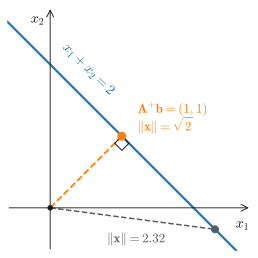
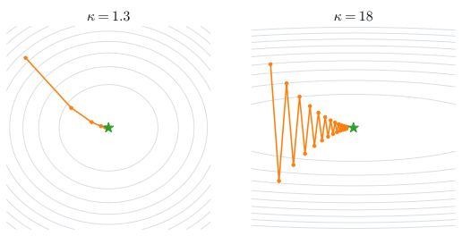
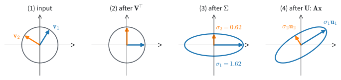
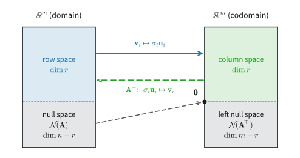
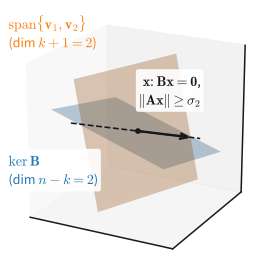
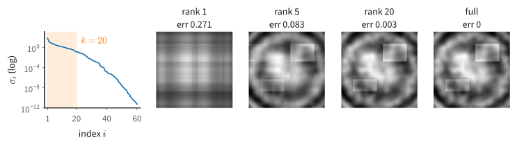
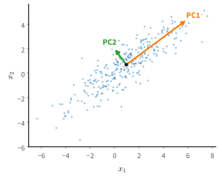
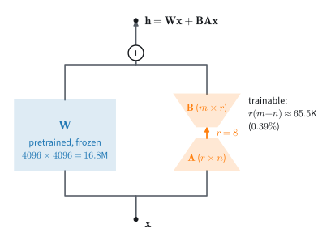

# Singular Value Decomposition and Low-Rank Approximation
:label:`sec_mdl-svd-low-rank`

In :numref:`sec_mdl-eigendecompositions`, we saw how the eigendecomposition
describes a square matrix in terms of the directions it merely stretches, turning
powers of a matrix into simple powers of numbers. Most matrices in deep learning,
however, are not like that. A weight matrix maps inputs of one width to outputs
of another, and a data matrix has one row per example and one column per feature.
Neither is applied repeatedly to its own output, and neither needs to be square.
Even when a matrix *is* square, eigenvalues can still let us down. The shear
$\mathbf{T}=\left(\begin{smallmatrix}1&1\\0&1\end{smallmatrix}\right)$ is
*defective*—it has only a single eigenvector direction where the plane needs
two—and in :numref:`sec_mdl-spectra-in-practice` we met a matrix that stretches a
vector ten-fold even though both of its eigenvalues are smaller than 1. We need a
factorization that exists for *every* matrix, measures stretching directly, and
tells us how few numbers are needed to approximate a large matrix well.

A concrete photograph makes that last requirement easy to appreciate. A grayscale
picture of a cat, $400\times500$ pixels, is simply a matrix of 200,000 numbers.
Like any matrix, it can be written as a sum of rank-one pieces, each formed by
the outer product of a single column and a single row. Remarkably, just twenty
well-chosen pieces—18,020 numbers, or 9% of the original data—reproduce the
photograph with a relative error of only 8% (:numref:`fig_mdl-la-eckart-young`).
Which twenty pieces achieve this, and could any other twenty do better? That same
question arises across deep learning: it tells us how many parameters a
fine-tuning adapter for a large model needs, and which directions in a dataset
are actually worth keeping.

The key idea is to stop asking a single basis to serve for both the inputs and
the outputs. If we allow one orthonormal basis for the input space and a separate
orthonormal basis for the output space, then *every* matrix reduces to a list of
independent non-negative stretches $\sigma_1\ge\sigma_2\ge\cdots\ge0$. From that
single list we can read off a matrix's rank, its best low-rank approximation,
principal component analysis, least-squares solutions, and how sensitive a linear
system is to measurement error. Recall that :numref:`sec_linear-algebra`
introduced two ways to measure the size of a matrix: the Frobenius norm
$\|\mathbf{A}\|_F$ (the square root of the sum of squared entries) and the
spectral norm $\|\mathbf{A}\|_2$ (the largest factor by which $\mathbf{A}$ can
stretch a unit vector). In this section, both become simple functions of the
singular values $\sigma_i$.

Two main results anchor what follows: the existence of the singular value
decomposition for any matrix, and the Eckart--Young theorem, which guarantees
that truncating the decomposition gives the best approximation of every rank.
From there, the pseudoinverse and the condition number follow in just a few
lines. The final subsection connects these tools to modern deep learning and can
be skipped on a first reading. All numerical experiments below use NumPy;
throughout, $\mathbf{T}$ denotes the shear matrix and $\mathbf{A}$ denotes a
general matrix unless stated otherwise.

```{.python .input #svd-imports}
#@tab mxnet
import math
import numpy as np
from mxnet import autograd, gluon, init, np as mnp, npx
from mxnet.gluon import nn
from d2l import mxnet as d2l
npx.set_np()
```

```{.python .input #svd-imports}
#@tab pytorch
import math
import numpy as np
import torch
from torch import nn
from torch.nn import functional as F
from d2l import torch as d2l
```

```{.python .input #svd-imports}
#@tab tensorflow
import math
import numpy as np
import tensorflow as tf
from d2l import tensorflow as d2l
```

```{.python .input #svd-imports}
#@tab jax
import math
import numpy as np
import jax
from jax import numpy as jnp
from flax import nnx
import optax
from d2l import jax as d2l
```

## The Singular Value Decomposition

### The Factorization and Its Geometry
:label:`subsec_mdl-svd-rotate-scale-rotate`

In :numref:`sec_linear-algebra`, we saw that the symmetric matrix
$\left(\begin{smallmatrix}2&1\\1&2\end{smallmatrix}\right)$ maps the unit
circle to an ellipse whose semi-axes lie along its eigenvectors $(1,1)$ and
$(-1,1)$, with half-lengths 3 and 1. Remarkably, a *non-symmetric* matrix also
maps the unit circle to an ellipse (or flattens it to a line segment if the
matrix is singular), as we will prove shortly. The difference is that the
orthogonal input directions landing on the axes of this ellipse are no longer the
axes themselves. Instead, there are two orthonormal frames—one for the input
space and one for the output space—and the singular value decomposition names
both.

**Theorem (singular value decomposition).** *Every real $m\times n$ matrix
$\mathbf{A}$ can be written as*

$$
\mathbf{A} = \mathbf{U}\,\boldsymbol{\Sigma}\,\mathbf{V}^\top,
$$
:eqlabel:`eq_mdl-svd`

*where $\mathbf{U}\in\mathbb{R}^{m\times m}$ and
$\mathbf{V}\in\mathbb{R}^{n\times n}$ are orthogonal
($\mathbf{U}^\top\mathbf{U}=\mathbf{I}$, $\mathbf{V}^\top\mathbf{V}=\mathbf{I}$)
and $\boldsymbol{\Sigma}\in\mathbb{R}^{m\times n}$ is zero except for the
non-negative entries $\sigma_1\ge\sigma_2\ge\cdots\ge\sigma_{\min(m,n)}\ge0$ on
its main diagonal.* The columns $\mathbf{v}_i$ of $\mathbf{V}$ are the *right
singular vectors*, the columns $\mathbf{u}_i$ of $\mathbf{U}$ are the *left
singular vectors*, and the diagonal entries $\sigma_i$ are the *singular
values*.

In geometric terms, *every* matrix—regardless of its shape—is simply an
orthogonal transformation, followed by a diagonal stretch, followed by a second
orthogonal transformation. Writing $\mathbf{A}\mathbf{V}=\mathbf{U}\boldsymbol{\Sigma}$
and reading off column $i$ makes the action explicit one direction at a time:

$$
\mathbf{A}\mathbf{v}_i = \sigma_i\,\mathbf{u}_i, \qquad i\le\min(m,n).
$$
:eqlabel:`eq_mdl-svd-action`

Each input direction $\mathbf{v}_i$ is sent to the corresponding output
direction $\mathbf{u}_i$, stretched by $\sigma_i$; when $n>m$, the extra input
directions $\mathbf{v}_{m+1},\ldots,\mathbf{v}_n$ are collapsed to zero.
Reading :eqref:`eq_mdl-svd` from right to left, applying $\mathbf{A}$ to a vector
$\mathbf{x}$ unfolds in three stages:

1. $\mathbf{V}^\top$ rotates the input so that each right singular vector
   $\mathbf{v}_i$ aligns with the coordinate axis $\mathbf{e}_i$;
2. $\boldsymbol{\Sigma}$ stretches axis $i$ by $\sigma_i$ and, when $m\ne n$,
   either appends zero coordinates or drops excess ones to match the output
   dimension;
3. $\mathbf{U}$ rotates the stretched axes so that axis $i$ points along
   $\mathbf{u}_i$.

Here "rotation" is convenient shorthand for an orthogonal map, which may also
include a reflection.

:numref:`fig_mdl-la-svd-action` illustrates these three stages for the shear
$\mathbf{T}$. Its singular values are $\sigma_1=1.618$ and $\sigma_2=0.618$; the
first right singular vector $\mathbf{v}_1$ points at $58.3^\circ$ above the
$x$-axis, while its image direction $\mathbf{u}_1$ points at $31.7^\circ$. Because
the input and output frames differ, $\mathbf{U}\ne\mathbf{V}$. We will derive
these exact numbers in :numref:`subsec_mdl-svd-via-ata`.


:label:`fig_mdl-la-svd-action`

In $n$ dimensions, the same three stages deform the unit sphere into an
ellipsoid whose semi-axes are the vectors $\sigma_i\mathbf{u}_i$. If only $r<n$
of the input directions have positive singular values, the remaining $n-r$
directions collapse to zero, and the image is a flat $r$-dimensional ellipsoid
lying inside the span of $\mathbf{u}_1,\ldots,\mathbf{u}_r$.

**Compact and thin forms.** Let $r$ be the number of positive singular values
(in :numref:`subsec_mdl-svd-subspaces` we will verify that $r$ is precisely the
rank of $\mathbf{A}$). Every row and column of $\boldsymbol{\Sigma}$ beyond the
first $r$ is zero, so the singular vectors paired with them contribute nothing to
the product. Dropping those zero entries yields the *compact SVD*,
$\mathbf{A}=\mathbf{U}_r\boldsymbol{\Sigma}_r\mathbf{V}_r^\top$, where
$\mathbf{U}_r\in\mathbb{R}^{m\times r}$ and
$\mathbf{V}_r\in\mathbb{R}^{n\times r}$ hold the first $r$ singular vectors and
$\boldsymbol{\Sigma}_r=\operatorname{diag}(\sigma_1,\ldots,\sigma_r)$. Between
the full and compact forms sits the *thin SVD*—the default reduced form that
numerical libraries return on request—which keeps $\min(m,n)$ columns in
$\mathbf{U}$ and $\mathbf{V}$ and still records any zero singular values when
$r<\min(m,n)$. For a $3\times2$ matrix of rank 2, the full factors have shapes
$3\times3$, $3\times2$, and $2\times2$, whereas the thin factors have shapes
$3\times2$, $2\times2$, and $2\times2$ (matching the compact SVD here because the
matrix has full column rank).

**The dyadic sum.** Multiplying out the compact SVD column by row expresses
$\mathbf{A}$ as a weighted sum of rank-one matrices, often called *dyads*:

$$
\mathbf{A} = \sum_{i=1}^{r} \sigma_i\,\mathbf{u}_i\mathbf{v}_i^\top.
$$
:eqlabel:`eq_mdl-svd-dyadic`

Each term $\mathbf{u}_i\mathbf{v}_i^\top$ is the outer product of an output
direction and an input direction, scaled by its singular value, and the terms are
already sorted from heaviest to lightest. For the shear,
$\mathbf{T}=\varphi\,\mathbf{u}_1\mathbf{v}_1^\top+\varphi^{-1}\,\mathbf{u}_2\mathbf{v}_2^\top$,
splitting the matrix into one piece of weight $1.618$ and a second of weight
$0.618$. Keeping only the heaviest pieces is the idea behind low-rank
approximation in :numref:`subsec_mdl-eckart-young`.

### Existence
:label:`subsec_mdl-svd-via-ata`

Where do the $\sigma_i$, $\mathbf{v}_i$, and $\mathbf{u}_i$ come from, and why
should the output directions come out orthonormal? The spectral theorem of
:numref:`subsec_mdl-spectral-theorem` guarantees that every symmetric matrix has
an orthonormal basis of eigenvectors with real eigenvalues. We can apply it to
the *Gram matrix* $\mathbf{A}^\top\mathbf{A}$, the $n\times n$ matrix of dot
products between the columns of $\mathbf{A}$. This matrix is symmetric, and it
is positive semidefinite (:numref:`subsec_mdl-psd`) because
$\mathbf{x}^\top\mathbf{A}^\top\mathbf{A}\mathbf{x}=\|\mathbf{A}\mathbf{x}\|^2\ge0$
for every vector $\mathbf{x}$.

**Proof of :eqref:`eq_mdl-svd` (existence).** By the spectral theorem,
$\mathbf{A}^\top\mathbf{A}$ has an orthonormal basis of eigenvectors
$\mathbf{v}_1,\ldots,\mathbf{v}_n$ with eigenvalues
$\lambda_1\ge\cdots\ge\lambda_n$. Every eigenvalue is non-negative because
$\lambda_i=\mathbf{v}_i^\top\mathbf{A}^\top\mathbf{A}\mathbf{v}_i=\|\mathbf{A}\mathbf{v}_i\|^2$.
Define

$$
\sigma_i = \sqrt{\lambda_i}, \qquad r = \#\{i : \sigma_i > 0\} .
$$

Thus the singular values are the square roots of the eigenvalues of the Gram
matrix, and $r$ counts the positive ones. For each $i\le r$, set
$\mathbf{u}_i = \mathbf{A}\mathbf{v}_i/\sigma_i$. The crucial check is that
these pushed-through vectors are automatically orthonormal, which follows from
$\mathbf{v}_j$ being an eigenvector of $\mathbf{A}^\top\mathbf{A}$ and the
$\mathbf{v}_i$ being orthonormal:

$$
\mathbf{u}_i^\top\mathbf{u}_j
  = \frac{1}{\sigma_i\sigma_j}\,\mathbf{v}_i^\top\mathbf{A}^\top\mathbf{A}\,\mathbf{v}_j
  = \frac{\lambda_j}{\sigma_i\sigma_j}\,\mathbf{v}_i^\top\mathbf{v}_j
  = \frac{\lambda_j}{\sigma_i\sigma_j}\,\delta_{ij}
  = \delta_{ij} .
$$

Orthonormality of the input frame therefore passes directly through
$\mathbf{A}^\top\mathbf{A}$ to the output frame. Next we check the dimensions.
Since the $r$ orthonormal vectors $\mathbf{u}_1,\ldots,\mathbf{u}_r$ lie in
$\mathbb{R}^m$, we have $r\le m$, and since there are $n$ eigenvalues in total,
$r\le n$; hence $r\le\min(m,n)$, and $\lambda_i=0$ for every $i>r$. Complete
$\mathbf{u}_1,\ldots,\mathbf{u}_r$ to an orthonormal basis
$\mathbf{u}_1,\ldots,\mathbf{u}_m$ of $\mathbb{R}^m$ (for example, by applying
Gram--Schmidt to any completion). For $r<i\le n$,
$\|\mathbf{A}\mathbf{v}_i\|^2=\lambda_i=0$, so $\mathbf{A}\mathbf{v}_i=\mathbf{0}$.
Comparing $\mathbf{A}\mathbf{V}$ with $\mathbf{U}\boldsymbol{\Sigma}$ column by
column, column $i$ of $\mathbf{U}\boldsymbol{\Sigma}$ is $\sigma_i\mathbf{u}_i$
for $i\le\min(m,n)$ (which vanishes when $i>r$) and $\mathbf{0}$ for $i>m$
(where $\boldsymbol{\Sigma}$ has no diagonal entry). In every case, column $i$
of $\mathbf{A}\mathbf{V}$ matches column $i$ of $\mathbf{U}\boldsymbol{\Sigma}$.
Hence $\mathbf{A}\mathbf{V}=\mathbf{U}\boldsymbol{\Sigma}$, and
right-multiplying by $\mathbf{V}^\top=\mathbf{V}^{-1}$ yields
$\mathbf{A}=\mathbf{U}\boldsymbol{\Sigma}\mathbf{V}^\top$. $\blacksquare$

This proof is also a recipe: diagonalize the symmetric matrix
$\mathbf{A}^\top\mathbf{A}$, take square roots to get the singular values, and
map the eigenvectors through $\mathbf{A}$ to obtain the left singular vectors.

Let us work through the shear by hand to see every step in action. For
$\mathbf{T}=\left(\begin{smallmatrix}1&1\\0&1\end{smallmatrix}\right)$, the
Gram matrix is
$\mathbf{T}^\top\mathbf{T}=\left(\begin{smallmatrix}1&1\\1&2\end{smallmatrix}\right)$.
It has trace 3 and determinant 1, so its characteristic polynomial is
$\lambda^2-3\lambda+1$, giving eigenvalues $(3\pm\sqrt5)/2$. Introducing the
golden ratio $\varphi=(1+\sqrt5)/2$, which satisfies $\varphi^2=\varphi+1$,
these eigenvalues simplify neatly to $\varphi^2$ and $\varphi^{-2}$. The
singular values are therefore $\sigma_1=\varphi\approx1.618$ and
$\sigma_2=1/\varphi\approx0.618$, and their product is $1=|\det\mathbf{T}|$.

Now we find the singular vectors. For the first right singular vector $(x,y)$,
the first row of
$(\mathbf{T}^\top\mathbf{T}-\varphi^2\mathbf{I})(x,y)=\mathbf{0}$ reads
$(1-\varphi^2)x+y=0$; using $\varphi^2-1=\varphi$ gives $y=\varphi x$, so
$\mathbf{v}_1\propto(1,\varphi)$. Applying $\mathbf{T}$ yields
$\mathbf{T}(1,\varphi)=(1+\varphi,\varphi)=\varphi\,(\varphi,1)$, so
$\mathbf{u}_1\propto(\varphi,1)$. Both vectors have length
$\sqrt{1+\varphi^2}=\sqrt{\varphi+2}$, giving
$\mathbf{v}_1\approx(0.526,0.851)$ at angle $\arctan\varphi=58.3^\circ$ and
$\mathbf{u}_1\approx(0.851,0.526)$ at $31.7^\circ$. The second pair follows by
orthogonality, $\mathbf{v}_2=(-\varphi,1)/\sqrt{\varphi+2}$ and
$\mathbf{u}_2=(-1,\varphi)/\sqrt{\varphi+2}$, and indeed
$\mathbf{T}\mathbf{v}_2=(1-\varphi,1)/\sqrt{\varphi+2}=\varphi^{-1}\mathbf{u}_2$
since $(1-\varphi)\varphi=-1$. Both $\mathbf{V}$ and $\mathbf{U}$ are
rotations
$\mathbf{R}_\theta=\left(\begin{smallmatrix}\cos\theta&-\sin\theta\\\sin\theta&\cos\theta\end{smallmatrix}\right)$,
so the shear factors as

$$
\mathbf{T} = \begin{bmatrix} 1 & 1\\ 0 & 1\end{bmatrix}
= \mathbf{R}_{31.7^\circ}
  \begin{bmatrix} \varphi & 0\\ 0 & 1/\varphi\end{bmatrix}
  \mathbf{R}_{58.3^\circ}^\top .
$$
:eqlabel:`eq_mdl-shear-svd`

Geometrically, the shear rotates the plane by $-58.3^\circ$, stretches it by
$1.618$ along the $x$-axis and $0.618$ along the $y$-axis, and rotates it back
by only $31.7^\circ$. The two angles sum to $90^\circ$ because $\mathbf{u}_1$
is simply $\mathbf{v}_1$ with its coordinates swapped, reflecting the symmetry
$\mathbf{T}^\top=\mathbf{J}\mathbf{T}\mathbf{J}$ for the swap matrix
$\mathbf{J}=\left(\begin{smallmatrix}0&1\\1&0\end{smallmatrix}\right)$.

Does NumPy's `np.linalg.svd` agree with our hand calculation? Because singular
vectors are only determined up to sign (:numref:`subsec_mdl-svd-uniqueness`),
the cell below stores the shear as `A` and first fixes signs so that
$\mathbf{u}_1$ lies in the first quadrant and $\mathbf{U}$ is a proper rotation.

```{.python .input #svd-defective-shear}
A = np.array([[1., 1.], [0., 1.]])
U, s, Vt = np.linalg.svd(A)
if U[0, 0] < 0:                         # joint sign choice: u_1 in the first quadrant
    U[:, 0], Vt[0] = -U[:, 0], -Vt[0]
if np.linalg.det(U) < 0:                # joint sign choice: U a rotation (then so is V)
    U[:, 1], Vt[1] = -U[:, 1], -Vt[1]
phi = (1 + np.sqrt(5)) / 2
print('singular values', s.round(4), '  phi, 1/phi', np.array([phi, 1 / phi]).round(4))
print('U =', U.round(3).tolist(), '  Vt =', Vt.round(3).tolist())
print('angles of u_1, v_1 (degrees):', np.degrees(np.arctan2(U[1, 0], U[0, 0])).round(1),
      np.degrees(np.arctan2(Vt[0, 1], Vt[0, 0])).round(1))
print('A v_1 = sigma_1 u_1:', np.allclose(A @ Vt[0], s[0] * U[:, 0]),
      '  sigma_1 sigma_2 =', s.prod().round(6))
```

It matches: the library returns $\varphi$ and $1/\varphi$ together with the two
rotations of :eqref:`eq_mdl-shear-svd`.

The same construction works unchanged for a rectangular matrix. Consider the
$3\times2$ matrix with rows $(3,1)$, $(1,3)$, and $(0,2)$. Its Gram matrix is
$\left(\begin{smallmatrix}10&6\\6&14\end{smallmatrix}\right)$, with
eigenvalues $12\pm\sqrt{40}$. The next cell carries out the proof's three steps
directly (eigenvectors of $\mathbf{A}^\top\mathbf{A}$, square roots, and
$\mathbf{u}_i=\mathbf{A}\mathbf{v}_i/\sigma_i$) and compares the result against
`np.linalg.svd`.

```{.python .input #svd-verify}
A = np.array([[3., 1.], [1., 3.], [0., 2.]])
lam, V = np.linalg.eigh(A.T @ A)
lam, V = lam[::-1], V[:, ::-1]                     # descending order
sigma = np.sqrt(lam)
U = A @ V / sigma                                   # u_i = A v_i / sigma_i
U_lib, s_lib, Vt_lib = np.linalg.svd(A, full_matrices=False)
print('sigma from eigh:', sigma.round(5), '  from svd:', s_lib.round(5))
print('U orthonormal:', np.allclose(U.T @ U, np.eye(2)), '  same U, V up to sign:',
      np.allclose(abs(U), abs(U_lib)), np.allclose(abs(V), abs(Vt_lib.T)))
print('rebuild error:', np.linalg.norm((U * sigma) @ V.T - A).round(12))
```

Both routes yield $\sigma_1=\sqrt{12+\sqrt{40}}\approx4.281$ and
$\sigma_2=\sqrt{12-\sqrt{40}}\approx2.382$. As the proof promised, the
pushed-through vectors $\mathbf{u}_i$ come out orthonormal, and both $\mathbf{U}$
and $\mathbf{V}$ agree with the library's output up to sign.

### Uniqueness and the Largest Stretch
:label:`subsec_mdl-svd-uniqueness`

Is the SVD of a matrix unique? The singular *values* are always unique, because
they are the square roots of the eigenvalues of $\mathbf{A}^\top\mathbf{A}$,
which $\mathbf{A}$ determines completely. The singular *vectors*, by contrast,
have three kinds of freedom:

* For a simple (unrepeated) $\sigma_i>0$, the only choice is a joint sign flip
  $(\mathbf{u}_i,\mathbf{v}_i)\to(-\mathbf{u}_i,-\mathbf{v}_i)$. Both vectors
  must flip together, because flipping only one side would violate
  $\mathbf{A}\mathbf{v}_i=\sigma_i\mathbf{u}_i$.
* For a repeated singular value $\sigma>0$ with index set $\mathcal{I}$, the
  columns $\mathbf{V}_{\mathcal I}$ may be rotated by any orthogonal matrix
  $\mathbf{Q}$ of matching size, becoming $\mathbf{V}_{\mathcal I}\mathbf{Q}$,
  provided $\mathbf{U}_{\mathcal I}$ is rotated by the *same* $\mathbf{Q}$ to
  preserve $\mathbf{U}_{\mathcal I}=\mathbf{A}\mathbf{V}_{\mathcal I}/\sigma$.
* For $\sigma=0$, the null-space vectors $\mathbf{v}_{r+1},\ldots,\mathbf{v}_n$
  and left-null-space vectors $\mathbf{u}_{r+1},\ldots,\mathbf{u}_m$ can be
  rotated completely independently, since they do not appear in the dyadic
  sum :eqref:`eq_mdl-svd-dyadic`.

This freedom explains why two numerical libraries, or even the same library on
two different machines, may return opposite signs for the singular vectors, and
why our code cells fix a sign convention before printing vectors.

Beyond factoring $\mathbf{A}$, the top singular value has a direct geometric
meaning: it is the largest factor by which $\mathbf{A}$ can stretch any unit
vector,

$$
\sigma_1 = \max_{\|\mathbf{x}\|=1}\|\mathbf{A}\mathbf{x}\| = \|\mathbf{A}\|_2 .
$$
:eqlabel:`eq_mdl-sigma1-variational`

This follows immediately from the Rayleigh proposition of
:numref:`subsec_mdl-rayleigh`, which states that over unit vectors $\mathbf{x}$,
the quadratic form $\mathbf{x}^\top\mathbf{S}\mathbf{x}$ of a symmetric matrix
$\mathbf{S}$ is maximized by its top eigenvector with value equal to its top
eigenvalue. Taking $\mathbf{S}=\mathbf{A}^\top\mathbf{A}$, we see that
$\|\mathbf{A}\mathbf{x}\|^2=\mathbf{x}^\top\mathbf{A}^\top\mathbf{A}\mathbf{x}$
is maximized at $\mathbf{x}=\mathbf{v}_1$ with value $\lambda_1=\sigma_1^2$.
Thus $\sigma_1$ is precisely the spectral norm $\|\mathbf{A}\|_2$ from
:numref:`sec_linear-algebra`: for the shear, no unit vector is stretched by more
than $\varphi=1.618$, and $\mathbf{v}_1$ achieves that stretch. The remaining
singular values solve the same maximization problem once the earlier right
singular vectors are ruled out, a procedure called *deflation*:
$\sigma_k=\max\{\|\mathbf{A}\mathbf{x}\| : \|\mathbf{x}\|=1,\ \mathbf{x}\perp\mathbf{v}_1,\ldots,\mathbf{v}_{k-1}\}$.
In fact, Exercise :exref:`ex_mdl-svd-low-rank-norms-singular-values`a reverses
this logic and constructs the entire SVD from the maximum stretch alone, without
invoking the spectral theorem.

### Singular Values and Eigenvalues
:label:`subsec_mdl-svd-eigenvalues`

How do singular values relate to eigenvalues? Substituting :eqref:`eq_mdl-svd`
into the two Gram matrices and using $\mathbf{U}^\top\mathbf{U}=\mathbf{I}$ and
$\mathbf{V}^\top\mathbf{V}=\mathbf{I}$ gives

$$
\mathbf{A}^\top\mathbf{A} = \mathbf{V}\,\boldsymbol{\Sigma}^\top\boldsymbol{\Sigma}\,\mathbf{V}^\top,
\qquad
\mathbf{A}\mathbf{A}^\top = \mathbf{U}\,\boldsymbol{\Sigma}\boldsymbol{\Sigma}^\top\,\mathbf{U}^\top .
$$
:eqlabel:`eq_mdl-svd-gram`

Both expressions are symmetric eigendecompositions: the right singular vectors
are the eigenvectors of $\mathbf{A}^\top\mathbf{A}$, the left singular vectors
are the eigenvectors of $\mathbf{A}\mathbf{A}^\top$, and the squares
$\sigma_i^2$ are the nonzero eigenvalues that the two Gram matrices share. When
$\mathbf{A}$ is symmetric positive semidefinite, its SVD and eigendecomposition
coincide, with $\mathbf{U}=\mathbf{V}$.

For any other matrix, however, the two decompositions differ, and it is a common
mistake to assume that singular values equal eigenvalue magnitudes. Consider the
chapter's running matrix
$\mathbf{A}=\left(\begin{smallmatrix}1&2\\-1&3\end{smallmatrix}\right)$, whose
eigenvalues are $2\pm i$, both of modulus $\sqrt5\approx2.236$
(:numref:`sec_mdl-eigendecompositions`). Its Gram matrix
$\mathbf{A}^\top\mathbf{A}=\left(\begin{smallmatrix}2&-1\\-1&13\end{smallmatrix}\right)$
has trace 15 and determinant 25, yielding $\sigma_{1,2}^2=(15\pm5\sqrt5)/2$ and
therefore $\sigma_{1,2}=(5\pm\sqrt5)/2\approx3.618,\,1.382$, far from $2.236$.
Still, one clean identity links the two lists for every square matrix:

$$
|\det\mathbf{A}| = \prod_i \sigma_i = \prod_i |\lambda_i| .
$$

The first equality holds because orthogonal matrices have determinant $\pm1$,
and the second because the determinant is the product of all eigenvalues. For a
$2\times2$ matrix with a conjugate pair of eigenvalues of common modulus
$|\lambda|$, this forces $|\lambda|=\sqrt{\sigma_1\sigma_2}$; here indeed
$\sqrt{3.618\cdot1.382}=\sqrt5$. The identity also recovers the volume
interpretation of the determinant from :numref:`sec_mdl-linear-maps`: rotations
preserve area, so the diagonal stretch $\boldsymbol{\Sigma}$ accounts for the
entire change of area, and our running matrix maps the unit square to a
parallelogram of area $3.618\cdot1.382=5$.

**Computing the SVD in practice.** Although our existence proof constructs the
SVD from $\mathbf{A}^\top\mathbf{A}$, numerical libraries never form that
product. Forming $\mathbf{A}^\top\mathbf{A}$ squares the condition number
(:numref:`subsec_mdl-condition-number`), which can wipe out small singular
values in floating-point arithmetic. Instead, libraries apply orthogonal
transformations directly to $\mathbf{A}$ to reduce it to bidiagonal form
(Golub--Kahan bidiagonalization) and then diagonalize that bidiagonal matrix
:cite:`Golub.Van-Loan.1996`.

### The Four Fundamental Subspaces
:label:`subsec_mdl-svd-subspaces`

Which inputs does $\mathbf{A}$ collapse to zero, and which outputs can it reach?
In :numref:`sec_mdl-linear-maps`, we named these sets the null space and the
column space, and defined the rank as the number of linearly independent
columns. Because $\mathbf{U}$ and $\mathbf{V}$ are invertible, multiplying by
them leaves all dimensions unchanged, so
$\operatorname{rank}\mathbf{A}=\operatorname{rank}\boldsymbol{\Sigma}$, which
is simply the count of nonzero diagonal entries:

$$
\operatorname{rank}\mathbf{A} = \#\{i : \sigma_i > 0\} = r .
$$
:eqlabel:`eq_mdl-rank-sigma`

In other words, the rank counts the directions that survive without collapsing.
Paired with a rounding tolerance (below), counting singular values is the most
numerically reliable way to determine rank. It costs more than Gaussian
elimination, but it is far more stable: a perturbation $\mathbf{E}$, such as
floating-point rounding error, shifts no singular value by more than
$\|\mathbf{E}\|_2$ (Weyl's inequality in :numref:`subsec_mdl-eckart-young`). A
clear gap between large and tiny singular values can therefore be trusted.

Even better, splitting the singular vectors at the index $r$ gives explicit
orthonormal bases for all four fundamental subspaces of $\mathbf{A}$ directly
from the dyadic sum :eqref:`eq_mdl-svd-dyadic`:

* The **column space** (range) of $\mathbf{A}$ is
  $\operatorname{span}\{\mathbf{u}_1,\ldots,\mathbf{u}_r\}$, because every
  output
  $\mathbf{A}\mathbf{x}=\sum_{i\le r}\sigma_i(\mathbf{v}_i^\top\mathbf{x})\mathbf{u}_i$
  is a linear combination of these vectors, and each one is attained via
  $\mathbf{u}_i=\mathbf{A}(\mathbf{v}_i/\sigma_i)$.
* The **null space** of $\mathbf{A}$ is
  $\operatorname{span}\{\mathbf{v}_{r+1},\ldots,\mathbf{v}_n\}$, because by the
  same formula $\mathbf{A}\mathbf{x}=\mathbf{0}$ holds if and only if
  $\mathbf{v}_i^\top\mathbf{x}=0$ for every $i\le r$ (the $\mathbf{u}_i$ are
  independent and the $\sigma_i$ are positive), meaning $\mathbf{x}$ is
  orthogonal to $\mathbf{v}_1,\ldots,\mathbf{v}_r$.
* The **row space** (column space of $\mathbf{A}^\top$) is
  $\operatorname{span}\{\mathbf{v}_1,\ldots,\mathbf{v}_r\}$ and the **left null
  space** (null space of $\mathbf{A}^\top$) is
  $\operatorname{span}\{\mathbf{u}_{r+1},\ldots,\mathbf{u}_m\}$, by applying the
  same two arguments to
  $\mathbf{A}^\top=\mathbf{V}\boldsymbol{\Sigma}^\top\mathbf{U}^\top$, which
  simply swaps the roles of the $\mathbf{u}_i$ and $\mathbf{v}_i$.

This gives a remarkably clean picture of any linear map. The input space splits
into two orthogonal pieces: the $r$-dimensional row space and the
$(n-r)$-dimensional null space. Likewise, the output space splits into the
$r$-dimensional column space and the $(m-r)$-dimensional left null space. On the
row space, $\mathbf{A}$ maps each $\mathbf{v}_i$ to $\sigma_i\mathbf{u}_i$, a
one-to-one bijection onto the column space; everything in the null space is sent
to zero.

To see this in the simplest nontrivial case, consider the singular matrix
$\mathbf{B}=\left(\begin{smallmatrix}2&1\\4&2\end{smallmatrix}\right)$ from
:numref:`sec_mdl-linear-maps`. Its Gram matrix
$\left(\begin{smallmatrix}20&10\\10&5\end{smallmatrix}\right)$ has eigenvalues
25 and 0, so $\sigma_1=5$, $\sigma_2=0$, and $r=1$. The four subspaces are the
lines spanned by

$$
\mathbf{v}_1=\tfrac{1}{\sqrt5}(2,1),\quad
\mathbf{v}_2=\tfrac{1}{\sqrt5}(-1,2),\quad
\mathbf{u}_1=\tfrac{1}{\sqrt5}(1,2),\quad
\mathbf{u}_2=\tfrac{1}{\sqrt5}(-2,1),
\qquad
\mathbf{B} = 5\,\mathbf{u}_1\mathbf{v}_1^\top .
$$

Here the column space is the line $y=2x$ along $\mathbf{u}_1$, and the left null
space is the perpendicular line along $\mathbf{u}_2$. In the input plane, the
null space is the line along $(1,-2)$, perpendicular to the row $(2,1)$ that
spans the row space. :numref:`fig_mdl-la-svd-subspaces` illustrates the general
geometry; as we will see in :numref:`subsec_mdl-pseudoinverse`, the
pseudoinverse simply runs the bijection from the row space to the column space
in reverse.


:label:`fig_mdl-la-svd-subspaces`

**Numerical rank.** In floating-point arithmetic, a matrix that is
mathematically rank-deficient almost never has singular values that are literally
zero; rounding error leaves tiny values of order $\epsilon_{\text{mach}}\sigma_1$
instead. In practice, rank is therefore decided with a threshold. NumPy's
`np.linalg.matrix_rank` counts singular values above
$\sigma_1\max(m,n)\,\epsilon_{\text{mach}}$, a tolerance that scales naturally
with both the largest singular value and the matrix dimensions. Let us see what
the "zero" singular values of a $4\times4$ matrix of rank 2 actually look like.

```{.python .input #svd-numerical-rank}
A = np.random.standard_normal((4, 2)) @ np.random.standard_normal((2, 4))   # rank <= 2
s = np.linalg.svd(A, compute_uv=False)
tol = s[0] * max(A.shape) * np.finfo(float).eps
print('singular values:', np.array2string(s, formatter={'float_kind': '{:.1e}'.format}))
print(f'tolerance {tol:.1e};  exact zeros: {(s == 0).sum()};  '
      f'numerical rank: {np.linalg.matrix_rank(A)}')
```

Two singular values are of order one, while the remaining two are pure rounding
noise: $10^{-15}$ or smaller, well below the tolerance, yet rarely exact zeros.
Checking for exact zeros would therefore misreport the rank, whereas the
threshold recovers the true rank of 2.

## Low-Rank Approximation

### Best Low-Rank Approximation
:label:`subsec_mdl-eckart-young`

We can now return to the cat photograph from the start of the section: which
twenty rank-one pieces should we keep? The dyadic sum :eqref:`eq_mdl-svd-dyadic`
already orders the pieces of $\mathbf{A}$ from heaviest to lightest, so the
natural candidate is to keep the first $k$ terms. This gives the *truncated
SVD*,

$$
\mathbf{A}_k = \sum_{i=1}^{k}\sigma_i\,\mathbf{u}_i\mathbf{v}_i^\top .
$$
:eqlabel:`eq_mdl-truncated-svd`

The matrix $\mathbf{A}_k$ has rank at most $k$, and storing it requires only
$k$ singular values, $k$ columns of length $m$, and $k$ columns of length $n$,
for a total of $k(m+n+1)$ numbers instead of $mn$. For our $400\times500$
photograph with $k=20$, that is 18,020 numbers out of 200,000. Two questions
immediately arise: how large is the approximation error, and could some cleverer
rank-$k$ matrix do even better?

**Matrix norms as singular values.** To measure approximation error, we need a
matrix norm. The Frobenius norm from :numref:`sec_linear-algebra`,
$\|\mathbf{A}\|_F^2=\sum_{ij}a_{ij}^2$, sums the squared lengths of the columns
of $\mathbf{A}$, which are the diagonal entries of $\mathbf{A}^\top\mathbf{A}$;
thus $\|\mathbf{A}\|_F^2=\operatorname{tr}(\mathbf{A}^\top\mathbf{A})$.
Substituting the SVD and using the cyclic property of the trace
(:numref:`sec_mdl-linear-maps`) to move $\mathbf{V}$ across, we find

$$
\|\mathbf{A}\|_F^2
  = \operatorname{tr}(\mathbf{V}\boldsymbol{\Sigma}^\top\boldsymbol{\Sigma}\mathbf{V}^\top)
  = \operatorname{tr}(\boldsymbol{\Sigma}^\top\boldsymbol{\Sigma}\,\mathbf{V}^\top\mathbf{V})
  = \sum_i \sigma_i^2 .
$$
:eqlabel:`eq_mdl-frobenius-singular`

The Frobenius norm is therefore the square root of the sum of squared singular
values, which immediately tells us that multiplying on either side by an
orthogonal matrix never changes it. For the shear,
$1+1+0+1=3=\varphi^2+\varphi^{-2}$. Meanwhile, the spectral norm is simply the
largest singular value, $\|\mathbf{A}\|_2=\sigma_1$, by
:eqref:`eq_mdl-sigma1-variational`.

With both norms expressed in terms of singular values, we can state the central
approximation theorem of linear algebra.

**Theorem (Eckart--Young--Mirsky).** *Let $\sigma_i=0$ for $i>r$. For every
$k\ge0$, the smallest spectral-norm error attainable by a matrix of rank at
most $k$ is*

$$
\min_{\operatorname{rank}\mathbf{B}\le k}\|\mathbf{A}-\mathbf{B}\|_2 = \sigma_{k+1},
$$
:eqlabel:`eq_mdl-eckart-young`

*and the smallest squared Frobenius error is
$\min_{\operatorname{rank}\mathbf{B}\le k}\|\mathbf{A}-\mathbf{B}\|_F^2=\sum_{i>k}\sigma_i^2$.
Both minima are attained at the truncated SVD $\mathbf{B}=\mathbf{A}_k$.*

In short, no rank-$k$ matrix can beat the truncated SVD in either norm: the best
rank-$k$ approximation misses by the first singular value it omits (in the
spectral norm), or by the combined energy of all omitted singular values (in the
Frobenius norm). Eckart and Young proved the Frobenius case
:cite:`Eckart.Young.1936`, and Mirsky later extended it to every norm that is
invariant under orthogonal multiplication on both sides :cite:`Mirsky.1960`. We
prove the spectral-norm bound first; the Frobenius bound then follows cleanly
from one extra ingredient, Weyl's inequality, which drops right out of the same
argument.

Before writing the general proof, picture $n=3$ and $k=1$. Any matrix
$\mathbf{B}$ of rank one collapses an entire plane of inputs to zero, while the
top two right singular vectors of $\mathbf{A}$ span another plane. In
$\mathbb{R}^3$, two planes through the origin must intersect in at least a line.
Along that line, $\mathbf{B}$ outputs zero while $\mathbf{A}$ stretches every
vector by at least $\sigma_2$, so $\mathbf{A}-\mathbf{B}$ must stretch some
unit vector by at least $\sigma_2$ (:numref:`fig_mdl-la-svd-dimension-count`).
The proof below simply carries this dimension count into $n$ dimensions.


:label:`fig_mdl-la-svd-dimension-count`

**Proof (spectral norm).** *First, the truncation achieves $\sigma_{k+1}$.* The
residual
$\mathbf{A}-\mathbf{A}_k=\sum_{i>k}\sigma_i\mathbf{u}_i\mathbf{v}_i^\top$ is
already in compact SVD form with largest singular value $\sigma_{k+1}$, so
$\|\mathbf{A}-\mathbf{A}_k\|_2=\sigma_{k+1}$ by
:eqref:`eq_mdl-sigma1-variational`. Likewise, :eqref:`eq_mdl-frobenius-singular`
gives $\|\mathbf{A}-\mathbf{A}_k\|_F^2=\sum_{i>k}\sigma_i^2$.

*Second, no matrix of rank at most $k$ can do better.* If $k\ge r$ the error is
zero and there is nothing to prove, so assume $k<r$ and let
$\operatorname{rank}\mathbf{B}\le k$. By rank--nullity
(:numref:`sec_mdl-linear-maps`), the null space $\mathcal{K}=\ker\mathbf{B}$
has dimension at least $n-k$. Meanwhile, the span
$\mathcal{V}=\operatorname{span}\{\mathbf{v}_1,\ldots,\mathbf{v}_{k+1}\}$ of
the top $k+1$ right singular vectors has dimension $k+1$. Because these two
dimensions add to more than $n$, the subspaces must share a nonzero vector:

$$
\dim(\mathcal{K}\cap\mathcal{V})
  = \dim\mathcal{K}+\dim\mathcal{V}-\dim(\mathcal{K}+\mathcal{V})
  \ge (n-k) + (k+1) - n = 1 ,
$$

where the equality is the dimension formula for two subspaces and the
inequality uses $\dim(\mathcal{K}+\mathcal{V})\le n$. (To verify the dimension
formula, extend a basis of $\mathcal{K}\cap\mathcal{V}$ separately to a basis of
$\mathcal{K}$ and a basis of $\mathcal{V}$; the combined vectors are linearly
independent, span $\mathcal{K}+\mathcal{V}$, and number
$\dim\mathcal{K}+\dim\mathcal{V}-\dim(\mathcal{K}\cap\mathcal{V})$.) Pick a
unit vector $\mathbf{x}\in\mathcal{K}\cap\mathcal{V}$ and expand it as
$\mathbf{x}=\sum_{i\le k+1}c_i\mathbf{v}_i$ with $\sum_i c_i^2=1$. Then
$\mathbf{B}\mathbf{x}=\mathbf{0}$, and using
$\mathbf{A}\mathbf{v}_i=\sigma_i\mathbf{u}_i$ together with the orthonormality
of the $\mathbf{u}_i$,

$$
\|\mathbf{A}\mathbf{x}\|^2 = \Bigl\|\sum_{i\le k+1}c_i\sigma_i\mathbf{u}_i\Bigr\|^2
   = \sum_{i\le k+1} c_i^2\sigma_i^2
   \ge \sigma_{k+1}^2 \sum_{i\le k+1} c_i^2
   = \sigma_{k+1}^2 .
$$

Hence
$\|\mathbf{A}-\mathbf{B}\|_2\ge\|(\mathbf{A}-\mathbf{B})\mathbf{x}\|=\|\mathbf{A}\mathbf{x}\|\ge\sigma_{k+1}$.
$\blacksquare$

The geometry is worth repeating in one sentence: any rank-$k$ competitor
$\mathbf{B}$ must annihilate at least one direction inside the span of the top
$k+1$ right singular vectors, and $\mathbf{A}$ stretches every direction in that
span by at least $\sigma_{k+1}$. For the shear $\mathbf{T}$ with $k=1$, the
truncation
$\mathbf{T}_1=\varphi\,\mathbf{u}_1\mathbf{v}_1^\top=\tfrac{1}{\sqrt5}\left(\begin{smallmatrix}\varphi&\varphi^2\\1&\varphi\end{smallmatrix}\right)\approx\left(\begin{smallmatrix}0.724&1.171\\0.447&0.724\end{smallmatrix}\right)$
misses by $1/\varphi=0.618$ in both norms (the residual has rank one, so its
spectral and Frobenius norms coincide), and no rank-one matrix can get closer.

To complete the theorem for the Frobenius norm, we first harvest a general
perturbation inequality from the spectral-norm bound we just proved.

**Lemma (Weyl's inequality for singular values).** *For any two matrices
$\mathbf{X},\mathbf{Y}$ of the same shape and indices $i,j\ge1$ with
$i+j-1\le\min(m,n)$,*

$$
\sigma_{i+j-1}(\mathbf{X}+\mathbf{Y})\le\sigma_i(\mathbf{X})+\sigma_j(\mathbf{Y}) .
$$
:eqlabel:`eq_mdl-weyl-singular`

**Proof.** Let $\mathbf{X}_{i-1}$ and $\mathbf{Y}_{j-1}$ be the truncated SVDs
:eqref:`eq_mdl-truncated-svd` (with $\mathbf{X}_0=\mathbf{0}$). Their sum
$\mathbf{X}_{i-1}+\mathbf{Y}_{j-1}$ has rank at most $i+j-2$, so applying the
spectral-norm lower bound to $\mathbf{X}+\mathbf{Y}$ with $k=i+j-2$ gives
$\sigma_{i+j-1}(\mathbf{X}+\mathbf{Y})\le\|\mathbf{X}+\mathbf{Y}-\mathbf{X}_{i-1}-\mathbf{Y}_{j-1}\|_2$.
By the triangle inequality and the achievability half of Eckart--Young, the
right-hand side is at most
$\|\mathbf{X}-\mathbf{X}_{i-1}\|_2+\|\mathbf{Y}-\mathbf{Y}_{j-1}\|_2=\sigma_i(\mathbf{X})+\sigma_j(\mathbf{Y})$.
$\blacksquare$

In words, adding $\mathbf{Y}$ to $\mathbf{X}$ can lift the $(i+j-1)$-th
singular value above the $i$-th singular value of $\mathbf{X}$ by at most
$\sigma_j(\mathbf{Y})$. Setting $j=1$ and applying the inequality in both
directions shows that perturbing a matrix by $\mathbf{Y}$ moves no singular
value by more than $\|\mathbf{Y}\|_2$ :cite:`Horn.Johnson.2012`; Exercise
:exref:`ex_mdl-svd-low-rank-weyl-perturbation` works out the details.

**Proof (Frobenius norm).** Apply Weyl's lemma with
$\mathbf{X}=\mathbf{A}-\mathbf{B}$, $\mathbf{Y}=\mathbf{B}$, and $j=k+1$.
Because $\operatorname{rank}\mathbf{B}\le k$, we have
$\sigma_{k+1}(\mathbf{B})=0$, which yields
$\sigma_{k+i}(\mathbf{A})\le\sigma_i(\mathbf{A}-\mathbf{B})$ for every $i\ge1$.
Squaring and summing over $i$, then applying :eqref:`eq_mdl-frobenius-singular`,

$$
\|\mathbf{A}-\mathbf{B}\|_F^2=\sum_{i\ge1}\sigma_i(\mathbf{A}-\mathbf{B})^2
  \ge\sum_{i\ge1}\sigma_{k+i}(\mathbf{A})^2=\sum_{j>k}\sigma_j(\mathbf{A})^2 ,
$$

which the truncation $\mathbf{A}_k$ attains. $\blacksquare$

**Uniqueness of the minimizer.** One subtle difference separates the two norms.
In the spectral norm, the best rank-$k$ approximation is never unique when
$k\ge1$ and $\sigma_{k+1}>0$: for $\mathbf{A}=\operatorname{diag}(3,2,1)$ and
$k=1$, every matrix $\mathbf{B}=\operatorname{diag}(3+t,0,0)$ with $|t|\le1$
gives $\|\mathbf{A}-\mathbf{B}\|_2=\max(|t|,2,1)=2=\sigma_2$. In the Frobenius
norm, by contrast, $\mathbf{A}_k$ is the *unique* minimizer whenever
$\sigma_k>\sigma_{k+1}$ or $\sigma_{k+1}=0$ (in which case $\mathbf{A}_k=\mathbf{A}$)
:cite:`Golub.Van-Loan.1996`. This uniqueness is one reason principal component
analysis, which we meet next, is formulated in the Frobenius norm.

Let us now test the theorem on our $400\times500$ cat photograph. Eckart--Young
fixes the spectral error of every truncation at $\sigma_{k+1}$, but it does not
tell us how quickly the singular values of a real image decay, nor how much
worse a natural rank-$k$ competitor performs. The cell below loads
`img/cat1.jpg`, converts it to grayscale using standard luminance weights for
red, green, and blue, and builds the truncations with `np.einsum` (which
multiplies its inputs and sums over every index omitted after the arrow; since
row $i$ of `Vt` is $\mathbf{v}_i^\top$, `'i,mi,in->mn'` computes the dyadic
sum).

```{.python .input #mdl-svd-low-rank-rotate-scale-rotate}
img = d2l.plt.imread('../img/cat1.jpg') @ np.array([0.299, 0.587, 0.114])  # 400 x 500
U, s, Vt = np.linalg.svd(img, full_matrices=False)
m, n = img.shape
fro = np.linalg.norm(img)
energy = np.cumsum(s**2) / (s**2).sum()                        # energy kept at each rank
slope = np.polyfit(np.log(np.arange(1, 101)), np.log(s[:100]), 1)[0]
print(f'{m} x {n} = {m * n} numbers;  slope of log sigma_i on log i: {slope:.2f}')
print(f'energy kept at rank 1: {energy[0]:.3f}, at rank 4: {energy[3]:.3f}')
for k in [1, 5, 20, 50]:
    A_k = np.einsum('i,mi,in->mn', s[:k], U[:, :k], Vt[:k])    # first k dyads
    print(f'k={k:2d}: ||A-A_k||_2={np.linalg.norm(img - A_k, 2):6.0f}  '
          f'sigma_{k + 1}={s[k]:6.0f}  rel. err {np.linalg.norm(img - A_k) / fro:.3f}  '
          f'stores {k * (m + n + 1) / (m * n):.1%}')
cols = np.argsort(-np.linalg.norm(img, axis=0))[:20]           # 20 largest columns
C = img[:, cols]
proj = C @ np.linalg.pinv(C) @ img
print(f'projection onto the 20 largest columns: rel. err {np.linalg.norm(img - proj) / fro:.3f}')
```

The spectral error matches $\sigma_{k+1}$ at every rank, as guaranteed, and
rank 20 stores just 9% of the numbers at an 8% relative error. In
:numref:`fig_mdl-la-eckart-young`, the cat appears as a bright blur at rank 1,
a recognizable silhouette with four paws at rank 5, and unmistakably a cat lying
on its back by rank 20. The left panel reveals why so few pieces suffice: over
the first hundred indices, the singular values decay roughly as a power law,
$\sigma_i\propto i^{-1.1}$.


:label:`fig_mdl-la-eckart-young`

**The energy ratio.** The Frobenius error formula gives a practical rule for
choosing $k$. The fraction of total squared "energy" $\sum_i\sigma_i^2$
retained by the rank-$k$ truncation is

$$
\frac{\sum_{i\le k}\sigma_i^2}{\sum_{i}\sigma_i^2}
  = 1 - \frac{\|\mathbf{A}-\mathbf{A}_k\|_F^2}{\|\mathbf{A}\|_F^2} ,
$$
:eqlabel:`eq_mdl-energy-ratio`

meaning the relative Frobenius error is the square root of one minus the energy
ratio. Retaining 95% of the energy thus corresponds to a relative error of
$\sqrt{0.05}\approx22\%$, while retaining 99% brings the error down to 10%. One
must read this ratio with care, however. On the photograph, $\sigma_1^2$ alone
accounts for 89% of the energy because a constant image has rank one (all rows
identical) and the photograph's average brightness is large, so the first dyad
mostly captures that mean. Rank 4 already retains 95% of the energy (at 21%
relative error), whereas once we subtract the mean pixel value, reaching 95%
requires rank 8 instead of 4 (as we verify in
:numref:`subsec_mdl-spectrum-control`). Always check whether $\sigma_1$ is
dominated by a nonzero mean, or subtract the mean first, just as principal
component analysis does.

To see how much Eckart--Young saves over a naive rank-20 scheme, the last lines
of the cell select the 20 actual columns of the photograph with the largest
norms and project every column onto their span (the idea behind CUR
decompositions, which approximate a matrix using subsets of its own rows and
columns). Its relative error is 0.31, nearly four times worse than the 0.08 of
the truncated SVD.

**Truncation as denoising.** Compression is not the only reason to truncate an
SVD; denoising is another. Suppose an observed $m\times n$ matrix ($m\le n$)
consists of a low-rank signal plus random noise,
$\mathbf{A}=\mathbf{B}+\mathbf{N}$, where the entries of $\mathbf{N}$ are
independent with mean zero and standard deviation $\sigma_{\text{noise}}$. By
the Marchenko--Pastur law of :numref:`subsec_mdl-sample-covariance-mp` applied
to $\mathbf{N}\mathbf{N}^\top/n$, the singular values of a large noise matrix
concentrate inside the interval
$[(\sqrt n-\sqrt m)\sigma_{\text{noise}},(\sqrt n+\sqrt m)\sigma_{\text{noise}}]$.
Signal components whose singular values rise well above the upper edge stand out
cleanly from the noise bulk, while weaker ones disappear into it. For square
matrices with a known noise level, Gavish and Donoho proved that the
asymptotically optimal hard threshold is
$\tfrac{4}{\sqrt3}\sqrt n\,\sigma_{\text{noise}}\approx2.309\sqrt n\,\sigma_{\text{noise}}$,
sitting slightly above the noise edge $2\sqrt n\,\sigma_{\text{noise}}$
:cite:`Gavish.Donoho.2014`. Exercise
:exref:`ex_mdl-svd-low-rank-optimal-hard-threshold`
derives the constant $4/\sqrt3$.

### Principal Component Analysis
:label:`subsec_mdl-pca`

Suppose we are given a dataset whose examples are the rows of
$\mathbf{X}\in\mathbb{R}^{n\times d}$, with $n$ data points and $d$ features.
Often most of the variation in the data lies along just a few directions. Two
natural questions arise: which unit direction captures the largest variance of
the data, and which $k$-dimensional affine subspace approximates the points with
the smallest squared error? Surprisingly, both questions have the exact same
answer, and it is simply the truncated SVD of the centered data.

**Centering.** First fix any $k$-dimensional subspace with orthogonal projector
$\mathbf{P}$, and ask which offset $\mathbf{c}$ minimizes the total squared
reconstruction error
$\sum_i\|(\mathbf{I}-\mathbf{P})(\mathbf{x}_i-\mathbf{c})\|^2$. This objective
is a convex quadratic in $\mathbf{c}$, and its gradient
$-2(\mathbf{I}-\mathbf{P})\sum_i(\mathbf{x}_i-\mathbf{c})$ vanishes at the
sample mean $\mathbf{c}=\bar{\mathbf{x}}$, regardless of $\mathbf{P}$. The
best affine subspace therefore always passes through the mean, so we begin by
*centering* the data:
$\tilde{\mathbf{X}}=\mathbf{X}-\mathbf{1}\bar{\mathbf{x}}^\top$. Its empirical
covariance is the symmetric positive semidefinite matrix
$\mathbf{C}=\tfrac1n\tilde{\mathbf{X}}^\top\tilde{\mathbf{X}}$. (Using the
unbiased factor $\tfrac1{n-1}$ rescales every eigenvalue identically and changes
neither the principal directions nor the fraction of variance they explain.)

**Proposition (PCA via Rayleigh).** *Over all unit vectors $\mathbf{w}$, the
projected variance
$\tfrac1n\|\tilde{\mathbf{X}}\mathbf{w}\|^2=\mathbf{w}^\top\mathbf{C}\mathbf{w}$
is maximized by the top eigenvector of $\mathbf{C}$, which is the top right
singular vector $\mathbf{v}_1$ of $\tilde{\mathbf{X}}$, with maximal variance
$\sigma_1^2/n$.*

**Proof.** Projecting a centered point onto $\mathbf{w}$ yields the scalar
coordinate $\tilde{\mathbf{x}}^\top\mathbf{w}$, whose empirical variance is
$\tfrac1n\sum_i(\tilde{\mathbf{x}}_i^\top\mathbf{w})^2=\tfrac1n\|\tilde{\mathbf{X}}\mathbf{w}\|^2=\mathbf{w}^\top\mathbf{C}\mathbf{w}$.
By the Rayleigh proposition of :numref:`subsec_mdl-rayleigh`, this quadratic
form is maximized by the top eigenvector of $\mathbf{C}$, with value
$\lambda_1(\mathbf{C})$. By :eqref:`eq_mdl-svd-gram`,
$\mathbf{C}=\tfrac1n\mathbf{V}\boldsymbol{\Sigma}^\top\boldsymbol{\Sigma}\mathbf{V}^\top$,
so the eigenvectors of $\mathbf{C}$ are the right singular vectors
$\mathbf{v}_i$ of $\tilde{\mathbf{X}}$ and its eigenvalues are $\sigma_i^2/n$.
$\blacksquare$

Among unit vectors orthogonal to $\mathbf{v}_1$, the variance is maximized by
$\mathbf{v}_2$, and continuing inductively gives the top $k$ *principal
directions* $\mathbf{v}_1,\ldots,\mathbf{v}_k$, with component $i$ explaining
variance $\sigma_i^2/n$. Now check the reconstruction error. Projecting every
centered point onto $\operatorname{span}\{\mathbf{v}_1,\ldots,\mathbf{v}_k\}$
corresponds to right-multiplying $\tilde{\mathbf{X}}$ by
$\mathbf{V}_k\mathbf{V}_k^\top$. Since $\mathbf{V}^\top\mathbf{V}_k$ selects
the first $k$ columns of the identity,

$$
\tilde{\mathbf{X}}\mathbf{V}_k\mathbf{V}_k^\top
  = \mathbf{U}\boldsymbol{\Sigma}\mathbf{V}^\top\mathbf{V}_k\mathbf{V}_k^\top
  = \mathbf{U}_k\boldsymbol{\Sigma}_k\mathbf{V}_k^\top
  = \tilde{\mathbf{X}}_k .
$$

Projecting onto the top $k$ principal directions is therefore identical to
taking the rank-$k$ truncated SVD of the centered data. By Eckart--Young in the
Frobenius norm, no other projection—indeed, no other rank-$k$ matrix at all—can
reconstruct the centered points with smaller squared error. The discarded
variance $\sum_{i>k}\sigma_i^2/n$ equals the mean squared reconstruction error,
and the explained-variance ratio is simply the energy ratio
:eqref:`eq_mdl-energy-ratio` of $\tilde{\mathbf{X}}$.

:numref:`fig_mdl-la-pca` shows a cloud of 300 points with standard deviations
3 and 0.8 along axes rotated by $\pi/5=36^\circ$, together with its two
principal axes. In the population, the first direction holds
$9/9.64\approx93.4\%$ of the variance and aligns with the long axis. The cell
below checks how accurately a finite sample of 300 points recovers these values.


:label:`fig_mdl-la-pca`

```{.python .input #svd-pca}
theta = np.pi / 5
rot = np.array([[np.cos(theta), -np.sin(theta)], [np.sin(theta), np.cos(theta)]])
X = np.random.standard_normal((300, 2)) * np.array([3.0, 0.8]) @ rot.T   # the cloud
Xc = X - X.mean(0)
U, s, Vt = np.linalg.svd(Xc, full_matrices=False)
X1 = np.outer(U[:, 0] * s[0], Vt[0])                                    # rank-1 reconstruction
print('explained-variance ratio:', (s**2 / (s**2).sum()).round(3), ' (population 0.934, 0.066)')
print('angle of v_1 to the long axis:',
      np.degrees(np.arccos(abs(Vt[0] @ rot[:, 0]))).round(1), 'degrees')
print('mean squared rank-1 error:', (((Xc - X1)**2).sum() / 300).round(4),
      '  sigma_2^2 / n:', (s[1]**2 / 300).round(4))
```

Across random draws, the first principal direction explains roughly 91% to 95%
of the variance and lands within a few degrees of the true long axis. If we
forget to center the data, however, the first singular vector swings toward the
mean of the cloud as soon as the mean's offset exceeds the spread of the points;
it then describes *where* the cloud sits rather than *how* it varies. Exercise
:exref:`ex_mdl-svd-low-rank-centering-pca` quantifies this effect.

## Solving Linear Systems with the SVD

### The Pseudoinverse and Least Squares
:label:`subsec_mdl-pseudoinverse`

A linear system $\mathbf{A}\mathbf{x}=\mathbf{b}$ with more equations than
unknowns generally has no exact solution, while one with fewer equations than
unknowns has infinitely many. In both situations, we look for the least-squares
solution introduced in :numref:`sec_mdl-geometry-linear-algebraic-ops` (writing
the target as $\mathbf{b}$ instead of $\mathbf{y}$),

$$
\min_{\mathbf{x}} \|\mathbf{A}\mathbf{x}-\mathbf{b}\|^2 ,
$$

and whenever multiple $\mathbf{x}$ achieve the same minimum residual, we choose
the one with the smallest norm.

Consider the simplest underdetermined example first: a single equation in two
unknowns, $x_1+x_2=2$. Its solutions form an entire line, and the residual is
zero everywhere on it. Which point on the line should we pick? Here
$\mathbf{A}=(1\;\;1)$, which has one nonzero singular value $\sigma_1=\sqrt2$,
right singular vector $\mathbf{v}_1=(1,1)/\sqrt2$, and $u_1=1$. The equation
fixes the coordinate of $\mathbf{x}$ along $\mathbf{v}_1$ to $\sqrt2$, while the
coordinate along the null-space direction $\mathbf{v}_2=(1,-1)/\sqrt2$ does not
affect the residual at all. Setting that free coordinate to zero yields $(1,1)$,
the foot of the perpendicular from the origin to the line, with norm $\sqrt2$;
every other solution $(1+t,1-t)$ has strictly larger squared norm $2+2t^2$
(:numref:`fig_mdl-la-min-norm`).


:label:`fig_mdl-la-min-norm`

The general rule simply inverts every nonzero singular value and transposes the
orthogonal factors. The *Moore--Penrose pseudoinverse* of $\mathbf{A}$ is

$$
\mathbf{A}^{+} = \mathbf{V}\boldsymbol{\Sigma}^{+}\mathbf{U}^\top,
\qquad
\boldsymbol{\Sigma}^{+}_{ii} = \begin{cases} 1/\sigma_i & \sigma_i>0,\\ 0 & \sigma_i=0,\end{cases}
$$
:eqlabel:`eq_mdl-pseudoinverse`

where $\boldsymbol{\Sigma}^{+}$ has shape $n\times m$, the transpose shape of
$\boldsymbol{\Sigma}$. Geometrically, $\mathbf{A}^{+}$ reverses every stretch
that can be reversed and sends the left null space to zero. For the shear,
$\mathbf{T}^{+}=\mathbf{T}^{-1}=\left(\begin{smallmatrix}1&-1\\0&1\end{smallmatrix}\right)$;
for $\mathbf{A}=(1\;\;1)$,
$\mathbf{A}^{+}=\mathbf{v}_1\sigma_1^{-1}u_1=(\tfrac12,\tfrac12)^\top$, so
$\mathbf{A}^{+}\cdot2=(1,1)$.

**Proposition (minimum-norm least squares).** *Among all minimizers of
$\|\mathbf{A}\mathbf{x}-\mathbf{b}\|$, the unique one of smallest norm is
$\hat{\mathbf{x}}=\mathbf{A}^{+}\mathbf{b}$.*

**Proof.** Change variables to the singular bases by setting
$\mathbf{y}=\mathbf{V}^\top\mathbf{x}$ and $\mathbf{c}=\mathbf{U}^\top\mathbf{b}$.
Because $\mathbf{U}$ is orthogonal, it preserves Euclidean norms, so

$$
\|\mathbf{A}\mathbf{x}-\mathbf{b}\|^2
   = \|\mathbf{U}^\top(\mathbf{A}\mathbf{x}-\mathbf{b})\|^2
   = \|\boldsymbol{\Sigma}\mathbf{y}-\mathbf{c}\|^2
   = \sum_{i\le r}(\sigma_i y_i - c_i)^2 + \sum_{i> r} c_i^2 .
$$

Rotating into the singular bases decouples the system into independent scalar
equations. The first sum is minimized term by term by setting $y_i=c_i/\sigma_i$
for $i\le r$. The second sum is a fixed constant, the component of $\mathbf{b}$
outside the column space, which no choice of $\mathbf{x}$ can reduce. Meanwhile,
the coordinates $y_i$ for $i>r$ do not enter the residual at all, and since
$\|\mathbf{x}\|=\|\mathbf{y}\|$, setting them to zero gives the unique minimizer
of smallest norm. That choice is $\mathbf{y}=\boldsymbol{\Sigma}^{+}\mathbf{c}$,
which translates back to
$\hat{\mathbf{x}}=\mathbf{V}\boldsymbol{\Sigma}^{+}\mathbf{U}^\top\mathbf{b}=\mathbf{A}^{+}\mathbf{b}$.
$\blacksquare$

In the singular bases, minimizing the residual and minimizing the norm govern
completely disjoint coordinates ($i\le r$ versus $i>r$), so both goals are
achieved simultaneously. When $\mathbf{A}$ is square and invertible, every
$\sigma_i$ is positive and
$\mathbf{A}^{+}=\mathbf{V}\boldsymbol{\Sigma}^{-1}\mathbf{U}^\top=\mathbf{A}^{-1}$.
Yet the same formula also exposes the main danger of least squares: dividing by
a tiny $\sigma_i$ multiplies any noise in $\mathbf{b}$ along $\mathbf{u}_i$ by
$1/\sigma_i$.

Two standard remedies tame these unstable directions. *Ridge regression*
minimizes $\|\mathbf{A}\mathbf{x}-\mathbf{b}\|^2+\lambda\|\mathbf{x}\|^2$ for
$\lambda>0$, giving
$\mathbf{x}_\lambda=(\mathbf{A}^\top\mathbf{A}+\lambda\mathbf{I})^{-1}\mathbf{A}^\top\mathbf{b}$.
The *truncated pseudoinverse* $\mathbf{x}_k$ instead keeps only the first $k$
singular terms of $\mathbf{A}^{+}\mathbf{b}$. Substituting the SVD and noting
that
$\mathbf{A}^\top\mathbf{A}+\lambda\mathbf{I}=\mathbf{V}(\boldsymbol{\Sigma}^\top\boldsymbol{\Sigma}+\lambda\mathbf{I})\mathbf{V}^\top$,
both solutions take a transparent filter form:

$$
\mathbf{x}_\lambda = \sum_{i\le r}\frac{\sigma_i^2}{\sigma_i^2+\lambda}\,
   \frac{\mathbf{u}_i^\top\mathbf{b}}{\sigma_i}\,\mathbf{v}_i,
\qquad
\mathbf{x}_k = \sum_{i\le k}\frac{\mathbf{u}_i^\top\mathbf{b}}{\sigma_i}\,\mathbf{v}_i .
$$
:eqlabel:`eq_mdl-ridge-filter`

Both start from the unregularized pseudoinverse terms
$\mathbf{u}_i^\top\mathbf{b}/\sigma_i$. Ridge regression scales component $i$ by
the smooth filter factor $\sigma_i^2/(\sigma_i^2+\lambda)$, which stays near 1
when $\sigma_i^2\gg\lambda$ and shrinks toward 0 when $\sigma_i^2\ll\lambda$;
truncation applies a sharp step function of 1 or 0. For $\lambda=1$, singular
values $3$, $1$, and $0.3$ receive filter factors $0.9$, $0.5$, and $0.083$. For
a linear model trained with squared loss, weight decay
(:numref:`sec_weight_decay`) is precisely ridge regression, and these filter
factors show exactly which directions it damps.

**The normal equations.** The classical textbook route to least squares solves
the normal equations $\mathbf{A}^\top\mathbf{A}\mathbf{x}=\mathbf{A}^\top\mathbf{b}$.
For any $\mathbf{A}$, its solutions are the least-squares minimizers (since
$\mathbf{A}^\top(\mathbf{A}\mathbf{x}-\mathbf{b})=\mathbf{0}$ states that the
residual is orthogonal to the column space), and the solution is unique whenever
$\mathbf{A}$ has full column rank. Numerically, however, forming
$\mathbf{A}^\top\mathbf{A}$ is a bad idea because it squares the condition
number (:numref:`subsec_mdl-condition-number`). Modern libraries therefore solve
least-squares problems via the SVD or a QR factorization instead.

Let us test the pseudoinverse on one overdetermined and one underdetermined
system. The first fits a line $b\approx x_1+x_2 t$ to the four observations
$\mathbf{b}=(6,5,7,10)$ at $t=1,2,3,4$; the second is our single equation
$x_1+x_2=2$.

```{.python .input #svd-least-squares}
A = np.array([[1., 1.], [1., 2.], [1., 3.], [1., 4.]])     # 4 equations, 2 unknowns
b = np.array([6., 5., 7., 10.])
x_pinv = np.linalg.pinv(A) @ b
x_lstsq = np.linalg.lstsq(A, b, rcond=None)[0]
print('overdetermined: pinv', x_pinv.round(4), ' lstsq', x_lstsq.round(4),
      ' residual', np.linalg.norm(A @ x_pinv - b).round(4))
A1 = np.array([[1., 1.]])                                  # 1 equation: x1 + x2 = 2
x1 = np.linalg.pinv(A1) @ np.array([2.])
print('underdetermined: pinv gives', x1.round(4), ' norm', np.linalg.norm(x1).round(4))
```

The pseudoinverse and `np.linalg.lstsq` agree on the fitted line $3.5+1.4t$,
with residual $\sqrt{4.2}\approx2.049$, and for the single equation the
pseudoinverse returns the foot of the perpendicular, $(1,1)$.

### The Condition Number
:label:`subsec_mdl-condition-number`

In practice, the entries of a linear system come from noisy measurements or
finite-precision rounding. Before trusting a computed solution, we need to know
how much a tiny change in the data can alter the answer. A simple $2\times2$
system reveals how dramatic the amplification can be. Consider
$\mathbf{K}\mathbf{x}=\mathbf{b}$ with
$\mathbf{K}=\left(\begin{smallmatrix}1&1\\1&1.0001\end{smallmatrix}\right)$
and $\mathbf{b}=(2,2.0001)$. Its exact solution is $\mathbf{x}=(1,1)$. Now
nudge $b_2$ by just $10^{-4}$, to $2.0002$: the solution jumps all the way to
$(0,2)$. A perturbation of roughly three parts in $10^5$ in the data has
completely changed the answer. The singular values of $\mathbf{K}$—roughly
$2.00005$ and $5\times10^{-5}$—tell us why.

The *condition number* of a matrix $\mathbf{A}$ of rank $r$ is the ratio of its
largest to its smallest nonzero singular value,

$$
\kappa(\mathbf{A}) = \frac{\sigma_1}{\sigma_r} .
$$
:eqlabel:`eq_mdl-condition-number`

Geometrically, $\kappa(\mathbf{A})$ measures how unevenly $\mathbf{A}$ stretches
different directions: for $\mathbf{K}$ it is about $4\times10^4$, whereas for
the shear it is only $\varphi^2\approx2.618$. When $\mathbf{A}$ is symmetric
positive definite, its singular values coincide with its eigenvalues, so
$\kappa=\lambda_{\max}/\lambda_{\min}$, recovering the condition number for
quadratic bowls in :numref:`subsec_mdl-rayleigh`. The next proposition shows
that $\kappa(\mathbf{A})$ is the exact worst-case amplification factor for
relative errors in a linear solve.

**Proposition (error amplification).** *Let $\mathbf{A}$ be square and
invertible, $\mathbf{A}\mathbf{x}=\mathbf{b}$ with $\mathbf{b}\ne\mathbf{0}$,
and let a perturbation $\delta\mathbf{b}$ shift the solution to
$\mathbf{x}+\delta\mathbf{x}$. Then*

$$
\frac{\|\delta\mathbf{x}\|}{\|\mathbf{x}\|}
   \le \kappa(\mathbf{A})\,\frac{\|\delta\mathbf{b}\|}{\|\mathbf{b}\|},
$$
:eqlabel:`eq_mdl-condition-bound`

*and for every $\mathbf{A}$ there exist $\mathbf{b}$ and $\delta\mathbf{b}$
that attain equality.*

**Proof.** From $\mathbf{A}\,\delta\mathbf{x}=\delta\mathbf{b}$ we have
$\delta\mathbf{x}=\mathbf{A}^{-1}\delta\mathbf{b}$. The largest singular value
of $\mathbf{A}^{-1}=\mathbf{V}\boldsymbol{\Sigma}^{-1}\mathbf{U}^\top$ is
$1/\sigma_n$, so :eqref:`eq_mdl-sigma1-variational` gives
$\|\delta\mathbf{x}\|\le\sigma_n^{-1}\|\delta\mathbf{b}\|$. Likewise,
$\mathbf{b}=\mathbf{A}\mathbf{x}$ gives $\|\mathbf{b}\|\le\sigma_1\|\mathbf{x}\|$.
Combining the two inequalities yields

$$
\frac{\|\delta\mathbf{x}\|}{\|\mathbf{x}\|}
   \le \frac{\sigma_1}{\sigma_n}\,\frac{\|\delta\mathbf{b}\|}{\|\mathbf{b}\|}
   = \kappa(\mathbf{A})\,\frac{\|\delta\mathbf{b}\|}{\|\mathbf{b}\|} .
$$

Equality holds in both bounds simultaneously when $\mathbf{b}=\mathbf{u}_1$
(making $\mathbf{x}=\sigma_1^{-1}\mathbf{v}_1$ as short as possible for a unit
right-hand side) and $\delta\mathbf{b}=\varepsilon\mathbf{u}_n$ (making
$\delta\mathbf{x}=\varepsilon\sigma_n^{-1}\mathbf{v}_n$ as large as possible
for a perturbation of size $\varepsilon$). $\blacksquare$

The relative error in the data is therefore amplified by at most $\kappa$. With
$\kappa=10^4$, a relative error of $10^{-8}$ in $\mathbf{b}$ can grow into
$10^{-4}$ in $\mathbf{x}$, costing four digits of accuracy. In our $2\times2$
example, the relative change in $\mathbf{b}$ is
$10^{-4}/\|\mathbf{b}\|\approx3.5\times10^{-5}$, so the bound allows a relative
change of $1.41$ in $\mathbf{x}$, and the realized change is $1.0$. The
perturbation $(0,10^{-4})$ places $1/\sqrt2$ of its length along the most
amplified direction $\mathbf{u}_2\approx(1,-1)/\sqrt2$, while $\mathbf{b}$
points almost directly along $\mathbf{u}_1$.

At the ideal extreme, an orthogonal matrix has all singular values equal to 1,
so $\kappa=1$: rotations and reflections never amplify error. That is why
computing with the orthogonal factors $\mathbf{U}$ and $\mathbf{V}$ is
numerically safe, and why an orthogonally initialized weight matrix preserves
the norm of every input vector. At the opposite extreme, forming the Gram
matrix squares the condition number,

$$
\kappa(\mathbf{A}^\top\mathbf{A})=\kappa(\mathbf{A})^2 ,
$$

because :eqref:`eq_mdl-svd-gram` is the SVD of $\mathbf{A}^\top\mathbf{A}$,
with singular values $\sigma_i^2$ (for any matrix $\mathbf{A}$ of any rank). For
the shear, $\kappa$ jumps from $\varphi^2\approx2.62$ to $\varphi^4\approx6.85$.
The cell below verifies our $2\times2$ example and compares $\kappa(\mathbf{A})$
with $\kappa(\mathbf{A}^\top\mathbf{A})$ for the line-fitting matrix above.

```{.python .input #mdl-svd-low-rank-the-condition-number}
K = np.array([[1., 1.], [1., 1.0001]])
b = np.array([2., 2.0001])
x = np.linalg.solve(K, b)
x2 = np.linalg.solve(K, b + np.array([0., 1e-4]))
print('x =', x.round(4), '  after changing b_2 by 1e-4:', x2.round(4) + 0.)
kappa = np.linalg.cond(K)
print(f'kappa(K) = {kappa:.0f};  bound {kappa * 1e-4 / np.linalg.norm(b):.2f};  '
      f'realized {np.linalg.norm(x2 - x) / np.linalg.norm(x):.2f}')
A = np.array([[1., 1.], [1., 2.], [1., 3.], [1., 4.]])
print(f'kappa(A) = {np.linalg.cond(A):.3f};  kappa(A^T A) = {np.linalg.cond(A.T @ A):.2f};  '
      f'kappa(A)^2 = {np.linalg.cond(A)**2:.2f}')
```

The output confirms our hand calculation: the solution jumps from $(1,1)$ to
$(0,2)$, with $\kappa(\mathbf{K})\approx40{,}002$. Even for the modest
$4\times2$ line-fitting matrix, $\kappa=7.47$, so forming the normal equations
would already inflate the condition number to $\kappa^2=55.8$.

**Conditioning and the shape of a bowl.** A large condition number also shows
up directly in optimization as elongated level sets. For a full-column-rank
least-squares objective $\tfrac12\|\mathbf{A}\mathbf{x}-\mathbf{b}\|^2$, the
Hessian is $\mathbf{H}=\mathbf{A}^\top\mathbf{A}$, whose level sets are
ellipsoids with semi-axes proportional to $1/\sigma_i$ along the $\mathbf{v}_i$.
The contours therefore have axis ratio $\kappa(\mathbf{A})$, while the Hessian
itself has condition number $\kappa(\mathbf{A})^2$. On such a narrow valley,
gradient descent zig-zags across the steep walls and makes slow progress along
the floor (:numref:`fig_mdl-la-condition`), at a convergence rate governed by
$\kappa(\mathbf{H})$ that we derive in
:numref:`sec_mdl-gradient-based-optimization`.


:label:`fig_mdl-la-condition`

## The SVD in Deep Learning
:label:`sec_mdl-svd-modern-dl`

Three recurring questions in modern large-model training come down directly to
the singular values of a weight matrix: how many parameters a fine-tuning
adapter needs, how to construct an update that treats every direction of weight
space equally, and how much a single layer can stretch its input.

### Low-Rank Updates
:label:`subsec_mdl-low-rank-updates`

Updating every parameter of a large pretrained model during fine-tuning is
costly in both memory and compute. LoRA :cite:`Hu.Shen.Wallis.ea.2021` avoids
this by freezing each pretrained weight matrix
$\mathbf{W}\in\mathbb{R}^{m\times n}$ and learning only a rank-$k$ correction
$\Delta\mathbf{W}=\mathbf{B}\mathbf{A}$, where
$\mathbf{B}\in\mathbb{R}^{m\times k}$ and $\mathbf{A}\in\mathbb{R}^{k\times n}$
(here $\mathbf{A}$ follows the paper's notation for the $k\times n$
down-projection, not the generic matrix of earlier subsections). The adapter
uses $k(m+n)$ trainable parameters instead of $mn$. For a $4096\times4096$
layer with $k=8$, that drops the parameter count from $16{,}777{,}216$ to
$8\cdot8192=65{,}536$, or just 0.39%. As :numref:`fig_mdl-la-lora` illustrates,
the frozen weight and the low-rank bypass act in parallel on the same input and
add their outputs.

![The LoRA architecture for one layer. The pretrained $\mathbf{W}$ (all $mn = 16.8$M parameters for $m=n=4096$) stays frozen; a parallel bypass first compresses the input to $k=8$ dimensions with $\mathbf{A}$ and then expands back with $\mathbf{B}$, so only $k(m+n) \approx 65.5$K parameters (about $0.39\%$) are trained. The two branches add: $\mathbf{h} = \mathbf{W}\mathbf{x} + \mathbf{B}\mathbf{A}\mathbf{x}$. After training, $\mathbf{B}\mathbf{A}$ can be merged into $\mathbf{W}$, so deployment costs nothing extra.](../img/mdl-la-lora.svg)
:label:`fig_mdl-la-lora`

What does Eckart--Young tell us here, and what does it *not* tell us? If full
fine-tuning would produce an update with singular values
$\sigma_1\ge\sigma_2\ge\cdots$, then Eckart--Young guarantees that no rank-$k$
adapter can approximate that specific update closer than $\sigma_{k+1}$ in the
spectral norm or $(\sum_{i>k}\sigma_i^2)^{1/2}$ in the Frobenius norm. It does
*not* dictate which adapter gradient descent actually learns. LoRA succeeds
whenever *some* low-rank update achieves low loss—even if it is not the closest
rank-$k$ approximation to the full fine-tuning update. That such low-rank
solutions exist for many downstream tasks is the empirical discovery behind
LoRA. Exercise :exref:`ex_mdl-svd-low-rank-weyl-perturbation` bounds how much a
rank-$k$ adapter can perturb the singular values of $\mathbf{W}$.

### Orthogonalized Updates
:label:`subsec_mdl-orthogonalized-updates`

The Muon optimizer :cite:`Jordan.Jin.Boza.ea.2024` updates a weight matrix not
along its raw momentum matrix $\mathbf{M}$, but along the *polar factor* of
$\mathbf{M}$, the matrix that keeps the singular vectors of $\mathbf{M}$ while
setting every nonzero singular value to 1. :numref:`sec_muon` motivates and
develops the full optimizer; here we supply the two linear-algebraic tools it
relies on: what the polar factor is, and how to compute it using only matrix
multiplications.

**The polar decomposition.** For a square matrix $\mathbf{A}$, inserting
$\mathbf{V}^\top\mathbf{V}=\mathbf{I}$ into the SVD splits it into an
orthogonal factor times a symmetric stretch:

$$
\mathbf{A}
  = \mathbf{U}\boldsymbol{\Sigma}\mathbf{V}^\top
  = (\mathbf{U}\mathbf{V}^\top)\,(\mathbf{V}\boldsymbol{\Sigma}\mathbf{V}^\top)
  = \mathbf{Q}\,\mathbf{P}.
$$
:eqlabel:`eq_mdl-polar`

Here $\mathbf{Q}=\mathbf{U}\mathbf{V}^\top$ is orthogonal (as a product of
orthogonal matrices) and $\mathbf{P}=\mathbf{V}\boldsymbol{\Sigma}\mathbf{V}^\top$
is symmetric positive semidefinite with eigenvalues $\sigma_i$. Every square
matrix thus decomposes into a symmetric stretch followed by an orthogonal map,
the matrix analogue of writing a complex number in polar form as
$z=e^{i\theta}|z|$. Note that $\mathbf{Q}$ need not be a pure rotation: when
$\mathbf{A}$ is invertible, $\det\mathbf{Q}=\operatorname{sign}\det\mathbf{A}$,
so $\mathbf{Q}$ includes a reflection whenever $\det\mathbf{A}<0$. For the
shear $\mathbf{T}$, :eqref:`eq_mdl-shear-svd` yields
$\mathbf{Q}=\mathbf{R}_{31.7^\circ}\mathbf{R}_{58.3^\circ}^\top=\mathbf{R}_{-26.6^\circ}=\tfrac{1}{\sqrt5}\left(\begin{smallmatrix}2&1\\-1&2\end{smallmatrix}\right)$
(since $\tan26.6^\circ=\tfrac12$) and
$\mathbf{P}=\tfrac{1}{\sqrt5}\left(\begin{smallmatrix}2&1\\1&3\end{smallmatrix}\right)$.
Checking the product confirms
$\mathbf{Q}\mathbf{P}=\tfrac15\left(\begin{smallmatrix}5&5\\0&5\end{smallmatrix}\right)=\mathbf{T}$
and $\mathbf{P}^2=\left(\begin{smallmatrix}1&1\\1&2\end{smallmatrix}\right)=\mathbf{T}^\top\mathbf{T}$.

For a rectangular matrix $\mathbf{M}$ with thin SVD
$\mathbf{M}=\mathbf{U}\boldsymbol{\Sigma}\mathbf{V}^\top$, the polar factor is
still $\mathbf{U}\mathbf{V}^\top$: it shares the singular vectors of
$\mathbf{M}$ and has all singular values equal to 1, so its columns (when
$m\ge n$) or its rows (when $m\le n$) are orthonormal. When $\mathbf{M}$ is
rank-deficient ($r<\min(m,n)$), the polar factor is not unique, and the natural
canonical choice is $\mathbf{U}_r\mathbf{V}_r^\top$ from the compact SVD.
Exercise :exref:`ex_mdl-svd-low-rank-polar-procrustes` shows that for a square
matrix, $\mathbf{U}\mathbf{V}^\top$ is also the closest orthogonal matrix to
$\mathbf{A}$ in the Frobenius norm.

**Odd polynomials of a matrix.** Computing a full SVD of every weight matrix at
every training step would be prohibitively slow. Fortunately, we can transform
the singular values without touching the singular vectors using nothing more
than matrix multiplications.

**Proposition (odd polynomials act on singular values).** *Let
$\mathbf{X}=\mathbf{U}\boldsymbol{\Sigma}\mathbf{V}^\top$ be a thin SVD and
let $p(\sigma)=\sum_j c_j\sigma^{2j+1}$ be an odd polynomial. Then*

$$
p(\mathbf{X}) := \sum_j c_j\,\mathbf{X}(\mathbf{X}^\top\mathbf{X})^j
  = \mathbf{U}\,p(\boldsymbol{\Sigma})\,\mathbf{V}^\top .
$$
:eqlabel:`eq_mdl-odd-polynomial`

**Proof.** Since $\mathbf{X}^\top\mathbf{X}=\mathbf{V}\boldsymbol{\Sigma}^2\mathbf{V}^\top$,
taking powers gives
$(\mathbf{X}^\top\mathbf{X})^j=\mathbf{V}\boldsymbol{\Sigma}^{2j}\mathbf{V}^\top$,
and left-multiplying by $\mathbf{X}=\mathbf{U}\boldsymbol{\Sigma}\mathbf{V}^\top$
gives $\mathbf{X}(\mathbf{X}^\top\mathbf{X})^j=\mathbf{U}\boldsymbol{\Sigma}^{2j+1}\mathbf{V}^\top$.
Summing over $j$ completes the proof. $\blacksquare$

Any odd matrix polynomial therefore leaves $\mathbf{U}$ and $\mathbf{V}$
untouched while applying the scalar function $p$ independently to each singular
value. To reach the polar factor $\mathbf{U}\mathbf{V}^\top$, we simply need an
odd polynomial $p$ whose repeated application drives every positive singular
value to 1.

**Newton--Schulz.** The classic *Newton--Schulz iteration*
$\mathbf{X}\leftarrow\tfrac12(3\mathbf{X}-\mathbf{X}\mathbf{X}^\top\mathbf{X})$
applies the cubic polynomial $p(\sigma)=\tfrac12(3\sigma-\sigma^3)$ to every
singular value. Its fixed points are $0$ and $\pm1$. On $(0,1]$, $p$ pushes
every value upward without ever overshooting 1, since
$p(\sigma)-\sigma=\tfrac12\sigma(1-\sigma^2)\ge0$ and $p$ reaches its maximum
$p(1)=1$. In fact, $p$ maps the entire interval $(0,\sqrt3)$ into $(0,1]$, so
every starting value in this *immediate basin* of 1 converges to 1, whereas
larger starting values can behave erratically (Exercise
:exref:`ex_mdl-svd-low-rank-newton-schulz-basin`). Scaling the initial matrix
as $\mathbf{X}_0=\mathbf{M}/\|\mathbf{M}\|_F$ guarantees that every singular
value starts inside $(0,1]$, because $\|\mathbf{M}\|_F\ge\sigma_1(\mathbf{M})$.
Any zero singular value stays zero (since $p(0)=0$), so a rank-deficient
$\mathbf{M}$ converges cleanly to $\mathbf{U}_r\mathbf{V}_r^\top$.

How many iterations does this take? Near 0, $p(\sigma)\approx\tfrac32\sigma$,
so a small singular value $s$ grows by a factor of $3/2$ per step and needs
roughly $\log_{3/2}(1/s)$ steps to reach order one. Near 1, expanding gives
$p(1-e)=1-\tfrac32e^2+\tfrac12e^3$: the error roughly squares at every step,
shrinking from order one to $10^{-6}$ in about four additional steps. Gluing
the two phases together predicts roughly $\log_{3/2}(1/s_{\min})+4$ steps,
governed by the smallest normalized singular value
$s_{\min}=\sigma_{\min}(\mathbf{M})/\|\mathbf{M}\|_F$. Let us test this rough
estimate on a random $6\times4$ matrix standing in for the momentum.

```{.python .input #mdl-svd-low-rank-the-svd-in-modern-deep-learning-1}
M = np.random.standard_normal((6, 4))                # a stand-in momentum matrix
X = M / np.linalg.norm(M)                            # Frobenius normalization: sigma in (0, 1]
s_min = np.linalg.svd(X, compute_uv=False)[-1]
for k in range(1, 41):
    X = 1.5 * X - 0.5 * X @ X.T @ X                  # p(sigma) = (3 sigma - sigma^3) / 2
    if np.abs(np.linalg.svd(X, compute_uv=False) - 1).max() < 1e-6:
        break
U, s, Vt = np.linalg.svd(M, full_matrices=False)
print(f'smallest scaled sigma {s_min:.3f};  predicted steps '
      f'{np.log(1 / s_min) / np.log(1.5) + 4:.1f}')
print(f'steps until max|sigma_i - 1| < 1e-6: {k};  distance to U V^T: '
      f'{np.linalg.norm(X - U @ Vt):.1e}')
```

The actual step count matches the prediction to within a single iteration, and
the iterate lands within $10^{-5}$ of the exact polar factor from a full SVD.
Because $s_{\min}$ varies across random draws, so does the step count; a nearly
rank-deficient $\mathbf{M}$ takes longer. In practice, Muon replaces the cubic
with a tuned quintic polynomial that trades exact convergence to 1 for speed
(:numref:`subsec_muon-newton-schulz`).

### Measuring and Controlling the Spectrum
:label:`subsec_mdl-spectrum-control`

Our third question asks how much a linear layer can stretch its input, and the
largest singular value answers it directly. More broadly, the full singular
spectrum tells us whether a matrix is genuinely close to low rank. Modern
training recipes therefore bound, inspect, and approximate singular values
without ever paying for a full SVD.

**Spectral normalization.** By :eqref:`eq_mdl-sigma1-variational`, a linear
layer $\mathbf{x}\mapsto\mathbf{W}\mathbf{x}$ satisfies
$\|\mathbf{W}\mathbf{x}-\mathbf{W}\mathbf{x}'\|\le\sigma_1\|\mathbf{x}-\mathbf{x}'\|$,
with equality whenever $\mathbf{x}-\mathbf{x}'$ aligns with $\mathbf{v}_1$. The
smallest constant bounding how much a map can amplify input differences is its
*Lipschitz constant*, so here the Lipschitz constant is simply
$\sigma_1=\|\mathbf{W}\|_2$. Dividing $\mathbf{W}$ by $\sigma_1$ caps the
layer's stretch at 1, a technique that stabilizes the training of GAN
discriminators :cite:`Miyato.Kataoka.Koyama.ea.2018`. Rather than computing a
full SVD, $\sigma_1$ is estimated via power iteration on
$\mathbf{W}^\top\mathbf{W}$ (:numref:`subsec_mdl-power-iteration`). In
practice, one alternates $\mathbf{u}\leftarrow\mathbf{W}\mathbf{v}$ and
$\mathbf{v}\leftarrow\mathbf{W}^\top\mathbf{u}$, normalizing at each half-step;
together they perform one multiplication by $\mathbf{W}^\top\mathbf{W}$, with
$\|\mathbf{W}\mathbf{v}\|$ as the estimate of $\sigma_1$. Each round pulls
$\mathbf{v}$ closer to $\mathbf{v}_1$, shrinking the error by roughly
$(\sigma_2/\sigma_1)^2$. :citet:`Miyato.Kataoka.Koyama.ea.2018` found
empirically that a single round per training step suffices when warm-started
from the previous step's vector. (For a convolutional layer,
reshaping the kernel into a 2D matrix gives an approximation to the
convolution's spectral norm, though not its exact value.)

**Measuring the spectrum.** Our earlier 0.39% LoRA figure assumed that rank 8
suffices. Whether a matrix is truly close to low rank depends entirely on how
fast its singular values decay, so one should measure before truncating. The
cell below compares two $400\times500$ matrices: a random Gaussian matrix with
no structure at all, and our cat photograph with its mean pixel value
subtracted.

```{.python .input #svd-weight-spectrum}
G = np.random.standard_normal(img.shape)                       # no structure
for name, W in [('Gaussian', G), ('photograph', img - img.mean())]:
    s = np.linalg.svd(W, compute_uv=False)
    r95 = int(np.searchsorted(np.cumsum(s**2) / (s**2).sum(), 0.95)) + 1
    print(f'{name:10s}: sigma from {s[0]:.3g} to {s[-1]:.2g};  95% energy at rank {r95:3d};  '
          f'adapter {r95 * (m + n) / (m * n):.1%} of W')
```

The contrast is stark. The singular values of the Gaussian matrix spread across
the Marchenko--Pastur interval
$[\sqrt n-\sqrt m,\sqrt n+\sqrt m]\approx[2.4,42.4]$ from
:numref:`subsec_mdl-eckart-young`, with no drop-off: capturing 95% of its
energy takes rank roughly 270 out of 400, so a low-rank adapter would actually
use *more* parameters than the original matrix. The centered photograph, by
contrast, reaches 95% of its energy at rank 8, corresponding to an adapter with
under 4% of the parameters. Neither matrix is a trained neural-network weight,
so this pair only illustrates the two extremes; for LoRA, the matrix that
matters is the task-specific update, whose spectrum must be measured rather
than assumed.

**Randomized SVD.** When a matrix is too large to factor directly, *randomized
SVD* :cite:`Halko.Martinsson.Tropp.2011` computes an accurate rank-$k$
approximation using only a handful of matrix--vector products with
$\mathbf{A}$. Its core ingredient is a *range finder*: multiply $\mathbf{A}$ by
a random Gaussian matrix $\boldsymbol{\Omega}$ with slightly more than $k$
columns, orthonormalize the columns of $\mathbf{A}\boldsymbol{\Omega}$ into
$\mathbf{Q}$, and compute the SVD of the much smaller matrix
$\mathbf{Q}^\top\mathbf{A}$. Whenever the singular values decay, the top
singular directions dominate every random linear combination of the columns of
$\mathbf{A}$, so $\mathbf{Q}$ captures them with high probability. Exercise
:exref:`ex_mdl-svd-low-rank-randomized-range-finder` implements this algorithm
along with a power-iteration refinement for slowly decaying spectra, and
:numref:`sec_mdl-linear-algebra-further-reading` places it in the broader
context of randomized sketching.

Finally, keep three limits of the SVD in mind. First, a full SVD costs
$O(mn\min(m,n))$ operations—roughly $4096^3\approx7\times10^{10}$ for a single
$4096\times4096$ weight matrix—which is why practical algorithms like
Newton--Schulz and randomized range finders rely solely on matrix products.
Second, low rank is a property of the data, never a free guarantee, as the
Gaussian matrix just demonstrated. Third, the SVD captures only *linear*
structure: points lying on a circle in the plane form a rank-2 data matrix even
though the circle is inherently one-dimensional. Understanding curved functions
and nonlinear structure requires derivatives, which is where we turn in the next
chapter.

## Summary

Every real matrix $\mathbf{A}$, regardless of its shape, admits an orthonormal
input basis $\{\mathbf{v}_i\}$ and an orthonormal output basis
$\{\mathbf{u}_i\}$ between which it acts as a simple list of non-negative
stretches, $\mathbf{A}\mathbf{v}_i=\sigma_i\mathbf{u}_i$ with
$\sigma_1\ge\sigma_2\ge\cdots\ge0$. The factorization follows from applying the
spectral theorem to the Gram matrix $\mathbf{A}^\top\mathbf{A}$, with
$\sigma_i=\sqrt{\lambda_i(\mathbf{A}^\top\mathbf{A})}$.

From that single ordered list of singular values, five core quantities fall out
at once: the rank (the number of positive $\sigma_i$), the spectral and
Frobenius norms ($\|\mathbf{A}\|_2=\sigma_1$ and
$\|\mathbf{A}\|_F^2=\sum_i\sigma_i^2$), the optimal rank-$k$ approximation
given by the truncated SVD $\mathbf{A}_k$ (Eckart--Young, which becomes
principal component analysis on centered data), the Moore--Penrose
pseudoinverse $\mathbf{A}^{+}$ that returns the minimum-norm least-squares
solution, and the condition number $\kappa=\sigma_1/\sigma_r$ that bounds
relative error amplification. In deep learning, the same singular spectrum sizes
low-rank fine-tuning adapters, defines the polar factor used by Muon, and gives
the Lipschitz constant controlled by spectral normalization.

## Exercises

1. **Norms and the maximum stretch.** The text obtained
   :eqref:`eq_mdl-sigma1-variational` from the spectral theorem. The maximum
   stretch can also build the SVD on its own.
    1. Let $\sigma_1=\max_{\|\mathbf{x}\|=1}\|\mathbf{A}\mathbf{x}\|$, assume
       $\sigma_1>0$, and build an SVD without the spectral theorem. (i) Show
       that the maximum is attained at some unit $\mathbf{v}_1$, and set
       $\mathbf{u}_1=\mathbf{A}\mathbf{v}_1/\sigma_1$. (ii) For a unit
       $\mathbf{w}\perp\mathbf{v}_1$, the function
       $t\mapsto\|\mathbf{A}(\mathbf{v}_1+t\mathbf{w})\|^2/(1+t^2)$ has a
       maximum at $t=0$, so its derivative there vanishes. Deduce
       $\mathbf{u}_1^\top\mathbf{A}\mathbf{w}=0$: $\mathbf{A}$ maps
       $\mathbf{v}_1^\perp$ into $\mathbf{u}_1^\perp$. (iii) Recurse on the
       restriction of $\mathbf{A}$ to $\mathbf{v}_1^\perp$. Where did
       compactness of the unit sphere enter?
    1. Show that
       $\|\mathbf{A}\|_2 \le \|\mathbf{A}\|_F \le \sqrt{r}\,\|\mathbf{A}\|_2$
       with $r = \operatorname{rank}\mathbf{A}$. Which matrices attain
       equality on each side?
    1. The ratio $\|\mathbf{A}\|_F^2/\|\mathbf{A}\|_2^2$ is called the *stable
       rank* of $\mathbf{A}$; by (b) it lies between 1 and
       $\operatorname{rank}\mathbf{A}$. Compute it in closed form for the
       decaying spectrum $\sigma_i=e^{-i/12}$, $i=0,\ldots,255$ (a geometric
       series), and show that rank 18 is needed to hold 95% of the energy of
       this spectrum. Then estimate the stable rank of the $400\times500$ Gaussian
       matrix of :numref:`subsec_mdl-spectrum-control` from
       $\|\mathbf{G}\|_F^2\approx mn$ and $\sigma_1\approx\sqrt m+\sqrt n$,
       and compare it with the rank of about 270 that holds 95% of its
       energy. Why can the stable rank be far below the rank?
   :exlabel:`ex_mdl-svd-low-rank-norms-singular-values`

1. **Weyl perturbation bound.** An update $\boldsymbol{\Delta}$, for instance
   a rank-$k$ LoRA update $\mathbf{B}\mathbf{A}$ (the paper's letters),
   changes the singular values of a weight matrix $\mathbf{W}$. The Weyl
   inequality :eqref:`eq_mdl-weyl-singular`, proved in
   :numref:`subsec_mdl-eckart-young`, limits how far they move.
    1. Set $j = 1$ in :eqref:`eq_mdl-weyl-singular` and apply the inequality
       in both directions to derive
       $|\sigma_i(\mathbf{W}+\boldsymbol{\Delta})-\sigma_i(\mathbf{W})|\le\sigma_1(\boldsymbol{\Delta})$
       for every $i$.
    1. Take $\mathbf{W} = \operatorname{diag}(1, 2)$ and
       $\boldsymbol{\Delta} = 0.1\,\mathbf{1}\mathbf{1}^\top$. Compute the
       singular values of $\mathbf{W}+\boldsymbol{\Delta}$ and compare each
       change with $\sigma_1(\boldsymbol{\Delta})$.
    1. Now let $\operatorname{rank}\boldsymbol{\Delta}\le k$. The Frobenius
       proof in :numref:`subsec_mdl-eckart-young` applies
       :eqref:`eq_mdl-weyl-singular` with $j = k+1$ to a matrix of rank at
       most $k$. Apply the same step to $\boldsymbol{\Delta}$ to obtain the
       interlacing inequalities
       $\sigma_{i+k}(\mathbf{W})\le\sigma_i(\mathbf{W}+\boldsymbol{\Delta})$ and
       $\sigma_{i+k}(\mathbf{W}+\boldsymbol{\Delta})\le\sigma_i(\mathbf{W})$.
       Use them to show that the ranks of $\mathbf{W}+\boldsymbol{\Delta}$ and
       $\mathbf{W}$ differ by at most $k$, and that at most $k$ singular values
       of $\mathbf{W}+\boldsymbol{\Delta}$ exceed $\sigma_1(\mathbf{W})$,
       however large $\sigma_1(\boldsymbol{\Delta})$ is. Why does the bound of
       (a) not give these conclusions?
   :exlabel:`ex_mdl-svd-low-rank-weyl-perturbation`

1. [code] **Centering in PCA, and Fashion-MNIST.** Let the rows of
   $\mathbf{X}\in\mathbb{R}^{n\times d}$ be data points with mean row
   $\bar{\mathbf{x}}$ and covariance $\mathbf{C}$ as in the principal
   component analysis of :numref:`subsec_mdl-pca`.
    1. Show that
       $\tfrac1n\mathbf{X}^\top\mathbf{X} = \mathbf{C}+\bar{\mathbf{x}}\bar{\mathbf{x}}^\top$.
    1. Generate a cloud like the one of :numref:`subsec_mdl-pca` (300 points
       with standard deviations 3 and 0.8 along axes rotated by $\pi/5$) and
       shift every point by $c\,(1,-1)/\sqrt2$ for $c\in\{0, 1, 3, 10, 30\}$.
       For each $c$, compute the top right singular vector of the
       *uncentered* data, its angle to the principal axis
       $(\cos\frac\pi5, \sin\frac\pi5)$, and the ratio
       $\sigma_1^2/\sum_i\sigma_i^2$.
    1. Use (a) to predict, from the eigenvalues of $\mathbf{C}$, the offset at
       which the top singular vector turns from the principal axis toward the
       mean.
    1. Use (a) again to approximate the ratio $\sigma_1^2/\sum_i\sigma_i^2$
       for large $c$, and find its limit as $c\to\infty$. At $c = 10$ the
       ratio is close to the centered explained-variance ratio. Does this
       agreement reflect the data or the chosen offset?
    1. Load the Fashion-MNIST test images of t-shirts and trousers through
       `d2l.FashionMNIST`, as in
       :numref:`sec_mdl-geometry-linear-algebraic-ops`, flatten them to
       vectors of length 784, center them, and compute the top two right
       singular vectors. Plot the two classes in the plane of the first two
       principal components. What fraction of the variance do these two
       directions hold? Compute the angle between $\mathbf{v}_1$ and the
       difference of the class means
       $\bar{\mathbf{x}}_{\text{trouser}}-\bar{\mathbf{x}}_{\text{t-shirt}}$,
       and explain why the two directions are close but not equal. Finally,
       reconstruct one t-shirt from its first 5, 20 and 50 components and
       report the relative error of each.
   :exlabel:`ex_mdl-svd-low-rank-centering-pca`

1. [code] **Ridgeless limit and gradient descent.** An overparameterized
   linear model has more parameters than equations, so least squares has
   infinitely many minimizers. Part (a) holds for every shape and rank;
   (b) and (c) use $\mathbf{A}\in\mathbb{R}^{m\times n}$ with $m < n$.
    1. Use the filter form :eqref:`eq_mdl-ridge-filter` to show that
       $(\mathbf{A}^\top\mathbf{A}+\lambda\mathbf{I})^{-1}\mathbf{A}^\top\to\mathbf{A}^{+}$
       as $\lambda\to0^{+}$, for a matrix $\mathbf{A}$ of any shape and
       rank. Why does $(\mathbf{A}^\top\mathbf{A})^{-1}\mathbf{A}^\top$ not
       exist when $m<n$?
    1. Gradient descent on $\tfrac12\|\mathbf{A}\mathbf{x}-\mathbf{b}\|^2$
       with step size $0 < \eta < 2/\sigma_1^2$ updates
       $\mathbf{x}_{t+1} = \mathbf{x}_t-\eta\,\mathbf{A}^\top(\mathbf{A}\mathbf{x}_t-\mathbf{b})$.
       Show that $\mathbf{x}_t-\mathbf{x}_0$ stays in the row space of
       $\mathbf{A}$ and that $\mathbf{x}_t$ converges to
       $\mathbf{A}^{+}\mathbf{b}+(\mathbf{I}-\mathbf{A}^{+}\mathbf{A})\mathbf{x}_0$.
       Which solution does the initialization $\mathbf{x}_0 = \mathbf{0}$
       select?
    1. Check (a) and (b) for a $20\times50$ Gaussian $\mathbf{A}$ and a
       Gaussian $\mathbf{b}$: run gradient descent from $\mathbf{x}_0 = \mathbf{0}$
       and from a random $\mathbf{x}_0$, and compare both limits and their
       norms with $\mathbf{A}^{+}\mathbf{b}$.
   :exlabel:`ex_mdl-svd-low-rank-ridgeless-gradient-descent`

1. [code] **Newton--Schulz basin.** The Newton--Schulz iteration
   $\mathbf{X}\leftarrow\tfrac12(3\mathbf{X}-\mathbf{X}\mathbf{X}^\top\mathbf{X})$
   of :numref:`subsec_mdl-orthogonalized-updates` starts from
   $\mathbf{X} = \mathbf{M}/\|\mathbf{M}\|_F$.
    1. Let $\mathbf{X} = \mathbf{U}\boldsymbol{\Sigma}\mathbf{V}^\top$ be a
       thin SVD. Show directly, without :eqref:`eq_mdl-odd-polynomial`, that
       one step produces $\mathbf{U}\,p(\boldsymbol{\Sigma})\,\mathbf{V}^\top$
       with $p(\sigma) = \tfrac12(3\sigma-\sigma^3)$ applied to every diagonal
       entry.
    1. Show that $(0,\sqrt3)$ is the immediate basin of 1: $p$ maps it into
       $(0, 1]$, and the iterates $p(p(\cdots p(\sigma_0)))$ converge to 1
       for every $\sigma_0\in(0,\sqrt3)$. Show that some starting values
       beyond $\sqrt3$ also reach 1 (try $2.15$) and others do not (try 2).
       Expand $p(1-e)$ in powers of $e$. How fast does the distance to 1
       shrink once it is small?
    1. For a $6\times4$ Gaussian $\mathbf{M}$, count the steps until
       $\|\mathbf{X}-\mathbf{U}\mathbf{V}^\top\|_F < 10^{-6}$ when the
       iteration starts from $\mathbf{M}/c$ with $c = \|\mathbf{M}\|_F$ and
       with $c = \sigma_1(\mathbf{M})$. Compare both counts with
       $\log_{3/2}(1/s_{\min})+4$, where $s_{\min}$ is the smallest singular
       value after scaling. Why does Muon divide by $\|\mathbf{M}\|_F$
       although $\sigma_1(\mathbf{M})$ saves a step?
    1. Start the iteration from $\mathbf{M}/c$ with
       $c = \sigma_1(\mathbf{M})/2$ and with $c = \sigma_1(\mathbf{M})/2.5$.
       What does it converge to in each case? Explain both outcomes with the
       polynomial $p$ of (b).
   :exlabel:`ex_mdl-svd-low-rank-newton-schulz-basin`

1. [code] **Polar factor and Procrustes.** ● The polar decomposition
   :eqref:`eq_mdl-polar` writes a square matrix as
   $\mathbf{A} = \mathbf{Q}\mathbf{P}$ with $\mathbf{Q}$ orthogonal and
   $\mathbf{P}$ symmetric positive semidefinite.
    1. Show that $\mathbf{P} = (\mathbf{A}^\top\mathbf{A})^{1/2}$ is
       determined by $\mathbf{A}$, and that $\mathbf{Q}$ is determined by
       $\mathbf{A}$ when $\mathbf{A}$ is invertible. Give two different polar
       decompositions of $\operatorname{diag}(1, 0)$.
    1. Show that $\mathbf{Q} = \mathbf{U}\mathbf{V}^\top$ is an orthogonal
       matrix closest to $\mathbf{A}$ in the Frobenius norm. Reduce the
       problem to maximizing $\operatorname{tr}(\mathbf{R}^\top\mathbf{A})$
       over orthogonal $\mathbf{R}$.
    1. Two embedding spaces that differ by a rotation can be aligned from
       paired points $\mathbf{X},\mathbf{Y}\in\mathbb{R}^{d\times N}$ by
       minimizing $\|\mathbf{R}\mathbf{X}-\mathbf{Y}\|_F$ over orthogonal
       $\mathbf{R}$. Use (b) to show that the minimizer is the polar factor of
       $\mathbf{Y}\mathbf{X}^\top$. Test it with $d = 50$, $N = 1000$, a random
       orthogonal $\mathbf{R}$ (the $\mathbf{Q}$ factor of a QR decomposition
       of a Gaussian matrix), Gaussian $\mathbf{X}$, and
       $\mathbf{Y} = \mathbf{R}\mathbf{X}+\mathbf{E}$, where $\mathbf{E}$ has
       i.i.d. $\mathcal{N}(0, s^2)$ entries for $s\in\{0, 0.1, 1, 3\}$.
       Compare $\|\hat{\mathbf{R}}-\mathbf{R}\|_F/\sqrt d$ for this estimate
       and for the unconstrained least-squares estimate
       $\mathbf{Y}\mathbf{X}^{+}$.
   :exlabel:`ex_mdl-svd-low-rank-polar-procrustes`

1. [code] **Randomized range finder.** ● The randomized SVD of
   :numref:`subsec_mdl-spectrum-control` multiplies $\mathbf{A}$ by a Gaussian
   $\boldsymbol\Omega\in\mathbb{R}^{n\times(k+p)}$, orthonormalizes
   $\mathbf{Y} = \mathbf{A}\boldsymbol\Omega$ into $\mathbf{Q}$, and
   truncates the SVD of $\mathbf{Q}^\top\mathbf{A}$ to rank $k$.
    1. Implement it. Build $\mathbf{A}\in\mathbb{R}^{1000\times500}$ as
       $\mathbf{U}\operatorname{diag}(\sigma_1,\ldots,\sigma_{500})\mathbf{V}^\top$
       with random orthonormal $\mathbf{U}$ and $\mathbf{V}$, once with the
       fast decay $\sigma_i = e^{-i/5}$ and once with the slow decay
       $\sigma_i = 1/i$. For $k = 20$ and $p\in\{0, 5, 10\}$, divide the
       spectral-norm error of the rank-$k$ result by $\sigma_{k+1}$, the
       minimum of :eqref:`eq_mdl-eckart-young`, and average over 10 draws of
       $\boldsymbol\Omega$. Why does oversampling alone suffice for one
       spectrum but not for the other?
    1. Replace $\mathbf{Y}$ by
       $(\mathbf{A}\mathbf{A}^\top)^q\mathbf{A}\boldsymbol\Omega$ for
       $q\in\{1, 2\}$. How do the ratios change for each spectrum? Explain
       the effect of $q$ with the singular values of
       $(\mathbf{A}\mathbf{A}^\top)^q\mathbf{A}$. How many products with
       $\mathbf{A}$ or $\mathbf{A}^\top$ does each variant cost?
   :exlabel:`ex_mdl-svd-low-rank-randomized-range-finder`

1. [code] **Optimal hard threshold.** ●● The threshold
   $\tfrac{4}{\sqrt3}\sqrt n\,\sigma_{\text{noise}}$ of
   :citet:`Gavish.Donoho.2014` follows from the behavior of a single signal
   component. Let $\mathbf{A} = \theta\,\mathbf{u}\mathbf{v}^\top+\mathbf{N}$
   be $n\times n$, with unit vectors $\mathbf{u},\mathbf{v}$, $\theta > 0$,
   and $\mathbf{N}$ with i.i.d. Gaussian entries
   $\mathcal{N}(0, \sigma_{\text{noise}}^2)$. Write $x = \theta/(\sqrt n\,\sigma_{\text{noise}})$
   and let $(\sigma_1, \hat{\mathbf{u}}, \hat{\mathbf{v}})$ be the top singular
   triple of $\mathbf{A}$, with the sign of the pair chosen so that
   $\mathbf{u}^\top\hat{\mathbf{u}}\ge0$. As $n\to\infty$,
   :citet:`Benaych-Georges.Nadakuditi.2012` show that $\sigma_1$ tends to the
   bulk edge $2\sqrt n\,\sigma_{\text{noise}}$ and the singular vectors become
   orthogonal to $\mathbf{u}$ and $\mathbf{v}$ when $x\le1$, and that for
   $x > 1$

   $$\frac{\sigma_1}{\sqrt n\,\sigma_{\text{noise}}}\to x+\frac1x,\qquad
   (\mathbf{u}^\top\hat{\mathbf{u}})^2\to1-\frac1{x^2},\qquad
   (\mathbf{v}^\top\hat{\mathbf{v}})^2\to1-\frac1{x^2}.$$

   The transition at $x = 1$ is the singular-value counterpart of the
   eigenvalue transition at $\beta = \sqrt c$ in exercise
   :exref:`ex_mdl-eigendecomposition-spiked-covariance`
   of :numref:`sec_mdl-eigendecompositions`.

    1. Two estimates of the signal $\theta\,\mathbf{u}\mathbf{v}^\top$ are
       the rank-one truncation $\sigma_1\hat{\mathbf{u}}\hat{\mathbf{v}}^\top$
       and the zero matrix. Express the squared Frobenius error of each in
       terms of $\theta$, $\sigma_1$, $\mathbf{u}^\top\hat{\mathbf{u}}$ and
       $\mathbf{v}^\top\hat{\mathbf{v}}$.
    1. Use the limits to show that the truncation has the smaller asymptotic
       error exactly when $x > \sqrt3$, and that the singular value at
       $x = \sqrt3$ is $\tfrac{4}{\sqrt3}\sqrt n\,\sigma_{\text{noise}}$. Which
       signal strengths produce a singular value above the noise edge that
       should nevertheless be discarded?
    1. Check (a) and (b) for $n = 500$ and $\sigma_{\text{noise}} = 1/\sqrt n$,
       with $x\in\{0.5, 1.2, 1.5, \sqrt3, 2, 3\}$ and 10 draws each: compare
       $\sigma_1$, the squared cosines, and both errors with their limits.
   :exlabel:`ex_mdl-svd-low-rank-optimal-hard-threshold`

[Discussions](https://d2l.discourse.group/t/36826)

<!-- slides -->

::: {.slide}
::: {.cover}
[Dive into Deep Learning · §33.5]{.kicker}

Singular Value Decomposition and Low-Rank Approximation<br>**two orthonormal bases · four subspaces · Eckart–Young & PCA · pseudoinverse & conditioning · LoRA & Muon**
:::
:::

::: {.slide title="Why One Basis Is Not Enough for Deep Learning"}
[Motivation]{.kicker}

::: {.cols .vc}
::: {.col}
- **Rectangular Layers & Data Tables:** Weight matrices $\mathbf{W} \in \mathbb{R}^{m \times n}$ and data tables $\mathbf{X} \in \mathbb{R}^{n \times d}$ are not square, so eigenvalues do not exist.
- **Two Orthonormal Bases ($\mathbf{V}$ and $\mathbf{U}$):** Pairing an input basis $\mathbf{V}$ with an output basis $\mathbf{U}$ turns *every* matrix into non-negative stretches $\mathbf{A}\mathbf{v}_i = \sigma_i\mathbf{u}_i$.
- **Low-Rank Compression:** Keeping $k = 20$ rank-1 pieces of a $400 \times 500$ cat photo uses $9\%$ storage at $8\%$ relative error.
:::

::: {.col .fig .big}
@fig:ch33-la-svd-two-bases
:::
:::
:::

::: {.slide title="The SVD: Rotate, Stretch Along Axes, Rotate"}
[The Factorization]{.kicker}

{.nostretch width=92%}

- **Theorem ($\mathbf{A} = \mathbf{U}\boldsymbol{\Sigma}\mathbf{V}^\top$):** Every real $m \times n$ matrix factors into orthogonal $\mathbf{U} \in \mathbb{R}^{m \times m}$ (left singular vectors $\mathbf{u}_i$), diagonal $\boldsymbol{\Sigma} \in \mathbb{R}^{m \times n}$ with $\sigma_1 \ge \sigma_2 \ge \cdots \ge 0$, and orthogonal $\mathbf{V} \in \mathbb{R}^{n \times n}$ (right singular vectors $\mathbf{v}_i$).
- **Directional Action ($\mathbf{A}\mathbf{v}_i = \sigma_i\mathbf{u}_i$):** Reading $\mathbf{U}\boldsymbol{\Sigma}\mathbf{V}^\top\mathbf{x}$ right to left rotates the input frame $\{\mathbf{v}_i\}$ onto the coordinate axes ($\mathbf{V}^\top$), stretches axis $i$ by $\sigma_i$ ($\boldsymbol{\Sigma}$), and rotates onto the output frame $\{\mathbf{u}_i\}$ ($\mathbf{U}$).
:::

::: {.slide title="Full, Thin, Compact, and Dyadic Forms of the SVD"}
[SVD Representations]{.kicker}

::: {.cols .vc}
::: {.col}
- **Full vs. Thin SVD:** Full SVD keeps square orthogonal $\mathbf{U}_{m\times m}, \mathbf{V}_{n\times n}$; thin SVD keeps $p = \min(m, n)$ columns (`full_matrices=False`).
- **Compact SVD ($r = \operatorname{rank}\mathbf{A}$):** Keeps only positive stretches $\sigma_1 \ge \cdots \ge \sigma_r > 0$.
- **Dyadic Sum:** $\mathbf{A} = \sum_{i=1}^r \sigma_i\mathbf{u}_i\mathbf{v}_i^\top$ sorts rank-1 outer products from heaviest to lightest.
:::

::: {.col .fig .big}
@fig:ch33-la-svd-four-forms
:::
:::
:::

::: {.slide title="Existence Proof: Spectral Theorem on AᵀA"}
[Why the SVD Always Exists]{.kicker}

::: {.cols .vc}
::: {.col}
- **1. Diagonalize PSD Gram Matrix $\mathbf{A}^\top\mathbf{A}$:** Orthonormal eigenvectors $\mathbf{v}_1, \ldots, \mathbf{v}_n$ have eigenvalues $\lambda_1 \ge \cdots \ge \lambda_n \ge 0$.
- **2. Push Forward ($\sigma_i = \sqrt{\lambda_i}$):** For $i \le r$, set $\mathbf{u}_i = \mathbf{A}\mathbf{v}_i/\sigma_i$; for $i > r$, $\|\mathbf{A}\mathbf{v}_i\|^2 = 0 \implies \mathbf{A}\mathbf{v}_i = \mathbf{0}$.
- **3. Automatic Orthonormality:** $\mathbf{u}_i^\top\mathbf{u}_j = \frac{\mathbf{v}_i^\top\mathbf{A}^\top\mathbf{A}\mathbf{v}_j}{\sigma_i\sigma_j} = \delta_{ij}$.
:::

::: {.col .fig .big}
@fig:ch33-la-svd-existence-proof
:::
:::
:::

::: {.slide title="Worked Example: SVD of the Defective Shear T"}
[By-Hand & Numerical SVD]{.kicker}

- **Golden-Ratio Stretches:** For $\mathbf{T} = \left(\begin{smallmatrix}1&1\\0&1\end{smallmatrix}\right)$, $\mathbf{T}^\top\mathbf{T} = \left(\begin{smallmatrix}1&1\\1&2\end{smallmatrix}\right)$ has $\operatorname{tr} = 3, \det = 1$, and eigenvalues $\lambda = (3 \pm \sqrt{5})/2 = \varphi^2, \varphi^{-2}$ where $\varphi = (1+\sqrt{5})/2 \approx 1.618$, giving $\sigma_1 = \varphi \approx 1.618$ and $\sigma_2 = 1/\varphi \approx 0.618$.
- **Input and Output Angles:** Solving $(\mathbf{T}^\top\mathbf{T} - \varphi^2\mathbf{I})\mathbf{v}_1 = \mathbf{0}$ yields $\mathbf{v}_1 \propto (1, \varphi)$ at $58.3^\circ$ and $\mathbf{u}_1 = \mathbf{T}\mathbf{v}_1/\varphi \propto (\varphi, 1)$ at $31.7^\circ$, so $\mathbf{T} = \mathbf{R}_{31.7^\circ}\operatorname{diag}(\varphi, 1/\varphi)\mathbf{R}_{58.3^\circ}^\top$:
:::

::: {.slide title="Worked Example: SVD of the Defective Shear T (cont.)"}
[By-Hand & Numerical SVD]{.kicker}

@svd-defective-shear
:::

::: {.slide title="Constructing a Rectangular SVD From AᵀA in Code"}
[By-Hand & Numerical SVD]{.kicker}

Carrying out the proof recipe on a $3 \times 2$ matrix ($\mathbf{A}^\top\mathbf{A} = \left(\begin{smallmatrix}10&6\\6&14\end{smallmatrix}\right)$, $\lambda = 12 \pm \sqrt{40}$) reproduces `np.linalg.svd` up to joint sign flips $(\mathbf{u}_i, \mathbf{v}_i) \mapsto (-\mathbf{u}_i, -\mathbf{v}_i)$:

@svd-verify

::: {.d2l-note .warn}
**Why Libraries Use Golub–Kahan Bidiagonalization:** Although $\mathbf{A}^\top\mathbf{A}$ proves existence, forming $\mathbf{A}^\top\mathbf{A}$ in floating point squares the condition number $\kappa(\mathbf{A})^2$ and wipes out small singular values. Production SVD solvers apply orthogonal transformations directly to $\mathbf{A}$.
:::
:::

::: {.slide title="Maximum Stretch, Norms, and Eigenvalue Links"}
[Singular Values vs. Eigenvalues]{.kicker}

::: {.cols .vc}
::: {.col}
- **Norms From Singular Values:** $\|\mathbf{A}\|_2 = \max_{\|\mathbf{x}\|=1}\|\mathbf{A}\mathbf{x}\| = \sigma_1$ (attained at $\mathbf{v}_1$) and $\|\mathbf{A}\|_F^2 = \sum_{i=1}^r \sigma_i^2$.
- **Singular Values $\neq$ Eigenvalue Moduli:** Running matrix $\mathbf{A} = \left(\begin{smallmatrix}1&2\\-1&3\end{smallmatrix}\right)$ has $|\lambda_{1,2}| = \sqrt{5} \approx 2.236$, whereas $\sigma_1 \approx 3.618, \sigma_2 \approx 1.382$.
- **Volume Identity:** $|\det\mathbf{A}| = \prod_i \sigma_i = \prod_i |\lambda_i| = 5$.
:::

::: {.col .fig .big}
@fig:ch33-la-svd-vs-eigen
:::
:::
:::

::: {.slide title="The Four Fundamental Subspaces From the SVD"}
[Subspace Geometry]{.kicker}

::: {.cols .vc}
::: {.col}
- **Exact Rank ($r = \#\{\sigma_i > 0\}$):** Orthogonal matrices preserve dimension, so $\operatorname{rank}\mathbf{A} = \operatorname{rank}\boldsymbol{\Sigma} = r$.
- **Orthonormal Bases for All Four Subspaces:**
  - *Row space* $\operatorname{col}(\mathbf{A}^\top) = \operatorname{span}\{\mathbf{v}_1, \ldots, \mathbf{v}_r\} \subseteq \mathbb{R}^n$
  - *Null space* $\ker(\mathbf{A}) = \operatorname{span}\{\mathbf{v}_{r+1}, \ldots, \mathbf{v}_n\} \subseteq \mathbb{R}^n$
  - *Column space* $\operatorname{col}(\mathbf{A}) = \operatorname{span}\{\mathbf{u}_1, \ldots, \mathbf{u}_r\} \subseteq \mathbb{R}^m$
  - *Left null space* $\ker(\mathbf{A}^\top) = \operatorname{span}\{\mathbf{u}_{r+1}, \ldots, \mathbf{u}_m\} \subseteq \mathbb{R}^m$
- **Bijection on the Row Space:** $\mathbf{A}$ maps $\mathbf{v}_i \mapsto \sigma_i\mathbf{u}_i$ ($i \le r$) one-to-one and crushes $\ker\mathbf{A}$ to zero.
:::

::: {.col .fig}
{.nostretch width=100%}
:::
:::
:::

::: {.slide title="Numerical Rank and Floating-Point Thresholding"}
[Subspace Geometry in Practice]{.kicker}

- **Why Exact Zeros Almost Never Appear:** Rounding error perturbs singular values by up to $\|\mathbf{E}\|_2 \sim \epsilon_{\text{mach}}\sigma_1$ (Weyl's inequality), turning mathematical zeros into tiny numbers around $10^{-15}\sigma_1$.
- **Standard Rank Tolerance:** `np.linalg.matrix_rank` counts singular values exceeding $\text{tol} = \sigma_1 \max(m, n)\,\epsilon_{\text{mach}}$:

@svd-numerical-rank
:::

::: {.slide title="Truncated SVD and the Eckart–Young Theorem"}
[Best Low-Rank Approximation]{.kicker}

::: {.cols .vc}
::: {.col}
- **Rank-$k$ Truncated SVD:** $\mathbf{A}_k = \sum_{i=1}^k \sigma_i\mathbf{u}_i\mathbf{v}_i^\top$ stores $k(m + n + 1)$ numbers instead of $mn$.
- **Eckart–Young–Mirsky Theorem:** $\mathbf{A}_k$ minimizes $\|\mathbf{A} - \mathbf{B}\|$ over all $\operatorname{rank}\mathbf{B} \le k$ in both spectral ($\sigma_{k+1}$) and Frobenius ($\sqrt{\sum_{i>k}\sigma_i^2}$) norms.
- **Uniqueness:** Unique in Frobenius norm whenever $\sigma_k > \sigma_{k+1}$.
:::

::: {.col .fig .big}
@fig:ch33-la-eckart-young-bounds
:::
:::
:::

::: {.slide title="Proving Eckart–Young by Subspace Intersection"}
[Proof of Eckart–Young]{.kicker}

::: {.cols .vc}
::: {.col}
- **Dimension Count ($\dim\mathcal{K} + \dim\mathcal{V} > n$):** Any competitor $\mathbf{B}$ with $\operatorname{rank}\mathbf{B} \le k$ has null space $\mathcal{K} = \ker\mathbf{B}$ of dimension at least $n - k$, while $\mathcal{V} = \operatorname{span}\{\mathbf{v}_1, \ldots, \mathbf{v}_{k+1}\}$ has dimension $k + 1$.
- **Nontrivial Intersection:** Since $(n - k) + (k + 1) = n + 1 > n$, $\mathcal{K} \cap \mathcal{V}$ contains a unit vector $\mathbf{x} = \sum_{i=1}^{k+1} c_i\mathbf{v}_i$ ($\sum c_i^2 = 1$) where $\mathbf{B}\mathbf{x} = \mathbf{0}$.
- **Lower Bound:** On this $\mathbf{x}$, $\mathbf{A}$ still stretches by at least $\sigma_{k+1}$:
  $$\|\mathbf{A} - \mathbf{B}\|_2^2 \ge \|\mathbf{A}\mathbf{x}\|^2 = \sum_{i=1}^{k+1} c_i^2\sigma_i^2 \ge \sigma_{k+1}^2$$
:::

::: {.col .fig}
{.nostretch width=92%}
:::
:::
:::

::: {.slide title="Weyl's Inequality and the Frobenius Norm Proof"}
[Perturbation & Frobenius Bound]{.kicker}

::: {.cols .vc}
::: {.col}
- **Weyl's Lemma:** $\sigma_{i+j-1}(\mathbf{X} + \mathbf{Y}) \le \sigma_i(\mathbf{X}) + \sigma_j(\mathbf{Y})$ by comparing $\mathbf{X} + \mathbf{Y}$ against rank-$(i+j-2)$ truncation $\mathbf{X}_{i-1} + \mathbf{Y}_{j-1}$.
- **1-Lipschitz Stability ($j = 1$):** $|\sigma_i(\mathbf{A} + \mathbf{E}) - \sigma_i(\mathbf{A})| \le \|\mathbf{E}\|_2$.
- **Frobenius Proof ($j = k + 1$):** $\sigma_i(\mathbf{A} - \mathbf{B}) \ge \sigma_{k+i}(\mathbf{A}) \implies \|\mathbf{A} - \mathbf{B}\|_F^2 \ge \sum_{i>k}\sigma_i^2$.
:::

::: {.col .fig .big}
@fig:ch33-la-weyl-frobenius
:::
:::
:::

::: {.slide title="Eckart–Young on a 400×500 Photograph"}
[Low-Rank Compression]{.kicker}

{.nostretch width=95%}

- **Power-Law Decay ($\sigma_i \propto i^{-1.1}$):** Because natural images have rapidly decaying singular values, $k = 20$ dyads capture $99.4\%$ of the Frobenius energy ($8\%$ relative error) using only $9\%$ of the parameters, beating projection onto the 20 largest image columns ($31\%$ error) by nearly $4\times$.
:::

::: {.slide title="Energy Ratio, Centering, and SVD Denoising"}
[Choosing the Rank k]{.kicker}

- **Frobenius Energy Ratio:** The fraction of total squared energy retained at rank $k$ directly determines the relative Frobenius error:
  $$\text{Energy}(k) = \frac{\sum_{i \le k} \sigma_i^2}{\sum_{i=1}^r \sigma_i^2} = 1 - \frac{\|\mathbf{A} - \mathbf{A}_k\|_F^2}{\|\mathbf{A}\|_F^2}$$

- **Mean Dominance & Gavish–Donoho Denoising:** On the uncentered photo, $\sigma_1^2$ holds $89\%$ of the energy simply from average brightness; under additive noise $\mathbf{A} = \mathbf{B} + \mathbf{N}$ ($\sigma_{\text{noise}}$), optimal hard thresholding discards singular values below $\tfrac{4}{\sqrt{3}}\sqrt{n}\,\sigma_{\text{noise}} \approx 2.309\sqrt{n}\,\sigma_{\text{noise}}$.

@!mdl-svd-low-rank-rotate-scale-rotate
:::

::: {.slide title="Energy Ratio, Centering, and SVD Denoising (cont.)"}
[Choosing the Rank k]{.kicker}

@-mdl-svd-low-rank-rotate-scale-rotate
:::

::: {.slide title="Principal Component Analysis via Centered SVD"}
[Dimensionality Reduction]{.kicker}

::: {.cols .vc}
::: {.col}
- **Center First ($\tilde{\mathbf{X}} = \mathbf{X} - \mathbf{1}\bar{\mathbf{x}}^\top$):** The optimal $k$-dimensional affine plane always passes through the sample mean $\bar{\mathbf{x}}$, with covariance $\mathbf{C} = \tfrac{1}{n}\tilde{\mathbf{X}}^\top\tilde{\mathbf{X}} = \tfrac{1}{n}\mathbf{V}\boldsymbol{\Sigma}^\top\boldsymbol{\Sigma}\mathbf{V}^\top$.
- **Maximum Variance = Minimum Error:** By Rayleigh and Eckart–Young, the top right singular vectors $\mathbf{v}_1, \ldots, \mathbf{v}_k$ of $\tilde{\mathbf{X}}$ simultaneously maximize projected variance ($\sigma_i^2/n$) and minimize reconstruction error:
  $$\tilde{\mathbf{X}}\mathbf{V}_k\mathbf{V}_k^\top = \mathbf{U}_k\boldsymbol{\Sigma}_k\mathbf{V}_k^\top = \tilde{\mathbf{X}}_k$$
:::

::: {.col .fig}
{.nostretch width=100%}
:::
:::
:::

::: {.slide title="PCA Variance and Reconstruction Error in Code"}
[PCA in Practice]{.kicker}

On a 300-point cloud rotated by $36^\circ$ with population standard deviations $3.0$ and $0.8$, the SVD of the centered data recovers the principal axis and matches the mean squared rank-1 error to $\sigma_2^2/n$:

@svd-pca

::: {.d2l-note .warn}
**What Happens If You Forget to Center?** Without subtracting `X.mean(0)`, $\mathbf{v}_1$ points from the origin toward the cloud's center of mass $\bar{\mathbf{x}}$ rather than along its axis of greatest spread.
:::
:::

::: {.slide title="The Moore–Penrose Pseudoinverse A⁺"}
[Solving Linear Systems]{.kicker}

::: {.cols .vc}
::: {.col}
- **Inverting Nonzero Stretches:** For any $\mathbf{A} = \mathbf{U}\boldsymbol{\Sigma}\mathbf{V}^\top \in \mathbb{R}^{m \times n}$, the *Moore–Penrose pseudoinverse* $\mathbf{A}^+ \in \mathbb{R}^{n \times m}$ is:
  $$\mathbf{A}^+ = \mathbf{V}\boldsymbol{\Sigma}^+\mathbf{U}^\top$$
  where $\boldsymbol{\Sigma}^+_{ii} = 1/\sigma_i$ for $\sigma_i > 0$ and $0$ otherwise.
- **Minimum-Norm Least Squares ($\hat{\mathbf{x}} = \mathbf{A}^+\mathbf{b}$):** In singular coordinates $\mathbf{y} = \mathbf{V}^\top\mathbf{x}$ and $\mathbf{c} = \mathbf{U}^\top\mathbf{b}$, $\|\mathbf{A}\mathbf{x} - \mathbf{b}\|^2 = \sum_{i \le r}(\sigma_i y_i - c_i)^2 + \sum_{i > r} c_i^2$.
- **Disjoint Roles:** Setting $y_i = c_i/\sigma_i$ ($i \le r$) minimizes the residual, while setting null-space coordinates $y_i = 0$ ($i > r$) minimizes $\|\mathbf{x}\| = \|\mathbf{y}\|$.
:::

::: {.col .fig}
{.nostretch width=90%}
:::
:::
:::

::: {.slide title="Ridge Regression as a Spectral Filter"}
[Regularized Least Squares]{.kicker}

- **Why Small Singular Values Are Dangerous:** In $\mathbf{A}^+\mathbf{b} = \sum_{i \le r} \frac{\mathbf{u}_i^\top\mathbf{b}}{\sigma_i}\mathbf{v}_i$, dividing by a tiny $\sigma_i$ amplifies measurement noise along $\mathbf{u}_i$ by $1/\sigma_i$.
- **Ridge vs. Truncated SVD Filter Factors:** Ridge regression $\min_{\mathbf{x}} \|\mathbf{A}\mathbf{x} - \mathbf{b}\|^2 + \lambda\|\mathbf{x}\|^2$ (weight decay) smoothly damps directions with $\sigma_i^2 \ll \lambda$ instead of cutting them off sharply:
  $$\mathbf{x}_\lambda = (\mathbf{A}^\top\mathbf{A} + \lambda\mathbf{I})^{-1}\mathbf{A}^\top\mathbf{b} = \sum_{i=1}^r \underbrace{\frac{\sigma_i^2}{\sigma_i^2 + \lambda}}_{\text{ridge filter}} \frac{\mathbf{u}_i^\top\mathbf{b}}{\sigma_i}\,\mathbf{v}_i$$
:::

::: {.slide title="Ridge Regression as a Spectral Filter (cont.)"}
[Regularized Least Squares]{.kicker}

@svd-least-squares
:::

::: {.slide title="The Condition Number κ(A) = σ₁ / σᵣ"}
[Sensitivity & Conditioning]{.kicker}

::: {.cols .vc}
::: {.col}
- **Ratio of Extreme Stretches:** $\kappa(\mathbf{A}) = \sigma_1/\sigma_r \ge 1$ ($\kappa = 1$ for orthogonal $\mathbf{Q}$; $\kappa = \infty$ for singular matrices).
- **Relative Error Amplification:** Perturbing $\mathbf{A}\mathbf{x} = \mathbf{b}$ by $\delta\mathbf{b}$ amplifies relative solution error by at most $\kappa(\mathbf{A})$: $\frac{\|\delta\mathbf{x}\|}{\|\mathbf{x}\|} \le \kappa(\mathbf{A})\frac{\|\delta\mathbf{b}\|}{\|\mathbf{b}\|}$.
- **Gram Squaring:** $\kappa(\mathbf{A}^\top\mathbf{A}) = (\sigma_1/\sigma_r)^2 = \kappa(\mathbf{A})^2$.
:::

::: {.col .fig .big}
@fig:ch33-la-cond-error-bound
:::
:::
:::

::: {.slide title="Condition Number Amplification & Narrow Valleys"}
[Conditioning in Code & Optimization]{.kicker}

::: {.cols .vc}
::: {.col}
@mdl-svd-low-rank-the-condition-number
:::

::: {.col .fig}
{.nostretch width=100%}

- **Zig-Zagging in Gradient Descent:** On $\tfrac{1}{2}\|\mathbf{A}\mathbf{x} - \mathbf{b}\|^2$, level sets have axis ratio $\kappa(\mathbf{A})$ while the Hessian $\mathbf{H} = \mathbf{A}^\top\mathbf{A}$ has condition number $\kappa(\mathbf{A})^2$, causing gradient descent to bounce across steep valley walls.
:::
:::
:::

::: {.slide title="LoRA: Low-Rank Adaptation of Pretrained Weights"}
[SVD in Modern Deep Learning]{.kicker}

::: {.cols .vc}
::: {.col}
- **Parallel Rank-$k$ Bypass:** LoRA freezes a pretrained weight $\mathbf{W} \in \mathbb{R}^{m \times n}$ and learns a rank-$k$ update $\Delta\mathbf{W} = \mathbf{B}\mathbf{A}$ ($\mathbf{B} \in \mathbb{R}^{m \times k}$, $\mathbf{A} \in \mathbb{R}^{k \times n}$):
  $$\mathbf{h} = \mathbf{W}\mathbf{x} + \mathbf{B}\mathbf{A}\mathbf{x}$$
- **$256\times$ Parameter Compression:** For a $4096 \times 4096$ Transformer layer ($16.8\text{M}$ weights), rank $k = 8$ trains only $k(m+n) = 65{,}536$ parameters ($0.39\%$) and merges into $\mathbf{W}$ with zero inference overhead.
- **What Eckart–Young Says:** Any full update $\Delta\mathbf{W}_{\text{full}}$ can be matched within $\sigma_{k+1}(\Delta\mathbf{W}_{\text{full}})$, and LoRA succeeds because task updates have fast-decaying spectra.
:::

::: {.col .fig}
{.nostretch width=100%}
:::
:::
:::

::: {.slide title="Polar Decomposition and Muon's Newton–Schulz Loop"}
[Orthogonalized Matrix Updates]{.kicker}

::: {.cols .vc}
::: {.col}
- **Polar Factor ($\mathbf{Q} = \mathbf{U}\mathbf{V}^\top$):** Closest orthogonal matrix ($\sigma_i \to 1$), used by Muon to update all active directions at unit scale.
- **Matrix-Multiply Newton–Schulz Loop:** Iterating $\mathbf{X}_{t+1} = \tfrac{1}{2}(3\mathbf{X}_t - \mathbf{X}_t\mathbf{X}_t^\top\mathbf{X}_t)$ from $\mathbf{M}/\|\mathbf{M}\|_F$ applies $p(\sigma) = \tfrac{1}{2}(3\sigma - \sigma^3) \to 1$.
:::

::: {.col .fig}
@fig:ch33-la-muon-newton-schulz
:::
:::
:::

::: {.slide title="Polar Decomposition and Muon's Newton–Schulz Loop (cont.)"}
[Orthogonalized Matrix Updates]{.kicker}

@mdl-svd-low-rank-the-svd-in-modern-deep-learning-1
:::

::: {.slide title="Spectral Normalization & Measuring Decay"}
[Controlling and Auditing Spectra]{.kicker}

- **Lipschitz Control via $\sigma_1 = \|\mathbf{W}\|_2$:** Because $\|\mathbf{W}\mathbf{x} - \mathbf{W}\mathbf{x}'\| \le \sigma_1\|\mathbf{x} - \mathbf{x}'\|$, spectral normalization divides $\mathbf{W}$ by an estimate of $\sigma_1$ tracked via 1 step of alternating power iteration ($\mathbf{u} \leftarrow \mathbf{W}\mathbf{v}$, $\mathbf{v} \leftarrow \mathbf{W}^\top\mathbf{u}$) per update.
- **Low Rank Must Be Measured, Not Assumed:** Comparing a $400 \times 500$ Gaussian noise matrix against our centered cat photograph shows why low-rank compression requires spectral decay:

@svd-weight-spectrum
:::

::: {.slide title="Concept Check: SVD, Eckart–Young & Conditioning"}
[Concept Check]{.kicker}

1. **Singular Values vs. Eigenvalues:** For $\mathbf{A} = \left(\begin{smallmatrix}1&2\\-1&3\end{smallmatrix}\right)$ with eigenvalues $2 \pm i$ ($|\lambda| = \sqrt{5}$), are its singular values equal to $\sqrt{5}$? How do $\sigma_1, \sigma_2$ relate to $\det\mathbf{A} = 5$?
2. **Condition Number of the Shear:** The shear $\mathbf{T} = \left(\begin{smallmatrix}1&1\\0&1\end{smallmatrix}\right)$ has singular values $\sigma_1 = \varphi$ and $\sigma_2 = 1/\varphi$ ($\varphi \approx 1.618$). What are $\kappa(\mathbf{T})$ and $\kappa(\mathbf{T}^\top\mathbf{T})$?
3. **Underdetermined Pseudoinverse:** What solution $\hat{\mathbf{x}} = \mathbf{A}^+\mathbf{b}$ does the pseudoinverse return for the single equation $x_1 + x_2 = 2$, and why?

::: {.d2l-note .fragment .fade-up}
**Answers:**
**1.** No: $\mathbf{A}^\top\mathbf{A} = \left(\begin{smallmatrix}2&-1\\-1&13\end{smallmatrix}\right)$ has eigenvalues $\sigma_{1,2}^2 = (15 \pm 5\sqrt{5})/2$, giving $\sigma_1 \approx 3.618$ and $\sigma_2 \approx 1.382$; their product is $\sigma_1\sigma_2 = 5 = |\det\mathbf{A}| = |\lambda_1\lambda_2|$.
**2.** $\kappa(\mathbf{T}) = \sigma_1/\sigma_2 = \varphi / (1/\varphi) = \varphi^2 \approx 2.618$, and forming the Gram matrix squares it to $\kappa(\mathbf{T}^\top\mathbf{T}) = \varphi^4 \approx 6.854$.
**3.** $\hat{\mathbf{x}} = (1, 1)$, the unique point on the line $x_1 + x_2 = 2$ closest to the origin (zero component along the null-space vector $(1, -1)$).
:::
:::

::: {.slide title="Summary: Singular Value Decomposition"}
[Key Takeaways]{.kicker}

| Concept / Tool | Mathematical Expression | Core Property & Deep Learning Role |
| :--- | :--- | :--- |
| **SVD & Dyadic Sum** | $\mathbf{A} = \mathbf{U}\boldsymbol{\Sigma}\mathbf{V}^\top = \sum_{i=1}^r \sigma_i\mathbf{u}_i\mathbf{v}_i^\top$ | Exists for any $m \times n$ matrix; $\mathbf{A}\mathbf{v}_i = \sigma_i\mathbf{u}_i$ with $\sigma_i = \sqrt{\lambda_i(\mathbf{A}^\top\mathbf{A})}$ |
| **Four Subspaces & Norms** | $r = \#\{\sigma_i > 0\}$, $\|\mathbf{A}\|_2 = \sigma_1$, $\|\mathbf{A}\|_F^2 = \sum \sigma_i^2$ | $\mathbf{v}_{1..r}$ span row space, $\mathbf{v}_{r+1..n}$ null space, $\mathbf{u}_{1..r}$ col space, $\mathbf{u}_{r+1..m}$ left null space |
| **Eckart–Young & PCA** | $\|\mathbf{A} - \mathbf{A}_k\|_2 = \sigma_{k+1}$, $\|\mathbf{A} - \mathbf{A}_k\|_F^2 = \sum_{i>k} \sigma_i^2$ | Truncated SVD $\mathbf{A}_k$ is optimal rank-$k$ approximation; on centered data $\tilde{\mathbf{X}}_k$ gives PCA |
| **Pseudoinverse & Ridge** | $\mathbf{A}^+ = \mathbf{V}\boldsymbol{\Sigma}^+\mathbf{U}^\top$, filter $\frac{\sigma_i^2}{\sigma_i^2 + \lambda}$ | $\hat{\mathbf{x}} = \mathbf{A}^+\mathbf{b}$ is minimum-norm least-squares fit; ridge damps small-$\sigma_i$ noise |
| **Condition Number $\kappa(\mathbf{A})$** | $\kappa(\mathbf{A}) = \sigma_1/\sigma_r$, $\frac{\|\delta\mathbf{x}\|}{\|\mathbf{x}\|} \le \kappa\frac{\|\delta\mathbf{b}\|}{\|\mathbf{b}\|}$ | Bounds error amplification and valley elongation; $\kappa(\mathbf{A}^\top\mathbf{A}) = \kappa(\mathbf{A})^2$ |
| **LoRA, Muon & Lipschitz** | $\Delta\mathbf{W} = \mathbf{B}\mathbf{A}$, $\mathbf{Q} = \mathbf{U}\mathbf{V}^\top$, $\mathbf{W}/\sigma_1$ | LoRA compresses adapters; Newton–Schulz computes $\mathbf{U}\mathbf{V}^\top$ for Muon; $\sigma_1$ bounds layer stretch |
:::
