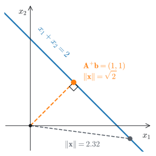
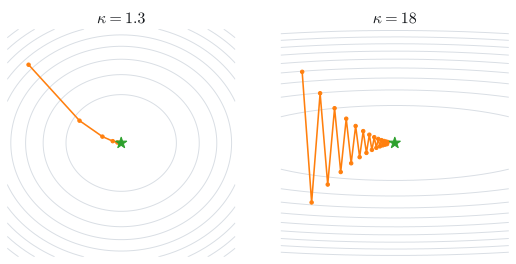
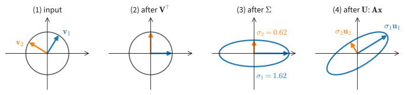
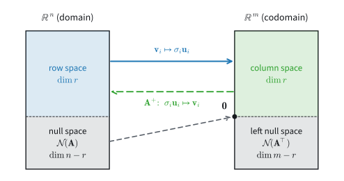
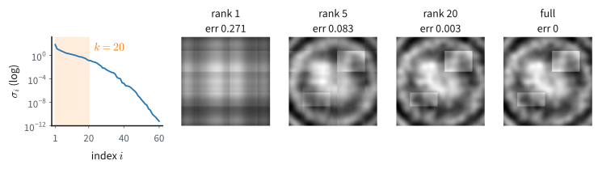
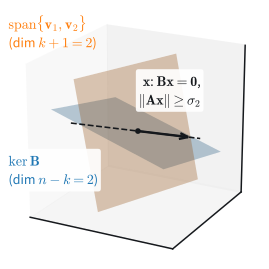
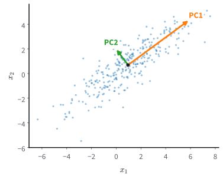

# Singular Value Decomposition and Low-Rank Approximation
:label:`sec_mdl-svd-low-rank`

The eigendecomposition of :numref:`sec_mdl-eigendecompositions` describes a
square matrix by the directions it only stretches, and it turns the powers
of that matrix into powers of numbers. Most matrices in deep learning are
of another kind. A weight matrix maps inputs of one width to outputs of
another, and a data matrix has one row per example and one column per
feature. Neither is applied to its own output, and neither need be square.
Even a square matrix may lack a basis of eigenvectors: the shear
$\left(\begin{smallmatrix}1&1\\0&1\end{smallmatrix}\right)$ is *defective*,
with a single eigenvector direction where the plane needs two. We need a
description that works for every matrix, and that tells how few numbers
suffice to describe a large matrix well.

A photograph shows why the second requirement matters. A grayscale
photograph of $400\times500$ pixels is a matrix with 200,000 entries. Like
any matrix, it can be written as a sum of rank-one pieces, each the outer
product of a column and a row. Twenty well-chosen pieces, 18,020 numbers or 9% of the
original, reproduce it with a relative error of 8%
(:numref:`fig_mdl-la-eckart-young` shows the result). Which twenty pieces are
these, and could any other twenty do better? The same question decides how
many parameters a fine-tuning adapter for a large model needs, and how many
directions of a dataset are worth keeping.

The answer is to stop asking one basis to serve as both the input and the
output axes. Choose one orthonormal basis for the inputs and another for the
outputs, and every matrix becomes a list of independent stretches
$\sigma_1\ge\sigma_2\ge\cdots\ge0$. Rank, the best low-rank approximation,
principal component analysis, least squares and the sensitivity of a linear
solve to errors are all read off that list. :numref:`sec_linear-algebra`
defined two sizes of a matrix, the Frobenius norm $\|\mathbf{A}\|_F$ (the root
of the sum of the squared entries) and the spectral norm $\|\mathbf{A}\|_2$
(the largest factor by which $\mathbf{A}$ stretches a vector). In this section
both become functions of the $\sigma_i$.

The computations of this section use NumPy. Each framework's own `svd`
routine appears once, to show what it returns.

```{.python .input #svd-imports}
#@tab mxnet
from d2l import mxnet as d2l
import numpy as np
from mxnet import np as mnp
```

```{.python .input #svd-imports}
#@tab pytorch
from d2l import torch as d2l
import numpy as np
import torch
```

```{.python .input #svd-imports}
#@tab tensorflow
from d2l import tensorflow as d2l
import numpy as np
import tensorflow as tf
```

```{.python .input #svd-imports}
#@tab jax
from d2l import jax as d2l
import numpy as np
from jax import numpy as jnp
```

## The Singular Value Decomposition

### The Factorization and Its Geometry
:label:`subsec_mdl-svd-rotate-scale-rotate`

The symmetric matrix
$\left(\begin{smallmatrix}2&1\\1&2\end{smallmatrix}\right)$ of
:numref:`sec_linear-algebra` maps the unit circle to an ellipse whose axes lie
along its eigenvectors $(1,1)$ and $(-1,1)$, with half-lengths 3 and 1. A
non-symmetric matrix also maps the circle to an ellipse (flattened to a
segment if the matrix is singular), as we prove below. The input directions
that land on the axes of this ellipse, however, are no longer the axes
themselves. There are two orthonormal frames, one for the inputs and one for
the outputs, and the singular value decomposition names both.

**Theorem (singular value decomposition).** *Every real $m\times n$ matrix
$\mathbf{A}$ can be written as*

$$
\mathbf{A} = \mathbf{U}\,\boldsymbol{\Sigma}\,\mathbf{V}^\top,
$$
:eqlabel:`eq_mdl-svd`

*where $\mathbf{U}\in\mathbb{R}^{m\times m}$ and
$\mathbf{V}\in\mathbb{R}^{n\times n}$ are orthogonal
($\mathbf{U}^\top\mathbf{U}=\mathbf{I}$, $\mathbf{V}^\top\mathbf{V}=\mathbf{I}$)
and $\boldsymbol{\Sigma}\in\mathbb{R}^{m\times n}$ is zero except for the
entries $\sigma_1\ge\sigma_2\ge\cdots\ge\sigma_{\min(m,n)}\ge0$ on its main
diagonal.* The columns $\mathbf{v}_i$ of $\mathbf{V}$ are the *right singular
vectors*, the columns $\mathbf{u}_i$ of $\mathbf{U}$ are the *left singular
vectors*, and the $\sigma_i$ are the *singular values*.

So a matrix of any shape is an orthogonal map, a diagonal stretch, and a
second orthogonal map. Reading off column $i$ of
$\mathbf{A}\mathbf{V}=\mathbf{U}\boldsymbol{\Sigma}$ gives the same statement
one direction at a time:

$$
\mathbf{A}\mathbf{v}_i = \sigma_i\,\mathbf{u}_i, \qquad i\le\min(m,n).
$$
:eqlabel:`eq_mdl-svd-action`

The input direction $\mathbf{v}_i$ goes to the output direction
$\mathbf{u}_i$, stretched by $\sigma_i$; when $n>m$, the remaining input
directions $\mathbf{v}_{m+1},\ldots,\mathbf{v}_n$ are sent to zero. Read right
to left, :eqref:`eq_mdl-svd` acts on a vector $\mathbf{x}$ in three stages:

1. $\mathbf{V}^\top$ rotates the input so that each right singular vector
   $\mathbf{v}_i$ lands on the coordinate axis $\mathbf{e}_i$;
2. $\boldsymbol{\Sigma}$ stretches axis $i$ by $\sigma_i$ and, when $m\ne n$,
   appends zero coordinates or drops coordinates to change the dimension;
3. $\mathbf{U}$ rotates the stretched axes so that axis $i$ lies along
   $\mathbf{u}_i$.

"Rotation" here means an orthogonal map, which may include a reflection.

:numref:`fig_mdl-la-svd-action` traces the three stages for the shear. Its
singular values are $\sigma_1=1.618$ and $\sigma_2=0.618$; the first right
singular vector $\mathbf{v}_1$ points at $58.3^\circ$ above the $x$-axis, and
its image direction $\mathbf{u}_1$ at $31.7^\circ$. The two frames differ, so
$\mathbf{U}\ne\mathbf{V}$. :numref:`subsec_mdl-svd-via-ata` derives these
numbers.


:label:`fig_mdl-la-svd-action`

In $n$ dimensions the same three stages turn the unit sphere into an
ellipsoid whose semi-axes are the vectors $\sigma_i\mathbf{u}_i$. When only
$r<n$ of the input directions $\mathbf{v}_i$ are stretched by a positive
$\sigma_i$, the other $n-r$ directions collapse, and the image is a filled
$r$-dimensional ellipsoid lying in the span of
$\mathbf{u}_1,\ldots,\mathbf{u}_r$.

**The compact SVD and the dyadic sum.** Let $r$ be the number of positive
singular values; :numref:`subsec_mdl-svd-subspaces` shows that $r$ is the rank
of $\mathbf{A}$. Every row and column of $\boldsymbol{\Sigma}$ beyond the
first $r$ is zero, and so is every contribution of the singular vectors that
meet them. Dropping them gives the *compact SVD*
$\mathbf{A}=\mathbf{U}_r\boldsymbol{\Sigma}_r\mathbf{V}_r^\top$, with
$\mathbf{U}_r\in\mathbb{R}^{m\times r}$ and
$\mathbf{V}_r\in\mathbb{R}^{n\times r}$ holding the first $r$ singular vectors
and $\boldsymbol{\Sigma}_r=\operatorname{diag}(\sigma_1,\ldots,\sigma_r)$.
Libraries return, on request, the *thin SVD*, with $\min(m,n)$ columns in $\mathbf{U}$ and
$\mathbf{V}$, which still lists zero singular values when $r<\min(m,n)$.
Multiplying out the compact SVD column by row writes $\mathbf{A}$ as a sum of
rank-one matrices, or *dyads*:

$$
\mathbf{A} = \sum_{i=1}^{r} \sigma_i\,\mathbf{u}_i\mathbf{v}_i^\top.
$$
:eqlabel:`eq_mdl-svd-dyadic`

Each term is the outer product of an output direction and an input direction,
weighted by its singular value, and the terms come sorted by weight. For the
shear,
$\mathbf{A}=\varphi\,\mathbf{u}_1\mathbf{v}_1^\top+\varphi^{-1}\,\mathbf{u}_2\mathbf{v}_2^\top$,
one piece of weight $1.618$ and one of weight $0.618$. Keeping only the
heaviest pieces is the low-rank approximation of
:numref:`subsec_mdl-eckart-young`.

The eigendecomposition insisted that one frame serve as both the input and
the output axes, and the shear showed that this demand can be impossible to
meet. The SVD drops the demand and therefore exists for every matrix.

### Existence and Uniqueness
:label:`subsec_mdl-svd-via-ata`

Where do the $\sigma_i$, $\mathbf{v}_i$ and $\mathbf{u}_i$ come from, and why
is the output frame orthonormal? The spectral theorem of
:numref:`subsec_mdl-spectral-theorem` gives every symmetric matrix an
orthonormal basis of eigenvectors with real eigenvalues. We apply it to the
*Gram matrix* $\mathbf{A}^\top\mathbf{A}$, the $n\times n$ matrix of dot
products between the columns of $\mathbf{A}$. This matrix is symmetric, and it
is positive semidefinite (:numref:`subsec_mdl-psd`) because
$\mathbf{x}^\top\mathbf{A}^\top\mathbf{A}\mathbf{x}=\|\mathbf{A}\mathbf{x}\|^2\ge0$.

**Proof of :eqref:`eq_mdl-svd` (existence).** By the spectral theorem,
$\mathbf{A}^\top\mathbf{A}$ has an orthonormal basis of eigenvectors
$\mathbf{v}_1,\ldots,\mathbf{v}_n$ with eigenvalues
$\lambda_1\ge\cdots\ge\lambda_n$, all non-negative because
$\lambda_i=\mathbf{v}_i^\top\mathbf{A}^\top\mathbf{A}\mathbf{v}_i=\|\mathbf{A}\mathbf{v}_i\|^2$.
Define

$$
\sigma_i = \sqrt{\lambda_i}, \qquad r = \#\{i : \sigma_i > 0\} .
$$

The singular values are the square roots of the eigenvalues of the Gram
matrix, and $r$ counts the positive ones. For each $i\le r$ set
$\mathbf{u}_i = \mathbf{A}\mathbf{v}_i/\sigma_i$. The construction works
because these vectors come out orthonormal, using only that $\mathbf{v}_j$ is
an eigenvector and the $\mathbf{v}_i$ are orthonormal:

$$
\mathbf{u}_i^\top\mathbf{u}_j
  = \frac{1}{\sigma_i\sigma_j}\,\mathbf{v}_i^\top\mathbf{A}^\top\mathbf{A}\,\mathbf{v}_j
  = \frac{\lambda_j}{\sigma_i\sigma_j}\,\mathbf{v}_i^\top\mathbf{v}_j
  = \frac{\lambda_j}{\sigma_i\sigma_j}\,\delta_{ij}
  = \delta_{ij} .
$$

The orthonormality of the input frame passes through $\mathbf{A}^\top\mathbf{A}$
to the output frame. It remains to check the dimensions. The $r$ orthonormal vectors
$\mathbf{u}_1,\ldots,\mathbf{u}_r$ lie in $\mathbb{R}^m$, so $r\le m$, and
$r\le n$ because there are $n$ eigenvalues; hence $r\le\min(m,n)$, and
$\lambda_i=0$ for every $i>r$. Extend $\mathbf{u}_1,\ldots,\mathbf{u}_r$ to an
orthonormal basis $\mathbf{u}_1,\ldots,\mathbf{u}_m$ of $\mathbb{R}^m$
(Gram--Schmidt applied to any completion). For $r<i\le n$,
$\|\mathbf{A}\mathbf{v}_i\|^2=\lambda_i=0$, so $\mathbf{A}\mathbf{v}_i=\mathbf{0}$.
Compare this with $\mathbf{U}\boldsymbol{\Sigma}$ column by column: column $i$
of $\mathbf{U}\boldsymbol{\Sigma}$ is $\sigma_i\mathbf{u}_i$ for
$i\le\min(m,n)$, which is $\mathbf{0}$ when $i>r$, and it is $\mathbf{0}$ for
$i>m$, where $\boldsymbol{\Sigma}$ has no diagonal entry. In every case column
$i$ of $\mathbf{A}\mathbf{V}$ equals column $i$ of $\mathbf{U}\boldsymbol{\Sigma}$,
so $\mathbf{A}\mathbf{V}=\mathbf{U}\boldsymbol{\Sigma}$, and right-multiplying
by $\mathbf{V}^\top=\mathbf{V}^{-1}$ gives
$\mathbf{A}=\mathbf{U}\boldsymbol{\Sigma}\mathbf{V}^\top$. $\blacksquare$

The proof is also an algorithm: diagonalize the symmetric matrix
$\mathbf{A}^\top\mathbf{A}$, take square roots for the singular values, and
push the eigenvectors through $\mathbf{A}$ for the left singular vectors.

**Example: the shear.** For
$\mathbf{A}=\left(\begin{smallmatrix}1&1\\0&1\end{smallmatrix}\right)$ the
Gram matrix is
$\mathbf{A}^\top\mathbf{A}=\left(\begin{smallmatrix}1&1\\1&2\end{smallmatrix}\right)$,
with trace 3 and determinant 1, so its characteristic polynomial is
$\lambda^2-3\lambda+1$ and its eigenvalues are $(3\pm\sqrt5)/2$. With the
golden ratio $\varphi=(1+\sqrt5)/2$, which satisfies $\varphi^2=\varphi+1$,
these are $\varphi^2$ and $\varphi^{-2}$. The singular values are therefore
$\sigma_1=\varphi\approx1.618$ and $\sigma_2=1/\varphi\approx0.618$, and their
product is $1=|\det\mathbf{A}|$. For the first right singular vector
$(a,b)$, the first row of
$(\mathbf{A}^\top\mathbf{A}-\varphi^2\mathbf{I})(a,b)=\mathbf{0}$ reads
$(1-\varphi^2)a+b=0$, and $\varphi^2-1=\varphi$, so $b=\varphi a$ and
$\mathbf{v}_1\propto(1,\varphi)$. Pushing it through $\mathbf{A}$ gives
$\mathbf{A}(1,\varphi)=(1+\varphi,\varphi)=\varphi\,(\varphi,1)$, so
$\mathbf{u}_1\propto(\varphi,1)$. Both vectors have length
$\sqrt{1+\varphi^2}=\sqrt{\varphi+2}$, which gives
$\mathbf{v}_1\approx(0.526,0.851)$ at the angle $\arctan\varphi=58.3^\circ$
and $\mathbf{u}_1\approx(0.851,0.526)$ at $31.7^\circ$. The second pair
follows by orthogonality,
$\mathbf{v}_2=(-\varphi,1)/\sqrt{\varphi+2}$ and
$\mathbf{u}_2=(-1,\varphi)/\sqrt{\varphi+2}$, and indeed
$\mathbf{A}\mathbf{v}_2=(1-\varphi,1)/\sqrt{\varphi+2}=\varphi^{-1}\mathbf{u}_2$
because $(1-\varphi)\varphi=-1$. Both $\mathbf{V}$ and $\mathbf{U}$ are
rotations
$\mathbf{R}_\theta=\left(\begin{smallmatrix}\cos\theta&-\sin\theta\\\sin\theta&\cos\theta\end{smallmatrix}\right)$,
and the shear factors as

$$
\begin{bmatrix} 1 & 1\\ 0 & 1\end{bmatrix}
= \mathbf{R}_{31.7^\circ}
  \begin{bmatrix} \varphi & 0\\ 0 & 1/\varphi\end{bmatrix}
  \mathbf{R}_{58.3^\circ}^\top .
$$
:eqlabel:`eq_mdl-shear-svd`

The shear rotates the plane by $-58.3^\circ$, stretches it by $1.618$ along
the $x$-axis and by $0.618$ along the $y$-axis, and rotates it back by only
$31.7^\circ$. The two angles add up to $90^\circ$ because $\mathbf{u}_1$ is
$\mathbf{v}_1$ with its coordinates swapped, a consequence of the symmetry
$\mathbf{A}^\top=\mathbf{J}\mathbf{A}\mathbf{J}$ for the swap
$\mathbf{J}=\left(\begin{smallmatrix}0&1\\1&0\end{smallmatrix}\right)$.

Does the library reproduce the hand computation? A library may return any of
the sign choices discussed below, so the cell fixes the signs that put
$\mathbf{u}_1$ in the first quadrant and make $\mathbf{U}$ a rotation before
printing the factors and their angles.

```{.python .input #svd-defective-shear}
A = np.array([[1., 1.], [0., 1.]])
U, s, Vt = np.linalg.svd(A)
if U[0, 0] < 0:                         # joint sign choice: u_1 in the first quadrant
    U[:, 0], Vt[0] = -U[:, 0], -Vt[0]
if np.linalg.det(U) < 0:                # joint sign choice: U a rotation (then so is V)
    U[:, 1], Vt[1] = -U[:, 1], -Vt[1]
phi = (1 + np.sqrt(5)) / 2
print('singular values', s.round(4), '  phi, 1/phi', np.array([phi, 1 / phi]).round(4))
print('U =', U.round(3).tolist(), '  Vt =', Vt.round(3).tolist())
print('angles of u_1, v_1 (degrees):', np.degrees(np.arctan2(U[1, 0], U[0, 0])).round(1),
      np.degrees(np.arctan2(Vt[0, 1], Vt[0, 0])).round(1))
print('A v_1 = sigma_1 u_1:', np.allclose(A @ Vt[0], s[0] * U[:, 0]),
      '  sigma_1 sigma_2 =', s.prod().round(6))
```

The singular values are $\varphi$ and $1/\varphi$, the factors are the
rotations $\mathbf{R}_{31.7^\circ}$ and $\mathbf{R}_{58.3^\circ}^\top$ of
:eqref:`eq_mdl-shear-svd`, and the product of the singular values is $|\det\mathbf{A}|=1$.

The construction of the proof works unchanged for a rectangular matrix. For
the $3\times2$ matrix with rows $(3,1)$, $(1,3)$, $(0,2)$, the Gram matrix is
$\left(\begin{smallmatrix}10&6\\6&14\end{smallmatrix}\right)$, with
eigenvalues $12\pm\sqrt{40}$. Does carrying out the proof's three steps
numerically (eigenvectors of $\mathbf{A}^\top\mathbf{A}$, square roots,
$\mathbf{u}_i=\mathbf{A}\mathbf{v}_i/\sigma_i$) agree with the library?

```{.python .input #svd-verify}
A = np.array([[3., 1.], [1., 3.], [0., 2.]])
lam, V = np.linalg.eigh(A.T @ A)
lam, V = lam[::-1], V[:, ::-1]                     # descending order
sigma = np.sqrt(lam)
U = A @ V / sigma                                   # u_i = A v_i / sigma_i
U_lib, s_lib, Vt_lib = np.linalg.svd(A, full_matrices=False)
print('sigma from eigh:', sigma.round(5), '  from svd:', s_lib.round(5))
print('U orthonormal:', np.allclose(U.T @ U, np.eye(2)), '  same U, V up to sign:',
      np.allclose(abs(U), abs(U_lib)), np.allclose(abs(V), abs(Vt_lib.T)))
print('rebuild error:', np.linalg.norm((U * sigma) @ V.T - A).round(12))
```

Both routes give $\sigma_1=\sqrt{12+\sqrt{40}}\approx4.281$ and
$\sigma_2=\sqrt{12-\sqrt{40}}\approx2.382$. The pushed-through vectors are
orthonormal, as the proof promised, and they agree with the library's up to
sign.

**Uniqueness.** The singular *values* are unique: they are the square roots
of the eigenvalues of $\mathbf{A}^\top\mathbf{A}$, which $\mathbf{A}$
determines. The singular *vectors* have three kinds of freedom.

* For a simple $\sigma_i>0$, the only choice is the joint sign flip
  $(\mathbf{u}_i,\mathbf{v}_i)\to(-\mathbf{u}_i,-\mathbf{v}_i)$. The flip must
  be joint, because flipping only one side would break
  $\mathbf{A}\mathbf{v}_i=\sigma_i\mathbf{u}_i$.
* For a repeated $\sigma>0$ with index set $\mathcal{I}$, the columns
  $\mathbf{V}_{\mathcal I}$ may be replaced by $\mathbf{V}_{\mathcal I}\mathbf{Q}$
  for any orthogonal $\mathbf{Q}$ of matching size, and then
  $\mathbf{U}_{\mathcal I}$ must become $\mathbf{U}_{\mathcal I}\mathbf{Q}$ with
  the *same* $\mathbf{Q}$, since $\mathbf{U}_{\mathcal I}=\mathbf{A}\mathbf{V}_{\mathcal I}/\sigma$.
* For $\sigma=0$, the vectors $\mathbf{v}_{r+1},\ldots,\mathbf{v}_n$ and
  $\mathbf{u}_{r+1},\ldots,\mathbf{u}_m$ can be rotated independently, because
  they do not enter the dyadic sum :eqref:`eq_mdl-svd-dyadic`.

This freedom is why two libraries, or one library on two machines, may return
different signs, and why the cells of this section fix a sign before printing
vectors.

**The maximum stretch.** The top singular value is the largest factor by which
$\mathbf{A}$ stretches any unit vector:

$$
\sigma_1 = \max_{\|\mathbf{x}\|=1}\|\mathbf{A}\mathbf{x}\| = \|\mathbf{A}\|_2 .
$$
:eqlabel:`eq_mdl-sigma1-variational`

The reason is the Rayleigh proposition of :numref:`subsec_mdl-rayleigh`: over
unit vectors $\mathbf{x}$, the quadratic form $\mathbf{x}^\top\mathbf{S}\mathbf{x}$
of a symmetric matrix $\mathbf{S}$ is maximized by the top eigenvector, with
the top eigenvalue as its value. With $\mathbf{S}=\mathbf{A}^\top\mathbf{A}$,
$\|\mathbf{A}\mathbf{x}\|^2=\mathbf{x}^\top\mathbf{A}^\top\mathbf{A}\mathbf{x}$
is maximized at $\mathbf{x}=\mathbf{v}_1$ with value $\lambda_1=\sigma_1^2$.
So $\sigma_1$ is the spectral norm of :numref:`sec_linear-algebra`: no unit
vector is stretched by the shear by more than $\varphi=1.618$, and
$\mathbf{v}_1$ is stretched by that much. This is a second reading of
$\sigma_1$ rather than a second proof that the SVD exists, since the Rayleigh
proposition rests on the same spectral theorem. Exercise
:exref:`ex_mdl-svd-low-rank-norms-singular-values`a gives a proof that avoids
it. The other singular values solve the same problem with the earlier right
singular vectors excluded, a procedure called *deflation*:
$\sigma_k=\max\{\|\mathbf{A}\mathbf{x}\| : \|\mathbf{x}\|=1,\ \mathbf{x}\perp\mathbf{v}_1,\ldots,\mathbf{v}_{k-1}\}$.

**Relationship to the eigendecomposition.** Substituting :eqref:`eq_mdl-svd`
into the two Gram matrices, and using $\mathbf{U}^\top\mathbf{U}=\mathbf{I}$ and
$\mathbf{V}^\top\mathbf{V}=\mathbf{I}$, gives

$$
\mathbf{A}^\top\mathbf{A} = \mathbf{V}\,\boldsymbol{\Sigma}^\top\boldsymbol{\Sigma}\,\mathbf{V}^\top,
\qquad
\mathbf{A}\mathbf{A}^\top = \mathbf{U}\,\boldsymbol{\Sigma}\boldsymbol{\Sigma}^\top\,\mathbf{U}^\top .
$$
:eqlabel:`eq_mdl-svd-gram`

Both are eigendecompositions: the right singular vectors are eigenvectors of
$\mathbf{A}^\top\mathbf{A}$, the left singular vectors are eigenvectors of
$\mathbf{A}\mathbf{A}^\top$, and the squares $\sigma_i^2$ are the nonzero
eigenvalues the two share. For a symmetric positive semidefinite matrix the
SVD and the eigendecomposition coincide, with $\mathbf{U}=\mathbf{V}$.

For any other matrix they differ, and singular values are not eigenvalue
magnitudes. The chapter's running matrix
$\mathbf{A}=\left(\begin{smallmatrix}1&2\\-1&3\end{smallmatrix}\right)$ has
the eigenvalues $2\pm i$ of modulus $\sqrt5\approx2.236$
(:numref:`sec_mdl-eigendecompositions`). Its Gram matrix
$\mathbf{A}^\top\mathbf{A}=\left(\begin{smallmatrix}2&-1\\-1&13\end{smallmatrix}\right)$
has trace 15 and determinant 25, so $\sigma_{1,2}^2=(15\pm5\sqrt5)/2$ and
$\sigma_{1,2}=(5\pm\sqrt5)/2\approx3.618,\,1.382$. One identity does hold for
every square matrix:

$$
|\det\mathbf{A}| = \prod_i \sigma_i = \prod_i |\lambda_i| .
$$

The first equality holds because orthogonal factors have determinant $\pm1$,
and the second because the determinant is the product of the eigenvalues. For
a $2\times2$ matrix with a conjugate pair of eigenvalues, both of modulus
$|\lambda|$, the identity forces $|\lambda|=\sqrt{\sigma_1\sigma_2}$; here
$\sqrt{3.618\cdot1.382}=\sqrt5$. The identity is also the volume reading of the
determinant from :numref:`sec_mdl-linear-maps`. Rotations preserve area, so
the stretch $\boldsymbol{\Sigma}$ carries the whole change of area, and the
running matrix turns the unit square into a parallelogram of area
$3.618\cdot1.382=5$.

**Computing the SVD.** Libraries do not form $\mathbf{A}^\top\mathbf{A}$.
Forming it squares the condition number of :numref:`subsec_mdl-condition-number`,
and singular values far below $\sigma_1$ are then lost to rounding. Instead,
they reduce $\mathbf{A}$ to bidiagonal form by orthogonal transformations
(Golub--Kahan bidiagonalization) and diagonalize the result
:cite:`Golub.Van-Loan.1996`. They return the thin SVD on request, and they
disagree on conventions: which factor comes first, and whether the third
factor is $\mathbf{V}$ or $\mathbf{V}^\top$. What does the framework's routine
return for a $3\times4$ matrix, compared with NumPy's?

```{.python .input #mdl-svd-low-rank-existence-and-uniqueness-1}
#@tab mxnet
A = np.array([[1., 2., 0., 1.], [0., 1., 1., 2.], [1., 0., 1., 0.]])
U, s, Vt = np.linalg.svd(A, full_matrices=False)
print('NumPy U, s, Vt:', U.shape, s.shape, Vt.shape)
Um, lm, Vtm = mnp.linalg.svd(mnp.array(A))
print('mxnet ut, l, v:', Um.shape, lm.shape, Vtm.shape)
print('ut diag(l) v rebuilds A:',
      np.allclose((Um.asnumpy() * lm.asnumpy()) @ Vtm.asnumpy(), A, atol=1e-5))
```

```{.python .input #mdl-svd-low-rank-existence-and-uniqueness-1}
#@tab pytorch
A = np.array([[1., 2., 0., 1.], [0., 1., 1., 2.], [1., 0., 1., 0.]])
U, s, Vt = np.linalg.svd(A, full_matrices=False)
print('NumPy U, s, Vt:', U.shape, s.shape, Vt.shape)
Ut, St, Vht = torch.linalg.svd(torch.tensor(A), full_matrices=False)
print('torch U, S, Vh:', tuple(Ut.shape), tuple(St.shape), tuple(Vht.shape))
print('U diag(S) Vh rebuilds A:', torch.allclose((Ut * St) @ Vht, torch.tensor(A)))
```

```{.python .input #mdl-svd-low-rank-existence-and-uniqueness-1}
#@tab tensorflow
A = np.array([[1., 2., 0., 1.], [0., 1., 1., 2.], [1., 0., 1., 0.]])
U, s, Vt = np.linalg.svd(A, full_matrices=False)
print('NumPy U, s, Vt:', U.shape, s.shape, Vt.shape)
St, Ut, Vtf = tf.linalg.svd(tf.constant(A))
print('tf s, u, v:', tuple(St.shape), tuple(Ut.shape), tuple(Vtf.shape))
print('u diag(s) v^T rebuilds A:',
      np.allclose((Ut.numpy() * St.numpy()) @ Vtf.numpy().T, A))
```

```{.python .input #mdl-svd-low-rank-existence-and-uniqueness-1}
#@tab jax
A = np.array([[1., 2., 0., 1.], [0., 1., 1., 2.], [1., 0., 1., 0.]])
U, s, Vt = np.linalg.svd(A, full_matrices=False)
print('NumPy U, s, Vt:', U.shape, s.shape, Vt.shape)
Uj, sj, Vhj = jnp.linalg.svd(jnp.array(A), full_matrices=False)
print('jnp u, s, vh:', Uj.shape, sj.shape, Vhj.shape, sj.dtype)
print('u diag(s) vh rebuilds A:', np.allclose((Uj * sj) @ Vhj, A, atol=1e-5))
```

:begin_tab:`mxnet`
`mxnet.np.linalg.svd` returns `(ut, l, v)`. Despite the names, `ut` is
$\mathbf{U}$ and `v` is $\mathbf{V}^\top$, so $\mathbf{A}$ is rebuilt as
`ut * l @ v`; the call always returns the thin factors. The routine requires
at most as many rows as columns. A tall matrix is decomposed through its
transpose: if $\mathbf{A}^\top=\mathbf{U}'\boldsymbol{\Sigma}\mathbf{V}'^\top$,
then $\mathbf{A}=\mathbf{V}'\boldsymbol{\Sigma}\mathbf{U}'^\top$.
:end_tab:

:begin_tab:`pytorch`
`torch.linalg.svd` returns `(U, S, Vh)` in NumPy's order, with
`Vh` $=\mathbf{V}^\top$; `full_matrices=False` requests the thin SVD.
`torch.linalg.svdvals` returns the singular values alone.
:end_tab:

:begin_tab:`tensorflow`
`tf.linalg.svd` returns the singular values *first*, `(s, u, v)`, and its
third factor `v` is $\mathbf{V}$ itself, of shape $n\times\min(m,n)$, not
$\mathbf{V}^\top$. The matrix is rebuilt as
$\mathbf{u}\operatorname{diag}(\mathbf{s})\mathbf{v}^\top$. The thin SVD is
the default (`full_matrices=False`).
:end_tab:

:begin_tab:`jax`
`jnp.linalg.svd` returns `(u, s, vh)` in NumPy's order, with
`vh` $=\mathbf{V}^\top$. JAX computes in single precision unless 64-bit mode
is enabled, so the singular values come back as `float32` and the comparison
uses a tolerance of about $10^{-5}$.
:end_tab:

### The Four Fundamental Subspaces
:label:`subsec_mdl-svd-subspaces`

Which inputs does $\mathbf{A}$ destroy, and which outputs can it reach?
:numref:`sec_mdl-linear-maps` named these sets the null space and the column
space, and defined the rank as the number of independent columns. Because
$\mathbf{U}$ and $\mathbf{V}$ are invertible, multiplying by them changes no
dimension, so $\operatorname{rank}\mathbf{A}=\operatorname{rank}\boldsymbol{\Sigma}$,
the number of nonzero diagonal entries:

$$
\operatorname{rank}\mathbf{A} = \#\{i : \sigma_i > 0\} = r .
$$
:eqlabel:`eq_mdl-rank-sigma`

The rank counts the stretches that do not collapse. With a tolerance for
rounding (below), this is the numerically reliable way to compute rank. It
costs more than elimination but is stable. A perturbation $\mathbf{E}$, such
as the rounding error of the computation, moves no singular value by more than
$\|\mathbf{E}\|_2$ (Weyl's inequality in :numref:`subsec_mdl-eckart-young`).
A clear gap between large and tiny singular values can therefore be trusted.

The dyadic sum :eqref:`eq_mdl-svd-dyadic` makes the four fundamental subspaces
explicit, splitting the singular vectors at the index $r$:

* the **column space** (range) of $\mathbf{A}$ is
  $\operatorname{span}\{\mathbf{u}_1,\ldots,\mathbf{u}_r\}$, because every
  output
  $\mathbf{A}\mathbf{x}=\sum_{i\le r}\sigma_i(\mathbf{v}_i^\top\mathbf{x})\mathbf{u}_i$
  is a combination of these vectors, and each of them is reached,
  $\mathbf{u}_i=\mathbf{A}(\mathbf{v}_i/\sigma_i)$;
* the **null space** of $\mathbf{A}$ is
  $\operatorname{span}\{\mathbf{v}_{r+1},\ldots,\mathbf{v}_n\}$, because by the
  same formula $\mathbf{A}\mathbf{x}=\mathbf{0}$ exactly when
  $\mathbf{v}_i^\top\mathbf{x}=0$ for every $i\le r$ (the $\mathbf{u}_i$ are
  independent and the $\sigma_i$ positive), that is, when $\mathbf{x}$ is
  orthogonal to $\mathbf{v}_1,\ldots,\mathbf{v}_r$;
* the **row space** (column space of $\mathbf{A}^\top$) is
  $\operatorname{span}\{\mathbf{v}_1,\ldots,\mathbf{v}_r\}$ and the **left null
  space** (null space of $\mathbf{A}^\top$) is
  $\operatorname{span}\{\mathbf{u}_{r+1},\ldots,\mathbf{u}_m\}$, by the same two
  arguments applied to $\mathbf{A}^\top=\mathbf{V}\boldsymbol{\Sigma}^\top\mathbf{U}^\top$,
  whose SVD swaps the roles of the $\mathbf{u}_i$ and the $\mathbf{v}_i$.

The input space therefore splits into two orthogonal pieces, the row space of
dimension $r$ and the null space of dimension $n-r$. The output space splits
into the column space of dimension $r$ and the left null space of dimension
$m-r$. On the row space, $\mathbf{A}$ sends each $\mathbf{v}_i$ to
$\sigma_i\mathbf{u}_i$, a one-to-one map onto the column space; the null space
goes to zero.

For the smallest case, take the singular matrix
$\mathbf{B}=\left(\begin{smallmatrix}2&1\\4&2\end{smallmatrix}\right)$ of
:numref:`sec_mdl-linear-maps`. Its Gram matrix
$\left(\begin{smallmatrix}20&10\\10&5\end{smallmatrix}\right)$ has eigenvalues
25 and 0, so $\sigma_1=5$, $\sigma_2=0$, and $r=1$. The four subspaces are the
lines along

$$
\mathbf{v}_1=\tfrac{1}{\sqrt5}(2,1),\quad
\mathbf{v}_2=\tfrac{1}{\sqrt5}(-1,2),\quad
\mathbf{u}_1=\tfrac{1}{\sqrt5}(1,2),\quad
\mathbf{u}_2=\tfrac{1}{\sqrt5}(-2,1),
\qquad
\mathbf{B} = 5\,\mathbf{u}_1\mathbf{v}_1^\top .
$$

The column space is the line $y=2x$ along $\mathbf{u}_1$, and the left null
space is the perpendicular line along $\mathbf{u}_2$. The null space is the
line along $(1,-2)$, perpendicular to the row $(2,1)$ that spans the row
space. :numref:`fig_mdl-la-svd-subspaces` draws the general case; the
pseudoinverse of :numref:`subsec_mdl-pseudoinverse` runs the map from the row
space to the column space backwards.


:label:`fig_mdl-la-svd-subspaces`

**Numerical rank.** In floating-point arithmetic a matrix that is
mathematically rank-deficient rarely has singular values that are exactly
zero; rounding leaves values of order $\epsilon_{\text{mach}}\sigma_1$
instead. Rank is therefore decided by a threshold. `np.linalg.matrix_rank`
counts the singular values above $\sigma_1\max(m,n)\,\epsilon_{\text{mach}}$,
a tolerance that scales with both the largest singular value and the size of
the matrix. What do the "zero" singular values of a $4\times4$ matrix of rank
two look like?

```{.python .input #svd-numerical-rank}
A = np.random.standard_normal((4, 2)) @ np.random.standard_normal((2, 4))   # rank <= 2
s = np.linalg.svd(A, compute_uv=False)
tol = s[0] * max(A.shape) * np.finfo(float).eps
print('singular values:', np.array2string(s, formatter={'float_kind': '{:.1e}'.format}))
print(f'tolerance {tol:.1e};  exact zeros: {(s == 0).sum()};  '
      f'numerical rank: {np.linalg.matrix_rank(A)}')
```

Two singular values are of order one. The other two are rounding noise,
$10^{-15}$ or smaller and typically more than ten times below the tolerance,
but usually not exact zeros. A test for exact zeros would therefore report the wrong rank,
while the threshold reports two.

## Low-Rank Approximation

### Best Low-Rank Approximation
:label:`subsec_mdl-eckart-young`

We can now return to the photograph of the opening and ask which twenty
rank-one pieces to keep. The dyadic sum :eqref:`eq_mdl-svd-dyadic` lists the
rank-one pieces of $\mathbf{A}$ heaviest first. Keeping only the first $k$
gives the *truncated SVD*

$$
\mathbf{A}_k = \sum_{i=1}^{k}\sigma_i\,\mathbf{u}_i\mathbf{v}_i^\top .
$$
:eqlabel:`eq_mdl-truncated-svd`

It is a matrix of rank at most $k$ stored as $k$ singular values, $k$ columns of
length $m$ and $k$ of length $n$, that is $k(m+n+1)$ numbers instead of $mn$.
For the photograph and $k=20$ that is 18,020 of 200,000 numbers. Two questions
remain: how large is the error, and could a cleverer matrix of rank $k$ do
better?

**Matrix norms as singular values.** The error needs a size for matrices. The
Frobenius norm of :numref:`sec_linear-algebra`,
$\|\mathbf{A}\|_F^2=\sum_{ij}a_{ij}^2$, sums the squared column lengths, which
are the diagonal entries of $\mathbf{A}^\top\mathbf{A}$, so
$\|\mathbf{A}\|_F^2=\operatorname{tr}(\mathbf{A}^\top\mathbf{A})$. Inserting
the SVD and moving $\mathbf{V}$ around the trace, which is cyclic
(:numref:`sec_mdl-linear-maps`), gives

$$
\|\mathbf{A}\|_F^2
  = \operatorname{tr}(\mathbf{V}\boldsymbol{\Sigma}^\top\boldsymbol{\Sigma}\mathbf{V}^\top)
  = \operatorname{tr}(\boldsymbol{\Sigma}^\top\boldsymbol{\Sigma}\,\mathbf{V}^\top\mathbf{V})
  = \sum_i \sigma_i^2 .
$$
:eqlabel:`eq_mdl-frobenius-singular`

The Frobenius norm is the root of the sum of the squared singular values, so
orthogonal factors on either side never change it. For the shear,
$1+1+0+1=3=\varphi^2+\varphi^{-2}$. The spectral norm is the largest singular
value, $\|\mathbf{A}\|_2=\sigma_1$, by :eqref:`eq_mdl-sigma1-variational`.

**Theorem (Eckart--Young--Mirsky).** *Let $\sigma_i=0$ for $i>r$. For every
$k\ge0$, the smallest spectral-norm error of a matrix of rank at most $k$ is*

$$
\min_{\operatorname{rank}\mathbf{B}\le k}\|\mathbf{A}-\mathbf{B}\|_2 = \sigma_{k+1},
$$
:eqlabel:`eq_mdl-eckart-young`

*and the smallest squared Frobenius error is
$\min_{\operatorname{rank}\mathbf{B}\le k}\|\mathbf{A}-\mathbf{B}\|_F^2=\sum_{i>k}\sigma_i^2$.
Both minima are attained at $\mathbf{B}=\mathbf{A}_k$.*

The best rank-$k$ approximation misses by the first singular value it leaves
out, or, in the Frobenius norm, by all of them together. Eckart and Young
proved the Frobenius case :cite:`Eckart.Young.1936`, and Mirsky extended the
result to every norm that is unchanged by orthogonal factors on either side
:cite:`Mirsky.1960`.

Picture $n=3$ and $k=1$ first. A matrix $\mathbf{B}$ of rank one destroys a
whole plane of inputs, and the top two right singular vectors of $\mathbf{A}$
span another plane. Two planes through the origin of $\mathbb{R}^3$ meet in at
least a line. On that line $\mathbf{B}$ gives zero while $\mathbf{A}$
stretches by at least $\sigma_2$, so $\mathbf{A}-\mathbf{B}$ stretches some
unit vector by at least $\sigma_2$ (:numref:`fig_mdl-la-svd-dimension-count`).
The proof repeats this argument in $n$ dimensions.


:label:`fig_mdl-la-svd-dimension-count`

**Proof (spectral norm).** *The truncation achieves $\sigma_{k+1}$.* The
residual
$\mathbf{A}-\mathbf{A}_k=\sum_{i>k}\sigma_i\mathbf{u}_i\mathbf{v}_i^\top$ is
itself written as a compact SVD, with largest singular value $\sigma_{k+1}$, so
$\|\mathbf{A}-\mathbf{A}_k\|_2=\sigma_{k+1}$ by
:eqref:`eq_mdl-sigma1-variational`. By :eqref:`eq_mdl-frobenius-singular`,
also $\|\mathbf{A}-\mathbf{A}_k\|_F^2=\sum_{i>k}\sigma_i^2$.

*No matrix of rank at most $k$ does better.* If $k\ge r$ there is nothing to
prove, so let $k<r$ and $\operatorname{rank}\mathbf{B}\le k$. By rank--nullity
(:numref:`sec_mdl-linear-maps`), the null space $\mathcal{K}=\ker\mathbf{B}$
has dimension at least $n-k$. The span
$\mathcal{V}=\operatorname{span}\{\mathbf{v}_1,\ldots,\mathbf{v}_{k+1}\}$ of
the top $k+1$ right singular vectors has dimension $k+1$. The main step shows
that these two subspaces share a nonzero vector. Their dimensions add to more
than $n$, and

$$
\dim(\mathcal{K}\cap\mathcal{V})
  = \dim\mathcal{K}+\dim\mathcal{V}-\dim(\mathcal{K}+\mathcal{V})
  \ge (n-k) + (k+1) - n = 1 ,
$$

where the equality is the dimension formula for two subspaces and the
inequality uses $\dim(\mathcal{K}+\mathcal{V})\le n$. The formula holds
because a basis of the intersection extends to bases of both subspaces, and
together these extensions form a basis of the sum. So there is
a unit vector $\mathbf{x}\in\mathcal{K}\cap\mathcal{V}$. Write it as
$\mathbf{x}=\sum_{i\le k+1}c_i\mathbf{v}_i$ with $\sum_i c_i^2=1$. Then
$\mathbf{B}\mathbf{x}=\mathbf{0}$, and since
$\mathbf{A}\mathbf{v}_i=\sigma_i\mathbf{u}_i$ with orthonormal $\mathbf{u}_i$,

$$
\|\mathbf{A}\mathbf{x}\|^2 = \Bigl\|\sum_{i\le k+1}c_i\sigma_i\mathbf{u}_i\Bigr\|^2
   = \sum_{i\le k+1} c_i^2\sigma_i^2
   \ge \sigma_{k+1}^2 \sum_{i\le k+1} c_i^2
   = \sigma_{k+1}^2 .
$$

Therefore
$\|\mathbf{A}-\mathbf{B}\|_2\ge\|(\mathbf{A}-\mathbf{B})\mathbf{x}\|=\|\mathbf{A}\mathbf{x}\|\ge\sigma_{k+1}$.
$\blacksquare$

In words: $\mathbf{B}$ must annihilate some direction in the span of the top
$k+1$ right singular vectors, and $\mathbf{A}$ stretches every direction of
that span by at least $\sigma_{k+1}$. For the shear and $k=1$, the truncation
$\mathbf{A}_1=\varphi\,\mathbf{u}_1\mathbf{v}_1^\top=\tfrac{1}{\sqrt5}\left(\begin{smallmatrix}\varphi&\varphi^2\\1&\varphi\end{smallmatrix}\right)\approx\left(\begin{smallmatrix}0.724&1.171\\0.447&0.724\end{smallmatrix}\right)$
misses by $1/\varphi=0.618$ in both norms (the residual has rank one, so its
two norms agree), and no matrix of rank one comes closer.

The same lower bound yields the inequality on which the Frobenius case rests.

**Lemma (Weyl's inequality for singular values).** *For matrices
$\mathbf{X},\mathbf{Y}$ of the same shape and indices $i,j\ge1$ with
$i+j-1\le\min(m,n)$,*

$$
\sigma_{i+j-1}(\mathbf{X}+\mathbf{Y})\le\sigma_i(\mathbf{X})+\sigma_j(\mathbf{Y}) .
$$
:eqlabel:`eq_mdl-weyl-singular`

**Proof.** Let $\mathbf{X}_{i-1}$ and $\mathbf{Y}_{j-1}$ be the truncations
:eqref:`eq_mdl-truncated-svd` (with $\mathbf{X}_0=\mathbf{0}$). Their sum has
rank at most $i+j-2$, so the lower bound just proved, applied to
$\mathbf{X}+\mathbf{Y}$ with $k=i+j-2$, gives
$\sigma_{i+j-1}(\mathbf{X}+\mathbf{Y})\le\|\mathbf{X}+\mathbf{Y}-\mathbf{X}_{i-1}-\mathbf{Y}_{j-1}\|_2$.
By the triangle inequality and the achievability half, this is at most
$\|\mathbf{X}-\mathbf{X}_{i-1}\|_2+\|\mathbf{Y}-\mathbf{Y}_{j-1}\|_2=\sigma_i(\mathbf{X})+\sigma_j(\mathbf{Y})$.
$\blacksquare$

Adding $\mathbf{Y}$ can raise the $(i+j-1)$-th singular value above the $i$-th
singular value of $\mathbf{X}$ by at most $\sigma_j(\mathbf{Y})$. With $j=1$,
applied in both directions, no singular value moves by more than
$\|\mathbf{Y}\|_2$ :cite:`Horn.Johnson.2012`; exercise
:exref:`ex_mdl-svd-low-rank-weyl-perturbation` works this out.

**Proof (Frobenius norm).** Apply the lemma with
$\mathbf{X}=\mathbf{A}-\mathbf{B}$, $\mathbf{Y}=\mathbf{B}$ and $j=k+1$. The
hypothesis $\operatorname{rank}\mathbf{B}\le k$ enters here, as
$\sigma_{k+1}(\mathbf{B})=0$, and gives
$\sigma_{k+i}(\mathbf{A})\le\sigma_i(\mathbf{A}-\mathbf{B})$ for every $i$.
Squaring and summing over $i$, with :eqref:`eq_mdl-frobenius-singular`,

$$
\|\mathbf{A}-\mathbf{B}\|_F^2=\sum_{i\ge1}\sigma_i(\mathbf{A}-\mathbf{B})^2
  \ge\sum_{i\ge1}\sigma_{k+i}(\mathbf{A})^2=\sum_{j>k}\sigma_j(\mathbf{A})^2 ,
$$

which the truncation attains. $\blacksquare$

**Uniqueness of the minimizer.** In the spectral norm the best approximation
is never unique when $k\ge1$ and $\sigma_{k+1}>0$. For
$\mathbf{A}=\operatorname{diag}(3,2,1)$ and $k=1$, every
$\mathbf{B}=\operatorname{diag}(3+t,0,0)$ with $|t|\le1$ has
$\|\mathbf{A}-\mathbf{B}\|_2=\max(|t|,2,1)=2=\sigma_2$. In the Frobenius norm,
$\mathbf{A}_k$ is the unique minimizer exactly when $\sigma_k>\sigma_{k+1}$
or $\sigma_{k+1}=0$ (then $\mathbf{A}_k=\mathbf{A}$)
:cite:`Golub.Van-Loan.1996`. This is one reason principal component analysis,
below, is stated in the Frobenius norm.

**The photograph.** On the photograph, is the spectral error equal to
$\sigma_{k+1}$, what does each rank cost, and does a plausible competitor do
as well? The cell reads `img/cat1.jpg` and converts it to grayscale with the
usual weights for red, green and blue. It forms the truncations with `einsum`,
which multiplies its arrays and sums over every index that does not appear
after the arrow. Since row $i$ of `Vt` is $\mathbf{v}_i^\top$, the pattern
`'i,mi,in->mn'` is the dyadic sum.

```{.python .input #mdl-svd-low-rank-rotate-scale-rotate}
img = d2l.plt.imread('../img/cat1.jpg') @ np.array([0.299, 0.587, 0.114])  # 400 x 500
U, s, Vt = np.linalg.svd(img, full_matrices=False)
m, n = img.shape
F = np.linalg.norm(img)
print(f'{m} x {n} = {m * n} numbers;  sigma_1^2 / sum sigma_i^2 = {s[0]**2 / (s**2).sum():.3f}')
for k in [1, 5, 20, 50]:
    A_k = np.einsum('i,mi,in->mn', s[:k], U[:, :k], Vt[:k])    # first k dyads
    print(f'k={k:2d}: ||A-A_k||_2={np.linalg.norm(img - A_k, 2):6.0f}  '
          f'sigma_{k + 1}={s[k]:6.0f}  rel. err {np.linalg.norm(img - A_k) / F:.3f}  '
          f'stores {k * (m + n + 1) / (m * n):.1%}')
cols = np.argsort(-np.linalg.norm(img, axis=0))[:20]           # 20 largest columns
C = img[:, cols]
proj = C @ np.linalg.pinv(C) @ img
print(f'projection onto the 20 largest columns: rel. err {np.linalg.norm(img - proj) / F:.3f}')
```

The spectral error equals $\sigma_{k+1}$ at every rank, as the theorem says,
and rank 20 stores 9% of the numbers at a relative error of 8%. The left panel
of :numref:`fig_mdl-la-eckart-young` explains why so few pieces suffice: over
the first hundred indices the singular values fall roughly as a power law,
$\sigma_i\propto i^{-1.1}$.


:label:`fig_mdl-la-eckart-young`

**The energy ratio.** The Frobenius formula gives a rule for choosing the
rank. The fraction of the "energy" $\sum_i\sigma_i^2$ that the truncation
keeps is

$$
\frac{\sum_{i\le k}\sigma_i^2}{\sum_{i}\sigma_i^2}
  = 1 - \frac{\|\mathbf{A}-\mathbf{A}_k\|_F^2}{\|\mathbf{A}\|_F^2} ,
$$
:eqlabel:`eq_mdl-energy-ratio`

so the relative Frobenius error is the square root of one minus the energy
ratio. Keeping 95% of the energy means a relative error of
$\sqrt{0.05}\approx22\%$, and keeping 99% means 10%. The ratio needs care. On
the photograph $\sigma_1^2$ alone holds 89% of the energy. A constant image
has rank one (all its rows are equal), and the photograph's mean brightness is
large, so the first dyad is mostly that mean. Rank 4 already
keeps 95%, at a relative error of 21%. After the mean pixel value is
subtracted from every pixel, 95% takes rank 8. Read the ratio with $\sigma_1$
in mind, or subtract the mean first, as principal component analysis does.

**A competitor.** How far do natural alternatives fall behind the
truncation? One alternative keeps 20 actual columns of the photograph, the 20
with the largest norms, and projects every column onto their span. This is
the idea behind CUR decompositions, which approximate a matrix by its own rows
and columns. The cell above prints its relative error, 0.31 against 0.08 for
the truncation, so this rank-20 approximation is about four times worse.

**Truncation as denoising.** A second reason to truncate is statistical.
Suppose the observed $m\times n$ matrix ($m\le n$) is a low-rank signal plus
noise, $\mathbf{A}=\mathbf{B}+\mathbf{N}$, where the entries of $\mathbf{N}$
are independent with mean zero and standard deviation $\sigma_{\text{noise}}$.
The Marchenko--Pastur law of :numref:`subsec_mdl-sample-covariance-mp` says that
for large matrices the eigenvalues of
$\mathbf{N}\mathbf{N}^\top/(n\sigma_{\text{noise}}^2)$ fill the interval
$[(1-\sqrt{m/n})^2,(1+\sqrt{m/n})^2]$. Taking square roots and scaling back,
the singular values of the noise fill
$[(\sqrt n-\sqrt m)\sigma_{\text{noise}},(\sqrt n+\sqrt m)\sigma_{\text{noise}}]$.
Signal components whose singular values rise well above the upper edge stand
out from the noise; weaker ones are lost in it. For square matrices with a
known noise level, Gavish and Donoho show that the asymptotically best hard
threshold is $\tfrac{4}{\sqrt3}\sqrt n\,\sigma_{\text{noise}}\approx2.309\sqrt n\,\sigma_{\text{noise}}$,
somewhat above the edge $2\sqrt n\,\sigma_{\text{noise}}$
:cite:`Gavish.Donoho.2014`. Exercise
:exref:`ex_mdl-svd-low-rank-denoising-truncation` shows the separation, and
exercise :exref:`ex_mdl-svd-low-rank-optimal-hard-threshold` derives the
constant $4/\sqrt3$.

### Principal Component Analysis
:label:`subsec_mdl-pca`

Let the rows of $\mathbf{X}\in\mathbb{R}^{n\times d}$ be data points; here $n$
counts the points and $d$ the features. Which unit direction captures the most
variance of the data, and which $k$-dimensional affine subspace fits the
points best?

**Centering.** Fix the directions, an orthogonal projector $\mathbf{P}$ onto
a $k$-dimensional subspace, and ask which offset $\mathbf{c}$ makes the
squared reconstruction error
$\sum_i\|(\mathbf{I}-\mathbf{P})(\mathbf{x}_i-\mathbf{c})\|^2$ smallest. This
error is a convex quadratic in $\mathbf{c}$, and its gradient
$-2(\mathbf{I}-\mathbf{P})\sum_i(\mathbf{x}_i-\mathbf{c})$ vanishes at the mean
$\mathbf{c}=\bar{\mathbf{x}}$, whatever $\mathbf{P}$ is. So the best affine
fit passes through the mean, and we first *center* the data,
$\tilde{\mathbf{X}}=\mathbf{X}-\mathbf{1}\bar{\mathbf{x}}^\top$. The empirical
covariance is the symmetric positive semidefinite matrix
$\mathbf{C}=\tfrac1n\tilde{\mathbf{X}}^\top\tilde{\mathbf{X}}$. (The unbiased
$\tfrac1{n-1}$ version rescales every eigenvalue by the same factor, so it
changes neither the principal directions nor the explained-variance ratio.)

**Proposition (PCA via Rayleigh).** *The projected variance
$\tfrac1n\|\tilde{\mathbf{X}}\mathbf{w}\|^2=\mathbf{w}^\top\mathbf{C}\mathbf{w}$
is maximized over unit $\mathbf{w}$ by the top eigenvector of $\mathbf{C}$,
which is the top right singular vector $\mathbf{v}_1$ of $\tilde{\mathbf{X}}$;
the maximal variance is $\sigma_1^2/n$.*

**Proof.** The projection of a centered point onto $\mathbf{w}$ has the
coordinate $\tilde{\mathbf{x}}^\top\mathbf{w}$, and the variance of these
coordinates is
$\tfrac1n\sum_i(\tilde{\mathbf{x}}_i^\top\mathbf{w})^2=\tfrac1n\|\tilde{\mathbf{X}}\mathbf{w}\|^2=\mathbf{w}^\top\mathbf{C}\mathbf{w}$.
By the Rayleigh proposition of :numref:`subsec_mdl-rayleigh`, this is
maximized by the top eigenvector of $\mathbf{C}$, with value
$\lambda_1(\mathbf{C})$. By :eqref:`eq_mdl-svd-gram`,
$\mathbf{C}=\tfrac1n\mathbf{V}\boldsymbol{\Sigma}^\top\boldsymbol{\Sigma}\mathbf{V}^\top$,
so the eigenvectors of $\mathbf{C}$ are the right singular vectors
$\mathbf{v}_i$ of $\tilde{\mathbf{X}}$ and its eigenvalues are
$\sigma_i^2/n$. $\blacksquare$

By deflation, the top $k$ principal directions are
$\mathbf{v}_1,\ldots,\mathbf{v}_k$, and component $i$ explains the variance
$\sigma_i^2/n$. These directions also give the best reconstruction. Projecting
every centered point onto their span is right-multiplication by
$\mathbf{V}_k\mathbf{V}_k^\top$, and since $\mathbf{V}^\top\mathbf{V}_k$ is the
first $k$ columns of the identity,

$$
\tilde{\mathbf{X}}\mathbf{V}_k\mathbf{V}_k^\top
  = \mathbf{U}\boldsymbol{\Sigma}\mathbf{V}^\top\mathbf{V}_k\mathbf{V}_k^\top
  = \mathbf{U}_k\boldsymbol{\Sigma}_k\mathbf{V}_k^\top
  = \tilde{\mathbf{X}}_k .
$$

The projection onto the top $k$ principal directions is the truncated SVD of
the centered data. By Eckart--Young in the Frobenius norm, no other
projection, and no other matrix of rank $k$, reconstructs the centered points
with a smaller squared error. The discarded variance $\sum_{i>k}\sigma_i^2/n$
is the mean squared reconstruction error, and the explained-variance ratio is
the energy ratio :eqref:`eq_mdl-energy-ratio` of $\tilde{\mathbf{X}}$.

:numref:`fig_mdl-la-pca` draws a cloud of 300 points with standard deviations
3 and 0.8 along axes rotated by $\pi/5=36^\circ$, and its two principal axes.
Do the SVD axes of a fresh cloud of this kind capture the variance the
proposition promises, and is the discarded variance the reconstruction error?


:label:`fig_mdl-la-pca`

```{.python .input #svd-pca}
theta = np.pi / 5
rot = np.array([[np.cos(theta), -np.sin(theta)], [np.sin(theta), np.cos(theta)]])
X = np.random.standard_normal((300, 2)) * np.array([3.0, 0.8]) @ rot.T   # the cloud
Xc = X - X.mean(0)
U, s, Vt = np.linalg.svd(Xc, full_matrices=False)
X1 = np.outer(U[:, 0] * s[0], Vt[0])                                    # rank-1 reconstruction
print('explained-variance ratio:', (s**2 / (s**2).sum()).round(3), ' (population 0.934, 0.066)')
print('angle of v_1 to the long axis:',
      np.degrees(np.arccos(abs(Vt[0] @ rot[:, 0]))).round(1), 'degrees')
print('mean squared rank-1 error:', (((Xc - X1)**2).sum() / 300).round(4),
      '  sigma_2^2 / n:', (s[1]**2 / 300).round(4))
```

The first direction explains between about 91% and 95% of the variance,
scattered around the population value $9/9.64=0.934$, and it lies within a
few degrees of the long axis. The last two numbers agree, as the identity says they must for any
draw. Without centering, the first singular vector turns toward the mean of
the cloud once the offset of the mean exceeds the spread of the data. It then
describes where the data are rather than how they vary, and exercise
:exref:`ex_mdl-svd-low-rank-centering-pca` quantifies the turn.

## Solving Linear Systems with the SVD

### The Pseudoinverse and Least Squares
:label:`subsec_mdl-pseudoinverse`

A system $\mathbf{A}\mathbf{x}=\mathbf{b}$ with more equations than unknowns
usually has no solution, and one with fewer equations has infinitely many. In
both cases we ask for the least-squares solution of
:numref:`sec_mdl-geometry-linear-algebraic-ops`, with the target written
$\mathbf{b}$ instead of $\mathbf{y}$,

$$
\min_{\mathbf{x}} \|\mathbf{A}\mathbf{x}-\mathbf{b}\|^2 ,
$$

and when several $\mathbf{x}$ minimize it, for the shortest one.

**The smallest case.** Take one equation in two unknowns, $x_1+x_2=2$. Its
solutions form a line, and the residual is zero on all of it. Which point
should we report? Here $\mathbf{A}=(1\;\;1)$, with the single singular value
$\sigma_1=\sqrt2$, right singular vector $\mathbf{v}_1=(1,1)/\sqrt2$ and
$u_1=1$. The coordinate of $\mathbf{x}$ along $\mathbf{v}_1$ is fixed by the
equation, $\sqrt2$. The coordinate along $\mathbf{v}_2=(1,-1)/\sqrt2$ does not
affect the residual at all. Setting it to zero gives $(1,1)$, the foot of the
perpendicular from the origin to the line, with norm $\sqrt2$; every other
solution $(1+t,1-t)$ has squared norm $2+2t^2$
(:numref:`fig_mdl-la-min-norm`).


:label:`fig_mdl-la-min-norm`

The general rule inverts the nonzero singular values and transposes the
rotations. The *Moore--Penrose pseudoinverse* of $\mathbf{A}$ is

$$
\mathbf{A}^{+} = \mathbf{V}\boldsymbol{\Sigma}^{+}\mathbf{U}^\top,
\qquad
\boldsymbol{\Sigma}^{+}_{ii} = \begin{cases} 1/\sigma_i & \sigma_i>0,\\ 0 & \sigma_i=0,\end{cases}
$$
:eqlabel:`eq_mdl-pseudoinverse`

where $\boldsymbol{\Sigma}^{+}$ is $n\times m$, the transpose shape of
$\boldsymbol{\Sigma}$. It undoes each stretch that can be undone and sends the
left null space to zero. For the shear, $\mathbf{A}^{+}=\mathbf{A}^{-1}=\left(\begin{smallmatrix}1&-1\\0&1\end{smallmatrix}\right)$;
for $\mathbf{A}=(1\;\;1)$, $\mathbf{A}^{+}=\mathbf{v}_1\sigma_1^{-1}u_1=(\tfrac12,\tfrac12)^\top$,
and $\mathbf{A}^{+}\cdot2=(1,1)$.

**Proposition (minimum-norm least squares).** *Among all minimizers of
$\|\mathbf{A}\mathbf{x}-\mathbf{b}\|$, the one of smallest norm is
$\hat{\mathbf{x}}=\mathbf{A}^{+}\mathbf{b}$.*

**Proof.** Rotate the unknown and the target into the singular bases,
$\mathbf{y}=\mathbf{V}^\top\mathbf{x}$ and $\mathbf{c}=\mathbf{U}^\top\mathbf{b}$.
Since $\mathbf{U}$ is orthogonal it preserves norms, so

$$
\|\mathbf{A}\mathbf{x}-\mathbf{b}\|^2
   = \|\mathbf{U}^\top(\mathbf{A}\mathbf{x}-\mathbf{b})\|^2
   = \|\boldsymbol{\Sigma}\mathbf{y}-\mathbf{c}\|^2
   = \sum_{i\le r}(\sigma_i y_i - c_i)^2 + \sum_{i> r} c_i^2 .
$$

The rotation has decoupled the problem into scalar problems. The first sum is
minimized term by term at $y_i=c_i/\sigma_i$ for $i\le r$. The second sum is a
constant, the part of $\mathbf{b}$ outside the column space, which no
$\mathbf{x}$ can reduce. The coordinates $y_i$ with $i>r$ do not appear in the
residual at all, and since $\|\mathbf{x}\|=\|\mathbf{y}\|$, setting them to
zero gives the unique minimizer of smallest norm. That choice is
$\mathbf{y}=\boldsymbol{\Sigma}^{+}\mathbf{c}$, that is,
$\hat{\mathbf{x}}=\mathbf{V}\boldsymbol{\Sigma}^{+}\mathbf{U}^\top\mathbf{b}=\mathbf{A}^{+}\mathbf{b}$.
$\blacksquare$

In the singular bases, a small residual and a small norm concern disjoint
coordinates, $i\le r$ and $i>r$, so both can be had at once. When
$\mathbf{A}$ is square and invertible, every $\sigma_i>0$ and
$\mathbf{A}^{+}=\mathbf{V}\boldsymbol{\Sigma}^{-1}\mathbf{U}^\top=\mathbf{A}^{-1}$.
The formula also shows where least squares goes wrong. A tiny $\sigma_i$ is
divided into $c_i$, so any noise in $\mathbf{b}$ along $\mathbf{u}_i$ is
multiplied by $1/\sigma_i$.

Two remedies damp these components. *Ridge regression* minimizes
$\|\mathbf{A}\mathbf{x}-\mathbf{b}\|^2+\gamma\|\mathbf{x}\|^2$ with
$\gamma>0$ and has the solution
$\mathbf{x}_\gamma=(\mathbf{A}^\top\mathbf{A}+\gamma\mathbf{I})^{-1}\mathbf{A}^\top\mathbf{b}$.
The *truncated pseudoinverse* solution $\mathbf{x}_k$ keeps only the first
$k$ singular components of $\mathbf{A}^{+}\mathbf{b}$. Inserting the SVD,
with
$\mathbf{A}^\top\mathbf{A}+\gamma\mathbf{I}=\mathbf{V}(\boldsymbol{\Sigma}^\top\boldsymbol{\Sigma}+\gamma\mathbf{I})\mathbf{V}^\top$,
the two solutions read

$$
\mathbf{x}_\gamma = \sum_{i\le r}\frac{\sigma_i^2}{\sigma_i^2+\gamma}\,
   \frac{\mathbf{u}_i^\top\mathbf{b}}{\sigma_i}\,\mathbf{v}_i,
\qquad
\mathbf{x}_k = \sum_{i\le k}\frac{\mathbf{u}_i^\top\mathbf{b}}{\sigma_i}\,\mathbf{v}_i .
$$
:eqlabel:`eq_mdl-ridge-filter`

Both start from the components $\mathbf{u}_i^\top\mathbf{b}/\sigma_i$ of the
pseudoinverse solution. Ridge multiplies component $i$ by the filter factor
$\sigma_i^2/(\sigma_i^2+\gamma)$, which is close to 1 for large $\sigma_i$ and
close to 0 for small ones; truncation multiplies it by exactly 1 or 0. At
$\gamma=1$, singular values $3$, $1$ and $0.3$ get the factors $0.9$, $0.5$ and
$0.083$. Weight decay in :numref:`sec_weight_decay` is ridge regression for
neural networks.

**The normal equations.** The classical route solves
$\mathbf{A}^\top\mathbf{A}\mathbf{x}=\mathbf{A}^\top\mathbf{b}$. For every
$\mathbf{A}$ its solutions are the least-squares minimizers, since
$\mathbf{A}^\top(\mathbf{A}\mathbf{x}-\mathbf{b})=\mathbf{0}$ says the residual
is orthogonal to the column space. The solution is unique when $\mathbf{A}$
has full column rank. Numerically this route is worse, because forming
$\mathbf{A}^\top\mathbf{A}$ squares the condition number
(:numref:`subsec_mdl-condition-number`). Libraries therefore solve least
squares through the SVD or a QR factorization.

Does the pseudoinverse give the fitted line for four measurements, and which
solution does it pick when there are too few equations? The first system fits
$b\approx x_1+x_2t$ to the values $\mathbf{b}=(6,5,7,10)$ at $t=1,2,3,4$.

```{.python .input #svd-least-squares}
A = np.array([[1., 1.], [1., 2.], [1., 3.], [1., 4.]])     # 4 equations, 2 unknowns
b = np.array([6., 5., 7., 10.])
x_pinv = np.linalg.pinv(A) @ b
x_lstsq = np.linalg.lstsq(A, b, rcond=None)[0]
print('overdetermined: pinv', x_pinv.round(4), ' lstsq', x_lstsq.round(4),
      ' residual', np.linalg.norm(A @ x_pinv - b).round(4))
A1 = np.array([[1., 1.]])                                  # 1 equation: x1 + x2 = 2
x1 = np.linalg.pinv(A1) @ np.array([2.])
print('underdetermined: pinv gives', x1.round(4), ' norm', np.linalg.norm(x1).round(4))
```

The pseudoinverse and the library's least-squares solver agree on the line
$3.5+1.4t$, with residual $\sqrt{4.2}\approx2.049$. For the single equation
the pseudoinverse returns $(1,1)$, of norm $\sqrt2$, the foot of the
perpendicular.

### The Condition Number
:label:`subsec_mdl-condition-number`

The data of a linear system are measured or rounded, so before trusting a
solution we need to know how much a small error in the data can change it. A
$2\times2$ system shows how large the effect can be. Consider the system
$\mathbf{K}\mathbf{x}=\mathbf{b}$ with
$\mathbf{K}=\left(\begin{smallmatrix}1&1\\1&1.0001\end{smallmatrix}\right)$
and $\mathbf{b}=(2,2.0001)$. Its solution is $\mathbf{x}=(1,1)$. Change $b_2$
by $10^{-4}$, to $2.0002$, and the solution becomes $(0,2)$. A change of about
three parts in $10^5$ in the data has changed the answer completely. The
singular values of $\mathbf{K}$, about $2.00005$ and $5\times10^{-5}$, explain
it.

The *condition number* of a matrix of rank $r$ is the ratio of its largest to
its smallest nonzero singular value,

$$
\kappa(\mathbf{A}) = \frac{\sigma_1}{\sigma_r} .
$$
:eqlabel:`eq_mdl-condition-number`

It says how unequal the stretches of $\mathbf{A}$ are; for $\mathbf{K}$ it is
about $4\times10^4$, for the shear $\varphi^2\approx2.618$. It measures how
much a linear solve can amplify an error in the data.

**Proposition (error amplification).** *Let $\mathbf{A}$ be square and
invertible, $\mathbf{A}\mathbf{x}=\mathbf{b}$ with $\mathbf{b}\ne\mathbf{0}$,
and let a perturbation $\delta\mathbf{b}$ change the solution to
$\mathbf{x}+\delta\mathbf{x}$. Then*

$$
\frac{\|\delta\mathbf{x}\|}{\|\mathbf{x}\|}
   \le \kappa(\mathbf{A})\,\frac{\|\delta\mathbf{b}\|}{\|\mathbf{b}\|},
$$
:eqlabel:`eq_mdl-condition-bound`

*and for every $\mathbf{A}$ some $\mathbf{b}$ and $\delta\mathbf{b}$ attain
the bound.*

**Proof.** From $\mathbf{A}\,\delta\mathbf{x}=\delta\mathbf{b}$ we get
$\delta\mathbf{x}=\mathbf{A}^{-1}\delta\mathbf{b}$, and the largest singular
value of $\mathbf{A}^{-1}=\mathbf{V}\boldsymbol{\Sigma}^{-1}\mathbf{U}^\top$
is $1/\sigma_n$, so by :eqref:`eq_mdl-sigma1-variational`
$\|\delta\mathbf{x}\|\le\sigma_n^{-1}\|\delta\mathbf{b}\|$. From
$\mathbf{b}=\mathbf{A}\mathbf{x}$ we get $\|\mathbf{b}\|\le\sigma_1\|\mathbf{x}\|$.
Multiplying the two inequalities,

$$
\frac{\|\delta\mathbf{x}\|}{\|\mathbf{x}\|}
   \le \frac{\sigma_1}{\sigma_n}\,\frac{\|\delta\mathbf{b}\|}{\|\mathbf{b}\|}
   = \kappa(\mathbf{A})\,\frac{\|\delta\mathbf{b}\|}{\|\mathbf{b}\|} .
$$

Both inequalities are equalities for $\mathbf{b}=\mathbf{u}_1$, whose
solution $\mathbf{x}=\sigma_1^{-1}\mathbf{v}_1$ is as short as a unit
right-hand side allows, and $\delta\mathbf{b}=\varepsilon\mathbf{u}_n$, whose
effect $\delta\mathbf{x}=\varepsilon\sigma_n^{-1}\mathbf{v}_n$ is as large as a
perturbation of that size allows. $\blacksquare$

The relative error of the data is multiplied by at most $\kappa$. With
$\kappa=10^4$, a relative error of $10^{-8}$ in $\mathbf{b}$ can become
$10^{-4}$ in $\mathbf{x}$, a loss of four digits. In the example, the
relative change of $\mathbf{b}$ is
$10^{-4}/\|\mathbf{b}\|\approx3.5\times10^{-5}$, so the bound allows a
relative change of $1.41$ in $\mathbf{x}$. The realized change is $1.0$. The
perturbation $(0,10^{-4})$ has only $1/\sqrt2$ of its length along the most
amplified direction $\mathbf{u}_2\approx(1,-1)/\sqrt2$, while $\mathbf{b}$
lies almost along $\mathbf{u}_1$.

An orthogonal matrix has all singular values equal to 1, so $\kappa=1$.
Rotations and reflections therefore never amplify error. For this reason the
factors $\mathbf{U}$ and $\mathbf{V}$ are safe to compute with, and
orthogonal initialization of weights is attractive. At the other extreme,
forming the Gram matrix squares the condition number,

$$
\kappa(\mathbf{A}^\top\mathbf{A})=\kappa(\mathbf{A})^2 ,
$$

because :eqref:`eq_mdl-svd-gram` is the SVD of $\mathbf{A}^\top\mathbf{A}$,
with singular values $\sigma_i^2$. This holds for every $\mathbf{A}$, of any
rank. For the shear, $\kappa$ goes from $\varphi^2\approx2.62$ to
$\varphi^4\approx6.85$. How large are these effects for the example and for
the line fit of the previous subsection?

```{.python .input #mdl-svd-low-rank-the-condition-number}
K = np.array([[1., 1.], [1., 1.0001]])
b = np.array([2., 2.0001])
x = np.linalg.solve(K, b)
x2 = np.linalg.solve(K, b + np.array([0., 1e-4]))
print('x =', x.round(4), '  after changing b_2 by 1e-4:', x2.round(4) + 0.)
kappa = np.linalg.cond(K)
print(f'kappa(K) = {kappa:.0f};  bound {kappa * 1e-4 / np.linalg.norm(b):.2f};  '
      f'realized {np.linalg.norm(x2 - x) / np.linalg.norm(x):.2f}')
A = np.array([[1., 1.], [1., 2.], [1., 3.], [1., 4.]])
print(f'kappa(A) = {np.linalg.cond(A):.3f};  kappa(A^T A) = {np.linalg.cond(A.T @ A):.2f};  '
      f'kappa(A)^2 = {np.linalg.cond(A)**2:.2f}')
```

The solution jumps from $(1,1)$ to $(0,2)$. The condition number is
$\kappa(\mathbf{K})\approx40{,}002$, the bound allows $1.41$, and the
realized relative change is $1.0$. For the
$4\times2$ matrix of the line fit, $\kappa=7.47$, and the normal equations
would work with $\kappa^2=55.8$.

**Condition and the shape of a bowl.** A large $\kappa$ also means elongated
level sets. For a quadratic $f(\mathbf{x})=\tfrac12\mathbf{x}^\top\mathbf{H}\mathbf{x}$
with $\mathbf{H}$ symmetric positive definite, the level set
$\mathbf{x}^\top\mathbf{H}\mathbf{x}=c$ is an ellipse with semi-axes
$\sqrt{c/\lambda_i}$ along the eigenvectors of $\mathbf{H}$, so its axis ratio
is $\sqrt{\lambda_{\max}/\lambda_{\min}}=\sqrt{\kappa(\mathbf{H})}$. For least
squares, $\tfrac12\|\mathbf{A}\mathbf{x}-\mathbf{b}\|^2$ has the Hessian
$\mathbf{H}=\mathbf{A}^\top\mathbf{A}$. Its contours have axis ratio
$\kappa(\mathbf{A})$, and the Hessian has condition number $\kappa(\mathbf{A})^2$.
With the best fixed step size, gradient descent on such a bowl contracts the
error by the factor $(\kappa(\mathbf{H})-1)/(\kappa(\mathbf{H})+1)$ per step,
a rate derived in :numref:`sec_mdl-gradient-based-optimization`.
:numref:`fig_mdl-la-condition` shows why. The step size is limited by the
steep direction, where too long a step overshoots. The flat direction then
needs many such short steps, and the path zig-zags across the narrow valley.


:label:`fig_mdl-la-condition`

## The SVD in Deep Learning
:label:`sec_mdl-svd-modern-dl`

Three questions of large-model training reduce to the singular values of a
weight matrix: how many parameters a fine-tuning adapter needs, which update
direction treats every direction of the weight space equally, and how much a
layer can stretch its input.

### Low-Rank Updates
:label:`subsec_mdl-low-rank-updates`

Fine-tuning every weight of a large pretrained model is expensive. LoRA
:cite:`Hu.Shen.Wallis.ea.2021` freezes a pretrained weight
$\mathbf{W}\in\mathbb{R}^{m\times n}$ and learns only a correction of rank $k$,
$\Delta\mathbf{W}=\mathbf{B}\mathbf{A}$ with $\mathbf{B}\in\mathbb{R}^{m\times k}$
and $\mathbf{A}\in\mathbb{R}^{k\times n}$; here $\mathbf{A}$ is the paper's
$k\times n$ down-projection, not the generic matrix of this section. The
adapter has $k(m+n)$ trainable parameters instead of $mn$. For a
$4096\times4096$ layer and $k=8$ that is $8\cdot8192=65{,}536$ of
$16{,}777{,}216$, or 0.39%. :numref:`fig_mdl-la-lora` shows the layer: the
frozen weight and the low-rank bypass act on the same input, and their
outputs add.

![The LoRA architecture for one layer. The pretrained $\mathbf{W}$ (all $mn = 16.8$M parameters for $m=n=4096$) stays frozen; a parallel bypass first compresses the input to $k=8$ dimensions with $\mathbf{A}$ and then expands back with $\mathbf{B}$, so only $k(m+n) \approx 65.5$K parameters (about $0.39\%$) are trained. The two branches add: $\mathbf{h} = \mathbf{W}\mathbf{x} + \mathbf{B}\mathbf{A}\mathbf{x}$. After training, $\mathbf{B}\mathbf{A}$ can be merged into $\mathbf{W}$, so deployment costs nothing extra.](../img/mdl-la-lora.svg)
:label:`fig_mdl-la-lora`

What does Eckart--Young say about this? It bounds how well any update of rank
$k$ can reproduce the update that full fine-tuning would have made. If that
update has singular values $\sigma_1\ge\sigma_2\ge\cdots$, no adapter of rank
$k$ comes closer than $\sigma_{k+1}$ in the spectral norm, or
$(\sum_{i>k}\sigma_i^2)^{1/2}$ in the Frobenius norm. It says nothing about
the adapter that training finds. That adapter is learned by gradient descent,
and it succeeds when some low-rank update reaches a low loss, which need not
be the one that best reproduces the full update. That such updates exist for
many fine-tuning tasks is the empirical finding behind LoRA. Exercise
:exref:`ex_mdl-svd-low-rank-weyl-perturbation`
bounds how far an adapter of rank $k$ can move the singular values of
$\mathbf{W}$.

### Orthogonalized Updates
:label:`subsec_mdl-orthogonalized-updates`

An optimizer with momentum keeps, for each weight matrix, a running average
$\mathbf{M}$ of its gradients and steps along it. The momentum matrix is
typically dominated by its few largest dyads, so a step along $\mathbf{M}$
moves mostly in those directions, while directions with small but consistent
gradients barely move. One remedy replaces $\mathbf{M}$ by the orthogonal
matrix closest to it, which keeps its singular vectors and sets every stretch
to 1. Which matrix is that, and how can it be computed without an SVD?

**The polar decomposition.** For a square matrix $\mathbf{A}$, inserting
$\mathbf{V}^\top\mathbf{V}=\mathbf{I}$ into the SVD splits it into an
orthogonal factor and a stretch:

$$
\mathbf{A}
  = \mathbf{U}\boldsymbol{\Sigma}\mathbf{V}^\top
  = (\mathbf{U}\mathbf{V}^\top)\,(\mathbf{V}\boldsymbol{\Sigma}\mathbf{V}^\top)
  = \mathbf{Q}\,\mathbf{P}.
$$
:eqlabel:`eq_mdl-polar`

Here $\mathbf{Q}=\mathbf{U}\mathbf{V}^\top$ is orthogonal, as a product of
orthogonal matrices, and $\mathbf{P}=\mathbf{V}\boldsymbol{\Sigma}\mathbf{V}^\top$
is symmetric positive semidefinite, with the $\sigma_i$ as its eigenvalues.
Every square matrix is a symmetric stretch followed by an orthogonal map, the
matrix version of writing a complex number as $z=e^{i\theta}|z|$. The
orthogonal factor need not be a rotation: when $\mathbf{A}$ is invertible,
$\det\mathbf{Q}=\operatorname{sign}\det\mathbf{A}$, so $\mathbf{Q}$ includes a
reflection exactly when $\det\mathbf{A}<0$. For the shear,
:eqref:`eq_mdl-shear-svd` gives
$\mathbf{Q}=\mathbf{R}_{31.7^\circ}\mathbf{R}_{58.3^\circ}^\top=\mathbf{R}_{-26.6^\circ}=\tfrac{1}{\sqrt5}\left(\begin{smallmatrix}2&1\\-1&2\end{smallmatrix}\right)$
(note $\tan26.6^\circ=\tfrac12$) and
$\mathbf{P}=\tfrac{1}{\sqrt5}\left(\begin{smallmatrix}2&1\\1&3\end{smallmatrix}\right)$.
Indeed $\mathbf{Q}\mathbf{P}=\tfrac15\left(\begin{smallmatrix}5&5\\0&5\end{smallmatrix}\right)=\mathbf{A}$,
and $\mathbf{P}^2=\left(\begin{smallmatrix}1&1\\1&2\end{smallmatrix}\right)=\mathbf{A}^\top\mathbf{A}$.

For a rectangular $\mathbf{M}$ with thin SVD
$\mathbf{M}=\mathbf{U}\boldsymbol{\Sigma}\mathbf{V}^\top$, the *polar factor*
is $\mathbf{U}\mathbf{V}^\top$: it has the singular vectors of $\mathbf{M}$
and every singular value equal to 1, so its columns (if $m\ge n$) or rows (if
$m\le n$) are orthonormal. If $\mathbf{M}$ has rank $r<\min(m,n)$, the factor
is not unique, and the natural choice is $\mathbf{U}_r\mathbf{V}_r^\top$ from
the compact SVD. Exercise :exref:`ex_mdl-svd-low-rank-polar-procrustes`
shows that, for a square matrix, $\mathbf{U}\mathbf{V}^\top$ is an
orthogonal matrix closest to it in the Frobenius norm.

The optimizer Muon :cite:`Jordan.Jin.Boza.ea.2024`, used in recent
large-scale language-model training and taught in :numref:`sec_muon`, steps
along the polar factor of the momentum. Every stretch is equalized to 1, so
directions with small but consistent gradients are not drowned out by the
dominant ones. This is the direction of steepest descent when distances
between weight matrices are measured in the spectral norm rather than the
Frobenius norm :cite:`Bernstein.Newhouse.2024`.

**Odd polynomials of a matrix.** An SVD of every weight at every step would be
too expensive, but matrix products can change the singular values without
touching the singular vectors.

**Proposition (odd polynomials act on singular values).** *Let
$\mathbf{X}=\mathbf{U}\boldsymbol{\Sigma}\mathbf{V}^\top$ be a thin SVD and
$p(\sigma)=\sum_j c_j\sigma^{2j+1}$ an odd polynomial. Then*

$$
p(\mathbf{X}) := \sum_j c_j\,\mathbf{X}(\mathbf{X}^\top\mathbf{X})^j
  = \mathbf{U}\,p(\boldsymbol{\Sigma})\,\mathbf{V}^\top .
$$
:eqlabel:`eq_mdl-odd-polynomial`

**Proof.** $\mathbf{X}^\top\mathbf{X}=\mathbf{V}\boldsymbol{\Sigma}^2\mathbf{V}^\top$,
so $(\mathbf{X}^\top\mathbf{X})^j=\mathbf{V}\boldsymbol{\Sigma}^{2j}\mathbf{V}^\top$
and $\mathbf{X}(\mathbf{X}^\top\mathbf{X})^j=\mathbf{U}\boldsymbol{\Sigma}^{2j+1}\mathbf{V}^\top$;
sum over $j$. $\blacksquare$

A matrix polynomial of this form keeps the singular vectors and applies $p$
to each singular value separately. To reach the polar factor we need a $p$
whose repeated application sends every positive $\sigma$ to 1.

**Newton--Schulz.** The iteration
$\mathbf{X}\leftarrow\tfrac12(3\mathbf{X}-\mathbf{X}\mathbf{X}^\top\mathbf{X})$
applies the cubic $p(\sigma)=\tfrac12(3\sigma-\sigma^3)$ to every singular
value. Its fixed points are $0$ and $\pm1$. On $(0,1]$ it increases every
value without passing 1, since $p(\sigma)-\sigma=\tfrac12\sigma(1-\sigma^2)\ge0$
and $p$ rises to its maximum $p(1)=1$. More generally, $p$ maps the interval
$(0,\sqrt3)$ into $(0,1]$, so every starting value in this interval, the
*immediate basin* of 1, converges to 1. Larger values can end anywhere
(exercise :exref:`ex_mdl-svd-low-rank-newton-schulz-basin`). Starting
from $\mathbf{X}_0=\mathbf{M}/\|\mathbf{M}\|_F$ puts every singular value into
$(0,1]$, because $\|\mathbf{M}\|_F\ge\sigma_1(\mathbf{M})$. A zero singular
value stays zero, since $p(0)=0$, so a rank-deficient $\mathbf{M}$ yields
$\mathbf{U}_r\mathbf{V}_r^\top$.

How many steps are needed? Near 0, $p(\sigma)\approx\tfrac32\sigma$, so a
singular value $s$ needs about $\log_{3/2}(1/s)$ steps to reach order one. Near
1, $p(1-e)=1-\tfrac32e^2+\tfrac12e^3$, so the distance to 1 is roughly squared
at each step, and from order one it reaches $10^{-6}$ in about four more
steps. The count is therefore about $\log_{3/2}(1/s_{\min})+4$, set by the
smallest normalized singular value $s_{\min}=\sigma_{\min}(\mathbf{M})/\|\mathbf{M}\|_F$.
Does this prediction hold for a random $6\times4$ momentum matrix?

```{.python .input #mdl-svd-low-rank-the-svd-in-modern-deep-learning-1}
M = np.random.standard_normal((6, 4))                # a stand-in momentum matrix
X = M / np.linalg.norm(M)                            # Frobenius normalization: sigma in (0, 1]
s_min = np.linalg.svd(X, compute_uv=False)[-1]
for k in range(1, 41):
    X = 1.5 * X - 0.5 * X @ X.T @ X                  # p(sigma) = (3 sigma - sigma^3) / 2
    if np.abs(np.linalg.svd(X, compute_uv=False) - 1).max() < 1e-6:
        break
U, s, Vt = np.linalg.svd(M, full_matrices=False)
print(f'smallest scaled sigma {s_min:.3f};  predicted steps '
      f'{np.log(1 / s_min) / np.log(1.5) + 4:.1f}')
print(f'steps until max|sigma_i - 1| < 1e-6: {k};  distance to U V^T: '
      f'{np.linalg.norm(X - U @ Vt):.1e}')
```

The step count agrees with the prediction to within a step, and the iterate
is within $10^{-5}$ of the polar factor computed by a full SVD. The count
varies from draw to draw because $s_{\min}$ does; a nearly rank-deficient
$\mathbf{M}$ needs more steps. Muon replaces the cubic by a tuned quintic
$p(\sigma)=3.4445\sigma-4.7750\sigma^3+2.0315\sigma^5$ that gives up
convergence to 1. In five steps it pushes every singular value above $0.01$
into a band from about $0.68$ to $1.13$, which is close enough to 1 for an
update direction. :numref:`sec_muon` develops the optimizer.

### Measuring and Controlling the Spectrum
:label:`subsec_mdl-spectrum-control`

The last of the three questions asks how much a layer can stretch its input,
and the largest singular value answers it. The whole spectrum of a weight
matrix also says how close the matrix is to low rank. Training methods
therefore bound the singular values, measure them, and need to compute them
cheaply for large matrices.

**Spectral normalization.** By :eqref:`eq_mdl-sigma1-variational`, a layer
$\mathbf{x}\mapsto\mathbf{W}\mathbf{x}$ satisfies
$\|\mathbf{W}\mathbf{x}-\mathbf{W}\mathbf{x}'\|\le\sigma_1\|\mathbf{x}-\mathbf{x}'\|$,
with equality when $\mathbf{x}-\mathbf{x}'$ points along $\mathbf{v}_1$. The
smallest factor that bounds the change of the output by the change of the
input is the layer's *Lipschitz constant*, so here it is
$\sigma_1=\|\mathbf{W}\|_2$. Dividing $\mathbf{W}$ by $\sigma_1$ caps the
stretch at 1, which stabilizes the training of GAN discriminators
:cite:`Miyato.Kataoka.Koyama.ea.2018`. The value $\sigma_1$ is estimated by
power iteration on $\mathbf{W}^\top\mathbf{W}$
(:numref:`sec_mdl-eigendecompositions`). Repeated multiplication turns a
vector toward $\mathbf{v}_1$, with the error shrinking by about
$(\sigma_2/\sigma_1)^2$ per step. :citet:`Miyato.Kataoka.Koyama.ea.2018`
found empirically that one round per training step suffices when each round
starts from the vector left by the previous one, and exercise
:exref:`ex_mdl-svd-low-rank-warm-power-iteration` tests this. For a convolution, $\sigma_1$ of the kernel reshaped into a matrix
approximates the stretch of the convolution but is not equal to it.

**Measuring the spectrum.** The 0.39% of the LoRA example assumed
that rank 8 suffices. Whether a matrix is close to low rank depends on its
spectrum, so one measures before truncating. Is low rank a property of
matrices or of the data they hold? The cell contrasts a $256\times512$
Gaussian matrix, which has no structure at all, with a matrix of the same
shape whose singular values decay as $e^{-i/12}$.

```{.python .input #svd-weight-spectrum}
m, n = 256, 512
G = np.random.standard_normal((m, n))                          # no structure
Q1 = np.linalg.qr(np.random.standard_normal((m, m)))[0]
Q2 = np.linalg.qr(np.random.standard_normal((n, m)))[0]
D = (Q1 * np.exp(-np.arange(m) / 12.0)) @ Q2.T                 # decaying spectrum
for name, W in [('Gaussian', G), ('decaying', D)]:
    s = np.linalg.svd(W, compute_uv=False)
    r95 = int(np.searchsorted(np.cumsum(s**2) / (s**2).sum(), 0.95)) + 1
    print(f'{name:8s}: sigma from {s[0]:.3g} to {s[-1]:.2g};  95% energy at rank {r95:3d};  '
          f'adapter {r95 * (m + n) / (m * n):.1%} of W')
```

The singular values of the Gaussian matrix fill the interval
$[\sqrt n-\sqrt m,\sqrt n+\sqrt m]\approx[6.6,38.6]$ predicted by the
Marchenko--Pastur law, with no gap. Keeping 95% of its energy takes rank
about 200 of 256, and an adapter of that rank would have more parameters
than the matrix itself. The decaying spectrum reaches 95% at rank 18, with an
adapter of about 10% of the parameters. Whether a matrix is close to low rank
therefore depends on what it holds. For LoRA, the matrix in question is the
update a task needs.

**Randomized SVD.** For matrices too large to factor in full, *randomized
SVD* :cite:`Halko.Martinsson.Tropp.2011` computes an accurate rank-$k$
truncation at a fraction of the cost. Its core is a *range finder*, which
finds an orthonormal basis for the dominant part of the column space. It draws
a Gaussian $n\times(k+p)$ matrix $\boldsymbol{\Omega}$, where the small
oversampling $p$ guards against unlucky draws. It forms
$\mathbf{Y}=\mathbf{A}\boldsymbol{\Omega}$, whose columns are random
combinations of the columns of $\mathbf{A}$, and orthonormalizes them,
$\mathbf{Q}=\operatorname{qr}(\mathbf{Y})$. When the spectrum decays, the top
singular directions dominate every random combination, and the $k+p$ columns
of $\mathbf{Q}$ capture them with high probability. One then factors only the
small $(k+p)\times n$ matrix $\mathbf{Q}^\top\mathbf{A}$ and maps its left
singular vectors back through $\mathbf{Q}$. When the spectrum decays slowly,
the power-iteration variant replaces $\mathbf{Y}$ by
$(\mathbf{A}\mathbf{A}^\top)^q\mathbf{A}\boldsymbol{\Omega}$, which raises
every singular value to the power $2q+1$ and so sharpens the decay. The cost
drops from the $O(mn\min(m,n))$ of a full SVD to a few passes over
$\mathbf{A}$.

We can now decompose a $2\times2$ matrix by hand and any matrix with one
library call. From the single list $\sigma_1\ge\sigma_2\ge\cdots$ we read
off the rank, the four subspaces, the best rank-$k$ approximation and its
error, the shortest least-squares solution, and the error amplification
$\kappa$. Three limits remain. A full SVD costs $O(mn\min(m,n))$ operations,
of order $4096^3\approx7\times10^{10}$ for a single $4096\times4096$ weight,
which is why the range finder and Newton--Schulz use only matrix products.
Low rank cannot be assumed: a $256\times512$ Gaussian matrix needs rank about
200 for 95% of its energy, while the decaying spectrum needs 18. And the SVD
finds only linear structure. Points on a circle in the plane form a data
matrix of rank 2, yet the circle is one-dimensional, and describing such
curved structure needs derivatives, the subject of the next chapter.

## Summary

Every matrix, of any shape, has two orthonormal bases, $\mathbf{v}_i$ for the
inputs and $\mathbf{u}_i$ for the outputs, between which it acts as a list of
stretches, $\mathbf{A}\mathbf{v}_i=\sigma_i\mathbf{u}_i$ with
$\sigma_1\ge\sigma_2\ge\cdots\ge0$. The defective shear, which has no
eigenbasis, is $\mathbf{R}_{31.7^\circ}\operatorname{diag}(\varphi,1/\varphi)\mathbf{R}_{58.3^\circ}^\top$.
The factorization comes from the spectral theorem applied to
$\mathbf{A}^\top\mathbf{A}$, with $\sigma_i=\sqrt{\lambda_i(\mathbf{A}^\top\mathbf{A})}$,
and libraries compute it in one call by a more stable route. From the list one
reads the rank (the number of positive $\sigma_i$), the four fundamental
subspaces, and the norms $\|\mathbf{A}\|_2=\sigma_1$ and
$\|\mathbf{A}\|_F^2=\sum_i\sigma_i^2$. The best rank-$k$ approximation is
the truncation $\mathbf{A}_k$, with spectral error $\sigma_{k+1}$ and squared
Frobenius error $\sum_{i>k}\sigma_i^2$ (Eckart--Young). Principal component
analysis is this truncation applied to centered data. The pseudoinverse
$\mathbf{A}^{+}=\mathbf{V}\boldsymbol{\Sigma}^{+}\mathbf{U}^\top$ gives the
shortest least-squares solution. The condition number
$\kappa=\sigma_1/\sigma_r$ bounds how much a solve amplifies relative error,
and $\kappa(\mathbf{A})^2=\kappa(\mathbf{A}^\top\mathbf{A})$ governs gradient
descent on least squares. In training, the same list sizes low-rank adapters,
defines the polar factor that Muon steps along, and gives the Lipschitz
constant that spectral normalization controls.

## Exercises

1. **The SVD by hand.** Let
   $\mathbf{A}=\left(\begin{smallmatrix}3&0\\4&5\end{smallmatrix}\right)$.
    1. Form $\mathbf{A}^\top\mathbf{A}$ and show that its eigenvalues are 45
       and 5, so that $\sigma_1=3\sqrt5$ and $\sigma_2=\sqrt5$.
    1. Find unit eigenvectors $\mathbf{v}_1,\mathbf{v}_2$ and compute
       $\mathbf{u}_i=\mathbf{A}\mathbf{v}_i/\sigma_i$. Check that
       $\mathbf{u}_1\perp\mathbf{u}_2$ directly, without the proof of the
       text.
    1. Write the rank-one approximation $\mathbf{A}_1$ and compute
       $\|\mathbf{A}-\mathbf{A}_1\|_2$ and $\|\mathbf{A}-\mathbf{A}_1\|_F$. Why
       are the two equal here, and when are they not?
    1. Compute $\mathbf{A}^{+}$ from the SVD, check it against
       $\mathbf{A}^{-1}$, and compute $\kappa(\mathbf{A})$.
    1. Let $\mathbf{A}$ be symmetric with eigendecomposition
       $\mathbf{A}=\mathbf{V}\boldsymbol{\Lambda}\mathbf{V}^\top$. Construct an
       SVD of $\mathbf{A}$ from $\mathbf{V}$ and $\boldsymbol{\Lambda}$ and
       conclude that its singular values are the $|\lambda_i|$. Apply the
       construction to $\operatorname{diag}(3,-2)$. Which factor absorbs the
       minus sign?
    1. Exercise :exref:`ex_mdl-eigendecomposition-spectral-radius-norms`a of
       :numref:`sec_mdl-eigendecompositions`, with $k=1$, gives $|\lambda|\le\sigma_1$ for
       every eigenvalue $\lambda$ of a square matrix
       $\mathbf{A}\in\mathbb{R}^{n\times n}$. Show that $\sigma_n\le|\lambda|$
       as well; for a complex eigenvector, write
       $\mathbf{x}=\mathbf{a}+i\,\mathbf{b}$ with real $\mathbf{a}$ and
       $\mathbf{b}$. Check both bounds on the chapter's running matrix
       $\left(\begin{smallmatrix}1&2\\-1&3\end{smallmatrix}\right)$.
   :exlabel:`ex_mdl-svd-low-rank-by-hand`

1. **Norms and the maximum stretch.** The text obtained
   :eqref:`eq_mdl-sigma1-variational` from the spectral theorem. The maximum
   stretch can also build the SVD on its own.
    1. Let $\sigma_1=\max_{\|\mathbf{x}\|=1}\|\mathbf{A}\mathbf{x}\|$, assume
       $\sigma_1>0$, and build an SVD without the spectral theorem. (i) Show
       that the maximum is attained at some unit $\mathbf{v}_1$, and set
       $\mathbf{u}_1=\mathbf{A}\mathbf{v}_1/\sigma_1$. (ii) For a unit
       $\mathbf{w}\perp\mathbf{v}_1$, the function
       $t\mapsto\|\mathbf{A}(\mathbf{v}_1+t\mathbf{w})\|^2/(1+t^2)$ has a
       maximum at $t=0$, so its derivative there vanishes. Deduce
       $\mathbf{u}_1^\top\mathbf{A}\mathbf{w}=0$: $\mathbf{A}$ maps
       $\mathbf{v}_1^\perp$ into $\mathbf{u}_1^\perp$. (iii) Recurse on the
       restriction of $\mathbf{A}$ to $\mathbf{v}_1^\perp$. Where did
       compactness of the unit sphere enter?
    1. Show that
       $\|\mathbf{A}\|_2 \le \|\mathbf{A}\|_F \le \sqrt{r}\,\|\mathbf{A}\|_2$
       with $r = \operatorname{rank}\mathbf{A}$. Which matrices attain
       equality on each side?
    1. The ratio $\|\mathbf{A}\|_F^2/\|\mathbf{A}\|_2^2$ is called the *stable
       rank* of $\mathbf{A}$; by (b) it lies between 1 and
       $\operatorname{rank}\mathbf{A}$. Compute it in closed form for the
       decaying spectrum $\sigma_i=e^{-i/12}$, $i=0,\ldots,255$, of
       :numref:`subsec_mdl-spectrum-control` (a geometric series), and
       estimate it for the $256\times512$ Gaussian matrix there from
       $\|\mathbf{G}\|_F^2\approx mn$ and $\sigma_1\approx\sqrt m+\sqrt n$.
       Compare both with the ranks 18 and about 200 that hold 95% of the
       energy. Why can the stable rank be far below the rank?
   :exlabel:`ex_mdl-svd-low-rank-norms-singular-values`

1. **Weyl perturbation bound.** An update $\boldsymbol{\Delta}$, for instance
   a rank-$k$ LoRA update $\mathbf{B}\mathbf{A}$ (the paper's letters),
   changes the singular values of a weight matrix $\mathbf{W}$. The Weyl
   inequality :eqref:`eq_mdl-weyl-singular`, proved in
   :numref:`subsec_mdl-eckart-young`, limits how far they move.
    1. Set $j = 1$ in :eqref:`eq_mdl-weyl-singular` and apply the inequality
       in both directions to derive
       $|\sigma_i(\mathbf{W}+\boldsymbol{\Delta})-\sigma_i(\mathbf{W})|\le\sigma_1(\boldsymbol{\Delta})$
       for every $i$.
    1. Take $\mathbf{W} = \operatorname{diag}(1, 2)$ and
       $\boldsymbol{\Delta} = 0.1\,\mathbf{1}\mathbf{1}^\top$. Compute the
       singular values of $\mathbf{W}+\boldsymbol{\Delta}$ and compare each
       change with $\sigma_1(\boldsymbol{\Delta})$.
    1. Now let $\operatorname{rank}\boldsymbol{\Delta}\le k$. The Frobenius
       proof in :numref:`subsec_mdl-eckart-young` applies
       :eqref:`eq_mdl-weyl-singular` with $j = k+1$ to a matrix of rank at
       most $k$. Apply the same step to $\boldsymbol{\Delta}$ to obtain the
       interlacing inequalities
       $\sigma_{i+k}(\mathbf{W})\le\sigma_i(\mathbf{W}+\boldsymbol{\Delta})$ and
       $\sigma_{i+k}(\mathbf{W}+\boldsymbol{\Delta})\le\sigma_i(\mathbf{W})$.
       Use them to show that the ranks of $\mathbf{W}+\boldsymbol{\Delta}$ and
       $\mathbf{W}$ differ by at most $k$, and that at most $k$ singular values
       of $\mathbf{W}+\boldsymbol{\Delta}$ exceed $\sigma_1(\mathbf{W})$,
       however large $\sigma_1(\boldsymbol{\Delta})$ is. Why does the bound of
       (a) not give these conclusions?
   :exlabel:`ex_mdl-svd-low-rank-weyl-perturbation`

1. [code] **Denoising by truncation.** Generate a rank-5 signal
   $\mathbf{B}=\mathbf{X}\mathbf{Y}^\top$ with
   $\mathbf{X},\mathbf{Y}\in\mathbb{R}^{200\times5}$ standard Gaussian, and
   add noise $\mathbf{N}$ with i.i.d. $\mathcal{N}(0, 1)$ entries. This is
   the model $\mathbf{A} = \mathbf{B}+\mathbf{N}$ of
   :numref:`subsec_mdl-eckart-young` with $m = n = 200$ and
   $\sigma_{\text{noise}} = 1$.
    1. Plot the singular values of $\mathbf{A}$ on a log scale. Where does the
       noise bulk end, compared with the edge
       $(\sqrt{m}+\sqrt{n})\,\sigma_{\text{noise}}$, and how many singular
       values lie above it?
    1. Compute $\|\mathbf{A}_k-\mathbf{B}\|_F^2$ for $k = 0, \ldots, 20$, where
       $\mathbf{A}_k$ is the rank-$k$ truncation of $\mathbf{A}$. Which $k$
       minimizes the error, and how does the minimum compare with
       $\|\mathbf{N}\|_F^2$?
    1. A rank-$r$ matrix of size $m\times n$ has $r(m+n-r)$ degrees of
       freedom. Compare the minimal error with
       $\sigma_{\text{noise}}^2\,r(m+n-r)$ for $r = 5$. Why does only this
       part of the noise survive the truncation? By about how much does each
       component beyond the fifth increase the error, and which singular value
       of $\mathbf{A}$ predicts the increase?
   :exlabel:`ex_mdl-svd-low-rank-denoising-truncation`

1. [code] **Centering in PCA, and Fashion-MNIST.** Let the rows of
   $\mathbf{X}\in\mathbb{R}^{n\times d}$ be data points with mean row
   $\bar{\mathbf{x}}$ and covariance $\mathbf{C}$ as in the principal
   component analysis of :numref:`subsec_mdl-pca`.
    1. Show that
       $\tfrac1n\mathbf{X}^\top\mathbf{X} = \mathbf{C}+\bar{\mathbf{x}}\bar{\mathbf{x}}^\top$.
    1. Generate a cloud like the one of :numref:`subsec_mdl-pca` (300 points
       with standard deviations 3 and 0.8 along axes rotated by $\pi/5$) and
       shift every point by $c\,(1,-1)/\sqrt2$ for $c\in\{0, 1, 3, 10, 30\}$.
       For each $c$, compute the top right singular vector of the
       *uncentered* data, its angle to the principal axis
       $(\cos\frac\pi5, \sin\frac\pi5)$, and the ratio
       $\sigma_1^2/\sum_i\sigma_i^2$.
    1. Use (a) to predict, from the eigenvalues of $\mathbf{C}$, the offset at
       which the top singular vector turns from the principal axis toward the
       mean.
    1. Use (a) again to approximate the ratio $\sigma_1^2/\sum_i\sigma_i^2$
       for large $c$, and find its limit as $c\to\infty$. At $c = 10$ the
       ratio is close to the centered explained-variance ratio. Does this
       agreement reflect the data or the chosen offset?
    1. Load the Fashion-MNIST test images of t-shirts and trousers through
       `d2l.FashionMNIST`, as in
       :numref:`sec_mdl-geometry-linear-algebraic-ops`, flatten them to
       vectors of length 784, center them, and compute the top two right
       singular vectors. Plot the two classes in the plane of the first two
       principal components. What fraction of the variance do these two
       directions hold? Compute the angle between $\mathbf{v}_1$ and the
       difference of the class means
       $\bar{\mathbf{x}}_{\text{trouser}}-\bar{\mathbf{x}}_{\text{t-shirt}}$,
       and explain why the two directions are close but not equal. Finally,
       reconstruct one t-shirt from its first 5, 20 and 50 components and
       report the relative error of each.
   :exlabel:`ex_mdl-svd-low-rank-centering-pca`

1. [code] **Ridgeless limit and gradient descent.** An overparameterized
   linear model has more parameters than equations, so least squares has
   infinitely many minimizers. Part (a) holds for every shape and rank;
   (b) and (c) use $\mathbf{A}\in\mathbb{R}^{m\times n}$ with $m < n$.
    1. Use the filter form :eqref:`eq_mdl-ridge-filter` to show that
       $(\mathbf{A}^\top\mathbf{A}+\gamma\mathbf{I})^{-1}\mathbf{A}^\top\to\mathbf{A}^{+}$
       as $\gamma\to0^{+}$, for a matrix $\mathbf{A}$ of any shape and
       rank. Why does $(\mathbf{A}^\top\mathbf{A})^{-1}\mathbf{A}^\top$ not
       exist when $m<n$?
    1. Gradient descent on $\tfrac12\|\mathbf{A}\mathbf{x}-\mathbf{b}\|^2$
       with step size $0 < \eta < 2/\sigma_1^2$ updates
       $\mathbf{x}_{t+1} = \mathbf{x}_t-\eta\,\mathbf{A}^\top(\mathbf{A}\mathbf{x}_t-\mathbf{b})$.
       Show that $\mathbf{x}_t-\mathbf{x}_0$ stays in the row space of
       $\mathbf{A}$ and that $\mathbf{x}_t$ converges to
       $\mathbf{A}^{+}\mathbf{b}+(\mathbf{I}-\mathbf{A}^{+}\mathbf{A})\mathbf{x}_0$.
       Which solution does the initialization $\mathbf{x}_0 = \mathbf{0}$
       select?
    1. Check (a) and (b) for a $20\times50$ Gaussian $\mathbf{A}$ and a
       Gaussian $\mathbf{b}$: run gradient descent from $\mathbf{x}_0 = \mathbf{0}$
       and from a random $\mathbf{x}_0$, and compare both limits and their
       norms with $\mathbf{A}^{+}\mathbf{b}$.
   :exlabel:`ex_mdl-svd-low-rank-ridgeless-gradient-descent`

1. [code] **Newton--Schulz basin.** The Newton--Schulz iteration
   $\mathbf{X}\leftarrow\tfrac12(3\mathbf{X}-\mathbf{X}\mathbf{X}^\top\mathbf{X})$
   of :numref:`subsec_mdl-orthogonalized-updates` starts from
   $\mathbf{X} = \mathbf{M}/\|\mathbf{M}\|_F$.
    1. Let $\mathbf{X} = \mathbf{U}\boldsymbol{\Sigma}\mathbf{V}^\top$ be a
       thin SVD. Show directly, without :eqref:`eq_mdl-odd-polynomial`, that
       one step produces $\mathbf{U}\,p(\boldsymbol{\Sigma})\,\mathbf{V}^\top$
       with $p(\sigma) = \tfrac12(3\sigma-\sigma^3)$ applied to every diagonal
       entry.
    1. Show that $(0,\sqrt3)$ is the immediate basin of 1: $p$ maps it into
       $(0, 1]$, and the iterates $p(p(\cdots p(\sigma_0)))$ converge to 1
       for every $\sigma_0\in(0,\sqrt3)$. Show that some starting values
       beyond $\sqrt3$ also reach 1 (try $2.15$) and others do not (try 2).
       Expand $p(1-e)$ in powers of $e$. How fast does the distance to 1
       shrink once it is small?
    1. For a $6\times4$ Gaussian $\mathbf{M}$, count the steps until
       $\|\mathbf{X}-\mathbf{U}\mathbf{V}^\top\|_F < 10^{-6}$ when the
       iteration starts from $\mathbf{M}/c$ with $c = \|\mathbf{M}\|_F$ and
       with $c = \sigma_1(\mathbf{M})$. Compare both counts with
       $\log_{3/2}(1/s_{\min})+4$, where $s_{\min}$ is the smallest singular
       value after scaling. Why does Muon divide by $\|\mathbf{M}\|_F$
       although $\sigma_1(\mathbf{M})$ saves a step?
    1. Start the iteration from $\mathbf{M}/c$ with
       $c = \sigma_1(\mathbf{M})/2$ and with $c = \sigma_1(\mathbf{M})/2.5$.
       What does it converge to in each case? Explain both outcomes with the
       polynomial $p$ of (b).
   :exlabel:`ex_mdl-svd-low-rank-newton-schulz-basin`

1. [code] **Polar factor and Procrustes.** ● The polar decomposition
   :eqref:`eq_mdl-polar` writes a square matrix as
   $\mathbf{A} = \mathbf{Q}\mathbf{P}$ with $\mathbf{Q}$ orthogonal and
   $\mathbf{P}$ symmetric positive semidefinite.
    1. Show that $\mathbf{P} = (\mathbf{A}^\top\mathbf{A})^{1/2}$ is
       determined by $\mathbf{A}$, and that $\mathbf{Q}$ is determined by
       $\mathbf{A}$ when $\mathbf{A}$ is invertible. Give two different polar
       decompositions of $\operatorname{diag}(1, 0)$.
    1. Show that $\mathbf{Q} = \mathbf{U}\mathbf{V}^\top$ is an orthogonal
       matrix closest to $\mathbf{A}$ in the Frobenius norm. Reduce the
       problem to maximizing $\operatorname{tr}(\mathbf{R}^\top\mathbf{A})$
       over orthogonal $\mathbf{R}$.
    1. Two embedding spaces that differ by a rotation can be aligned from
       paired points $\mathbf{X},\mathbf{Y}\in\mathbb{R}^{d\times N}$ by
       minimizing $\|\mathbf{R}\mathbf{X}-\mathbf{Y}\|_F$ over orthogonal
       $\mathbf{R}$. Use (b) to show that the minimizer is the polar factor of
       $\mathbf{Y}\mathbf{X}^\top$. Test it with $d = 50$, $N = 1000$, a random
       orthogonal $\mathbf{R}$ (the $\mathbf{Q}$ factor of a QR decomposition
       of a Gaussian matrix), Gaussian $\mathbf{X}$, and
       $\mathbf{Y} = \mathbf{R}\mathbf{X}+\mathbf{E}$, where $\mathbf{E}$ has
       i.i.d. $\mathcal{N}(0, s^2)$ entries for $s\in\{0, 0.1, 1, 3\}$.
       Compare $\|\hat{\mathbf{R}}-\mathbf{R}\|_F/\sqrt d$ for this estimate
       and for the unconstrained least-squares estimate
       $\mathbf{Y}\mathbf{X}^{+}$.
   :exlabel:`ex_mdl-svd-low-rank-polar-procrustes`

1. [code] **Warm-started power iteration.** ● Spectral normalization divides
   a weight $\mathbf{W}$ by an estimate of $\sigma_1(\mathbf{W})$ at every
   training step. One round of the estimator updates
   $\mathbf{v}\leftarrow\mathbf{W}^\top\mathbf{u}/\|\mathbf{W}^\top\mathbf{u}\|$
   and $\mathbf{u}\leftarrow\mathbf{W}\mathbf{v}/\|\mathbf{W}\mathbf{v}\|$
   and reports $\hat\sigma = \mathbf{u}^\top\mathbf{W}\mathbf{v}$.
   :citet:`Miyato.Kataoka.Koyama.ea.2018` run one round per training step and
   start it from the $\mathbf{u}$ of the previous step.
    1. Show that one round performs one step of power iteration on
       $\mathbf{W}^\top\mathbf{W}$ for $\mathbf{v}$ and that
       $\hat\sigma = \|\mathbf{W}\mathbf{v}\|$. Why can $\hat\sigma$ never
       exceed $\sigma_1$? This is the one-round estimate whose adequacy
       :numref:`subsec_mdl-spectrum-control` calls empirical; (c) tests it.
    1. For a $256\times512$ matrix with i.i.d. $\mathcal{N}(0, 1/512)$
       entries, run 200 rounds from a random $\mathbf{u}$. Plot the relative
       error of $\hat\sigma$ and the squared sine of the angle between
       $\mathbf{v}$ and $\mathbf{v}_1$ against the round, and compute
       $\sigma_2/\sigma_1$. Since $\hat\sigma^2$ is the Rayleigh quotient of
       $\mathbf{W}^\top\mathbf{W}$ at $\mathbf{v}$, problem
       :exref:`ex_mdl-eigendecomposition-power-iteration-rates`b of
       :numref:`sec_mdl-eigendecompositions` bounds its error by the order of
       the squared sine. Why is the relative error of $\hat\sigma$ smaller
       than the squared sine by a further large factor?
    1. Simulate training: for 300 steps, add $\epsilon\,\mathbf{G}_k$ to
       $\mathbf{W}$, with a fresh $\mathbf{G}_k$ of i.i.d.
       $\mathcal{N}(0, 1/512)$ entries at each step and
       $\epsilon\in\{10^{-3}, 10^{-2}, 10^{-1}\}$, and run one round per step.
       Compare the relative error of $\hat\sigma$ when each round starts from
       the previous $\mathbf{u}$ and when it starts from a fresh random
       $\mathbf{u}$.
   :exlabel:`ex_mdl-svd-low-rank-warm-power-iteration`

1. [code] **Randomized range finder.** ● The randomized SVD of
   :numref:`subsec_mdl-spectrum-control` multiplies $\mathbf{A}$ by a Gaussian
   $\boldsymbol\Omega\in\mathbb{R}^{n\times(k+p)}$, orthonormalizes
   $\mathbf{Y} = \mathbf{A}\boldsymbol\Omega$ into $\mathbf{Q}$, and
   truncates the SVD of $\mathbf{Q}^\top\mathbf{A}$ to rank $k$.
    1. Implement it. Build $\mathbf{A}\in\mathbb{R}^{1000\times500}$ as
       $\mathbf{U}\operatorname{diag}(\sigma_1,\ldots,\sigma_{500})\mathbf{V}^\top$
       with random orthonormal $\mathbf{U}$ and $\mathbf{V}$, once with the
       fast decay $\sigma_i = e^{-i/5}$ and once with the slow decay
       $\sigma_i = 1/i$. For $k = 20$ and $p\in\{0, 5, 10\}$, divide the
       spectral-norm error of the rank-$k$ result by $\sigma_{k+1}$, the
       minimum of :eqref:`eq_mdl-eckart-young`, and average over 10 draws of
       $\boldsymbol\Omega$. Why does oversampling alone suffice for one
       spectrum but not for the other?
    1. Replace $\mathbf{Y}$ by
       $(\mathbf{A}\mathbf{A}^\top)^q\mathbf{A}\boldsymbol\Omega$ for
       $q\in\{1, 2\}$. How do the ratios change for each spectrum? Explain
       the effect of $q$ with the singular values of
       $(\mathbf{A}\mathbf{A}^\top)^q\mathbf{A}$. How many products with
       $\mathbf{A}$ or $\mathbf{A}^\top$ does each variant cost?
   :exlabel:`ex_mdl-svd-low-rank-randomized-range-finder`

1. [code] **Optimal hard threshold.** ●● The threshold
   $\tfrac{4}{\sqrt3}\sqrt n\,\sigma_{\text{noise}}$ of
   :citet:`Gavish.Donoho.2014` follows from the behavior of a single signal
   component. Let $\mathbf{A} = \theta\,\mathbf{u}\mathbf{v}^\top+\mathbf{N}$
   be $n\times n$, with unit vectors $\mathbf{u},\mathbf{v}$, $\theta > 0$,
   and $\mathbf{N}$ with i.i.d. Gaussian entries
   $\mathcal{N}(0, \sigma_{\text{noise}}^2)$. Write $x = \theta/(\sqrt n\,\sigma_{\text{noise}})$
   and let $(\sigma_1, \hat{\mathbf{u}}, \hat{\mathbf{v}})$ be the top singular
   triple of $\mathbf{A}$, with the sign of the pair chosen so that
   $\mathbf{u}^\top\hat{\mathbf{u}}\ge0$. As $n\to\infty$,
   :citet:`Benaych-Georges.Nadakuditi.2012` show that $\sigma_1$ tends to the
   bulk edge $2\sqrt n\,\sigma_{\text{noise}}$ and the singular vectors become
   orthogonal to $\mathbf{u}$ and $\mathbf{v}$ when $x\le1$, and that for
   $x > 1$

   $$\frac{\sigma_1}{\sqrt n\,\sigma_{\text{noise}}}\to x+\frac1x,\qquad
   (\mathbf{u}^\top\hat{\mathbf{u}})^2\to1-\frac1{x^2},\qquad
   (\mathbf{v}^\top\hat{\mathbf{v}})^2\to1-\frac1{x^2}.$$

   The transition at $x = 1$ is the singular-value counterpart of the
   eigenvalue transition at $\beta = \sqrt c$ in exercise
   :exref:`ex_mdl-eigendecomposition-spiked-covariance`
   of :numref:`sec_mdl-eigendecompositions`.

    1. Two estimates of the signal $\theta\,\mathbf{u}\mathbf{v}^\top$ are
       the rank-one truncation $\sigma_1\hat{\mathbf{u}}\hat{\mathbf{v}}^\top$
       and the zero matrix. Express the squared Frobenius error of each in
       terms of $\theta$, $\sigma_1$, $\mathbf{u}^\top\hat{\mathbf{u}}$ and
       $\mathbf{v}^\top\hat{\mathbf{v}}$.
    1. Use the limits to show that the truncation has the smaller asymptotic
       error exactly when $x > \sqrt3$, and that the singular value at
       $x = \sqrt3$ is $\tfrac{4}{\sqrt3}\sqrt n\,\sigma_{\text{noise}}$. Which
       signal strengths produce a singular value above the noise edge that
       should nevertheless be discarded?
    1. Check (a) and (b) for $n = 500$ and $\sigma_{\text{noise}} = 1/\sqrt n$,
       with $x\in\{0.5, 1.2, 1.5, \sqrt3, 2, 3\}$ and 10 draws each: compare
       $\sigma_1$, the squared cosines, and both errors with their limits.
       How do the results bear on the choice of $k$ in exercise
       :exref:`ex_mdl-svd-low-rank-denoising-truncation`?
   :exlabel:`ex_mdl-svd-low-rank-optimal-hard-threshold`

1. [extended] **Matrix completion by soft-thresholding.** ●● Matrix
   completion recovers a low-rank matrix $\mathbf{B}\in\mathbb{R}^{n\times n}$
   from its entries in an observed index set $\Omega$. Recommender systems
   face this problem with a sparsely observed ratings matrix. Instead of the
   rank, which is not convex, one penalizes the *nuclear norm*
   $\|\mathbf{Z}\|_* = \sum_i\sigma_i(\mathbf{Z})$, the convex stand-in for
   rank :cite:`Candes.Recht.2009`, much as the $\ell_1$ norm stands in for
   sparsity. Soft-Impute :cite:`Mazumder.Hastie.Tibshirani.2010` minimizes
   $\tfrac12\sum_{(i,j)\in\Omega}(Z_{ij}-B_{ij})^2+\gamma\|\mathbf{Z}\|_*$.
    1. Let $\mathbf{Y} = \mathbf{U}\boldsymbol{\Sigma}\mathbf{V}^\top$. Show
       that $\tfrac12\|\mathbf{Z}-\mathbf{Y}\|_F^2+\gamma\|\mathbf{Z}\|_*$ is
       minimized by
       $S_\gamma(\mathbf{Y}) = \mathbf{U}\max(\boldsymbol{\Sigma}-\gamma\mathbf{I}, \mathbf{0})\mathbf{V}^\top$,
       with the maximum taken entrywise on the diagonal. Use von Neumann's
       trace inequality
       $\operatorname{tr}(\mathbf{Z}^\top\mathbf{Y})\le\sum_i\sigma_i(\mathbf{Z})\sigma_i(\mathbf{Y})$
       :cite:`Horn.Johnson.2012`.
    1. Let $P_\Omega$ keep the observed entries of a matrix and set the others
       to zero, and let $P_\Omega^\perp$ do the opposite. Soft-Impute iterates
       $\mathbf{Z}\leftarrow S_\gamma\bigl(P_\Omega(\mathbf{B})+P_\Omega^\perp(\mathbf{Z})\bigr)$.
       Implement it for a decreasing sequence of $\gamma$ that ends near
       $10^{-4}\,\sigma_1(P_\Omega(\mathbf{B}))$, starting each $\gamma$ from
       the solution for the previous one.
    1. Take $n = 100$, $\mathbf{B} = \mathbf{X}\mathbf{Y}^\top$ with
       Gaussian $\mathbf{X},\mathbf{Y}\in\mathbb{R}^{n\times r}$ for
       $r\in\{2, 5, 10\}$, and observe each entry independently with
       probability $p\in\{0.1, 0.2, 0.3, 0.4, 0.6\}$. The deliverable is a
       table of the relative error on the unobserved entries for every
       $(r, p)$. Compare the boundary between failure and recovery with the
       $r(2n-r)$ degrees of freedom of a rank-$r$ matrix. Why can no method
       recover $\mathbf{B}$ from fewer observations than that?
   :exlabel:`ex_mdl-svd-low-rank-matrix-completion`

:begin_tab:`mxnet`
[Discussions](https://d2l.discourse.group/t/svd)
:end_tab:

:begin_tab:`pytorch`
[Discussions](https://d2l.discourse.group/t/svd)
:end_tab:

:begin_tab:`tensorflow`
[Discussions](https://d2l.discourse.group/t/svd)
:end_tab:

:begin_tab:`jax`
[Discussions](https://d2l.discourse.group/t/svd)
:end_tab:

[Discussions](https://d2l.discourse.group/t/36826)

<!-- slides -->

::: {.slide}
::: {.cover}
[Dive into Deep Learning · §24.4]{.kicker}

Singular value decomposition<br>**two bases · best rank k · least squares · condition number**
:::
:::

::: {.slide title="A 400×500 Photograph Is 200,000 Numbers; 18,020 Reproduce It at 8% Error"}
[The problem]{.kicker}

- A grayscale photograph is a $400\times500$ matrix: 200,000 numbers.
- Twenty rank-one pieces store $20\cdot(400+500+1)=18{,}020$ numbers, 9%,
  at 8% relative error.
- Which twenty pieces? Could another twenty do better?
- Eigenvectors cannot answer: the photograph is not square, and the shear
  $\left(\begin{smallmatrix}1&1\\0&1\end{smallmatrix}\right)$ has only one
  eigenvector direction.

::: {.d2l-note}
Choose one orthonormal basis for the inputs and another for the outputs:
every matrix becomes a list of stretches $\sigma_1\ge\sigma_2\ge\cdots\ge0$.
:::
:::

::: {.slide title="By the End of This Deck You Can"}
[Goals]{.kicker}

- compute the SVD of a $2\times2$ matrix by hand;
- bound the error of every rank-$k$ approximation by $\sigma_{k+1}$;
- find the shortest least-squares solution with the pseudoinverse;
- predict error amplification from $\kappa=\sigma_1/\sigma_r$;
- read what a library's `svd` returns.

**Running examples:** the shear
$\left(\begin{smallmatrix}1&1\\0&1\end{smallmatrix}\right)$ and the
$400\times500$ photograph.
:::

::: {.slide title="Two Bases Instead of One Complete the Chapter"}
[Where this fits]{.kicker}

::: {.cols .vc}
::: {.col}
| section | adds |
|---|---|
| Vectors, Angles, and Projections | lengths, angles, projections, hyperplanes |
| Matrices as Linear Maps | columns, rank, inverses, determinants |
| Eigendecompositions | powers of one square map, symmetric matrices |
| **Singular Value Decomposition** | **two bases, best low rank, least squares, $\kappa$** |
:::

::: {.col .narrow}
- **Uses:** the spectral theorem for symmetric matrices.
- **Skips:** how libraries compute the SVD; tensor decompositions.
:::
:::
:::

::: {.slide}
::: {.divider}
[01]{.dnum}

[The factorization]{.dtitle}

[rotate, stretch, rotate]{.dsub}
:::
:::

::: {.slide title="Every Matrix Is a Rotation, a Stretch, and a Rotation"}
[The factorization]{.kicker}

{width=100%}

- $\mathbf{A}=\mathbf{U}\boldsymbol{\Sigma}\mathbf{V}^\top$: $\mathbf{U},\mathbf{V}$
  orthogonal (a reflection may be included), $\boldsymbol{\Sigma}$ diagonal with $\sigma_i\ge0$, and
  $\mathbf{A}\mathbf{v}_i=\sigma_i\mathbf{u}_i$.
- The input frame $\mathbf{v}_i$ and the output frame $\mathbf{u}_i$ differ.
:::

::: {.slide title="The Shear Has Singular Values φ and 1/φ"}
[The factorization]{.kicker}

- Gram matrix $\mathbf{A}^\top\mathbf{A}=\left(\begin{smallmatrix}1&1\\1&2\end{smallmatrix}\right)$:
  $\lambda^2-3\lambda+1=0$, so $\lambda=\varphi^{2},\varphi^{-2}$ with
  $\varphi=(1+\sqrt5)/2$.
- $\sigma=\sqrt\lambda$: $1.618$ and $0.618$.
- $\mathbf{v}_1\propto(1,\varphi)$ at $58.3^\circ$;
  $\mathbf{u}_1=\mathbf{A}\mathbf{v}_1/\varphi\propto(\varphi,1)$ at $31.7^\circ$.

@!svd-defective-shear

::: {.d2l-note}
$\mathbf{A}=\mathbf{R}_{31.7^\circ}\operatorname{diag}(\varphi,1/\varphi)\mathbf{R}_{58.3^\circ}^\top$:
defective for eigenvectors, routine for the SVD.
:::
:::

::: {.slide title="The SVD Is the Spectral Theorem Applied to AᵀA"}
[The factorization]{.kicker}

**I.** $\mathbf{A}^\top\mathbf{A}$ is symmetric with
$\mathbf{x}^\top\mathbf{A}^\top\mathbf{A}\mathbf{x}=\|\mathbf{A}\mathbf{x}\|^2\ge0$:
orthonormal eigenvectors $\mathbf{v}_i$, eigenvalues $\lambda_i\ge0$.

. . .

**II.** Set $\sigma_i=\sqrt{\lambda_i}$ and
$\mathbf{u}_i=\mathbf{A}\mathbf{v}_i/\sigma_i$ for every $\sigma_i>0$.

. . .

**III.** The output frame comes out orthonormal:

$$\boxed{\mathbf{u}_i^\top\mathbf{u}_j=\frac{\mathbf{v}_i^\top\mathbf{A}^\top\mathbf{A}\mathbf{v}_j}{\sigma_i\sigma_j}=\frac{\lambda_j\,\delta_{ij}}{\sigma_i\sigma_j}=\delta_{ij}}$$

::: {.d2l-note .rule}
Gram matrices always have an orthonormal eigenbasis, so every matrix has an SVD.
:::
:::

::: {.slide title="Rank and the Four Subspaces Are Read Off the σᵢ"}
[The factorization]{.kicker}

::: {.cols .vc}
::: {.col}
- $\operatorname{rank}\mathbf{A}=\#\{\sigma_i>0\}=r$.
- Row space $\mathbf{v}_{1..r}$, null space $\mathbf{v}_{r+1..n}$;
  column space $\mathbf{u}_{1..r}$, left null space $\mathbf{u}_{r+1..m}$.
- In floating point, count $\sigma_i>\sigma_1\max(m,n)\,\epsilon_{\text{mach}}$.
:::

::: {.col .fig .big}
{width=100%}
:::
:::
:::

::: {.slide title="Singular Values Are Not Eigenvalue Magnitudes"}
[Check]{.kicker}

The running matrix
$\mathbf{A}=\left(\begin{smallmatrix}1&2\\-1&3\end{smallmatrix}\right)$ has
eigenvalues $2\pm i$, of modulus $\sqrt5$. Are its singular values
$\sqrt5$ and $\sqrt5$?

. . .

No: $\mathbf{A}^\top\mathbf{A}=\left(\begin{smallmatrix}2&-1\\-1&13\end{smallmatrix}\right)$
gives $\sigma=3.618$ and $1.382$. Only the product agrees:
$\sigma_1\sigma_2=5=|\det\mathbf{A}|=|\lambda_1\lambda_2|$.

. . .

What is $\kappa=\sigma_1/\sigma_2$ for the shear?

. . .

$\varphi/\varphi^{-1}=\varphi^2\approx2.62$.
:::

::: {.slide}
::: {.divider}
[02]{.dnum}

[Low-rank approximation]{.dtitle}

[keep the heaviest pieces]{.dsub}
:::
:::

::: {.slide title="Twenty Rank-One Pieces Store 9% of the Photograph at 8% Error"}
[Approximation]{.kicker}

{width=100%}

- The singular values fall roughly like $i^{-1.1}$.
- 95% of the energy means 22% relative error; here $\sigma_1^2$ alone holds 89%.
:::

::: {.slide title="Eckart–Young I: The Truncation Misses by σ_{k+1}"}
[Approximation]{.kicker}

Keep the top $k$ dyads:
$\mathbf{A}_k=\sum_{i\le k}\sigma_i\mathbf{u}_i\mathbf{v}_i^\top$.

. . .

The residual $\mathbf{A}-\mathbf{A}_k=\sum_{i>k}\sigma_i\mathbf{u}_i\mathbf{v}_i^\top$
is an SVD with top value $\sigma_{k+1}$, so
$\|\mathbf{A}-\mathbf{A}_k\|_2=\sigma_{k+1}$.

. . .

$\|\mathbf{A}\|_F^2=\operatorname{tr}(\mathbf{A}^\top\mathbf{A})=\sum_i\sigma_i^2$,
so $\|\mathbf{A}-\mathbf{A}_k\|_F^2=\sum_{i>k}\sigma_i^2$.

::: {.d2l-note}
Shear, $k=1$: error $1/\varphi=0.618$ in both norms.
Photograph, $k=20$: $\sigma_{21}=874$.
:::
:::

::: {.slide title="Eckart–Young II: No Matrix of Rank k Beats σ_{k+1}"}
[Approximation]{.kicker}

::: {.cols .vc}
::: {.col}
- $\operatorname{rank}\mathbf{B}\le k$, so $\dim\ker\mathbf{B}\ge n-k$.
- $\operatorname{span}\{\mathbf{v}_1,\ldots,\mathbf{v}_{k+1}\}$ has dimension $k+1$.
- $(n-k)+(k+1)>n$: they share a unit $\mathbf{x}$, with $\mathbf{B}\mathbf{x}=\mathbf{0}$.

$$\boxed{\|\mathbf{A}-\mathbf{B}\|_2\ge\|\mathbf{A}\mathbf{x}\|\ge\sigma_{k+1}}$$
:::

::: {.col .fig}
{width=85%}
:::
:::
:::

::: {.slide title="PCA Is Eckart–Young on Centered Data"}
[Approximation]{.kicker}

::: {.cols .vc}
::: {.col}
- Center the rows; the top right singular vectors $\mathbf{v}_i$ are the
  principal directions, with variance $\sigma_i^2/n$.
- Projecting onto $\mathbf{v}_{1..k}$ is the truncation
  $\tilde{\mathbf{X}}_k$.

@!svd-pca
:::

::: {.col .fig}
{width=100%}
:::
:::
:::

::: {.slide title="A Rank-8 Adapter Trains 0.39% of a 4096×4096 Layer"}
[Check]{.kicker}

LoRA adds a trainable $\Delta\mathbf{W}=\mathbf{B}\mathbf{A}$ of rank $k=8$
to a frozen $4096\times4096$ weight. What fraction of the parameters does it
train, and how well can it reproduce the update of full fine-tuning?

. . .

$k(m+n)/mn=8\cdot8192/4096^2=0.39\%$. No rank-8 update reproduces the full
update better than its $\sigma_9$ (spectral norm).
:::

::: {.slide}
::: {.divider}
[03]{.dnum}

[Solving and conditioning]{.dtitle}

[the pseudoinverse and κ]{.dsub}
:::
:::

::: {.slide title="The Pseudoinverse Picks the Shortest Least-Squares Solution"}
[Solving]{.kicker}

::: {.cols .vc}
::: {.col}
With $\mathbf{y}=\mathbf{V}^\top\mathbf{x}$, $\mathbf{c}=\mathbf{U}^\top\mathbf{b}$:

$$\|\mathbf{A}\mathbf{x}-\mathbf{b}\|^2=\sum_{i\le r}(\sigma_iy_i-c_i)^2+\sum_{i>r}c_i^2$$

- $y_i=c_i/\sigma_i$ for $i\le r$; $y_i=0$ for $i>r$ (free, set short).
- So $\mathbf{A}^{+}=\mathbf{V}\boldsymbol{\Sigma}^{+}\mathbf{U}^\top$;
  $x_1+x_2=2\mapsto(1,1)$.
:::

::: {.col .fig}
{width=88%}
:::
:::
:::

::: {.slide title="κ = 4×10⁴ Turns a 10⁻⁴ Change in b Into a Different Answer"}
[Conditioning]{.kicker}

$\mathbf{K}=\left(\begin{smallmatrix}1&1\\1&1.0001\end{smallmatrix}\right)$,
$\mathbf{b}=(2,2.0001)$, then $b_2+10^{-4}$:

@!mdl-svd-low-rank-the-condition-number

- Bound: $\|\delta\mathbf{x}\|/\|\mathbf{x}\|\le\kappa\,\|\delta\mathbf{b}\|/\|\mathbf{b}\|$,
  tight for $\mathbf{b}=\mathbf{u}_1$, $\delta\mathbf{b}\propto\mathbf{u}_n$.
- $\kappa(\mathbf{A}^\top\mathbf{A})=\kappa(\mathbf{A})^2$: the normal
  equations square the condition number.
:::

::: {.slide title="A Large κ Is a Narrow Valley"}
[Conditioning]{.kicker}

{width=90%}

- Contours of $\tfrac12\mathbf{x}^\top\mathbf{H}\mathbf{x}$ have axis ratio
  $\sqrt{\kappa(\mathbf{H})}$; for least squares $\mathbf{H}=\mathbf{A}^\top\mathbf{A}$.
- Gradient descent with the best fixed step contracts by
  $(\kappa(\mathbf{H})-1)/(\kappa(\mathbf{H})+1)$ per step.
:::

::: {.slide}
::: {.divider}
[04]{.dnum}

[In deep learning]{.dtitle}

[adapters, polar updates, spectral norms]{.dsub}
:::
:::

::: {.slide title="The Polar Factor Sets Every Stretch to 1"}
[Orthogonalized updates]{.kicker}

- $\mathbf{A}=(\mathbf{U}\mathbf{V}^\top)(\mathbf{V}\boldsymbol{\Sigma}\mathbf{V}^\top)=\mathbf{Q}\mathbf{P}$:
  orthogonal times symmetric stretch.
- Shear: $\mathbf{Q}=\mathbf{R}_{-26.6^\circ}$,
  $\mathbf{P}=\tfrac1{\sqrt5}\left(\begin{smallmatrix}2&1\\1&3\end{smallmatrix}\right)$.
- Odd polynomials keep the singular vectors:
  $p(\mathbf{X})=\mathbf{U}\,p(\boldsymbol{\Sigma})\,\mathbf{V}^\top$.

::: {.d2l-note}
Muon steps along $\mathbf{U}\mathbf{V}^\top$ of the momentum, so small but
consistent directions are not drowned out.
:::
:::

::: {.slide title="Newton–Schulz Reaches UVᵀ With Matrix Products Only"}
[Orthogonalized updates]{.kicker}

$\mathbf{X}\leftarrow\tfrac12(3\mathbf{X}-\mathbf{X}\mathbf{X}^\top\mathbf{X})$
applies $p(\sigma)=\tfrac12(3\sigma-\sigma^3)$, from $\mathbf{M}/\|\mathbf{M}\|_F$:

@!mdl-svd-low-rank-the-svd-in-modern-deep-learning-1

- Small $\sigma$ grow by $\tfrac32$ per step; near 1 the error squares.
- Steps $\approx\log_{3/2}(1/s_{\min})+4$. For $s_{\min}=0.1$?

. . .

$5.7+4\approx10$ steps. Muon's tuned quintic settles for a band
$[0.68,1.13]$ in five.
:::

::: {.slide title="Low Rank Is a Property of the Data, So Measure the Spectrum"}
[Spectrum]{.kicker}

@!svd-weight-spectrum

- A Gaussian $256\times512$ matrix needs rank about 200 of 256: an adapter
  larger than the matrix.
- A decaying spectrum $e^{-i/12}$ needs rank 18.
- $\sigma_1=\|\mathbf{W}\|_2$ is the layer's Lipschitz constant; spectral
  normalization divides by it.
:::

::: {.slide title="One List of Numbers Answers Five Questions"}
[Wrap-up]{.kicker}

- **Factor:** shear $\sigma=\varphi,1/\varphi$,
  $\mathbf{U}=\mathbf{R}_{31.7^\circ}$, $\mathbf{V}=\mathbf{R}_{58.3^\circ}$.
- **Approximate:** photograph at rank 20 stores 9% at 8% error;
  $\|\mathbf{A}-\mathbf{A}_{20}\|_2=\sigma_{21}=874$.
- **Solve:** $\mathbf{A}^{+}$ gives $x_1+x_2=2\mapsto(1,1)$.
- **Trust:** $\kappa=4\times10^4$ turned $10^{-4}$ into a new answer.
- **Measure:** 95% energy at rank about 200 (Gaussian) versus 18 (decaying).

::: {.d2l-note}
The SVD finds linear structure only; curved structure needs derivatives,
the subject of the next chapter.
:::
:::
