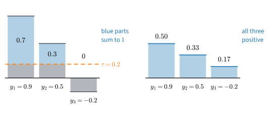

# Constrained Optimization
:label:`sec_mdl-constrained-optimization-duality`

So far every variable could take any value. Many quantities in deep learning
cannot. Attention weights must be nonnegative and sum to one, gradient
clipping keeps the norm of a gradient at or below a threshold, a norm budget
limits the weights, and the margins of a support vector machine must be at
least one. At the best point of such a problem the gradient usually does not
vanish, so the zero-gradient test of the earlier sections fails. How do we
recognize the best point when the variables must stay in a set, and how do
we compute it?

Gradient clipping gives the smallest instance. Clipping the gradient
$\mathbf{y} = (3, 4)$ to norm at most $1$ returns $(0.6, 0.8)$, the point of
the unit disk nearest to $\mathbf{y}$. This point minimizes the squared
distance $f(\mathbf{x}) = \tfrac12\|\mathbf{x} - \mathbf{y}\|^2$ over the
disk, yet it is not a point where any gradient vanishes: $f$ has gradient
$(-2.4, -3.2)$ there, and $f = 8$. Instead, no *allowed* direction lowers
$f$: every move that keeps $\|\mathbf{x}\| \le 1$ makes $f$ larger or, to
first order, leaves it unchanged. We need a replacement for the condition
"the gradient is zero", and a replacement for gradient descent, which on its
own walks out of the feasible set.

The replacement is one number per constraint, its *multiplier*, which records
how hard the optimum presses against that constraint. At $(0.6, 0.8)$ the push
is $4$ times the outward normal, and $(-2.4, -3.2) + 4\,(0.6, 0.8) = \mathbf{0}$.
Multipliers give optimality conditions: Lagrange's for equality constraints,
and those of Karush, Kuhn, and Tucker for inequalities. The projection that
produced $(0.6, 0.8)$ gives an algorithm: take a gradient step, then return to
the nearest feasible point. When a penalty with a kink, such as the absolute
value that the lasso charges for every weight, replaces the hard wall, the
same step becomes a proximal step, which sets weights to exactly zero.
Convexity (:numref:`sec_mdl-convexity`) makes the conditions of this section
sufficient and its algorithms convergent.

Three results carry the section: the KKT conditions with their sufficiency
for convex problems, the obtuse-angle inequality that characterizes a
projection, and soft-thresholding.

```{.python .input #constrained-imports}
#@tab mxnet
import math
import numpy as np
from mxnet import autograd, gluon, init, np as mnp, npx
from mxnet.gluon import nn
from d2l import mxnet as d2l
npx.set_np()
```

```{.python .input #constrained-imports}
#@tab pytorch
import math
import numpy as np
import torch
from torch import nn
from torch.nn import functional as F
from d2l import torch as d2l
```

```{.python .input #constrained-imports}
#@tab tensorflow
import math
import numpy as np
import tensorflow as tf
from d2l import tensorflow as d2l
```

```{.python .input #constrained-imports}
#@tab jax
import math
import numpy as np
import jax
from jax import numpy as jnp
from flax import nnx
import optax
from d2l import jax as d2l
```

## Equality Constraints and Lagrange Multipliers
:label:`subsec_mdl-lagrange-multipliers`

### Tangency and the Lagrange Condition

Equalities are simpler than inequalities, so we first replace the disk of
the clipping example by its boundary: minimize
$f(\mathbf{x}) = \tfrac12\|\mathbf{x} - \mathbf{y}\|^2$ with
$\mathbf{y} = (3, 4)$ over the unit circle, written as
$h(\mathbf{x}) = \tfrac12(\|\mathbf{x}\|^2 - 1) = 0$. In general we minimize a
differentiable $f : \mathbb{R}^n \to \mathbb{R}$ subject to one equality
constraint,

$$
\min_{\mathbf{x}}\; f(\mathbf{x}) \quad \textrm{subject to} \quad h(\mathbf{x}) = 0.
$$

The feasible set is a surface (in the example a curve), not a region, so every
feasible move runs along it.

:numref:`fig_mdl-opt-lagrange-tangency` shows what distinguishes the optimum.
At a feasible point where a level set of $f$ *crosses* the circle, $\nabla f$
has a component along the circle, and sliding along the circle against that
component lowers $f$ while staying feasible. Such a point cannot be optimal.
Only where the level set is *tangent* to the circle is every feasible direction
neutral to first order. Tangent curves have parallel normals, so at the optimum
$\nabla f$ is a multiple of $\nabla h$.


:label:`fig_mdl-opt-lagrange-tangency`

**Proposition (Lagrange condition).** *Let $\mathbf{x}^\star$ be a local
minimum of $f$ on $\{\mathbf{x} : h(\mathbf{x}) = 0\}$. Assume that $f$ is
differentiable at $\mathbf{x}^\star$, that $h$ is continuously differentiable
near $\mathbf{x}^\star$, and that $\nabla h(\mathbf{x}^\star) \neq \mathbf{0}$.
Then there is a unique scalar $\nu^\star$, the **Lagrange multiplier**, with*

$$
\nabla f(\mathbf{x}^\star) + \nu^\star\,\nabla h(\mathbf{x}^\star) = \mathbf{0}.
$$
:eqlabel:`eq_mdl-opt-lagrange-condition`

The objective's gradient is balanced by a multiple of the constraint's normal.
This is the Lagrange condition of :numref:`subsec_mdl-lagrange`, where the
tangency argument is made into a proof. That section writes the constraint as
$g(\mathbf{x}) = c$ and the condition as $\nabla f = \mu\,\nabla g$; with
$h = g - c$ and $\nu = -\mu$ the two statements agree. We use the plus sign
because it is the sign of the Lagrangian below.

At the tangent point $(0.6, 0.8)$ of the figure,
$\nabla f = \mathbf{x} - \mathbf{y} = (-2.4, -3.2)$ and
$\nabla h = \mathbf{x} = (0.6, 0.8)$. The two vectors are parallel, with
$\nabla f = -4\,\nabla h$, so $\nu^\star = 4$.

The hypothesis $\nabla h(\mathbf{x}^\star) \neq \mathbf{0}$ is a **constraint
qualification**, and it is not a formality. Minimize $f(\mathbf{x}) = x_1$
subject to $h(\mathbf{x}) = x_1^2 + x_2^2 = 0$. The feasible set is the single
point $\mathbf{0}$, which is therefore the minimum, yet
$\nabla f(\mathbf{0}) = (1, 0)$ while $\nabla h(\mathbf{0}) = \mathbf{0}$, so no
multiplier exists. The constraint set has collapsed to a point with no tangent
directions, and the tangency argument has nothing to work with.

### The Lagrangian

Two requirements, parallel gradients and feasibility, determine two unknowns,
$\mathbf{x}$ and $\nu$. Both requirements say that a single function of
$(\mathbf{x}, \nu)$ is stationary. This function, the **Lagrangian**, adds to
the objective the constraint function weighted by the multiplier:

$$
\mathcal{L}(\mathbf{x}, \nu) = f(\mathbf{x}) + \nu\, h(\mathbf{x}).
$$
:eqlabel:`eq_mdl-opt-lagrangian-eq`

Setting its derivatives to zero gives

$$
\nabla_{\mathbf{x}} \mathcal{L} = \nabla f + \nu\, \nabla h = \mathbf{0}
\qquad\textrm{and}\qquad
\frac{\partial \mathcal{L}}{\partial \nu} = h(\mathbf{x}) = 0,
$$

which are :eqref:`eq_mdl-opt-lagrange-condition` and the constraint. The
constrained problem in $\mathbf{x}$ has become an unconstrained stationarity
problem in $(\mathbf{x}, \nu)$.

On the circle, $\nabla_{\mathbf{x}}\mathcal{L} = (\mathbf{x} - \mathbf{y}) + \nu\mathbf{x} = \mathbf{0}$
gives $\mathbf{x} = \mathbf{y}/(1 + \nu)$, a point on the line through the
origin and $\mathbf{y}$. Feasibility, $\|\mathbf{x}\| = 1$, then requires
$|1 + \nu| = \|\mathbf{y}\| = 5$, which has two solutions:

* $\nu = 4$: $\mathbf{x} = (0.6, 0.8)$, at distance $4$ from $\mathbf{y}$, with $f = 8$;
* $\nu = -6$: $\mathbf{x} = (-0.6, -0.8)$, at distance $6$ from $\mathbf{y}$, with $f = 18$.

The second point is the point of the circle farthest from $\mathbf{y}$. The
Lagrange condition is necessary, not sufficient: it holds wherever $f$
restricted to the surface is stationary, maxima included. In this example the
sign of the multiplier tells the two points apart. For inequality constraints
the KKT conditions below turn that sign into a rule.

With several equality constraints $h_j(\mathbf{x}) = 0$, $j = 1, \ldots, p$,
each constraint gets its own multiplier, $\mathcal{L} = f + \sum_j \nu_j h_j$.
The same argument, now assuming that the $\nabla h_j(\mathbf{x}^\star)$ are
linearly independent, puts $\nabla f(\mathbf{x}^\star)$ in the *span* of the
constraint gradients: the objective's gradient is balanced by a combination of
the constraint normals.

### The Closest Point on a Hyperplane
:label:`subsec_mdl-closest-point`

The smallest problem with a linear constraint asks for the point of a
hyperplane nearest the origin: minimize $f(\mathbf{x}) = \tfrac12\|\mathbf{x}\|^2$
subject to $h(\mathbf{x}) = \mathbf{a}^\top\mathbf{x} - b = 0$. Stationarity of
$\mathcal{L} = \tfrac12\|\mathbf{x}\|^2 + \nu(\mathbf{a}^\top\mathbf{x} - b)$
gives $\mathbf{x} + \nu\mathbf{a} = \mathbf{0}$, so the solution lies on the
normal $\mathbf{a}$. Feasibility, $-\nu\|\mathbf{a}\|^2 = b$, fixes
$\nu^\star = -b/\|\mathbf{a}\|^2$, and the solution and its value are

$$
\mathbf{x}^\star = \frac{b}{\|\mathbf{a}\|^2}\,\mathbf{a},
\qquad
p^\star = \frac{b^2}{2\,\|\mathbf{a}\|^2}.
$$

The nearest point lies a distance $b/\|\mathbf{a}\|$ along the unit normal
$\mathbf{a}/\|\mathbf{a}\|$, which is the projection formula of
:numref:`sec_mdl-geometry-linear-algebraic-ops`.

With $\mathbf{a} = (3, 4)$ and $b = 5$ the nearest point is $(0.6, 0.8)$ once
more, with $\nu^\star = -0.2$ and $p^\star = \tfrac12$: the line
$3x_1 + 4x_2 = 5$ touches the unit circle at $(0.6, 0.8)$. The multiplier is
more than a by-product of the calculation. Raising $b$ from $5$ to $5.1$ moves
the line away from the origin and raises the optimal value by about
$0.02 = -\nu^\star \cdot 0.1$. :numref:`subsec_mdl-shadow-prices` shows that
this is what a multiplier always measures: the rate at which the optimum
changes when its constraint is moved.

## Inequality Constraints and the KKT Conditions
:label:`subsec_mdl-kkt-conditions`

### Active and Inactive Constraints

Most constraints in practice are one-sided: a norm at most $r$, a probability
at least $0$, a budget not exceeded. We write them as

$$
\min_{\mathbf{x}}\; f(\mathbf{x}) \quad \textrm{subject to} \quad g_i(\mathbf{x}) \le 0,\; i = 1, \ldots, m,
$$

so that each $g_i$ is negative inside its region and zero on its boundary.
At a solution each inequality is in one of two regimes. Either
$g_i(\mathbf{x}^\star) < 0$: the constraint is **inactive**, the solution lies
strictly inside its region, and near $\mathbf{x}^\star$ the constraint has no
effect. Or $g_i(\mathbf{x}^\star) = 0$: the constraint is **active**
and behaves like an equality.

Clipping shows both regimes. Project $\mathbf{y}$ onto the ball of
radius $r$: minimize $f(\mathbf{x}) = \tfrac12\|\mathbf{x} - \mathbf{y}\|^2$
subject to $g(\mathbf{x}) = \tfrac12(\|\mathbf{x}\|^2 - r^2) \le 0$. With a
multiplier $\lambda$, stationarity of $f + \lambda g$ gives
$(\mathbf{x} - \mathbf{y}) + \lambda\mathbf{x} = \mathbf{0}$, so
$\mathbf{x} = \mathbf{y}/(1 + \lambda)$: the solution is a radial rescaling of
$\mathbf{y}$.

* If $\|\mathbf{y}\| \le r$, then $\mathbf{y}$ is feasible and minimizes $f$
  outright. The constraint is inactive, $\lambda^\star = 0$, and
  $\mathbf{x}^\star = \mathbf{y}$; for instance $\mathbf{y} = (0.3, 0.4)$ stays
  where it is.
* If $\|\mathbf{y}\| > r$, a solution inside the ball would be an
  unconstrained minimum of $f$, and the only one is the infeasible
  $\mathbf{y}$. So the constraint is active, and $\|\mathbf{x}^\star\| = r$
  forces $\lambda^\star = \|\mathbf{y}\|/r - 1 > 0$. For $\mathbf{y} = (3, 4)$
  and $r = 1$ this gives $\lambda^\star = 4$,
  $\mathbf{x}^\star = (0.6, 0.8)$, and $p^\star = \tfrac12 \cdot 4^2 = 8$.

Both cases combine into one formula,

$$
\mathbf{x}^\star = \frac{\mathbf{y}}{\max\left(1,\; \|\mathbf{y}\|/r\right)},
$$

which leaves short vectors alone and rescales long ones to length $r$. This is
*gradient clipping* :cite:`Pascanu.Mikolov.Bengio.2013`, applied to the update
vector. In code the case split is a single `max`, and the balance of forces
can be read off: at the clipped point the gradient of $f$ is cancelled by
$\lambda^\star$ times the gradient of the constraint,
$\nabla g(\mathbf{x}) = \mathbf{x}$.

```{.python .input #mdl-constrained-optimization-duality-active-and-inactive-constraints}
y, r = np.array([3.0, 4.0]), 1.0
lam = max(np.linalg.norm(y) / r - 1, 0.0)    # multiplier: 0 if y is inside the ball
x = y / (1 + lam)                            # x* = y / max(1, |y|/r)
print('x* =', x, ' lambda* =', lam, ' f(x*) =', 0.5 * ((x - y)**2).sum())
print('grad f(x*) =', x - y, ' lambda* grad g(x*) =', lam * x,
      ' sum =', (x - y) + lam * x)
```

Stationarity holds although $\nabla f$ is far from zero: the gradient
$(-2.4, -3.2)$ and the constraint's push $(2.4, 3.2)$ cancel, and the
multiplier is the ratio of their lengths, $4$.

The sign of the multiplier has a geometric meaning. The constraint's gradient
$\nabla g = \mathbf{x}$ points out of the ball, and stationarity
$-\nabla f = \lambda\nabla g$ with $\lambda > 0$ says that the objective pulls
outward and the wall pushes back. If the objective pulled inward, moving inward
would be feasible and would lower $f$, so the point would not be optimal. A
negative multiplier is therefore never needed: the multiplier $-6$ would give
the far point $(-0.6, -0.8)$ of the circle, which is not a minimum over the
disk. An inequality constraint pushes the solution in one direction only.

### The Karush--Kuhn--Tucker Conditions

With both kinds of constraints, the general problem is

$$
\min_{\mathbf{x}}\; f(\mathbf{x}) \quad \textrm{subject to} \quad
g_i(\mathbf{x}) \le 0,\; i = 1, \ldots, m, \qquad h_j(\mathbf{x}) = 0,\; j = 1, \ldots, p.
$$
:eqlabel:`eq_mdl-opt-standard-problem`

Its **Lagrangian** has one multiplier per constraint, and the inequality
multipliers are nonnegative:

$$
\mathcal{L}(\mathbf{x}, \boldsymbol{\lambda}, \boldsymbol{\nu})
= f(\mathbf{x}) + \sum_{i=1}^m \lambda_i\, g_i(\mathbf{x}) + \sum_{j=1}^p \nu_j\, h_j(\mathbf{x}),
\qquad \lambda_i \ge 0.
$$
:eqlabel:`eq_mdl-opt-lagrangian`

At a minimum $\mathbf{x}^\star$ where a constraint qualification holds (the
next subsection says which), there are multipliers that satisfy the four
**Karush--Kuhn--Tucker (KKT) conditions** :cite:`Karush.1939,Kuhn.Tucker.1951`:

$$
\begin{aligned}
&\textrm{stationarity:}
&& \nabla f(\mathbf{x}^\star) + \textstyle\sum_i \lambda_i^\star \nabla g_i(\mathbf{x}^\star) + \sum_j \nu_j^\star \nabla h_j(\mathbf{x}^\star) = \mathbf{0}, \\
&\textrm{primal feasibility:}
&& g_i(\mathbf{x}^\star) \le 0, \qquad h_j(\mathbf{x}^\star) = 0, \\
&\textrm{dual feasibility:}
&& \lambda_i^\star \ge 0, \\
&\textrm{complementary slackness:}
&& \lambda_i^\star\, g_i(\mathbf{x}^\star) = 0 \quad \textrm{for every } i.
\end{aligned}
$$
:eqlabel:`eq_mdl-opt-kkt`

The first three we have met in the examples: a balance of gradients, the
constraints themselves, and a push in one direction only.
**Complementary slackness** says that for each $i$ at least one of
$\lambda_i^\star$ and $g_i(\mathbf{x}^\star)$ is zero. An inactive constraint
therefore has a zero multiplier and drops out of stationarity, and the
multipliers tell which constraints contribute to stationarity. They do not
always identify the active set, because a constraint can be active with
$\lambda_i^\star = 0$ (it touches $\mathbf{x}^\star$ but does no work). In the
ball projection complementary slackness is the case split we did by hand, and
at the solution $\lambda^\star g(\mathbf{x}^\star) = 4 \cdot 0 = 0$.

:numref:`fig_mdl-opt-kkt-active-set` draws stationarity and dual feasibility
together: at the optimum, $-\nabla f$ is a nonnegative combination of the
outward normals of the active constraints. Equivalently, $-\nabla f$ lies in
the cone those normals span, the *normal cone*; inactive constraints add
nothing to it.

![Geometry of the KKT conditions on a feasible region cut out by two inequality constraints. At the optimum $\mathbf{x}^\star$ in (a) one constraint is active and one is inactive: $-\nabla f$ points along the active constraint's outward normal with $\lambda_1 > 0$, while the inactive constraint has $\lambda_2 = 0$. At the corner in (b), where both constraints are active, $-\nabla f$ must lie in the cone spanned by both normals (shaded: the normal cone). The orange arcs are level sets of $f$ around its unconstrained minimizer (+).](../img/mdl-opt-kkt-active-set.svg)
:label:`fig_mdl-opt-kkt-active-set`

The KKT conditions are first-order conditions, and like the Lagrange condition
they are not sufficient. Minimize $f(x) = -x^2$ on $[-1, 1]$, written as
$x - 1 \le 0$ and $-1 - x \le 0$. At $x = 0$ the gradient is zero, both
constraints are inactive, and both multipliers are zero, so $x = 0$ is a KKT
point. It is the *maximum*. The minima $x = \pm 1$ are KKT points as well, each
with multiplier $2$ on its active constraint.
Exercise :exref:`ex_mdl-constrained-optimization-duality-write-all-four-kkt`
works out a two-dimensional version.

### Constraint Qualifications and Sufficiency
:label:`subsec_mdl-constraint-qualifications`

Two questions remain. When must a minimum satisfy the KKT conditions, and when
is a KKT point a minimum?

The first question has the same answer as for one equality constraint: when a
constraint qualification holds. The standard one is the *linear independence
constraint qualification* (LICQ). Let $\mathbf{x}^\star$ be a local minimum of
:eqref:`eq_mdl-opt-standard-problem` with $f$, $g_i$, $h_j$ continuously
differentiable. If the gradients of the active inequality constraints together
with the gradients of all equality constraints,
$\{\nabla g_i(\mathbf{x}^\star) : g_i(\mathbf{x}^\star) = 0\} \cup \{\nabla h_j(\mathbf{x}^\star) : j = 1, \ldots, p\}$,
are linearly independent, then multipliers satisfying :eqref:`eq_mdl-opt-kkt`
exist (:citet:`Nocedal.Wright.2006`, chapter 12, proves this). LICQ generalizes
the condition $\nabla h \neq \mathbf{0}$, and the problems of
Exercise :exref:`ex_mdl-constrained-degenerate-constraints` show how it fails.

For convex problems a condition that is far easier to check suffices: it asks
for one point, not for gradients at the unknown solution. Call
:eqref:`eq_mdl-opt-standard-problem` *convex* when $f$ and every $g_i$ are
convex and every $h_j$ is affine. A convex problem satisfies **Slater's
condition** :cite:`Slater.1950` if there is a point $\bar{\mathbf{x}}$ with

$$
g_i(\bar{\mathbf{x}}) < 0 \;\textrm{ for every } g_i \textrm{ that is not affine},
\qquad
g_i(\bar{\mathbf{x}}) \le 0 \;\textrm{ for every affine } g_i,
\qquad
h_j(\bar{\mathbf{x}}) = 0 \;\textrm{ for every } j.
$$
:eqlabel:`eq_mdl-opt-slater`

The point must be feasible, and strictly inside every curved constraint. A
problem whose constraints are all affine satisfies the condition as soon as it
has a feasible point. (If $f$ or some $g_i$ is defined only on a subset of
$\mathbb{R}^n$, which does not happen in this section, $\bar{\mathbf{x}}$
must also lie in the relative interior of that domain.) For the ball,
$\bar{\mathbf{x}} = \mathbf{0}$ gives $g(\mathbf{0}) = -r^2/2 < 0$. Under Slater's condition every minimum
of a convex problem with differentiable $f$ and $g_i$ is a KKT point
:cite:`Boyd.Vandenberghe.2004`; the reason is strong duality, which
:numref:`subsec_mdl-strong-duality` derives from the same condition.

Convexity answers the second question, and the answer is the result of this
section that we will use most.

**Proposition (KKT sufficiency under convexity).** *In problem
:eqref:`eq_mdl-opt-standard-problem`, let $f$ and every $g_i$ be convex and
differentiable and every $h_j$ affine. If
$(\mathbf{x}^\star, \boldsymbol{\lambda}^\star, \boldsymbol{\nu}^\star)$
satisfies the KKT conditions :eqref:`eq_mdl-opt-kkt`, then $\mathbf{x}^\star$ is
a global minimum.*

**Proof.** The function
$\varphi(\mathbf{x}) = \mathcal{L}(\mathbf{x}, \boldsymbol{\lambda}^\star, \boldsymbol{\nu}^\star)$
is convex: it is a nonnegative combination of convex functions plus affine
terms. Stationarity says $\nabla\varphi(\mathbf{x}^\star) = \mathbf{0}$, so
$\mathbf{x}^\star$ is a *global* minimizer of $\varphi$. Now take any feasible
$\mathbf{x}$. Since $\lambda_i^\star \ge 0$, $g_i(\mathbf{x}) \le 0$, and
$h_j(\mathbf{x}) = 0$,

$$
f(\mathbf{x}) \;\ge\; f(\mathbf{x}) + \sum_i \lambda_i^\star g_i(\mathbf{x}) + \sum_j \nu_j^\star h_j(\mathbf{x})
= \varphi(\mathbf{x}) \;\ge\; \varphi(\mathbf{x}^\star)
= f(\mathbf{x}^\star),
$$

where the last equality uses complementary slackness
($\sum_i \lambda_i^\star g_i(\mathbf{x}^\star) = 0$) and feasibility
($h_j(\mathbf{x}^\star) = 0$). $\blacksquare$

The proof contains an idea larger than the proposition. For *any* fixed
multipliers with $\boldsymbol{\lambda} \ge 0$, the first inequality of the
chain holds, so the unconstrained minimum of the Lagrangian is a lower bound
on $f$ over the feasible set; at the KKT multipliers the bound is attained.
:numref:`sec_mdl-lagrangian-duality` starts from this bound. For convex
problems the KKT conditions are sufficient, and under Slater's condition also
necessary, so they identify the minima completely.

## Projections and Projected Gradient Descent
:label:`subsec_mdl-projected-gd`

The KKT conditions recognize an optimum. To compute one we combine the
nearest feasible point with gradient descent: take the ordinary gradient
step, and if it leaves the feasible set, project back.

### Projection onto a Convex Set

For a nonempty closed convex set $C \subseteq \mathbb{R}^n$, the
**projection** of $\mathbf{y}$ onto $C$ is the nearest point of $C$,

$$
\Pi_C(\mathbf{y}) = \mathop{\mathrm{argmin}}_{\mathbf{x} \in C}\; \tfrac12 \|\mathbf{x} - \mathbf{y}\|^2.
$$

A minimizer exists: we may restrict the search to the intersection of $C$ with
a large closed ball around $\mathbf{y}$, which is compact because $C$ is
closed, and the continuous objective attains its minimum there. It is unique
because the objective is strictly convex. So $\Pi_C$ is a well-defined map.

Both examples computed so far are projections: onto a hyperplane (the
closest-point problem) and onto a ball (the clipping formula). The projection
onto the half-space $\{\mathbf{x} : \mathbf{a}^\top\mathbf{x} \ge b\}$ follows
from the hyperplane case. A point that violates the constraint moves along
$\mathbf{a}$ onto the boundary hyperplane, and a point that satisfies it stays,
so

$$
\Pi(\mathbf{y}) = \mathbf{y} + \frac{\max(0,\; b - \mathbf{a}^\top\mathbf{y})}{\|\mathbf{a}\|^2}\,\mathbf{a}.
$$

Projections onto closed convex sets have a first-order characterization. The
point $\hat{\mathbf{x}} = \Pi_C(\mathbf{y})$ minimizes the convex function
$\tfrac12\|\mathbf{x} - \mathbf{y}\|^2$ over $C$. For any $\mathbf{x} \in C$
the whole segment from $\hat{\mathbf{x}}$ to $\mathbf{x}$ lies in $C$, so the
directional derivative of the objective along it must be nonnegative:
$(\hat{\mathbf{x}} - \mathbf{y})^\top(\mathbf{x} - \hat{\mathbf{x}}) \ge 0$.
Rearranged,

$$
\left(\mathbf{y} - \Pi_C(\mathbf{y})\right)^\top \left(\mathbf{x} - \Pi_C(\mathbf{y})\right) \;\le\; 0
\qquad \textrm{for all } \mathbf{x} \in C.
$$
:eqlabel:`eq_mdl-opt-proj-variational`

The *residual* $\mathbf{y} - \Pi_C(\mathbf{y})$ makes an angle of at least
$90^\circ$ with the direction to every point of $C$
(:numref:`fig_mdl-opt-projection-inequality`, panel (a)). Equivalently, $C$
lies entirely on the far side of the hyperplane through $\Pi_C(\mathbf{y})$
with normal $\mathbf{y} - \Pi_C(\mathbf{y})$, a *supporting hyperplane* of $C$.


:label:`fig_mdl-opt-projection-inequality`

For the running example the inequality can be checked by hand. The residual of
$\mathbf{y} = (3, 4)$ is $(2.4, 3.2) = 4\,(0.6, 0.8)$, the multiplier times the
constraint normal once more. For any $\mathbf{x}$ in the unit disk,

$$
(2.4, 3.2)^\top\bigl(\mathbf{x} - (0.6, 0.8)\bigr) = 4\,(0.6x_1 + 0.8x_2) - 4 \;\le\; 4\,\|\mathbf{x}\| - 4 \;\le\; 0,
$$

by the Cauchy--Schwarz inequality $\mathbf{u}^\top\mathbf{v} \le \|\mathbf{u}\|\,\|\mathbf{v}\|$.
The supporting line is $3x_1 + 4x_2 = 5$, the hyperplane of the closest-point
example.

The inequality is also *sufficient*. Suppose $\hat{\mathbf{x}} \in C$
satisfies it, and let $\varphi(\mathbf{x}) = \tfrac12\|\mathbf{x} - \mathbf{y}\|^2$,
whose gradient at $\hat{\mathbf{x}}$ is $\hat{\mathbf{x}} - \mathbf{y}$. A
convex differentiable function lies above its tangent planes,
$\varphi(\mathbf{x}) \ge \varphi(\hat{\mathbf{x}}) + \nabla\varphi(\hat{\mathbf{x}})^\top(\mathbf{x} - \hat{\mathbf{x}})$
(:numref:`sec_mdl-convexity`). For every $\mathbf{x} \in C$ the last term is
nonnegative by assumption, so $\varphi(\mathbf{x}) \ge \varphi(\hat{\mathbf{x}})$
and $\hat{\mathbf{x}} = \Pi_C(\mathbf{y})$. So
:eqref:`eq_mdl-opt-proj-variational` *characterizes* the projection. Everything
else we need about projections follows from it, first of all the property
that makes projected algorithms converge.

**Proposition (projections are nonexpansive).** *For a nonempty closed convex
set $C$ and all $\mathbf{x}, \mathbf{y} \in \mathbb{R}^n$,*

$$
\|\Pi_C(\mathbf{x}) - \Pi_C(\mathbf{y})\| \;\le\; \|\mathbf{x} - \mathbf{y}\|.
$$

**Proof.** Write $\mathbf{u} = \Pi_C(\mathbf{x})$ and $\mathbf{v} = \Pi_C(\mathbf{y})$.
Apply :eqref:`eq_mdl-opt-proj-variational` twice, at $\mathbf{x}$ with the
test point $\mathbf{v}$ and at $\mathbf{y}$ with the test point $\mathbf{u}$:

$$
(\mathbf{x} - \mathbf{u})^\top(\mathbf{v} - \mathbf{u}) \le 0,
\qquad
(\mathbf{y} - \mathbf{v})^\top(\mathbf{u} - \mathbf{v}) \le 0.
$$

Adding them gives
$(\mathbf{x} - \mathbf{y} - (\mathbf{u} - \mathbf{v}))^\top(\mathbf{v} - \mathbf{u}) \le 0$,
which rearranges to

$$
\|\mathbf{u} - \mathbf{v}\|^2 \;\le\; (\mathbf{x} - \mathbf{y})^\top (\mathbf{u} - \mathbf{v})
\;\le\; \|\mathbf{x} - \mathbf{y}\|\, \|\mathbf{u} - \mathbf{v}\|
$$

by Cauchy--Schwarz. Divide by $\|\mathbf{u} - \mathbf{v}\|$ (the claim is
trivial when it is zero). $\blacksquare$

Panel (b) of :numref:`fig_mdl-opt-projection-inequality` shows the statement:
two points outside the disk are farther apart than their projections.
The proof needs convexity of $C$. Let $C = \{-1, 1\}$, two points. Then
$y = 0.01$ projects to $1$ and $y = -0.01$ projects to $-1$: inputs $0.02$
apart give outputs $2$ apart, and at $y = 0$ the projection is not even unique.
Projection onto a nonconvex set can be discontinuous and multivalued.

### Projected Gradient Descent

**Projected gradient descent** (PGD) follows each gradient step by a
projection. With $k$ counting iterations,

$$
\mathbf{x}_{k+1} = \Pi_C\left(\mathbf{x}_k - \eta\, \nabla f(\mathbf{x}_k)\right).
$$
:eqlabel:`eq_mdl-opt-pgd`

The iterates are feasible by construction. Their fixed points are the
constrained stationary points: for differentiable $f$, closed convex $C$, and
any $\eta > 0$, the equation
$\mathbf{x}^\star = \Pi_C(\mathbf{x}^\star - \eta \nabla f(\mathbf{x}^\star))$
holds if and only if $\mathbf{x}^\star \in C$ satisfies
:eqref:`eq_mdl-opt-proj-variational` with
$\mathbf{y} = \mathbf{x}^\star - \eta\nabla f(\mathbf{x}^\star)$. After the
$\mathbf{x}^\star$ terms cancel and we divide by $\eta$, that inequality reads

$$
\nabla f(\mathbf{x}^\star)^\top (\mathbf{x} - \mathbf{x}^\star) \;\ge\; 0
\qquad \textrm{for all } \mathbf{x} \in C.
$$

No feasible direction is a descent direction. This is the constrained
first-order condition, and it reduces to $\nabla f = \mathbf{0}$ when
$C = \mathbb{R}^n$. For convex $f$ it is also sufficient for a global minimum,
by the tangent-plane inequality used above. For nonconvex $f$ it certifies only
stationarity. When $C = \{\mathbf{x} : g_i(\mathbf{x}) \le 0\}$ with
differentiable convex $g_i$ and Slater's condition holds, the condition is
equivalent to the KKT conditions.

The projection does not slow gradient descent down, and nonexpansiveness gives
a three-line proof.

**Proposition (PGD contracts at least as fast as GD).** *Let $C$ be nonempty,
closed, and convex, let $f$ be twice continuously differentiable with
$\mu\mathbf{I} \preceq \nabla^2 f \preceq L\mathbf{I}$ for some
$0 < \mu \le L$, let $\mathbf{x}^\star$ be the minimizer of $f$ over $C$, and
let $\eta > 0$. Then the iterates of :eqref:`eq_mdl-opt-pgd` satisfy*

$$
\|\mathbf{x}_{k+1} - \mathbf{x}^\star\| \;\le\; \rho\, \|\mathbf{x}_k - \mathbf{x}^\star\|,
\qquad \rho = \max\left(|1 - \eta\mu|,\; |1 - \eta L|\right).
$$
:eqlabel:`eq_mdl-opt-pgd-contraction`

**Proof.** (i) By the fixed-point property, $\mathbf{x}^\star = \Pi_C(\mathbf{b})$
with $\mathbf{b} = \mathbf{x}^\star - \eta\nabla f(\mathbf{x}^\star)$.
(ii) Choosing this $\mathbf{b}$ is the one non-routine step: it lets
nonexpansiveness, applied to $\mathbf{x}_k - \eta\nabla f(\mathbf{x}_k)$ and
$\mathbf{b}$, remove the projection,

$$
\|\mathbf{x}_{k+1} - \mathbf{x}^\star\| \;\le\; \left\|(\mathbf{x}_k - \mathbf{x}^\star) - \eta\left(\nabla f(\mathbf{x}_k) - \nabla f(\mathbf{x}^\star)\right)\right\|.
$$

(iii) By the fundamental theorem of calculus along the segment from
$\mathbf{x}^\star$ to $\mathbf{x}_k$,
$\nabla f(\mathbf{x}_k) - \nabla f(\mathbf{x}^\star) = \bar{\mathbf{H}}(\mathbf{x}_k - \mathbf{x}^\star)$
with
$\bar{\mathbf{H}} = \int_0^1 \nabla^2 f(\mathbf{x}^\star + t(\mathbf{x}_k - \mathbf{x}^\star))\,dt$.
This average of Hessians is symmetric with eigenvalues in $[\mu, L]$, so
$\mathbf{I} - \eta\bar{\mathbf{H}}$ has eigenvalues $1 - \eta h$ with
$h \in [\mu, L]$, all of magnitude at most $\rho$. Hence the right side is at
most $\rho\,\|\mathbf{x}_k - \mathbf{x}^\star\|$. $\blacksquare$

Once step (ii) has removed the projection, what remains is plain gradient
descent's contraction. For a quadratic
$f = \tfrac12\mathbf{x}^\top\mathbf{A}\mathbf{x}$ we have $\bar{\mathbf{H}} = \mathbf{A}$,
and step (iii) is the per-mode factor $|1 - \eta\lambda_i(\mathbf{A})|$ of
gradient descent from :numref:`sec_mdl-gradient-based-optimization`; the factor
is below $1$ if and only if $0 < \eta < 2/L$. For a convex $f$ that is
$L$-smooth but not strongly convex, PGD with $\eta = 1/L$ still has the
$O(1/k)$ rate of gradient descent in the objective value :cite:`Nesterov.2018`.

How tight is the factor $\rho$? Take the quadratic
$f(\mathbf{x}) = \tfrac12(x_1^2 + 1000\,x_2^2)$ with condition number
$\kappa = 10^3$, restricted to the half-space $x_1 + x_2 \ge 1$, that is
$g(\mathbf{x}) = 1 - x_1 - x_2 \le 0$. The KKT conditions can be solved by
hand. The unconstrained minimizer $\mathbf{0}$ is infeasible, so the constraint
is active. Stationarity, $(x_1, 1000\,x_2) - \lambda(1, 1) = \mathbf{0}$, gives
$x_1 = \lambda$ and $x_2 = \lambda/1000$, and the active constraint
$x_1 + x_2 = 1$ gives $\lambda^\star = 1000/1001 \approx 0.999$,
$\mathbf{x}^\star = (1000/1001,\; 1/1001) \approx (0.999, 0.001)$, and
$p^\star = 500/1001 \approx 0.4995$.

Take the step $\eta = 0.0015$, an unremarkable value below the ceiling
$2/L = 0.002$. The factor of the proposition is
$\rho = \max(1 - \eta,\ |1 - 1000\,\eta|) = 0.9985$. From the starting point
$(3, 4)$, at distance $4.47$ from $\mathbf{x}^\star$, this factor guarantees
a distance of $10^{-6}$ after about
$\log(4.47 \times 10^6)/\log(1/\rho) \approx 10{,}200$ steps. The run below
records the largest ratio of successive distances, the number of steps it
needs, the step from which every update is projected, the ratio per step from
then on, and the gradient where it stops.

```{.python .input #mdl-constrained-optimization-duality-projected-gradient-descent}
A = np.diag([1.0, 1000.0])                         # f(x) = 1/2 x^T A x, kappa = 1000
x_star = np.array([1000 / 1001, 1 / 1001])         # KKT point of x1 + x2 >= 1
project = lambda y: y + max(0.0, 1 - y.sum()) / 2  # onto the half-space x1 + x2 >= 1
eta = 1.5e-3
rho = max(abs(1 - eta), abs(1 - 1000 * eta))       # the GD contraction factor
x, dist, projected = np.array([3.0, 4.0]), [], []
for k in range(1000):
    y = x - eta * A @ x
    projected.append(y.sum() < 1)                  # did the step leave C?
    x = project(y)
    dist.append(np.linalg.norm(x - x_star))
dist, projected = np.array(dist), np.array(projected)
ratios = dist[1:] / dist[:-1]
steps = np.argmax(dist < 1e-6) + 1
on_line = np.flatnonzero(~projected).max() + 2     # every step from here on is projected
print(f'bound rho = {rho:.4f}   largest ratio in a step = '
      f'{ratios[dist[:-1] > 1e-12].max():.4f}')
print(f'steps to |x - x*| < 1e-6: {steps}   every step projected from step {on_line} on')
print(f'ratio per step on the line: {np.median(ratios[on_line:steps - 1]):.4f}'
      f'   1 - 500.5 eta = {1 - 500.5 * eta:.4f}')
print(f'grad f at the end = {A @ x}')
```

The largest ratio in a step, $0.9977$, comes close to $\rho$, so the per-step
bound is nearly tight for this problem. The step count is another matter:
738, not $10{,}200$. The printed numbers explain the difference, because
the run has two phases. In the first, the constraint is inactive after the
first step. The stiff coordinate $x_2$ dies out within a few dozen steps,
and the flat coordinate $x_1$ shrinks by the factor $1 - \eta$ per step, as
in unconstrained gradient descent. Reaching the line from $x_1 = 3$ takes
about $\log 3/\eta \approx 730$ steps, and from step 733 on every step is
projected. In the second phase the iterate moves along the line
$x_1 + x_2 = 1$, where the quadratic has curvature $(1 + 1000)/2 = 500.5$,
and the distance shrinks by $1 - 500.5\,\eta = 0.249$ per step, the factor
of gradient descent on that one-dimensional problem. A handful of further
steps finish the run. The proposition's $\rho$ bounds the worst step
anywhere in the plane. Once the constraint is active only the curvature
along the constraint counts, and here that curvature is far better matched
to the step. The bound is thus tight for a single step and pessimistic for
the run. What does carry over unchanged is the last number printed. The final
gradient $(0.999, 0.999)$ equals $\lambda^\star(1, 1) = -\lambda^\star\nabla g$:
it does not vanish, and it hands us the multiplier $1000/1001$ computed by
hand.

PGD is practical whenever $\Pi_C$ is cheap. Nonnegativity constraints project
onto the orthant by setting negative entries to zero, and max-norm constraints
on the rows of a weight matrix rescale each row onto a ball after the update.
The use most readers will have met is the search for adversarial examples:
projected gradient ascent on an input perturbation $\boldsymbol{\delta}$ with
$\|\boldsymbol{\delta}\|_\infty \le \epsilon$, where the projection clips each
coordinate to $[-\epsilon, \epsilon]$ :cite:`Madry.Makelov.Schmidt.ea.2018`.
Gradient clipping also projects, but it projects the *gradient vector* onto a
ball, and it is not PGD for any constraint on the parameters
(Exercise :exref:`ex_mdl-constrained-projected-fixed-points` shows the
difference).

### Projection onto the Simplex

Attention weights and class probabilities live on the **probability simplex**
$\Delta = \{\mathbf{x} : \mathbf{x} \ge 0,\; \sum_i x_i = 1\}$. What is the
point of $\Delta$ nearest a vector of scores $\mathbf{y}$? The problem

$$
\min_{\mathbf{x}}\; \tfrac12\|\mathbf{x} - \mathbf{y}\|^2
\quad \textrm{subject to} \quad \textstyle\sum_i x_i = 1, \;\; -x_i \le 0,
$$

is a small **quadratic program** (QP), a convex quadratic objective with affine
constraints. The KKT conditions reduce it to finding one number. With a
multiplier $\tau$ for the sum and $\lambda_i \ge 0$ for each sign constraint,
stationarity reads $x_i - y_i + \tau - \lambda_i = 0$. Complementary slackness
splits the coordinates. Where $x_i > 0$ we get $\lambda_i = 0$ and
$x_i = y_i - \tau$. Where $x_i = 0$, stationarity gives $\lambda_i = \tau - y_i$,
and dual feasibility $\lambda_i \ge 0$ says $y_i \le \tau$. Both cases combine as

$$
x_i^\star = \max(y_i - \tau,\, 0),
\qquad \textrm{with } \tau \textrm{ set by } \sum_i \max(y_i - \tau,\, 0) = 1.
$$
:eqlabel:`eq_mdl-opt-simplex`

Every score is shifted down by the same $\tau$ and clipped at zero. The
threshold form satisfies stationarity, complementary slackness, dual
feasibility, and the sign constraints for *every* $\tau$. The budget
$\sum_i x_i = 1$ alone fixes $\tau$. The left side of the budget equation,
$\varphi(\tau) = \sum_i \max(y_i - \tau, 0)$, is continuous, piecewise linear,
and strictly decreasing where it is positive, so exactly one $\tau$ solves it.

A hand example shows how to find it. Take $\mathbf{y} = (0.9, 0.5, -0.2)$,
already sorted, and guess that the $k$ largest scores are positive. The budget
then reads $\sum_{j \le k}(y_j - \tau) = 1$, so the guess predicts
$\tau_k = (\sum_{j \le k} y_j - 1)/k$, and it is consistent only if the $k$-th
score stays above the threshold:

* $k = 1$: $\tau_1 = -0.1$, and $y_1 = 0.9 > \tau_1$;
* $k = 2$: $\tau_2 = 0.2$, and $y_2 = 0.5 > \tau_2$;
* $k = 3$: $\tau_3 \approx 0.067$, but $y_3 = -0.2 < \tau_3$.

So $k = 2$, $\tau = 0.2$, and $\mathbf{x}^\star = (0.7, 0.3, 0)$
(:numref:`fig_mdl-opt-simplex-threshold`). Softmax of the same scores is
$(0.50, 0.33, 0.17)$, positive everywhere.


:label:`fig_mdl-opt-simplex-threshold`

Two facts make the hand procedure an algorithm. First, the *support*
$\{i : x_i^\star > 0\}$ consists of the largest scores: if $y_i > y_j$ and
$x_j^\star > 0$, then $x_i^\star \ge y_i - \tau > y_j - \tau = x_j^\star > 0$.
(The *active* sign constraints are the complement, the zero coordinates.)
Second, with the scores sorted as $u_1 \ge \cdots \ge u_n$, the test
$u_k > \tau_k$ passes for $k$ up to the support size and fails beyond it. Indeed
$u_k > \tau_k$ rearranges to $\sum_{j < k}(u_j - u_k) < 1$, that is
$\varphi(u_k) < 1 = \varphi(\tau)$, and since $\varphi$ decreases this holds
exactly when $u_k > \tau$. So we sort, take the largest $k$ with
$u_k > \tau_k$, and set $\tau = \tau_k$, which costs $O(n \log n)$
:cite:`Held.Wolfe.Crowder.1974,Duchi.Shalev-Shwartz.Singer.ea.2008`.

Applied to attention scores, this projection is *sparsemax*
:cite:`Martins.Astudillo.2016`, which puts exactly zero weight on low-scoring
positions. The two maps differ in one term. Expanding the squared distance
shows that sparsemax maximizes
$\mathbf{y}^\top\mathbf{x} - \tfrac12\|\mathbf{x}\|^2$ over $\Delta$, while
softmax maximizes $\mathbf{y}^\top\mathbf{x} + H(\mathbf{x})$ with the entropy
$H$ in place of the quadratic (:eqref:`eq_mdl-opt-lse-entropy`).

A computed projection should be tested, and the KKT residuals are the obvious
candidates. The cell evaluates them for six random scores, at the computed
$\tau$ and at a wrong one, and then evaluates the certificate that
:eqref:`eq_mdl-opt-proj-variational` provides. The left side of that
inequality is affine in $\mathbf{x}$, so its maximum over $\Delta$ is attained
at a vertex, and checking the $n$ vertices $\mathbf{e}_i$ suffices.

```{.python .input #constrained-simplex-projection}
def project_simplex(y):
    """Sort-and-threshold projection onto {x >= 0, sum x = 1}; returns x* and tau."""
    u = np.sort(y)[::-1]
    tau_k = (np.cumsum(u) - 1) / np.arange(1, len(y) + 1)   # tau_k for k = 1..n
    k = np.nonzero(u > tau_k)[0][-1]                          # largest k with u_k > tau_k
    return np.maximum(y - tau_k[k], 0.0), tau_k[k]

y = np.random.default_rng().normal(size=6)
x, tau = project_simplex(y)
print('x* =', x.round(3), ' zeros:', int((x == 0).sum()), ' tau =', round(tau, 3))
for t in (tau, tau + 0.3):                     # three conditions hold for every tau ...
    xt, lam = np.maximum(y - t, 0), np.maximum(0, t - y)
    print(f'tau = {t:6.3f}: stationarity {abs(xt - y + t - lam).max():.0e}, '
          f'comp. slack {abs(lam * xt).max():.0e}, dual feas. {lam.min() >= 0}, '
          f'sum x = {xt.sum():.3f}')            # ... only the budget differs
cert = ((y - x) @ (np.eye(6) - x).T).max()     # max_i (y - x*)^T (e_i - x*)
print(f'certificate max_i (y - x*)^T(e_i - x*) = {cert:.0e}  '
      f'(<= 0 up to rounding: {cert <= 1e-12})')
```

Typically three to five of the six coordinates are exactly zero. These are the
active sign constraints, each with the positive multiplier $\tau - y_i$. The
stationarity and complementary-slackness residuals are zero up to rounding for
the correct $\tau$ *and* for the wrong one, and dual feasibility holds for
both. Only the sum differs, so these residuals cannot confirm the solution.
The certificate does: the largest value of the variational inequality over the
vertices is at most rounding error, which proves that no point of the simplex
is closer to $\mathbf{y}$.

## Proximal Operators and Coordinate Descent

### Soft-Thresholding and the Proximal Operator
:label:`subsec_mdl-proximal-operators`

A hard wall is not the only way to restrict weights. The **lasso**
:cite:`Tibshirani.1996` adds a kinked penalty to a least-squares loss,

$$
F(\mathbf{w}) = \tfrac12\|\mathbf{A}\mathbf{w} - \mathbf{b}\|^2 + \lambda\|\mathbf{w}\|_1,
\qquad \mathbf{A} \in \mathbb{R}^{n \times d},
$$

and its minimizer typically has many coordinates exactly zero. The penalty
weight is written $\lambda$ because it plays the role of the multiplier of a
constraint $\|\mathbf{w}\|_1 \le c$: every minimizer of $F$ also solves the
least-squares problem under the budget $c$ that it uses up, and every
budget $c > 0$ has its $\lambda$. :numref:`subsec_mdl-weight-decay-duality` proves
both directions, for this penalty and for weight decay.

We plant a sparse $\mathbf{w}$ with five of its eight coordinates zero,
generate $n = 100$ noisy observations, and set $\lambda = 3$. The step size is
$\eta = 1/L$ with $L = \lambda_{\max}(\mathbf{A}^\top\mathbf{A})$, the largest
eigenvalue of $\mathbf{A}^\top\mathbf{A}$ and the smoothness constant of the
least-squares term.

```{.python .input #mdl-constrained-optimization-duality-soft-thresholding-and-the-proximal-operator-1}
rng = np.random.default_rng()
w_planted = np.array([2.0, 0, 0, -1.5, 0, 0, 0, 1.0])
A = rng.normal(size=(100, 8))
b = A @ w_planted + 0.05 * rng.normal(size=100)
lam = 3.0
L = np.linalg.eigvalsh(A.T @ A).max()
eta = 1 / L
F = lambda w: 0.5 * ((A @ w - b)**2).sum() + lam * np.abs(w).sum()
soft = lambda z, t: np.sign(z) * np.maximum(np.abs(z) - t, 0.0)  # derived below
print(f'L = lambda_max(A^T A) = {L:.1f};  |a_j|^2 range from '
      f'{(A**2).sum(0).min():.0f} to {(A**2).sum(0).max():.0f}')
```

The output gives $L$ between about $130$ and $190$ and squared column norms
$\|\mathbf{a}_j\|^2$ around $100$, where $\mathbf{a}_j$ is the $j$-th column of
$\mathbf{A}$.

A first method to try is subgradient descent. The subgradients of $|w|$
(:numref:`sec_mdl-convexity`) are $\mathrm{sign}(w)$ away from zero and every
number in $[-1, 1]$ at the kink. Subgradient descent picks one,
$\mathbf{w} \leftarrow \mathbf{w} - \eta\left(\mathbf{A}^\top(\mathbf{A}\mathbf{w} - \mathbf{b}) + \lambda\,\mathrm{sign}(\mathbf{w})\right)$.
Does it find the five zeros?

```{.python .input #mdl-constrained-optimization-duality-soft-thresholding-and-the-proximal-operator-2}
w_sub, signs = np.zeros(8), []
for k in range(50):                                # subgradient descent, step 1/L
    w_sub = w_sub - eta * (A.T @ (A @ w_sub - b) + lam * np.sign(w_sub))
    signs.append(np.sign(w_sub))
null = w_planted == 0
S = np.array(signs)[-20:, null]
print(f'exact zeros: {int((w_sub == 0).sum())} of 8;  sign flips of the null '
      f'coordinates, last 20 steps: {(S[1:] != S[:-1]).sum()} of 95')
print(f'largest null coordinate: {np.abs(w_sub[null]).max():.3f};  '
      f'eta * lam = {eta * lam:.3f}')
```

It does not. No coordinate is exactly zero, and the five *null* coordinates,
those planted at zero, change sign at most steps, usually at every one, at a size of about
$\eta\lambda$. The cause is the kink. At the lasso solution the smooth part of
the gradient of a null coordinate is smaller than $\lambda$ in magnitude. Near
zero the step is therefore dominated by $-\eta\lambda\,\mathrm{sign}(w_j)$,
which carries the coordinate across zero by about $\eta\lambda$ every time. The method uses one element of
the interval $[-\lambda, \lambda]$ of subgradients of $\lambda|w_j|$ at zero,
and with a fixed step no single element balances the smooth part.

The remedy is to solve the kinked part exactly. Start with one coordinate:
minimize $\lambda|x| + \tfrac12(x - z)^2$ over $x \in \mathbb{R}$. The
objective is convex, so a point minimizes it if and only if $0$ is one of its
subgradients there.

* If the minimizer is $x \neq 0$, the objective is differentiable there and
  $\lambda\,\mathrm{sign}(x) + x - z = 0$. For $x > 0$ this gives
  $x = z - \lambda$, which is consistent only if $z > \lambda$; for $x < 0$ it
  gives $x = z + \lambda$, consistent only if $z < -\lambda$.
* If the minimizer is $x = 0$, the subgradients there are
  $[-\lambda, \lambda] - z$, and $0$ lies in this interval if and only if
  $|z| \le \lambda$.

The two cases cover every $z$, and together they give **soft-thresholding**,

$$
\mathrm{prox}_{\lambda|\cdot|}(z) \;=\; \mathrm{sign}(z)\, \max\left(|z| - \lambda,\, 0\right).
$$
:eqlabel:`eq_mdl-opt-soft-threshold`

Inputs of size at most $\lambda$ are set to exactly zero, and larger ones are
shrunk toward zero by $\lambda$. With $\lambda = 0.7$: $z = 0.5$ maps to $0$,
$z = 2$ to $1.3$, and $z = -2$ to $-1.3$. This threshold is how $\ell_1$
regularization produces exact zeros, where $\ell_2$ regularization only
shrinks.

The operation generalizes. The **proximal operator** of a function $\psi$ finds
the point that balances a lower value of $\psi$ against the cost of moving away
from $\mathbf{z}$:

$$
\mathrm{prox}_{\psi}(\mathbf{z}) \;=\; \mathop{\mathrm{argmin}}_{\mathbf{x}}\; \left( \psi(\mathbf{x}) + \tfrac12\, \|\mathbf{x} - \mathbf{z}\|^2 \right).
$$
:eqlabel:`eq_mdl-opt-prox`

The prox is well defined for every *proper closed convex* $\psi$: convex, with
values in $\mathbb{R} \cup \{+\infty\}$, finite somewhere, and with a closed
epigraph. The objective in :eqref:`eq_mdl-opt-prox` is then $1$-strongly
convex and has exactly one minimizer :cite:`Parikh.Boyd.2014`.

Three choices of $\psi$ show what the definition does:

* $\psi = 0$ gives the identity.
* $\psi$ the *indicator* of a closed convex set $C$ (zero on $C$, $+\infty$
  outside) forces $\mathbf{x} \in C$, and the prox is the nearest point of $C$:
  $\mathrm{prox}_\psi = \Pi_C$. Proximal operators are projections, generalized
  from sets to functions.
* $\psi = \lambda\|\cdot\|_1$ separates into a sum over coordinates, so its prox
  is soft-thresholding :eqref:`eq_mdl-opt-soft-threshold` applied to each
  coordinate.

Exercise :exref:`ex_mdl-constrained-group-lasso-prox` derives the
prox of the Euclidean norm, which zeroes a whole block of weights at once.
Exercise :exref:`ex_mdl-convexity-moreau-decomposition` shows that the prox of a
norm and the projection onto a related ball add up to the identity.

### Proximal Gradient Descent

The lasso has the form $F = s + \psi$: a smooth part $s$ and a kinked part
$\psi$ whose prox is cheap. Assume that $s$ is convex with an $L$-Lipschitz
gradient, that $\psi$ is proper closed convex, and that $0 < \eta \le 1/L$.
An $L$-smooth $s$ lies below the quadratic
$s(\mathbf{x}_k) + \nabla s(\mathbf{x}_k)^\top(\mathbf{x} - \mathbf{x}_k) + \tfrac{1}{2\eta}\|\mathbf{x} - \mathbf{x}_k\|^2$
(the descent lemma of :numref:`sec_mdl-gradient-based-optimization`, with
$1/\eta \ge L$). Instead of linearizing $\psi$ as well, we minimize this upper
bound of $s$ plus the exact $\psi$. Completing the square shows that the
minimizer is

$$
\mathop{\mathrm{argmin}}_{\mathbf{x}}\; \psi(\mathbf{x}) + \frac{1}{2\eta}\left\|\mathbf{x} - \left(\mathbf{x}_k - \eta\nabla s(\mathbf{x}_k)\right)\right\|^2
\;=\; \mathrm{prox}_{\eta\psi}\left(\mathbf{x}_k - \eta\, \nabla s(\mathbf{x}_k)\right),
$$

a gradient step on the smooth part followed by a prox on the kinked part. The
resulting iteration,

$$
\mathbf{x}_{k+1} = \mathrm{prox}_{\eta\psi}\left(\mathbf{x}_k - \eta\, \nabla s(\mathbf{x}_k)\right),
$$
:eqlabel:`eq_mdl-opt-ista`

is **proximal gradient descent**, called **ISTA** (iterative
soft-thresholding) when $\psi = \lambda\|\cdot\|_1$. It contains projected
gradient descent (take $\psi$ the indicator of $C$) and gradient descent
($\psi = 0$).

Under the assumptions above, with $\eta = 1/L$, proximal gradient descent
satisfies
$F(\mathbf{x}_k) - F^\star \le L\|\mathbf{x}_0 - \mathbf{x}^\star\|^2/(2k)$
(:citet:`Beck.Teboulle.2009`, Theorem 3.1). This is the $O(1/k)$ rate of
gradient descent, although $F$ is not differentiable. If $s$ is also twice
continuously differentiable with $\mu\mathbf{I} \preceq \nabla^2 s$ for some
$\mu > 0$, the proof of the PGD contraction goes through word for word. It
needs only that $\mathbf{x}^\star$ is a fixed point of the update and that the
prox is nonexpansive like the projection
(Exercise :exref:`ex_mdl-convexity-accelerated-proximal-gradient` proves this).

On the lasso the prox is soft-thresholding with threshold $\eta\lambda$, so
every coordinate that the gradient step leaves within $\eta\lambda$ of zero is
set to exactly zero. That is the size at which the null coordinates of the
subgradient run kept changing sign, so ISTA should hold them at zero.

```{.python .input #convexity-prox-ista}
w = np.zeros(8)
for k in range(50):                                # ISTA: gradient step, then prox
    w = soft(w - eta * A.T @ (A @ w - b), eta * lam)
print(f'exact zeros: {int((w == 0).sum())} of 8;  support recovered: '
      f'{np.array_equal(w != 0, w_planted != 0)};  '
      f'max deviation on the support: {np.abs(w - w_planted)[~null].max():.3f}')
```

After the same fifty steps, at the same cost per step as the subgradient
method, ISTA sets the five null coordinates to zero and no others. The three
nonzero coordinates sit within about $0.05$ of the planted values. They cannot
sit much closer, because the lasso solution itself is shrunk: a coordinate in
the support is pulled toward zero by about
$\lambda/\|\mathbf{a}_j\|^2 \approx 0.03$.

### Coordinate Descent
:label:`subsec_mdl-coordinate-descent`

This subsection can be skipped on a first reading: coordinate descent is the
standard solver for the lasso, but it is not how networks are trained.

On the lasso the exact minimizer along a single coordinate is cheap, because
it is the scalar problem just solved. Fix every coordinate but $w_j$, and let
$\mathbf{r}_{-j} = \mathbf{b} - \sum_{i \neq j}\mathbf{a}_i w_i$ be the residual
without coordinate $j$. The $j$-th subproblem,
$\tfrac12\|\mathbf{a}_j w_j - \mathbf{r}_{-j}\|^2 + \lambda|w_j|$, equals
$\|\mathbf{a}_j\|^2\left(\tfrac12(w_j - c_j/\|\mathbf{a}_j\|^2)^2 + (\lambda/\|\mathbf{a}_j\|^2)|w_j|\right)$
plus a constant, and soft-thresholding with threshold
$\lambda/\|\mathbf{a}_j\|^2$ solves it:

$$
w_j \leftarrow \frac{\mathrm{sign}(c_j)\,\max(|c_j| - \lambda,\, 0)}{\|\mathbf{a}_j\|^2},
\qquad c_j = \mathbf{a}_j^\top\mathbf{r}_{-j}.
$$
:eqlabel:`eq_mdl-opt-lasso-coordinate`

A coordinate whose correlation $c_j$ with the remaining residual is at most
$\lambda$ is set to zero. Cycling through the coordinates with this update is
the algorithm of the glmnet package :cite:`Friedman.Hastie.Tibshirani.2010`.
With the residual kept up to date, a sweep costs as much as one gradient.

The same idea applies to any differentiable $f$ with coordinate-wise
smoothness constants $L_j$,

$$
f(\mathbf x+t\mathbf e_j)
\le f(\mathbf x)+t\,\partial_jf(\mathbf x)+\tfrac12L_jt^2,
$$
:eqlabel:`eq_mdl-coordinate-smoothness`

where minimizing the bound over $t$ gives the **coordinate-descent** step

$$
x_j\leftarrow x_j-\frac{1}{L_j}\partial_jf(\mathbf x).
$$
:eqlabel:`eq_mdl-coordinate-step`

Each $L_j$ is the curvature along one axis and can be much smaller than the
global $L$: for the lasso's smooth part $L_j = \|\mathbf{a}_j\|^2$, about
$100$, against an $L$ of $130$ to $190$. On a quadratic
$f(\mathbf x)=\tfrac12\mathbf x^\top\mathbf{A}\mathbf x-\mathbf b^\top\mathbf x$
with $\mathbf{A}$ positive definite the bound is an equality with
$L_j = A_{jj}$, and the step

$$
x_j\leftarrow x_j-\frac{(\mathbf{A}\mathbf x-\mathbf b)_j}{A_{jj}}
$$
:eqlabel:`eq_mdl-quadratic-coordinate`

minimizes $f$ along the coordinate exactly. A cyclic sweep of these steps is
the Gauss--Seidel iteration for $\mathbf{A}\mathbf x=\mathbf b$.

What is a sweep worth, compared with the ISTA step it costs? We count the
passes over the data that each method needs to reach a gap of $10^{-8}$ on
our lasso.

```{.python .input #mdl-convexity-coordinate-descent}
w_ref = np.zeros(8)
for k in range(5000):                              # reference optimum by ISTA
    w_ref = soft(w_ref - eta * A.T @ (A @ w_ref - b), eta * lam)
F_star, col2 = F(w_ref), (A**2).sum(0)             # col2[j] = |a_j|^2
w_i, w_c, r = np.zeros(8), np.zeros(8), b.copy()   # r = b - A w_c, kept up to date
gap_i, gap_c = [], []
for sweep in range(30):
    w_i = soft(w_i - eta * A.T @ (A @ w_i - b), eta * lam)   # one ISTA step
    for j in range(8):                                       # one coordinate sweep
        c_j = A[:, j] @ r + col2[j] * w_c[j]                 # a_j^T r_{-j}
        w_new = soft(c_j, lam) / col2[j]
        r -= A[:, j] * (w_new - w_c[j])
        w_c[j] = w_new
    gap_i.append(F(w_i) - F_star); gap_c.append(F(w_c) - F_star)
passes = lambda gap: next((k + 1 for k, g in enumerate(gap) if g < 1e-8),
                          '> 30')                  # not reached in 30 passes
print(f'passes to gap < 1e-8: ISTA {passes(gap_i)}, coordinate descent {passes(gap_c)}')
d2l.plot(np.arange(1, 31), [np.maximum(gap_i, 1e-16), np.maximum(gap_c, 1e-16)],
         'passes over the data', 'F - F*', legend=['ISTA', 'coordinate descent'],
         yscale='log')                             # gaps floored at rounding level
```

Both methods converge linearly, as straight lines on the logarithmic axis, and
coordinate descent is steeper: it reaches the gap in four to six sweeps,
typically, where ISTA needs about fifteen to twenty-five steps. Nothing
proved in this section predicts that factor. The known rates for coordinate descent are for
coordinates drawn at random :cite:`Nesterov.2012`, not for cyclic sweeps.

Coordinate descent has a limit. On a nonsmooth function whose kink is not a sum
over coordinates it can stop short: for $f(x, y) = \max(|x|, |y|)$ at
$(1, 1)$, no change of $x$ alone or of $y$ alone lowers $f$, although the
minimum $0$ lies at the origin. It works on the lasso because the kinked term
$\lambda\sum_j|w_j|$ separates over coordinates :cite:`Tseng.2001`
(Exercise :exref:`ex_mdl-constrained-cd-stall`). It remains the method of
choice for sparse linear models and for alternating minimization over blocks
of variables. It plays no part in training dense networks, because
accelerators are built for large matrix products, not for sequential scalar
updates.

Every multiplier in this section was found by solving for $\mathbf{x}$ first.
:numref:`sec_mdl-lagrangian-duality` asks the reverse question: how to find the
multipliers directly, and how a choice of multipliers certifies that no
feasible point lies below the value reached. The clipping problem, with
$\lambda^\star = 4$ and $p^\star = 8$, is its first example.

## Summary

A constrained optimum is a point with no feasible descent direction. With one
equality constraint and $\nabla h(\mathbf{x}^\star) \neq \mathbf{0}$, this
means $\nabla f + \nu\nabla h = \mathbf{0}$ for a multiplier $\nu$ that
measures how hard the optimum presses on the constraint. With inequalities the
condition becomes the four KKT conditions, and complementary slackness
$\lambda_i g_i = 0$ gives every inactive constraint a zero multiplier. For
convex problems every KKT point is a global minimum, and under a constraint
qualification (LICQ, or Slater's condition for convex problems) every minimum
is a KKT point. Projection onto a closed convex set is unique, nonexpansive,
and characterized by the obtuse-angle inequality, so projected gradient descent
contracts the distance to the optimum at least as fast as gradient descent.
The projections onto a ball, a half-space, and the simplex each reduce to
finding one scalar, a multiplier.
The proximal operator generalizes the projection from sets to functions.
Soft-thresholding is the prox of $\lambda|\cdot|$, and ISTA and coordinate
descent built on it solve the lasso with exact zeros, which subgradient steps
do not produce.

## Exercises

1. **Degenerate constraints.** The Lagrange condition
   :eqref:`eq_mdl-opt-lagrange-condition` and the KKT conditions
   :eqref:`eq_mdl-opt-kkt` hold at a minimum only under a constraint
   qualification. Each of the following problems violates one.
    1. Minimize $f(\mathbf{x}) = x_1 + x_2^2$ over $\mathbb{R}^3$ subject to
       $h_1(\mathbf{x}) = x_3 = 0$ and $h_2(\mathbf{x}) = x_3 - x_1^2 = 0$.
       Show that the feasible set is a line, find the minimizer, and show
       that both constraint gradients are nonzero everywhere. Show that no
       multipliers $\nu_1, \nu_2$ satisfy
       $\nabla f + \nu_1 \nabla h_1 + \nu_2 \nabla h_2 = \mathbf{0}$ at the
       minimizer. Describe the same line by two other equality constraints
       for which multipliers exist. Is a constraint qualification a property
       of the feasible set or of the functions that describe it?
    1. Minimize $f(x) = x$ over $\mathbb{R}$ subject to $x^2 \le 0$. Find
       $p^\star$ and show that no $\lambda \ge 0$ satisfies the KKT
       stationarity condition at the minimizer. Which of LICQ and Slater's
       condition fails? Explain why for each.
    1. Minimize $f(x) = x$ over $\mathbb{R}$ subject to the constraint
       $-x \le 0$ written twice, $g_1(x) = g_2(x) = -x$. Show that LICQ fails
       and Slater's condition holds. Find all pairs
       $(\lambda_1^\star, \lambda_2^\star)$ that satisfy the KKT conditions at
       the minimizer. Under the relaxed constraints $-x \le u_1$ and
       $-x \le u_2$, compute the optimal value $p^\star(u_1, u_2)$, and verify
       that every KKT pair satisfies
       $p^\star(\mathbf{u}) \ge p^\star(\mathbf{0}) - \boldsymbol{\lambda}^{\star\top}\mathbf{u}$
       for all $\mathbf{u}$. Is $p^\star$ differentiable at $\mathbf{0}$, and what
       takes the place of the relation
       $\boldsymbol{\lambda}^\star = -\nabla p^\star(\mathbf{0})$?
   :exlabel:`ex_mdl-constrained-degenerate-constraints`

1. **KKT points that are not minima.** The KKT conditions
   :eqref:`eq_mdl-opt-kkt` are necessary at a local minimum under a
   constraint qualification, but a nonconvex problem can satisfy them at other
   points.
    1. Minimize $f(\mathbf{x}) = x_1^2 - x_2^2$ over the box
       $-1 \le x_1 \le 1$, $-1 \le x_2 \le 1$, written as four inequality
       constraints. Find all KKT points and their multipliers. Classify each
       KKT point as a local minimum, a local maximum, or neither.
    1. The maximum of $f$ on the box is attained at $(\pm 1, 0)$. Which KKT
       condition fails at these points, and what value would the multiplier
       of the active constraint need?
    1. Give a problem in one variable with a single inequality constraint
       $g(x) \le 0$ that has a KKT point $x^\star$ which is a strict local
       maximum. Can the multiplier at such a point be positive when
       $g'(x^\star) \neq 0$? Compare with $\min -x^2$ on $[-1, 1]$ from the
       text.
   :exlabel:`ex_mdl-constrained-optimization-duality-write-all-four-kkt`

1. **Projected fixed points.** For a closed convex set $C$, the fixed points
   of projected gradient descent :eqref:`eq_mdl-opt-pgd` are the constrained
   stationary points, whatever the step size $\eta > 0$.
    1. Let $C = \{\mathbf{x} : \mathbf{x} \ge 0\}$. Show that
       $\mathbf{x}^\star$ is a fixed point if and only if, for every
       coordinate $i$, either $\partial f / \partial x_i (\mathbf{x}^\star) = 0$
       and $x_i^\star \ge 0$, or
       $\partial f / \partial x_i (\mathbf{x}^\star) > 0$ and $x_i^\star = 0$.
       Show that these conditions are the KKT conditions for the constraints
       $-x_i \le 0$, and express the multipliers through
       $\nabla f(\mathbf{x}^\star)$.
    1. Gradient clipping updates
       $\mathbf{x}_{k+1} = \mathbf{x}_k - \eta\,\Pi_{B_c}(\nabla f(\mathbf{x}_k))$,
       where $B_c = \{\mathbf{z} : \|\mathbf{z}\| \le c\}$. Find the fixed
       points of this update and compare them with those of projected
       gradient descent onto the parameter ball
       $\{\mathbf{x} : \|\mathbf{x}\| \le r\}$. Which of the two updates
       solves a constrained problem?
    1. Binary weights restrict a parameter to the nonconvex set
       $C = \{-1, 1\}$, and projecting onto $C$ rounds to the nearer element
       (to $1$ at a tie). Let $f(x) = \tfrac12 (x - a)^2$ with $0 < a < 1$.
       For which step sizes is $x = 1$ a fixed point of
       :eqref:`eq_mdl-opt-pgd`, and for which is $x = -1$ one? What do the
       iterates do when $\eta$ exceeds both ranges? Which point minimizes
       $f$ over $C$? Does either point satisfy
       $f'(x^\star)(x - x^\star) \ge 0$ for all $x \in C$? Which step of the
       fixed-point argument fails for this set?
    1. Run the PGD cell on the half-space with $\eta = 2.2/1000$ instead of
       $0.0015$. The projection is nonexpansive; why does the run still
       diverge? Which factor of the contraction proposition exceeds $1$?
   :exlabel:`ex_mdl-constrained-projected-fixed-points`

1. [code] **Sparsemax and the $\ell_1$ ball.** The function `project_simplex`
   computes the simplex projection :eqref:`eq_mdl-opt-simplex`, which is
   sparsemax; its first output is the projected vector.
    1. Show that adding the same constant to every score leaves the
       projection unchanged. Divide the scores by a temperature $T > 0$, and
       let $u_1 > u_2$ be the two largest entries of $\mathbf{y}$. Show that
       the projection of $\mathbf{y} / T$ is one-hot exactly when
       $T \le u_1 - u_2$, and find its limit as $T \to \infty$. Plot the
       number of nonzero entries of the projection of $\mathbf{y} / T$
       against $T$ for ten standard normal scores.
    1. Let $S$ be the support of $\mathbf{x}^\star$, and suppose that no
       $y_i$ equals the threshold $\tau$. Derive the Jacobian
       $\partial \mathbf{x}^\star / \partial \mathbf{y}$ from
       :eqref:`eq_mdl-opt-simplex` :cite:`Martins.Astudillo.2016` and check
       it against central finite differences. How many arithmetic operations
       does the backward pass through sparsemax need for an input of length
       $n$?
    1. Show that the projection onto the $\ell_1$ ball
       $\{\mathbf{x} : \|\mathbf{x}\|_1 \le z\}$ keeps the signs of
       $\mathbf{y}$ and, when $\|\mathbf{y}\|_1 > z$, equals
       $\mathrm{sign}(\mathbf{y}) \odot z\,\Pi_\Delta(|\mathbf{y}| / z)$
       :cite:`Duchi.Shalev-Shwartz.Singer.ea.2008`. Implement it with
       `project_simplex`. Certify the result with the variational inequality
       $(\mathbf{y} - \hat{\mathbf{x}})^\top(\mathbf{x} - \hat{\mathbf{x}}) \le 0$,
       checked at the $2n$ points $\pm z\,\mathbf{e}_i$. Why do these points
       suffice?

1. **Second-order conditions on the sphere.** ● The Lagrange condition is a
   first-order condition and cannot tell minima from saddles. A second-order
   test must account for the curvature of the constraint.
    1. Let $f$ and $h$ be twice continuously differentiable, and let
       $\mathbf{x}^\star$ satisfy :eqref:`eq_mdl-opt-lagrange-condition` with
       multiplier $\nu^\star$. For every curve $\mathbf{x}(t)$ on
       $\{h = 0\}$ with $\mathbf{x}(0) = \mathbf{x}^\star$ and
       $\dot{\mathbf{x}}(0) = \mathbf{v}$, show that

       $$\left.\frac{d^2}{dt^2} f(\mathbf{x}(t))\right|_{t=0} = \mathbf{v}^\top \nabla^2_{\mathbf{x}} \mathcal{L}(\mathbf{x}^\star, \nu^\star)\, \mathbf{v},$$

       with the Lagrangian :eqref:`eq_mdl-opt-lagrangian-eq`. Conclude that
       $\mathbf{v}^\top \nabla^2_{\mathbf{x}} \mathcal{L}\, \mathbf{v} \ge 0$
       for every tangent direction $\mathbf{v}$ at a local minimum. Why is the
       Hessian of $f$ alone the wrong matrix for this test? Conversely,
       positive definiteness on the tangent space implies a strict local
       minimum (:citet:`Nocedal.Wright.2006`, chapter 12).
    1. Let $\mathbf{A}$ be symmetric with distinct eigenvalues
       $a_1 < a_2 < \cdots < a_n$ and unit eigenvectors
       $\mathbf{q}_1, \ldots, \mathbf{q}_n$, and minimize
       $f(\mathbf{x}) = \mathbf{x}^\top \mathbf{A} \mathbf{x}$ subject to
       $\mathbf{x}^\top \mathbf{x} = 1$. Show that the Lagrange points are
       $\pm \mathbf{q}_i$ with $\nu^\star = -a_i$, and find the eigenvalues of
       $\nabla^2_{\mathbf{x}} \mathcal{L}$ on the tangent space at
       $\mathbf{q}_i$. Which Lagrange points are local minima, which are local
       maxima, and which are saddles? How many independent descent directions
       does $\mathbf{q}_i$ have?
    1. Projected gradient descent onto the sphere,
       $\mathbf{x} \leftarrow (\mathbf{x} - \eta \nabla f(\mathbf{x})) / \|\mathbf{x} - \eta \nabla f(\mathbf{x})\|$,
       projects onto a nonconvex set. Show that for this $f$ it is the power
       iteration for $\mathbf{I} - 2\eta \mathbf{A}$. Assume $a_1 + a_n > 0$.
       From a random start, what do the iterates $\mathbf{x}_k$ and the values
       $f(\mathbf{x}_k)$ do? How does the answer depend on $\eta > 0$?

1. [code] **Projection onto an ellipse.** Clip $\mathbf{y} = (3, 4)$ to the
   ellipse $\{\mathbf{x} : x_1^2/4 + x_2^2 \le 1\}$, with semi-axes $a_1 = 2$
   and $a_2 = 1$, written as
   $g(\mathbf{x}) = \tfrac12(x_1^2/4 + x_2^2 - 1) \le 0$.
    1. Show from stationarity that $x_i^\star = y_i/(1 + \lambda/a_i^2)$. Each
       coordinate is rescaled by its own factor, so the projection is not on
       the ray through $\mathbf{y}$.
    1. Show that $\lambda \mapsto g(\mathbf{x}(\lambda))$ is strictly
       decreasing on $\lambda > 0$, tends to $-\tfrac12$ as
       $\lambda \to \infty$, and is positive at $\lambda = 0$. Solve
       $g(\mathbf{x}(\lambda)) = 0$ by bisection; you should find
       $\lambda^\star \approx 4.59$ and
       $\mathbf{x}^\star \approx (1.40, 0.72)$. Compare with the point of the
       ellipse on the ray through $\mathbf{y}$, about $(0.70, 0.94)$, and
       check that it is farther from $\mathbf{y}$.
    1. Explain why the ball, the simplex, and the ellipse projections all
       reduce to one scalar equation in a multiplier, and why the projection
       onto a general polytope does not.
   :exlabel:`ex_mdl-constrained-ellipse-projection`

1. **Block soft-thresholding (the group lasso).** The penalty
   $\lambda\|\mathbf{w}\|_2$ on a whole vector is kinked only at
   $\mathbf{w} = \mathbf{0}$. Its subgradients are $\mathbf{w}/\|\mathbf{w}\|$
   for $\mathbf{w} \neq \mathbf{0}$ and every vector of the unit ball at
   $\mathbf{0}$ (times $\lambda$).
    1. Show that
       $\mathrm{prox}_{\lambda\|\cdot\|_2}(\mathbf{z}) = \max\left(0,\; 1 - \lambda/\|\mathbf{z}\|\right)\mathbf{z}$.
    1. Compare the zero pattern with that of coordinatewise
       soft-thresholding :eqref:`eq_mdl-opt-soft-threshold`. When does the block prox return
       exactly $\mathbf{0}$, and can it zero a single coordinate of a block?
    1. What does the penalty $\lambda\sum_u\|\mathbf{w}_u\|_2$, summed over the
       vectors $\mathbf{w}_u$ of outgoing weights of the hidden units $u$ of a
       network, do to the network?
    1. [code] Verify (a) against a brute-force minimization on a 2-D grid for
       $\mathbf{z} = (0.3, 0.4)$ and $\mathbf{z} = (3, 4)$ with $\lambda = 1$.
       The answers are $\mathbf{0}$ and $(2.4, 3.2)$; where has $(2.4, 3.2)$
       appeared in this section?
   :exlabel:`ex_mdl-constrained-group-lasso-prox`

1. **Moreau decomposition.** ● The *convex conjugate* of $\psi$ is
   $\psi^*(\mathbf{y}) = \sup_{\mathbf{x}}\left(\mathbf{y}^\top\mathbf{x} - \psi(\mathbf{x})\right)$.
   For a proper closed convex $\psi$, two facts connect it with the proximal
   operator :eqref:`eq_mdl-opt-prox`: $\mathbf{x} = \mathrm{prox}_\psi(\mathbf{z})$
   exactly when $\mathbf{z} - \mathbf{x} \in \partial \psi(\mathbf{x})$ (the
   set of subgradients), and $\mathbf{y} \in \partial \psi(\mathbf{x})$
   exactly when $\mathbf{x} \in \partial \psi^*(\mathbf{y})$
   :cite:`Parikh.Boyd.2014`.
    1. Derive the Moreau decomposition
       $\mathbf{z} = \mathrm{prox}_\psi(\mathbf{z}) + \mathrm{prox}_{\psi^*}(\mathbf{z})$.
    1. The conjugate of $\psi = \lambda\|\cdot\|_1$ is the indicator of the box
       $\{\mathbf{y} : \|\mathbf{y}\|_\infty \le \lambda\}$. Show that the
       decomposition writes soft-thresholding
       :eqref:`eq_mdl-opt-soft-threshold` as $\mathbf{z}$ minus a clipped
       copy of $\mathbf{z}$.
    1. The conjugate of $\psi = \lambda\|\cdot\|_2$ is the indicator of the
       $\ell_2$ ball of radius $\lambda$, whose prox is the projection onto
       the ball, the clip-by-norm map of gradient clipping. Use the
       decomposition to recover the block soft-thresholding formula of the
       group-lasso exercise from the clipping formula. For $\mathbf{z} = (3, 4)$
       and $\lambda = 1$, which two vectors of this section add up to
       $\mathbf{z}$?
   :exlabel:`ex_mdl-convexity-moreau-decomposition`

1. [code] **Accelerated proximal gradient.** ● FISTA
   :cite:`Beck.Teboulle.2009` adds momentum to the ISTA update
   :eqref:`eq_mdl-opt-ista` for $F = s + \psi$. With
   $\mathbf{v}_1 = \mathbf{x}_0$ and $t_1 = 1$, it iterates for $k \ge 1$

   $$\mathbf{x}_k = \mathrm{prox}_{\eta \psi}\bigl(\mathbf{v}_k - \eta \nabla s(\mathbf{v}_k)\bigr), \qquad t_{k+1} = \tfrac12\Bigl(1 + \sqrt{1 + 4t_k^2}\Bigr), \qquad \mathbf{v}_{k+1} = \mathbf{x}_k + \frac{t_k - 1}{t_{k+1}}\,(\mathbf{x}_k - \mathbf{x}_{k-1}).$$

   With $\eta = 1/L$ its objective gap satisfies
   $F(\mathbf{x}_k) - F^\star \le 2L\|\mathbf{x}_0 - \mathbf{x}^\star\|^2/(k+1)^2$,
   against $O(1/k)$ for ISTA.
    1. Show that the prox is nonexpansive,
       $\|\mathrm{prox}_{\eta\psi}(\mathbf{u}) - \mathrm{prox}_{\eta\psi}(\mathbf{v})\| \le \|\mathbf{u} - \mathbf{v}\|$,
       by adding the two subgradient inequalities that characterize
       $\mathrm{prox}_{\eta\psi}(\mathbf{u})$ and
       $\mathrm{prox}_{\eta\psi}(\mathbf{v})$, as in the proof for
       projections.
    1. Add FISTA to the ISTA cell, on the same lasso, and plot
       $F(\mathbf{x}_k) - F^\star$ of both methods over 100 steps on a
       logarithmic axis, with $F^\star$ taken from $10^4$ ISTA steps. Which
       method is ahead after 10 steps, and which after 30? Explain the
       straight line of ISTA with the PGD contraction proposition and part (a).
    1. Is $F(\mathbf{x}_k)$ monotone along the FISTA iterates?
    1. Replace $\mathbf{A}$ by a $30 \times 100$ Gaussian matrix, plant the
       same three nonzero coefficients, and run both methods for 1000 steps.
       Over which range of $k$ is FISTA ahead now? Why does ISTA still end
       with a fast linear phase, although $\mathbf{A}^\top\mathbf{A}$ is
       singular?
   :exlabel:`ex_mdl-convexity-accelerated-proximal-gradient`

1. [code] **Stalls of coordinate descent and separable penalties.** ●
    1. Let $f(x, y) = \max(|x|, |y|)$. Show that at $(1, 1)$ no change of $x$
       alone and no change of $y$ alone lowers $f$, although the minimum $0$
       lies at the origin. Conclude that exact coordinate descent started at
       $(1, 1)$ never moves.
    1. Let $F(\mathbf{w}) = s(\mathbf{w}) + \sum_j \psi_j(w_j)$ with $s$ convex
       and differentiable and each $\psi_j$ convex. Show that a point at which
       $F$ is minimal along every coordinate separately is a global minimizer.
       Hint: minimality along coordinate $j$ means
       $0 \in \partial_j s(\mathbf{w}) + \partial\psi_j(w_j)$, and the set of
       subgradients of a separable sum is the product of the one-dimensional
       sets. Why does (a) not contradict this?
    1. On the quadratic
       $\tfrac12\mathbf{x}^\top\mathbf{A}\mathbf{x} - \mathbf{1}^\top\mathbf{x}$
       with the $40 \times 40$ tridiagonal matrix
       $\mathbf{A} = 2\mathbf{I} - 0.95(\mathbf{E}_{+1} + \mathbf{E}_{-1})$,
       where $\mathbf{E}_{\pm1}$ have ones on the first super- and
       subdiagonal, a cyclic sweep of exact coordinate steps
       :eqref:`eq_mdl-quadratic-coordinate` is the Gauss--Seidel iteration.
       Theory predicts that its error shrinks per sweep by the square of the
       Jacobi factor $0.95\cos(\pi/41) \approx 0.947$, that is by about
       $0.897$, while gradient descent with $\eta = 1/L$ shrinks it by
       $1 - \mu/L \approx 0.973$ per step, with $\mu \approx 0.106$ and
       $L \approx 3.89$ the extreme eigenvalues of $\mathbf{A}$. Run both for
       100 sweeps or steps and measure the late factors.
   :exlabel:`ex_mdl-constrained-cd-stall`

[Discussions](https://d2l.discourse.group/t/36831)

<!-- slides -->

::: {.slide}
::: {.cover}
[Dive into Deep Learning · §24.4]{.kicker}

Constrained Optimization<br>**Lagrange multipliers · KKT · projections · proximal steps**
:::
:::

::: {.slide title="Clip (3, 4) to Norm 1: the Answer Has a Nonzero Gradient"}
[The problem]{.kicker}

- Minimize $f(\mathbf{x})=\tfrac12\|\mathbf{x}-\mathbf{y}\|^2$, $\mathbf{y}=(3,4)$, over $\|\mathbf{x}\|\le1$.
- Answer $\mathbf{x}^\star=(0.6,0.8)$, with $f=8$ and $\nabla f=(-2.4,-3.2)\neq\mathbf{0}$.
- No *allowed* direction lowers $f$: every feasible move raises it.
- The wall pushes back: $(-2.4,-3.2)+4\,(0.6,0.8)=\mathbf{0}$.

::: {.d2l-note .warn}
One number per wall, its multiplier, measures the push. Here it is $4$.
:::
:::

::: {.slide title="By the End of This Deck You Can"}
[Goals]{.kicker}

- write the KKT conditions and solve them by a case split;
- read a multiplier as the price of its constraint;
- project onto a ball, a hyperplane, a half-space, the simplex;
- run projected gradient descent at gradient descent's rate;
- set lasso weights to exactly zero with a proximal step.

**Running example:** clip $\mathbf{y}=(3,4)$ to the unit disk:
$\mathbf{x}^\star=(0.6,0.8)$, $\lambda^\star=4$, $p^\star=8$.
:::

::: {.slide title="Constrained Optimization, after Adaptive Methods"}
[Where this fits]{.kicker}

::: {.cols .vc}
::: {.col}
| section | adds |
|---|---|
| Gradient Descent and Curvature | safe steps, $\kappa$, momentum |
| Curvature Methods | Newton, BFGS, trust regions |
| Convexity | local = global, rates, Jensen |
| Stochastic Gradient Methods | noise floors, step decay |
| Adaptive Methods | per-coordinate steps |
| **Constrained Optimization** | **KKT, projections, prox** |
| Duality | lower bounds, prices |
| Numerical Stability and Conditioning | rounding, conditioning |
:::

::: {.col .narrow}
- **Uses:** gradients, convexity, GD's factor $|1-\eta\lambda_i(\mathbf{A})|$.
- **Skips:** finding multipliers without $\mathbf{x}$, interior-point solvers.
:::
:::
:::

::: {.slide}
::: {.divider}
[01]{.dnum}

[Lagrange multipliers]{.dtitle}

[equality constraints and tangency]{.dsub}
:::
:::

::: {.slide title="A Crossing Level Set Leaves a Feasible Descent"}
[Lagrange]{.kicker}

::: {.cols .vc}
::: {.col}
Minimize $f$ on the circle $h(\mathbf{x})=\tfrac12(\|\mathbf{x}\|^2-1)=0$.

- Level set crosses the circle: slide along it, $f$ drops.
- Level set tangent: normals parallel,

$$\nabla f(\mathbf{x}^\star)+\nu^\star\nabla h(\mathbf{x}^\star)=\mathbf{0}.$$

::: {.d2l-note}
Needs $\nabla h(\mathbf{x}^\star)\neq\mathbf{0}$, a constraint qualification.
:::
:::

::: {.col .fig}
@fig:mdl-opt-lagrange-tangency
:::
:::
:::

::: {.slide title="The Lagrangian Finds Both Tangent Points; the Sign Tells Them Apart"}
[Lagrange]{.kicker}

$\mathcal{L}(\mathbf{x},\nu)=f(\mathbf{x})+\nu h(\mathbf{x})$; set
$\nabla_{\mathbf{x}}\mathcal{L}=\mathbf{0}$ and $\partial_\nu\mathcal{L}=h=0$.

- $(\mathbf{x}-\mathbf{y})+\nu\mathbf{x}=\mathbf{0}$ gives $\mathbf{x}=\mathbf{y}/(1+\nu)$.
- $\|\mathbf{x}\|=1$ gives $|1+\nu|=5$.
- $\nu=4$: $\mathbf{x}=(0.6,0.8)$, $f=8$, the minimum.
- $\nu=-6$: $\mathbf{x}=(-0.6,-0.8)$, $f=18$, the maximum.

::: {.d2l-note .warn}
Necessary, not sufficient: every stationary point of $f$ on the circle passes.
:::
:::

::: {.slide title="The Multiplier Is the Price of Moving the Constraint"}
[Lagrange]{.kicker}

Nearest point to $\mathbf{0}$ on $\mathbf{a}^\top\mathbf{x}=b$: stationarity
$\mathbf{x}+\nu\mathbf{a}=\mathbf{0}$ puts $\mathbf{x}$ on the normal.

$$\mathbf{x}^\star=\frac{b}{\|\mathbf{a}\|^2}\mathbf{a},\qquad
p^\star(b)=\frac{b^2}{2\|\mathbf{a}\|^2},\qquad
\frac{\partial p^\star}{\partial b}=-\nu^\star.$$

- $\mathbf{a}=(3,4)$, $b=5$: $\mathbf{x}^\star=(0.6,0.8)$, $\nu^\star=-0.2$, $p^\star=\tfrac12$.
- Raise $b$ by $0.1$: $p^\star$ rises by about $0.02$.

::: {.d2l-note}
Write the line as $0.6x_1+0.8x_2=1$ and $\nu^\star=-1$: units follow the constraint.
:::
:::

::: {.slide}
::: {.divider}
[02]{.dnum}

[The KKT conditions]{.dtitle}

[inequalities, one-way walls]{.dsub}
:::
:::

::: {.slide title="Clipping (3, 4) Is an Active Constraint with λ* = 4"}
[KKT]{.kicker}

$g(\mathbf{x})=\tfrac12(\|\mathbf{x}\|^2-r^2)\le0$; stationarity gives
$\mathbf{x}=\mathbf{y}/(1+\lambda)$.

- $\|\mathbf{y}\|\le r$: inactive, $\lambda^\star=0$; $(0.3,0.4)$ stays.
- $\|\mathbf{y}\|>r$: active, $\lambda^\star=\|\mathbf{y}\|/r-1$; $(3,4)\mapsto(0.6,0.8)$.

@!mdl-constrained-optimization-duality-active-and-inactive-constraints

::: {.d2l-note}
$\lambda\ge0$: the objective pulls outward, the wall pushes back. Never the reverse.
:::
:::

::: {.slide title="Four Conditions, One Case Split per Wall"}
[KKT]{.kicker}

::: {.cols .vc}
::: {.col}
::: {.d2l-note .rule}
**Stationarity:** $\nabla f+\sum_i\lambda_i\nabla g_i+\sum_j\nu_j\nabla h_j=\mathbf{0}$

**Primal feas.:** $g_i\le0$, $h_j=0$ · **Dual feas.:** $\lambda_i\ge0$

**Comp. slackness:** $\lambda_i g_i=0$
:::

- An inactive wall has $\lambda_i=0$ and drops out.
- $\min -x^2$ on $[-1,1]$: $x=0$ is a KKT point and the maximum.
:::

::: {.col .fig}
@fig:mdl-opt-kkt-active-set
:::
:::
:::

::: {.slide title="For Convex Problems a KKT Point Is a Global Minimum"}
[KKT]{.kicker}

$f$, $g_i$ convex, $h_j$ affine, KKT at $\mathbf{x}^\star$. Let
$\varphi(\mathbf{x})=\mathcal{L}(\mathbf{x},\boldsymbol\lambda^\star,\boldsymbol\nu^\star)$,
convex with $\nabla\varphi(\mathbf{x}^\star)=\mathbf{0}$. For feasible $\mathbf{x}$:

$$f(\mathbf{x})\;\ge\;\varphi(\mathbf{x})\;\ge\;\varphi(\mathbf{x}^\star)\;=\;f(\mathbf{x}^\star).$$

- First $\ge$: the added terms are $\le0$ on the feasible set.
- Last $=$: complementary slackness.

::: {.d2l-note}
Necessity needs a qualification: LICQ, or Slater (a feasible point strictly inside every constraint that is not affine).
:::
:::

::: {.slide title="Check: Clip (1.5, 2) and (0.3, 0.4) to Norm 1"}
[Check]{.kicker}

Find $\mathbf{x}^\star$ and $\lambda^\star$ for each, and say which
constraint is active.

::: {.fragment .fade-up}
::: {.d2l-note}
**Answer.** $(1.5,2)$ has norm $2.5$: active, $\lambda^\star=2.5-1=1.5$,
$\mathbf{x}^\star=(0.6,0.8)$. $(0.3,0.4)$ has norm $0.5$: inactive,
$\lambda^\star=0$, $\mathbf{x}^\star=(0.3,0.4)$.
:::
:::
:::

::: {.slide}
::: {.divider}
[03]{.dnum}

[Projections]{.dtitle}

[the nearest feasible point as an algorithm]{.dsub}
:::
:::

::: {.slide title="The Residual Makes an Obtuse Angle with Every Feasible Direction"}
[Projections]{.kicker}

::: {.cols .vc}
::: {.col}
$$\left(\mathbf{y}-\Pi_C(\mathbf{y})\right)^\top\left(\mathbf{x}-\Pi_C(\mathbf{y})\right)\le0\quad\forall\,\mathbf{x}\in C.$$

Disk: residual $(2.4,3.2)$, and $4(0.6x_1+0.8x_2)-4\le4\|\mathbf{x}\|-4\le0$.
Supporting line: $3x_1+4x_2=5$.
:::

::: {.col .fig}
@fig:mdl-opt-projection-inequality
:::
:::
:::

::: {.slide title="Projection Never Increases Distance, So PGD Converges Like GD"}
[Projections]{.kicker}

$\mathbf{x}_{k+1}=\Pi_C(\mathbf{x}_k-\eta\nabla f(\mathbf{x}_k))$, with
$\mu\mathbf{I}\preceq\nabla^2f\preceq L\mathbf{I}$:

$$\|\mathbf{x}_{k+1}-\mathbf{x}^\star\|\le\rho\,\|\mathbf{x}_k-\mathbf{x}^\star\|,\qquad\rho=\max(|1-\eta\mu|,|1-\eta L|).$$

- $\mathbf{x}^\star=\Pi_C(\mathbf{x}^\star-\eta\nabla f(\mathbf{x}^\star))$, and $\Pi_C$ is nonexpansive.
- $\tfrac12(x_1^2+1000x_2^2)$ on $x_1+x_2\ge1$, $\eta=0.0015$:

@!mdl-constrained-optimization-duality-projected-gradient-descent

::: {.d2l-note}
$738$ steps, not the $10{,}200$ that $\rho$ guarantees: about $730$ to reach
the line (factor $1-\eta$), then $0.249=1-500.5\,\eta$ per step along it.
Final gradient $=\lambda^\star(1,1)$ with $\lambda^\star=1000/1001$.
:::
:::

::: {.slide title="The Simplex Projection Is a Shift and a Clip"}
[Projections]{.kicker}

::: {.cols .vc}
::: {.col}
KKT on $\{\mathbf{x}\ge0,\ \sum_ix_i=1\}$:
$x_i^\star=\max(y_i-\tau,0)$, and the budget $\sum_ix_i=1$ fixes $\tau$.

$(0.9,0.5,-0.2)\mapsto(0.7,0.3,0)$; softmax gives $(0.50,0.33,0.17)$.
On attention scores this is **sparsemax**.
:::

::: {.col .fig}
@fig:mdl-opt-simplex-threshold
:::
:::
:::

::: {.slide title="Residuals Hold for Any τ; the Certificate Decides"}
[Projections]{.kicker}

Six random scores; KKT residuals at the right $\tau$ and at $\tau+0.3$:

@!constrained-simplex-projection

- Stationarity, slackness, dual feasibility: zero for **both** $\tau$.
- Only the sum differs. The vertex certificate proves optimality.
:::

::: {.slide title="Check: Which τ and Which x* for Scores (0.9, 0.5, −0.2)?"}
[Check]{.kicker}

Guess the support size $k$, compute $\tau_k=(\sum_{j\le k}y_j-1)/k$, and
test $y_k>\tau_k$.

::: {.fragment .fade-up}
::: {.d2l-note}
**Answer.** $\tau_1=-0.1$ ✓, $\tau_2=0.2$ ✓ ($0.5>0.2$), $\tau_3\approx0.067$ ✗
($-0.2<0.067$). So $\tau=0.2$ and $\mathbf{x}^\star=(0.7,0.3,0)$.
:::
:::
:::

::: {.slide}
::: {.divider}
[04]{.dnum}

[Proximal steps]{.dtitle}

[kinked penalties and exact zeros]{.dsub}
:::
:::

::: {.slide title="Subgradient Descent Never Lands on Zero"}
[Prox]{.kicker}

Lasso $F(\mathbf{w})=\tfrac12\|\mathbf{A}\mathbf{w}-\mathbf{b}\|^2+\lambda\|\mathbf{w}\|_1$,
$\mathbf{A}$ of size $100\times8$, five planted zeros, $\lambda=3$, step $1/L$.

@!mdl-constrained-optimization-duality-soft-thresholding-and-the-proximal-operator-2

::: {.d2l-note .warn}
At $0$ every slope in $[-\lambda,\lambda]$ is a subgradient. Picking one
overshoots by about $\eta\lambda$ every step.
:::
:::

::: {.slide title="Soft-Thresholding Is the Prox of λ|x|; One Prox per Step Is ISTA"}
[Prox]{.kicker}

$$\mathrm{prox}_\psi(\mathbf{z})=\mathop{\mathrm{argmin}}_{\mathbf{x}}\ \psi(\mathbf{x})+\tfrac12\|\mathbf{x}-\mathbf{z}\|^2,\qquad
\mathrm{prox}_{\lambda|\cdot|}(z)=\mathrm{sign}(z)\max(|z|-\lambda,0).$$

- $\psi$ = indicator of $C$: the prox is $\Pi_C$.
- ISTA: $\mathbf{w}\leftarrow\mathrm{prox}_{\eta\lambda\|\cdot\|_1}\big(\mathbf{w}-\eta\nabla s(\mathbf{w})\big)$.

@!convexity-prox-ista
:::

::: {.slide title="Coordinate Descent Solves the Lasso One Soft-Threshold at a Time"}
[Prox]{.kicker}

::: {.cols .vc}
::: {.col}
$$w_j\leftarrow\frac{\mathrm{sign}(c_j)\max(|c_j|-\lambda,0)}{\|\mathbf{a}_j\|^2},\quad c_j=\mathbf{a}_j^\top\mathbf{r}_{-j}$$

- One sweep costs one gradient.
- Typically 4 to 6 sweeps against 15 to 25 ISTA steps.
- Stalls on $\max(|x|,|y|)$ at $(1,1)$: the kink must separate.
:::

::: {.col .fig}
@!mdl-convexity-coordinate-descent
:::
:::
:::

::: {.slide title="Check: prox of λ|·| at z = 0.5 and z = 2, λ = 0.7?"}
[Check]{.kicker}

And what is the prox of the indicator of a closed convex set $C$?

::: {.fragment .fade-up}
::: {.d2l-note}
**Answer.** $0$ (since $|0.5|\le0.7$) and $2-0.7=1.3$. The prox of an
indicator is the projection $\Pi_C$.
:::
:::
:::

::: {.slide title="No Feasible Descent, Measured by One Number per Wall"}
[Wrap-up]{.kicker}

- Lagrange and KKT: $\nabla f+\sum\lambda_i\nabla g_i+\sum\nu_j\nabla h_j=\mathbf{0}$; clipping $(3,4)$ has $\lambda^\star=4$.
- A multiplier is a price: $\partial p^\star/\partial b=-\nu^\star$.
- Projection is nonexpansive; PGD contracts by GD's $\rho$ ($0.9985$ at $\eta=0.0015$ on the $\kappa=10^3$ quadratic).
- The simplex projection is a shift and a clip: $(0.9,0.5,-0.2)\mapsto(0.7,0.3,0)$.
- The prox generalizes projection; ISTA and coordinate descent give exact lasso zeros.

::: {.d2l-note}
Next: find the multipliers directly, and prove that no feasible point has $f<8$.
:::
:::
