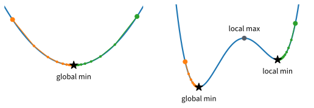
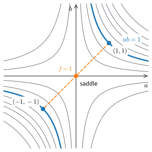
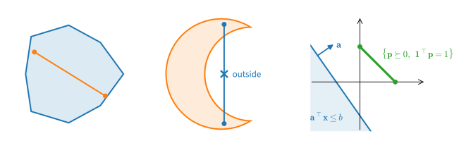
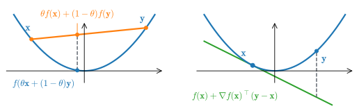
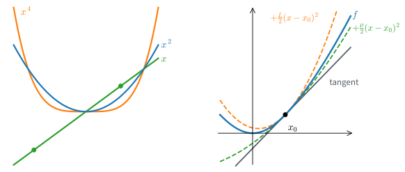
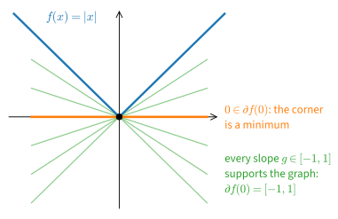

# Convexity
:label:`sec_mdl-convexity`

When a training run finishes, we usually know only one thing about the point
where it stopped: the loss no longer decreases there. Gradient descent with a
safe step size reliably reaches such a point, where the gradient is nearly zero
(:numref:`sec_mdl-gradient-based-optimization`), and Newton's method gets there
faster, even when the stationary point turns out to be a saddle
(:numref:`sec_mdl-curvature-methods`). Neither guarantee tells us whether a
much better point is hiding somewhere else. In this section we ask when a
stationary point is actually the best point available, and how quickly gradient
descent converges to it.

A simple one-dimensional experiment shows that this is not an idle question.
Suppose we run the exact same gradient-descent loop from $500$ random starting
points, first on the bowl $f(x) = (x - \tfrac12)^2$ and then on the tilted
double well $\phi(x) = (x^2 - 1)^2 + x/2$. On the bowl, every single run lands
at the same minimizer. On the double well, nearly half of the runs get trapped
in a shallower valley whose loss sits almost a full unit above the global
minimum. Those stranded runs still have zero gradient—which is all that a
stationarity guarantee promises—and looking at the gradient alone gives no hint
that a deeper valley exists nearby.

The difference between the two functions comes down to a single geometric
property. Every chord drawn between two points on the bowl lies above its
graph, whereas the double well has chords that cut below the curve. Functions
whose chords always lie on or above their graph are called *convex*, and for
them our opening question has the cleanest possible answer: every local minimum
is a global minimum. The proof takes just three lines
(:numref:`subsec_mdl-local-global`). Underneath it lies an even more useful
fact: any tangent line to a convex function stays below the graph across the
entire domain, so local information at a single point constrains the function
everywhere. Summing this tangent bound along the iterates of gradient descent
yields convergence rates that hold from any starting point. Averaging it over a
random variable yields Jensen's inequality, a workhorse of the probability and
information-theory chapters.

We cover a fair amount of ground here, and not every result carries the same
weight. Three ideas are worth keeping at your fingertips: the tangent lower
bound, the fact that local minima are global, and the linear convergence rate
of gradient descent—whose proof relies on a single inequality that survives even
when convexity fails. We begin with convex sets and three equivalent tests for
convex functions, derive their main consequences, and assemble a short calculus
for recognizing convex losses. Since deep-network losses are not convex, we
close by asking which parts of the theory carry over to them. If you are in a
hurry, you can read the chord and tangent conditions in
:numref:`subsec_mdl-three-lenses` and jump straight to
:numref:`subsec_mdl-why-convexity-matters`. Two examples will accompany us
throughout: the chapter's running quadratic $\tfrac12(x_1^2 + 1000\,x_2^2)$ for
measuring convergence rates, and the double well $\phi$, which fails every test
of convexity we throw at it.

```{.python .input #convexity-imports}
#@tab mxnet
import math
import numpy as np
from mxnet import autograd, gluon, init, np as mnp, npx
from mxnet.gluon import nn
from d2l import mxnet as d2l
npx.set_np()
```

```{.python .input #convexity-imports}
#@tab pytorch
import math
import numpy as np
import torch
from torch import nn
from torch.nn import functional as F
from d2l import torch as d2l
```

```{.python .input #convexity-imports}
#@tab tensorflow
import math
import numpy as np
import tensorflow as tf
from d2l import tensorflow as d2l
```

```{.python .input #convexity-imports}
#@tab jax
import math
import numpy as np
import jax
from jax import numpy as jnp
from flax import nnx
import optax
from d2l import jax as d2l
```

## Convex Sets
:label:`subsec_mdl-convex-sets`

Because convex functions are defined along line segments between points of
their domain, we start with the sets those points live in. The domain of a
loss, the feasible region of a constrained problem, and the set of all
minimizers are all sets. Fortunately, we need only a short toolkit: one
definition, three standard families of examples, and one rule for building new
convex sets from old ones.

### Definition and Examples

Geometrically, a set is convex if the straight line segment connecting any two
of its points stays entirely inside the set. Formally, a set
$C \subseteq \mathbb{R}^d$ of $d$-dimensional points is **convex** if

$$
\theta \mathbf{x} + (1 - \theta)\, \mathbf{y} \in C
\qquad \textrm{for all } \mathbf{x}, \mathbf{y} \in C \textrm{ and all } \theta \in [0, 1].
$$
:eqlabel:`eq_mdl-opt-convex-set`

As $\theta$ moves from $1$ to $0$, the combination
$\theta\mathbf{x} + (1-\theta)\mathbf{y}$ sweeps out the line segment from
$\mathbf{x}$ to $\mathbf{y}$. :numref:`fig_mdl-opt-convex-vs-nonconvex-set`
contrasts a convex set with a nonconvex crescent and illustrates the two convex
sets that appear most often in deep learning: the probability simplex and a
half-space.


:label:`fig_mdl-opt-convex-vs-nonconvex-set`

To see what the definition rules out, consider the annulus
$\{\mathbf{x} : 1 \le \|\mathbf{x}\| \le 2\}$. It contains both
$(\tfrac32, 0)$ and $(-\tfrac32, 0)$, yet their midpoint is the origin, which
lies in the hole. A single missing midpoint is enough to violate
:eqref:`eq_mdl-opt-convex-set`.

Three families of convex sets cover almost everything we meet in this chapter.
First, any hyperplane $\{\mathbf{x} : \mathbf{a}^\top\mathbf{x} = b\}$ and any
half-space $\{\mathbf{x} : \mathbf{a}^\top\mathbf{x} \le b\}$ are convex
because $\mathbf{a}^\top\mathbf{x}$ is linear: a weighted average of two
numbers equal to $b$ (or at most $b$) is again equal to $b$ (or at most $b$).
Second, any norm ball $\{\mathbf{x} : \|\mathbf{x}\| \le r\}$ is convex by the
triangle inequality and homogeneity,
$\|\theta\mathbf{x} + (1-\theta)\mathbf{y}\| \le \theta\|\mathbf{x}\| + (1-\theta)\|\mathbf{y}\| \le r$.
This single check covers both the $\ell_2$ balls of weight decay and gradient
clipping and the $\ell_1$ balls of sparsity-inducing regularization. Third is
the probability simplex
$\Delta = \{\mathbf{p} \in \mathbb{R}^d : \mathbf{p} \succeq 0,\ \mathbf{1}^\top\mathbf{p} = 1\}$,
where $\mathbf{p} \succeq 0$ means every entry is nonnegative. Attention
weights, class probabilities, and mixture weights all live on $\Delta$, and its
convexity follows immediately from our next rule.

### New Convex Sets from Old

The intersection of any collection of convex sets—finite or infinite—is always
convex. If two points lie in the intersection, then they lie in every set of
the collection, so the segment between them stays inside every set and
therefore inside the intersection. Intuitively, a convex set has no dents, and
carving a dent-free set with another dent-free set cannot create one. Unions,
by contrast, have no such guarantee: $[0,1] \cup [2,3]$ is a union of two
convex intervals, yet the segment from $1$ to $2$ leaves the set.

This single intersection rule certifies two central sets at once. The
probability simplex is the intersection of one hyperplane
($\mathbf{1}^\top\mathbf{p} = 1$) with $d$ half-spaces ($-p_i \le 0$), so it is
convex. Likewise, the set of symmetric positive semidefinite (PSD) matrices is
convex because it is an intersection of infinitely many half-spaces: for each
fixed vector $\mathbf{z}$, the constraint
$\mathbf{z}^\top \mathbf{A} \mathbf{z} \ge 0$ is a single linear inequality in
the entries of $\mathbf{A}$.

We can also build a convex set from the inside out. The **convex hull** of a
set $S$ is the collection of all weighted averages $\sum_i \theta_i \mathbf{x}_i$
of points $\mathbf{x}_i \in S$ with $\theta_i \ge 0$ and $\sum_i \theta_i = 1$.
It is convex, and in fact it is the smallest convex set containing $S$
(Exercise :exref:`ex_mdl-convexity-prove-jensen-s-finite`). Seen this way, the
probability simplex is simply the convex hull of the standard basis vectors
$\mathbf{e}_1, \ldots, \mathbf{e}_d$: every probability distribution is a
weighted average of certainties.

## Convex Functions
:label:`subsec_mdl-three-lenses`

Just as a convex set has no dents, a convex function is one whose graph curves
upward without ever dipping into a second valley. We now develop three
equivalent tests for convexity—requiring zero, one, and two derivatives
respectively—followed by two refinements: strong convexity, which governs how
fast gradient descent converges, and subgradients, which handle losses with
corners. If you remember only one of the three tests, make it the second: the
tangent lower bound is the engine behind almost every proof in this section.

### The Chord Condition

The first test needs no derivatives at all, which means it applies just as
easily to the absolute value and the hinge loss as to smooth objectives. A
function $f : C \to \mathbb{R}$ on a convex domain $C$ is **convex** if its
graph lies on or below every chord joining two of its points:

$$
f\left(\theta \mathbf{x} + (1 - \theta)\, \mathbf{y}\right)
\;\le\; \theta f(\mathbf{x}) + (1 - \theta) f(\mathbf{y})
\qquad \textrm{for all } \mathbf{x}, \mathbf{y} \in C,\ \theta \in [0, 1].
$$
:eqlabel:`eq_mdl-opt-chord`

Here the left side evaluates $f$ at a point on the segment between
$\mathbf{x}$ and $\mathbf{y}$, while the right side gives the height of the
straight chord joining $(\mathbf{x}, f(\mathbf{x}))$ to
$(\mathbf{y}, f(\mathbf{y}))$ directly above that point. Let us check a
concrete case: for $f(x) = x^2$ with $x = 0$, $y = 2$, and $\theta = \tfrac12$,
the graph sits at $f(1) = 1$ while the chord sits at
$\tfrac12 \cdot 0 + \tfrac12 \cdot 4 = 2$, and indeed $1 \le 2$. For arbitrary
$x$, $y$, and $\theta$, expanding the squares shows that the height gap between
chord and graph is

$$
\theta x^2 + (1-\theta) y^2 - \left(\theta x + (1-\theta) y\right)^2 = \theta(1-\theta)(x-y)^2 \;\ge\; 0.
$$

Thus $x^2$ is convex, with a gap that grows quadratically with the separation
between the two points. We will meet this exact expression again shortly as the
variance in Jensen's inequality.

Two nearby notions are worth naming right away. If the inequality
:eqref:`eq_mdl-opt-chord` is strict whenever $\mathbf{x} \neq \mathbf{y}$ and
$\theta \in (0, 1)$, we call $f$ **strictly convex**; if $-f$ is convex, we
call $f$ **concave**. Notice that a linear function $f(x) = x$ is convex (and
concave) but not strictly convex, because every chord lies directly on its
graph. Notice also why the domain $C$ must be convex: without that requirement,
the intermediate point $\theta\mathbf{x} + (1-\theta)\mathbf{y}$ might not even
belong to the domain where $f$ is defined.

Convex functions and convex sets are two sides of the same geometric coin. The
**epigraph** of $f$ is the region on and above its graph,
$\{(\mathbf{x}, t) : t \ge f(\mathbf{x})\}$. A function $f$ is convex if and
only if its epigraph is a convex set, because a chord between two points of the
epigraph stays above the graph precisely when :eqref:`eq_mdl-opt-chord` holds.
Convexity also passes from functions to sets via their **sublevel sets**
$\{\mathbf{x} \in C : f(\mathbf{x}) \le c\}$: if $f(\mathbf{x}) \le c$ and
$f(\mathbf{y}) \le c$, the chord inequality immediately gives
$f(\theta\mathbf{x} + (1-\theta)\mathbf{y}) \le \theta c + (1-\theta) c = c$.
This is why any inequality constraint $g(\mathbf{x}) \le 0$ with a convex $g$
automatically carves out a convex feasible region.

Be careful, though: the converse does not hold. Every sublevel set of
$f(x) = \sqrt{|x|}$ is a convex interval $\{|x| \le c^2\}$, yet $f$ itself is
not convex. At $x = 0$, $y = 1$, and $\theta = \tfrac12$, the graph sits at
$\sqrt{1/2} \approx 0.71$ while the chord sits below it at $0.5$.

### Local Minima Are Global
:label:`subsec_mdl-local-global`

Remarkably, the chord condition alone is already enough to answer the question
we posed at the opening. :numref:`fig_mdl-opt-local-equals-global` contrasts
the two landscapes: a single basin on a convex objective versus two competing
basins on the double well.


:label:`fig_mdl-opt-local-equals-global`

**Proposition (local minima are global).** *If $f$ is convex on a convex set
$C$, every local minimizer of $f$ on $C$ is a global minimizer.*

**Proof.** Let $\mathbf{x}^\star$ be a local minimizer and let
$\mathbf{y} \in C$ be any other point. For sufficiently small $\theta > 0$, the
point $\mathbf{z}_\theta = (1-\theta)\mathbf{x}^\star + \theta\mathbf{y}$ along
the segment toward $\mathbf{y}$ falls inside the neighborhood where
$\mathbf{x}^\star$ is minimal. Combining local minimality with the chord
inequality gives

$$
f(\mathbf{x}^\star) \;\le\; f(\mathbf{z}_\theta)
\;\le\; (1-\theta)f(\mathbf{x}^\star) + \theta f(\mathbf{y}).
$$

Subtract $(1-\theta)f(\mathbf{x}^\star)$ from both sides and divide by
$\theta > 0$ to obtain $f(\mathbf{x}^\star) \le f(\mathbf{y})$. $\blacksquare$

The geometric picture is just as crisp: if any strictly better point
$\mathbf{y}$ existed anywhere in $C$, the chord from $\mathbf{x}^\star$ toward
$\mathbf{y}$ would slope downward immediately, forcing the graph below
$f(\mathbf{x}^\star)$ arbitrarily close to $\mathbf{x}^\star$ and contradicting
local minimality.

Let us now run the experiment from the opening and see how the proposition
plays out numerically. We apply the same gradient-descent loop (step size
$0.05$, $600$ steps) to both the bowl $(x - \tfrac12)^2$ and the double well
$\phi$, starting from the same $500$ points drawn uniformly on $[-1.5, 1.5]$.
Because the step is small, each iterate rolls downhill without hopping over the
central hump, so a run on $\phi$ should land in whichever well lies on its own
side of the local maximum. We compute that local maximum as a root of
$\phi'(x) = 4x^3 - 4x + \tfrac12$ and check whether the fraction of starts to
its right matches the fraction of runs that end in the shallower right well.

```{.python .input #convexity-basins}
def gd(grad_fn, x, eta=0.05, steps=600):
    for _ in range(steps):
        x = x - eta * grad_fn(x)
    return x

phi = lambda x: (x**2 - 1)**2 + 0.5 * x        # tilted double well
dphi = lambda x: 4 * x * (x**2 - 1) + 0.5      # its derivative
rng = np.random.default_rng()
inits = rng.uniform(-1.5, 1.5, size=500)       # 500 random starting points
bowl = gd(lambda x: 2 * (x - 0.5), inits)      # convex: (x - 1/2)^2
well = gd(dphi, inits)
left, right = well[well < 0], well[well > 0]
print(f'bowl: all {bowl.size} runs end at x = {bowl.mean():.6f}'
      f' (spread {np.ptp(bowl):.0e})')
for name, w in (('left ', left), ('right', right)):
    print(f'well, {name}: {w.size} runs, x = {w.mean():.4f}, phi = {phi(w.mean()):.4f}')
x_max = np.sort(np.roots([4, 0, -4, 0.5]).real)[1]   # local max of phi
print(f'local max at {x_max:.4f}: predicted share right {(1.5 - x_max) / 3:.3f},'
      f' observed {right.size / inits.size:.3f}')
```

On the bowl, all $500$ runs converge to $x = 0.5$ to within numerical rounding.
On the double well, the runs split cleanly into two camps: one at
$x \approx -1.0575$ with $\phi \approx -0.515$, and another at
$x \approx 0.9304$ with $\phi \approx 0.483$—nearly a full unit worse. The
local maximum separating the two basins sits at $x \approx 0.127$, so a
fraction $(1.5 - 0.127)/3 \approx 0.458$ of uniform starts fall to its right.
Across random draws, the observed share hovers within a few percentage points
of $46\%$, matching the prediction up to the sampling noise of $500$ starts.

Both experiments ran the exact same optimizer; only the objective changed.
Convexity eliminates the second basin, though it does not by itself guarantee
that gradient descent will reach the minimizer—that still requires smoothness
and a safe step size, as in :numref:`subsec_mdl-gd-smoothness`.

### The First-Order Condition

The chord condition has the virtue of needing no derivatives, but optimization
proofs are built out of gradients. When $f$ is differentiable, convexity takes
an equivalent first-order form: the tangent hyperplane at any point is a
*global under-estimator* of the function,

$$
f(\mathbf{y}) \;\ge\; f(\mathbf{x}) + \nabla f(\mathbf{x})^\top (\mathbf{y} - \mathbf{x})
\qquad \textrm{for all } \mathbf{x}, \mathbf{y} \in C.
$$
:eqlabel:`eq_mdl-opt-first-order`

Check this on $f(x) = x^2$ at $x = 1$: the tangent line is
$1 + 2(y - 1) = 2y - 1$, and the vertical gap between graph and tangent is
$y^2 - (2y - 1) = (y - 1)^2 \ge 0$ for every $y$. Pause to appreciate how
strong a statement :eqref:`eq_mdl-opt-first-order` is: a single gradient,
computed at a single point $\mathbf{x}$, bounds $f$ from below at every other
point in the domain. Almost every proof in the rest of this section rests on
this one inequality. :numref:`fig_mdl-opt-chord-above-graph` places the first
two tests side by side: chords lie above the graph, while tangents lie below
it.


:label:`fig_mdl-opt-chord-above-graph`

### The Second-Order Condition

For smooth objectives, the quickest way to verify convexity is usually a matrix
test. When $f$ is twice differentiable on an **open** convex domain $C$, $f$ is
convex if and only if its Hessian is positive semidefinite everywhere:

$$
\nabla^2 f(\mathbf{x}) \succeq 0 \qquad \textrm{for all } \mathbf{x} \in C.
$$

In one dimension this reduces to the familiar calculus rule $f''(x) \ge 0$: the
curve bends upward. In $d$ dimensions it says that every one-dimensional slice
through $\mathbf{x}$ bends upward, since
$\mathbf{v}^\top \nabla^2 f(\mathbf{x})\, \mathbf{v}$ is the second derivative
of $f$ along the line in direction $\mathbf{v}$
(:numref:`sec_mdl-multivariable_calculus`).

This matrix test settles three workhorse examples immediately. First, a
quadratic $\tfrac12\mathbf{x}^\top \mathbf{A} \mathbf{x} + \mathbf{b}^\top\mathbf{x}$
with symmetric $\mathbf{A}$ has constant Hessian $\mathbf{A}$, so it is convex
if and only if $\mathbf{A} \succeq 0$. Second, the least-squares loss
$\tfrac12\|\mathbf{X}\mathbf{w} - \mathbf{y}\|^2$ for a design matrix
$\mathbf{X} \in \mathbb{R}^{n \times d}$ ($n$ examples, $d$ weights) has
Hessian $\mathbf{X}^\top \mathbf{X}$; because
$\mathbf{v}^\top \mathbf{X}^\top\mathbf{X} \mathbf{v} = \|\mathbf{X}\mathbf{v}\|^2 \ge 0$
for every $\mathbf{v}$, least squares is always convex
(:numref:`subsec_mdl-psd`). Third, the scalar functions $e^x$, $-\log x$, and
$x \log x$ are all convex on their domains, since their second derivatives
$e^x$, $1/x^2$, and $1/x$ are positive everywhere.

Why did we insist that the domain $C$ be open? On a lower-dimensional domain,
only directions that stay inside $C$ matter: for instance, $x^2 - y^2$ is
convex when restricted to the line $y = 0$, even though its full two-dimensional
Hessian is indefinite.

We now verify that all three tests single out the exact same class of
functions. The proof has four short parts, and the second is the one worth
remembering: applying the tangent bound at the *intermediate* point of a chord
makes the gradient terms cancel—the same trick we will use to prove Jensen's
inequality.

**Proposition (the three characterizations agree).** *Let $f$ be
differentiable on an open convex domain $C$. Then the chord condition
:eqref:`eq_mdl-opt-chord` and the first-order condition
:eqref:`eq_mdl-opt-first-order` are equivalent. If $f$ is twice
differentiable, both are equivalent to $\nabla^2 f(\mathbf{x}) \succeq 0$ on
$C$.*

**Proof.** *(Chord $\Rightarrow$ first-order.)* Fix $\mathbf{x}, \mathbf{y} \in C$
and $\theta \in (0, 1]$. Apply the chord inequality at the intermediate point
$\mathbf{x} + \theta(\mathbf{y} - \mathbf{x})$, subtract $f(\mathbf{x})$ from
both sides, and divide by $\theta$:

$$
\frac{f(\mathbf{x} + \theta(\mathbf{y} - \mathbf{x})) - f(\mathbf{x})}{\theta}
\;\le\; f(\mathbf{y}) - f(\mathbf{x}).
$$

Letting $\theta \downarrow 0$, the left side approaches the directional
derivative $\nabla f(\mathbf{x})^\top(\mathbf{y} - \mathbf{x})$, yielding
:eqref:`eq_mdl-opt-first-order`.

*(First-order $\Rightarrow$ chord.)* Set
$\mathbf{z} = \theta\mathbf{x} + (1-\theta)\mathbf{y}$ and apply the tangent
lower bound at $\mathbf{z}$ twice, once toward each endpoint:

$$
f(\mathbf{x}) \ge f(\mathbf{z}) + \nabla f(\mathbf{z})^\top(\mathbf{x} - \mathbf{z}),
\qquad
f(\mathbf{y}) \ge f(\mathbf{z}) + \nabla f(\mathbf{z})^\top(\mathbf{y} - \mathbf{z}).
$$

Multiply the first inequality by $\theta$, the second by $1 - \theta$, and add.
The linear terms combine to
$\nabla f(\mathbf{z})^\top(\theta\mathbf{x} + (1-\theta)\mathbf{y} - \mathbf{z}) = 0$,
leaving :eqref:`eq_mdl-opt-chord`.

*(Second-order $\Rightarrow$ first-order.)* Restrict $f$ to the line segment
between $\mathbf{x}$ and $\mathbf{y}$ by defining
$g(t) = f(\mathbf{x} + t(\mathbf{y} - \mathbf{x}))$. Its second derivative is
$g''(t) = (\mathbf{y} - \mathbf{x})^\top \nabla^2 f(\mathbf{x} + t(\mathbf{y} - \mathbf{x}))\,(\mathbf{y} - \mathbf{x}) \ge 0$.
By Taylor's theorem with the Lagrange remainder
(:numref:`sec_mdl-single_variable_calculus`),
$g(1) = g(0) + g'(0) + \tfrac12 g''(\tau)$ for some $\tau \in (0, 1)$. Dropping
the nonnegative remainder yields :eqref:`eq_mdl-opt-first-order`.

*(First-order $\Rightarrow$ second-order.)* Suppose for contradiction that
$\mathbf{v}^\top \nabla^2 f(\mathbf{x})\, \mathbf{v} < 0$ for some
$\mathbf{x} \in C$ and direction $\mathbf{v}$. Expanding $f$ along $\mathbf{v}$
gives

$$
f(\mathbf{x} + t\mathbf{v}) = f(\mathbf{x}) + t\, \nabla f(\mathbf{x})^\top\mathbf{v}
+ \frac{t^2}{2}\, \mathbf{v}^\top \nabla^2 f(\mathbf{x})\, \mathbf{v} + o(t^2).
$$

For sufficiently small $t > 0$, the negative quadratic term dominates the
$o(t^2)$ remainder, so $f(\mathbf{x} + t\mathbf{v})$ drops strictly below the
tangent value $f(\mathbf{x}) + t \nabla f(\mathbf{x})^\top\mathbf{v}$,
contradicting :eqref:`eq_mdl-opt-first-order`. $\blacksquare$

### A Numerical Check of the Three Tests

Let us put all three tests to work numerically on two losses: the least-squares
objective $f(\mathbf{w}) = \tfrac12\|\mathbf{X}\mathbf{w} - \mathbf{y}\|^2$
with $n = 20$ random examples and $d = 2$ weights, and the double well $\phi$
from our opening experiment. For least squares we already know the exact
formulas for the violations: expanding the squares as we did for $x^2$ gives
the chord gap (graph minus chord) as
$-\tfrac12\theta(1-\theta)\|\mathbf{X}(\mathbf{u} - \mathbf{v})\|^2$ and the
tangent gap (tangent minus graph) as
$-\tfrac12\|\mathbf{X}(\mathbf{v} - \mathbf{u})\|^2$, both nonpositive. For
each loss, the code below samples $1{,}000$ random chords and tangents in
$[-1.5, 1.5]^d$, reports the largest violation of each kind, and checks the
smallest Hessian eigenvalue across the sampled points.

```{.python .input #convexity-three-lenses}
X, y = rng.normal(size=(20, 2)), rng.normal(size=20)  # least squares, d = 2
losses = {'least squares': (2, lambda w: 0.5 * ((X @ w - y) ** 2).sum(),
                            lambda w: X.T @ (X @ w - y), lambda w: X.T @ X),
          'double well': (1, lambda w: phi(w[0]), dphi,  # phi'' = 12 x^2 - 4
                          lambda w: np.diag(12 * w**2 - 4))}
print('               worst chord gap  worst tangent gap  smallest Hessian eig')
for name, (d, f, grad, hess) in losses.items():
    U, V = rng.uniform(-1.5, 1.5, size=(2, 1000, d))  # 1000 random pairs
    T = rng.uniform(size=1000)
    chord = [f(t * u + (1 - t) * v) - (t * f(u) + (1 - t) * f(v))
             for u, v, t in zip(U, V, T)]             # graph minus chord
    tangent = [f(u) + grad(u) @ (v - u) - f(v)        # tangent minus graph
               for u, v in zip(U, V)]
    eig = min(np.linalg.eigvalsh(hess(u))[0] for u in U)
    print(f'{name:15s}{max(chord):15.3f}{max(tangent):19.3f}{eig:22.3f}')
i = int(np.argmax(chord))                             # the double well's worst
print(f'worst chord of the double well: from {U[i, 0]:.2f} to {V[i, 0]:.2f}')
```

For least squares, not a single sampled chord dips below the graph, no tangent
rises above it, and the Hessian eigenvalues stay positive, just as the algebra
predicted. The double well fails all three checks: its worst chord cuts nearly
one unit below the graph between points in the two valleys, its tangents slice
through the curve, and its second derivative drops near $-4$ at the central
hump, where $\phi''(0) = -4$. Notice, however, an asymmetry between the tests.
Random sampling can *refute* convexity—a single bad chord is a complete
counterexample for $\phi$—but it can never *prove* convexity; for least squares
it only failed to find a violation. What proves convexity for least squares is
the Hessian test, because $\mathbf{X}^\top \mathbf{X}$ is the same PSD matrix
at every $\mathbf{w}$.

### Strict and Strong Convexity

Plain convexity still permits arbitrarily flat stretches, and on a flat stretch
gradient descent can crawl arbitrarily slowly. To guarantee fast convergence,
we need curvature that stays bounded away from zero everywhere. Three simple
functions illustrate the hierarchy, shown in
:numref:`fig_mdl-opt-convexity-hierarchy`(a). The line $f(x) = x$ is convex but
not strictly convex, because its chords sit right on its graph. The quartic
$x^4$ is strictly convex—its second derivative $12x^2$ vanishes only at $0$, so
its slope increases strictly everywhere—yet $f''(0) = 0$ leaves it completely
flat at the minimizer. The quadratic $x^2$, by contrast, has constant curvature
$f''(x) = 2$ at every point.

Strong convexity turns this observation into a quantitative bound. For
$\mu > 0$, a function $f$ is **$\mu$-strongly convex** if subtracting a
quadratic of curvature $\mu$ leaves a convex function—that is, if
$h(\mathbf{x}) = f(\mathbf{x}) - \tfrac{\mu}{2}\|\mathbf{x}\|^2$ is convex.
When $f$ is differentiable, applying the first-order condition to $h$ (whose
gradient is $\nabla f(\mathbf{x}) - \mu\mathbf{x}$) and using the identity
$\|\mathbf{y}\|^2 - \|\mathbf{x}\|^2 - 2\mathbf{x}^\top(\mathbf{y} - \mathbf{x}) = \|\mathbf{y} - \mathbf{x}\|^2$
yields the equivalent inequality

$$
f(\mathbf{y}) \;\ge\; f(\mathbf{x}) + \nabla f(\mathbf{x})^\top(\mathbf{y} - \mathbf{x})
+ \frac{\mu}{2}\, \|\mathbf{y} - \mathbf{x}\|^2
\qquad \textrm{for all } \mathbf{x}, \mathbf{y}.
$$
:eqlabel:`eq_mdl-opt-strong-convexity`

Geometrically, the graph of $f$ must sit not merely above its tangent line at
$\mathbf{x}$, but above a parabola of curvature $\mu$ tangent to it there.
Applying the second-order condition to $h$ gives the matrix test: a
twice-differentiable $f$ is $\mu$-strongly convex if and only if
$\nabla^2 f(\mathbf{x}) \succeq \mu\mathbf{I}$ everywhere, where $\mathbf{I}$
is the identity matrix. Thus $x^2$ is $2$-strongly convex, whereas $x^4$ fails
to be strongly convex on any neighborhood of $0$ because $f''(0) = 0 < \mu$ for
every $\mu > 0$. Notice also a practical bonus: adding the ridge penalty
$\tfrac{\lambda}{2}\|\mathbf{w}\|^2$ to any convex loss immediately makes the
sum $\lambda$-strongly convex, because subtracting
$\tfrac{\lambda}{2}\|\mathbf{w}\|^2$ recovers the original convex loss. Weight
decay does not just shrink parameters; it guarantees strong convexity.


:label:`fig_mdl-opt-convexity-hierarchy`

Strong convexity is the natural counterpart to smoothness. Recall from
:numref:`subsec_mdl-gd-smoothness` that $f$ is **$L$-smooth** when its gradient
is $L$-Lipschitz,
$\|\nabla f(\mathbf{x}) - \nabla f(\mathbf{y})\| \le L\|\mathbf{x} - \mathbf{y}\|$;
for a convex twice-differentiable function, this means
$\nabla^2 f \preceq L\mathbf{I}$. Smoothness places a quadratic ceiling above
the graph,
$f(\mathbf{y}) \le f(\mathbf{x}) + \nabla f(\mathbf{x})^\top(\mathbf{y} - \mathbf{x}) + \tfrac{L}{2}\|\mathbf{y} - \mathbf{x}\|^2$,
while strong convexity places a quadratic floor :eqref:`eq_mdl-opt-strong-convexity`
beneath it. Together they sandwich $f$ between two tangent parabolas of
curvatures $\mu$ and $L$, as illustrated in
:numref:`fig_mdl-opt-convexity-hierarchy`(b) for
$f(x) = \tfrac12 x^2 + 3\log\cosh x$, whose second derivative
$f''(x) = 1 + 3/\cosh^2 x$ ranges between $\mu = 1$ and $L = 4$.

The ratio $\kappa = L/\mu$ is the **condition number**, generalizing the
eigenvalue ratio we encountered for quadratics in
:numref:`subsec_mdl-quadratic-model`. On our running quadratic
$\tfrac12(x_1^2 + 1000\,x_2^2)$, the extreme curvatures are $\mu = 1$ and
$L = 1000$, giving $\kappa = 10^3$.

### Subgradients

Important losses such as the $\ell_1$ norm $\|\mathbf{x}\|_1$ and the hinge
loss $\max(0, 1 - z)$ have sharp corners, where no gradient exists and
:eqref:`eq_mdl-opt-first-order` cannot be written as stated. Rather than give
up on the tangent bound, we keep the *job* the gradient was doing—producing a
global linear under-estimator—and turn that job into a definition. A vector
$\mathbf{g}$ is a **subgradient** of $f$ at $\mathbf{x}$ if

$$
f(\mathbf{y}) \;\ge\; f(\mathbf{x}) + \mathbf{g}^\top (\mathbf{y} - \mathbf{x})
\qquad \textrm{for all } \mathbf{y}.
$$
:eqlabel:`eq_mdl-opt-subgradient`

The set of all subgradients at $\mathbf{x}$ is called the **subdifferential**,
written $\partial f(\mathbf{x})$. Wherever a convex function $f$ is
differentiable, the subdifferential collapses to a single vector,
$\{\nabla f(\mathbf{x})\}$. At a corner, however, it fans out into a whole set
of supporting slopes (:numref:`fig_mdl-opt-subgradient-fan`). For $f(x) = |x|$
at $x = 0$, every slope $g \in [-1, 1]$ satisfies $|y| \ge g y$ for all $y$, so
$\partial f(0) = [-1, 1]$; similarly, for the hinge loss $\max(0, 1 - z)$ at
the kink $z = 1$, we get $\partial f(1) = [-1, 0]$.


:label:`fig_mdl-opt-subgradient-fan`

This immediately gives a derivative-free optimality test: $\mathbf{x}^\star$
minimizes $f$ if and only if $\mathbf{0} \in \partial f(\mathbf{x}^\star)$.
The proof is a one-line tautology: setting $\mathbf{g} = \mathbf{0}$ in
:eqref:`eq_mdl-opt-subgradient` reads $f(\mathbf{y}) \ge f(\mathbf{x}^\star)$
for all $\mathbf{y}$, which is literally the definition of a global minimizer.

Does a convex function always possess a subgradient? At every interior point of
its domain, yes—a fact we will rely on to prove Jensen's inequality. In one
dimension the reason is elementary. For any three points $a < b < c$ in an open
interval where $f$ is convex, rearranging the chord inequality at $b$ gives

$$
\frac{f(b) - f(a)}{b - a} \;\le\; \frac{f(c) - f(a)}{c - a} \;\le\; \frac{f(c) - f(b)}{c - b},
$$

meaning that chord slopes are nondecreasing from left to right. Consequently,
the difference quotient $q(x) = (f(x) - f(x_0))/(x - x_0)$ at any interior
point $x_0$ is nondecreasing in $x$, so its one-sided limits—the left and right
derivatives $f'_-(x_0) \le f'_+(x_0)$—both exist and are finite. Every slope
$g \in [f'_-(x_0), f'_+(x_0)]$ is a subgradient: for $y > x_0$ we have
$q(y) \ge f'_+(x_0) \ge g$, which rearranges to
$f(y) \ge f(x_0) + g(y - x_0)$, and the case $y < x_0$ is symmetric.

The same guarantee extends to $d$ dimensions: at every interior point of its
domain, a convex function has at least one subgradient, so a supporting
hyperplane always fits beneath its graph (:citet:`Rockafellar.1970`;
:citet:`Boyd.Vandenberghe.2004`, section 2.5). We will use this result without
proof. Keep in mind, though, that as a search direction a subgradient is much
weaker than a true gradient: stepping along $-\mathbf{g}$ need not decrease
$f$ at all (at the minimum $x = 0$ of $|x|$, the valid subgradient
$g = \tfrac12$ steps to $-\eta/2$, raising the loss). For that reason, the
subgradient method requires diminishing step sizes and converges slowly, with
error falling only as $1/\sqrt{k}$.

## Consequences of Convexity
:label:`subsec_mdl-why-convexity-matters`

The rest of this book draws on three major consequences of convexity, and all
three spring from the same geometric source: a supporting line or hyperplane
that bounds the function from below everywhere. Averaged over a random
variable, that bound yields Jensen's inequality. Evaluated at a stationary
point, it certifies global optimality—sharpening what
:numref:`subsec_mdl-local-global` deduced from the chord condition alone.
Summed along the steps of gradient descent, it turns local progress into global
convergence rates. Jensen's inequality stands on its own, so if you are reading
purely for optimization you can skip directly to the next subsection.

### Jensen's Inequality
:label:`subsec_mdl-jensen`

Expected losses, average log-likelihoods, and KL divergences all confront the
same basic question: how does a function of an average compare with the average
of the function? The simplest two-point example shows which way the inequality
points. Let $Z$ take the values $0$ and $2$ with probability $\tfrac12$ each,
and let $f(x) = x^2$. Evaluating $f$ at the mean gives
$f(\mathbb{E}[Z]) = f(1) = 1$, whereas averaging $f$ over the outcomes gives
$\mathbb{E}[f(Z)] = \tfrac12 \cdot 0 + \tfrac12 \cdot 4 = 2$. The gap of $1$ is
simply the variance of $Z$; in fact, for $f(x) = x^2$ the difference
$\mathbb{E}[Z^2] - (\mathbb{E}[Z])^2$ is always the variance. Look back at
:numref:`fig_mdl-opt-chord-above-graph`(a): the chord inequality is making this
exact comparison for a two-point distribution with weights $\theta$ and
$1 - \theta$, and the gap $\theta(1-\theta)(x - y)^2$ we computed earlier for
$x^2$ is that distribution's variance.

Nothing about this argument is restricted to two points. Applying
:eqref:`eq_mdl-opt-chord` inductively (Exercise
:exref:`ex_mdl-convexity-prove-jensen-s-finite`) gives the finite form

$$
f\left(\sum_i \theta_i \mathbf{x}_i\right) \;\le\; \sum_i \theta_i\, f(\mathbf{x}_i),
\qquad \theta_i \ge 0,\ \sum_i \theta_i = 1.
$$
:eqlabel:`eq_mdl-opt-jensen-finite`

Because nonnegative weights summing to one define a discrete probability
distribution on the points $\mathbf{x}_i$, the natural generalization replaces
the finite average with an arbitrary expectation.

**Proposition (Jensen's inequality).** *Let $f$ be convex on a convex set
$C \subseteq \mathbb{R}^d$, and let $\mathbf{Z}$ be a random vector taking
values in $C$, with $\mathbb{E}\|\mathbf{Z}\| < \infty$ and mean
$\mathbf{m} = \mathbb{E}[\mathbf{Z}]$ in the interior of $C$. Then*

$$
f\left(\mathbf{m}\right) \;\le\; \mathbb{E}\left[f(\mathbf{Z})\right].
$$
:eqlabel:`eq_mdl-opt-jensen`

*If $f$ is strictly convex, equality holds if and only if
$\mathbf{Z} = \mathbf{m}$ with probability one.*

**Proof.** Because $\mathbf{m}$ lies in the interior of $C$, $f$ has at least
one subgradient $\mathbf{g} \in \partial f(\mathbf{m})$. The supporting
hyperplane at $\mathbf{m}$ bounds $f$ for every outcome at once: by
:eqref:`eq_mdl-opt-subgradient`,

$$
f(\mathbf{Z}) \;\ge\; f(\mathbf{m}) + \mathbf{g}^\top (\mathbf{Z} - \mathbf{m}).
$$

Now take expectations of both sides. Because
$\mathbb{E}[\mathbf{Z} - \mathbf{m}] = \mathbf{0}$, the linear term vanishes,
leaving $\mathbb{E}[f(\mathbf{Z})] \ge f(\mathbf{m})$. When $f$ is strictly
convex, this supporting hyperplane touches the graph *only* at $\mathbf{m}$: if
it also touched at some $\mathbf{x} \neq \mathbf{m}$, strict convexity would
force
$f\bigl(\tfrac{\mathbf{x} + \mathbf{m}}{2}\bigr) < \tfrac12 f(\mathbf{x}) + \tfrac12 f(\mathbf{m})$,
placing the graph strictly below the supporting hyperplane at the midpoint, a
contradiction. Hence the pointwise inequality is strict whenever
$\mathbf{Z} \neq \mathbf{m}$, so equality in expectation forces
$\mathbf{Z} = \mathbf{m}$ with probability one. $\blacksquare$

As a bonus, the same pointwise bound shows that $f(\mathbf{Z})$ is bounded
below by an integrable random variable, so $\mathbb{E}[f(\mathbf{Z})]$ is
always well-defined (possibly $+\infty$, in which case the inequality holds
trivially). In plain terms, spreading a random variable out while keeping its
mean fixed can only increase the expected value of a convex function. For a
concave function $f$, the inequality reverses:
$\mathbb{E}[f(\mathbf{Z})] \le f(\mathbb{E}[\mathbf{Z}])$.

In machine learning, the most frequent application of Jensen's inequality is
proving that KL divergence is never negative; :numref:`sec_mdl-information_theory`
meets this same result as Gibbs' inequality.

**Corollary (nonnegativity of KL divergence).** *For probability
distributions $p$ and $q$ on a common finite alphabet, with $q(x) > 0$
wherever $p(x) > 0$,*

$$
D_{\textrm{KL}}(p \,\|\, q) \;=\; \sum_x p(x) \log \frac{p(x)}{q(x)} \;\ge\; 0,
$$

*with equality if and only if $p = q$.*

**Proof.** Draw $Z \sim p$ and apply Jensen's inequality to the strictly
convex function $-\log$ and the positive random variable $R = q(Z)/p(Z)$:

$$
D_{\textrm{KL}}(p \,\|\, q)
= \mathbb{E}_p\left[-\log R\right]
\;\ge\; -\log \mathbb{E}_p[R]
= -\log \sum_{x : p(x) > 0} p(x)\, \frac{q(x)}{p(x)}
\;\ge\; -\log 1 = 0,
$$

where the last step uses $\sum_{x : p(x) > 0} q(x) \le 1$. By the equality
condition of Jensen's inequality, equality holds if and only if $R$ is constant
with probability one and $q$ places no mass outside the support of $p$—that is,
$q = c\,p$ with $c = 1$. $\blacksquare$

Applying the same idea to the concave function $\log$ yields the classical
**arithmetic–geometric mean inequality**: for any positive numbers
$x_1, \ldots, x_N$, concavity gives
$\log\bigl(\tfrac1N \sum_i x_i\bigr) \ge \tfrac1N \sum_i \log x_i$, and
exponentiating both sides produces

$$
\frac{1}{N} \sum_{i=1}^N x_i \;\ge\; \left(\prod_{i=1}^N x_i\right)^{1/N},
$$

with equality if and only if all $x_i$ are equal, since $\log$ is strictly
concave. Likewise, the evidence lower bound (ELBO) of
:numref:`sec_mdl-latent-em-elbo`, which bounds the logarithm of an expectation
from below, is another direct application of Jensen's inequality to $\log$.

Let us test both Jensen's gap and the KL equality case numerically. First, for
$Z \sim \mathcal{N}(0, 1)$ and $f(x) = e^x$, we can compute both sides in
closed form—$\mathbb{E}[e^Z] = \sqrt{e} \approx 1.649$ versus
$e^{\mathbb{E}[Z]} = 1$—and see how closely Monte Carlo matches them. Second,
as we blend $q$ into $p$ via $(1 - \varepsilon)p + \varepsilon q$, how quickly
does the KL divergence vanish: linearly in $\varepsilon$, or faster?

```{.python .input #convexity-jensen-mc}
rng = np.random.default_rng()
z = rng.normal(size=1_000_000)                 # Z ~ N(0, 1)
print(f'E[exp(Z)] = {np.exp(z).mean():.2f} vs exp(E[Z]) = {np.exp(z.mean()):.2f}'
      f'  (population: {np.exp(0.5):.4f} vs 1)')
kl = lambda p, q: (p * np.log(p / q)).sum(axis=1)
p = rng.dirichlet(np.ones(10), size=1000)      # 1000 random pairs, 10 symbols
q = rng.dirichlet(np.ones(10), size=1000)
print('median KL(p || (1-eps) p + eps q), eps = 1e-2, 1e-3, 1e-4:',
      *[f'{np.median(kl(p, (1 - e) * p + e * q)):.1e}' for e in (1e-2, 1e-3, 1e-4)])
```

The Monte Carlo averages land right around $1.65$ versus $1.00$; drawing more
samples shrinks the estimation noise, but the structural Jensen gap remains
fixed. In the KL experiment, the divergence vanishes much faster than
$\varepsilon$: every tenfold reduction in $\varepsilon$ cuts the median
divergence roughly a hundredfold. Expanding the logarithm explains why:
$D_{\textrm{KL}}(p \,\|\, (1-\varepsilon)p + \varepsilon q) \approx \tfrac{\varepsilon^2}{2}\sum_x (q(x) - p(x))^2/p(x)$
once $\varepsilon\,q(x)/p(x)$ is small for every $x$. (Pairs where $p$ assigns
tiny probability to some symbol enter this quadratic regime last, which is why
we report the median rather than the maximum.) Equality is approached
quadratically, and attained only in the limit $q \to p$.

### Local and Global Minima

We already proved that every local minimum of a convex function is global
(:numref:`subsec_mdl-local-global`). Three companion facts follow just as
effortlessly, each in a single line. First, the set of all global minimizers is
convex: if both $\mathbf{x}$ and $\mathbf{y}$ attain the minimum value
$f^\star$, the chord inequality forces every point between them to lie at or
below $f^\star$. Second, for a differentiable convex $f$ on an open set,
$\nabla f(\mathbf{x}) = \mathbf{0}$ immediately implies
$f(\mathbf{x}) = f^\star$, because the first-order condition with a zero
gradient reads $f(\mathbf{y}) \ge f(\mathbf{x})$ for all $\mathbf{y}$. Third,
a small gradient guarantees a small suboptimality gap: pointing the first-order
condition at a minimizer $\mathbf{x}^\star$ gives
$f(\mathbf{x}) - f^\star \le \nabla f(\mathbf{x})^\top(\mathbf{x} - \mathbf{x}^\star) \le \|\nabla f(\mathbf{x})\|\,\|\mathbf{x} - \mathbf{x}^\star\|$.
Thus the stationarity result of :numref:`subsec_mdl-gd-smoothness`—that
gradient descent with $\eta = 1/L$ drives the smallest gradient norm to
zero—upgrades for convex objectives into a guarantee on the *loss value*
itself, provided the iterates stay within a bounded distance of
$\mathbf{x}^\star$. In :numref:`subsec_mdl-convergence-rates` we will prove
that they do, and pin down the exact rate.

Be aware of two things that plain convexity does *not* guarantee: a minimizer
need not be unique (a convex function can be flat along an entire segment), and
it need not even exist ($e^x$ approaches $0$ as $x \to -\infty$ without ever
attaining it). Strict convexity rules out multiple minimizers, and strong
convexity guarantees both existence and uniqueness.

**Proposition (uniqueness).** *A strictly convex $f$ has at most one
minimizer. A continuous $\mu$-strongly convex $f$ on a nonempty closed convex
set $C$ with nonempty interior has exactly one.*

**Proof.** Suppose $\mathbf{x} \neq \mathbf{y}$ were both global minimizers
with value $f^\star$. By the strict chord inequality at $\theta = \tfrac12$,
their midpoint would satisfy
$f\bigl(\tfrac{\mathbf{x} + \mathbf{y}}{2}\bigr) < f^\star$, a contradiction.
Because strong convexity implies strict convexity, it remains only to prove
existence. We prove it for a differentiable $f$ on $C = \mathbb{R}^d$, which
covers the unconstrained losses in this book; the general case follows the same
steps using a subgradient of $f - \tfrac{\mu}{2}\|\cdot\|^2$ at an interior
point of $C$. Fix any starting point $\mathbf{x}_0$. In
:eqref:`eq_mdl-opt-strong-convexity`, the linear term is at least
$-\|\nabla f(\mathbf{x}_0)\|\,\|\mathbf{y} - \mathbf{x}_0\|$, so
$f(\mathbf{y}) > f(\mathbf{x}_0)$ whenever
$\|\mathbf{y} - \mathbf{x}_0\| > 2\|\nabla f(\mathbf{x}_0)\|/\mu$. Hence the
sublevel set $\{\mathbf{y} : f(\mathbf{y}) \le f(\mathbf{x}_0)\}$ is bounded,
and continuity of $f$ ensures that it is closed. Every continuous function on a
nonempty closed and bounded set attains its minimum, and the minimum over this
sublevel set is automatically the global minimum over $\mathbb{R}^d$.
$\blacksquare$

The technical hypotheses on $C$ and continuity merely exclude pathological
functions that jump upward at the boundary of their domain, which never occur
for the losses in this book. By contrast, the missing minimizer of $e^x$ shows
up in real machine learning: Exercise
:exref:`ex_mdl-convexity-minimizer-existence` traces it directly to logistic
regression on linearly separable data.

### Convergence Rates
:label:`subsec_mdl-convergence-rates`

Convexity tells us *where* gradient descent stops, but not *how fast* it gets
there—and on speed, plain convexity promises surprisingly little. Compare
$f(x) = x^2$ and $f(x) = x^4$: both are strictly convex with unique minimizer
$0$, yet only $x^2$ is strongly convex. Let us run the exact same
gradient-descent loop ($\eta = \tfrac18$, starting from $x_0 = 1$) on both
functions for $10^4$ steps and watch how differently they behave.

```{.python .input #mdl-convexity-strict-and-strong-convexity}
eta, steps = 1 / 8, 10_000
x2, x4 = np.ones(steps + 1), np.ones(steps + 1)  # iterates from x_0 = 1
for j in range(steps):                         # same start, same step
    x2[j + 1] = x2[j] - eta * 2 * x2[j]        # f(x) = x^2
    x4[j + 1] = x4[j] - eta * 4 * x4[j]**3     # f(x) = x^4
k = np.arange(1, steps + 1)
print('x^2: first k with x_k < 1e-6:', k[x2[1:] < 1e-6][0])
print('x^4: x_k * sqrt(k) at k = 1e2, 1e3, 1e4:',
      (x4[1:] * np.sqrt(k))[[99, 999, 9999]].round(3))
d2l.plot(k, [x4[1:]**4, x2[1:]**2], 'k', 'f(x_k)', xscale='log',
         yscale='log', ylim=(1e-12, 1), legend=['x^4', 'x^2'])
```

The contrast is dramatic. On $x^2$, every step multiplies the iterate by a
constant factor $1 - 2\eta = 0.75$, driving it below $10^{-6}$ in just $49$
steps; the loss drops off the bottom of the plot almost immediately. On $x^4$,
by contrast, each step multiplies $x_k$ by $1 - 4\eta x_k^2$, a contraction
factor that creeps closer and closer to $1$ as the iterate approaches the flat
valley at $0$. The printed products $x_k\sqrt{k}$ settle near $1$, showing that
$x_k$ decays only like $1/\sqrt{k}$ and still sits at $0.01$ after $10{,}000$
steps. On a log–log plot, the loss gap $x_k^4$ therefore traces a straight line
of slope $-2$. Strict convexity rules out multiple minimizers, but it cannot
guarantee fast convergence; a geometric rate requires $\mu > 0$. Exercise
:exref:`ex_mdl-convexity-quartic-sublinear` proves this $1/\sqrt{k}$ law for
the quartic.

The next two propositions make this contrast completely general: every smooth
strongly convex function converges geometrically like $x^2$, whereas without
$\mu > 0$ we can guarantee only an $O(1/k)$ decay. Both proofs begin with the
**descent lemma** from :numref:`subsec_mdl-gd-smoothness`: for an $L$-smooth
function $f$ and the gradient step
$\mathbf{x}_{k+1} = \mathbf{x}_k - \tfrac1L\nabla f(\mathbf{x}_k)$,

$$
f(\mathbf{x}_{k+1}) \;\le\; f(\mathbf{x}_k) - \frac{1}{2L}\, \|\nabla f(\mathbf{x}_k)\|^2.
$$

Each step reduces the objective by at least $\|\nabla f(\mathbf{x}_k)\|^2/(2L)$.
On a general nonconvex function, that only proves the gradient shrinks to zero.
Convexity supplies the missing link between the gradient and the suboptimality
gap: whenever $f(\mathbf{x}_k) - f^\star$ is still large, the gradient must be
large enough to keep making progress, so the iterates cannot stall far from the
optimum.

**Proposition (gradient descent on smooth convex functions).** *Let $f$ be
convex and $L$-smooth with a minimizer $\mathbf{x}^\star$. Gradient descent
with $\eta = 1/L$ satisfies, for every $k \ge 1$,*

$$
f(\mathbf{x}_k) - f(\mathbf{x}^\star) \;\le\; \frac{L\, \|\mathbf{x}_0 - \mathbf{x}^\star\|^2}{2k}.
$$
:eqlabel:`eq_mdl-opt-rate-convex`

Thus the loss gap decays at least as fast as $1/k$, scaled by the smoothness
constant and the squared initial distance to the minimizer. To put numbers on
it, if $L = 1$ and $\|\mathbf{x}_0 - \mathbf{x}^\star\| = 10$, the bound is
$50/k$, guaranteeing a gap below $10^{-2}$ within $5{,}000$ steps.

**Proof.** Combine the descent lemma with the first-order condition
:eqref:`eq_mdl-opt-first-order` evaluated at $\mathbf{x}_k$ toward the optimum,
$f(\mathbf{x}_k) - f(\mathbf{x}^\star) \le \nabla f(\mathbf{x}_k)^\top(\mathbf{x}_k - \mathbf{x}^\star)$:

$$
f(\mathbf{x}_{k+1}) - f(\mathbf{x}^\star)
\;\le\; \nabla f(\mathbf{x}_k)^\top (\mathbf{x}_k - \mathbf{x}^\star) - \frac{1}{2L} \|\nabla f(\mathbf{x}_k)\|^2.
$$

Now comes the clever step: complete the square so that the right side turns
into a difference of two squared distances to $\mathbf{x}^\star$,

$$
\nabla f(\mathbf{x}_k)^\top (\mathbf{x}_k - \mathbf{x}^\star) - \frac{1}{2L} \|\nabla f(\mathbf{x}_k)\|^2
= \frac{L}{2} \left( \|\mathbf{x}_k - \mathbf{x}^\star\|^2
- \left\|\mathbf{x}_k - \mathbf{x}^\star - \tfrac{1}{L}\nabla f(\mathbf{x}_k)\right\|^2 \right).
$$

Notice that the second norm is simply $\|\mathbf{x}_{k+1} - \mathbf{x}^\star\|^2$.
Summing over $j = 0, \ldots, k - 1$, the right side telescopes cleanly:

$$
\sum_{j=0}^{k-1} \left( f(\mathbf{x}_{j+1}) - f(\mathbf{x}^\star) \right)
\;\le\; \frac{L}{2} \left( \|\mathbf{x}_0 - \mathbf{x}^\star\|^2 - \|\mathbf{x}_k - \mathbf{x}^\star\|^2 \right)
\;\le\; \frac{L}{2}\, \|\mathbf{x}_0 - \mathbf{x}^\star\|^2.
$$

Because the descent lemma ensures that $f(\mathbf{x}_j)$ never increases, the
final term $f(\mathbf{x}_k) - f(\mathbf{x}^\star)$ is the smallest term in the
sum, so $k\left(f(\mathbf{x}_k) - f(\mathbf{x}^\star)\right)$ is bounded by the
total sum. Dividing by $k$ gives :eqref:`eq_mdl-opt-rate-convex`. $\blacksquare$

Two features of this proof are worth noting. First, the dimension $d$ never
appears: a model with a billion weights and the same $L$ and initial distance
enjoys the exact same worst-case guarantee. Second, before summing, the
per-step inequality has a nonnegative left side
$f(\mathbf{x}_{k+1}) - f^\star \ge 0$, which forces
$\|\mathbf{x}_{k+1} - \mathbf{x}^\star\| \le \|\mathbf{x}_k - \mathbf{x}^\star\|$:
every single step moves monotonically closer to every minimizer.

Adding strong convexity transforms this $1/k$ decay into a geometric rate.

**Proposition (linear rate under strong convexity).** *Let $f$ be
$\mu$-strongly convex and $L$-smooth, with minimizer $\mathbf{x}^\star$.
Gradient descent with $\eta = 1/L$ satisfies*

$$
f(\mathbf{x}_k) - f(\mathbf{x}^\star)
\;\le\; \left(1 - \frac{\mu}{L}\right)^{k} \left( f(\mathbf{x}_0) - f(\mathbf{x}^\star) \right).
$$
:eqlabel:`eq_mdl-opt-rate-strong`

In words, every iteration shaves off at least a fraction $\mu/L = 1/\kappa$ of
the remaining loss gap.

**Proof.** The proof splits into two short steps. First, strong convexity
bounds the squared gradient norm from below in terms of the suboptimality gap.
Minimize both sides of :eqref:`eq_mdl-opt-strong-convexity` over $\mathbf{y}$:
the left side attains its minimum $f(\mathbf{x}^\star)$, while the right side
is a simple quadratic in $\mathbf{y}$ minimized at
$\mathbf{y} = \mathbf{x} - \tfrac{1}{\mu}\nabla f(\mathbf{x})$, where its value
is $f(\mathbf{x}) - \tfrac{1}{2\mu}\|\nabla f(\mathbf{x})\|^2$. Rearranging
gives

$$
\frac12\, \|\nabla f(\mathbf{x})\|^2 \;\ge\; \mu \left( f(\mathbf{x}) - f(\mathbf{x}^\star) \right)
\qquad \textrm{for all } \mathbf{x}.
$$
:eqlabel:`eq_mdl-opt-pl`

Second, substitute :eqref:`eq_mdl-opt-pl` directly into the descent lemma:

$$
f(\mathbf{x}_{k+1}) - f(\mathbf{x}^\star)
\;\le\; f(\mathbf{x}_k) - f(\mathbf{x}^\star) - \frac{1}{2L} \|\nabla f(\mathbf{x}_k)\|^2
\;\le\; \left(1 - \frac{\mu}{L}\right) \left( f(\mathbf{x}_k) - f(\mathbf{x}^\star) \right).
$$

Applying this contraction $k$ times completes the proof. $\blacksquare$

Look closely at the second half of that proof: it never invoked convexity at
all, only the inequality :eqref:`eq_mdl-opt-pl`. We will return to that
surprising fact in :numref:`subsec_mdl-beyond-convexity`. Notice also the
enormous speedup over the non-strongly-convex case: reaching relative accuracy
$\epsilon$ now takes roughly $\kappa \log(1/\epsilon)$ steps instead of
$O(1/\epsilon)$. On our running quadratic with $\kappa = 10^3$, gaining six
digits of accuracy, $(1 - 10^{-3})^k \le 10^{-6}$, takes about $13{,}800$ steps
by this bound.

How tight is :eqref:`eq_mdl-opt-rate-strong` in practice? Let us measure it on
a least-squares problem whose Hessian $\mathbf{X}^\top\mathbf{X}$ has
eigenvalues $1$ and $10$ by construction ($\mu = 1$, $L = 10$, $\kappa = 10$).
We run gradient descent with $\eta = 1/L$ and track the actual per-step ratio
of successive loss gaps, $(f(\mathbf{w}_{k+1}) - f^\star)/(f(\mathbf{w}_k) - f^\star)$.

```{.python .input #convexity-rate-check}
rng = np.random.default_rng()
Q, _ = np.linalg.qr(rng.normal(size=(20, 2)))  # orthonormal columns
R, _ = np.linalg.qr(rng.normal(size=(2, 2)))   # random rotation
X = Q @ np.diag([1.0, np.sqrt(10.0)]) @ R      # X^T X has eigenvalues 1, 10
y = rng.normal(size=20)
f = lambda w: 0.5 * ((X @ w - y) ** 2).sum()
mu, L = np.linalg.eigvalsh(X.T @ X)[[0, -1]]
w_star = np.linalg.lstsq(X, y, rcond=None)[0]
w, gaps = np.zeros(2), [f(np.zeros(2)) - f(w_star)]
for _ in range(60):                            # gradient descent, eta = 1/L
    w = w - X.T @ (X @ w - y) / L
    gaps.append(f(w) - f(w_star))
r = np.array(gaps[1:]) / np.array(gaps[:-1])   # per-step contraction of f - f*
print(f'mu = {mu:.4f}, L = {L:.4f}: bound 1 - mu/L = {1 - mu / L:.4f},'
      f' its square {(1 - mu / L)**2:.4f}')
print('first three ratios:', r[:3].round(4), ' largest ratio:', r.max().round(4))
```

Our bound promises a contraction factor of $0.9$ per step, yet from the second
step onward the measured ratio is $0.81$—which is $(1 - \mu/L)^2$. (The very
first ratio depends on the random starting direction and varies from run to
run.) Viewing the update in the eigenvector coordinates of
$\mathbf{X}^\top\mathbf{X}$ explains what happened. With $\eta = 1/L$, the
first step multiplies the stiff eigen-component of
$\mathbf{w} - \mathbf{w}^\star$ by $1 - L/L = 0$, wiping it out completely. In
two dimensions, only the slow component remains; its distance to
$\mathbf{w}^\star$ shrinks by $1 - \mu/L$ per step, so the loss gap—which is
quadratic in that distance—shrinks by $(1 - \mu/L)^2$. In higher dimensions,
the ratio climbs toward $(1 - \mu/L)^2$ as the faster eigen-components decay.

Our short proof gave away a square in the contraction factor. A sharper
analysis shows that gradient descent with $\eta = 1/L$ in fact contracts
$f - f^\star$ by $(1 - \mu/L)^2$ per step on *every* $L$-smooth $\mu$-strongly
convex function :cite:`Taylor.Hendrickx.Glineur.2018`, with quadratics
achieving equality; Exercise :exref:`ex_mdl-convexity-distance-contraction`
proves the closely related bound $\kappa(1 - \mu/L)^{2k}$. Returning to our
$\kappa = 10^3$ running quadratic, six digits of accuracy cost roughly
$13{,}800$ steps by our simple bound, about $6{,}900$ steps at the true
$(1 - \mu/L)^2$ rate, and half again as many—$3{,}454$ steps—at the optimal
fixed step $\eta = 2/(\mu + L)$ from
:numref:`sec_mdl-gradient-based-optimization`. One factor of two came from the
looseness of our proof, and the second from doubling the step size.

## Recognizing Convexity
:label:`subsec_mdl-recognizing-convexity`

Global optimality and clean convergence rates are useful only if we can tell
whether a given loss function is convex in the first place. Computing Hessians
by hand quickly becomes tedious—and fails altogether at kinks—so in practice we
rarely check convexity from scratch. Instead, we recognize convex objectives by
assembling them from simple convex building blocks.

### A Calculus of Convex Functions

Four elementary operations preserve convexity, and almost every convex loss in
machine learning is built from basic convex atoms using just these four rules.

1. **Nonnegative weighted sums.** If $f_1, \ldots, f_m$ are convex and
   $w_i \ge 0$, then $\sum_i w_i f_i$ is convex: simply multiply the chord
   inequality for each $f_i$ by $w_i$ and add. In particular, averaging a
   convex per-example loss over a training set always yields a convex
   objective.
2. **Affine pre-composition.** If $f$ is convex, then so is
   $\mathbf{x} \mapsto f(\mathbf{A}\mathbf{x} + \mathbf{b})$: an affine map
   carries the line segment between $\mathbf{x}$ and $\mathbf{y}$ onto the
   segment between their images with the exact same weight $\theta$, so the
   chord inequality transfers directly. As a result, any loss that is convex
   in a model's *predictions* is automatically convex in the *weights of a
   linear model* producing those predictions.
3. **Pointwise maximum and supremum.** If every $f_i$ is convex, then so is
   $\max_i f_i$. The quickest proof uses epigraphs: the epigraph of a pointwise
   maximum is the intersection of the individual epigraphs, and intersections of
   convex sets are convex. Consequently, the upper envelope of any collection
   of affine functions is convex, no matter how large the collection.
4. **Monotone composition.** If $g$ is convex and $h$ is both convex *and
   nondecreasing*, then the composition $h \circ g$ is convex. Two lines
   prove it:

   $$
   h\bigl(g(\theta\mathbf{x} + (1-\theta)\mathbf{y})\bigr)
   \;\le\; h\bigl(\theta g(\mathbf{x}) + (1-\theta) g(\mathbf{y})\bigr)
   \;\le\; \theta\, h(g(\mathbf{x})) + (1-\theta)\, h(g(\mathbf{y})),
   $$

   where the first inequality uses convexity of $g$ together with monotonicity
   of $h$, and the second uses convexity of $h$. Do not forget the monotonicity
   requirement on $h$: $h(t) = t^2$ is convex but not nondecreasing, and
   composing it with the convex function $g(x) = x^2 - 1$ produces the
   nonconvex double well $(x^2 - 1)^2$ (which becomes $\phi$ after adding
   $x/2$).

These four rules certify nearly all the standard convex losses in one sweep.
The hinge loss $\max(0, 1 - y\,\mathbf{w}^\top\mathbf{x})$ is the maximum of
two affine functions of $\mathbf{w}$ (rules 3 and 2). The $\ell_1$ norm
$\|\mathbf{w}\|_1 = \sum_i \max(w_i, -w_i)$ is a sum of maxima of affine
functions (rules 1, 3, and 2). The logistic loss
$\log(1 + e^{-y\,\mathbf{w}^\top\mathbf{x}})$ starts from the scalar function
$t \mapsto \log(1 + e^t)$—convex because its second derivative
$e^t/(1 + e^t)^2$ is strictly positive—pre-composed with an affine map (rule 2)
and summed over training examples (rule 1). Adding the ridge penalty
$\tfrac{\lambda}{2}\|\mathbf{w}\|^2$ to any of these produces a strongly convex
objective. Notice, however, that convexity does not automatically upgrade to
strong convexity under rule 3: $\max(x^2, 1 - x)$ is convex, yet it equals the
flat affine line $1 - x$ across the entire interval $(-1.618, 0.618)$ between
the two roots of $x^2 = 1 - x$, so it is not strongly convex.

Notice what is conspicuously absent from our list: composition with an inner
map that is neither affine nor convex. A two-layer neural network
$\mathbf{W}_2\,\mathrm{relu}(\mathbf{W}_1\mathbf{x})$ is precisely such a
composition in its weights, which is the exact point where convexity breaks
down (:numref:`subsec_mdl-beyond-convexity`).

### Log-Sum-Exp and the Softmax Covariance

One fundamental loss sits just outside the four rules above: the log-sum-exp
function $\mathrm{lse}(\mathbf{x}) = \log \sum_{i=1}^d e^{x_i}$ at the heart of
every softmax cross-entropy loss. Geometrically, $\mathrm{lse}(\mathbf{x})$ is
a smooth upper approximation to $\max_i x_i$ that never overshoots it by more
than $\log d$. Rather than force it into the composition rules, we can certify
its convexity directly through its Hessian—which turns out to have a
remarkably clean probabilistic interpretation.

**Proposition (log-sum-exp is convex).** *The Hessian of $\mathrm{lse}$ at
$\mathbf{x}$ is*

$$
\nabla^2 \mathrm{lse}(\mathbf{x}) = \mathrm{diag}(\mathbf{s}) - \mathbf{s}\mathbf{s}^\top,
\qquad \mathbf{s} = \mathrm{softmax}(\mathbf{x}),
$$
:eqlabel:`eq_mdl-opt-lse-hessian`

*which is the covariance matrix of the one-hot encoding of a class drawn from
$\mathbf{s}$. Since every covariance matrix is PSD, $\mathrm{lse}$ is convex.*

**Proof.** Differentiating once gives
$\partial\, \mathrm{lse} / \partial x_i = e^{x_i} / \sum_k e^{x_k} = s_i$, so
the gradient of $\mathrm{lse}$ is simply the softmax vector $\mathbf{s}$.
Differentiating $s_i = e^{x_i}/\sum_k e^{x_k}$ a second time by the quotient
rule yields

$$
\frac{\partial s_i}{\partial x_j}
= \frac{\delta_{ij}\, e^{x_i}}{\sum_k e^{x_k}} - \frac{e^{x_i}\, e^{x_j}}{\left(\sum_k e^{x_k}\right)^2}
= s_i\,(\delta_{ij} - s_j),
$$

which is the $(i, j)$ entry of $\mathrm{diag}(\mathbf{s}) - \mathbf{s}\mathbf{s}^\top$
(the same softmax Jacobian derived in :numref:`sec_mdl-matrix-calculus`). Now
let $Y$ be a random class index drawn with probabilities $P(Y = i) = s_i$, and
let $\mathbf{e}_Y$ be its one-hot vector. Then $\mathbb{E}[\mathbf{e}_Y] = \mathbf{s}$
and $\mathbb{E}[\mathbf{e}_Y \mathbf{e}_Y^\top] = \mathrm{diag}(\mathbf{s})$,
so the Hessian is literally
$\textrm{Cov}(\mathbf{e}_Y) = \mathrm{diag}(\mathbf{s}) - \mathbf{s}\mathbf{s}^\top$.
Every covariance matrix is PSD; explicitly, for any direction $\mathbf{v}$,

$$
\mathbf{v}^\top \nabla^2 \mathrm{lse}(\mathbf{x})\, \mathbf{v}
= \sum_i s_i v_i^2 - \left(\sum_i s_i v_i\right)^2
= \mathbb{E}\left[v_Y^2\right] - \left(\mathbb{E}[v_Y]\right)^2
= \textrm{Var}(v_Y) \;\ge\; 0. \;\blacksquare
$$

In other words, the curvature of log-sum-exp along a direction $\mathbf{v}$ is
nothing more than the variance of the coordinate $v_Y$ under the softmax
distribution.

Three practical consequences follow immediately from this formula. First, the
cross-entropy loss as a function of the logits,
$\ell(\mathbf{z}) = \mathrm{lse}(\mathbf{z}) - z_y$ for true class $y$, is
log-sum-exp minus a linear term, hence convex. Second, softmax regression
(:numref:`sec_softmax`) feeds affine logits $\mathbf{z} = \mathbf{W}\mathbf{x} + \mathbf{b}$
into $\ell(\mathbf{z})$, so by rule 2 the loss is convex in the weights:
training a linear classifier on fixed features is always a convex problem.
Third, the variance formula immediately predicts a *zero* eigenvalue along the
all-ones vector $\mathbf{1}$, because $\textrm{Var}(v_Y) = 0$ whenever all
entries $v_i$ are equal. That flat direction reflects the shift invariance
$\mathrm{lse}(\mathbf{x} + c\mathbf{1}) = \mathrm{lse}(\mathbf{x}) + c$ that
makes the numerically stable softmax possible. The very same Jacobian
$\mathrm{diag}(\mathbf{s}) - \mathbf{s}\mathbf{s}^\top$ also governs the
backward pass of every attention head, whose attention weights are a softmax of
query–key scores (:numref:`sec_attention-scoring-functions`).

How large can the curvature of log-sum-exp get? As Exercise
:exref:`ex_mdl-convexity-smoothing-maximum` proves, no eigenvalue of its
Hessian ever exceeds $\tfrac12$, regardless of the logits, so $\tfrac12$ is a
global smoothness constant. Where is that ceiling approached, and how curved is
the loss at typical logits? Below, we draw $10{,}000$ random six-class logit
vectors, rescale them by a temperature multiplier $c$, and report both the
largest Hessian eigenvalue across all draws and the median.

```{.python .input #convexity-lse-hessian}
z = rng.normal(size=(10_000, 6))               # 10,000 draws of six logits
print('  c   largest eigenvalue   median')
for c in (0.1, 1.0, 3.0, 10.0, 30.0):
    s = np.exp(c * z - (c * z).max(axis=1, keepdims=True))
    s /= s.sum(axis=1, keepdims=True)          # softmax of each row
    hess = s[:, :, None] * np.eye(6) - s[:, :, None] * s[:, None, :]
    top = np.linalg.eigvalsh(hess)[:, -1]      # largest eigenvalue per draw
    print(f'{c:5.1f}  {top.max():14.4f}  {np.median(top):12.4f}')
```

As predicted, the largest eigenvalue never exceeds $\tfrac12$, confirming that
softmax cross-entropy is $\tfrac12$-smooth in the logits at every temperature.
When the logits are small ($c = 0.1$), the softmax is nearly uniform across the
six classes and the curvature hovers just above $\tfrac16$. At moderate scales,
the typical curvature peaks with a median near $0.3$. Push $c$ larger, however,
and a split emerges: a typical draw becomes sharply confident (nearly
one-hot), so its median curvature collapses toward zero—the loss is almost
completely flat around a confident prediction. Meanwhile, the *maximum* over
the $10{,}000$ draws climbs toward $\tfrac12$, coming from the rare draws where
the top two logits nearly tie and the softmax splits its probability evenly
between two classes.

## Beyond Convexity
:label:`subsec_mdl-beyond-convexity`

Deep neural networks do not have convex loss landscapes. In this final
subsection we show why with just two scalar weights, identify the weaker
condition that preserves gradient descent's linear convergence rate without
convexity, and ask how an optimizer chooses a single solution when infinitely
many global minimizers exist.

### Nonconvex Networks

Consider $f(a, b) = (ab - 1)^2$: a linear model with two scalar weights stacked
in sequence under a squared loss—the simplest possible "deep" network. As
:numref:`fig_mdl-opt-factored-model` shows, its global minimizers form the
hyperbola $\{ab = 1\}$. We proved in :numref:`subsec_mdl-why-convexity-matters`
that the minimizer set of any convex function must be convex, yet a hyperbola
is manifestly not convex: the midpoint of the two minimizers $(1, 1)$ and
$(-1, -1)$ is the origin $(0, 0)$, where $f(0, 0) = 1$ sits well above the
minimum value $0$. The origin is a stationary point, not a minimum—its Hessian
$\nabla^2 f(0, 0)$ has eigenvalues $\pm 2$, making it a saddle point.


:label:`fig_mdl-opt-factored-model`

Real neural networks lose convexity for a closely related structural reason.
Permuting the hidden units of any layer—together with their incoming and
outgoing weights—leaves the network's input–output function unchanged, so every
minimizer automatically comes with a huge number of symmetric copies scattered
across parameter space. Generically these copies are distinct, and averaging
two of them alters the function and raises the loss, just as averaging $(1, 1)$
and $(-1, -1)$ landed on the saddle at the origin. A minimizer set that
contains distinct points without containing their midpoints cannot belong to a
convex objective.

Even a tiny network with two ReLU units already exhibits this failure. The
parameter vector $(w_1, v_1, w_2, v_2) = (1, 1, -1, 1)$ in
$v_1\,\mathrm{relu}(w_1 x) + v_2\,\mathrm{relu}(w_2 x)$ computes $|x|$, and
swapping the two units computes $|x|$ identically. Yet averaging the two
parameter vectors cancels the input weights to zero and collapses the network
to the zero function (Exercise :exref:`ex_mdl-convexity-permutation-symmetry`).

### The Polyak–Łojasiewicz Condition
:label:`subsec_mdl-pl-condition`

Remember how our proof of the linear convergence rate under strong convexity
worked? It used convexity *only* in the first step, to derive
:eqref:`eq_mdl-opt-pl`; the second step never touched convexity at all. That
intermediate inequality has a name of its own. A function $f$ with infimum
$f^\star$ satisfies the **Polyak–Łojasiewicz (PL) inequality** with constant
$\mu > 0$ if
$\tfrac12\|\nabla f(\mathbf{x})\|^2 \ge \mu\,(f(\mathbf{x}) - f^\star)$ for
all $\mathbf{x}$, a condition introduced independently by Polyak and
Łojasiewicz in 1963 :cite:`Polyak.1963,Lojasiewicz.1963`. Intuitively, it says
that the gradient is allowed to be small only where the loss is already close
to optimal.

**Proposition (linear rate under PL).** *Let $f$ be $L$-smooth, bounded
below with $f^\star = \inf f$, and satisfy the PL inequality with constant
$\mu$. Then gradient descent with $\eta = 1/L$ satisfies
$f(\mathbf{x}_k) - f^\star \le (1 - \mu/L)^k\,(f(\mathbf{x}_0) - f^\star)$.*

**Proof.** Repeat the second half of the strong-convexity proof verbatim:
combining the descent lemma with the PL inequality yields
$f(\mathbf{x}_{k+1}) - f^\star \le (1 - \mu/L)(f(\mathbf{x}_k) - f^\star)$
:cite:`Karimi.Nutini.Schmidt.2016`, and iterating $k$ times finishes the proof.
$\blacksquare$

What makes the PL condition so appealing is how much nonconvexity it tolerates.
A PL function can have multiple minimizers, flat manifolds of minimizers, and
regions of negative curvature. Two things, however, are non-negotiable: every
stationary point must be a global minimizer (since
$\nabla f(\mathbf{x}) = \mathbf{0}$ forces $f(\mathbf{x}) = f^\star$), *and*
$f - f^\star$ must grow at least quadratically away from the minimizer set.
The quartic $x^4$ shows why the second requirement matters: it has only one
stationary point, its global minimum, yet it fails PL because
$\tfrac12 f'(x)^2 = 8x^6$ cannot stay above $\mu x^4$ as $x \to 0$ for any
$\mu > 0$. That failure is precisely why gradient descent crawled on $x^4$ in
:numref:`subsec_mdl-convergence-rates`. In short, strong convexity implies PL
(as we proved earlier), but the converse is false.

The classic example of a nonconvex PL function is
$f(x) = x^2 + 3\sin^2 x$, whose second derivative $2 + 6\cos 2x$ dips all the
way to $-4$ and peaks at $L = 8$. Let us estimate its PL constant numerically
on $[-5, 5]$ and run gradient descent from $x_0 = 4.5$ using step size
$\eta = \tfrac1{16} = 1/(2L)$. (We choose $1/(2L)$ rather than $1/L$ because at
$\eta = 1/L$ the local contraction factor $1 - f''(0)\,\eta$ vanishes at the
origin, hiding the asymptotic rate.) At $\eta = 1/(2L)$, the quadratic ceiling
guarantees a per-step decrease of $\tfrac{3}{8L} f'(x_k)^2$, which the PL
inequality turns into the contraction factor $1 - \tfrac{3\mu}{4L}$.

```{.python .input #convexity-pl-rate}
f_pl = lambda x: x**2 + 3 * np.sin(x)**2       # nonconvex; f* = 0 at x = 0
df_pl = lambda x: 2 * x + 3 * np.sin(2 * x)
xs = np.linspace(-5, 5, 100001)
xs = xs[np.abs(xs) > 1e-3]                     # avoid 0/0 at the minimizer
mu = (0.5 * df_pl(xs)**2 / f_pl(xs)).min()
print(f'PL constant on [-5, 5]: mu = {mu:.4f}')
print(f"min f'' = {(2 + 6 * np.cos(2 * xs)).min():.2f}  (f is not convex)")
path = [4.5]
for _ in range(80):                            # gradient descent, eta = 1/16
    path.append(path[-1] - df_pl(path[-1]) / 16.0)
path = np.array(path)
ratios = f_pl(path[1:]) / f_pl(path[:-1])      # per-step contraction of f - f*
j = ratios.argmax()
print(f'guaranteed {1 - 3 * mu / 32:.4f}; largest ratio {ratios[j]:.4f}'
      f' from x = {path[j]:.2f}; last ratio {ratios[-1]:.4f}')
```

The PL constant on $[-5, 5]$ is $\mu \approx 0.1755$, and the minimum of
$f''$ is $-4$: the function is nonconvex yet PL. The window suffices,
because outside it the ratio $\tfrac12 f'(x)^2 / f(x)$ stays well above this
value and tends to $2$ as $|x| \to \infty$; Exercise
:exref:`ex_mdl-convexity-show-that-polyak-ojasiewicz` proves the bound.

With this $\mu$ the guaranteed factor is about $0.98$ per step. The largest
measured ratio, about $0.978$, comes from $x \approx 2.2$, where
$\tfrac12 f'(x)^2/f(x)$ attains its minimum $\mu$, so there the guarantee is
nearly tight. Near the minimizer the ratio settles at $0.25$. That limit
comes from the local quadratic: near $0$, $f \approx \tfrac12 f''(0)\,x^2$
with $f''(0) = 8$, each step multiplies $x$ by $1 - 8/16 = \tfrac12$, and
the gap, quadratic in $x$, by $\tfrac14$.

PL can also hold on part of the space. For $(ab - 1)^2$ the gradient
satisfies $\tfrac12\|\nabla f\|^2 = 2(a^2 + b^2) f$, so PL holds with
constant $2r^2$ on the region $\{a^2 + b^2 \ge r^2\}$ and with no constant
near the saddle at the origin (Exercise
:exref:`ex_mdl-convexity-factored-model`). Analyses of wide networks
establish such local PL inequalities near interpolating solutions
:cite:`Liu.Zhu.Belkin.2022`, which gives a rate for the training loss and
says nothing about generalization.

### Implicit Bias

When a loss has many global minimizers, convex or not, the optimizer decides
which one it reaches: it has an **implicit bias**. For deep learning this is
not a curiosity. A network with more weights than training examples can fit
its data in many ways, all with the same training loss and with different
predictions elsewhere, so the choice among them decides how the model
generalizes. The simplest case is underdetermined least squares, with fewer
examples than weights and $\mathbf{X}$ of full row rank. Every gradient
$\mathbf{X}^\top(\mathbf{X}\mathbf{w} - \mathbf{y})$ lies in the row space
of $\mathbf{X}$, so iterates started from $\mathbf{w}_0 = \mathbf{0}$ never
leave it. The limit is therefore the one interpolant in the row space, the
*minimum-norm* interpolant that the pseudoinverse computes (Exercise
:exref:`ex_mdl-svd-low-rank-ridgeless-gradient-descent` of
:numref:`sec_mdl-svd-low-rank`). For logistic regression on separable data
the loss has no minimizer at all, yet the direction of the iterates
converges to the maximum-margin separator, the solution of the hard-margin
support vector machine :cite:`Soudry.Hoffer.Nacson.ea.2018` (Exercise
:exref:`ex_mdl-convexity-max-margin-bias`). Which minimizer is selected
depends on the model, the loss, the start, and the update rule. A fixed
diagonal preconditioner $\mathbf{D}$, for instance, leads to the interpolant
that minimizes $\mathbf{w}^\top\mathbf{D}^{-1}\mathbf{w}$ instead of
$\|\mathbf{w}\|^2$ (Exercise
:exref:`ex_mdl-convexity-implicit-bias-verified`), so the per-coordinate
steps of Adam (:numref:`sec_adam`) need not select the solution that
gradient descent selects.

Every result of this section assumes the exact gradient and weights free to
range over all of $\mathbb{R}^d$. Training uses minibatch gradients that are
right only on average (:numref:`sec_mdl-stochastic-gradient-methods`), and a
weight vector confined to a ball, a simplex, or a half-space needs the
projections and multipliers of
:numref:`sec_mdl-constrained-optimization-duality`.

## Summary

A convex function lies below its chords. For differentiable functions this
is equivalent to lying above every tangent, and for twice-differentiable
functions to a PSD Hessian; at a corner a subgradient takes the place of the
gradient. Because one gradient bounds the function everywhere, a stationary
point is a global minimizer, and the descent lemma turns into global rates
for gradient descent: $L\|\mathbf{x}_0 - \mathbf{x}^\star\|^2/(2k)$ for
smooth convex $f$, and a factor $1 - \mu/L$ per step with strong convexity,
hence about $\kappa\log(1/\epsilon)$ steps. Jensen's inequality is the chord
inequality for expectations and gives $D_{\textrm{KL}} \ge 0$. Four closure
rules certify the hinge, $\ell_1$, and logistic losses; log-sum-exp, and
with it the softmax cross-entropy, is convex because its Hessian is a
covariance. Network losses are generically nonconvex. Where a PL inequality
holds, the linear rate survives without convexity, and among many minimizers
the optimizer's dynamics pick one.

## Exercises

1. **Subdifferentials of norms and maxima.** Compute each subdifferential
   from the definition :eqref:`eq_mdl-opt-subgradient`.
    1. Compute $\partial \|\mathbf{x}\|_2$ at every
       $\mathbf{x} \in \mathbb{R}^d$, including $\mathbf{x} = \mathbf{0}$.
    1. Let $f(\mathbf{x}) = \max_i x_i$, and let
       $\mathcal{A}(\mathbf{x}) = \{i : x_i = f(\mathbf{x})\}$ be its set of
       active coordinates. Show that $\partial f(\mathbf{x})$ is the convex
       hull of $\{\mathbf{e}_i : i \in \mathcal{A}(\mathbf{x})\}$.
       Backpropagation through max pooling passes the incoming gradient to a
       single maximal input, so it uses one vertex $\mathbf{e}_i$ of this
       hull. Suppose that two or more inputs tie. Show that a small step
       along $-\mathbf{e}_i$ does not decrease $f$. For which
       $\mathbf{g} \in \partial f(\mathbf{x})$ is $-\mathbf{g}$ a descent
       direction, and which of them makes the directional derivative of $f$
       along $-\mathbf{g}/\|\mathbf{g}\|$ most negative?
    1. Use (a) and the optimality criterion $\mathbf{0} \in \partial(\cdot)$
       to minimize
       $\lambda\|\mathbf{w}\|_2 + \tfrac12\|\mathbf{w} - \mathbf{z}\|^2$ over
       $\mathbf{w} \in \mathbb{R}^d$, which gives the proximal operator of
       $\lambda\|\cdot\|_2$. Compare the zero pattern of the solution with
       that of coordinatewise soft-thresholding,
       $w_i = \mathrm{sign}(z_i)\max(|z_i| - \lambda, 0)$. What does this
       penalty do when $\mathbf{w}$ collects the outgoing weights of one
       hidden unit?
   :exlabel:`ex_mdl-convexity-compute-full-subdifferential-f`

1. **Convex combinations and Jensen's inequality.** Write
   $\sum_{i=1}^N \theta_i \mathbf{x}_i$ with $\theta_i \ge 0$ and
   $\sum_i \theta_i = 1$ for a convex combination of $N$ points.
    1. Show by induction on $N$ that a convex set $C$ contains every convex
       combination of points of $C$. This is the inclusion that completes
       the description of the convex hull in :numref:`subsec_mdl-convex-sets`.
    1. Apply (a) to the epigraph of a convex function $f$ to derive the
       finite form :eqref:`eq_mdl-opt-jensen-finite` of Jensen's
       inequality.
    1. Let $f$ be twice differentiable with $\alpha \le f'' \le \beta$ on an
       interval that contains the values of a random variable $Z$ with mean
       $m$ and variance $s^2$. Show that the Jensen gap
       $\mathbb{E}[f(Z)] - f(m)$ lies between $\alpha s^2/2$ and
       $\beta s^2/2$. Check the bounds on the two-point example of the text,
       $Z \in \{0, 2\}$ with $f(x) = x^2$, where $\alpha = \beta = 2$. Then
       apply the result to $f = -\log$ to bound
       $\log \mathbb{E}[Z] - \mathbb{E}[\log Z]$ for $Z$ with values in
       $[a, b] \subset (0, \infty)$.
   :exlabel:`ex_mdl-convexity-prove-jensen-s-finite`

1. **Existence of minimizers.** Let
   $\ell(\mathbf{w}) = \sum_i \log\bigl(1 + e^{-y_i \mathbf{w}^\top \mathbf{x}_i}\bigr)$
   be the logistic loss of labels $y_i \in \{\pm 1\}$, and let $\mathbf{X}$
   be the matrix with rows $\mathbf{x}_i^\top$. The uniqueness proposition of
   :numref:`subsec_mdl-why-convexity-matters` states that a strictly convex
   function has at most one minimizer, and that a continuous, strongly
   convex function on a nonempty closed convex set with nonempty interior
   has exactly one.
    1. Suppose that some $\mathbf{w}$ satisfies
       $y_i \mathbf{w}^\top \mathbf{x}_i > 0$ for every $i$, that is, the
       data are linearly separable by a hyperplane through the origin. Show
       that $\inf_{\mathbf{w}} \ell(\mathbf{w}) = 0$ and that $\ell$ has no
       minimizer.
    1. Show that $\ell$ is strictly convex whenever $\mathbf{X}$ has full
       column rank. Why does this not contradict (a)?
    1. Show that $\ell(\mathbf{w}) + \tfrac{\lambda}{2}\|\mathbf{w}\|^2$ has
       exactly one minimizer for every $\lambda > 0$ and every dataset.
       Which hypothesis of the uniqueness proposition does the penalty
       supply?
   :exlabel:`ex_mdl-convexity-minimizer-existence`

1. **The PL condition beyond convexity.** The cell that studies
   $f(x) = x^2 + 3\sin^2 x$ measures its PL constant $\mu \approx 0.1755$ on
   the window $[-5, 5]$.
    1. Bound $|f'(x)|$ from below and $f(x)$ from above for $|x| \ge 5$.
       Conclude that the PL inequality :eqref:`eq_mdl-opt-pl` holds on all
       of $\mathbb{R}$ with the constant measured on the window.
    1. Let $\mathbf{X} \in \mathbb{R}^{n \times d}$ with $n < d$ have full
       row rank, and let
       $f(\mathbf{w}) = \tfrac12\|\mathbf{X}\mathbf{w} - \mathbf{y}\|^2$.
       Show that $f$ is not strongly convex and has infinitely many
       minimizers, but satisfies the PL inequality with
       $\mu = \lambda_{\min}(\mathbf{X}\mathbf{X}^\top)$, the smallest
       eigenvalue of $\mathbf{X}\mathbf{X}^\top$. Which linear rate does
       gradient descent with $\eta = 1/L$ then achieve, and how is $L$
       related to $\mathbf{X}\mathbf{X}^\top$?
   :exlabel:`ex_mdl-convexity-show-that-polyak-ojasiewicz`

1. [code] **Contraction of the distance.** ● The rate
   :eqref:`eq_mdl-opt-rate-strong` guarantees the per-step factor
   $1 - \mu/L$ for $f - f^\star$, but the rate-check cell measures
   $(1 - \mu/L)^2$. Let $f$ be twice continuously differentiable with
   $\mu \mathbf{I} \preceq \nabla^2 f \preceq L \mathbf{I}$, and let
   $\mathbf{x}_{k+1} = \mathbf{x}_k - \eta \nabla f(\mathbf{x}_k)$. Two facts
   from :numref:`sec_mdl-gradient-based-optimization` are used: the
   quadratic ceiling
   $f(\mathbf{y}) \le f(\mathbf{x}) + \nabla f(\mathbf{x})^\top(\mathbf{y} - \mathbf{x}) + \tfrac{L}{2}\|\mathbf{y} - \mathbf{x}\|^2$
   and the step
   $\eta^\star = 2/(\mu + L)$, the best
   fixed step on a quadratic.
    1. Write
       $\nabla f(\mathbf{x}_k) = \bar{\mathbf{H}}_k (\mathbf{x}_k - \mathbf{x}^\star)$
       with
       $\bar{\mathbf{H}}_k = \int_0^1 \nabla^2 f\bigl(\mathbf{x}^\star + s(\mathbf{x}_k - \mathbf{x}^\star)\bigr)\,ds$.
       Show that

       $$\|\mathbf{x}_{k+1} - \mathbf{x}^\star\| \le \max\bigl(|1 - \eta\mu|,\, |1 - \eta L|\bigr)\, \|\mathbf{x}_k - \mathbf{x}^\star\|.$$

    1. Set $\eta = 1/L$ and $\kappa = L/\mu$. Combine (a) with the lower
       bound :eqref:`eq_mdl-opt-strong-convexity` and the quadratic
       ceiling, both taken at $\mathbf{x}^\star$, to show that
       $f(\mathbf{x}_k) - f^\star \le \kappa\,(1 - \mu/L)^{2k}\,(f(\mathbf{x}_0) - f^\star)$.
       From which $k$ on is this bound stronger than
       :eqref:`eq_mdl-opt-rate-strong`?
    1. Predict the per-step contraction of $f - f^\star$ on the
       $\kappa = 10$ design of the rate-check cell at $\eta^\star = 2/11$.
       (Hint: both eigen-components are multiplied by numbers of absolute
       value $9/11$.) Verify the prediction by changing the step in that
       cell, and explain why, unlike at $\eta = 1/L$, the first ratio is no
       longer special.
   :exlabel:`ex_mdl-convexity-distance-contraction`

1. **Smoothing the maximum.** ● A maximum of affine functions, the shape of
   hinge-type and worst-case objectives, has a kink wherever two of its
   pieces tie. For a temperature $\tau > 0$, let
   $\mathrm{lse}_\tau(\mathbf{z}) = \tau\, \mathrm{lse}(\mathbf{z}/\tau)$ for
   $\mathbf{z} \in \mathbb{R}^m$. This smoothing technique is due to
   :citet:`Nesterov.2005`.
    1. Show that
       $\max_j z_j \le \mathrm{lse}(\mathbf{z}) \le \max_j z_j + \log m$,
       and conclude that
       $\max_j z_j \le \mathrm{lse}_\tau(\mathbf{z}) \le \max_j z_j + \tau\log m$.
    1. Use :eqref:`eq_mdl-opt-lse-hessian` to show that the largest
       eigenvalue of $\nabla^2 \mathrm{lse}_\tau(\mathbf{z})$ is at most
       $1/(2\tau)$, by bounding $\textrm{Var}(v_Y)$ by
       $\mathbb{E}[(v_Y - c)^2]$ for a well-chosen constant $c$. Is the
       bound attained?
    1. Let $F(\mathbf{w}) = \max_j (\mathbf{A}\mathbf{w} + \mathbf{r})_j$ and
       $F_\tau(\mathbf{w}) = \mathrm{lse}_\tau(\mathbf{A}\mathbf{w} + \mathbf{r})$,
       and assume that $F_\tau$ has a minimizer within distance $R$ of
       $\mathbf{w}_0$. Show with (b) that $F_\tau$ is $L$-smooth for
       $L = \|\mathbf{A}\|_2^2/(2\tau)$, and that $k$ steps of gradient
       descent on $F_\tau$ with $\eta = 1/L$ give

       $$F(\mathbf{w}_k) - \min F \le \tau \log m + \frac{\|\mathbf{A}\|_2^2 R^2}{4\tau k}.$$

       Choose $\tau$ to minimize this bound, and give the number of steps
       that guarantees accuracy $\epsilon$. How does the count change when
       an accelerated method with error $O(LR^2/k^2)$ replaces gradient
       descent?
   :exlabel:`ex_mdl-convexity-smoothing-maximum`

1. **A factored scalar model.** ● The two-weight model
   $f(a, b) = (ab - 1)^2$ of :numref:`subsec_mdl-beyond-convexity` is
   nonconvex, and its minimizers form the hyperbola $ab = 1$.
    1. Show that the origin is the only stationary point that is not a
       global minimum. Compute the eigenvalues of $\nabla^2 f(0, 0)$,
       classify the origin, and locate it in
       :numref:`fig_mdl-opt-factored-model`, the contour plot of $f$.
    1. Show that
       $\tfrac12\|\nabla f(a, b)\|^2 = 2(a^2 + b^2)\, f(a, b)$. On which sets
       does the PL inequality :eqref:`eq_mdl-opt-pl` hold, and with which
       constant? Why does no constant $\mu > 0$ work on all of
       $\mathbb{R}^2$?
    1. Show that the imbalance $a^2 - b^2$ is constant along the gradient
       flow $(\dot a, \dot b) = -\nabla f(a, b)$ :cite:`Du.Hu.Lee.2018`, and
       that a gradient-descent step with step size $\eta$ multiplies it by
       $1 - 4\eta^2 (ab - 1)^2$.
    1. Use $a^2 + b^2 \ge |a^2 - b^2|$ and (b) to show that the gradient flow
       from $(a_0, b_0)$ satisfies
       $f(a(t), b(t)) \le e^{-4|a_0^2 - b_0^2|\, t}\, f(a_0, b_0)$. What
       does this bound give for a balanced start $a_0 = b_0$, and why does
       gradient descent from a small balanced start still converge?
   :exlabel:`ex_mdl-convexity-factored-model`

1. [code] **Implicit bias and the optimizer.** ● Exercise
   :exref:`ex_mdl-svd-low-rank-ridgeless-gradient-descent` of
   :numref:`sec_mdl-svd-low-rank` shows on paper that gradient descent on
   $\tfrac12\|\mathbf{X}\mathbf{w} - \mathbf{y}\|^2$, for
   $\mathbf{X} \in \mathbb{R}^{n \times d}$ with $n < d$ and full row rank,
   started at $\mathbf{w}_0 = \mathbf{0}$, stays in the row space of
   $\mathbf{X}$ and converges to the minimum-norm interpolant
   $\mathbf{X}^+\mathbf{y}$. Here the start stays at
   $\mathbf{w}_0 = \mathbf{0}$ and the algorithm changes. Take a random
   $4 \times 10$ system, and compare the limit of each method and its norm
   with `np.linalg.pinv(X) @ y`.
    1. Run gradient descent with
       $\eta = 1/\lambda_{\max}(\mathbf{X}^\top \mathbf{X})$, and track the
       norm of the component of $\mathbf{w}_k$ orthogonal to the row space,
       computed with the projector $\mathbf{I} - \mathbf{X}^+\mathbf{X}$.
    1. Heavy-ball momentum updates
       $\mathbf{w}_{k+1} = \mathbf{w}_k - \eta\nabla f(\mathbf{w}_k) + \beta(\mathbf{w}_k - \mathbf{w}_{k-1})$.
       Show that its iterates stay in the row space, and predict their
       limit. Verify the prediction with the step of (a) and $\beta = 0.9$.
    1. Replace the update by the diagonally preconditioned step
       $\mathbf{w}_{k+1} = \mathbf{w}_k - \eta\, \mathbf{D} \mathbf{X}^\top (\mathbf{X}\mathbf{w}_k - \mathbf{y})$,
       where $\mathbf{D}$ is a fixed diagonal matrix with entries drawn
       uniformly from $[0.1, 10]$ and
       $\eta = 1/\lambda_{\max}(\mathbf{D}^{1/2} \mathbf{X}^\top \mathbf{X} \mathbf{D}^{1/2})$.
       Use the substitution $\mathbf{u} = \mathbf{D}^{-1/2}\mathbf{w}$ to
       find the limit in closed form, and verify it numerically. Is the
       limit still the minimum-norm interpolant? What does this suggest
       about the implicit bias of adaptive methods such as Adam
       (:numref:`sec_adam`), whose per-coordinate
       step sizes act like $\mathbf{D}$?
    1. Run exact cyclic coordinate descent for 1000 sweeps, with
       $\mathbf{A} = \mathbf{X}^\top \mathbf{X}$,
       $\mathbf{b} = \mathbf{X}^\top \mathbf{y}$, and the update
       $w_j \leftarrow (b_j - \sum_{i \ne j} A_{ji} w_i)/A_{jj}$ for
       $j = 1, \ldots, d$ in turn. Check that the limit interpolates the
       data. Is it the minimum-norm interpolant, and which step of the
       row-space argument fails? Repeat the run three times with coordinates
       drawn uniformly at random. Does the limit depend on the draw?
   :exlabel:`ex_mdl-convexity-implicit-bias-verified`

1. [extended] **Max-margin bias of gradient descent.** ●● On data that a hyperplane
   through the origin separates, the logistic loss has no minimizer
   (part (a) of Exercise :exref:`ex_mdl-convexity-minimizer-existence`).
   :citet:`Soudry.Hoffer.Nacson.ea.2018` prove that gradient descent on it
   nevertheless diverges in a definite direction: the iterates satisfy
   $\mathbf{w}_k = \hat{\mathbf{w}} \log k + \boldsymbol{\rho}_k$, with
   $\boldsymbol{\rho}_k$ bounded for almost every dataset, where

   $$\hat{\mathbf{w}} = \mathop{\mathrm{argmin}}_{\mathbf{w}} \|\mathbf{w}\| \quad \textrm{subject to} \quad y_i \mathbf{w}^\top \mathbf{x}_i \ge 1 \textrm{ for all } i$$

   is the hard-margin SVM solution, with margin
   $\gamma = 1/\|\hat{\mathbf{w}}\|$. The vector $\hat{\mathbf{w}}$ is
   characterized by $\hat{\mathbf{w}} = \sum_i \alpha_i y_i \mathbf{x}_i$
   with $\alpha_i \ge 0$, where $\alpha_i = 0$ unless
   $y_i \hat{\mathbf{w}}^\top \mathbf{x}_i = 1$; the points with equality
   are the support vectors.
    1. Derive the direction heuristically. Replace the logistic loss by its
       tail $e^{-q}$ in the margin $q = y_i \mathbf{w}^\top \mathbf{x}_i$,
       and suppose that $\mathbf{w}_k = g(k)\,\mathbf{u} + O(1)$ with
       $\|\mathbf{u}\| = 1$ and $g(k) \to \infty$. Show that the negative
       gradient is asymptotically a nonnegative combination of the points
       $y_i\mathbf{x}_i$ of smallest margin $y_i \mathbf{u}^\top \mathbf{x}_i$.
       Conclude that $\mathbf{u}$ is proportional to $\hat{\mathbf{w}}$.
    1. Derive the growth rate. Keep only the support vectors in the
       gradient flow $\dot{\mathbf{w}} = -\nabla \ell(\mathbf{w})$, show
       that $\dot g \approx c\, e^{-\gamma g}$ for a constant $c > 0$, and
       conclude that $\|\mathbf{w}(t)\| \approx \|\hat{\mathbf{w}}\| \log t$.
    1. Take the support vectors $\mathbf{x}_1 = (0.5, 1.5)$ and
       $\mathbf{x}_2 = (1.5, 0.5)$ with label $+1$, their negatives with
       label $-1$, and 12 random points, 6 per class, with
       $y_i \hat{\mathbf{w}}^\top \mathbf{x}_i > 1$ for
       $\hat{\mathbf{w}} = (\tfrac12, \tfrac12)$. Let $\mathbf{X}$ be the
       $16 \times 2$ matrix with rows $\mathbf{x}_i^\top$. Run gradient
       descent on the summed logistic loss from $\mathbf{w}_0 = \mathbf{0}$
       with $\eta = 1/\|\mathbf{X}\|_2^2$ for $10^6$ steps, which takes
       seconds in vectorized NumPy. Plot, against $k$ on a logarithmic axis,
       the norm $\|\mathbf{w}_k\|$, the training loss, the angle between
       $\mathbf{w}_k$ and $\hat{\mathbf{w}}$, and the margin gap
       $\gamma - \min_i y_i \mathbf{w}_k^\top \mathbf{x}_i / \|\mathbf{w}_k\|$.
       Compare the slope of $\|\mathbf{w}_k\|$ against $\log k$ with (b).
    1. The training error reaches zero within the first few steps. By what
       factor do the margin gap and the training loss change between
       $k = 10^3$ and $k = 10^6$? What does the comparison imply for stopping
       training as soon as the training error reaches zero?
   :exlabel:`ex_mdl-convexity-max-margin-bias`

1. **Gradient descent on $x^4$.** ● The quartic is strictly but not strongly
   convex, and the text measured $x_k\sqrt{k} \to 1$ for gradient descent
   with $\eta = \tfrac18$ from $x_0 = 1$. Here you prove the rate. Let
   $x_{k+1} = x_k - 4\eta x_k^3$ with $0 < x_0 < 1/(2\sqrt{\eta})$.
    1. Show that $0 < x_{k+1} < x_k$ for every $k$ and that $x_k \to 0$.
    1. Show that $1/x_{k+1}^2 = 1/x_k^2 + 8\eta + O(x_k^2)$, and conclude
       that $x_k\sqrt{k} \to 1/\sqrt{8\eta}$ and
       $f(x_k) = x_k^4 \sim 1/(64\eta^2 k^2)$. Compare with the measured
       limit at $\eta = \tfrac18$.
    1. On $[-1, 1]$, which contains every iterate from $x_0 = 1$, the
       quartic is $12$-smooth, and the proof of
       :eqref:`eq_mdl-opt-rate-convex` uses smoothness only between
       iterates. At $\eta = 1/12$ compare the proposition's bound
       $12 \cdot x_0^2/(2k) = 6/k$ with the true gap at $k = 100$. Explain
       why no bound of the form $c\rho^k$ with $\rho < 1$ can hold. (Hint:
       $\tfrac12 f'(x)^2 = 8x^6$, against $\mu x^4$ in the PL inequality.)
   :exlabel:`ex_mdl-convexity-quartic-sublinear`

1. [short-code] **Permutation symmetry and nonconvexity.** A network
   $h(x) = v_1\,\mathrm{relu}(w_1 x) + v_2\,\mathrm{relu}(w_2 x)$ with
   parameters $(w_1, v_1, w_2, v_2) = (1, 1, -1, 1)$ computes $|x|$.
    1. Write the parameter vector of the network with the two units
       swapped, and check that it computes the same function.
    1. Compute the function computed by the average of the two parameter
       vectors.
    1. Draw 1,000 inputs $x \sim \mathcal{N}(0, 1)$ with targets $y = |x|$,
       and print the mean squared error of the three networks. Explain why
       the third is close to $\mathbb{E}[x^2] = 1$. Which inequality does
       the midpoint violate, and what does this say about convexity of the
       loss in the parameters?
    1. For a hidden layer of $m$ units with distinct parameters, how many
       copies of a minimizer does permutation symmetry produce? Show that
       the average of all copies gives every unit the same parameters, and
       explain why the convex hull of the copies therefore generally
       contains non-minimizers.
   :exlabel:`ex_mdl-convexity-permutation-symmetry`

1. **Convexity of the log-partition function.** This exercise generalizes the
   log-sum-exp proposition to the log-partition functions that
   :numref:`sec_mdl-exponential-family` builds on. For a finite set
   $\mathcal{X}$, weights $h(x) > 0$, statistics
   $\mathbf{T}(x) \in \mathbb{R}^p$, and natural parameters
   $\boldsymbol{\eta} \in \mathbb{R}^p$ (not a step size here), let
   $A(\boldsymbol{\eta}) = \log\sum_{x \in \mathcal{X}} h(x)\exp(\boldsymbol{\eta}^\top\mathbf{T}(x))$
   and $p_{\boldsymbol{\eta}}(x) = h(x)\exp(\boldsymbol{\eta}^\top\mathbf{T}(x) - A(\boldsymbol{\eta}))$.
    1. Show that $\nabla A(\boldsymbol{\eta}) = \mathbb{E}_{\boldsymbol{\eta}}[\mathbf{T}]$
       and $\nabla^2 A(\boldsymbol{\eta}) = \textrm{Cov}_{\boldsymbol{\eta}}[\mathbf{T}]$,
       with expectation and covariance under $p_{\boldsymbol{\eta}}$.
    1. Conclude that $A$ is convex, and that it is strictly convex if and
       only if no nonzero $\mathbf{v}$ makes $\mathbf{v}^\top\mathbf{T}(x)$
       constant on $\mathcal{X}$.
    1. Recover :eqref:`eq_mdl-opt-lse-hessian` with
       $\mathcal{X} = \{1, \ldots, d\}$, $\mathbf{T}(x) = \mathbf{e}_x$, and
       $h \equiv 1$, and name the direction in which $A$ is flat.
    1. For observations $x_1, \ldots, x_n$ with average statistic
       $\bar{\mathbf{T}} = \tfrac1n\sum_i \mathbf{T}(x_i)$, show that the
       average negative log-likelihood
       $A(\boldsymbol{\eta}) - \boldsymbol{\eta}^\top\bar{\mathbf{T}} - \tfrac1n\sum_i \log h(x_i)$
       is convex in $\boldsymbol{\eta}$, and that a minimizer satisfies
       $\mathbb{E}_{\boldsymbol{\eta}}[\mathbf{T}] = \bar{\mathbf{T}}$
       (moment matching). For the softmax case of (c), why does no
       minimizer exist when one class is never observed?
   :exlabel:`ex_mdl-convexity-log-partition`

[Discussions](https://d2l.discourse.group/t/36830)

<!-- slides -->

::: {.slide}
::: {.cover}
[Dive into Deep Learning · §24.3]{.kicker}

Convexity<br>**convex sets · chords, tangents, Hessians · Jensen · rates · beyond convexity**
:::
:::

::: {.slide title="The Same Loop Ends in Different Places"}
[The problem]{.kicker}

Gradient descent, step $0.05$, 600 steps, 500 starts uniform on $[-1.5, 1.5]$:

- bowl $(x-\tfrac12)^2$: every run ends at $x = 0.5$;
- double well $\phi(x) = (x^2-1)^2 + x/2$: a little under half (about 46%) end at $x \approx 0.93$,
  where $\phi \approx 0.48$;
- the best value is $\phi \approx -0.51$ at $x \approx -1.06$.

::: {.d2l-note .warn}
Every stopped run has a zero gradient. For which functions does a local
stop give the global answer?
:::
:::

::: {.slide title="By the End of This Deck You Can"}
[Goals]{.kicker}

- certify convexity by chords, tangents, the Hessian, or four rules;
- prove that local minima of convex functions are global;
- derive the rates $1/k$ and $(1-\mu/L)^k$ for gradient descent;
- use Jensen's inequality to show $D_{\textrm{KL}} \ge 0$;
- say what survives for networks: the PL inequality.

**Running example:** $\tfrac12(x_1^2 + 1000\,x_2^2)$, smallest and largest curvature $\mu = 1$, $L = 1000$; and the double well.

**The idea:** for convex $f$, one gradient bounds $f$ everywhere.
:::

::: {.slide title="Convexity Turns Gradient Steps into Global Guarantees"}
[Where this fits]{.kicker}

::: {.cols .vc}
::: {.col}
| section | adds |
|---|---|
| Gradient Descent and Curvature | safe steps, $\kappa$, momentum |
| Curvature Methods | Newton, BFGS, trust regions |
| **Convexity** | **local = global, rates, Jensen** |
| Stochastic Gradient Methods | noise floors, step decay |
| Adaptive Methods | per-coordinate steps |
| Constrained Optimization | KKT, projections, prox |
| Duality | lower bounds, prices |
| Numerical Stability and Conditioning | rounding, conditioning |
:::

::: {.col .narrow}
- **Uses:** gradients, Hessians, the descent lemma.
- **Skips:** constraints, noise, duality.
:::
:::
:::

::: {.slide title="A Set Is Convex When Every Chord Stays Inside"}
[Convex sets]{.kicker}

{width=68%}

- Annulus $1 \le \|\mathbf{x}\| \le 2$: $(\pm\tfrac32, 0)$ are in, their midpoint $\mathbf{0}$ is not.
- Intersections keep convexity: simplex = hyperplane $\cap$ $d$ half-spaces; PSD cone = $\bigcap_{\mathbf{z}}\{\mathbf{A} : \mathbf{z}^\top\mathbf{A}\mathbf{z} \ge 0\}$.
- Unions do not: $[0,1] \cup [2,3]$.
:::

::: {.slide title="A Convex Function Lies Below Its Chords and Above Its Tangents"}
[Convex functions]{.kicker}

{width=60%}

- $x^2$ with $x=0$, $y=2$, $\theta=\tfrac12$: graph $f(1) = 1 \le 2$ = chord.
- Tangent at $1$: $y^2 - (2y-1) = (y-1)^2 \ge 0$.

::: {.d2l-note}
One gradient gives a lower bound on $f$ at every point, so $\nabla f = \mathbf{0}$ certifies a global minimum.
:::
:::

::: {.slide title="Every Local Minimum of a Convex Function Is Global"}
[Convex functions]{.kicker}

{width=58%}

- If $f(\mathbf{y}) < f(\mathbf{x}^\star)$, the chord toward $\mathbf{y}$ dips below $f(\mathbf{x}^\star)$ arbitrarily close to $\mathbf{x}^\star$.
- Minimizer set convex; strictly convex: at most one minimizer.
- Reaching it still needs smoothness and a safe step.
:::

::: {.slide title="Check: What Fraction Ends in the Right Well?"}
[Check]{.kicker}

Starts uniform on $[-1.5, 1.5]$, small step, $\phi(x) = (x^2-1)^2 + x/2$.
Where do the basins meet, and what fraction goes right?

::: {.fragment .fade-up}
::: {.d2l-note}
**Answer.** At the local maximum $x \approx 0.127$ (root of
$4x^3 - 4x + \tfrac12$), so $(1.5 - 0.127)/3 \approx 46\%$.
:::

@!convexity-basins
:::
:::

::: {.slide title="Three Tests Agree: Chord, Tangent, PSD Hessian"}
[Convex functions]{.kicker}

On an open convex domain, for differentiable (twice, for the last) $f$:

$$\begin{aligned}
&f(\theta\mathbf{x}+(1-\theta)\mathbf{y}) \le \theta f(\mathbf{x}) + (1-\theta)f(\mathbf{y})\\
\iff\ &f(\mathbf{y}) \ge f(\mathbf{x}) + \nabla f(\mathbf{x})^\top(\mathbf{y}-\mathbf{x})
\iff \nabla^2 f \succeq 0
\end{aligned}$$

- chords need no derivatives ($\|\mathbf{x}\|_1$, hinge); tangents drive proofs;
- $e^x$, $-\log x$, $\tfrac12\|\mathbf{X}\mathbf{w}-\mathbf{y}\|^2$ (Hessian $\mathbf{X}^\top\mathbf{X}$) are convex;
- sublevel sets $\{f \le c\}$ of convex $f$ are convex.
:::

::: {.slide title="Sampling Refutes the Double Well and Only Fails to Refute Least Squares"}
[Convex functions]{.kicker}

A thousand random chords and tangents on $[-1.5, 1.5]^d$, and the Hessian at the sampled points. Gaps: graph minus chord, tangent minus graph; a positive gap violates convexity.

@!convexity-three-lenses

- $\phi$ fails all three: a chord between the two wells runs almost one unit below the graph, and $\phi''(0) = -4$.
- One bad chord disproves convexity. No number of good ones proves it; the constant PSD Hessian $\mathbf{X}^\top\mathbf{X}$ does.
:::

::: {.slide title="Strong Convexity Puts a Parabola Between Tangent and Graph"}
[Convex functions]{.kicker}

{width=62%}

$\mu$-strongly convex: $f - \tfrac\mu2\|\cdot\|^2$ convex $\iff$ tangent $+\tfrac\mu2\|\mathbf{y}-\mathbf{x}\|^2 \le f$ $\iff$ $\nabla^2 f \succeq \mu\mathbf{I}$.
With $L$-smoothness, $\kappa = L/\mu$; the running example has $\mu = 1$, $L = 1000$, $\kappa = 10^3$.
:::

::: {.slide title="Check: Is $x \log x$ Strongly Convex?"}
[Check]{.kicker}

Is $f(x) = x\log x$ convex on $x > 0$? Strongly convex on $(0, 1]$? On $(0, \infty)$?

::: {.fragment .fade-up}
::: {.d2l-note}
**Answer.** $f''(x) = 1/x > 0$: convex. On $(0, 1]$, $f'' \ge 1$: $1$-strongly
convex there. On $(0, \infty)$, $f'' \to 0$ as $x \to \infty$: no $\mu > 0$
works.
:::
:::
:::

::: {.slide title="At a Kink, Every Supporting Slope Is a Subgradient"}
[Convex functions]{.kicker}

::: {.cols .vc}
::: {.col}
$\mathbf{g} \in \partial f(\mathbf{x})$ if $f(\mathbf{y}) \ge f(\mathbf{x}) + \mathbf{g}^\top(\mathbf{y}-\mathbf{x})$ for all $\mathbf{y}$.

- $\partial|x|(0) = [-1, 1]$;
- hinge $\max(0, 1-z)$ at $z = 1$: $[-1, 0]$;
- $\mathbf{x}^\star$ minimizes $f$ $\iff$ $\mathbf{0} \in \partial f(\mathbf{x}^\star)$;
- in 1-D, slopes of chords increase, so $[f'_-, f'_+]$ are subgradients.
:::

::: {.col .fig}
{width=98%}
:::
:::
:::

::: {.slide title="Spread Under a Convex $f$ Raises Its Mean"}
[Jensen]{.kicker}

$Z \in \{0, 2\}$ with probability $\tfrac12$ each, $f = x^2$:
$f(\mathbb{E}Z) = 1$, $\mathbb{E}f(Z) = 2$, gap $= \textrm{Var}(Z) = 1$.

$$f(\mathbb{E}[\mathbf{Z}]) \;\le\; \mathbb{E}[f(\mathbf{Z})] \qquad (f \textrm{ convex})$$

- **Proof:** take $\mathbf{g} \in \partial f(\mathbf{m})$ at the mean $\mathbf{m}$;
- $f(\mathbf{Z}) \ge f(\mathbf{m}) + \mathbf{g}^\top(\mathbf{Z} - \mathbf{m})$ for every outcome;
- take expectations: the linear term has mean zero.
:::

::: {.slide title="Jensen Gives KL ≥ 0 and AM ≥ GM"}
[Jensen]{.kicker}

$D_{\textrm{KL}}(p\|q) = \mathbb{E}_p[-\log R] \ge -\log\mathbb{E}_p[R] \ge 0$, with $R = q(Z)/p(Z)$, $Z \sim p$.

@!convexity-jensen-mc

- population values $\sqrt{e} \approx 1.649$ and $1$, gap $0.65$;
- mixing $q$ into $p$, $(1-\varepsilon)p + \varepsilon q$: the median KL falls $100\times$ per $10\times$ smaller $\varepsilon$.
:::

::: {.slide title="Without Strong Convexity, Descent Slows to $1/\sqrt{k}$"}
[Rates]{.kicker}

Same loop, $\eta = \tfrac18$, $x_0 = 1$, on $x^2$ and on $x^4$:

@!mdl-convexity-strict-and-strong-convexity

$x^2$: below $10^{-6}$ at step 49. $x^4$: still $0.01$ after $10^4$ steps; the gap falls like $k^{-2}$.
:::

::: {.slide title="Derivation I: Each Gap Is Bounded by a Drop in Distance"}
[Rates]{.kicker}

Convex, $L$-smooth $f$ with minimizer $\mathbf{x}^\star$ and $f^\star = f(\mathbf{x}^\star)$.
Descent lemma at $\eta = 1/L$: $f(\mathbf{x}_{k+1}) \le f(\mathbf{x}_k) - \tfrac1{2L}\|\nabla f(\mathbf{x}_k)\|^2$.

Tangent at $\mathbf{x}_k$, aimed at $\mathbf{x}^\star$: $f(\mathbf{x}_k) - f^\star \le \nabla f(\mathbf{x}_k)^\top(\mathbf{x}_k - \mathbf{x}^\star)$.

Add, then complete the square:

$$f(\mathbf{x}_{k+1}) - f^\star \le \tfrac{L}{2}\left(\|\mathbf{x}_k - \mathbf{x}^\star\|^2 - \|\mathbf{x}_{k+1} - \mathbf{x}^\star\|^2\right)$$

The left side is $\ge 0$, so the distance to $\mathbf{x}^\star$ never grows.
:::

::: {.slide title="Derivation II: Telescoping Gives the $1/k$ Rate"}
[Rates]{.kicker}

Sum steps $0, \ldots, k-1$; the right side telescopes. Values decrease, so the
last is the smallest:

::: {.d2l-note .rule}
$$f(\mathbf{x}_k) - f^\star \;\le\; \frac{L\,\|\mathbf{x}_0 - \mathbf{x}^\star\|^2}{2k}$$
:::

- $L = 1$, $\|\mathbf{x}_0 - \mathbf{x}^\star\| = 10$: bound $50/k$, so $10^{-2}$ after $5{,}000$ steps.
- No dimension appears in the bound.
:::

::: {.slide title="Derivation III: Strong Convexity Shrinks the Gap Geometrically"}
[Rates]{.kicker}

Minimize both sides of $f(\mathbf{y}) \ge f(\mathbf{x}) + \nabla f(\mathbf{x})^\top(\mathbf{y}-\mathbf{x}) + \tfrac\mu2\|\mathbf{y}-\mathbf{x}\|^2$ over $\mathbf{y}$:

$$\tfrac12\|\nabla f(\mathbf{x})\|^2 \ge \mu\,(f(\mathbf{x}) - f^\star)$$

Insert into the descent lemma:

::: {.d2l-note .rule}
$$f(\mathbf{x}_k) - f^\star \le \left(1 - \tfrac{\mu}{L}\right)^k (f(\mathbf{x}_0) - f^\star)$$
:::

The second step used only the middle inequality, not convexity.
:::

::: {.slide title="On a Quadratic the Gap Contracts by $(1-\mu/L)^2$ from Step 2"}
[Rates]{.kicker}

Least squares with $\mathbf{X}^\top\mathbf{X}$ eigenvalues $1$ and $10$ ($\kappa = 10$), $\eta = 1/L$:

@!convexity-rate-check

- The stiff component is multiplied by $1 - L/L = 0$: gone after step 1.
- The slow distance shrinks by $1 - \mu/L$, the gap by its square.
- The proof gave away a square; $(1-\mu/L)^2$ is the tight factor for the class.
:::

::: {.slide title="Check: How Many Steps on the $\kappa = 10^3$ Quadratic?"}
[Check]{.kicker}

$\tfrac12(x_1^2 + 1000\,x_2^2)$, $\eta = 1/L$. How many steps gain six
digits of $f - f^\star$?

::: {.fragment .fade-up}
::: {.d2l-note}
**Answer.** The bound $(1 - 10^{-3})^k \le 10^{-6}$ gives $k \approx 13{,}800$.
The quadratic contracts by the square, $(1 - 10^{-3})^2$ per step: about
$6{,}900$. The best fixed step $2/(\mu+L)$ halves it again: $3{,}454$.
:::
:::
:::

::: {.slide title="Four Rules Certify Hinge, ℓ1, Logistic and Softmax Losses"}
[Recognizing convexity]{.kicker}

::: {.d2l-note .rule}
1 nonnegative sums · 2 affine pre-composition · 3 pointwise max ·
4 $h \circ g$ with $g$ convex, $h$ convex and nondecreasing
:::

- hinge: 3, 2; $\ell_1$: 1, 3, 2; logistic $\log(1+e^t)$: 2, 1;
- rule 4 fails without monotone $h$: $t^2 \circ (x^2 - 1)$ is the double well;
- $\max(x^2, 1-x)$: convex by 3, not strongly (affine on $(-1.618, 0.618)$);
- networks fail: the inner map is neither affine nor convex.
:::

::: {.slide title="The Hessian of Log-Sum-Exp Is the Softmax Covariance"}
[Recognizing convexity]{.kicker}

$\nabla\,\mathrm{lse} = \mathbf{s} = \mathrm{softmax}(\mathbf{x})$, and with a random class $Y \sim \mathbf{s}$:

$$\nabla^2\mathrm{lse} = \mathrm{diag}(\mathbf{s}) - \mathbf{s}\mathbf{s}^\top = \textrm{Cov}(\mathbf{e}_Y), \qquad \mathbf{v}^\top\nabla^2\mathrm{lse}\,\mathbf{v} = \textrm{Var}(v_Y) \ge 0$$

@!convexity-lse-hessian

- Largest eigenvalue $\le\tfrac12$ at every temperature $c$: near $\tfrac12$ only when two classes tie.
- A confident softmax (large $c$) is nearly flat: the median curvature falls toward $0$.
- One zero eigenvalue, along $\mathbf{1}$: the shift invariance of softmax.
:::

::: {.slide title="Two Weights Already Break Convexity"}
[Beyond convexity]{.kicker}

::: {.cols .vc}
::: {.col .fig}
{width=95%}
:::

::: {.col}
- $(ab-1)^2$: minimizers $ab = 1$ form a nonconvex set.
- Midpoint of $(1,1)$ and $(-1,-1)$: $f = 1$, Hessian eigenvalues $\pm 2$.
- Permuting $m$ hidden units gives $m!$ copies of a minimizer; their averages are generically not minimizers.
:::
:::
:::

::: {.slide title="PL Keeps the Linear Rate Without Convexity"}
[Beyond convexity]{.kicker}

$\tfrac12\|\nabla f\|^2 \ge \mu(f - f^\star)$ and $L$-smooth $\Rightarrow$ $f(\mathbf{x}_k) - f^\star \le (1-\mu/L)^k(f(\mathbf{x}_0) - f^\star)$.

- PL needs every stationary point global *and* quadratic growth: $x^4$ fails.
- $x^2 + 3\sin^2 x$: $f''$ dips to $-4$, yet PL with $\mu \approx 0.18$.

@!convexity-pl-rate

With many minimizers the update picks one: min-norm from $\mathbf{0}$, max-margin on separable data.
:::

::: {.slide title="Convexity Turns Local Certificates into Global Guarantees"}
[Wrap-up]{.kicker}

- Chords above, tangents below, PSD Hessian: one property, three tests.
- Local = global: all 500 runs agree on the bowl; the double well strands a little under half (about 46%).
- Rates: $50/k$ for $L = 1$ at distance $10$; six digits at $\kappa = 10^3$ take $13{,}800$ steps by the bound and $6{,}900$ on the quadratic; $0.81 = (1 - \mu/L)^2$ measured at $\kappa = 10$.
- Jensen: $\sqrt{e}$ against $1$; $D_{\textrm{KL}} \ge 0$.
- Four rules and a covariance certify the losses of linear models.
- Networks: nonconvex, but PL keeps linear rates.

**Next:** gradients that are right only on average.
:::
