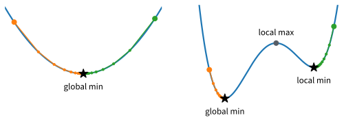
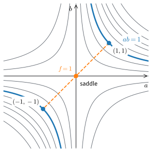
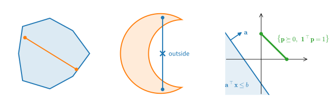
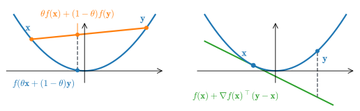
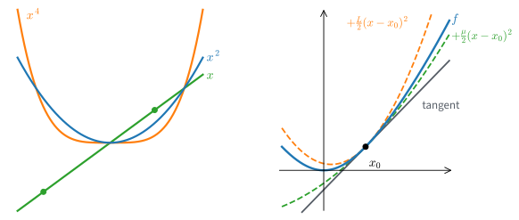
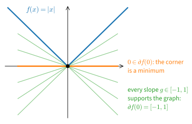

# Convexity
:label:`sec_mdl-convexity`

Run one gradient-descent loop, with step $0.05$ and $600$ steps, from $500$
starting points drawn uniformly on $[-1.5, 1.5]$. On the bowl
$f(x) = (x - \tfrac12)^2$ every run ends at $x = \tfrac12$. On the tilted
double well $\phi(x) = (x^2 - 1)^2 + x/2$ a little under half of the runs,
about 46%, stop at $x \approx 0.93$, where $\phi \approx 0.48$. That is almost
one unit above the best value $\phi \approx -0.51$, reached at
$x \approx -1.06$. The stopped runs have a zero gradient, which is all that
the stationarity guarantee of :numref:`sec_mdl-gradient-based-optimization`
promises, and nothing in the run tells us that a better point exists.
Training a model is this loop, so we need to know when the end of a run is
the best point there is.

The two functions differ in one property. Every chord of the bowl lies above
its graph, while the double well has chords that dip below it. Functions with
this property are called *convex*. For a convex function, information at
one point constrains the function everywhere. A zero gradient certifies a
global minimum, and a tangent line bounds the function from below on its
whole domain. The progress of single gradient steps then adds up to a rate
that holds from every start. The same property gives Jensen's inequality,
which the probability and information chapters use throughout.

The previous section proved what one gradient step does. Here we define
convex sets and convex functions, give three tests for convexity, and derive
the consequences, including the rates of gradient descent. A short calculus
then certifies the common losses of machine learning as convex without
computing a Hessian. Deep-network losses are not convex, and the last part
says which conclusions survive. Three examples recur: the chapter's quadratic
$\tfrac12(x_1^2 + 1000\,x_2^2)$ for the rates, the double well $\phi$ as the
nonconvex contrast, and small least-squares problems in two weights for the
numerical checks.

```{.python .input #convexity-imports}
#@tab mxnet
%matplotlib inline
from d2l import mxnet as d2l
import numpy as np
```

```{.python .input #convexity-imports}
#@tab pytorch
%matplotlib inline
from d2l import torch as d2l
import numpy as np
```

```{.python .input #convexity-imports}
#@tab tensorflow
%matplotlib inline
from d2l import tensorflow as d2l
import numpy as np
```

```{.python .input #convexity-imports}
#@tab jax
%matplotlib inline
from d2l import jax as d2l
import numpy as np
```

## Convex Sets
:label:`subsec_mdl-convex-sets`

A convex function is defined through the segments between points of its
domain. That domain, the feasible region of a constrained problem, and the
set of minimizers are all sets, so we begin with sets.

### Definition and Examples

A set is convex when the segment between any two of its points stays inside
it. Formally, a set $C \subseteq \mathbb{R}^d$ of points with $d$ coordinates
is **convex** if

$$
\theta \mathbf{x} + (1 - \theta)\, \mathbf{y} \in C
\qquad \textrm{for all } \mathbf{x}, \mathbf{y} \in C \textrm{ and all } \theta \in [0, 1].
$$
:eqlabel:`eq_mdl-opt-convex-set`

As the weight $\theta$ runs from $1$ to $0$, the point
$\theta\mathbf{x} + (1-\theta)\mathbf{y}$ traces the straight segment from
$\mathbf{x}$ to $\mathbf{y}$, and convexity requires every point of this
segment to belong to the set. :numref:`fig_mdl-opt-convex-vs-nonconvex-set`
contrasts a convex set with a nonconvex crescent: every chord of the convex
set lies within it, while a chord between two points of the crescent passes
outside. It also shows the two convex sets that deep learning uses most, the
probability simplex and a half-space.


:label:`fig_mdl-opt-convex-vs-nonconvex-set`

An annulus shows what the definition excludes. The annulus
$\{\mathbf{x} : 1 \le \|\mathbf{x}\| \le 2\}$ contains the points
$(\pm \tfrac32, 0)$, but their midpoint is the origin, which the annulus
excludes. One missing midpoint is enough to violate
:eqref:`eq_mdl-opt-convex-set`.

Four families of convex sets appear throughout this book.

* **Hyperplanes and half-spaces.** For the hyperplane
  $\{\mathbf{x} : \mathbf{a}^\top\mathbf{x} = b\}$ and the half-space
  $\{\mathbf{x} : \mathbf{a}^\top\mathbf{x} \le b\}$, the check is linearity:
  $\mathbf{a}^\top(\theta\mathbf{x} + (1-\theta)\mathbf{y}) = \theta\, \mathbf{a}^\top\mathbf{x} + (1-\theta)\, \mathbf{a}^\top\mathbf{y}$,
  and an average of two numbers equal to $b$ (or at most $b$) is again equal
  to $b$ (or at most $b$).
* **Norm balls.** For any norm, $\{\mathbf{x} : \|\mathbf{x}\| \le r\}$ is
  convex by the triangle inequality and homogeneity:
  $\|\theta\mathbf{x} + (1-\theta)\mathbf{y}\| \le \theta\|\mathbf{x}\| + (1-\theta)\|\mathbf{y}\| \le r$.
  This covers the $\ell_2$ balls of weight decay and gradient clipping and
  the $\ell_1$ balls of sparsity-inducing regularization alike.
* **The probability simplex.**
  $\Delta = \{\mathbf{p} \in \mathbb{R}^d : \mathbf{p} \succeq 0,\ \mathbf{1}^\top\mathbf{p} = 1\}$,
  which contains attention weights, class probabilities, and mixture
  weights.
* **The positive semidefinite (PSD) cone.**
  $\mathbb{S}^d_+ = \{\mathbf{A} = \mathbf{A}^\top : \mathbf{z}^\top \mathbf{A} \mathbf{z} \ge 0 \textrm{ for all } \mathbf{z}\}$,
  the set of symmetric $d \times d$ matrices with no negative curvature
  direction. It contains covariance matrices and the Hessians of convex
  functions.

The symbol $\succeq$ (and its mirror $\preceq$) carries two senses in this
part of the book: *elementwise* for vectors, as in $\mathbf{p} \succeq 0$
above, and the *semidefinite order* for symmetric matrices, as in
$\mathbf{A} \succeq 0$ for $\mathbf{A} \in \mathbb{S}^d_+$. The type of the
operands says which is meant.

### New Convex Sets from Old

The simplex and the PSD cone are convex for the same reason: each is cut out
of space by conditions that are individually convex.

**Proposition (intersections preserve convexity).** *Let $\{C_i\}_{i \in I}$
be any family of convex sets, finite or infinite. Then
$C = \bigcap_{i \in I} C_i$ is convex.*

**Proof.** Take $\mathbf{x}, \mathbf{y} \in C$ and $\theta \in [0, 1]$. For
every $i$, both points lie in the convex set $C_i$, so
$\theta\mathbf{x} + (1-\theta)\mathbf{y} \in C_i$. A point in every $C_i$ is
a point in their intersection. $\blacksquare$

A convex set has no dents, and cutting a dent-free set with another
dent-free set cannot create one. Unions have no such guarantee:
$[0,1] \cup [2,3]$ is a union of two convex intervals whose chord from $1$ to
$2$ leaves the set.

The proposition certifies most of the catalog. The probability simplex is the
intersection of one hyperplane ($\mathbf{1}^\top\mathbf{p} = 1$) with $d$
half-spaces ($-p_i \le 0$), hence convex. The PSD cone is the intersection of
*infinitely many* half-spaces, one per test vector: for each fixed
$\mathbf{z}$, the condition $\mathbf{z}^\top \mathbf{A} \mathbf{z} \ge 0$ is
linear in the entries of $\mathbf{A}$, so
$\mathbb{S}^d_+ = \bigcap_{\mathbf{z}} \{\mathbf{A} : \mathbf{z}^\top \mathbf{A} \mathbf{z} \ge 0\}$
is convex. More generally, every **polyhedron**
$\{\mathbf{x} : \mathbf{A}\mathbf{x} \preceq \mathbf{b}\}$ is a finite
intersection of half-spaces; polyhedra are the feasible sets of linear
programs.

Affine maps preserve convexity in both directions: images and preimages of
convex sets under $\mathbf{x} \mapsto \mathbf{A}\mathbf{x} + \mathbf{b}$ are
convex, because affine maps send segments to segments.

Any point cloud $S$ generates a smallest convex superset, its **convex
hull**. It has two descriptions: the
intersection of every convex set containing $S$ (convex by the proposition),
and the set of all weighted averages $\sum_i \theta_i \mathbf{x}_i$ of points
$\mathbf{x}_i \in S$ with $\theta_i \ge 0$ and $\sum_i \theta_i = 1$. The two
coincide. The set of weighted averages is convex and contains $S$, so it
contains the intersection; the reverse inclusion, that every convex superset
contains all weighted averages, is the induction of Exercise
:exref:`ex_mdl-convexity-prove-jensen-s-finite`. The simplex is the convex
hull of the coordinate vectors $\mathbf{e}_1, \ldots, \mathbf{e}_d$: every
probability distribution is an average of certainties.

## Convex Functions
:label:`subsec_mdl-three-lenses`

A convex function is one whose graph has no dents. We give three equivalent
tests for this property, which need zero, one, and two derivatives
respectively, and then two refinements: strong convexity, which controls the
speed of gradient descent, and subgradients, which handle corners.

### The Chord Condition

The first test needs no derivatives, so it applies to the absolute value and
the hinge loss as well as to smooth losses. A function $f : C \to \mathbb{R}$ on a convex
domain $C$ is **convex** if its graph lies on or below every chord:

$$
f\left(\theta \mathbf{x} + (1 - \theta)\, \mathbf{y}\right)
\;\le\; \theta f(\mathbf{x}) + (1 - \theta) f(\mathbf{y})
\qquad \textrm{for all } \mathbf{x}, \mathbf{y} \in C,\ \theta \in [0, 1].
$$
:eqlabel:`eq_mdl-opt-chord`

The left side evaluates $f$ at a point of the segment; the right side is the
height of the chord joining $(\mathbf{x}, f(\mathbf{x}))$ to
$(\mathbf{y}, f(\mathbf{y}))$ above that same point. For $f(x) = x^2$ with
$x = 0$, $y = 2$, and $\theta = \tfrac12$, the graph gives $f(1) = 1$ and the
chord gives $\tfrac12 \cdot 0 + \tfrac12 \cdot 4 = 2$, and indeed $1 \le 2$.
For general $x$, $y$, and $\theta$, expanding the squares gives the gap

$$
\theta x^2 + (1-\theta) y^2 - \left(\theta x + (1-\theta) y\right)^2 = \theta(1-\theta)(x-y)^2 \;\ge\; 0,
$$

so the square is convex, with a gap that grows with the distance between the
two points. This gap will return as the variance in Jensen's inequality.

If the inequality :eqref:`eq_mdl-opt-chord` is strict whenever
$\mathbf{x} \neq \mathbf{y}$ and $\theta \in (0, 1)$, $f$ is **strictly
convex**; if $-f$ is convex, $f$ is **concave**. The linear function
$f(x) = x$ is convex but not strictly convex: its chords lie on its graph.
The domain must be convex for the definition to parse, since the point
$\theta\mathbf{x} + (1-\theta)\mathbf{y}$ has to be one where $f$ is defined.
The first consequence of the definition, that every local minimum is global,
is proved in :numref:`subsec_mdl-why-convexity-matters`.

Convex functions and convex sets are linked by the **epigraph**
$\{(\mathbf{x}, t) : t \ge f(\mathbf{x})\}$, the region on and above the
graph. A function $f$ is convex if and only if its epigraph is a convex set,
because chords between points of the epigraph stay above the graph if and
only if :eqref:`eq_mdl-opt-chord` holds. This correspondence turns facts
about convex sets into facts about convex functions. The first such fact
runs the other way and produces convex sets from convex functions.

**Proposition (sublevel sets are convex).** *If $f$ is convex on $C$, then
for every number $c$ the sublevel set
$\{\mathbf{x} \in C : f(\mathbf{x}) \le c\}$ is convex.*

**Proof.** If $f(\mathbf{x}) \le c$ and $f(\mathbf{y}) \le c$, the chord
inequality gives
$f(\theta\mathbf{x} + (1-\theta)\mathbf{y}) \le \theta c + (1-\theta) c = c$.
$\blacksquare$

The converse fails. The function $\sqrt{|x|}$ has intervals
$\{|x| \le c^2\}$ as sublevel sets, yet with $x = 0$, $y = 1$, and
$\theta = \tfrac12$ the graph gives $\sqrt{1/2} \approx 0.71$ and the chord
gives $0.5$, so the chord condition fails. The proposition explains why a
constraint $g(\mathbf{x}) \le 0$ with a convex $g$ always describes a convex
feasible region.

### The First-Order Condition

The chord condition needs no derivatives, but optimization proofs work with
gradients. When $f$ is differentiable, convexity has an equivalent
first-order form: the first-order Taylor approximation at any point is a
*global under-estimator*,

$$
f(\mathbf{y}) \;\ge\; f(\mathbf{x}) + \nabla f(\mathbf{x})^\top (\mathbf{y} - \mathbf{x})
\qquad \textrm{for all } \mathbf{x}, \mathbf{y} \in C.
$$
:eqlabel:`eq_mdl-opt-first-order`

For $f(x) = x^2$ at $x = 1$ the tangent line is $1 + 2(y - 1) = 2y - 1$, and
$y^2 - (2y - 1) = (y - 1)^2 \ge 0$ for every $y$. In words: one gradient,
evaluated at one point $\mathbf{x}$, gives a lower bound on $f$ at every
other point of the domain. This is the property every proof below uses.
:numref:`fig_mdl-opt-chord-above-graph` shows the two conditions side by
side: chords lie above the graph, tangents lie below it.


:label:`fig_mdl-opt-chord-above-graph`

### The Second-Order Condition

For smooth losses the easiest test is usually a matrix test. When $f$ is
twice differentiable on an **open** convex domain $C$, $f$ is convex if and
only if

$$
\nabla^2 f(\mathbf{x}) \succeq 0 \qquad \textrm{for all } \mathbf{x} \in C
$$

(on a closed full-dimensional domain, test the interior and require
continuity up to the boundary; on a lower-dimensional domain only directions
inside the domain count: $x^2 - y^2$ is convex on the line $y = 0$ although
its Hessian is indefinite).

In one dimension this is the calculus criterion $f''(x) \ge 0$: the graph
curves upward. In $d$ dimensions it says that every one-dimensional slice
curves upward, since $\mathbf{v}^\top \nabla^2 f(\mathbf{x})\, \mathbf{v}$
is the second derivative of $f$ along the line through $\mathbf{x}$ in
direction $\mathbf{v}$ (:numref:`sec_mdl-multivariable_calculus`).

The test settles three common cases. The quadratic
$\tfrac12\mathbf{x}^\top \mathbf{A} \mathbf{x} + \mathbf{b}^\top\mathbf{x}$
with $\mathbf{A}$ symmetric has the constant Hessian $\mathbf{A}$, so it is
convex if and only if $\mathbf{A} \succeq 0$. The least-squares loss
$\tfrac12\|\mathbf{X}\mathbf{w} - \mathbf{y}\|^2$ of a design matrix
$\mathbf{X} \in \mathbb{R}^{n \times d}$ ($n$ examples, $d$ weights) has
Hessian $\mathbf{X}^\top \mathbf{X}$, and
$\mathbf{v}^\top \mathbf{X}^\top\mathbf{X} \mathbf{v} = \|\mathbf{X}\mathbf{v}\|^2 \ge 0$,
so least squares is always convex (:numref:`subsec_mdl-psd`). And $e^x$,
$-\log x$, and $x \log x$ are convex on their domains because their second
derivatives $e^x$, $1/x^2$, and $1/x$ are positive.

**Proposition (the three characterizations agree).** *Let $f$ be
differentiable on an open convex domain $C$. Then the chord condition
:eqref:`eq_mdl-opt-chord` and the first-order condition
:eqref:`eq_mdl-opt-first-order` are equivalent. If $f$ is twice
differentiable, both are equivalent to $\nabla^2 f(\mathbf{x}) \succeq 0$ on
$C$.*

**Proof.** *(Chord $\Rightarrow$ first-order.)* Fix $\mathbf{x}, \mathbf{y}$
and $\theta \in (0, 1]$. Write the chord inequality at the point
$\mathbf{x} + \theta(\mathbf{y} - \mathbf{x})$, subtract $f(\mathbf{x})$, and
divide by $\theta$:

$$
\frac{f(\mathbf{x} + \theta(\mathbf{y} - \mathbf{x})) - f(\mathbf{x})}{\theta}
\;\le\; f(\mathbf{y}) - f(\mathbf{x}).
$$

As $\theta \downarrow 0$ the left side converges to the directional
derivative $\nabla f(\mathbf{x})^\top(\mathbf{y} - \mathbf{x})$, which gives
:eqref:`eq_mdl-opt-first-order`.

*(First-order $\Rightarrow$ chord.)* Let
$\mathbf{z} = \theta\mathbf{x} + (1-\theta)\mathbf{y}$ and apply the
under-estimator at $\mathbf{z}$ twice, once toward each endpoint:

$$
f(\mathbf{x}) \ge f(\mathbf{z}) + \nabla f(\mathbf{z})^\top(\mathbf{x} - \mathbf{z}),
\qquad
f(\mathbf{y}) \ge f(\mathbf{z}) + \nabla f(\mathbf{z})^\top(\mathbf{y} - \mathbf{z}).
$$

Multiply by $\theta$ and $1 - \theta$ and add. The gradient terms combine to
$\nabla f(\mathbf{z})^\top(\theta\mathbf{x} + (1-\theta)\mathbf{y} - \mathbf{z}) = 0$,
which leaves :eqref:`eq_mdl-opt-chord`.

*(Second-order $\Rightarrow$ first-order.)* Restrict $f$ to the segment:
$g(t) = f(\mathbf{x} + t(\mathbf{y} - \mathbf{x}))$ has
$g''(t) = (\mathbf{y} - \mathbf{x})^\top \nabla^2 f(\mathbf{x} + t(\mathbf{y} - \mathbf{x}))\,(\mathbf{y} - \mathbf{x}) \ge 0$.
Taylor's theorem with the Lagrange remainder
(:numref:`sec_mdl-single_variable_calculus`) gives
$g(1) = g(0) + g'(0) + \tfrac12 g''(\tau)$ for some $\tau \in (0, 1)$, and
dropping the nonnegative remainder is :eqref:`eq_mdl-opt-first-order`.

*(First-order $\Rightarrow$ second-order.)* Suppose instead that
$\mathbf{v}^\top \nabla^2 f(\mathbf{x})\, \mathbf{v} < 0$ for some
$\mathbf{x}$ and $\mathbf{v}$. Expanding along that direction,

$$
f(\mathbf{x} + t\mathbf{v}) = f(\mathbf{x}) + t\, \nabla f(\mathbf{x})^\top\mathbf{v}
+ \frac{t^2}{2}\, \mathbf{v}^\top \nabla^2 f(\mathbf{x})\, \mathbf{v} + o(t^2),
$$

so for small enough $t > 0$ the left side drops strictly below the tangent
value $f(\mathbf{x}) + t \nabla f(\mathbf{x})^\top\mathbf{v}$, contradicting
:eqref:`eq_mdl-opt-first-order`. $\blacksquare$

Which characterization to use depends on the available structure. The chord
condition needs no smoothness, so it certifies $\|\mathbf{x}\|_1$ and the
hinge loss, where Hessians do not exist. The first-order condition drives
optimization proofs. The second-order condition is the usual test for smooth
losses, where checking convexity means checking that a matrix is PSD
(:numref:`sec_mdl-eigendecompositions`).

### Strict and Strong Convexity

Convexity alone allows flat stretches, and on a flat stretch gradient descent
can be arbitrarily slow. A guaranteed speed needs curvature that is bounded
away from zero. Three functions show the hierarchy, drawn in
:numref:`fig_mdl-opt-convexity-hierarchy`(a). The line $f(x) = x$ is convex
but not strictly convex, since its chords lie on its graph. The quartic
$x^4$ is strictly convex (its second derivative $12x^2$ vanishes only at the
single point $0$, so its slope strictly increases), yet $f''(0) = 0$: it is
flat at its minimizer. The square $x^2$ has $f'' \equiv 2$ and curves
equally everywhere.

Strong convexity states that bound. For $\mu > 0$, $f$ is **$\mu$-strongly
convex** if $f(\mathbf{x}) - \tfrac{\mu}{2}\|\mathbf{x}\|^2$ is convex.
Applying the first-order condition to
$h(\mathbf{x}) = f(\mathbf{x}) - \tfrac{\mu}{2}\|\mathbf{x}\|^2$, whose
gradient is $\nabla f(\mathbf{x}) - \mu\mathbf{x}$, and using
$\|\mathbf{y}\|^2 - \|\mathbf{x}\|^2 - 2\mathbf{x}^\top(\mathbf{y} - \mathbf{x}) = \|\mathbf{y} - \mathbf{x}\|^2$,
gives the equivalent form for differentiable $f$:

$$
f(\mathbf{y}) \;\ge\; f(\mathbf{x}) + \nabla f(\mathbf{x})^\top(\mathbf{y} - \mathbf{x})
+ \frac{\mu}{2}\, \|\mathbf{y} - \mathbf{x}\|^2
\qquad \textrm{for all } \mathbf{x}, \mathbf{y}.
$$
:eqlabel:`eq_mdl-opt-strong-convexity`

So the graph lies above a parabola of curvature $\mu$ that touches it at
$\mathbf{x}$, not only above the tangent line. Applying the second-order
condition to $h$ gives the third form: for twice-differentiable $f$, strong convexity means
$\nabla^2 f(\mathbf{x}) \succeq \mu\mathbf{I}$ everywhere, where
$\mathbf{I}$ is the identity. The square $x^2$ is $2$-strongly convex; the
quartic $x^4$ is strongly convex on no neighborhood of $0$, because
$f''(0) = 0 < \mu$ for every $\mu > 0$. Adding the ridge penalty
$\tfrac{\lambda}{2}\|\mathbf{w}\|^2$ to any convex loss makes the sum
$\lambda$-strongly convex, since subtracting $\tfrac{\lambda}{2}\|\mathbf{w}\|^2$
returns the convex loss. This is one more effect of weight decay.


:label:`fig_mdl-opt-convexity-hierarchy`

Strong convexity pairs with smoothness. The previous section called $f$
**$L$-smooth** when its gradient is $L$-Lipschitz,
$\|\nabla f(\mathbf{x}) - \nabla f(\mathbf{y})\| \le L\|\mathbf{x} - \mathbf{y}\|$;
for a convex twice-differentiable $f$ this means
$\nabla^2 f \preceq L\mathbf{I}$. Smoothness gives the quadratic ceiling
$f(\mathbf{y}) \le f(\mathbf{x}) + \nabla f(\mathbf{x})^\top(\mathbf{y} - \mathbf{x}) + \tfrac{L}{2}\|\mathbf{y} - \mathbf{x}\|^2$
of :numref:`subsec_mdl-gd-smoothness`, and strong convexity gives the
floor :eqref:`eq_mdl-opt-strong-convexity`. Together they sandwich the graph
between two parabolas tangent at $\mathbf{x}$, with curvatures $\mu$ and
$L$, as in :numref:`fig_mdl-opt-convexity-hierarchy`(b). The function in
that panel, $f(x) = \tfrac12 x^2 + 3\log\cosh x$, has
$f''(x) = 1 + 3/\cosh^2 x \in [1, 4]$, so $\mu = 1$ and $L = 4$.

The ratio $\kappa = L/\mu$ is the **condition number**. The chapter's
running example $\tfrac12(x_1^2 + 1000\,x_2^2)$ has Hessian $\mathrm{diag}(1, 1000)$, so
$\mu = 1$, $L = 1000$, and $\kappa = 10^3$. The previous section measured
$\kappa$ on this quadratic; here it is defined for every smooth strongly
convex function.

What does gradient descent lose when a function is strictly but not strongly
convex? The cell runs the same loop, with step $\eta = \tfrac18$ from
$x_0 = 1$, on $x^2$ and on $x^4$, for $10^4$ steps.

```{.python .input #mdl-convexity-strict-and-strong-convexity}
eta, steps = 1 / 8, 10_000
x2, x4 = np.ones(steps + 1), np.ones(steps + 1)  # iterates from x_0 = 1
for j in range(steps):                         # same start, same step
    x2[j + 1] = x2[j] - eta * 2 * x2[j]        # f(x) = x^2
    x4[j + 1] = x4[j] - eta * 4 * x4[j]**3     # f(x) = x^4
k = np.arange(1, steps + 1)
print('x^2: first k with x_k < 1e-6:', k[x2[1:] < 1e-6][0])
print('x^4: x_k * sqrt(k) at k = 1e2, 1e3, 1e4:',
      (x4[1:] * np.sqrt(k))[[99, 999, 9999]].round(3))
d2l.plot(k, [x4[1:]**4, x2[1:]**2], 'k', 'f(x_k)', xscale='log',
         yscale='log', ylim=(1e-12, 1), legend=['x^4', 'x^2'])
```

On $x^2$ each step multiplies the iterate by $1 - 2\eta = 0.75$, so it falls
below $10^{-6}$ at step $49$ and the gap leaves the plot within fifty steps.
On $x^4$ each step multiplies the iterate by $1 - 4\eta x_k^2$, a factor that
approaches $1$ as the iterate approaches the minimizer. The printed products
$x_k\sqrt{k}$ approach $1$, so the iterate behaves like $1/\sqrt{k}$ and is
still $0.01$ after $10^4$ steps. On the log–log plot the gap $x_k^4$ is
therefore a straight line of slope $-2$. Strict convexity allows at most one
minimizer but promises no speed; a geometric rate needs $\mu > 0$. The rates
of :numref:`subsec_mdl-convergence-rates` prove that every strongly convex
function behaves like the square, and that without $\mu$ only a $1/k$
guarantee survives. Exercise :exref:`ex_mdl-convexity-quartic-sublinear`
proves the $1/\sqrt{k}$ law for the quartic.

### Subgradients

The losses $\|\mathbf{x}\|_1$ and $\max(0, 1 - z)$ have corners, so
:eqref:`eq_mdl-opt-first-order` cannot be checked as written: there is no
gradient at the kink. In one dimension, a number $g$ is a subgradient of $f$
at $x$ if $f(y) \ge f(x) + g(y - x)$ for all $y$; for $|x|$ at $0$ every
$g \in [-1, 1]$ qualifies (:numref:`sec_mdl-single_variable_calculus`). The
vector form is the same idea. A vector $\mathbf{g}$ is a **subgradient** of
$f$ at $\mathbf{x}$ if it gives the global under-estimate a gradient would:

$$
f(\mathbf{y}) \;\ge\; f(\mathbf{x}) + \mathbf{g}^\top (\mathbf{y} - \mathbf{x})
\qquad \textrm{for all } \mathbf{y}.
$$
:eqlabel:`eq_mdl-opt-subgradient`

The set of all subgradients at $\mathbf{x}$ is the **subdifferential**
$\partial f(\mathbf{x})$. Where a convex $f$ is differentiable it is the
single gradient, $\{\nabla f(\mathbf{x})\}$. At a corner it can contain many
vectors (:numref:`fig_mdl-opt-subgradient-fan`), as it did for $|x|$, and as
it does for the hinge $\max(0, 1 - z)$ at $z = 1$, where
$\partial f(1) = [-1, 0]$.


:label:`fig_mdl-opt-subgradient-fan`

The optimality test needs no derivatives: $\mathbf{x}^\star$ minimizes $f$
if and only if $\mathbf{0} \in \partial f(\mathbf{x}^\star)$. With
$\mathbf{g} = \mathbf{0}$ the definition reads
$f(\mathbf{y}) \ge f(\mathbf{x}^\star)$ for all $\mathbf{y}$, which is the
statement that $\mathbf{x}^\star$ is a minimizer. The condition and the
conclusion are the same inequality, so each implies the other.

Does a convex function always have a subgradient? In one dimension the
answer follows from the chord inequality alone.

**Proposition (supporting lines in one dimension).** *Let $f$ be convex on an
open interval and $x_0$ a point of it. Then the left and right derivatives
$f'_-(x_0) \le f'_+(x_0)$ exist and are finite, and every
$g \in [f'_-(x_0), f'_+(x_0)]$ is a subgradient of $f$ at $x_0$.*

**Proof.** For three points $a < b < c$ of the interval, write $b$ as the
convex combination of $a$ and $c$ with $\theta = (c - b)/(c - a)$; the chord
inequality at $b$ rearranges to

$$
\frac{f(b) - f(a)}{b - a} \;\le\; \frac{f(c) - f(a)}{c - a} \;\le\; \frac{f(c) - f(b)}{c - b}:
$$

slopes of chords increase from left to right. Taking $x_0$ as one of the
three points shows that the difference quotient
$q(x) = (f(x) - f(x_0))/(x - x_0)$ is nondecreasing in $x \neq x_0$. A
monotone function has one-sided limits at $x_0$, finite because every value
of $q$ left of $x_0$ is at most every value right of it; these limits are
$f'_-(x_0) \le f'_+(x_0)$. Now take $g$ between them. For $y > x_0$,
$q(y) \ge f'_+(x_0) \ge g$, and multiplying by $y - x_0 > 0$ gives
$f(y) \ge f(x_0) + g(y - x_0)$. For $y < x_0$, $q(y) \le f'_-(x_0) \le g$,
and multiplying by $y - x_0 < 0$ flips the inequality into the same
conclusion. $\blacksquare$

In $d$ dimensions the same holds at every interior point of the domain: a
convex $f$ has at least one subgradient there, so a supporting hyperplane
fits under its graph (:citet:`Rockafellar.1970`;
:citet:`Boyd.Vandenberghe.2004`, section 2.5). We use this fact without
proof. The Jensen proof below uses nothing but one such subgradient.
As a search direction a subgradient is weaker than a gradient: a subgradient
step need not decrease $f$ (at
the minimum of $|x|$, the subgradient $\tfrac12$ moves $x = 0$ to
$-\eta/2$), and the subgradient method needs diminishing steps, with an
error that falls only like $1/\sqrt{k}$.

### A Numerical Check of the Three Tests

Do the three tests agree on a concrete loss? The cell checks them on the
least-squares loss $f(\mathbf{w}) = \tfrac12\|\mathbf{X}\mathbf{w} - \mathbf{y}\|^2$
with $n = 20$ random examples and $d = 2$ weights: a thousand random chords,
a thousand random tangents, and the eigenvalues of the Hessian. Each gap is
the left side minus the right side of its inequality, so convexity predicts
that both are at most zero.

```{.python .input #convexity-three-lenses}
rng = np.random.default_rng()
X = rng.normal(size=(20, 2))                   # design matrix: n = 20, d = 2
y = rng.normal(size=20)
f = lambda w: 0.5 * ((X @ w - y) ** 2).sum()
grad = lambda w: X.T @ (X @ w - y)
worst_chord, worst_tangent = -np.inf, -np.inf
for _ in range(1000):
    u, v = rng.normal(size=(2, 2)) * 3.0       # random pair of weight vectors
    t = rng.uniform()
    worst_chord = max(worst_chord,             # f(chord point) - chord height
                      f(t * u + (1 - t) * v) - (t * f(u) + (1 - t) * f(v)))
    worst_tangent = max(worst_tangent,         # tangent value - f
                        f(u) + grad(u) @ (v - u) - f(v))
print(f'worst chord gap:   {worst_chord:.2e}')
print(f'worst tangent gap: {worst_tangent:.2e}')
print('both <= 0:', bool(worst_chord <= 0 and worst_tangent <= 0))
print('Hessian eigenvalues:', np.linalg.eigvalsh(X.T @ X).round(4))
```

In every run both worst gaps are negative and both Hessian eigenvalues are
positive. The signs do not depend on the draw. For a quadratic loss the chord
gap equals $-\tfrac12\theta(1-\theta)\|\mathbf{X}(\mathbf{u} - \mathbf{v})\|^2$,
the vector form of the gap computed for $x^2$ above, and the tangent gap
equals $-\tfrac12\|\mathbf{X}(\mathbf{v} - \mathbf{u})\|^2$. Sampling can
refute convexity but cannot prove it. The Hessian check proves it, since
$\mathbf{X}^\top \mathbf{X}$ is the same PSD matrix at every $\mathbf{w}$.

### Jensen's Inequality
:label:`subsec_mdl-jensen`

Averages of losses, expected log-likelihoods, and KL divergences all compare
a function of an average with the average of a function. The smallest case
settles which is larger. Let $Z \in \{0, 2\}$ with probability $\tfrac12$
each, and $f(x) = x^2$. Then $f(\mathbb{E}[Z]) = f(1) = 1$, while
$\mathbb{E}[f(Z)] = \tfrac12 \cdot 0 + \tfrac12 \cdot 4 = 2$. The gap $1$ is
the variance of $Z$, and for $f = x^2$ the gap is always the variance,
$\mathbb{E}[Z^2] - (\mathbb{E}[Z])^2$. The chord inequality of
:numref:`fig_mdl-opt-chord-above-graph`(a) makes this comparison for a
two-point distribution with weights $\theta$ and $1 - \theta$. The gap
$\theta(1-\theta)(x - y)^2$ computed for $x^2$ is that distribution's
variance.

Nothing in the chord argument is special to two points. Applying
:eqref:`eq_mdl-opt-chord` repeatedly (Exercise
:exref:`ex_mdl-convexity-prove-jensen-s-finite`) gives the finite form

$$
f\left(\sum_i \theta_i \mathbf{x}_i\right) \;\le\; \sum_i \theta_i\, f(\mathbf{x}_i),
\qquad \theta_i \ge 0,\ \sum_i \theta_i = 1,
$$
:eqlabel:`eq_mdl-opt-jensen-finite`

and a set of nonnegative weights summing to one is a probability
distribution on the points $\mathbf{x}_i$. The general form replaces the
weighted average by an expectation.

**Proposition (Jensen's inequality).** *Let $f$ be convex on a convex set
$C \subseteq \mathbb{R}^d$, and let $\mathbf{Z}$ be a random vector with
values in $C$, with $\mathbb{E}\|\mathbf{Z}\| < \infty$ and mean
$\mathbf{m} = \mathbb{E}[\mathbf{Z}]$ in the interior of $C$. Then*

$$
f\left(\mathbf{m}\right) \;\le\; \mathbb{E}\left[f(\mathbf{Z})\right].
$$
:eqlabel:`eq_mdl-opt-jensen`

*If $f$ is strictly convex, equality holds if and only if
$\mathbf{Z} = \mathbf{m}$ with probability one.*

**Proof.** Pick a subgradient $\mathbf{g} \in \partial f(\mathbf{m})$, which
exists because $\mathbf{m}$ is an interior point. The key step is that the
supporting hyperplane at $\mathbf{m}$ holds for every outcome at once: by
:eqref:`eq_mdl-opt-subgradient`,

$$
f(\mathbf{Z}) \;\ge\; f(\mathbf{m}) + \mathbf{g}^\top (\mathbf{Z} - \mathbf{m}).
$$

Take expectations of both sides. The linear term has mean zero, which leaves
$\mathbb{E}[f(\mathbf{Z})] \ge f(\mathbf{m})$. For strictly convex $f$ the
supporting hyperplane touches the graph only at $\mathbf{m}$. Suppose it
also touched at some $\mathbf{x} \neq \mathbf{m}$. Strict convexity would
then give
$f\bigl(\tfrac{\mathbf{x} + \mathbf{m}}{2}\bigr) < \tfrac12 f(\mathbf{x}) + \tfrac12 f(\mathbf{m})$,
where the right side is the value of the affine hyperplane at the midpoint;
this contradicts that the hyperplane lies below $f$. So the pointwise
inequality is strict on the event $\mathbf{Z} \neq \mathbf{m}$, and equality
in expectation forces that event to have probability zero. $\blacksquare$

The same pointwise bound shows that $f(\mathbf{Z})$ is bounded below by an
integrable random variable, so $\mathbb{E}[f(\mathbf{Z})]$ is always defined;
it may be $+\infty$, in which case the inequality holds trivially. Spreading
$\mathbf{Z}$ out around a fixed mean can only raise the average of a convex
$f$. For concave $f$ the inequality flips:
$\mathbb{E}[f(\mathbf{Z})] \le f(\mathbb{E}[\mathbf{Z}])$.

The most used corollary is the nonnegativity of the KL divergence;
:numref:`sec_mdl-information_theory` restates it as Gibbs' inequality.

**Corollary (nonnegativity of KL divergence).** *For probability
distributions $p$ and $q$ on a common finite alphabet, with $q(x) > 0$
wherever $p(x) > 0$,*

$$
D_{\mathrm{KL}}(p \,\|\, q) \;=\; \sum_x p(x) \log \frac{p(x)}{q(x)} \;\ge\; 0,
$$

*with equality if and only if $p = q$.*

**Proof.** Let $Z \sim p$ and apply Jensen's inequality to the strictly
convex function $-\log$ and the positive random variable $R = q(Z)/p(Z)$:

$$
D_{\mathrm{KL}}(p \,\|\, q)
= \mathbb{E}_p\left[-\log R\right]
\;\ge\; -\log \mathbb{E}_p[R]
= -\log \sum_{x : p(x) > 0} p(x)\, \frac{q(x)}{p(x)}
\;\ge\; -\log 1 = 0,
$$

since $\sum_{x : p(x) > 0} q(x) \le 1$. By the equality case, the bound is
tight if and only if $R$ is constant with probability one and $q$ puts no
mass off the support of $p$, that is, $q = c\,p$ with $c = 1$. $\blacksquare$

The same argument with the concave $\log$ gives the
**arithmetic–geometric mean inequality**: for positive
$x_1, \ldots, x_N$, concavity gives
$\log\bigl(\tfrac1N \sum_i x_i\bigr) \ge \tfrac1N \sum_i \log x_i$, and
exponentiating,

$$
\frac{1}{N} \sum_{i=1}^N x_i \;\ge\; \left(\prod_{i=1}^N x_i\right)^{1/N},
$$

with equality if and only if all $x_i$ coincide, because $\log$ is strictly
concave. The evidence lower bound of :numref:`sec_mdl-latent-em-elbo`, a
bound on the log of an expectation, is the same inequality for the concave
$\log$.

How large is the gap in a concrete case, and is the bound $0$ for the KL
divergence ever reached? The cell estimates $\mathbb{E}[e^Z]$ against
$e^{\mathbb{E}[Z]}$ for $Z \sim \mathcal{N}(0, 1)$, tests AM–GM and
$D_{\mathrm{KL}} \ge 0$ in bulk, and then moves $q$ toward $p$ along the
mixture $(1 - \varepsilon)p + \varepsilon q$.

```{.python .input #convexity-jensen-mc}
rng = np.random.default_rng()
z = rng.normal(size=1_000_000)                 # Z ~ N(0, 1)
print(f'E[exp(Z)] = {np.exp(z).mean():.2f} vs exp(E[Z]) = {np.exp(z.mean()):.2f}'
      f'  (population: {np.exp(0.5):.4f} vs 1)')
u = rng.uniform(0.1, 10.0, size=(100_000, 5))  # AM-GM from concavity of log
am, gm = u.mean(axis=1), np.exp(np.log(u).mean(axis=1))
print('AM >= GM in every draw:', bool((am >= gm).all()))
kl = lambda p, q: (p * np.log(p / q)).sum(axis=1)
p = rng.dirichlet(np.ones(10), size=1000)      # 1000 random pairs, 10 symbols
q = rng.dirichlet(np.ones(10), size=1000)
print(f'KL >= 0 for every pair: {bool(kl(p, q).min() >= 0)},'
      f' smallest {kl(p, q).min():.3f}')
print('median KL(p || (1-eps) p + eps q), eps = 1e-2, 1e-3, 1e-4:',
      *[f'{np.median(kl(p, (1 - e) * p + e * q)):.1e}' for e in (1e-2, 1e-3, 1e-4)])
```

With the convex $f(x) = e^x$, a million samples give $\mathbb{E}[e^Z]$ of
about $1.65$ against $e^{\mathbb{E}[Z]}$ of about $1.00$; the population
values are $\sqrt{e} \approx 1.649$ and $1$, and more samples shrink the
Monte Carlo error but not this gap. AM $\ge$ GM holds in every draw, and the
smallest KL divergence over a thousand random pairs is positive. The last
line shows how equality is approached: each tenfold smaller $\varepsilon$
lowers the median divergence about a hundredfold, because
$D_{\mathrm{KL}}(p \,\|\, (1-\varepsilon)p + \varepsilon q) \approx \tfrac{\varepsilon^2}{2}\sum_x (q(x) - p(x))^2/p(x)$
once $\varepsilon\,q(x)/p(x)$ is small for every $x$. (Pairs in which $p$
has a nearly empty symbol reach this regime last, which is why the cell
reports the median rather than the maximum.) The bound $0$ is reached only
in the limit $q \to p$.

## Consequences of Convexity
:label:`subsec_mdl-why-convexity-matters`

We now return to the question of the opening: what does the end of a run
mean? For convex functions there are three answers. A local minimum is
global, which explains the opening's experiment, and the progress of single
gradient steps adds up to global rates.

### Local and Global Minima

:numref:`fig_mdl-opt-local-equals-global` shows the difference that
convexity makes. On the convex objective every start leads to the same
point. On the double well, a start on the right of the hump settles in a
well that is not the deepest, and nothing near that well reveals the better
one.


:label:`fig_mdl-opt-local-equals-global`

**Proposition (local minima are global).** *If $f$ is convex on a convex set
$C$, every local minimizer of $f$ on $C$ is a global minimizer.*

**Proof.** Let $\mathbf{x}^\star$ be a local minimizer and take any
$\mathbf{y} \in C$. For small $\theta > 0$ the point
$\mathbf{z}_\theta = (1-\theta)\mathbf{x}^\star + \theta\mathbf{y}$ on the
chord toward $\mathbf{y}$ lies in the neighborhood where $\mathbf{x}^\star$
is minimal, so local minimality and the chord inequality give

$$
f(\mathbf{x}^\star) \;\le\; f(\mathbf{z}_\theta)
\;\le\; (1-\theta)f(\mathbf{x}^\star) + \theta f(\mathbf{y}).
$$

Subtract $(1-\theta)f(\mathbf{x}^\star)$ and divide by $\theta$:
$f(\mathbf{x}^\star) \le f(\mathbf{y})$. $\blacksquare$

In words: if a better point $\mathbf{y}$ existed anywhere, the chord from
$\mathbf{x}^\star$ toward it would run below the level $f(\mathbf{x}^\star)$
arbitrarily close to $\mathbf{x}^\star$, and $\mathbf{x}^\star$ would not be
a local minimizer.

The proposition has three corollaries. The set of minimizers is convex: if $\mathbf{x}$ and $\mathbf{y}$ both attain
the minimum value $f^\star$, the chord inequality puts every point between
them at or below $f^\star$. For differentiable $f$ on an open set,
$\nabla f(\mathbf{x}) = \mathbf{0}$ implies $f(\mathbf{x}) = f^\star$,
because the first-order condition with a zero gradient reads
$f(\mathbf{y}) \ge f(\mathbf{x})$ for all $\mathbf{y}$. And a small
gradient means a small gap: the first-order condition aimed at a minimizer
gives
$f(\mathbf{x}) - f^\star \le \nabla f(\mathbf{x})^\top(\mathbf{x} - \mathbf{x}^\star) \le \|\nabla f(\mathbf{x})\|\,\|\mathbf{x} - \mathbf{x}^\star\|$.
So the guarantee of the previous section, that gradient descent with
$\eta = 1/L$ drives the smallest gradient norm among its iterates to zero,
becomes for convex $f$ a guarantee about the value; the rates below make it
quantitative.

A minimizer need not be unique (a convex $f$ may be constant on a whole
segment), and it need not exist ($e^x$ has none). The next proposition gives
conditions for both.

**Proposition (uniqueness).** *A strictly convex $f$ has at most one
minimizer. A continuous $\mu$-strongly convex $f$ on a nonempty closed convex
set $C$ with nonempty interior has exactly one.*

**Proof.** If $\mathbf{x} \neq \mathbf{y}$ were both minimizers with value
$f^\star$, the strict chord inequality at $\theta = \tfrac12$ would give
$f\bigl(\tfrac{\mathbf{x} + \mathbf{y}}{2}\bigr) < f^\star$, a
contradiction. Strong convexity implies strict convexity, so it remains to
show existence. Write $f = h + \tfrac{\mu}{2}\|\cdot\|^2$ with $h$ convex,
fix an interior point $\mathbf{x}_0$ of $C$ and a subgradient
$\mathbf{g} \in \partial h(\mathbf{x}_0)$, and add the quadratic back.
Expanding
$\|\mathbf{y}\|^2 = \|\mathbf{x}_0\|^2 + 2\mathbf{x}_0^\top(\mathbf{y} - \mathbf{x}_0) + \|\mathbf{y} - \mathbf{x}_0\|^2$
turns $h(\mathbf{y}) \ge h(\mathbf{x}_0) + \mathbf{g}^\top(\mathbf{y} - \mathbf{x}_0)$
into

$$
f(\mathbf{y}) \;\ge\; f(\mathbf{x}_0)
+ (\mathbf{g} + \mu\mathbf{x}_0)^\top (\mathbf{y} - \mathbf{x}_0)
+ \frac{\mu}{2}\, \|\mathbf{y} - \mathbf{x}_0\|^2
\qquad \textrm{for all } \mathbf{y} \in C,
$$

the subgradient form of :eqref:`eq_mdl-opt-strong-convexity`, valid without
differentiability. The right side exceeds $f(\mathbf{x}_0)$ outside a ball
around $\mathbf{x}_0$, so the sublevel set
$\{\mathbf{y} \in C : f(\mathbf{y}) \le f(\mathbf{x}_0)\}$ is bounded; it is
closed because $f$ is continuous and $C$ is closed. A continuous function on
a nonempty closed bounded set attains its minimum, and the minimum over this
sublevel set is the minimum over $C$. $\blacksquare$

The continuity hypothesis is automatic in the interior, where convex
functions are continuous. It matters only at the boundary, where a convex
function may jump upward: $f(x) = x + \tfrac12 x^2$ on $(0, 1]$ with
$f(0) = 1$ is $1$-strongly convex on $[0, 1]$, yet its infimum $0$ is not
attained.

### A Bowl and a Double Well

The opening's experiment can now be read with the proposition in hand. The
cell runs the same loop, with the same step and the same $500$ random starts,
on the bowl $(x - \tfrac12)^2$ and on the double well $\phi$. It then
compares the share of runs that end in the right well with a prediction
made before running anything.

```{.python .input #convexity-basins}
def gd(grad_fn, x, eta=0.05, steps=600):
    for _ in range(steps):
        x = x - eta * grad_fn(x)
    return x

phi = lambda x: (x**2 - 1)**2 + 0.5 * x        # tilted double well
rng = np.random.default_rng()
inits = rng.uniform(-1.5, 1.5, size=500)       # 500 random starting points
bowl = gd(lambda x: 2 * (x - 0.5), inits)      # convex: (x - 1/2)^2
well = gd(lambda x: 4 * x * (x**2 - 1) + 0.5, inits)
left, right = well[well < 0], well[well > 0]
print(f'bowl: all {bowl.size} runs end at x = {bowl.mean():.6f}'
      f' (spread {np.ptp(bowl):.0e})')
for name, w in (('left ', left), ('right', right)):
    print(f'well, {name}: {w.size} runs, x = {w.mean():.4f}, phi = {phi(w.mean()):.4f}')
x_max = np.sort(np.roots([4, 0, -4, 0.5]).real)[1]   # local max of phi
print(f'local max at {x_max:.4f}: predicted share right {(1.5 - x_max) / 3:.3f},'
      f' observed {right.size / inits.size:.3f}')
```

In every run the bowl's $500$ endpoints agree to rounding. The double well
splits the runs into two groups, at $x \approx -1.0575$ with
$\phi \approx -0.515$ and at $x \approx 0.9304$ with $\phi \approx 0.483$, a
gap of almost one unit; both are roots of $\phi'(x) = 4x^3 - 4x + \tfrac12$.
The groups are separated by the third root, the local maximum at
$x \approx 0.127$. With this small step a run moves downhill without jumping
over the hump, so it ends in the well on its own side, and a fraction
$(1.5 - 0.127)/3 \approx 0.458$ of uniform starts goes right: a little under
half. From draw to draw the observed share scatters around this
prediction by a few percentage points, the sampling error of $500$ starts.

The two runs use the same loop and differ only in the objective. Convexity
rules out the second basin, but whether the loop reaches the minimizer
still depends on smoothness and the step size, as in the previous section.

### Convergence Rates
:label:`subsec_mdl-convergence-rates`

The previous section stated two rates for gradient descent, one for smooth
convex and one for smooth strongly convex functions; here we prove them.
Both proofs start from the **descent lemma** of
:numref:`subsec_mdl-gd-smoothness`. For an $L$-smooth $f$ and the step
$\mathbf{x}_{k+1} = \mathbf{x}_k - \tfrac1L\nabla f(\mathbf{x}_k)$, with $k$
counting iterations,

$$
f(\mathbf{x}_{k+1}) \;\le\; f(\mathbf{x}_k) - \frac{1}{2L}\, \|\nabla f(\mathbf{x}_k)\|^2.
$$

One step lowers $f$ by at least $\|\nabla f\|^2/(2L)$. By itself this
guarantees only that gradients become small. Convexity ties the gradient to
the gap: a large gap $f(\mathbf{x}_k) - f^\star$ forces a large gradient, so
the steps cannot stall far from the minimum.

**Proposition (gradient descent on smooth convex functions).** *Let $f$ be
convex and $L$-smooth with a minimizer $\mathbf{x}^\star$. Gradient descent
with $\eta = 1/L$ satisfies, for every $k \ge 1$,*

$$
f(\mathbf{x}_k) - f(\mathbf{x}^\star) \;\le\; \frac{L\, \|\mathbf{x}_0 - \mathbf{x}^\star\|^2}{2k}.
$$
:eqlabel:`eq_mdl-opt-rate-convex`

The gap falls like $1/k$, scaled by the curvature bound and the squared
distance from the start. With $L = 1$ and $\|\mathbf{x}_0 - \mathbf{x}^\star\| = 10$
the bound is $50/k$, so a gap of $10^{-2}$ is guaranteed after $5{,}000$
steps.

**Proof.** Combine the descent lemma with the first-order condition
:eqref:`eq_mdl-opt-first-order` aimed at the optimum,
$f(\mathbf{x}_k) - f(\mathbf{x}^\star) \le \nabla f(\mathbf{x}_k)^\top(\mathbf{x}_k - \mathbf{x}^\star)$:

$$
f(\mathbf{x}_{k+1}) - f(\mathbf{x}^\star)
\;\le\; \nabla f(\mathbf{x}_k)^\top (\mathbf{x}_k - \mathbf{x}^\star) - \frac{1}{2L} \|\nabla f(\mathbf{x}_k)\|^2.
$$

The non-routine step is to complete the square, so that the right side
becomes a difference of two squared distances:

$$
\nabla f(\mathbf{x}_k)^\top (\mathbf{x}_k - \mathbf{x}^\star) - \frac{1}{2L} \|\nabla f(\mathbf{x}_k)\|^2
= \frac{L}{2} \left( \|\mathbf{x}_k - \mathbf{x}^\star\|^2
- \left\|\mathbf{x}_k - \mathbf{x}^\star - \tfrac{1}{L}\nabla f(\mathbf{x}_k)\right\|^2 \right),
$$

and the second norm is $\|\mathbf{x}_{k+1} - \mathbf{x}^\star\|^2$. Summing
over the first $k$ steps, the right side telescopes:

$$
\sum_{j=0}^{k-1} \left( f(\mathbf{x}_{j+1}) - f(\mathbf{x}^\star) \right)
\;\le\; \frac{L}{2} \left( \|\mathbf{x}_0 - \mathbf{x}^\star\|^2 - \|\mathbf{x}_k - \mathbf{x}^\star\|^2 \right)
\;\le\; \frac{L}{2}\, \|\mathbf{x}_0 - \mathbf{x}^\star\|^2.
$$

The descent lemma makes $f(\mathbf{x}_j)$ nonincreasing, so the last term of
the sum is the smallest, and $k\left(f(\mathbf{x}_k) - f(\mathbf{x}^\star)\right)$
is at most the sum. This is :eqref:`eq_mdl-opt-rate-convex`. $\blacksquare$

The bound contains no dimension: a model with a billion weights and the same
$L$ and starting distance gets the same guarantee. And the per-step
inequality, before summing, has the left side
$f(\mathbf{x}_{k+1}) - f^\star \ge 0$, so
$\|\mathbf{x}_k - \mathbf{x}^\star\|$ never increases: the iterates move
monotonically closer to every minimizer.

With strong convexity the $1/k$ sharpens to a geometric decay.

**Proposition (linear rate under strong convexity).** *Let $f$ be
$\mu$-strongly convex and $L$-smooth, with minimizer $\mathbf{x}^\star$.
Gradient descent with $\eta = 1/L$ satisfies*

$$
f(\mathbf{x}_k) - f(\mathbf{x}^\star)
\;\le\; \left(1 - \frac{\mu}{L}\right)^{k} \left( f(\mathbf{x}_0) - f(\mathbf{x}^\star) \right).
$$
:eqlabel:`eq_mdl-opt-rate-strong`

Each step removes at least the fraction $\mu/L = 1/\kappa$ of the remaining
gap.

**Proof.** First, strong convexity ties the size of the gradient to the
remaining gap. Minimize both sides of :eqref:`eq_mdl-opt-strong-convexity`
over $\mathbf{y}$: the left side's minimum is $f(\mathbf{x}^\star)$, and the
right side is a quadratic in $\mathbf{y}$ minimized at
$\mathbf{y} = \mathbf{x} - \tfrac{1}{\mu}\nabla f(\mathbf{x})$, where it
equals $f(\mathbf{x}) - \tfrac{1}{2\mu}\|\nabla f(\mathbf{x})\|^2$. Hence

$$
\frac12\, \|\nabla f(\mathbf{x})\|^2 \;\ge\; \mu \left( f(\mathbf{x}) - f(\mathbf{x}^\star) \right)
\qquad \textrm{for all } \mathbf{x}.
$$
:eqlabel:`eq_mdl-opt-pl`

Second, substitute :eqref:`eq_mdl-opt-pl` into the descent lemma:

$$
f(\mathbf{x}_{k+1}) - f(\mathbf{x}^\star)
\;\le\; f(\mathbf{x}_k) - f(\mathbf{x}^\star) - \frac{1}{2L} \|\nabla f(\mathbf{x}_k)\|^2
\;\le\; \left(1 - \frac{\mu}{L}\right) \left( f(\mathbf{x}_k) - f(\mathbf{x}^\star) \right),
$$

and iterate $k$ times. $\blacksquare$

The second half of the proof used no convexity, only the inequality
:eqref:`eq_mdl-opt-pl`; we return to it in
:numref:`subsec_mdl-beyond-convexity`. Reaching a relative accuracy
$\epsilon$ costs about $\kappa \log(1/\epsilon)$ iterations, against
$O(1/\epsilon)$ without strong convexity. On the running example, $\kappa = 10^3$,
and $(1 - 10^{-3})^k \le 10^{-3}$ requires $k \approx 6{,}900$ steps.

Does the measured contraction obey the bound, and by how much? The cell
builds a least-squares problem whose Hessian $\mathbf{X}^\top\mathbf{X}$ has
eigenvalues $1$ and $10$ by construction, so that $\mu = 1$, $L = 10$, and
$\kappa = 10$, runs gradient descent at $\eta = 1/L$, and prints the ratio of
successive gaps $f(\mathbf{w}_{k+1}) - f^\star$ over $f(\mathbf{w}_k) - f^\star$.

```{.python .input #convexity-rate-check}
rng = np.random.default_rng()
Q, _ = np.linalg.qr(rng.normal(size=(20, 2)))  # orthonormal columns
R, _ = np.linalg.qr(rng.normal(size=(2, 2)))   # random rotation
X = Q @ np.diag([1.0, np.sqrt(10.0)]) @ R      # X^T X has eigenvalues 1, 10
y = rng.normal(size=20)
f = lambda w: 0.5 * ((X @ w - y) ** 2).sum()
mu, L = np.linalg.eigvalsh(X.T @ X)[[0, -1]]
w_star = np.linalg.lstsq(X, y, rcond=None)[0]
w, gaps = np.zeros(2), [f(np.zeros(2)) - f(w_star)]
for _ in range(60):                            # gradient descent, eta = 1/L
    w = w - X.T @ (X @ w - y) / L
    gaps.append(f(w) - f(w_star))
r = np.array(gaps[1:]) / np.array(gaps[:-1])   # per-step contraction of f - f*
print(f'mu = {mu:.4f}, L = {L:.4f}: bound 1 - mu/L = {1 - mu / L:.4f},'
      f' its square {(1 - mu / L)**2:.4f}')
print('first three ratios:', r[:3].round(4), ' largest ratio:', r.max().round(4))
print('bound holds at every step:', bool(r.max() <= 1 - mu / L))
```

The bound promises a factor $0.9$ per step. The measured ratio is $0.81$
at every step from the second on, which is $(1 - \mu/L)^2$; the first ratio
depends on the start and varies from run to run. The reason is visible in
the eigenvector coordinates of $\mathbf{X}^\top\mathbf{X}$. With
$\eta = 1/L$, each step multiplies the stiff component of
$\mathbf{w} - \mathbf{w}^\star$ by $1 - L/L = 0$, so it disappears in the
first step. In two dimensions only the slow component is left; its distance
to the minimizer contracts by $1 - \mu/L$, and the gap, quadratic in the
distance, by the square. With more dimensions the ratio climbs toward
$(1 - \mu/L)^2$ as the faster components die out.

The proof gives away a square. A finer analysis shows that gradient descent
with $\eta = 1/L$ contracts $f - f^\star$ by $(1 - \mu/L)^2$ per step on
every $L$-smooth $\mu$-strongly convex function
:cite:`Taylor.Hendrickx.Glineur.2018`, and quadratics attain it; Exercise
:exref:`ex_mdl-convexity-distance-contraction` proves the weaker
$\kappa(1 - \mu/L)^{2k}$. On the running example the quadratic itself needs
about $3{,}450$ steps for a thousandfold reduction of the gap, half of the
$6{,}900$ that the bound promises.

## Recognizing Convexity
:label:`subsec_mdl-recognizing-convexity`

The consequences above are worth having only if we can tell which losses are
convex. Hessians are tedious and do not exist at kinks, so in practice
convexity is assembled from parts.

### A Calculus of Convex Functions

A small set of operations preserves convexity, and most losses are built
from convex atoms by these operations.

1. **Nonnegative weighted sums.** If $f_1, \ldots, f_m$ are convex and
   $w_i \ge 0$, then $\sum_i w_i f_i$ is convex: multiply the chord
   inequality for each $f_i$ by $w_i$ and add. An average of losses over a
   training set is such a sum.
2. **Affine pre-composition.** If $f$ is convex then so is
   $\mathbf{x} \mapsto f(\mathbf{A}\mathbf{x} + \mathbf{b})$: affine maps
   send the segment between $\mathbf{x}$ and $\mathbf{y}$ to the segment
   between their images, with the same $\theta$, so the chord inequality
   transfers unchanged. A loss that is convex in a model's *output* is
   therefore convex in the *weights of a linear model* producing that
   output.
3. **Pointwise maximum and supremum.** If each $f_i$ is convex, so is
   $\max_i f_i$. The proof goes through epigraphs: the epigraph of a
   maximum is the intersection of the epigraphs, and intersections of convex
   sets are convex. The upper envelope of any family of lines is convex,
   however large the family.
4. **Monotone composition.** If $g$ is convex and $h$ is convex *and
   nondecreasing*, then $h \circ g$ is convex. Two inequalities prove it:

   $$
   h\bigl(g(\theta\mathbf{x} + (1-\theta)\mathbf{y})\bigr)
   \;\le\; h\bigl(\theta g(\mathbf{x}) + (1-\theta) g(\mathbf{y})\bigr)
   \;\le\; \theta\, h(g(\mathbf{x})) + (1-\theta)\, h(g(\mathbf{y})),
   $$

   the first by convexity of $g$ and monotonicity of $h$, the second by
   convexity of $h$. The monotonicity of the outer map is essential:
   $h(t) = t^2$ is convex but not nondecreasing, and with the convex
   $g(x) = x^2 - 1$ it composes to the double well $(x^2 - 1)^2$, which
   becomes $\phi$ after adding $x/2$.

These rules certify most of the convex losses in this book. The hinge loss
$\max(0, 1 - y\,\mathbf{w}^\top\mathbf{x})$ is a maximum of two affine
functions of $\mathbf{w}$ (rules 3 and 2). The $\ell_1$ norm
$\|\mathbf{w}\|_1 = \sum_i \max(w_i, -w_i)$ is a sum of maxima of affine
functions (rules 1, 3, 2). The logistic loss
$\log(1 + e^{-y\,\mathbf{w}^\top\mathbf{x}})$ is the function
$t \mapsto \log(1 + e^t)$, convex because its second derivative
$e^t/(1 + e^t)^2$ is positive, pre-composed with an affine map (rule 2) and
summed over data (rule 1). Adding the ridge penalty to any of these gives a
strongly convex loss. A worked case: $\max(x^2, 1 - x)$ is convex by rule 3,
but it is not strongly convex, because it equals the affine function
$1 - x$ on the interval $(-1.618, 0.618)$ between the two roots of
$x^2 = 1 - x$.

What the list lacks is composition with an inner map that is neither affine
nor convex. A two-layer network $\mathbf{W}_2\,\mathrm{relu}(\mathbf{W}_1\mathbf{x})$
is such a composition in its weights, which is where convexity is lost
(:numref:`subsec_mdl-beyond-convexity`).

### Log-Sum-Exp and the Softmax Covariance

The function behind every softmax cross-entropy loss is the log-sum-exp
$\mathrm{lse}(\mathbf{x}) = \log \sum_{i=1}^d e^{x_i}$, a smooth version of
$\max_i x_i$ that exceeds it by at most $\log d$. None of
the four rules applies to it directly, but its Hessian has a probabilistic
reading that settles the question.

**Proposition (log-sum-exp is convex).** *The Hessian of $\mathrm{lse}$ at
$\mathbf{x}$ is*

$$
\nabla^2 \mathrm{lse}(\mathbf{x}) = \mathrm{diag}(\mathbf{s}) - \mathbf{s}\mathbf{s}^\top,
\qquad \mathbf{s} = \mathrm{softmax}(\mathbf{x}),
$$
:eqlabel:`eq_mdl-opt-lse-hessian`

*which is the covariance matrix of the one-hot encoding of a class drawn from
$\mathbf{s}$, hence PSD, hence $\mathrm{lse}$ is convex.*

**Proof.** Differentiating once gives
$\partial\, \mathrm{lse} / \partial x_i = e^{x_i} / \sum_k e^{x_k} = s_i$:
the gradient of $\mathrm{lse}$ is the softmax. Differentiating
$s_i = e^{x_i}/\sum_k e^{x_k}$ again by the quotient rule,

$$
\frac{\partial s_i}{\partial x_j}
= \frac{\delta_{ij}\, e^{x_i}}{\sum_k e^{x_k}} - \frac{e^{x_i}\, e^{x_j}}{\left(\sum_k e^{x_k}\right)^2}
= s_i\,(\delta_{ij} - s_j),
$$

which is the claimed matrix; :numref:`sec_mdl-matrix-calculus` derives the
same softmax Jacobian. Now let $Y$ be a random class with
$P(Y = i) = s_i$ and let $\mathbf{e}_Y$ be its one-hot vector. Then
$\mathbb{E}[\mathbf{e}_Y] = \mathbf{s}$ and
$\mathbb{E}[\mathbf{e}_Y \mathbf{e}_Y^\top] = \mathrm{diag}(\mathbf{s})$, so
$\textrm{Cov}(\mathbf{e}_Y) = \mathrm{diag}(\mathbf{s}) - \mathbf{s}\mathbf{s}^\top$
is the Hessian. Covariances are PSD; directly, for any $\mathbf{v}$,

$$
\mathbf{v}^\top \nabla^2 \mathrm{lse}(\mathbf{x})\, \mathbf{v}
= \sum_i s_i v_i^2 - \left(\sum_i s_i v_i\right)^2
= \mathbb{E}\left[v_Y^2\right] - \left(\mathbb{E}[v_Y]\right)^2
= \textrm{Var}(v_Y) \;\ge\; 0. \;\blacksquare
$$

The curvature of log-sum-exp in a direction $\mathbf{v}$ is the variance of
the entry $v_Y$ picked out by a random class.

This reading has three consequences. The cross-entropy loss in the logits, $\ell(\mathbf{z}) = \mathrm{lse}(\mathbf{z}) - z_y$
for the true class $y$, is log-sum-exp plus an affine function, hence
convex. Softmax regression (:numref:`sec_softmax`) composes it with the
affine map $\mathbf{z} = \mathbf{W}\mathbf{x} + \mathbf{b}$, so its loss is
convex in the weights by rule 2: for fixed features, training only the
linear classifier is a convex problem. And the formula predicts a *zero*
eigenvalue in the direction $\mathbf{1}$, because $\textrm{Var}(v_Y)$
vanishes when all $v_i$ are equal. This is the shift invariance
$\mathrm{lse}(\mathbf{x} + c\mathbf{1}) = \mathrm{lse}(\mathbf{x}) + c$
behind the numerically stable softmax. The same Jacobian
$\mathrm{diag}(\mathbf{s}) - \mathbf{s}\mathbf{s}^\top$ appears in the
backward pass of every attention head, whose weights are a softmax of
query–key scores (:numref:`sec_attention-scoring-functions`).

Does the covariance reading hold numerically? The cell computes the
eigenvalues of the analytic Hessian at six random logits, compares the
Hessian with the empirical covariance of $200{,}000$ one-hot draws, and
checks the flat direction.

```{.python .input #convexity-lse-hessian}
lse = lambda x: x.max() + np.log(np.exp(x - x.max()).sum())
rng = np.random.default_rng()
x = rng.normal(size=6)                         # six logits
s = np.exp(x - lse(x))                         # softmax(x)
hess = np.diag(s) - np.outer(s, s)             # Hessian of lse at x
print('eigenvalues:', np.linalg.eigvalsh(hess).round(6))
draws = rng.choice(len(x), size=200_000, p=s)  # classes Y ~ Categorical(s)
onehot = np.eye(len(x))[draws]                 # their one-hot vectors e_Y
print(f'max |hess - Cov(e_Y)| = {np.abs(hess - np.cov(onehot.T)).max():.4f}')
print(f'max |hess @ 1| = {np.abs(hess @ np.ones(len(x))).max():.1e}')
```

The eigenvalues are nonnegative up to rounding, with the smallest a
numerical zero (it may print as `-0.`). The empirical covariance agrees with
the Hessian to about $10^{-3}$, the Monte Carlo error of $200{,}000$ draws,
and $\nabla^2\mathrm{lse}\,\mathbf{1}$ vanishes to about $10^{-16}$, the
predicted flat direction.

## Beyond Convexity
:label:`subsec_mdl-beyond-convexity`

The losses of deep networks are not convex in their weights. This part shows
why with two weights, names the condition that keeps the linear rate of
gradient descent without convexity, and describes how the optimizer chooses
among many minimizers.

### Nonconvex Networks

Take $f(a, b) = (ab - 1)^2$: a linear model with two stacked scalar weights
and a squared loss, the smallest "deep" network.
:numref:`fig_mdl-opt-factored-model` draws its contours. Its global minima
form the hyperbola $\{ab = 1\}$, a nonconvex set, while the minimizer set of
a convex function is convex (:numref:`subsec_mdl-why-convexity-matters`).
So $f$ cannot be convex. The average of the minimizers $(1, 1)$ and
$(-1, -1)$ is the origin, where $f = 1$ sits strictly above the minimum $0$.
The origin is a stationary point but not a minimum: $\nabla^2 f(0, 0)$ has
eigenvalues $\pm 2$, so it is a saddle.


:label:`fig_mdl-opt-factored-model`

Real networks have the same structural source of nonconvexity. Permuting the
hidden units of a layer, together with their incoming and outgoing weights,
leaves the computed function unchanged, so every minimizer comes with many
symmetric copies scattered across parameter space. Generically the copies
are distinct, and averaging two of them changes the function and raises the
loss, as the midpoint of $(1, 1)$ and $(-1, -1)$ did. A minimizer set that
contains distinct copies but not their averages is not convex.

The smallest instance has two ReLU units. The weights
$(w_1, v_1, w_2, v_2) = (1, 1, -1, 1)$ of
$v_1\,\mathrm{relu}(w_1 x) + v_2\,\mathrm{relu}(w_2 x)$ compute $|x|$, and
swapping the two units computes $|x|$ as well. The average of the two weight
vectors has both input weights $0$ and computes the zero function (Exercise
:exref:`ex_mdl-convexity-permutation-symmetry`).

### The Polyak–Łojasiewicz Condition
:label:`subsec_mdl-pl-condition`

The linear-rate proof used convexity only to derive
:eqref:`eq_mdl-opt-pl`; its second half needed nothing else. That
inequality has a name. A function $f$ with infimum $f^\star$ satisfies the
**Polyak–Łojasiewicz (PL) inequality** with constant $\mu > 0$ if
$\tfrac12\|\nabla f(\mathbf{x})\|^2 \ge \mu\,(f(\mathbf{x}) - f^\star)$ for
all $\mathbf{x}$; Polyak and Łojasiewicz introduced it independently in
1963 :cite:`Polyak.1963,Lojasiewicz.1963`. It says that the gradient can be
small only where the value is nearly optimal.

**Proposition (linear rate under PL).** *Let $f$ be $L$-smooth, bounded
below with $f^\star = \inf f$, and satisfy the PL inequality with constant
$\mu$. Then gradient descent with $\eta = 1/L$ satisfies
$f(\mathbf{x}_k) - f^\star \le (1 - \mu/L)^k\,(f(\mathbf{x}_0) - f^\star)$.*

**Proof.** The second half of the proof of the linear rate under strong
convexity, unchanged: the descent lemma and the PL inequality give
$f(\mathbf{x}_{k+1}) - f^\star \le (1 - \mu/L)(f(\mathbf{x}_k) - f^\star)$
:cite:`Karimi.Nutini.Schmidt.2016`. $\blacksquare$

A PL function may have many minimizers, plateaus of minimizers, and
negative curvature. Two properties are forced, though:
every stationary point must be a global minimizer (a zero gradient forces
$f(\mathbf{x}) = f^\star$), *and* $f - f^\star$ must grow at least
quadratically with the distance to the set of minimizers. The quartic $x^4$
has only one stationary point, its global minimizer, yet it fails PL:
$\tfrac12 f'(x)^2 = 8x^6$, and $8x^6 \ge \mu x^4$ breaks down as $x \to 0$
for every $\mu > 0$. That failure is the
slow descent on $x^4$ measured earlier. Strong convexity implies PL (the
first half of the earlier proof); the converse fails.

The standard example of a nonconvex PL function is
$f(x) = x^2 + 3\sin^2 x$, whose second derivative $2 + 6\cos 2x$ dips to
$-4$. Is it PL, and does gradient descent converge linearly on it? The cell
estimates the PL constant on $[-5, 5]$ and runs gradient descent from
$x_0 = 4.5$ with the step $\tfrac1{16}$, half of $1/L$ for $L = 8$, the
largest value of $f''$.

```{.python .input #convexity-pl-rate}
f_pl = lambda x: x**2 + 3 * np.sin(x)**2       # nonconvex; f* = 0 at x = 0
df_pl = lambda x: 2 * x + 3 * np.sin(2 * x)
xs = np.linspace(-5, 5, 100001)
xs = xs[np.abs(xs) > 1e-3]                     # avoid 0/0 at the minimizer
mu = (0.5 * df_pl(xs)**2 / f_pl(xs)).min()
print(f'PL constant on [-5, 5]: mu = {mu:.4f}')
print(f"min f'' = {(2 + 6 * np.cos(2 * xs)).min():.2f}  (f is not convex)")
path = [4.5]
for _ in range(80):                            # gradient descent, eta = 1/16
    path.append(path[-1] - df_pl(path[-1]) / 16.0)
path = np.array(path)
ratios = f_pl(path[1:]) / f_pl(path[:-1])      # per-step contraction of f - f*
j = ratios.argmax()
print(f'guaranteed {1 - 3 * mu / 32:.4f}; largest ratio {ratios[j]:.4f}'
      f' from x = {path[j]:.2f}; last ratio {ratios[-1]:.4f}')
```

The PL constant on $[-5, 5]$ is $\mu \approx 0.1755$, and the minimum of
$f''$ is $-4$: the function is nonconvex yet PL. The window suffices,
because outside it the ratio $\tfrac12 f'(x)^2 / f(x)$ stays well above this
value and tends to $2$ as $|x| \to \infty$; Exercise
:exref:`ex_mdl-convexity-show-that-polyak-ojasiewicz` proves the bound.

At the step $\tfrac1{16}$ the descent lemma and PL guarantee a factor
$1 - \tfrac{3\mu}{4L} \approx 0.98$ per step. The largest measured ratio,
about $0.978$, comes from $x \approx 2.2$, where $\tfrac12 f'(x)^2/f(x)$
attains its minimum $\mu$, so there the guarantee is nearly tight. Near the
minimizer the ratio settles at $0.25$. That limit comes from the local
quadratic: near $0$, $f \approx \tfrac12 f''(0)\,x^2$ with $f''(0) = 8$,
each step multiplies $x$ by $1 - 8/16 = \tfrac12$, and the gap, quadratic in
$x$, by $\tfrac14$.

PL can also hold on part of the space. For $(ab - 1)^2$ the gradient
satisfies $\tfrac12\|\nabla f\|^2 = 2(a^2 + b^2) f$, so PL holds with
constant $2r^2$ on the region $\{a^2 + b^2 \ge r^2\}$ and with no constant
near the saddle at the origin (Exercise
:exref:`ex_mdl-convexity-factored-model`). Analyses of wide networks
establish such local PL inequalities near interpolating solutions
:cite:`Liu.Zhu.Belkin.2022`, which gives a rate for the training loss and
says nothing about generalization.

### Implicit Bias

When a loss has many global minimizers, convex or not, the optimizer decides
which one it reaches: it has an **implicit bias**. The simplest case is
underdetermined least squares, with fewer examples than weights and
$\mathbf{X}$ of full row rank. Every gradient
$\mathbf{X}^\top(\mathbf{X}\mathbf{w} - \mathbf{y})$ lies in the row space
of $\mathbf{X}$, so iterates started from $\mathbf{w}_0 = \mathbf{0}$ never
leave it. The limit is therefore the one interpolant in the row space, the
*minimum-norm* interpolant that the pseudoinverse computes (Exercise
:exref:`ex_mdl-svd-low-rank-ridgeless-gradient-descent` of
:numref:`sec_mdl-svd-low-rank`). For logistic regression on separable data
the loss has no minimizer at all, yet the direction of the iterates
converges to the maximum-margin separator, the solution of the hard-margin
support vector machine :cite:`Soudry.Hoffer.Nacson.ea.2018` (Exercise
:exref:`ex_mdl-convexity-max-margin-bias`). Which minimizer is selected
depends on the model, the loss, the start, and the update rule; Exercise
:exref:`ex_mdl-convexity-implicit-bias-verified` changes the update and
watches the limit move.

We can now certify that a loss is convex from its parts, read one gradient
as a lower bound on the whole function, and turn the descent lemma into a
count of steps: about $\kappa\log(1/\epsilon)$ for a strongly convex
function, or about $6{,}900$ on the running example for
$\epsilon = 10^{-3}$. Every result here assumes the exact gradient and
weights free to range over all of $\mathbb{R}^d$. Training uses minibatch
gradients that are right only on average
(:numref:`sec_mdl-stochastic-gradient-methods`), and a weight vector confined
to a ball, a simplex, or a half-space needs the projections and multipliers
of :numref:`sec_mdl-constrained-optimization-duality`.

## Summary

A convex set contains the segment between any two of its points, and a
convex function lies below its chords. For differentiable functions this is
equivalent to lying above every tangent, and for twice-differentiable
functions to a PSD Hessian. Because one
gradient bounds the function everywhere, a stationary point is a global
minimizer, and the descent lemma turns into global rates for gradient
descent: $L\|\mathbf{x}_0 - \mathbf{x}^\star\|^2/(2k)$ for smooth convex
$f$, and a factor $1 - \mu/L$ per step with strong convexity. Jensen's
inequality is the chord inequality for expectations and gives
$D_{\mathrm{KL}} \ge 0$. Four closure rules certify the hinge, $\ell_1$, and
logistic losses; log-sum-exp, and with it the softmax cross-entropy, is
convex because its Hessian is a covariance. Network losses are generically nonconvex, but the PL
inequality keeps the linear rate, and among many minimizers the optimizer's
dynamics pick one.

## Exercises

1. **Subdifferentials of norms and maxima.** Compute each subdifferential
   from the definition :eqref:`eq_mdl-opt-subgradient`.
    1. Compute $\partial \|\mathbf{x}\|_2$ at every
       $\mathbf{x} \in \mathbb{R}^d$, including $\mathbf{x} = \mathbf{0}$.
    1. Let $f(\mathbf{x}) = \max_i x_i$, and let
       $\mathcal{A}(\mathbf{x}) = \{i : x_i = f(\mathbf{x})\}$ be its set of
       active coordinates. Show that $\partial f(\mathbf{x})$ is the convex
       hull of $\{\mathbf{e}_i : i \in \mathcal{A}(\mathbf{x})\}$.
       Backpropagation through max pooling passes the incoming gradient to a
       single maximal input, so it uses one vertex $\mathbf{e}_i$ of this
       hull. Suppose that two or more inputs tie. Show that a small step
       along $-\mathbf{e}_i$ does not decrease $f$. For which
       $\mathbf{g} \in \partial f(\mathbf{x})$ is $-\mathbf{g}$ a descent
       direction, and which of them makes the directional derivative of $f$
       along $-\mathbf{g}/\|\mathbf{g}\|$ most negative?
    1. Use (a) and the optimality criterion $\mathbf{0} \in \partial(\cdot)$
       to minimize
       $\lambda\|\mathbf{w}\|_2 + \tfrac12\|\mathbf{w} - \mathbf{z}\|^2$ over
       $\mathbf{w} \in \mathbb{R}^d$, which gives the proximal operator of
       $\lambda\|\cdot\|_2$. Compare the zero pattern of the solution with
       that of coordinatewise soft-thresholding,
       $w_i = \mathrm{sign}(z_i)\max(|z_i| - \lambda, 0)$. What does this
       penalty do when $\mathbf{w}$ collects the outgoing weights of one
       hidden unit?
   :exlabel:`ex_mdl-convexity-compute-full-subdifferential-f`

1. **Convex combinations and Jensen's inequality.** Write
   $\sum_{i=1}^N \theta_i \mathbf{x}_i$ with $\theta_i \ge 0$ and
   $\sum_i \theta_i = 1$ for a convex combination of $N$ points.
    1. Show by induction on $N$ that a convex set $C$ contains every convex
       combination of points of $C$. This is the inclusion that completes
       the description of the convex hull in :numref:`subsec_mdl-convex-sets`.
    1. Apply (a) to the epigraph of a convex function $f$ to derive the
       finite form :eqref:`eq_mdl-opt-jensen-finite` of Jensen's
       inequality.
    1. Let $f$ be twice differentiable with $\alpha \le f'' \le \beta$ on an
       interval that contains the values of a random variable $Z$ with mean
       $m$ and variance $s^2$. Show that the Jensen gap
       $\mathbb{E}[f(Z)] - f(m)$ lies between $\alpha s^2/2$ and
       $\beta s^2/2$. Check the bounds on the two-point example of the text,
       $Z \in \{0, 2\}$ with $f(x) = x^2$, where $\alpha = \beta = 2$. Then
       apply the result to $f = -\log$ to bound
       $\log \mathbb{E}[Z] - \mathbb{E}[\log Z]$ for $Z$ with values in
       $[a, b] \subset (0, \infty)$.
   :exlabel:`ex_mdl-convexity-prove-jensen-s-finite`

1. **Existence of minimizers.** Let
   $\ell(\mathbf{w}) = \sum_i \log\bigl(1 + e^{-y_i \mathbf{w}^\top \mathbf{x}_i}\bigr)$
   be the logistic loss of labels $y_i \in \{\pm 1\}$, and let $\mathbf{X}$
   be the matrix with rows $\mathbf{x}_i^\top$. The uniqueness proposition of
   :numref:`subsec_mdl-why-convexity-matters` states that a strictly convex
   function has at most one minimizer, and that a continuous, strongly
   convex function on a nonempty closed convex set with nonempty interior
   has exactly one.
    1. Suppose that some $\mathbf{w}$ satisfies
       $y_i \mathbf{w}^\top \mathbf{x}_i > 0$ for every $i$, that is, the
       data are linearly separable by a hyperplane through the origin. Show
       that $\inf_{\mathbf{w}} \ell(\mathbf{w}) = 0$ and that $\ell$ has no
       minimizer.
    1. Show that $\ell$ is strictly convex whenever $\mathbf{X}$ has full
       column rank. Why does this not contradict (a)?
    1. Show that $\ell(\mathbf{w}) + \tfrac{\lambda}{2}\|\mathbf{w}\|^2$ has
       exactly one minimizer for every $\lambda > 0$ and every dataset.
       Which hypothesis of the uniqueness proposition does the penalty
       supply?
   :exlabel:`ex_mdl-convexity-minimizer-existence`

1. **The PL condition beyond convexity.** The cell that studies
   $f(x) = x^2 + 3\sin^2 x$ measures its PL constant $\mu \approx 0.1755$ on
   the window $[-5, 5]$.
    1. Bound $|f'(x)|$ from below and $f(x)$ from above for $|x| \ge 5$.
       Conclude that the PL inequality :eqref:`eq_mdl-opt-pl` holds on all
       of $\mathbb{R}$ with the constant measured on the window.
    1. Let $\mathbf{X} \in \mathbb{R}^{n \times d}$ with $n < d$ have full
       row rank, and let
       $f(\mathbf{w}) = \tfrac12\|\mathbf{X}\mathbf{w} - \mathbf{y}\|^2$.
       Show that $f$ is not strongly convex and has infinitely many
       minimizers, but satisfies the PL inequality with
       $\mu = \lambda_{\min}(\mathbf{X}\mathbf{X}^\top)$, the smallest
       eigenvalue of $\mathbf{X}\mathbf{X}^\top$. Which linear rate does
       gradient descent with $\eta = 1/L$ then achieve, and how is $L$
       related to $\mathbf{X}\mathbf{X}^\top$?
   :exlabel:`ex_mdl-convexity-show-that-polyak-ojasiewicz`

1. [code] **Contraction of the distance.** ● The rate
   :eqref:`eq_mdl-opt-rate-strong` guarantees the per-step factor
   $1 - \mu/L$ for $f - f^\star$, but the rate-check cell measures
   $(1 - \mu/L)^2$. Let $f$ be twice continuously differentiable with
   $\mu \mathbf{I} \preceq \nabla^2 f \preceq L \mathbf{I}$, and let
   $\mathbf{x}_{k+1} = \mathbf{x}_k - \eta \nabla f(\mathbf{x}_k)$. Two facts
   from :numref:`sec_mdl-gradient-based-optimization` are used: the
   quadratic ceiling
   $f(\mathbf{y}) \le f(\mathbf{x}) + \nabla f(\mathbf{x})^\top(\mathbf{y} - \mathbf{x}) + \tfrac{L}{2}\|\mathbf{y} - \mathbf{x}\|^2$
   and the step
   $\eta^\star = 2/(\mu + L)$, the best
   fixed step on a quadratic.
    1. Write
       $\nabla f(\mathbf{x}_k) = \bar{\mathbf{H}}_k (\mathbf{x}_k - \mathbf{x}^\star)$
       with
       $\bar{\mathbf{H}}_k = \int_0^1 \nabla^2 f\bigl(\mathbf{x}^\star + s(\mathbf{x}_k - \mathbf{x}^\star)\bigr)\,ds$.
       Show that

       $$\|\mathbf{x}_{k+1} - \mathbf{x}^\star\| \le \max\bigl(|1 - \eta\mu|,\, |1 - \eta L|\bigr)\, \|\mathbf{x}_k - \mathbf{x}^\star\|.$$

    1. Set $\eta = 1/L$ and $\kappa = L/\mu$. Combine (a) with the lower
       bound :eqref:`eq_mdl-opt-strong-convexity` and the quadratic
       ceiling, both taken at $\mathbf{x}^\star$, to show that
       $f(\mathbf{x}_k) - f^\star \le \kappa\,(1 - \mu/L)^{2k}\,(f(\mathbf{x}_0) - f^\star)$.
       From which $k$ on is this bound stronger than
       :eqref:`eq_mdl-opt-rate-strong`?
    1. Predict the per-step contraction of $f - f^\star$ on the
       $\kappa = 10$ design of the rate-check cell at $\eta^\star = 2/11$.
       (Hint: both eigen-components are multiplied by numbers of absolute
       value $9/11$.) Verify the prediction by changing the step in that
       cell, and explain why, unlike at $\eta = 1/L$, the first ratio is no
       longer special.
   :exlabel:`ex_mdl-convexity-distance-contraction`

1. **Smoothing the maximum.** ● A maximum of affine functions, the shape of
   hinge-type and worst-case objectives, has a kink wherever two of its
   pieces tie. For a temperature $\tau > 0$, let
   $\mathrm{lse}_\tau(\mathbf{z}) = \tau\, \mathrm{lse}(\mathbf{z}/\tau)$ for
   $\mathbf{z} \in \mathbb{R}^m$. This smoothing technique is due to
   :citet:`Nesterov.2005`.
    1. Show that
       $\max_j z_j \le \mathrm{lse}(\mathbf{z}) \le \max_j z_j + \log m$,
       and conclude that
       $\max_j z_j \le \mathrm{lse}_\tau(\mathbf{z}) \le \max_j z_j + \tau\log m$.
    1. Use :eqref:`eq_mdl-opt-lse-hessian` to show that the largest
       eigenvalue of $\nabla^2 \mathrm{lse}_\tau(\mathbf{z})$ is at most
       $1/(2\tau)$, by bounding $\textrm{Var}(v_Y)$ by
       $\mathbb{E}[(v_Y - c)^2]$ for a well-chosen constant $c$. Is the
       bound attained?
    1. Let $F(\mathbf{w}) = \max_j (\mathbf{A}\mathbf{w} + \mathbf{r})_j$ and
       $F_\tau(\mathbf{w}) = \mathrm{lse}_\tau(\mathbf{A}\mathbf{w} + \mathbf{r})$,
       and assume that $F_\tau$ has a minimizer within distance $R$ of
       $\mathbf{w}_0$. Show with (b) that $F_\tau$ is $L$-smooth for
       $L = \|\mathbf{A}\|_2^2/(2\tau)$, and that $k$ steps of gradient
       descent on $F_\tau$ with $\eta = 1/L$ give

       $$F(\mathbf{w}_k) - \min F \le \tau \log m + \frac{\|\mathbf{A}\|_2^2 R^2}{4\tau k}.$$

       Choose $\tau$ to minimize this bound, and give the number of steps
       that guarantees accuracy $\epsilon$. How does the count change when
       an accelerated method with error $O(LR^2/k^2)$ replaces gradient
       descent?
   :exlabel:`ex_mdl-convexity-smoothing-maximum`

1. **A factored scalar model.** ● The two-weight model
   $f(a, b) = (ab - 1)^2$ of :numref:`subsec_mdl-beyond-convexity` is
   nonconvex, and its minimizers form the hyperbola $ab = 1$.
    1. Show that the origin is the only stationary point that is not a
       global minimum. Compute the eigenvalues of $\nabla^2 f(0, 0)$,
       classify the origin, and locate it in
       :numref:`fig_mdl-opt-factored-model`, the contour plot of $f$.
    1. Show that
       $\tfrac12\|\nabla f(a, b)\|^2 = 2(a^2 + b^2)\, f(a, b)$. On which sets
       does the PL inequality :eqref:`eq_mdl-opt-pl` hold, and with which
       constant? Why does no constant $\mu > 0$ work on all of
       $\mathbb{R}^2$?
    1. Show that the imbalance $a^2 - b^2$ is constant along the gradient
       flow $(\dot a, \dot b) = -\nabla f(a, b)$ :cite:`Du.Hu.Lee.2018`, and
       that a gradient-descent step with step size $\eta$ multiplies it by
       $1 - 4\eta^2 (ab - 1)^2$.
    1. Use $a^2 + b^2 \ge |a^2 - b^2|$ and (b) to show that the gradient flow
       from $(a_0, b_0)$ satisfies
       $f(a(t), b(t)) \le e^{-4|a_0^2 - b_0^2|\, t}\, f(a_0, b_0)$. What
       does this bound give for a balanced start $a_0 = b_0$, and why does
       gradient descent from a small balanced start still converge?
   :exlabel:`ex_mdl-convexity-factored-model`

1. [code] **Implicit bias and the optimizer.** ● Exercise
   :exref:`ex_mdl-svd-low-rank-ridgeless-gradient-descent` of
   :numref:`sec_mdl-svd-low-rank` shows on paper that gradient descent on
   $\tfrac12\|\mathbf{X}\mathbf{w} - \mathbf{y}\|^2$, for
   $\mathbf{X} \in \mathbb{R}^{n \times d}$ with $n < d$ and full row rank,
   started at $\mathbf{w}_0 = \mathbf{0}$, stays in the row space of
   $\mathbf{X}$ and converges to the minimum-norm interpolant
   $\mathbf{X}^+\mathbf{y}$. Here the start stays at
   $\mathbf{w}_0 = \mathbf{0}$ and the algorithm changes. Take a random
   $4 \times 10$ system, and compare the limit of each method and its norm
   with `np.linalg.pinv(X) @ y`.
    1. Run gradient descent with
       $\eta = 1/\lambda_{\max}(\mathbf{X}^\top \mathbf{X})$, and track the
       norm of the component of $\mathbf{w}_k$ orthogonal to the row space,
       computed with the projector $\mathbf{I} - \mathbf{X}^+\mathbf{X}$.
    1. Heavy-ball momentum updates
       $\mathbf{w}_{k+1} = \mathbf{w}_k - \eta\nabla f(\mathbf{w}_k) + \beta(\mathbf{w}_k - \mathbf{w}_{k-1})$.
       Show that its iterates stay in the row space, and predict their
       limit. Verify the prediction with the step of (a) and $\beta = 0.9$.
    1. Replace the update by the diagonally preconditioned step
       $\mathbf{w}_{k+1} = \mathbf{w}_k - \eta\, \mathbf{D} \mathbf{X}^\top (\mathbf{X}\mathbf{w}_k - \mathbf{y})$,
       where $\mathbf{D}$ is a fixed diagonal matrix with entries drawn
       uniformly from $[0.1, 10]$ and
       $\eta = 1/\lambda_{\max}(\mathbf{D}^{1/2} \mathbf{X}^\top \mathbf{X} \mathbf{D}^{1/2})$.
       Use the substitution $\mathbf{u} = \mathbf{D}^{-1/2}\mathbf{w}$ to
       find the limit in closed form, and verify it numerically. Is the
       limit still the minimum-norm interpolant? What does this suggest
       about the implicit bias of adaptive methods such as Adam
       (:numref:`sec_adam`), whose per-coordinate
       step sizes act like $\mathbf{D}$?
    1. Run exact cyclic coordinate descent for 1000 sweeps, with
       $\mathbf{A} = \mathbf{X}^\top \mathbf{X}$,
       $\mathbf{b} = \mathbf{X}^\top \mathbf{y}$, and the update
       $w_j \leftarrow (b_j - \sum_{i \ne j} A_{ji} w_i)/A_{jj}$ for
       $j = 1, \ldots, d$ in turn. Check that the limit interpolates the
       data. Is it the minimum-norm interpolant, and which step of the
       row-space argument fails? Repeat the run three times with coordinates
       drawn uniformly at random. Does the limit depend on the draw?
   :exlabel:`ex_mdl-convexity-implicit-bias-verified`

1. [extended] **Max-margin bias of gradient descent.** ●● On data that a hyperplane
   through the origin separates, the logistic loss has no minimizer
   (part (a) of Exercise :exref:`ex_mdl-convexity-minimizer-existence`).
   :citet:`Soudry.Hoffer.Nacson.ea.2018` prove that gradient descent on it
   nevertheless diverges in a definite direction: the iterates satisfy
   $\mathbf{w}_k = \hat{\mathbf{w}} \log k + \boldsymbol{\rho}_k$, with
   $\boldsymbol{\rho}_k$ bounded for almost every dataset, where

   $$\hat{\mathbf{w}} = \mathop{\mathrm{argmin}}_{\mathbf{w}} \|\mathbf{w}\| \quad \textrm{subject to} \quad y_i \mathbf{w}^\top \mathbf{x}_i \ge 1 \textrm{ for all } i$$

   is the hard-margin SVM solution, with margin
   $\gamma = 1/\|\hat{\mathbf{w}}\|$. The vector $\hat{\mathbf{w}}$ is
   characterized by $\hat{\mathbf{w}} = \sum_i \alpha_i y_i \mathbf{x}_i$
   with $\alpha_i \ge 0$, where $\alpha_i = 0$ unless
   $y_i \hat{\mathbf{w}}^\top \mathbf{x}_i = 1$; the points with equality
   are the support vectors.
    1. Derive the direction heuristically. Replace the logistic loss by its
       tail $e^{-q}$ in the margin $q = y_i \mathbf{w}^\top \mathbf{x}_i$,
       and suppose that $\mathbf{w}_k = g(k)\,\mathbf{u} + O(1)$ with
       $\|\mathbf{u}\| = 1$ and $g(k) \to \infty$. Show that the negative
       gradient is asymptotically a nonnegative combination of the points
       $y_i\mathbf{x}_i$ of smallest margin $y_i \mathbf{u}^\top \mathbf{x}_i$.
       Conclude that $\mathbf{u}$ is proportional to $\hat{\mathbf{w}}$.
    1. Derive the growth rate. Keep only the support vectors in the
       gradient flow $\dot{\mathbf{w}} = -\nabla \ell(\mathbf{w})$, show
       that $\dot g \approx c\, e^{-\gamma g}$ for a constant $c > 0$, and
       conclude that $\|\mathbf{w}(t)\| \approx \|\hat{\mathbf{w}}\| \log t$.
    1. Take the support vectors $\mathbf{x}_1 = (0.5, 1.5)$ and
       $\mathbf{x}_2 = (1.5, 0.5)$ with label $+1$, their negatives with
       label $-1$, and 12 random points, 6 per class, with
       $y_i \hat{\mathbf{w}}^\top \mathbf{x}_i > 1$ for
       $\hat{\mathbf{w}} = (\tfrac12, \tfrac12)$. Let $\mathbf{X}$ be the
       $16 \times 2$ matrix with rows $\mathbf{x}_i^\top$. Run gradient
       descent on the summed logistic loss from $\mathbf{w}_0 = \mathbf{0}$
       with $\eta = 1/\|\mathbf{X}\|_2^2$ for $10^6$ steps, which takes
       seconds in vectorized NumPy. Plot, against $k$ on a logarithmic axis,
       the norm $\|\mathbf{w}_k\|$, the training loss, the angle between
       $\mathbf{w}_k$ and $\hat{\mathbf{w}}$, and the margin gap
       $\gamma - \min_i y_i \mathbf{w}_k^\top \mathbf{x}_i / \|\mathbf{w}_k\|$.
       Compare the slope of $\|\mathbf{w}_k\|$ against $\log k$ with (b).
    1. The training error reaches zero within the first few steps. By what
       factor do the margin gap and the training loss change between
       $k = 10^3$ and $k = 10^6$? What does the comparison imply for stopping
       training as soon as the training error reaches zero?
   :exlabel:`ex_mdl-convexity-max-margin-bias`

1. **Gradient descent on $x^4$.** ● The quartic is strictly but not strongly
   convex, and the text measured $x_k\sqrt{k} \to 1$ for gradient descent
   with $\eta = \tfrac18$ from $x_0 = 1$. Here you prove the rate. Let
   $x_{k+1} = x_k - 4\eta x_k^3$ with $0 < x_0 < 1/(2\sqrt{\eta})$.
    1. Show that $0 < x_{k+1} < x_k$ for every $k$ and that $x_k \to 0$.
    1. Show that $1/x_{k+1}^2 = 1/x_k^2 + 8\eta + O(x_k^2)$, and conclude
       that $x_k\sqrt{k} \to 1/\sqrt{8\eta}$ and
       $f(x_k) = x_k^4 \sim 1/(64\eta^2 k^2)$. Compare with the measured
       limit at $\eta = \tfrac18$.
    1. On $[-1, 1]$, which contains every iterate from $x_0 = 1$, the
       quartic is $12$-smooth, and the proof of
       :eqref:`eq_mdl-opt-rate-convex` uses smoothness only between
       iterates. At $\eta = 1/12$ compare the proposition's bound
       $12 \cdot x_0^2/(2k) = 6/k$ with the true gap at $k = 100$. Explain
       why no bound of the form $c\rho^k$ with $\rho < 1$ can hold. (Hint:
       $\tfrac12 f'(x)^2 = 8x^6$, against $\mu x^4$ in the PL inequality.)
   :exlabel:`ex_mdl-convexity-quartic-sublinear`

1. [short-code] **Permutation symmetry and nonconvexity.** A network
   $h(x) = v_1\,\mathrm{relu}(w_1 x) + v_2\,\mathrm{relu}(w_2 x)$ with
   parameters $(w_1, v_1, w_2, v_2) = (1, 1, -1, 1)$ computes $|x|$.
    1. Write the parameter vector of the network with the two units
       swapped, and check that it computes the same function.
    1. Compute the function computed by the average of the two parameter
       vectors.
    1. Draw 1,000 inputs $x \sim \mathcal{N}(0, 1)$ with targets $y = |x|$,
       and print the mean squared error of the three networks. Explain why
       the third is close to $\mathbb{E}[x^2] = 1$. Which inequality does
       the midpoint violate, and what does this say about convexity of the
       loss in the parameters?
    1. For a hidden layer of $m$ units with distinct parameters, how many
       copies of a minimizer does permutation symmetry produce? Show that
       the average of all copies gives every unit the same parameters, and
       explain why the convex hull of the copies therefore generally
       contains non-minimizers.
   :exlabel:`ex_mdl-convexity-permutation-symmetry`

1. **Convexity of the log-partition function.** This exercise generalizes the
   log-sum-exp proposition to the log-partition functions that
   :numref:`sec_mdl-exponential-family` builds on. For a finite set
   $\mathcal{X}$, weights $h(x) > 0$, statistics
   $\mathbf{T}(x) \in \mathbb{R}^p$, and natural parameters
   $\boldsymbol{\eta} \in \mathbb{R}^p$ (not a step size here), let
   $A(\boldsymbol{\eta}) = \log\sum_{x \in \mathcal{X}} h(x)\exp(\boldsymbol{\eta}^\top\mathbf{T}(x))$
   and $p_{\boldsymbol{\eta}}(x) = h(x)\exp(\boldsymbol{\eta}^\top\mathbf{T}(x) - A(\boldsymbol{\eta}))$.
    1. Show that $\nabla A(\boldsymbol{\eta}) = \mathbb{E}_{\boldsymbol{\eta}}[\mathbf{T}]$
       and $\nabla^2 A(\boldsymbol{\eta}) = \textrm{Cov}_{\boldsymbol{\eta}}[\mathbf{T}]$,
       with expectation and covariance under $p_{\boldsymbol{\eta}}$.
    1. Conclude that $A$ is convex, and that it is strictly convex if and
       only if no nonzero $\mathbf{v}$ makes $\mathbf{v}^\top\mathbf{T}(x)$
       constant on $\mathcal{X}$.
    1. Recover :eqref:`eq_mdl-opt-lse-hessian` with
       $\mathcal{X} = \{1, \ldots, d\}$, $\mathbf{T}(x) = \mathbf{e}_x$, and
       $h \equiv 1$, and name the direction in which $A$ is flat.
    1. For observations $x_1, \ldots, x_n$ with average statistic
       $\bar{\mathbf{T}} = \tfrac1n\sum_i \mathbf{T}(x_i)$, show that the
       average negative log-likelihood
       $A(\boldsymbol{\eta}) - \boldsymbol{\eta}^\top\bar{\mathbf{T}} - \tfrac1n\sum_i \log h(x_i)$
       is convex in $\boldsymbol{\eta}$, and that a minimizer satisfies
       $\mathbb{E}_{\boldsymbol{\eta}}[\mathbf{T}] = \bar{\mathbf{T}}$
       (moment matching). For the softmax case of (c), why does no
       minimizer exist when one class is never observed?
   :exlabel:`ex_mdl-convexity-log-partition`

[Discussions](https://d2l.discourse.group/t/36830)

<!-- slides -->

::: {.slide}
::: {.cover}
[Dive into Deep Learning · §24.3]{.kicker}

Convexity<br>**convex sets · chords, tangents, Hessians · Jensen · rates · beyond convexity**
:::
:::

::: {.slide title="The Same Loop Ends in Different Places"}
[The problem]{.kicker}

Gradient descent, step $0.05$, 600 steps, 500 starts uniform on $[-1.5, 1.5]$:

- bowl $(x-\tfrac12)^2$: every run ends at $x = 0.5$;
- double well $\phi(x) = (x^2-1)^2 + x/2$: about 46% end at $x \approx 0.93$,
  where $\phi \approx 0.48$;
- the best value is $\phi \approx -0.51$ at $x \approx -1.06$.

::: {.d2l-note .warn}
Every stopped run has a zero gradient. For which functions does a local
stop give the global answer?
:::
:::

::: {.slide title="By the End of This Deck You Can"}
[Goals]{.kicker}

- certify convexity by chords, tangents, the Hessian, or four rules;
- prove that local minima of convex functions are global;
- derive the rates $1/k$ and $(1-\mu/L)^k$ for gradient descent;
- use Jensen's inequality to show $D_{\mathrm{KL}} \ge 0$;
- say what survives for networks: the PL inequality.

**Running example:** $\tfrac12(x_1^2 + 1000\,x_2^2)$, smallest and largest curvature $\mu = 1$, $L = 1000$; and the double well.

**The idea:** for convex $f$, one gradient bounds $f$ everywhere.
:::

::: {.slide title="Convexity Turns the Previous Section's Steps into Guarantees"}
[Where this fits]{.kicker}

::: {.cols .vc}
::: {.col}
| section | adds |
|---|---|
| Gradient Descent and Curvature | safe steps, $\kappa$, momentum, Newton |
| **Convexity** | **local = global, rates, Jensen** |
| Stochastic Gradient Methods | noise floors, step decay |
| Adaptive Methods | per-coordinate steps |
| Constrained Optimization | KKT, projections, prox |
| Duality | lower bounds, prices |
| Numerical Stability and Conditioning | rounding, conditioning |
:::

::: {.col .narrow}
- **Uses:** gradients, Hessians, the descent lemma.
- **Skips:** constraints, noise, duality.
:::
:::
:::

::: {.slide title="A Set Is Convex When Every Chord Stays Inside"}
[Convex sets]{.kicker}

{width=68%}

- Annulus $1 \le \|\mathbf{x}\| \le 2$: $(\pm\tfrac32, 0)$ are in, their midpoint $\mathbf{0}$ is not.
- Intersections keep convexity: simplex = hyperplane $\cap$ $d$ half-spaces; PSD cone = $\bigcap_{\mathbf{z}}\{\mathbf{A} : \mathbf{z}^\top\mathbf{A}\mathbf{z} \ge 0\}$.
- Unions do not: $[0,1] \cup [2,3]$.
:::

::: {.slide title="A Convex Function Lies Below Its Chords and Above Its Tangents"}
[Convex functions]{.kicker}

{width=60%}

- $x^2$ with $x=0$, $y=2$, $\theta=\tfrac12$: graph $f(1) = 1 \le 2$ = chord.
- Tangent at $1$: $y^2 - (2y-1) = (y-1)^2 \ge 0$.

::: {.d2l-note}
One gradient gives a lower bound on $f$ at every point, so $\nabla f = \mathbf{0}$ certifies a global minimum.
:::
:::

::: {.slide title="Three Tests Agree: Chord, Tangent, PSD Hessian"}
[Convex functions]{.kicker}

On an open convex domain, for differentiable (twice, for the last) $f$:

$$\begin{aligned}
&f(\theta\mathbf{x}+(1-\theta)\mathbf{y}) \le \theta f(\mathbf{x}) + (1-\theta)f(\mathbf{y})\\
\iff\ &f(\mathbf{y}) \ge f(\mathbf{x}) + \nabla f(\mathbf{x})^\top(\mathbf{y}-\mathbf{x})
\iff \nabla^2 f \succeq 0
\end{aligned}$$

- chords need no derivatives ($\|\mathbf{x}\|_1$, hinge); tangents drive proofs;
- $e^x$, $-\log x$, $\tfrac12\|\mathbf{X}\mathbf{w}-\mathbf{y}\|^2$ (Hessian $\mathbf{X}^\top\mathbf{X}$) are convex;
- sublevel sets $\{f \le c\}$ of convex $f$ are convex.
:::

::: {.slide title="Strong Convexity Puts a Parabola Between Tangent and Graph"}
[Convex functions]{.kicker}

{width=62%}

$\mu$-strongly convex: $f - \tfrac\mu2\|\cdot\|^2$ convex $\iff$ tangent $+\tfrac\mu2\|\mathbf{y}-\mathbf{x}\|^2 \le f$ $\iff$ $\nabla^2 f \succeq \mu\mathbf{I}$.
With $L$-smoothness, $\kappa = L/\mu$; the running example has $\mu = 1$, $L = 1000$, $\kappa = 10^3$.
:::

::: {.slide title="Without Strong Convexity, Descent Slows to $1/\sqrt{k}$"}
[Convex functions]{.kicker}

Same loop, $\eta = \tfrac18$, $x_0 = 1$, on $x^2$ and on $x^4$:

@!mdl-convexity-strict-and-strong-convexity

$x^2$: below $10^{-6}$ at step 49. $x^4$: still $0.01$ after $10^4$ steps; the gap falls like $k^{-2}$.
:::

::: {.slide title="Check: Is $x \log x$ Strongly Convex?"}
[Check]{.kicker}

Is $f(x) = x\log x$ convex on $x > 0$? Strongly convex on $(0, 1]$? On $(0, \infty)$?

::: {.fragment .fade-up}
::: {.d2l-note}
**Answer.** $f''(x) = 1/x > 0$: convex. On $(0, 1]$, $f'' \ge 1$: $1$-strongly
convex there. On $(0, \infty)$, $f'' \to 0$ as $x \to \infty$: no $\mu > 0$
works.
:::
:::
:::

::: {.slide title="At a Kink, Every Supporting Slope Is a Subgradient"}
[Convex functions]{.kicker}

::: {.cols .vc}
::: {.col}
$\mathbf{g} \in \partial f(\mathbf{x})$ if $f(\mathbf{y}) \ge f(\mathbf{x}) + \mathbf{g}^\top(\mathbf{y}-\mathbf{x})$ for all $\mathbf{y}$.

- $\partial|x|(0) = [-1, 1]$;
- hinge $\max(0, 1-z)$ at $z = 1$: $[-1, 0]$;
- $\mathbf{x}^\star$ minimizes $f$ $\iff$ $\mathbf{0} \in \partial f(\mathbf{x}^\star)$;
- in 1-D, slopes of chords increase, so $[f'_-, f'_+]$ are subgradients.
:::

::: {.col .fig}
{width=98%}
:::
:::
:::

::: {.slide title="Spread Under a Convex $f$ Raises Its Mean"}
[Jensen]{.kicker}

$Z \in \{0, 2\}$ with probability $\tfrac12$ each, $f = x^2$:
$f(\mathbb{E}Z) = 1$, $\mathbb{E}f(Z) = 2$, gap $= \textrm{Var}(Z) = 1$.

$$f(\mathbb{E}[\mathbf{Z}]) \;\le\; \mathbb{E}[f(\mathbf{Z})] \qquad (f \textrm{ convex})$$

- **Proof:** take $\mathbf{g} \in \partial f(\mathbf{m})$ at the mean $\mathbf{m}$;
- $f(\mathbf{Z}) \ge f(\mathbf{m}) + \mathbf{g}^\top(\mathbf{Z} - \mathbf{m})$ for every outcome;
- take expectations: the linear term has mean zero.
:::

::: {.slide title="Jensen Gives KL ≥ 0 and AM ≥ GM"}
[Jensen]{.kicker}

$D_{\mathrm{KL}}(p\|q) = \mathbb{E}_p[-\log R] \ge -\log\mathbb{E}_p[R] \ge 0$, with $R = q(Z)/p(Z)$, $Z \sim p$.

@!convexity-jensen-mc

- population values $\sqrt{e} \approx 1.649$ and $1$, gap $0.65$;
- mixing $q$ into $p$, $(1-\varepsilon)p + \varepsilon q$: the median KL falls $100\times$ per $10\times$ smaller $\varepsilon$.
:::

::: {.slide title="Every Local Minimum of a Convex Function Is Global"}
[Consequences]{.kicker}

{width=58%}

- If $f(\mathbf{y}) < f(\mathbf{x}^\star)$, the chord toward $\mathbf{y}$ dips below $f(\mathbf{x}^\star)$ arbitrarily close to $\mathbf{x}^\star$.
- Minimizer set convex; strictly convex: at most one minimizer.
- Reaching it still needs smoothness and a safe step.
:::

::: {.slide title="Check: What Fraction Ends in the Right Well?"}
[Check]{.kicker}

Starts uniform on $[-1.5, 1.5]$, small step, $\phi(x) = (x^2-1)^2 + x/2$.
Where do the basins meet, and what fraction goes right?

::: {.fragment .fade-up}
::: {.d2l-note}
**Answer.** At the local maximum $x \approx 0.127$ (root of
$4x^3 - 4x + \tfrac12$), so $(1.5 - 0.127)/3 \approx 46\%$.
:::

@!convexity-basins
:::
:::

::: {.slide title="Derivation I: Each Gap Is Bounded by a Drop in Distance"}
[Rates]{.kicker}

Convex, $L$-smooth $f$ with minimizer $\mathbf{x}^\star$ and $f^\star = f(\mathbf{x}^\star)$.
Descent lemma at $\eta = 1/L$: $f(\mathbf{x}_{k+1}) \le f(\mathbf{x}_k) - \tfrac1{2L}\|\nabla f(\mathbf{x}_k)\|^2$.

Tangent at $\mathbf{x}_k$, aimed at $\mathbf{x}^\star$: $f(\mathbf{x}_k) - f^\star \le \nabla f(\mathbf{x}_k)^\top(\mathbf{x}_k - \mathbf{x}^\star)$.

Add, then complete the square:

$$f(\mathbf{x}_{k+1}) - f^\star \le \tfrac{L}{2}\left(\|\mathbf{x}_k - \mathbf{x}^\star\|^2 - \|\mathbf{x}_{k+1} - \mathbf{x}^\star\|^2\right)$$

The left side is $\ge 0$, so the distance to $\mathbf{x}^\star$ never grows.
:::

::: {.slide title="Derivation II: Telescoping Gives the $1/k$ Rate"}
[Rates]{.kicker}

Sum steps $0, \ldots, k-1$; the right side telescopes. Values decrease, so the
last is the smallest:

::: {.d2l-note .rule}
$$f(\mathbf{x}_k) - f^\star \;\le\; \frac{L\,\|\mathbf{x}_0 - \mathbf{x}^\star\|^2}{2k}$$
:::

- $L = 1$, $\|\mathbf{x}_0 - \mathbf{x}^\star\| = 10$: bound $50/k$, so $10^{-2}$ after $5{,}000$ steps.
- No dimension appears in the bound.
:::

::: {.slide title="Derivation III: Strong Convexity Shrinks the Gap Geometrically"}
[Rates]{.kicker}

Minimize both sides of $f(\mathbf{y}) \ge f(\mathbf{x}) + \nabla f(\mathbf{x})^\top(\mathbf{y}-\mathbf{x}) + \tfrac\mu2\|\mathbf{y}-\mathbf{x}\|^2$ over $\mathbf{y}$:

$$\tfrac12\|\nabla f(\mathbf{x})\|^2 \ge \mu\,(f(\mathbf{x}) - f^\star)$$

Insert into the descent lemma:

::: {.d2l-note .rule}
$$f(\mathbf{x}_k) - f^\star \le \left(1 - \tfrac{\mu}{L}\right)^k (f(\mathbf{x}_0) - f^\star)$$
:::

The second step used only the middle inequality, not convexity.
:::

::: {.slide title="On a Quadratic the Gap Contracts by $(1-\mu/L)^2$ from Step 2"}
[Rates]{.kicker}

Least squares with $\mathbf{X}^\top\mathbf{X}$ eigenvalues $1$ and $10$ ($\kappa = 10$), $\eta = 1/L$:

@!convexity-rate-check

- The stiff component is multiplied by $1 - L/L = 0$: gone after step 1.
- The slow distance shrinks by $1 - \mu/L$, the gap by its square.
- The proof gave away a square; $(1-\mu/L)^2$ is the tight factor for the class.
:::

::: {.slide title="Check: How Many Steps on the $\kappa = 10^3$ Quadratic?"}
[Check]{.kicker}

$\tfrac12(x_1^2 + 1000\,x_2^2)$, $\eta = 1/L$. How many steps reduce
$f - f^\star$ a thousandfold?

::: {.fragment .fade-up}
::: {.d2l-note}
**Answer.** The bound $(1 - 10^{-3})^k \le 10^{-3}$ gives $k \approx 6{,}900$.
The quadratic itself contracts by the square, $(1 - 10^{-3})^2$ per step,
and needs about $3{,}450$.
:::
:::
:::

::: {.slide title="Four Rules Certify Hinge, ℓ1, Logistic and Softmax Losses"}
[Recognizing convexity]{.kicker}

::: {.d2l-note .rule}
1 nonnegative sums · 2 affine pre-composition · 3 pointwise max ·
4 $h \circ g$ with $g$ convex, $h$ convex and nondecreasing
:::

- hinge: 3, 2; $\ell_1$: 1, 3, 2; logistic $\log(1+e^t)$: 2, 1;
- rule 4 fails without monotone $h$: $t^2 \circ (x^2 - 1)$ is the double well;
- $\max(x^2, 1-x)$: convex by 3, not strongly (affine on $(-1.618, 0.618)$);
- networks fail: the inner map is neither affine nor convex.
:::

::: {.slide title="The Hessian of Log-Sum-Exp Is the Softmax Covariance"}
[Recognizing convexity]{.kicker}

$\nabla\,\mathrm{lse} = \mathbf{s} = \mathrm{softmax}(\mathbf{x})$, and with a random class $Y \sim \mathbf{s}$:

$$\nabla^2\mathrm{lse} = \mathrm{diag}(\mathbf{s}) - \mathbf{s}\mathbf{s}^\top = \textrm{Cov}(\mathbf{e}_Y), \qquad \mathbf{v}^\top\nabla^2\mathrm{lse}\,\mathbf{v} = \textrm{Var}(v_Y) \ge 0$$

@!convexity-lse-hessian

One zero eigenvalue, along $\mathbf{1}$: the shift invariance of softmax.
:::

::: {.slide title="Two Weights Already Break Convexity"}
[Beyond convexity]{.kicker}

::: {.cols .vc}
::: {.col .fig}
{width=95%}
:::

::: {.col}
- $(ab-1)^2$: minimizers $ab = 1$ form a nonconvex set.
- Midpoint of $(1,1)$ and $(-1,-1)$: $f = 1$, Hessian eigenvalues $\pm 2$.
- Permuting $m$ hidden units gives $m!$ copies of a minimizer; their averages are generically not minimizers.
:::
:::
:::

::: {.slide title="PL Keeps the Linear Rate Without Convexity"}
[Beyond convexity]{.kicker}

$\tfrac12\|\nabla f\|^2 \ge \mu(f - f^\star)$ and $L$-smooth $\Rightarrow$ $f(\mathbf{x}_k) - f^\star \le (1-\mu/L)^k(f(\mathbf{x}_0) - f^\star)$.

- PL needs every stationary point global *and* quadratic growth: $x^4$ fails.
- $x^2 + 3\sin^2 x$: $f''$ dips to $-4$, yet PL with $\mu \approx 0.18$.

@!convexity-pl-rate

With many minimizers the update picks one: min-norm from $\mathbf{0}$, max-margin on separable data.
:::

::: {.slide title="Convexity Turns Local Certificates into Global Guarantees"}
[Wrap-up]{.kicker}

- Chords above, tangents below, PSD Hessian: one property, three tests.
- Local = global: all 500 runs agree on the bowl; the double well strands about 46%.
- Rates: $50/k$ for $L = 1$ at distance $10$; $\approx 6{,}900$ steps at $\kappa = 10^3$, and $0.81 = (1 - \mu/L)^2$ measured at $\kappa = 10$.
- Jensen: $\sqrt{e}$ against $1$; $D_{\mathrm{KL}} \ge 0$.
- Four rules and a covariance certify the losses of linear models.
- Networks: nonconvex, but PL keeps linear rates.

**Next:** gradients that are right only on average.
:::
