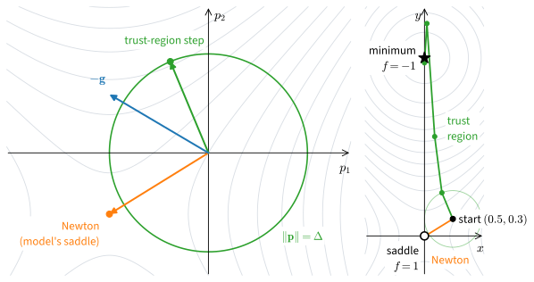

# Curvature Methods: Newton, Quasi-Newton, and Trust Regions
:label:`sec_mdl-curvature-methods`

Gradient descent never looks at the curvature of the function it descends.
It only suffers from it: the steepest direction caps the step, the flattest
direction then crawls, and the number of steps grows with the condition
number $\kappa$, or with $\sqrt\kappa$ once momentum is added
(:numref:`subsec_mdl-momentum-acceleration`). On the chapter's running
example $\tfrac12(x_1^2 + 1000\,x_2^2)$ that came to $6{,}908$ steps, or
$315$ with momentum. Yet anyone can solve this problem by inspection: divide
each coordinate of the gradient by its curvature, $1$ or $1000$, and a
single step lands on the minimum. What does a method gain when it measures
the curvature instead of merely surviving it?

Newton's method, a century and a half older than gradient descent, is the
classical answer. It fits a quadratic to the function at the current point
and jumps to the minimum of the quadratic. We ask four questions of it. How
fast is it? What does a step cost? Where does it go wrong? And how much of
it can be recovered from gradients alone, when second derivatives are out of
reach? In brief: it is very fast near a minimum, it is far too expensive
for a network, it runs to saddle points as readily as to minima, and a good
part of it can be rebuilt by comparing successive gradients. The remedy for
the saddles is to limit each step to the region where the quadratic has
predicted well.

For training networks this section matters less than the previous one, and
we should say so. A Hessian is too large to form, and minibatch noise spoils
curvature estimates built from differences of gradients. The ideas return
in other forms, though: the per-coordinate steps of Adam are a diagonal
stand-in for Newton's matrix (:numref:`sec_mdl-adaptive-stochastic-methods`),
and the damping that such methods add to a curvature matrix is the shift of
a trust region. The result to remember is the quadratic convergence of
Newton's method :eqref:`eq_mdl-opt-newton-error`. The part on quasi-Newton
methods can be skipped on a first reading. From
:numref:`sec_mdl-gradient-based-optimization` we reuse two things: the
Armijo test of the backtracking line search, and the function
$\tfrac12 x^2 + \cos y$, at whose saddle gradient descent stopped.

```{.python .input #mdl-curvature-methods-curvature-methods-newton-quasi-newton-and-trust-regions}
#@tab mxnet
import math
import numpy as np
from mxnet import autograd, gluon, init, np as mnp, npx
from mxnet.gluon import nn
from d2l import mxnet as d2l
npx.set_np()
```

```{.python .input #mdl-curvature-methods-curvature-methods-newton-quasi-newton-and-trust-regions}
#@tab pytorch
import math
import numpy as np
import torch
from torch import nn
from torch.nn import functional as F
from d2l import torch as d2l
```

```{.python .input #mdl-curvature-methods-curvature-methods-newton-quasi-newton-and-trust-regions}
#@tab tensorflow
import math
import numpy as np
import tensorflow as tf
from d2l import tensorflow as d2l
```

```{.python .input #mdl-curvature-methods-curvature-methods-newton-quasi-newton-and-trust-regions}
#@tab jax
import math
import numpy as np
import jax
from jax import numpy as jnp
from flax import nnx
import optax
from d2l import jax as d2l
```

## Newton's Method
:label:`subsec_mdl-why-not-newton`

Gradient descent rests on a linear model of $f$. A linear model has no
minimum, which is why the method needs a step size from outside. A quadratic
model has a minimum of its own, and with it comes a step that needs no
tuning.

### The Newton Step

Newton's method lets the curvature choose the step
(:numref:`subsec_gd-newton`). Model $f$ near $\mathbf{x}_k$ by its
second-order Taylor expansion in the step $\mathbf{p}$:

$$
m_k(\mathbf{p}) = f(\mathbf{x}_k) + \mathbf{g}_k^\top \mathbf{p} + \tfrac12\, \mathbf{p}^\top \nabla^2 f(\mathbf{x}_k)\, \mathbf{p}.
$$
:eqlabel:`eq_mdl-opt-newton-model`

If $\nabla^2 f(\mathbf{x}_k)$ is positive definite, the model is a bowl with
a unique minimizer, where
$\nabla m_k = \mathbf{g}_k + \nabla^2 f(\mathbf{x}_k)\,\mathbf{p} = \mathbf{0}$.
Solving for $\mathbf{p}$ and stepping there is **Newton's method**:

$$
\mathbf{x}_{k+1} = \mathbf{x}_k - \big(\nabla^2 f(\mathbf{x}_k)\big)^{-1} \nabla f(\mathbf{x}_k).
$$
:eqlabel:`eq_mdl-opt-newton-step`

No step size appears: the curvature has set it. Newton's direction belongs
to the family $\mathbf{d} = -\mathbf{P}^{-1}\nabla f$ with a positive
definite matrix $\mathbf{P}$, here $\nabla^2 f$. Every member of the family
is a descent direction, since
$\nabla f^\top \mathbf{d} = -\nabla f^\top \mathbf{P}^{-1}\nabla f < 0$.
Newton's direction is the steepest one when lengths are measured in the
Hessian's norm instead of the Euclidean one (exercise
:exref:`ex_mdl-gradient-based-optimization-show-that-is-de`).

On the quadratic $\tfrac12\mathbf{x}^\top\mathbf{A}\mathbf{x}$ the model is the
function, so one step lands on the minimizer,
$\mathbf{x}_1 = \mathbf{x}_0 - \mathbf{A}^{-1}\mathbf{A}\mathbf{x}_0 = \mathbf{0}$,
for every $\kappa$. The reason goes deeper than the algebra. Newton's method
is **affine-invariant**: it does not depend on the coordinates. Under a
change of coordinates
$\mathbf{x} = \mathbf{T}\mathbf{y}$, Newton's iterates for $f(\mathbf{T}\mathbf{y})$
are the images of Newton's iterates for $f$. Gradient descent's iterates, in
contrast, change under every $\mathbf{T}$ that is not orthogonal; a multiple
of an orthogonal matrix changes only the effective step (exercise
:exref:`ex_mdl-gradient-based-optimization-newton-show-that-any`). Since a
change of coordinates can make any positive definite quadratic round, the
condition number cannot matter to Newton. A long valley is, to Newton's
method, a round bowl drawn on stretched paper.

### Quadratic Convergence

On a function that is not quadratic the model is only an approximation, and
one step no longer suffices. What survives is the speed. Near a minimizer
Newton's method converges much faster than geometrically, and the proof is
a single use of the fundamental theorem of calculus. We write
$\mathbf{e}_k = \mathbf{x}_k - \mathbf{x}^\star$ for the error.

**Proposition (quadratic convergence).** *Let $\nabla f(\mathbf{x}^\star) = \mathbf{0}$,
and suppose that on a ball around $\mathbf{x}^\star$ the Hessian satisfies
$\nabla^2 f(\mathbf{x}) \succeq \mu\mathbf{I}$ and
$\|\nabla^2 f(\mathbf{x}) - \nabla^2 f(\mathbf{y})\| \le L_2\|\mathbf{x} - \mathbf{y}\|$.
If $\mathbf{x}_k$ lies in the ball, then*

$$
\|\mathbf{e}_{k+1}\| \;\le\; \frac{L_2}{2\mu}\, \|\mathbf{e}_k\|^2.
$$
:eqlabel:`eq_mdl-opt-newton-error`

**Proof.** Write $\nabla^2 f_k = \nabla^2 f(\mathbf{x}_k)$. Since
$\nabla f(\mathbf{x}^\star) = \mathbf{0}$, the Newton step gives
$\mathbf{e}_{k+1} = \mathbf{e}_k - (\nabla^2 f_k)^{-1}\mathbf{g}_k = (\nabla^2 f_k)^{-1}\big[\nabla^2 f_k\,\mathbf{e}_k - (\nabla f(\mathbf{x}_k) - \nabla f(\mathbf{x}^\star))\big]$.
By the fundamental theorem of calculus along the segment from $\mathbf{x}^\star$
to $\mathbf{x}_k$, the gradient difference is
$\int_0^1 \nabla^2 f(\mathbf{x}^\star + t\mathbf{e}_k)\,\mathbf{e}_k\,dt$, so the
bracket is $\int_0^1 \big[\nabla^2 f_k - \nabla^2 f(\mathbf{x}^\star + t\mathbf{e}_k)\big]\mathbf{e}_k\,dt$.
The two points differ by $(1 - t)\mathbf{e}_k$, so the bracket has norm at most
$\int_0^1 L_2(1 - t)\|\mathbf{e}_k\|^2\,dt = \tfrac{L_2}{2}\|\mathbf{e}_k\|^2$.
Finally $\|(\nabla^2 f_k)^{-1}\| \le 1/\mu$. $\blacksquare$

Multiplying both sides by $L_2/(2\mu)$ gives
$\tfrac{L_2}{2\mu}\|\mathbf{e}_{k+1}\| \le \big(\tfrac{L_2}{2\mu}\|\mathbf{e}_k\|\big)^2$,
so the scaled error squares at every step. If it starts below $1$, the error
shrinks and every later iterate stays in the ball. Once it is below $0.1$, it
goes to $10^{-2}$, $10^{-4}$, $10^{-8}$, so the number of correct digits
roughly doubles per step. Compare gradient descent on the running example,
which gains one digit in about $1{,}150$ steps. The speed has a condition
attached, and it is in the hypotheses: the bound says nothing until the
iterate is already close.

Far from $\mathbf{x}^\star$ the full step can overshoot, even with a positive
definite Hessian. The remedy is **damping**: step to
$\mathbf{x}_k + \alpha_k\mathbf{p}_k$ along the Newton direction
$\mathbf{p}_k = -(\nabla^2 f(\mathbf{x}_k))^{-1}\mathbf{g}_k$, with
$\alpha_k \le 1$ chosen by backtracking on the Armijo test
$f(\mathbf{x}_k + \alpha\mathbf{p}_k) \le f(\mathbf{x}_k) + c\,\alpha\,\mathbf{g}_k^\top\mathbf{p}_k$,
which is :eqref:`eq_mdl-opt-armijo` for a general descent direction. Near a
minimizer with positive definite Hessian the full step $\alpha = 1$ passes
this test when $c < \tfrac12$, so damping costs nothing once the fast phase
begins.

The test problem for the cells below is $\ell_2$-regularized
logistic regression on $n = 200$ random examples in $d = 5$ dimensions,

$$
f(\mathbf{w}) = \frac1n \sum_{i=1}^n \log\big(1 + \exp(-y_i\,\mathbf{x}_i^\top \mathbf{w})\big) + \frac{\nu}{2}\|\mathbf{w}\|^2,
\qquad \nu = 0.1,
$$

with labels $y_i = \pm 1$ drawn from a logistic model (the weight-decay
coefficient is $\nu$ here because $\lambda$ denotes eigenvalues). The data
cell also computes a reference optimum $\mathbf{w}^\star$ with $4{,}000$
gradient steps of size $\eta = 0.5$, which is safe since
$L = \lambda_{\max}(\mathbf{X}^\top\mathbf{X})/(4n) + \nu$ is about $0.4$ here
(exercise :exref:`ex_mdl-gradient-based-optimization-smoothness-constants`).

```{.python .input #mdl-gradient-based-optimization-newton-s-method-and-its-computational-cost-1}
rng = np.random.default_rng()
n, d, nu = 200, 5, 0.1
w_true = np.array([1.0, -2.0, 1.5, 0.0, 2.0])
X = rng.normal(size=(n, d))
y = np.where(rng.random(n) < 1 / (1 + np.exp(-X @ w_true)), 1.0, -1.0)

def loss(w, X, y, nu):
    return np.logaddexp(0, -y * (X @ w)).mean() + nu / 2 * (w @ w)

def grad_rows(w, X, y, nu):                   # row i: gradient of example i
    s = 1 / (1 + np.exp(y * (X @ w)))         # sigmoid(-y_i x_i^T w)
    return -(y * s)[:, None] * X + nu * w

w_star = np.zeros(d)
for _ in range(4000):                         # full-batch reference optimum
    w_star = w_star - 0.5 * grad_rows(w_star, X, y, nu).mean(axis=0)
```

Two predictions can now be tested. On the chapter's running example
$\mathrm{diag}(1, 1000)$ one Newton step should replace the
$\log 10^6/\log(1001/999) \approx 6{,}908$ steps of gradient descent at its
best fixed step (:numref:`subsec_mdl-momentum-acceleration`). On the logistic loss,
which is not a quadratic, the exponent of the gradient norm should roughly
double per iteration once the fast phase has begun.

```{.python .input #gradient-based-optimization-newton}
A2 = np.diag([1.0, 1000.0])                   # the running example, kappa = 1000
x = np.array([1.0, 1.0])
x_new = x - np.linalg.solve(A2, A2 @ x)       # one Newton step
rate = (1000 - 1) / (1000 + 1)
print(f'Newton on the quadratic: |x_1| = {np.linalg.norm(x_new):.1e} after one step')
print(f'GD at the optimal step contracts by {rate:.4f}; it needs '
      f'{int(np.ceil(np.log(1e-6) / np.log(rate)))} steps for |x_k| <= 1e-6 |x_0|')
w = np.zeros(d)                               # Newton on the logistic loss
for it in range(6):
    s = 1 / (1 + np.exp(y * (X @ w)))
    g = grad_rows(w, X, y, nu).mean(axis=0)
    hess = (X * (s * (1 - s))[:, None]).T @ X / n + nu * np.eye(d)
    w = w - np.linalg.solve(hess, g)
    print(f'Newton iteration {it + 1}:  |grad| = {np.linalg.norm(g):.1e}')
print(f'max |w - w_star| = {np.abs(w - w_star).max():.1e}')
```

Both hold. On the quadratic one Newton step leaves an error of exactly
zero, where gradient descent at its best step contracts by $0.998$ and needs
its $6{,}908$ steps. On the logistic loss the gradient norm starts at a few
tenths and is below $10^{-8}$ by the fifth iteration, its exponent roughly
doubling each time once it is small. After six iterations the iterate
agrees with the reference optimum of the data cell to about $10^{-15}$, the
precision of the reference itself. Six linear solves have done the work of
the $4{,}000$ gradient steps that produced the reference.

### The Cost of a Step

Unfortunately the comparison of step counts flatters Newton's method. The
Hessian has $d^2$ entries, and a generic solve costs $O(d^3)$ operations per
step. With $d = 5$ this is nothing. A network with a modest $10^8$ weights
has a Hessian of $10^{16}$ entries, which rules the method out before the
first step is taken (:numref:`subsec_gd-newton`). The cheap alternatives
are the secant approximations of the next part and the diagonal or
structured preconditioners of
:numref:`sec_mdl-adaptive-stochastic-methods`.

### Saddle Points

Cost is not the only objection, and it is not the most instructive one.
Newton's step solves $\nabla m_k = \mathbf{0}$, which finds the stationary
point of the model whether it is a minimum or not. Return to the function
$f(x, y) = \tfrac12 x^2 + \cos y$ of
:numref:`sec_mdl-gradient-based-optimization`, which has a saddle at the
origin and its minimum value $-1$ at $(0, \pi)$, and start at
$(0.5, 0.3)$. The gradient is $(0.5, -\sin 0.3) = (0.5, -0.296)$, and the
Hessian $\mathrm{diag}(1, -\cos 0.3) = \mathrm{diag}(1, -0.955)$ is indefinite:
the model curves up along $x$ and down along $y$. Which way will Newton's
step move $y$ from here, and which way a plain gradient step with
$\eta = 1$?

```{.python .input #mdl-gradient-based-optimization-newton-s-method-1}
def f_s(v):
    return 0.5 * v[0]**2 + np.cos(v[1])

def grad_s(v):
    return np.array([v[0], -np.sin(v[1])])

def hess_s(v):
    return np.diag([1.0, -np.cos(v[1])])

x_n = x_g = np.array([0.5, 0.3])
ys_n, ys_g = [], []
for _ in range(6):
    x_n = x_n - np.linalg.solve(hess_s(x_n), grad_s(x_n))    # Newton
    x_g = x_g - 1.0 * grad_s(x_g)                            # GD, eta = 1
    ys_n.append(x_n[1])
    ys_g.append(x_g[1])
print('Newton y:', np.array(ys_n[:3]), f'  f = {f_s(x_n):.4f}')
print('GD     y:', np.array(ys_g).round(4), f'  f = {f_s(x_g):.4f}')
```

Newton's first step sets $x$ to $0$ and $y$ to $0.3 - \tan 0.3 = -0.0093$; the
next sends $y$ to $2.7 \times 10^{-7}$. This is Newton's fast local
convergence (here even cubic, since $y - \tan y \approx -y^3/3$), to the
saddle $(0, 0)$ with $f = 1$. Gradient descent moves $y$ the other way, to
$0.60$, $1.16$, $2.07$, $2.95$, $3.140$, $3.1416$, and reaches the minimum
$(0, \pi)$ with $f = -1$. The better model has led to the worse point. The
cause is that the model's curvature along $y$ is negative, so its stationary
point is a saddle, and Newton's method seeks any stationary point. A trust
region (:numref:`subsec_mdl-trust-region`) repairs this.

## Quasi-Newton Methods

Newton's method needs second derivatives. Can the curvature be inferred
instead from gradients that have already been computed? A gradient that
changes quickly along a step betrays a large curvature in that direction,
and a method that remembers such changes can assemble a model of the Hessian
without ever evaluating one.

### The Secant Method

In one dimension the idea is elementary: the slope of $f'$ between the last
two iterates estimates $f''$,

$$
h_k = \frac{f'(x_k) - f'(x_{k-1})}{x_k - x_{k-1}},
\qquad
x_{k+1} = x_k - \frac{f'(x_k)}{h_k}.
$$

This is the **secant method**, Newton's step with $f''$ replaced by the slope
of the chord through the last two gradients. Take $f(x) = e^x - 2x$, whose
minimizer is $\log 2 = 0.6931$, from $x_0 = 0$ and $x_1 = 1$. The first slope is
$h_1 = (e - 2) - (1 - 2) = e - 1 = 1.718$, so
$x_2 = 1 - (e - 2)/1.718 = 0.582$. The errors then run
$1.1 \times 10^{-1}$, $1.6 \times 10^{-2}$, $9.3 \times 10^{-4}$,
$7.7 \times 10^{-6}$, $3.6 \times 10^{-9}$. Each is about half the product of
the previous two (the half is $f'''/(2f'')$ at the minimizer), so the number
of correct digits grows by a factor approaching $1.6$ per step. That is
slower than Newton's factor $2$, but each step costs one gradient and no
second derivative. On a quadratic $\tfrac{\lambda}{2}x^2$ the secant slope is
$\lambda$ exactly, and the step from $x_1$ lands on the minimizer.

In $d$ dimensions the analogous condition is one vector equation, which
cannot determine a $d \times d$ matrix: one step reveals the curvature along
one direction only. Something must fill in the rest.

### BFGS
:label:`subsec_mdl-quasi-newton`

A **quasi-Newton** method keeps an approximation of the inverse Hessian and
updates it from the steps and gradient changes it has observed. After moving
from $\mathbf{x}_k$ to $\mathbf{x}_{k+1}$, record the secant pair

$$
\mathbf s_k=\mathbf x_{k+1}-\mathbf x_k,
\qquad
\mathbf y_k=\nabla f(\mathbf x_{k+1})-\nabla f(\mathbf x_k).
$$

On a quadratic $\mathbf{y}_k = \mathbf{A}\mathbf{s}_k$, so the inverse Hessian
maps $\mathbf{y}_k$ back to $\mathbf{s}_k$. The new approximation
$\mathbf{M}_{k+1}$ is required to do the same, which is the **secant
equation**

$$
\mathbf{M}_{k+1}\,\mathbf{y}_k = \mathbf{s}_k .
$$
:eqlabel:`eq_mdl-opt-secant`

**BFGS** (Broyden, Fletcher, Goldfarb, and Shanno) fills in the rest by
changing $\mathbf{M}_k$ as little as possible: in a suitably weighted
Frobenius norm, the symmetric matrix closest to $\mathbf{M}_k$ that
satisfies the secant equation is

$$
\mathbf{M}_{k+1}
=(\mathbf{I}-\gamma_k\mathbf s_k\mathbf y_k^\top)\,\mathbf{M}_k\,
 (\mathbf{I}-\gamma_k\mathbf y_k\mathbf s_k^\top)
 +\gamma_k\mathbf s_k\mathbf s_k^\top,
\qquad
\gamma_k=\frac{1}{\mathbf y_k^\top\mathbf s_k}.
$$
:eqlabel:`eq_mdl-opt-bfgs`

The formula can be read without deriving it (we drop the index $k$ on the
pair). The right factor $\mathbf{I} - \gamma\mathbf{y}\mathbf{s}^\top$
sends $\mathbf{y}$ to zero, since $\gamma\,\mathbf{s}^\top\mathbf{y} = 1$, and
leaves every vector orthogonal to $\mathbf{s}$ unchanged. So the first term
forgets what $\mathbf{M}_k$ said about $\mathbf{y}$, and the second writes in
the new answer:
$\mathbf{M}_{k+1}\mathbf{y} = \gamma\,\mathbf{s}\,(\mathbf{s}^\top\mathbf{y}) = \mathbf{s}$,
the secant equation. The update also keeps the matrix positive definite, so
that $-\mathbf{M}_{k+1}\nabla f(\mathbf{x}_{k+1})$ is again a descent
direction. For $\mathbf{z} \neq \mathbf{0}$ put
$\mathbf{w} = (\mathbf{I} - \gamma\mathbf{y}\mathbf{s}^\top)\mathbf{z}$. Then
$\mathbf{z}^\top\mathbf{M}_{k+1}\mathbf{z} = \mathbf{w}^\top\mathbf{M}_k\mathbf{w} + \gamma(\mathbf{s}^\top\mathbf{z})^2$.
If $\mathbf{M}_k \succ 0$ and $\gamma > 0$, both terms are nonnegative, and
they cannot both vanish: $\mathbf{w} = \mathbf{0}$ forces
$\mathbf{z} = \gamma(\mathbf{s}^\top\mathbf{z})\,\mathbf{y}$ with
$\mathbf{s}^\top\mathbf{z} \neq 0$. The requirement $\gamma > 0$ is the
**curvature condition** $\mathbf{y}_k^\top\mathbf{s}_k > 0$: the slope along
the step has increased. It holds for every step on a strictly convex
function, and elsewhere the line search enforces it by a second test, the
Wolfe condition :cite:`Nocedal.Wright.2006`.

How much curvature do the secant pairs recover? We run BFGS from $(1, 1)$
on $\mathrm{diag}(1, 10)$ with $\mathbf{M}_0 = \mathbf{I}$ and the exact line
search $\alpha = -\mathbf{g}^\top\mathbf{p}/(\mathbf{p}^\top\mathbf{A}\mathbf{p})$
of a quadratic, and print the iterate and $\mathbf{M}$ after each step.

```{.python .input #mdl-gradient-based-optimization-bfgs-1}
def bfgs_update(M, s, y):
    gamma = 1.0 / (y @ s)
    V = np.eye(len(s)) - gamma * np.outer(s, y)
    return V @ M @ V.T + gamma * np.outer(s, s)

A = np.diag([1.0, 10.0])
x, M = np.array([1.0, 1.0]), np.eye(2)
for k in range(2):
    g = A @ x
    p = -M @ g
    alpha = -(g @ p) / (p @ A @ p)            # exact line search
    s = alpha * p
    M = bfgs_update(M, s, A @ s)              # y = A s on a quadratic
    x = x + s
    print(f'step {k + 1}: x = {x.round(4)},  M = {M.round(4).tolist()}')
print(f'A^-1 = {np.linalg.inv(A).tolist()},  '
      f'max |M_2 - A^-1| = {np.abs(M - np.linalg.inv(A)).max():.0e}')
```

After one step $\mathbf{M}_1 \approx \mathrm{diag}(1.009, 0.100)$, already
close to $\mathbf{A}^{-1}$ in the stiff direction it has seen. After the second
step $\mathbf{M}_2 = \mathbf{A}^{-1}$ to rounding error and
$\mathbf{x}_2 = \mathbf{0}$. The two-dimensional case is typical. On a quadratic
with exact line searches, each secant equation, once satisfied, stays
satisfied, and the steps are $\mathbf{A}$-conjugate ($\mathbf{s}_i^\top\mathbf{A}\mathbf{s}_j = 0$
for $i \neq j$). After $d$ steps $\mathbf{M}_d\mathbf{A} = \mathbf{I}$ and the
iterate is the minimizer (exercise
:exref:`ex_mdl-gradient-based-optimization-bfgs-quadratic`).

Finite termination is a statement about quadratics with exact line
searches, and it should not be read as a promise. On other functions the
line search is inexact, the curvature changes from step to step, and noisy
gradients corrupt $\mathbf{y}_k$: the difference of two minibatch gradients
is mostly the difference of two noises. Full BFGS also stores a dense
$d \times d$ matrix. **L-BFGS** keeps only the $m$
most recent secant pairs and applies, in $O(md)$ time and memory, the matrix
they define, a scaled identity plus a correction of rank at most $2m$
:cite:`Liu.Nocedal.1989`. It suits deterministic medium-scale problems and is
less natural when fresh minibatch noise makes gradient differences
unreliable.

## Trust Regions
:label:`subsec_mdl-trust-region`

Newton's method failed at $(0.5, 0.3)$ because it trusted the model
everywhere. The model deserved no such trust: it was fitted at one point,
and it describes the function only near that point. A trust region takes
this literally. It keeps the curvature information, including the negative
directions, and bounds the step instead.

### The Subproblem

At $(0.5, 0.3)$ the model of $\tfrac12x^2 + \cos y$ has curvature $-0.955$
along $y$, so it is unbounded below and "minimize the model" has no answer.
A **trust-region method** minimizes the model over a ball whose radius
$\Delta_k$ says how far the model is believed:

$$
\min_{\|\mathbf p\|\le\Delta_k}
 m_k(\mathbf p)
 =f(\mathbf x_k)+\nabla f(\mathbf x_k)^\top\mathbf p
  +\tfrac12\mathbf p^\top \mathbf{B}_k\mathbf p.
$$
:eqlabel:`eq_mdl-opt-trust-region`

Here $\mathbf{B}_k$ is the Hessian or a symmetric approximation of it. The
radius makes the subproblem bounded even when $\mathbf{B}_k$ has a negative
eigenvalue, because a continuous function on a ball has a minimum. The
minimizers can be characterized exactly.

**Proposition (solution of the subproblem).** *A step $\mathbf{p}$ with
$\|\mathbf{p}\| \le \Delta$ solves :eqref:`eq_mdl-opt-trust-region` if and only
if there is a $\tau \ge 0$ with*

$$
(\mathbf{B} + \tau\mathbf{I})\,\mathbf{p} = -\mathbf{g},
\qquad \mathbf{B} + \tau\mathbf{I} \succeq \mathbf{0},
\qquad \tau\,(\Delta - \|\mathbf{p}\|) = 0.
$$

This is Theorem 4.1 of :citet:`Nocedal.Wright.2006`; exercise
:exref:`ex_mdl-gradient-based-optimization-trust-region-saddle` proves that the
conditions are sufficient. A trust region adds the same amount $\tau$ to every
curvature, enough to make the shifted model convex. If $\mathbf{B}$ is
positive definite and the Newton step fits inside the ball, $\tau = 0$ and the
step is Newton's. Otherwise the step lies on the boundary, and $\tau$ is found
from the scalar equation $\|(\mathbf{B} + \tau\mathbf{I})^{-1}\mathbf{g}\| = \Delta$
with $\tau > -\lambda_{\min}(\mathbf{B})$, whose left side decreases as $\tau$
grows. The equation can fail to have a root only in the degenerate *hard
case*, where $\mathbf{g}$ is orthogonal to the eigenvectors of the smallest
eigenvalue of $\mathbf{B}$. Part d of exercise
:exref:`ex_mdl-gradient-based-optimization-trust-region-saddle` meets it. The
shift $\tau$ is a Lagrange multiplier for the constraint
$\tfrac12\|\mathbf{p}\|^2 \le \tfrac12\Delta^2$, in the sense of
:numref:`sec_mdl-constrained-optimization-duality`.

The radius adapts to how well the model predicted the last step. After solving
the subproblem, compare the actual with the predicted decrease:

$$
r_k=
\frac{f(\mathbf x_k)-f(\mathbf x_k+\mathbf p_k)}
     {m_k(\mathbf 0)-m_k(\mathbf p_k)}.
$$
:eqlabel:`eq_mdl-opt-trust-ratio`

A ratio near one says that the model was right. The rule used below accepts
the step whenever $r_k > 0.1$. Independently, it shrinks the radius,
$\Delta \leftarrow \Delta/4$, if $r_k < \tfrac14$, and doubles it if
$r_k > \tfrac34$ and the step reached the boundary.

### The Trust-Region Step at a Saddle

We solve the subproblem at $(0.5, 0.3)$ by hand, with $\Delta = 0.5$. There
$\mathbf{g} = (0.5, -0.296)$ and $\mathbf{B} = \mathrm{diag}(1, -0.955)$.
Positive semidefiniteness of $\mathbf{B} + \tau\mathbf{I}$ needs
$\tau \ge 0.955$, and the Newton point $\tau = 0$ is excluded, so the step lies
on the boundary. The equations are
$(1 + \tau)p_1 = -0.5$ and $(\tau - 0.955)p_2 = 0.296$, with
$p_1^2 + p_2^2 = 0.25$. Their solution is $\tau \approx 1.60$ and
$\mathbf{p} \approx (-0.19, 0.46)$. The new point $(0.31, 0.76)$ has
$f = 0.771$, down from $1.080$. The model predicted a decrease of $0.316$, the
actual decrease is $0.309$, and $r = 0.98$, so the radius doubles. The step
moves *away* from the saddle, along the direction of negative curvature,
where the model falls, while the Newton step $(-0.5, -0.31)$ moves toward it.

One step by hand does not show where the rule leads. We implement the step
by bisection on $\tau$ and run six iterations, printing the iterate, $f$,
the step length, $\tau$, the ratio, and the radius in force.

```{.python .input #mdl-gradient-based-optimization-the-trust-region-step-at-a-saddle-1}
def tr_step(g, B, Delta):
    """Minimize g p + p B p / 2 over |p| <= Delta; return (p, tau)."""
    eig_min = np.linalg.eigvalsh(B).min()
    if eig_min > 0 and np.linalg.norm(np.linalg.solve(B, -g)) <= Delta:
        return np.linalg.solve(B, -g), 0.0     # Newton step fits: tau = 0
    lo = hi = max(0.0, -eig_min)
    hi += 1e3
    for _ in range(100):                       # bisection for |p(tau)| = Delta
        tau = (lo + hi) / 2
        p = np.linalg.solve(B + tau * np.eye(len(g)), -g)
        lo, hi = (tau, hi) if np.linalg.norm(p) > Delta else (lo, tau)
    return p, tau
```

```{.python .input #mdl-gradient-based-optimization-the-trust-region-step-at-a-saddle-2}
x, Delta = np.array([0.5, 0.3]), 0.5
print(' k        x            f      |p|    tau      r  Delta')
for k in range(6):
    g, B = grad_s(x), hess_s(x)
    p, tau = tr_step(g, B, Delta)
    r = (f_s(x) - f_s(x + p)) / -(g @ p + 0.5 * p @ B @ p)
    print(f'{k:2d} ({x[0]:6.3f},{x[1]:6.3f}) {f_s(x):7.4f} '
          f'{np.linalg.norm(p):6.3f} {tau:6.3f} {r:6.2f} {Delta:5.2f}')
    if r > 0.1:                                # accept the step
        x = x + p
    if r < 0.25:
        Delta /= 4                             # poor prediction: shrink
    elif r > 0.75 and np.linalg.norm(p) > 0.99 * Delta:
        Delta *= 2                             # good, and on the boundary
print(f'final x = ({x[0]:.4f}, {x[1]:.4f}),  f = {f_s(x):.4f}')
```

The first row reproduces the hand computation. The radius grows from $0.5$ to
$1$ and $2$, and the third step, with ratio $0.41$, is accepted without
changing it. The fourth iterate, $(0.04, 3.75)$, lies in the region where the
Hessian is positive definite. From there on the Newton step fits inside the
ball and $\tau = 0$, so the method has become Newton's method. It converges
quadratically to the minimum $(0, \pi)$, where $f = -1$. Six iterations suffice.
:numref:`fig_mdl-opt-trust-region-saddle` shows both runs.

![Newton and a trust region from $(0.5,0.3)$ on $\tfrac12x^2+\cos y$, whose Hessian there is $\mathrm{diag}(1,-0.96)$. (a) The quadratic model is a saddle surface; Newton's step goes to its stationary point, while the step of length $\Delta=0.5$ that minimizes the model moves along the negative-curvature direction, away from the saddle. (b) Newton converges quadratically to the saddle $(0,0)$, where $f=1$; the trust region, with its first radius drawn, reaches the minimum $(0,\pi)$, $f=-1$, in six steps, its radius growing $0.5,1,2$.](../img/mdl-opt-trust-region-saddle.svg)
:label:`fig_mdl-opt-trust-region-saddle`

The exact subproblem needs a factorization of $\mathbf{B}_k + \tau\mathbf{I}$
for each trial $\tau$. Large problems solve it approximately with
Hessian--vector products, which cost about as much as a gradient
(:numref:`sec_mdl-matrix-calculus-autodiff`). Even so, neither BFGS nor a
trust region replaces stochastic gradients on a large noisy loss.

The saddle of $\tfrac12 x^2 + \cos y$ has now misled two methods: gradient
descent stopped at it, and Newton's method ran to it. A trust region
escapes, but only by testing each model against the function. On some
functions no such care is needed, because they have no saddle and no second
basin, and every stationary point is the minimum. Which functions these are
is the subject of :numref:`sec_mdl-convexity`.

## Summary

Newton's step minimizes the local quadratic model of $f$. It solves a
quadratic in one step whatever its condition number, and near a minimizer
with a positive definite, Lipschitz-continuous Hessian it squares the error
at every step. A step costs $O(d^2)$ memory and $O(d^3)$ time, which no
network can afford, and the method runs to saddles as readily as to minima.
BFGS rebuilds the inverse Hessian from the changes of the gradient along
past steps, and on a quadratic in $d$ dimensions it has rebuilt all of it
after $d$ steps. A trust region makes any quadratic model safe to use: it
bounds the step, compares the predicted decrease with the actual one, and
adjusts the bound accordingly.

## Exercises

1. **Reparametrization and preconditioning.** Let $\mathbf{T}$ be an invertible
   matrix and $h(\mathbf{y}) = f(\mathbf{T}\mathbf{y})$, so that
   $\mathbf{x} = \mathbf{T}\mathbf{y}$ is a change of coordinates.
    1. Express $\nabla h$ and $\nabla^2 h$ through the derivatives of $f$.
       Show that Newton's iterates :eqref:`eq_mdl-opt-newton-step` for $h$,
       started at $\mathbf{y}_0 = \mathbf{T}^{-1}\mathbf{x}_0$, satisfy
       $\mathbf{y}_k = \mathbf{T}^{-1}\mathbf{x}_k$, where $\mathbf{x}_k$ are
       Newton's iterates for $f$.
    1. Run gradient descent with step $\eta$ on $h$ and map every iterate
       back by $\mathbf{x}_k = \mathbf{T}\mathbf{y}_k$. Show that the mapped iterates
       follow $\mathbf{x}_{k+1} = \mathbf{x}_k - \eta\, \mathbf{P}^{-1} \nabla f(\mathbf{x}_k)$
       for a positive definite matrix $\mathbf{P}$, and find $\mathbf{P}$. By
       problem :exref:`ex_mdl-gradient-based-optimization-show-that-is-de`b
       this direction is the steepest one in the norm $\|\cdot\|_{\mathbf{P}}$.
       What is $\|\mathbf{x}\|_{\mathbf{P}}$ in the coordinates $\mathbf{y}$?
    1. For $f(\mathbf{x}) = \tfrac12\mathbf{x}^\top \mathbf{A}\,\mathbf{x}$ with
       $\mathbf{A} = \mathrm{diag}(1, 1000)$, the $\kappa = 1000$ quadratic of the
       Newton subsection, find a diagonal $\mathbf{T}$ for which gradient
       descent on $h$ with $\eta = 1$ reaches the minimizer in one step. What
       does constructing such a $\mathbf{T}$ require for a general positive
       definite $\mathbf{A}$?
   :exlabel:`ex_mdl-gradient-based-optimization-newton-show-that-any`

1. [code] **BFGS on a quadratic.** ● Let
   $f(\mathbf{x}) = \tfrac12\mathbf{x}^\top\mathbf{A}\mathbf{x} - \mathbf{b}^\top\mathbf{x}$
   with $\mathbf{A}$ positive definite, and run BFGS
   :eqref:`eq_mdl-opt-bfgs` with exact line searches from
   $\mathbf{M}_0 = \mathbf{I}$.
    1. Show that an exact line search along $\mathbf{p}_k$ gives
       $\nabla f(\mathbf{x}_{k+1})^\top\mathbf{p}_k = 0$, and that
       $\mathbf{y}_k = \mathbf{A}\mathbf{s}_k$.
    1. Show the hereditary property: if $\mathbf{M}_k\mathbf{y}_j = \mathbf{s}_j$
       for all $j < k$ and the steps $\mathbf{s}_0, \ldots, \mathbf{s}_{k-1}$,
       $\mathbf{s}_k$ are $\mathbf{A}$-conjugate, then
       $\mathbf{M}_{k+1}\mathbf{y}_j = \mathbf{s}_j$ for all $j \le k$. (Hint:
       $\mathbf{s}_j^\top\mathbf{y}_k = \mathbf{s}_j^\top\mathbf{A}\mathbf{s}_k = 0$
       for $j < k$.) Conclude that after $d$ linearly independent steps
       $\mathbf{M}_d\mathbf{A} = \mathbf{I}$.
    1. Run the BFGS loop of the text in $d = 6$ dimensions, on a randomly
       rotated quadratic with eigenvalues from $1$ to $1000$. Print
       $\max_{j \le k}\|\mathbf{M}_{k+1}\mathbf{y}_j - \mathbf{s}_j\|$
       after each step, and confirm that it stays at rounding level and that
       $\mathbf{M}_6 = \mathbf{A}^{-1}$. How far from the minimizer is
       gradient descent at its best fixed step after the same six
       gradients?
    1. The symmetric rank-one update
       $\mathbf{M}_{k+1} = \mathbf{M}_k + \frac{(\mathbf{s} - \mathbf{M}_k\mathbf{y})(\mathbf{s} - \mathbf{M}_k\mathbf{y})^\top}{(\mathbf{s} - \mathbf{M}_k\mathbf{y})^\top\mathbf{y}}$
       also satisfies the secant equation. Show by a $2 \times 2$ example that
       it need not stay positive definite even when $\mathbf{y}^\top\mathbf{s} > 0$,
       and say which of the two checks in the text fails for it.
   :exlabel:`ex_mdl-gradient-based-optimization-bfgs-quadratic`

1. [code] **Trust region at a saddle.** ● Consider the model
   $m(\mathbf{p}) = \mathbf{g}^\top\mathbf{p} + \tfrac12\mathbf{p}^\top\mathbf{B}\mathbf{p}$
   with $\mathbf{B} = \mathrm{diag}(1, -1)$ and
   $\mathbf{g} = (\tfrac12, -\tfrac{3}{10})$.
    1. Show that $m$ is unbounded below on $\mathbb{R}^2$ and that the Newton
       point $-\mathbf{B}^{-1}\mathbf{g} = (-\tfrac12, -\tfrac{3}{10})$ is a
       saddle of $m$, not a minimum.
    1. Prove that the conditions of the subproblem proposition are
       sufficient: if $(\mathbf{B} + \tau\mathbf{I})\mathbf{p} = -\mathbf{g}$
       with $\tau \ge 0$, $\mathbf{B} + \tau\mathbf{I} \succeq \mathbf{0}$, and
       $\tau(\Delta - \|\mathbf{p}\|) = 0$, then every $\|\mathbf{q}\| \le \Delta$
       satisfies
       $m(\mathbf{q}) \ge m(\mathbf{p}) + \tfrac{\tau}{2}(\|\mathbf{p}\|^2 - \|\mathbf{q}\|^2) \ge m(\mathbf{p})$.
       (Hint: expand $m(\mathbf{q}) - m(\mathbf{p})$ around $\mathbf{p}$ and use
       $\mathbf{g} = -(\mathbf{B} + \tau\mathbf{I})\mathbf{p}$.)
    1. For $\Delta = \tfrac12$ find $\tau \ge 1$ by bisection on
       $\|(\mathbf{B} + \tau\mathbf{I})^{-1}\mathbf{g}\| = \Delta$ (the answer
       is $\tau \approx 1.65$, $\mathbf{p} \approx (-0.19, 0.46)$), and check
       that the step increases the coordinate with negative curvature while
       the Newton step decreases it.
    1. Replace $\mathbf{g}$ by $(\tfrac12, 0)$. Show that
       $\|(\mathbf{B} + \tau\mathbf{I})^{-1}\mathbf{g}\| = \tfrac12/(1 + \tau) \le \tfrac14$
       for all $\tau > 1$, so the boundary equation has no solution with
       $\tau > 1$. Find the minimizers on the ball directly (they have
       $\tau = 1$ and $p_2 = \pm\sqrt{\Delta^2 - p_1^2}$), and explain in one
       sentence what the ball does with a direction of negative curvature that
       the gradient does not see.
   :exlabel:`ex_mdl-gradient-based-optimization-trust-region-saddle`

[Discussions](https://d2l.discourse.group/t/36879)

<!-- slides -->

::: {.slide}
::: {.cover}
[Dive into Deep Learning · §35.2]{.kicker}

Curvature Methods<br>**Newton's step · secant pairs and BFGS · trust regions**
:::
:::

::: {.slide title="Gradient Steps Count with $\kappa$; a Step That Knows the Curvature Needs One"}
[The problem]{.kicker}

On $\tfrac12(x_1^2+1000x_2^2)$ from $(1,1)$, six digits of the error cost:

| method | steps |
|---|---|
| gradient descent, best fixed step | $6{,}908$ |
| heavy ball, tuned | $315$ |
| divide each gradient entry by its curvature | $1$ |

::: {.d2l-note .warn}
How fast is a step that models the curvature, what does it cost, where does
it go wrong, and how much of it can gradients alone recover?
:::
:::

::: {.slide title="By the End of This Deck You Can"}
[Goals]{.kicker}

- derive Newton's step and prove that it squares the error near a minimizer;
- say what a step costs and why a network cannot afford it;
- explain why Newton's method runs to a saddle;
- rebuild the inverse Hessian from gradient differences with BFGS;
- solve a trust-region step by hand and read its acceptance rule.

**Running example:** $\tfrac12x^2+\cos y$ from $(0.5, 0.3)$: saddle at $(0,0)$, minimum at $(0,\pi)$.

**The idea:** model the curvature, and trust the model only where it predicts well.
:::

::: {.slide title="After the Gradient Step, a Model of the Curvature"}
[Where this fits]{.kicker}

::: {.cols .vc}
::: {.col}
| section | adds |
|---|---|
| Gradient Descent and Curvature | safe steps, $\kappa$, momentum |
| **Curvature Methods** | **Newton, BFGS, trust regions** |
| Convexity | local = global, rates, Jensen |
| Stochastic Gradient Methods | noise floors, step decay |
| Adaptive Methods | per-coordinate steps |
| Constrained Optimization | KKT, projections, prox |
| Duality | lower bounds, prices |
| Numerical Stability and Conditioning | rounding, conditioning |
:::

::: {.col .narrow}
- **Uses:** the quadratic model, $\kappa$, the Armijo test.
- **Skips:** L-BFGS internals, inexact subproblem solvers.
- Deep learning uses these methods rarely; their ideas return as preconditioners and damping.
:::
:::
:::

::: {.slide}
::: {.divider}
[01]{.dnum}

[Newton's method]{.dtitle}

[the step · the rate · the cost · the saddle]{.dsub}
:::
:::

::: {.slide title="Newton Jumps to the Minimum of a Quadratic Model"}
[Newton]{.kicker}

Model $f$ near $\mathbf{x}_k$ in the step $\mathbf{p}$, with gradient $\mathbf{g}_k$ and Hessian $\nabla^2f_k$:

$$m_k(\mathbf{p})=f(\mathbf{x}_k)+\mathbf{g}_k^\top\mathbf{p}+\tfrac12\,\mathbf{p}^\top\nabla^2f_k\,\mathbf{p}$$

If $\nabla^2f_k\succ0$, set $\nabla m_k=\mathbf{g}_k+\nabla^2f_k\,\mathbf{p}=\mathbf{0}$:

::: {.d2l-note .rule}
$$\mathbf{x}_{k+1}=\mathbf{x}_k-(\nabla^2f_k)^{-1}\mathbf{g}_k$$
:::

- No step size: the curvature sets it.
- $f=\tfrac12\mathbf{x}^\top\mathbf{A}\mathbf{x}$: $\mathbf{x}_1=\mathbf{x}_0-\mathbf{A}^{-1}\mathbf{A}\mathbf{x}_0=\mathbf{0}$, for every $\kappa$.
:::

::: {.slide title="Newton's Method Does Not Depend on the Coordinates"}
[Newton]{.kicker}

Change coordinates, $\mathbf{x}=\mathbf{T}\mathbf{y}$ with $\mathbf{T}$ invertible, and minimize $h(\mathbf{y})=f(\mathbf{T}\mathbf{y})$.

- Newton on $h$ from $\mathbf{T}^{-1}\mathbf{x}_0$: iterates $\mathbf{y}_k=\mathbf{T}^{-1}\mathbf{x}_k$, the same path.
- Gradient descent on $h$: a different path unless $\mathbf{T}$ is a multiple of an orthogonal matrix.

::: {.d2l-note}
Some $\mathbf{T}$ makes any positive definite quadratic round. Newton cannot
tell the valley from the round bowl, so $\kappa$ cannot matter to it.
:::
:::

::: {.slide title="Derivation I: The New Error Is an Integral of Hessian Differences"}
[Newton]{.kicker}

Error $\mathbf{e}_k=\mathbf{x}_k-\mathbf{x}^\star$, with $\nabla f(\mathbf{x}^\star)=\mathbf{0}$. One Newton step:

$$\mathbf{e}_{k+1}=(\nabla^2f_k)^{-1}\big[\nabla^2f_k\,\mathbf{e}_k-(\nabla f(\mathbf{x}_k)-\nabla f(\mathbf{x}^\star))\big]$$

Fundamental theorem of calculus on the segment from $\mathbf{x}^\star$ to $\mathbf{x}_k$:

$$\nabla f(\mathbf{x}_k)-\nabla f(\mathbf{x}^\star)=\int_0^1\nabla^2f(\mathbf{x}^\star+t\mathbf{e}_k)\,\mathbf{e}_k\,dt$$

So the bracket is $\int_0^1\big[\nabla^2f_k-\nabla^2f(\mathbf{x}^\star+t\mathbf{e}_k)\big]\mathbf{e}_k\,dt$.
:::

::: {.slide title="Derivation II: Each Step Squares the Error"}
[Newton]{.kicker}

The two Hessians are taken $(1-t)\|\mathbf{e}_k\|$ apart. If the Hessian is $L_2$-Lipschitz, the bracket is at most
$\int_0^1L_2(1-t)\|\mathbf{e}_k\|^2dt=\tfrac{L_2}{2}\|\mathbf{e}_k\|^2$. If $\nabla^2f\succeq\mu\mathbf{I}$, the inverse has norm at most $1/\mu$:

::: {.d2l-note .rule}
$$\|\mathbf{e}_{k+1}\|\le\frac{L_2}{2\mu}\,\|\mathbf{e}_k\|^2$$
:::

- Scaled error $\tfrac{L_2}{2\mu}\|\mathbf{e}\|$: $10^{-1}\to10^{-2}\to10^{-4}\to10^{-8}$. Digits double.
- Gradient descent at $\kappa=10^3$: one digit per $1{,}150$ steps.

[Assumes both bounds on a ball around $\mathbf{x}^\star$ that contains $\mathbf{x}_k$: the result is local.]{.small}
:::

::: {.slide title="Measured: One Step on the Valley, Five Iterations on a Logistic Loss"}
[Newton]{.kicker}

$\mathrm{diag}(1,1000)$ from $(1,1)$; then logistic regression with weight decay $0.1$, $200$ examples, $5$ weights:

@!gradient-based-optimization-newton

- The exponent of $\|\nabla f\|$ roughly doubles once it is small.
- Six solves match a reference that took $4{,}000$ gradient steps.
:::

::: {.slide title="A Newton Step Costs $d^2$ Memory and $d^3$ Time"}
[Newton]{.kicker}

| weights $d$ | Hessian entries $d^2$ | solve, about $d^3$ |
|---|---|---|
| $5$ (the logistic problem) | $25$ | $125$ |
| $10^4$ | $10^8$ | $10^{12}$ |
| $10^8$ (a small network) | $10^{16}$ | $10^{24}$ |

::: {.d2l-note .warn}
The step count flatters Newton's method: for a network, the first Hessian
cannot even be stored.
:::

Far from $\mathbf{x}^\star$ the full step can overshoot: step $\alpha\le1$ along Newton's direction, with $\alpha$ from the Armijo test.
:::

::: {.slide title="Check: How Many Steps from $10^{-1}$ to $10^{-8}$?"}
[Check]{.kicker}

The scaled error of Newton's method is $10^{-1}$. How many steps bring it to
$10^{-8}$? How many steps does gradient descent need for the same seven
digits at $\kappa=10^3$?

::: {.fragment .fade-up}
::: {.d2l-note}
**Answer.** Three: $10^{-1}\to10^{-2}\to10^{-4}\to10^{-8}$. Gradient descent
gains a digit per $\log10/\log(1001/999)\approx1{,}150$ steps: about $8{,}000$.
:::
:::
:::

::: {.slide title="From $(0.5, 0.3)$ Newton Runs to the Saddle, Gradient Descent to the Minimum"}
[Newton]{.kicker}

$f=\tfrac12x^2+\cos y$: gradient $(0.5,-0.296)$, Hessian $\mathrm{diag}(1,-0.955)$, indefinite. Six steps of each method, $\eta=1$ for gradient descent:

@!mdl-gradient-based-optimization-newton-s-method-1

::: {.d2l-note .warn}
$\nabla m=\mathbf{0}$ finds the model's stationary point, minimum or not. The
model curves down along $y$, so that point is a saddle: $y\mapsto y-\tan y$.
:::
:::

::: {.slide}
::: {.divider}
[02]{.dnum}

[Quasi-Newton methods]{.dtitle}

[curvature from gradients already computed]{.dsub}
:::
:::

::: {.slide title="The Secant Slope Estimates $f''$ from Two Gradients"}
[Quasi-Newton]{.kicker}

$$h_k=\frac{f'(x_k)-f'(x_{k-1})}{x_k-x_{k-1}},\qquad x_{k+1}=x_k-\frac{f'(x_k)}{h_k}$$

$f(x)=e^x-2x$, minimizer $\log2=0.6931$, from $x_0=0$, $x_1=1$:

| step | $x_2$ | $x_3$ | $x_4$ | $x_5$ | $x_6$ |
|---|---|---|---|---|---|
| error | $1.1\times10^{-1}$ | $1.6\times10^{-2}$ | $9.3\times10^{-4}$ | $7.7\times10^{-6}$ | $3.6\times10^{-9}$ |

- Each error is about half the product of the previous two: digits grow by a factor near $1.6$ per step.
- Newton's factor is $2$, but this step needs no second derivative.
:::

::: {.slide title="The Secant Equation Fixes One Direction; BFGS Changes Nothing Else"}
[Quasi-Newton]{.kicker}

Keep $\mathbf{M}_k\approx(\nabla^2f)^{-1}$. After a step record
$\mathbf{s}=\mathbf{x}_{k+1}-\mathbf{x}_k$ and $\mathbf{y}=\nabla f(\mathbf{x}_{k+1})-\nabla f(\mathbf{x}_k)$.

- On a quadratic $\mathbf{y}=\mathbf{A}\mathbf{s}$, so demand $\mathbf{M}_{k+1}\mathbf{y}=\mathbf{s}$: $d$ equations for $d^2$ unknowns.
- BFGS takes the closest symmetric matrix that satisfies it, with $\gamma=1/(\mathbf{y}^\top\mathbf{s})$:

$$\mathbf{M}_{k+1}=(\mathbf{I}-\gamma\mathbf{s}\mathbf{y}^\top)\,\mathbf{M}_k\,(\mathbf{I}-\gamma\mathbf{y}\mathbf{s}^\top)+\gamma\,\mathbf{s}\mathbf{s}^\top$$

::: {.d2l-note}
The first term forgets what $\mathbf{M}_k$ said about $\mathbf{y}$; the second
writes in $\mathbf{s}$. Positive definite as long as $\mathbf{y}^\top\mathbf{s}>0$.
:::
:::

::: {.slide title="After $d$ Steps on a Quadratic, BFGS Holds the Inverse Hessian"}
[Quasi-Newton]{.kicker}

$\mathrm{diag}(1,10)$ from $(1,1)$, $\mathbf{M}_0=\mathbf{I}$, exact line search:

@!mdl-gradient-based-optimization-bfgs-1

- After one step $\mathbf{M}$ already has the stiff curvature: $0.100=1/10$.
- Off quadratics: inexact line searches, changing curvature, and a noisy $\mathbf{y}$, the difference of two minibatch gradients.
- L-BFGS keeps the last $m$ pairs: $O(md)$ memory in place of $d^2$.
:::

::: {.slide}
::: {.divider}
[03]{.dnum}

[Trust regions]{.dtitle}

[a model believed only nearby]{.dsub}
:::
:::

::: {.slide title="A Trust Region Minimizes the Model Inside a Ball"}
[Trust regions]{.kicker}

With $\mathbf{B}$ the Hessian or an approximation, and radius $\Delta$:

$$\min_{\|\mathbf{p}\|\le\Delta}\ m(\mathbf{p})=f+\mathbf{g}^\top\mathbf{p}+\tfrac12\mathbf{p}^\top\mathbf{B}\,\mathbf{p}$$

Bounded even for indefinite $\mathbf{B}$. $\mathbf{p}$ solves it exactly when some $\tau\ge0$ has

::: {.d2l-note .rule}
$$(\mathbf{B}+\tau\mathbf{I})\,\mathbf{p}=-\mathbf{g},\qquad\mathbf{B}+\tau\mathbf{I}\succeq0,\qquad\tau\,(\Delta-\|\mathbf{p}\|)=0$$
:::

- $\mathbf{B}\succ0$ and the Newton step fits: $\tau=0$, Newton's step.
- Otherwise the step lies on the boundary, and $\tau$ lifts every curvature by the same amount.
:::

::: {.slide title="By Hand at $(0.5, 0.3)$: $\tau=1.60$, and the Step Leaves the Saddle"}
[Trust regions]{.kicker}

$\mathbf{g}=(0.5,-0.296)$, $\mathbf{B}=\mathrm{diag}(1,-0.955)$, $\Delta=0.5$.

- $\mathbf{B}+\tau\mathbf{I}\succeq0$ needs $\tau\ge0.955$: the step is on the boundary.
- $(1+\tau)\,p_1=-0.5$, $\ (\tau-0.955)\,p_2=0.296$, $\ p_1^2+p_2^2=0.25$.
- Solution: $\tau\approx1.60$, $\mathbf{p}\approx(-0.19,0.46)$, new point $(0.31,0.76)$.
- $f$: $1.080\to0.771$. Predicted decrease $0.316$, actual $0.309$.

::: {.d2l-note}
Newton's step $(-0.5,-0.31)$ moves toward the saddle; this one moves along
the direction of negative curvature, away from it.
:::
:::

::: {.slide title="The Radius Follows the Ratio of Actual to Predicted Decrease"}
[Trust regions]{.kicker}

$$r=\frac{f(\mathbf{x})-f(\mathbf{x}+\mathbf{p})}{m(\mathbf{0})-m(\mathbf{p})}$$

Accept if $r>0.1$; $\Delta\leftarrow\Delta/4$ if $r<\tfrac14$; $\Delta\leftarrow2\Delta$ if $r>\tfrac34$ at the boundary.

@!mdl-gradient-based-optimization-the-trust-region-step-at-a-saddle-2

- Radius $0.5\to1\to2$; from the fourth row on $\tau=0$: the method has become Newton's.
- Six steps to the minimum $(0,\pi)$, $f=-1$.
:::

::: {.slide title="Same Start, Same Model: Newton Ends at $f=1$, the Trust Region at $f=-1$"}
[Trust regions]{.kicker}

{width=92%}
:::

::: {.slide title="Check: Which $\tau$?"}
[Check]{.kicker}

1. $\mathbf{B}=\mathrm{diag}(1,4)$, $\mathbf{g}=(1,4)$, $\Delta=2$. What are $\tau$ and $\mathbf{p}$?
2. $\mathbf{B}=\mathrm{diag}(1,-0.955)$. What is the smallest $\tau$ the conditions allow, and where does the step lie?

::: {.fragment .fade-up}
::: {.d2l-note}
**Answer.** (1) Newton's step $-\mathbf{B}^{-1}\mathbf{g}=(-1,-1)$ has length
$1.41<2$: $\tau=0$. (2) $\tau\ge0.955>0$, so $\|\mathbf{p}\|=\Delta$: on the
boundary.
:::
:::
:::

::: {.slide title="Curvature Chooses the Step, if the Model Is Trusted Only Nearby"}
[Wrap-up]{.kicker}

| method | gain | cost and limit |
|---|---|---|
| Newton | $1$ step on $\mathrm{diag}(1,1000)$ against $6{,}908$; error squared per step | $d^2$ memory, $d^3$ time; runs to the saddle, $f=1$ |
| BFGS | $\mathbf{M}_d=\mathbf{A}^{-1}$ after $d$ steps on a quadratic, from gradients alone | dense $d\times d$ matrix; noisy $\mathbf{y}$ |
| trust region | leaves the saddle, $f=-1$ in six steps, then is Newton | a subproblem per step |

**Next:** functions on which no method can be misled, because every stationary point is the minimum.
:::
