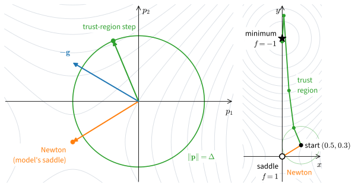

# Curvature Methods: Newton, Quasi-Newton, and Trust Regions
:label:`sec_mdl-curvature-methods`

Gradient descent never measures the curvature of the function it minimizes;
it only endures it. The steepest direction caps the step size, the flattest
direction then crawls, and the number of iterations grows with the condition
number $\kappa$, or with $\sqrt\kappa$ once momentum is added
(:numref:`subsec_mdl-momentum-acceleration`). On our running example
$\tfrac12(x_1^2 + 1000\,x_2^2)$, that came to $6{,}908$ steps of gradient
descent, or $315$ with momentum. Yet anyone can solve this problem by
inspection: divide each coordinate of the gradient by its curvature ($1$ or
$1000$) and a single step lands directly on the minimum. What can an
optimizer achieve when it accounts for curvature instead of merely surviving
it?

The classical answer is Newton's method, which predates gradient descent by
a century and a half. At each iterate, it fits a quadratic approximation to
the objective and jumps straight to the minimizer of that quadratic. In this
section we examine how fast that step converges, what it costs, where it
breaks down, and how much of its curvature information can be recovered from
gradients alone when second derivatives are unavailable. Near a minimum,
Newton's method is remarkably fast; for a neural network, however, forming
the Hessian is far too expensive, and on nonconvex functions the method is
drawn to saddle points just as readily as to minima. We then turn to two
remedies: quasi-Newton methods, which rebuild curvature from successive
gradient differences, and trust-region methods, which restrict each step to
a neighborhood where the quadratic model actually agrees with the function.

For training deep networks, these classical methods are used much less often
than first-order optimizers, and it is worth being candid about why. A full
Hessian is too large to form, and minibatch noise spoils curvature estimates
built from differences of gradients. Even so, the underlying ideas reappear
throughout deep learning: the per-coordinate scaling of Adam acts as a
diagonal stand-in for Newton's inverse Hessian
(:numref:`sec_mdl-adaptive-stochastic-methods`), and the damping added to
curvature matrices plays the same stabilizing role as a trust region. The
central result to keep in mind is the quadratic convergence of Newton's
method :eqref:`eq_mdl-opt-newton-error`; the subsection on quasi-Newton
methods may be skipped on a first reading. From
:numref:`sec_mdl-gradient-based-optimization`, we carry over two ingredients:
the Armijo condition for backtracking line search and the test function
$\tfrac12 x^2 + \cos y$, whose saddle point stalled gradient descent.

```{.python .input #mdl-curvature-methods-curvature-methods-newton-quasi-newton-and-trust-regions}
#@tab mxnet
import math
import numpy as np
from mxnet import autograd, gluon, init, np as mnp, npx
from mxnet.gluon import nn
from d2l import mxnet as d2l
npx.set_np()
```

```{.python .input #mdl-curvature-methods-curvature-methods-newton-quasi-newton-and-trust-regions}
#@tab pytorch
import math
import numpy as np
import torch
from torch import nn
from torch.nn import functional as F
from d2l import torch as d2l
```

```{.python .input #mdl-curvature-methods-curvature-methods-newton-quasi-newton-and-trust-regions}
#@tab tensorflow
import math
import numpy as np
import tensorflow as tf
from d2l import tensorflow as d2l
```

```{.python .input #mdl-curvature-methods-curvature-methods-newton-quasi-newton-and-trust-regions}
#@tab jax
import math
import numpy as np
import jax
from jax import numpy as jnp
from flax import nnx
import optax
from d2l import jax as d2l
```

## Newton's Method
:label:`subsec_mdl-why-not-newton`

Gradient descent builds a linear approximation to $f$ at the current point.
Because a linear function has no minimum, the algorithm cannot choose its own
step length and must rely on an external learning rate. A quadratic
approximation, by contrast, has a unique minimum whenever it curves upward,
giving us a step whose length is set automatically by the local geometry.

### The Newton Step

Newton's method lets the local curvature determine both the direction and the
length of the step (:numref:`subsec_gd-newton`). Writing
$\mathbf{g}_k = \nabla f(\mathbf{x}_k)$, we approximate $f$ near
$\mathbf{x}_k$ by its second-order Taylor expansion in the displacement
$\mathbf{p}$:

$$
m_k(\mathbf{p}) = f(\mathbf{x}_k) + \mathbf{g}_k^\top \mathbf{p} + \tfrac12\, \mathbf{p}^\top \nabla^2 f(\mathbf{x}_k)\, \mathbf{p}.
$$
:eqlabel:`eq_mdl-opt-newton-model`

When the Hessian $\nabla^2 f(\mathbf{x}_k)$ is positive definite, the model
$m_k$ is a strictly convex bowl with a unique minimizer, found by setting
$\nabla m_k(\mathbf{p}) = \mathbf{g}_k + \nabla^2 f(\mathbf{x}_k)\,\mathbf{p} = \mathbf{0}$.
Solving for $\mathbf{p}$ and moving there gives **Newton's method**:

$$
\mathbf{x}_{k+1} = \mathbf{x}_k - \big(\nabla^2 f(\mathbf{x}_k)\big)^{-1} \nabla f(\mathbf{x}_k).
$$
:eqlabel:`eq_mdl-opt-newton-step`

Notice that no step size appears in :eqref:`eq_mdl-opt-newton-step`: the
inverse Hessian rescales each direction according to its curvature. More
broadly, Newton's direction belongs to the family of preconditioned steps
$\mathbf{d} = -\mathbf{P}^{-1}\nabla f$ with a positive definite matrix
$\mathbf{P}$ (here $\mathbf{P} = \nabla^2 f$). Every such direction is a
descent direction, since
$\nabla f^\top \mathbf{d} = -\nabla f^\top \mathbf{P}^{-1}\nabla f < 0$.
In fact, Newton's direction is simply the direction of steepest descent when
step lengths are measured in the norm induced by the Hessian rather than the
Euclidean norm (exercise
:exref:`ex_mdl-gradient-based-optimization-show-that-is-de`).

On a positive definite quadratic $\tfrac12\mathbf{x}^\top\mathbf{A}\mathbf{x}$,
the Taylor model is exact, so a single Newton step lands immediately on the
minimizer:
$\mathbf{x}_1 = \mathbf{x}_0 - \mathbf{A}^{-1}\mathbf{A}\mathbf{x}_0 = \mathbf{0}$,
regardless of the condition number $\kappa$. The reason goes deeper than
matrix cancellation. Newton's method is **affine-invariant**, meaning that
its trajectory does not depend on the choice of coordinates. Under any
invertible linear change of variables $\mathbf{x} = \mathbf{T}\mathbf{y}$,
running Newton's method on $f(\mathbf{T}\mathbf{y})$ produces the exact
images of Newton's iterates for $f$. Gradient descent, by contrast, changes
its path under every non-orthogonal $\mathbf{T}$, while a scalar multiple of
an orthogonal matrix merely rescales the effective step size (exercise
:exref:`ex_mdl-gradient-based-optimization-newton-show-that-any`). Because
some linear transformation turns any positive definite quadratic into a
perfect sphere, the condition number cannot affect Newton's method. A long
valley is, to Newton's method, a round bowl drawn on stretched paper.

### Quadratic Convergence

For a general non-quadratic objective, the Taylor model is only a local
approximation, so one step is no longer enough. What survives is remarkable
speed. Once the iterate enters a neighborhood of a minimizer, Newton's
method converges much faster than geometrically, and the proof requires
little more than the fundamental theorem of calculus. Let
$\mathbf{e}_k = \mathbf{x}_k - \mathbf{x}^\star$ denote the error at
iteration $k$.

**Proposition (quadratic convergence).** *Let $\nabla f(\mathbf{x}^\star) = \mathbf{0}$,
and suppose that on a ball around $\mathbf{x}^\star$ the Hessian satisfies
$\nabla^2 f(\mathbf{x}) \succeq \mu\mathbf{I}$ and
$\|\nabla^2 f(\mathbf{x}) - \nabla^2 f(\mathbf{y})\| \le L_2\|\mathbf{x} - \mathbf{y}\|$.
If $\mathbf{x}_k$ lies in the ball, then*

$$
\|\mathbf{e}_{k+1}\| \;\le\; \frac{L_2}{2\mu}\, \|\mathbf{e}_k\|^2.
$$
:eqlabel:`eq_mdl-opt-newton-error`

**Proof.** Abbreviate $\nabla^2 f_k = \nabla^2 f(\mathbf{x}_k)$. Because
$\nabla f(\mathbf{x}^\star) = \mathbf{0}$, subtracting $\mathbf{x}^\star$
from the Newton update yields
$\mathbf{e}_{k+1} = \mathbf{e}_k - (\nabla^2 f_k)^{-1}\mathbf{g}_k = (\nabla^2 f_k)^{-1}\big[\nabla^2 f_k\,\mathbf{e}_k - (\nabla f(\mathbf{x}_k) - \nabla f(\mathbf{x}^\star))\big]$.
Applying the fundamental theorem of calculus along the line segment from
$\mathbf{x}^\star$ to $\mathbf{x}_k$ expresses the gradient difference as
$\int_0^1 \nabla^2 f(\mathbf{x}^\star + t\mathbf{e}_k)\,\mathbf{e}_k\,dt$,
so the bracketed term becomes
$\int_0^1 \big[\nabla^2 f_k - \nabla^2 f(\mathbf{x}^\star + t\mathbf{e}_k)\big]\mathbf{e}_k\,dt$.
Since $\mathbf{x}_k$ and $\mathbf{x}^\star + t\mathbf{e}_k$ are separated by
$(1 - t)\mathbf{e}_k$, the Lipschitz bound on the Hessian gives this integral
norm at most
$\int_0^1 L_2(1 - t)\|\mathbf{e}_k\|^2\,dt = \tfrac{L_2}{2}\|\mathbf{e}_k\|^2$.
Combining this with $\|(\nabla^2 f_k)^{-1}\| \le 1/\mu$ completes the
proof. $\blacksquare$

To read what :eqref:`eq_mdl-opt-newton-error` implies, multiply both sides by
$L_2/(2\mu)$:
$\tfrac{L_2}{2\mu}\|\mathbf{e}_{k+1}\| \le \big(\tfrac{L_2}{2\mu}\|\mathbf{e}_k\|\big)^2$.
The scaled error squares at every step. If it starts below $1$, it shrinks
monotonically and every subsequent iterate remains in the ball. Once it drops
below $0.1$, it plunges to $10^{-2}$, $10^{-4}$, $10^{-8}$, roughly doubling
the number of accurate digits at each iteration. Compare that with gradient
descent on our running example, which needs about $1{,}150$ steps to gain a
single digit. The catch is written directly into the hypotheses: this
quadratic rate is strictly local and guarantees nothing until the iterate is
already close to $\mathbf{x}^\star$.

Far from $\mathbf{x}^\star$, the pure Newton step can overshoot even when
the Hessian is positive definite. The standard safeguard is **damping**:
update via $\mathbf{x}_k + \alpha_k\mathbf{p}_k$ along the Newton direction
$\mathbf{p}_k = -(\nabla^2 f(\mathbf{x}_k))^{-1}\mathbf{g}_k$, choosing
$\alpha_k \le 1$ by backtracking until the Armijo condition
$f(\mathbf{x}_k + \alpha\mathbf{p}_k) \le f(\mathbf{x}_k) + c\,\alpha\,\mathbf{g}_k^\top\mathbf{p}_k$
holds (the general-direction form of :eqref:`eq_mdl-opt-armijo`). Near a
minimizer with a positive definite Hessian, the full step $\alpha = 1$
automatically passes this test whenever $c < \tfrac12$, so damping adds no
overhead once quadratic convergence kicks in.

To test these predictions in code, we use $\ell_2$-regularized logistic
regression on $n = 200$ synthetic examples in $d = 5$ dimensions,

$$
f(\mathbf{w}) = \frac1n \sum_{i=1}^n \log\big(1 + \exp(-y_i\,\mathbf{x}_i^\top \mathbf{w})\big) + \frac{\nu}{2}\|\mathbf{w}\|^2,
\qquad \nu = 0.1,
$$

with binary labels $y_i = \pm 1$ sampled from a logistic model (we write
$\nu$ for the weight-decay coefficient to reserve $\lambda$ for eigenvalues).
The setup cell below also computes a reference optimum $\mathbf{w}^\star$
using $4{,}000$ gradient steps of size $\eta = 0.5$, which is safely below
$2/L$ because $L = \lambda_{\max}(\mathbf{X}^\top\mathbf{X})/(4n) + \nu$ is
roughly $0.4$ here (exercise
:exref:`ex_mdl-gradient-based-optimization-smoothness-constants`).

```{.python .input #mdl-gradient-based-optimization-newton-s-method-and-its-computational-cost-1}
rng = np.random.default_rng()
n, d, nu = 200, 5, 0.1
w_true = np.array([1.0, -2.0, 1.5, 0.0, 2.0])
X = rng.normal(size=(n, d))
y = np.where(rng.random(n) < 1 / (1 + np.exp(-X @ w_true)), 1.0, -1.0)

def loss(w, X, y, nu):
    return np.logaddexp(0, -y * (X @ w)).mean() + nu / 2 * (w @ w)

def grad_rows(w, X, y, nu):                   # row i: gradient of example i
    s = 1 / (1 + np.exp(y * (X @ w)))         # sigmoid(-y_i x_i^T w)
    return -(y * s)[:, None] * X + nu * w

w_star = np.zeros(d)
for _ in range(4000):                         # full-batch reference optimum
    w_star = w_star - 0.5 * grad_rows(w_star, X, y, nu).mean(axis=0)
```

We can now test both predictions directly. On our running quadratic
$\mathrm{diag}(1, 1000)$, a single Newton step should replace the
$\log 10^6/\log(1001/999) \approx 6{,}908$ steps required by gradient descent
at its optimal fixed step size (:numref:`subsec_mdl-momentum-acceleration`).
On the non-quadratic logistic loss, the exponent of the gradient norm should
roughly double at every iteration once the local phase begins.

```{.python .input #gradient-based-optimization-newton}
A2 = np.diag([1.0, 1000.0])                   # the running example, kappa = 1000
x = np.array([1.0, 1.0])
x_new = x - np.linalg.solve(A2, A2 @ x)       # one Newton step
rate = (1000 - 1) / (1000 + 1)
print(f'Newton on the quadratic: |x_1| = {np.linalg.norm(x_new):.1e} after one step')
print(f'GD at the optimal step contracts by {rate:.4f}; it needs '
      f'{int(np.ceil(np.log(1e-6) / np.log(rate)))} steps for |x_k| <= 1e-6 |x_0|')
w = np.zeros(d)                               # Newton on the logistic loss
for it in range(6):
    s = 1 / (1 + np.exp(y * (X @ w)))
    g = grad_rows(w, X, y, nu).mean(axis=0)
    hess = (X * (s * (1 - s))[:, None]).T @ X / n + nu * np.eye(d)
    w = w - np.linalg.solve(hess, g)
    print(f'Newton iteration {it + 1}:  |grad| = {np.linalg.norm(g):.1e}')
print(f'max |w - w_star| = {np.abs(w - w_star).max():.1e}')
```

Both predictions hold. On the quadratic, a single Newton step drives the
error to zero, whereas optimal fixed-step gradient descent contracts by only
$0.998$ per step and requires $6{,}908$ iterations. On the logistic loss, the
gradient norm starts at a few tenths and drops below $10^{-8}$ by the fifth
iteration, its exponent roughly doubling once it becomes small. After just
six iterations, Newton's iterate agrees with the reference optimum to roughly
$10^{-15}$, matching the precision of the reference itself. Six linear solves
have accomplished what took $4{,}000$ gradient steps.

### The Cost of a Step

Unfortunately, comparing iteration counts alone flatters Newton's method. The
Hessian contains $d^2$ entries, and solving the linear system in
:eqref:`eq_mdl-opt-newton-step` generally requires $O(d^3)$ operations per
step. For $d = 5$ this cost is negligible, but for a neural network with even
a modest $10^8$ parameters, the Hessian has $10^{16}$ entries, ruling out
exact Newton's method before the first step is ever taken
(:numref:`subsec_gd-newton`). Practical alternatives either approximate the
Hessian from gradients, as in the quasi-Newton methods below, or use cheap
diagonal and structured preconditioners
(:numref:`sec_mdl-adaptive-stochastic-methods`).

### Saddle Points

Computational cost is not the only drawback of Newton's method, nor is it the
most instructive one. Because the Newton step solves $\nabla m_k = \mathbf{0}$,
it jumps to the stationary point of the quadratic model whether that point is
a minimum, a maximum, or a saddle. Return to the function
$f(x, y) = \tfrac12 x^2 + \cos y$ from
:numref:`sec_mdl-gradient-based-optimization`, which has a saddle at the
origin and a minimum of $-1$ at $(0, \pi)$, and start at $(0.5, 0.3)$. Here
the gradient is $(0.5, -\sin 0.3) = (0.5, -0.296)$, and the Hessian
$\mathrm{diag}(1, -\cos 0.3) = \mathrm{diag}(1, -0.955)$ is indefinite: the
surface curves upward along $x$ and downward along $y$. Which way does a
Newton step move $y$ from this point, compared with a plain gradient step of
size $\eta = 1$?

```{.python .input #mdl-gradient-based-optimization-newton-s-method-1}
def f_s(v):
    return 0.5 * v[0]**2 + np.cos(v[1])

def grad_s(v):
    return np.array([v[0], -np.sin(v[1])])

def hess_s(v):
    return np.diag([1.0, -np.cos(v[1])])

x_n = x_g = np.array([0.5, 0.3])
ys_n, ys_g = [], []
for _ in range(6):
    x_n = x_n - np.linalg.solve(hess_s(x_n), grad_s(x_n))    # Newton
    x_g = x_g - 1.0 * grad_s(x_g)                            # GD, eta = 1
    ys_n.append(x_n[1])
    ys_g.append(x_g[1])
print('Newton y:', np.array(ys_n[:3]), f'  f = {f_s(x_n):.4f}')
print('GD     y:', np.array(ys_g).round(4), f'  f = {f_s(x_g):.4f}')
```

Newton's first step sends $x$ to $0$ and $y$ to $0.3 - \tan 0.3 = -0.0093$;
the second sends $y$ to $2.7 \times 10^{-7}$. We are seeing Newton's rapid
local convergence (here even cubic, since $y - \tan y \approx -y^3/3$), driving
the iterate straight into the saddle $(0, 0)$ with $f = 1$. Gradient descent
moves $y$ in the opposite direction, through $0.60$, $1.16$, $2.07$, $2.95$,
$3.140$, and $3.1416$, reaching the minimum $(0, \pi)$ with $f = -1$. The
richer model has led to the worse point. Because the curvature along $y$ is
negative, the stationary point of the quadratic model is a saddle, and
Newton's method is blind to the difference between a saddle and a minimum.
A trust region (:numref:`subsec_mdl-trust-region`) fixes this flaw.

## Quasi-Newton Methods

Newton's method requires explicit second derivatives. Can we instead infer
curvature from the gradients we are already computing? When the gradient
changes rapidly along a step, the objective must have large curvature in that
direction. An optimizer that records these changes can gradually assemble a
model of the Hessian without ever evaluating a second derivative.

### The Secant Method

In one dimension the idea is immediate: the slope of the chord connecting
the last two gradients estimates $f''$,

$$
h_k = \frac{f'(x_k) - f'(x_{k-1})}{x_k - x_{k-1}},
\qquad
x_{k+1} = x_k - \frac{f'(x_k)}{h_k}.
$$

This is the **secant method**, which is simply Newton's step with $f''(x_k)$
replaced by a finite difference of gradients. Consider $f(x) = e^x - 2x$,
whose minimizer is $\log 2 \approx 0.6931$, starting from $x_0 = 0$ and
$x_1 = 1$. The first secant slope is $h_1 = (e - 2) - (1 - 2) = e - 1 \approx 1.718$,
giving $x_2 = 1 - (e - 2)/1.718 \approx 0.582$. From there the errors shrink
as $1.1 \times 10^{-1}$, $1.6 \times 10^{-2}$, $9.3 \times 10^{-4}$,
$7.7 \times 10^{-6}$, and $3.6 \times 10^{-9}$. Each error is roughly half
the product of the previous two (the factor of one-half comes from
$f'''/(2f'')$ at the minimizer), so the number of correct digits grows by a
factor approaching $1.6$ per step. That is slightly slower than Newton's
factor of $2$, yet each iteration requires only a single gradient evaluation
and no second derivative. On a one-dimensional quadratic
$\tfrac{\lambda}{2}x^2$, the secant slope equals $\lambda$ exactly, and the
step from $x_1$ lands directly on the minimizer.

In $d$ dimensions, the analogous secant condition is a single vector
equation, which is far from enough to pin down a $d \times d$ matrix: one
step reveals curvature along one direction only. We need a principled rule to
fill in the remaining directions.

### BFGS
:label:`subsec_mdl-quasi-newton`

A **quasi-Newton** method maintains an approximation $\mathbf{M}_k$ to the
inverse Hessian and updates it after each step using the observed change in
the gradient. After moving from $\mathbf{x}_k$ to $\mathbf{x}_{k+1}$, we
record the secant pair

$$
\mathbf s_k=\mathbf x_{k+1}-\mathbf x_k,
\qquad
\mathbf y_k=\nabla f(\mathbf x_{k+1})-\nabla f(\mathbf x_k).
$$

On a quadratic $\tfrac12\mathbf{x}^\top\mathbf{A}\mathbf{x}$, the gradient
difference satisfies $\mathbf{y}_k = \mathbf{A}\mathbf{s}_k$, so the true
inverse Hessian maps $\mathbf{y}_k$ back to $\mathbf{s}_k$. We require the
updated approximation $\mathbf{M}_{k+1}$ to obey the same **secant
equation**:

$$
\mathbf{M}_{k+1}\,\mathbf{y}_k = \mathbf{s}_k .
$$
:eqlabel:`eq_mdl-opt-secant`

Among all symmetric matrices satisfying :eqref:`eq_mdl-opt-secant`, **BFGS**
(named after Broyden, Fletcher, Goldfarb, and Shanno) chooses the one closest
to the previous estimate $\mathbf{M}_k$ in a suitably weighted Frobenius
norm:

$$
\mathbf{M}_{k+1}
=(\mathbf{I}-\gamma_k\mathbf s_k\mathbf y_k^\top)\,\mathbf{M}_k\,
 (\mathbf{I}-\gamma_k\mathbf y_k\mathbf s_k^\top)
 +\gamma_k\mathbf s_k\mathbf s_k^\top,
\qquad
\gamma_k=\frac{1}{\mathbf y_k^\top\mathbf s_k}.
$$
:eqlabel:`eq_mdl-opt-bfgs`

Even without deriving :eqref:`eq_mdl-opt-bfgs`, we can read off how it works
(dropping the index $k$ on the pair for clarity). The right factor
$\mathbf{I} - \gamma\mathbf{y}\mathbf{s}^\top$ sends $\mathbf{y}$ to zero,
because $\gamma\,\mathbf{s}^\top\mathbf{y} = 1$, while leaving every vector
orthogonal to $\mathbf{s}$ untouched. Thus the first term erases what
$\mathbf{M}_k$ previously predicted along $\mathbf{y}$, and the second term
writes in the new observation:
$\mathbf{M}_{k+1}\mathbf{y} = \gamma\,\mathbf{s}\,(\mathbf{s}^\top\mathbf{y}) = \mathbf{s}$,
satisfying the secant equation.

Just as importantly, the update preserves positive definiteness, ensuring
that the next search direction $-\mathbf{M}_{k+1}\nabla f(\mathbf{x}_{k+1})$
remains a descent direction. For any nonzero vector $\mathbf{z}$, set
$\mathbf{w} = (\mathbf{I} - \gamma\mathbf{y}\mathbf{s}^\top)\mathbf{z}$, so
that
$\mathbf{z}^\top\mathbf{M}_{k+1}\mathbf{z} = \mathbf{w}^\top\mathbf{M}_k\mathbf{w} + \gamma(\mathbf{s}^\top\mathbf{z})^2$.
When $\mathbf{M}_k \succ 0$ and $\gamma > 0$, both terms are nonnegative and
cannot vanish simultaneously: $\mathbf{w} = \mathbf{0}$ forces
$\mathbf{z} = \gamma(\mathbf{s}^\top\mathbf{z})\,\mathbf{y}$, which requires
$\mathbf{s}^\top\mathbf{z} \neq 0$. The requirement $\gamma > 0$ is the
**curvature condition** $\mathbf{y}_k^\top\mathbf{s}_k > 0$, meaning that the
directional slope increased along the step. It holds automatically on any
strictly convex objective; on general objectives, the line search enforces it
via a second check known as the Wolfe condition :cite:`Nocedal.Wright.2006`.

How quickly do secant pairs reconstruct the true curvature? Let us run BFGS
from $(1, 1)$ on the two-dimensional quadratic $\mathrm{diag}(1, 10)$,
starting with $\mathbf{M}_0 = \mathbf{I}$ and using the exact line search
$\alpha = -\mathbf{g}^\top\mathbf{p}/(\mathbf{p}^\top\mathbf{A}\mathbf{p})$,
and inspect both $\mathbf{x}$ and $\mathbf{M}$ after each step.

```{.python .input #mdl-gradient-based-optimization-bfgs-1}
def bfgs_update(M, s, y):
    gamma = 1.0 / (y @ s)
    V = np.eye(len(s)) - gamma * np.outer(s, y)
    return V @ M @ V.T + gamma * np.outer(s, s)

A = np.diag([1.0, 10.0])
x, M = np.array([1.0, 1.0]), np.eye(2)
for k in range(2):
    g = A @ x
    p = -M @ g
    alpha = -(g @ p) / (p @ A @ p)            # exact line search
    s = alpha * p
    M = bfgs_update(M, s, A @ s)              # y = A s on a quadratic
    x = x + s
    print(f'step {k + 1}: x = {x.round(4)},  M = {M.round(4).tolist()}')
print(f'A^-1 = {np.linalg.inv(A).tolist()},  '
      f'max |M_2 - A^-1| = {np.abs(M - np.linalg.inv(A)).max():.0e}')
```

After a single step, $\mathbf{M}_1 \approx \mathrm{diag}(1.009, 0.100)$ is
already close to $\mathbf{A}^{-1}$ along the steep direction it has just
probed. After the second step, $\mathbf{M}_2 = \mathbf{A}^{-1}$ up to
floating-point rounding and $\mathbf{x}_2 = \mathbf{0}$. This two-dimensional
behavior generalizes cleanly: on any $d$-dimensional positive definite
quadratic with exact line searches, each secant equation remains satisfied
after subsequent updates, and the steps are mutually $\mathbf{A}$-conjugate
($\mathbf{s}_i^\top\mathbf{A}\mathbf{s}_j = 0$ for $i \neq j$). After $d$
steps, $\mathbf{M}_d\mathbf{A} = \mathbf{I}$ and BFGS reaches the exact
minimizer (exercise
:exref:`ex_mdl-gradient-based-optimization-bfgs-quadratic`).

Finite termination, however, holds specifically for quadratics with exact
line searches and should not be taken as a general guarantee. On non-quadratic
objectives, line searches are inexact, the true Hessian varies from step to
step, and stochastic gradients corrupt $\mathbf{y}_k$: the difference between
two minibatch gradients is often dominated by sampling noise rather than
curvature. In addition, full BFGS stores a dense $d \times d$ matrix.
**L-BFGS** avoids that memory cost by retaining only the $m$ most recent
secant pairs and applying the resulting inverse-Hessian approximation (a
scaled identity plus a correction of rank at most $2m$) in $O(md)$ time and
memory :cite:`Liu.Nocedal.1989`. It works very well on deterministic,
medium-scale problems, though it remains awkward when fresh minibatch noise
makes gradient differences unreliable.

## Trust Regions
:label:`subsec_mdl-trust-region`

Newton's method went astray at $(0.5, 0.3)$ because it trusted its local
quadratic model across the entire space. That model was built from derivatives
at a single point and accurately reflects $f$ only nearby. A trust-region
method takes this limitation literally: it keeps the full curvature
information, including directions of negative curvature, and instead bounds the
step to a region where the model can be trusted.

### The Subproblem

At $(0.5, 0.3)$, the quadratic model of $\tfrac12 x^2 + \cos y$ has
curvature $-0.955$ along $y$. Because it curves downward without bound,
asking for its unconstrained minimum makes no sense. A **trust-region
method** instead minimizes the quadratic model inside a ball of radius
$\Delta_k$, which represents how far we believe the approximation holds:

$$
\min_{\|\mathbf p\|\le\Delta_k}
 m_k(\mathbf p)
 =f(\mathbf x_k)+\nabla f(\mathbf x_k)^\top\mathbf p
  +\tfrac12\mathbf p^\top \mathbf{B}_k\mathbf p.
$$
:eqlabel:`eq_mdl-opt-trust-region`

Here $\mathbf{B}_k$ is either the exact Hessian or a symmetric approximation
to it. Restricting $\mathbf{p}$ to a closed ball guarantees that a minimizer
exists even when $\mathbf{B}_k$ has negative eigenvalues, because any
continuous function achieves a minimum on a compact set. Better still, the
exact solutions of this constrained problem have a clean characterization.

**Proposition (solution of the subproblem).** *A step $\mathbf{p}$ with
$\|\mathbf{p}\| \le \Delta$ solves :eqref:`eq_mdl-opt-trust-region` if and only
if there is a $\tau \ge 0$ with*

$$
(\mathbf{B} + \tau\mathbf{I})\,\mathbf{p} = -\mathbf{g},
\qquad \mathbf{B} + \tau\mathbf{I} \succeq \mathbf{0},
\qquad \tau\,(\Delta - \|\mathbf{p}\|) = 0.
$$

This result is Theorem 4.1 of :citet:`Nocedal.Wright.2006`; exercise
:exref:`ex_mdl-gradient-based-optimization-trust-region-saddle` proves the
sufficiency of these conditions. Geometrically, the trust region adds a
uniform shift $\tau$ to every eigenvalue of $\mathbf{B}$, just enough to
make the shifted quadratic convex. Two cases arise. When $\mathbf{B}$ is
positive definite and the unconstrained Newton step already lies inside the
ball, we have $\tau = 0$ and simply take the Newton step. Otherwise the
solution lies on the boundary $\|\mathbf{p}\| = \Delta$, and $\tau$ is the
root of the scalar equation
$\|(\mathbf{B} + \tau\mathbf{I})^{-1}\mathbf{g}\| = \Delta$ over
$\tau > -\lambda_{\min}(\mathbf{B})$, where the left-hand side decreases
strictly as $\tau$ grows.

This scalar equation fails to have a root only in the degenerate *hard case*,
when $\mathbf{g}$ is orthogonal to the eigenvectors associated with the
smallest eigenvalue of $\mathbf{B}$ (explored in part d of exercise
:exref:`ex_mdl-gradient-based-optimization-trust-region-saddle`). As we will
see in :numref:`sec_mdl-constrained-optimization-duality`, the shift $\tau$
is simply the Lagrange multiplier enforcing the constraint
$\tfrac12\|\mathbf{p}\|^2 \le \tfrac12\Delta^2$.

Between iterations, the radius $\Delta_k$ adapts according to how accurately
the model predicted the actual drop in $f$. After solving
:eqref:`eq_mdl-opt-trust-region`, we form the ratio of actual decrease to
predicted decrease:

$$
r_k=
\frac{f(\mathbf x_k)-f(\mathbf x_k+\mathbf p_k)}
     {m_k(\mathbf 0)-m_k(\mathbf p_k)}.
$$
:eqlabel:`eq_mdl-opt-trust-ratio`

A ratio near $1$ indicates that the quadratic model matched the objective
well. In the implementation below, we accept the step whenever $r_k > 0.1$.
Independently, we shrink the radius to $\Delta \leftarrow \Delta/4$ whenever
$r_k < \tfrac14$, and we double it when $r_k > \tfrac34$ and the step hit
the boundary $\|\mathbf{p}_k\| = \Delta_k$.

### The Trust-Region Step at a Saddle

Let us work out one trust-region step at $(0.5, 0.3)$ by hand with
$\Delta = 0.5$. At this point $\mathbf{g} = (0.5, -0.296)$ and
$\mathbf{B} = \mathrm{diag}(1, -0.955)$. Making
$\mathbf{B} + \tau\mathbf{I}$ positive semidefinite requires
$\tau \ge 0.955$, so $\tau = 0$ is impossible and the step must lie on the
boundary of the ball. The optimality system gives
$(1 + \tau)p_1 = -0.5$ and $(\tau - 0.955)p_2 = 0.296$ subject to
$p_1^2 + p_2^2 = 0.25$, whose solution is $\tau \approx 1.60$ and
$\mathbf{p} \approx (-0.19, 0.46)$. Moving to $(0.31, 0.76)$ lowers $f$ from
$1.080$ to $0.771$. Because the model predicted a decrease of $0.316$ and
the actual decrease is $0.309$, the ratio is $r = 0.98$, so the step is
accepted and the radius doubles. Crucially, the trust-region step moves
*away* from the saddle along the negative-curvature direction where the
model drops, whereas the unconstrained Newton step $(-0.5, -0.31)$ marched
straight toward it.

To see where this update rule leads over several iterations, we implement
`tr_step` via bisection on $\tau$ and run six steps from $(0.5, 0.3)$,
printing the iterate, objective value, step norm, shift $\tau$, agreement
ratio $r$, and current radius $\Delta$.

```{.python .input #mdl-gradient-based-optimization-the-trust-region-step-at-a-saddle-1}
def tr_step(g, B, Delta):
    """Minimize g p + p B p / 2 over |p| <= Delta; return (p, tau)."""
    eig_min = np.linalg.eigvalsh(B).min()
    if eig_min > 0 and np.linalg.norm(np.linalg.solve(B, -g)) <= Delta:
        return np.linalg.solve(B, -g), 0.0     # Newton step fits: tau = 0
    lo = hi = max(0.0, -eig_min)
    hi += 1e3
    for _ in range(100):                       # bisection for |p(tau)| = Delta
        tau = (lo + hi) / 2
        p = np.linalg.solve(B + tau * np.eye(len(g)), -g)
        lo, hi = (tau, hi) if np.linalg.norm(p) > Delta else (lo, tau)
    return p, tau
```

```{.python .input #mdl-gradient-based-optimization-the-trust-region-step-at-a-saddle-2}
x, Delta = np.array([0.5, 0.3]), 0.5
print(' k        x            f      |p|    tau      r  Delta')
for k in range(6):
    g, B = grad_s(x), hess_s(x)
    p, tau = tr_step(g, B, Delta)
    r = (f_s(x) - f_s(x + p)) / -(g @ p + 0.5 * p @ B @ p)
    print(f'{k:2d} ({x[0]:6.3f},{x[1]:6.3f}) {f_s(x):7.4f} '
          f'{np.linalg.norm(p):6.3f} {tau:6.3f} {r:6.2f} {Delta:5.2f}')
    if r > 0.1:                                # accept the step
        x = x + p
    if r < 0.25:
        Delta /= 4                             # poor prediction: shrink
    elif r > 0.75 and np.linalg.norm(p) > 0.99 * Delta:
        Delta *= 2                             # good, and on the boundary
print(f'final x = ({x[0]:.4f}, {x[1]:.4f}),  f = {f_s(x):.4f}')
```

The first row matches our hand calculation. The radius doubles from $0.5$ to
$1$ and then to $2$, while the third step (with ratio $0.41$) is accepted
without changing the radius. By the fourth iterate, $(0.04, 3.75)$, the
algorithm has entered the basin where the Hessian is positive definite. From
that point on, the unconstrained Newton step fits inside the trust-region
ball with $\tau = 0$, so the method seamlessly turns into Newton's method and
converges quadratically to the minimum $(0, \pi)$ with $f = -1$. Six
iterations are enough; :numref:`fig_mdl-opt-trust-region-saddle` contrasts
both trajectories.

![Newton's method and a trust-region method from $(0.5,0.3)$ on $\tfrac12 x^2 + \cos y$, where the Hessian is $\mathrm{diag}(1,-0.96)$. (a) The local quadratic model forms a saddle surface: Newton's step moves to its stationary point, whereas minimizing the model over the ball of radius $\Delta = 0.5$ follows the negative-curvature direction away from the saddle. (b) Newton's method converges quadratically to the saddle $(0,0)$ with $f = 1$, while the trust-region method (shown with its initial radius) reaches the minimum $(0,\pi)$ with $f = -1$ in six steps as its radius expands through $0.5, 1, 2$.](../img/mdl-opt-trust-region-saddle.svg)
:label:`fig_mdl-opt-trust-region-saddle`

Solving the trust-region subproblem exactly requires factoring
$\mathbf{B}_k + \tau\mathbf{I}$ for each trial value of $\tau$. Large-scale
implementations instead solve it approximately using Hessian--vector
products, each costing roughly the same as a single gradient evaluation
(:numref:`sec_mdl-matrix-calculus-autodiff`). Even with that speedup, neither
BFGS nor trust-region methods replace stochastic gradient descent on large,
noisy deep learning objectives.

The saddle of $\tfrac12 x^2 + \cos y$ has now tripped up two optimizers:
gradient descent stalled at it, and Newton's method ran straight into it. A
trust region escapes, but only by checking each local model against the true
objective. Yet there is a large class of functions where none of these
precautions are needed: functions with no saddles, no spurious basins, and
where every stationary point is a global minimum. Identifying those
functions is the subject of :numref:`sec_mdl-convexity`.

## Summary

Newton's method minimizes a local quadratic model of $f$ at each iterate. It
solves any positive definite quadratic in a single step regardless of the
condition number, and near a minimizer with a positive definite,
Lipschitz-continuous Hessian it squares the error at every iteration. That
speed comes with two obstacles: each step requires $O(d^2)$ memory and
$O(d^3)$ operations, far beyond what a neural network can afford, and the
unconstrained step is attracted to saddle points just as strongly as to
minima. BFGS avoids explicit second derivatives by reconstructing the inverse
Hessian from past step and gradient differences, recovering it completely in
$d$ steps on a $d$-dimensional quadratic. Trust-region methods make any
quadratic model safe to use by confining each step to a ball, comparing the
predicted and actual decreases in $f$, and expanding or shrinking the ball
accordingly.

## Exercises

1. **Reparametrization and preconditioning.** Let $\mathbf{T}$ be an invertible
   matrix and $h(\mathbf{y}) = f(\mathbf{T}\mathbf{y})$, so that
   $\mathbf{x} = \mathbf{T}\mathbf{y}$ is a change of coordinates.
    1. Express $\nabla h$ and $\nabla^2 h$ through the derivatives of $f$.
       Show that Newton's iterates :eqref:`eq_mdl-opt-newton-step` for $h$,
       started at $\mathbf{y}_0 = \mathbf{T}^{-1}\mathbf{x}_0$, satisfy
       $\mathbf{y}_k = \mathbf{T}^{-1}\mathbf{x}_k$, where $\mathbf{x}_k$ are
       Newton's iterates for $f$.
    1. Run gradient descent with step $\eta$ on $h$ and map every iterate
       back by $\mathbf{x}_k = \mathbf{T}\mathbf{y}_k$. Show that the mapped iterates
       follow $\mathbf{x}_{k+1} = \mathbf{x}_k - \eta\, \mathbf{P}^{-1} \nabla f(\mathbf{x}_k)$
       for a positive definite matrix $\mathbf{P}$, and find $\mathbf{P}$. By
       problem :exref:`ex_mdl-gradient-based-optimization-show-that-is-de`b
       this direction is the steepest one in the norm $\|\cdot\|_{\mathbf{P}}$.
       What is $\|\mathbf{x}\|_{\mathbf{P}}$ in the coordinates $\mathbf{y}$?
    1. For $f(\mathbf{x}) = \tfrac12\mathbf{x}^\top \mathbf{A}\,\mathbf{x}$ with
       $\mathbf{A} = \mathrm{diag}(1, 1000)$, the $\kappa = 1000$ quadratic of the
       Newton subsection, find a diagonal $\mathbf{T}$ for which gradient
       descent on $h$ with $\eta = 1$ reaches the minimizer in one step. What
       does constructing such a $\mathbf{T}$ require for a general positive
       definite $\mathbf{A}$?
   :exlabel:`ex_mdl-gradient-based-optimization-newton-show-that-any`

1. [code] **BFGS on a quadratic.** ● Let
   $f(\mathbf{x}) = \tfrac12\mathbf{x}^\top\mathbf{A}\mathbf{x} - \mathbf{b}^\top\mathbf{x}$
   with $\mathbf{A}$ positive definite, and run BFGS
   :eqref:`eq_mdl-opt-bfgs` with exact line searches from
   $\mathbf{M}_0 = \mathbf{I}$.
    1. Show that an exact line search along $\mathbf{p}_k$ gives
       $\nabla f(\mathbf{x}_{k+1})^\top\mathbf{p}_k = 0$, and that
       $\mathbf{y}_k = \mathbf{A}\mathbf{s}_k$.
    1. Show the hereditary property: if $\mathbf{M}_k\mathbf{y}_j = \mathbf{s}_j$
       for all $j < k$ and the steps $\mathbf{s}_0, \ldots, \mathbf{s}_{k-1}$,
       $\mathbf{s}_k$ are $\mathbf{A}$-conjugate, then
       $\mathbf{M}_{k+1}\mathbf{y}_j = \mathbf{s}_j$ for all $j \le k$. (Hint:
       $\mathbf{s}_j^\top\mathbf{y}_k = \mathbf{s}_j^\top\mathbf{A}\mathbf{s}_k = 0$
       for $j < k$.) Conclude that after $d$ linearly independent steps
       $\mathbf{M}_d\mathbf{A} = \mathbf{I}$.
    1. Run the BFGS loop of the text in $d = 6$ dimensions, on a randomly
       rotated quadratic with eigenvalues from $1$ to $1000$. Print
       $\max_{j \le k}\|\mathbf{M}_{k+1}\mathbf{y}_j - \mathbf{s}_j\|$
       after each step, and confirm that it stays at rounding level and that
       $\mathbf{M}_6 = \mathbf{A}^{-1}$. How far from the minimizer is
       gradient descent at its best fixed step after the same six
       gradients?
    1. The symmetric rank-one update
       $\mathbf{M}_{k+1} = \mathbf{M}_k + \frac{(\mathbf{s} - \mathbf{M}_k\mathbf{y})(\mathbf{s} - \mathbf{M}_k\mathbf{y})^\top}{(\mathbf{s} - \mathbf{M}_k\mathbf{y})^\top\mathbf{y}}$
       also satisfies the secant equation. Show by a $2 \times 2$ example that
       it need not stay positive definite even when $\mathbf{y}^\top\mathbf{s} > 0$,
       and say which of the two checks in the text fails for it.
   :exlabel:`ex_mdl-gradient-based-optimization-bfgs-quadratic`

1. [code] **Trust region at a saddle.** ● Consider the model
   $m(\mathbf{p}) = \mathbf{g}^\top\mathbf{p} + \tfrac12\mathbf{p}^\top\mathbf{B}\mathbf{p}$
   with $\mathbf{B} = \mathrm{diag}(1, -1)$ and
   $\mathbf{g} = (\tfrac12, -\tfrac{3}{10})$.
    1. Show that $m$ is unbounded below on $\mathbb{R}^2$ and that the Newton
       point $-\mathbf{B}^{-1}\mathbf{g} = (-\tfrac12, -\tfrac{3}{10})$ is a
       saddle of $m$, not a minimum.
    1. Prove that the conditions of the subproblem proposition are
       sufficient: if $(\mathbf{B} + \tau\mathbf{I})\mathbf{p} = -\mathbf{g}$
       with $\tau \ge 0$, $\mathbf{B} + \tau\mathbf{I} \succeq \mathbf{0}$, and
       $\tau(\Delta - \|\mathbf{p}\|) = 0$, then every $\|\mathbf{q}\| \le \Delta$
       satisfies
       $m(\mathbf{q}) \ge m(\mathbf{p}) + \tfrac{\tau}{2}(\|\mathbf{p}\|^2 - \|\mathbf{q}\|^2) \ge m(\mathbf{p})$.
       (Hint: expand $m(\mathbf{q}) - m(\mathbf{p})$ around $\mathbf{p}$ and use
       $\mathbf{g} = -(\mathbf{B} + \tau\mathbf{I})\mathbf{p}$.)
    1. For $\Delta = \tfrac12$ find $\tau \ge 1$ by bisection on
       $\|(\mathbf{B} + \tau\mathbf{I})^{-1}\mathbf{g}\| = \Delta$ (the answer
       is $\tau \approx 1.65$, $\mathbf{p} \approx (-0.19, 0.46)$), and check
       that the step increases the coordinate with negative curvature while
       the Newton step decreases it.
    1. Replace $\mathbf{g}$ by $(\tfrac12, 0)$. Show that
       $\|(\mathbf{B} + \tau\mathbf{I})^{-1}\mathbf{g}\| = \tfrac12/(1 + \tau) \le \tfrac14$
       for all $\tau > 1$, so the boundary equation has no solution with
       $\tau > 1$. Find the minimizers on the ball directly (they have
       $\tau = 1$ and $p_2 = \pm\sqrt{\Delta^2 - p_1^2}$), and explain in one
       sentence what the ball does with a direction of negative curvature that
       the gradient does not see.
   :exlabel:`ex_mdl-gradient-based-optimization-trust-region-saddle`

[Discussions](https://d2l.discourse.group/t/36879)

<!-- slides -->

::: {.slide}
::: {.cover}
[Dive into Deep Learning · §35.2]{.kicker}

Curvature Methods<br>**Newton's step · secant pairs and BFGS · trust regions**
:::
:::

::: {.slide title="Gradient Steps Count with $\kappa$; a Step That Knows the Curvature Needs One"}
[The problem]{.kicker}

On $\tfrac12(x_1^2+1000x_2^2)$ from $(1,1)$, six digits of the error cost:

| method | steps |
|---|---|
| gradient descent, best fixed step | $6{,}908$ |
| heavy ball, tuned | $315$ |
| divide each gradient entry by its curvature | $1$ |

::: {.d2l-note .warn}
How fast is a step that models the curvature, what does it cost, where does
it go wrong, and how much of it can gradients alone recover?
:::
:::

::: {.slide title="By the End of This Deck You Can"}
[Goals]{.kicker}

- derive Newton's step and prove that it squares the error near a minimizer;
- say what a step costs and why a network cannot afford it;
- explain why Newton's method runs to a saddle;
- rebuild the inverse Hessian from gradient differences with BFGS;
- solve a trust-region step by hand and read its acceptance rule.

**Running example:** $\tfrac12x^2+\cos y$ from $(0.5, 0.3)$: saddle at $(0,0)$, minimum at $(0,\pi)$.

**The idea:** model the curvature, and trust the model only where it predicts well.
:::

::: {.slide title="After the Gradient Step, a Model of the Curvature"}
[Where this fits]{.kicker}

::: {.cols .vc}
::: {.col}
| section | adds |
|---|---|
| Gradient Descent and Curvature | safe steps, $\kappa$, momentum |
| **Curvature Methods** | **Newton, BFGS, trust regions** |
| Convexity | local = global, rates, Jensen |
| Stochastic Gradient Methods | noise floors, step decay |
| Adaptive Methods | per-coordinate steps |
| Constrained Optimization | KKT, projections, prox |
| Duality | lower bounds, prices |
| Numerical Stability and Conditioning | rounding, conditioning |
:::

::: {.col .narrow}
- **Uses:** the quadratic model, $\kappa$, the Armijo test.
- **Skips:** L-BFGS internals, inexact subproblem solvers.
- Deep learning uses these methods rarely; their ideas return as preconditioners and damping.
:::
:::
:::

::: {.slide}
::: {.divider}
[01]{.dnum}

[Newton's method]{.dtitle}

[the step · the rate · the cost · the saddle]{.dsub}
:::
:::

::: {.slide title="Newton Jumps to the Minimum of a Quadratic Model"}
[Newton]{.kicker}

Model $f$ near $\mathbf{x}_k$ in the step $\mathbf{p}$, with gradient $\mathbf{g}_k$ and Hessian $\nabla^2f_k$:

$$m_k(\mathbf{p})=f(\mathbf{x}_k)+\mathbf{g}_k^\top\mathbf{p}+\tfrac12\,\mathbf{p}^\top\nabla^2f_k\,\mathbf{p}$$

If $\nabla^2f_k\succ0$, set $\nabla m_k=\mathbf{g}_k+\nabla^2f_k\,\mathbf{p}=\mathbf{0}$:

::: {.d2l-note .rule}
$$\mathbf{x}_{k+1}=\mathbf{x}_k-(\nabla^2f_k)^{-1}\mathbf{g}_k$$
:::

- No step size: the curvature sets it.
- $f=\tfrac12\mathbf{x}^\top\mathbf{A}\mathbf{x}$: $\mathbf{x}_1=\mathbf{x}_0-\mathbf{A}^{-1}\mathbf{A}\mathbf{x}_0=\mathbf{0}$, for every $\kappa$.
:::

::: {.slide title="Newton's Method Does Not Depend on the Coordinates"}
[Newton]{.kicker}

Change coordinates, $\mathbf{x}=\mathbf{T}\mathbf{y}$ with $\mathbf{T}$ invertible, and minimize $h(\mathbf{y})=f(\mathbf{T}\mathbf{y})$.

- Newton on $h$ from $\mathbf{T}^{-1}\mathbf{x}_0$: iterates $\mathbf{y}_k=\mathbf{T}^{-1}\mathbf{x}_k$, the same path.
- Gradient descent on $h$: a different path unless $\mathbf{T}$ is a multiple of an orthogonal matrix.

::: {.d2l-note}
Some $\mathbf{T}$ makes any positive definite quadratic round. Newton cannot
tell the valley from the round bowl, so $\kappa$ cannot matter to it.
:::
:::

::: {.slide title="Derivation I: The New Error Is an Integral of Hessian Differences"}
[Newton]{.kicker}

Error $\mathbf{e}_k=\mathbf{x}_k-\mathbf{x}^\star$, with $\nabla f(\mathbf{x}^\star)=\mathbf{0}$. One Newton step:

$$\mathbf{e}_{k+1}=(\nabla^2f_k)^{-1}\big[\nabla^2f_k\,\mathbf{e}_k-(\nabla f(\mathbf{x}_k)-\nabla f(\mathbf{x}^\star))\big]$$

Fundamental theorem of calculus on the segment from $\mathbf{x}^\star$ to $\mathbf{x}_k$:

$$\nabla f(\mathbf{x}_k)-\nabla f(\mathbf{x}^\star)=\int_0^1\nabla^2f(\mathbf{x}^\star+t\mathbf{e}_k)\,\mathbf{e}_k\,dt$$

So the bracket is $\int_0^1\big[\nabla^2f_k-\nabla^2f(\mathbf{x}^\star+t\mathbf{e}_k)\big]\mathbf{e}_k\,dt$.
:::

::: {.slide title="Derivation II: Each Step Squares the Error"}
[Newton]{.kicker}

The two Hessians are taken $(1-t)\|\mathbf{e}_k\|$ apart. If the Hessian is $L_2$-Lipschitz, the bracket is at most
$\int_0^1L_2(1-t)\|\mathbf{e}_k\|^2dt=\tfrac{L_2}{2}\|\mathbf{e}_k\|^2$. If $\nabla^2f\succeq\mu\mathbf{I}$, the inverse has norm at most $1/\mu$:

::: {.d2l-note .rule}
$$\|\mathbf{e}_{k+1}\|\le\frac{L_2}{2\mu}\,\|\mathbf{e}_k\|^2$$
:::

- Scaled error $\tfrac{L_2}{2\mu}\|\mathbf{e}\|$: $10^{-1}\to10^{-2}\to10^{-4}\to10^{-8}$. Digits double.
- Gradient descent at $\kappa=10^3$: one digit per $1{,}150$ steps.

[Assumes both bounds on a ball around $\mathbf{x}^\star$ that contains $\mathbf{x}_k$: the result is local.]{.small}
:::

::: {.slide title="Measured: One Step on the Valley, Five Iterations on a Logistic Loss"}
[Newton]{.kicker}

$\mathrm{diag}(1,1000)$ from $(1,1)$; then logistic regression with weight decay $0.1$, $200$ examples, $5$ weights:

@!gradient-based-optimization-newton

- The exponent of $\|\nabla f\|$ roughly doubles once it is small.
- Six solves match a reference that took $4{,}000$ gradient steps.
:::

::: {.slide title="A Newton Step Costs $d^2$ Memory and $d^3$ Time"}
[Newton]{.kicker}

| weights $d$ | Hessian entries $d^2$ | solve, about $d^3$ |
|---|---|---|
| $5$ (the logistic problem) | $25$ | $125$ |
| $10^4$ | $10^8$ | $10^{12}$ |
| $10^8$ (a small network) | $10^{16}$ | $10^{24}$ |

::: {.d2l-note .warn}
The step count flatters Newton's method: for a network, the first Hessian
cannot even be stored.
:::

Far from $\mathbf{x}^\star$ the full step can overshoot: step $\alpha\le1$ along Newton's direction, with $\alpha$ from the Armijo test.
:::

::: {.slide title="Check: How Many Steps from $10^{-1}$ to $10^{-8}$?"}
[Check]{.kicker}

The scaled error of Newton's method is $10^{-1}$. How many steps bring it to
$10^{-8}$? How many steps does gradient descent need for the same seven
digits at $\kappa=10^3$?

::: {.fragment .fade-up}
::: {.d2l-note}
**Answer.** Three: $10^{-1}\to10^{-2}\to10^{-4}\to10^{-8}$. Gradient descent
gains a digit per $\log10/\log(1001/999)\approx1{,}150$ steps: about $8{,}000$.
:::
:::
:::

::: {.slide title="From $(0.5, 0.3)$ Newton Runs to the Saddle, Gradient Descent to the Minimum"}
[Newton]{.kicker}

$f=\tfrac12x^2+\cos y$: gradient $(0.5,-0.296)$, Hessian $\mathrm{diag}(1,-0.955)$, indefinite. Six steps of each method, $\eta=1$ for gradient descent:

@!mdl-gradient-based-optimization-newton-s-method-1

::: {.d2l-note .warn}
$\nabla m=\mathbf{0}$ finds the model's stationary point, minimum or not. The
model curves down along $y$, so that point is a saddle: $y\mapsto y-\tan y$.
:::
:::

::: {.slide}
::: {.divider}
[02]{.dnum}

[Quasi-Newton methods]{.dtitle}

[curvature from gradients already computed]{.dsub}
:::
:::

::: {.slide title="The Secant Slope Estimates $f''$ from Two Gradients"}
[Quasi-Newton]{.kicker}

$$h_k=\frac{f'(x_k)-f'(x_{k-1})}{x_k-x_{k-1}},\qquad x_{k+1}=x_k-\frac{f'(x_k)}{h_k}$$

$f(x)=e^x-2x$, minimizer $\log2=0.6931$, from $x_0=0$, $x_1=1$:

| step | $x_2$ | $x_3$ | $x_4$ | $x_5$ | $x_6$ |
|---|---|---|---|---|---|
| error | $1.1\times10^{-1}$ | $1.6\times10^{-2}$ | $9.3\times10^{-4}$ | $7.7\times10^{-6}$ | $3.6\times10^{-9}$ |

- Each error is about half the product of the previous two: digits grow by a factor near $1.6$ per step.
- Newton's factor is $2$, but this step needs no second derivative.
:::

::: {.slide title="The Secant Equation Fixes One Direction; BFGS Changes Nothing Else"}
[Quasi-Newton]{.kicker}

Keep $\mathbf{M}_k\approx(\nabla^2f)^{-1}$. After a step record
$\mathbf{s}=\mathbf{x}_{k+1}-\mathbf{x}_k$ and $\mathbf{y}=\nabla f(\mathbf{x}_{k+1})-\nabla f(\mathbf{x}_k)$.

- On a quadratic $\mathbf{y}=\mathbf{A}\mathbf{s}$, so demand $\mathbf{M}_{k+1}\mathbf{y}=\mathbf{s}$: $d$ equations for $d^2$ unknowns.
- BFGS takes the closest symmetric matrix that satisfies it, with $\gamma=1/(\mathbf{y}^\top\mathbf{s})$:

$$\mathbf{M}_{k+1}=(\mathbf{I}-\gamma\mathbf{s}\mathbf{y}^\top)\,\mathbf{M}_k\,(\mathbf{I}-\gamma\mathbf{y}\mathbf{s}^\top)+\gamma\,\mathbf{s}\mathbf{s}^\top$$

::: {.d2l-note}
The first term forgets what $\mathbf{M}_k$ said about $\mathbf{y}$; the second
writes in $\mathbf{s}$. Positive definite as long as $\mathbf{y}^\top\mathbf{s}>0$.
:::
:::

::: {.slide title="After $d$ Steps on a Quadratic, BFGS Holds the Inverse Hessian"}
[Quasi-Newton]{.kicker}

$\mathrm{diag}(1,10)$ from $(1,1)$, $\mathbf{M}_0=\mathbf{I}$, exact line search:

@!mdl-gradient-based-optimization-bfgs-1

- After one step $\mathbf{M}$ already has the stiff curvature: $0.100=1/10$.
- Off quadratics: inexact line searches, changing curvature, and a noisy $\mathbf{y}$, the difference of two minibatch gradients.
- L-BFGS keeps the last $m$ pairs: $O(md)$ memory in place of $d^2$.
:::

::: {.slide}
::: {.divider}
[03]{.dnum}

[Trust regions]{.dtitle}

[a model believed only nearby]{.dsub}
:::
:::

::: {.slide title="A Trust Region Minimizes the Model Inside a Ball"}
[Trust regions]{.kicker}

With $\mathbf{B}$ the Hessian or an approximation, and radius $\Delta$:

$$\min_{\|\mathbf{p}\|\le\Delta}\ m(\mathbf{p})=f+\mathbf{g}^\top\mathbf{p}+\tfrac12\mathbf{p}^\top\mathbf{B}\,\mathbf{p}$$

Bounded even for indefinite $\mathbf{B}$. $\mathbf{p}$ solves it exactly when some $\tau\ge0$ has

::: {.d2l-note .rule}
$$(\mathbf{B}+\tau\mathbf{I})\,\mathbf{p}=-\mathbf{g},\qquad\mathbf{B}+\tau\mathbf{I}\succeq0,\qquad\tau\,(\Delta-\|\mathbf{p}\|)=0$$
:::

- $\mathbf{B}\succ0$ and the Newton step fits: $\tau=0$, Newton's step.
- Otherwise the step lies on the boundary, and $\tau$ lifts every curvature by the same amount.
:::

::: {.slide title="By Hand at $(0.5, 0.3)$: $\tau=1.60$, and the Step Leaves the Saddle"}
[Trust regions]{.kicker}

$\mathbf{g}=(0.5,-0.296)$, $\mathbf{B}=\mathrm{diag}(1,-0.955)$, $\Delta=0.5$.

- $\mathbf{B}+\tau\mathbf{I}\succeq0$ needs $\tau\ge0.955$: the step is on the boundary.
- $(1+\tau)\,p_1=-0.5$, $\ (\tau-0.955)\,p_2=0.296$, $\ p_1^2+p_2^2=0.25$.
- Solution: $\tau\approx1.60$, $\mathbf{p}\approx(-0.19,0.46)$, new point $(0.31,0.76)$.
- $f$: $1.080\to0.771$. Predicted decrease $0.316$, actual $0.309$.

::: {.d2l-note}
Newton's step $(-0.5,-0.31)$ moves toward the saddle; this one moves along
the direction of negative curvature, away from it.
:::
:::

::: {.slide title="The Radius Follows the Ratio of Actual to Predicted Decrease"}
[Trust regions]{.kicker}

$$r=\frac{f(\mathbf{x})-f(\mathbf{x}+\mathbf{p})}{m(\mathbf{0})-m(\mathbf{p})}$$

Accept if $r>0.1$; $\Delta\leftarrow\Delta/4$ if $r<\tfrac14$; $\Delta\leftarrow2\Delta$ if $r>\tfrac34$ at the boundary.

@!mdl-gradient-based-optimization-the-trust-region-step-at-a-saddle-2

- Radius $0.5\to1\to2$; from the fourth row on $\tau=0$: the method has become Newton's.
- Six steps to the minimum $(0,\pi)$, $f=-1$.
:::

::: {.slide title="Same Start, Same Model: Newton Ends at $f=1$, the Trust Region at $f=-1$"}
[Trust regions]{.kicker}

{width=92%}
:::

::: {.slide title="Check: Which $\tau$?"}
[Check]{.kicker}

1. $\mathbf{B}=\mathrm{diag}(1,4)$, $\mathbf{g}=(1,4)$, $\Delta=2$. What are $\tau$ and $\mathbf{p}$?
2. $\mathbf{B}=\mathrm{diag}(1,-0.955)$. What is the smallest $\tau$ the conditions allow, and where does the step lie?

::: {.fragment .fade-up}
::: {.d2l-note}
**Answer.** (1) Newton's step $-\mathbf{B}^{-1}\mathbf{g}=(-1,-1)$ has length
$1.41<2$: $\tau=0$. (2) $\tau\ge0.955>0$, so $\|\mathbf{p}\|=\Delta$: on the
boundary.
:::
:::
:::

::: {.slide title="Curvature Chooses the Step, if the Model Is Trusted Only Nearby"}
[Wrap-up]{.kicker}

| method | gain | cost and limit |
|---|---|---|
| Newton | $1$ step on $\mathrm{diag}(1,1000)$ against $6{,}908$; error squared per step | $d^2$ memory, $d^3$ time; runs to the saddle, $f=1$ |
| BFGS | $\mathbf{M}_d=\mathbf{A}^{-1}$ after $d$ steps on a quadratic, from gradients alone | dense $d\times d$ matrix; noisy $\mathbf{y}$ |
| trust region | leaves the saddle, $f=-1$ in six steps, then is Newton | a subproblem per step |

**Next:** functions on which no method can be misled, because every stationary point is the minimum.
:::
