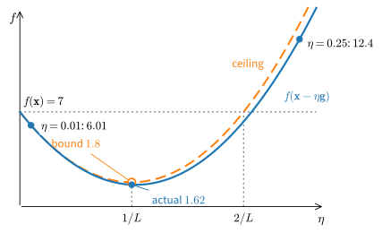
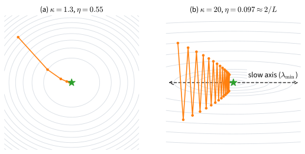
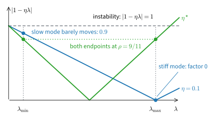
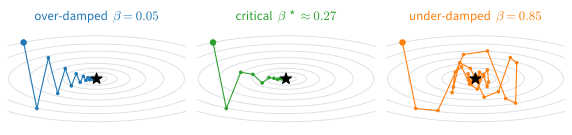
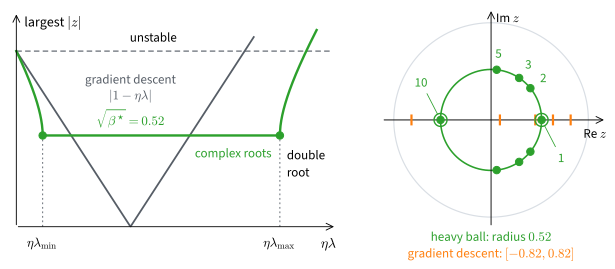
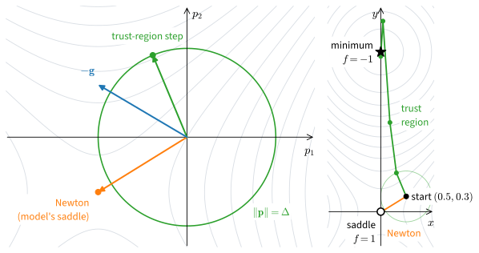

# Gradient Descent and Curvature
:label:`sec_mdl-gradient-based-optimization`

A learning rate is usually found by trial: we try a value, watch the loss,
and lower the value if the loss blows up. Each training step moves against
the gradient of the loss, so the gradient fixes the direction of the step and
the learning rate sets only its distance. Yet a poor choice of distance makes
training either slow or unstable. This section asks how far a step along the gradient
can be trusted, and how many steps that limit forces on us.

A function of two variables already shows the difficulty. Take the bowl
$f(x, y) = \tfrac12(x^2 + 10\,y^2)$, which curves ten times faster along $y$
than along $x$, and start at the point $(2, 1)$, where $f = 7$ and the
gradient is $\nabla f = (2, 10)$. A step of size $\eta$ against the gradient
moves to $(2 - 2\eta,\, 1 - 10\eta)$. With $\eta = 0.01$ the value drops only
to $6.01$. With $\eta = 0.1$ it drops to $1.62$. With $\eta = 0.25$ it
*rises* to $12.4$. The direction was downhill every time; only the distance
differed.

How far a step can go depends on curvature. A step short enough for the
steep direction $y$ makes slow progress along the flat direction $x$. Even
the best fixed step needs $69$ iterations to shrink the error by a factor of
$10^6$, that is, to gain six digits. Stretch the ratio to $1000$, the
chapter's running example $\tfrac12(x_1^2 + 1000\,x_2^2)$, and it needs
$6{,}908$. Momentum brings that down to $315$, and Newton's method needs a
single step if we can afford its Hessian. Most worked numbers below use the
opening function, whose Hessian $\mathrm{diag}(1, 10)$ keeps every step
checkable by hand.

We first bound the safe step through smoothness, which turns the local
linear model of :numref:`sec_mdl-multivariable_calculus` into a guarantee.
We then solve gradient descent exactly on quadratics, where the ratio of
curvatures appears as the condition number, and show how momentum and
curvature models each change the count. Gradients are exact throughout; the
noisy gradients of training are the subject of
:numref:`sec_mdl-stochastic-gradient-methods`. The code is plain NumPy, so
each update can be read against its equation.

```{.python .input #gradient-based-optimization-imports}
#@tab mxnet
%matplotlib inline
from d2l import mxnet as d2l
import numpy as np
```

```{.python .input #gradient-based-optimization-imports}
#@tab pytorch
import math
import numpy as np
import torch
from torch import nn
from torch.nn import functional as F
from d2l import torch as d2l
```

```{.python .input #gradient-based-optimization-imports}
#@tab tensorflow
%matplotlib inline
from d2l import tensorflow as d2l
import numpy as np
```

```{.python .input #gradient-based-optimization-imports}
#@tab jax
import math
import numpy as np
import jax
from jax import numpy as jnp
from flax import nnx
import optax
from d2l import jax as d2l
```

## Descent Directions and Smoothness
:label:`subsec_mdl-gd-smoothness`

A gradient step answers two questions, which direction and how far. The first
has a clean answer from the first-order Taylor expansion. The second needs an
assumption about how fast the gradient changes. That assumption turns the
first-order approximation into a guarantee for a step of finite length.

### The Steepest Direction
:label:`subsec_mdl-descent-directions`

The opening stepped along $-\nabla f$ without asking why. To see that it is
the right choice, expand $f$ to first order. For a differentiable
$f : \mathbb{R}^d \to \mathbb{R}$, a small step of size $\eta > 0$ along a
direction $\mathbf{d}$ changes the value by

$$
f(\mathbf{x} + \eta\,\mathbf{d}) = f(\mathbf{x}) + \eta\, \nabla f(\mathbf{x})^\top \mathbf{d} + o(\eta).
$$

To first order the change is $\eta$ times the directional derivative
$\nabla f(\mathbf{x})^\top \mathbf{d}$. Call $\mathbf{d}$ a **descent
direction** at $\mathbf{x}$ if $\nabla f(\mathbf{x})^\top \mathbf{d} < 0$.

**Proposition (descent directions, and the steepest one).** *Let $f$ be
differentiable at $\mathbf{x}$ with $\nabla f(\mathbf{x}) \neq \mathbf{0}$.*

1. *If $\nabla f(\mathbf{x})^\top \mathbf{d} < 0$, then
   $f(\mathbf{x} + \eta\,\mathbf{d}) < f(\mathbf{x})$ for every sufficiently
   small $\eta > 0$.*
2. *Among unit vectors, the directional derivative is minimized uniquely by the
   normalized negative gradient:*

$$
\min_{\|\mathbf{d}\| = 1} \nabla f(\mathbf{x})^\top \mathbf{d} = -\|\nabla f(\mathbf{x})\|,
\qquad \textrm{attained only at } \mathbf{d} = -\frac{\nabla f(\mathbf{x})}{\|\nabla f(\mathbf{x})\|}.
$$
:eqlabel:`eq_mdl-opt-steepest`

**Proof.** For the first claim, the function
$\varphi(\eta) = f(\mathbf{x} + \eta\,\mathbf{d})$ has
$\varphi'(0) = \nabla f(\mathbf{x})^\top \mathbf{d} < 0$ by the chain rule, so
the difference quotient $(\varphi(\eta) - \varphi(0))/\eta$ is negative for all
small $\eta > 0$, that is, $\varphi(\eta) < \varphi(0)$. For the second, the
Cauchy--Schwarz inequality gives, for every unit vector $\mathbf{d}$,
$\nabla f(\mathbf{x})^\top \mathbf{d} \ge -\|\nabla f(\mathbf{x})\|\,\|\mathbf{d}\| = -\|\nabla f(\mathbf{x})\|$,
with equality only when $\mathbf{d}$ is a negative multiple of
$\nabla f(\mathbf{x})$. The only such unit vector is
$-\nabla f(\mathbf{x})/\|\nabla f(\mathbf{x})\|$, and it attains the bound.
$\blacksquare$

On the opening example the steepest unit direction at $(2, 1)$ is
$-(2, 10)/\sqrt{104} = (-0.196, -0.981)$, with slope
$-\|\nabla f\| = -10.198$. The axis direction $(-1, 0)$ is also downhill,
but its slope is only $-2$. Descent directions fill the open half-space of
vectors that make an acute angle with $-\nabla f$; the gradient picks the
steepest of them. The cell compares the first-order slope with the actual
change along four unit directions, then scans $3600$ directions on the unit
circle for the most negative slope.

```{.python .input #gradient-based-optimization-steepest-direction}
def f(v):
    return 0.5 * (v[0]**2 + 10 * v[1]**2)

def grad(v):
    return np.array([v[0], 10 * v[1]])

x = np.array([2.0, 1.0])
g = grad(x)
steepest = -g / np.linalg.norm(g)
candidates = [('steepest -grad/|grad|', steepest),
              ('diagonal -(1,1)/sqrt(2)', -np.ones(2) / np.sqrt(2)),
              ('axis     (-1,0)', np.array([-1.0, 0.0])),
              ('uphill   +(1,1)/sqrt(2)', np.ones(2) / np.sqrt(2))]
eta = 0.01
for name, d in candidates:
    print(f'{name}:  slope = {g @ d:+8.4f},  '
          f'f(x + eta d) - f(x) = {f(x + eta * d) - f(x):+.6f}')
thetas = np.linspace(0.0, 2 * np.pi, 3601)
dirs = np.stack([np.cos(thetas), np.sin(thetas)])
best = dirs[:, np.argmin(g @ dirs)]
print('best of 3600 directions:', best.round(4),
      '  -grad/|grad|:', steepest.round(4))
```

Every direction with negative slope lowers $f$ for the tested step, and the
uphill direction raises it. The axis direction has slope $-2.0$, five times
smaller in magnitude than the steepest slope $-10.198$. The unit-circle scan
returns $(-0.196, -0.981)$, the normalized negative gradient, to grid
resolution. Differentiability promises a decrease only for small enough
steps. How small is the question of the next subsection.

### Smoothness and the Descent Lemma

**Gradient descent** repeats the steepest step with a fixed **step size**
(learning rate) $\eta > 0$:

$$
\mathbf{x}_{k+1} = \mathbf{x}_k - \eta\, \nabla f(\mathbf{x}_k).
$$
:eqlabel:`eq_mdl-opt-gd-step`

Throughout this section $k$ counts iterations, and we abbreviate
$\mathbf{g}_k = \nabla f(\mathbf{x}_k)$. The first-order model justified the
direction. It says nothing about how far to trust it, because the gradient
at $\mathbf{x}_k$ stops describing $f$ once the step moves far enough for
the gradient to change. The assumption we need bounds that change.

**Definition ($L$-smoothness).** A differentiable $f$ is **$L$-smooth** if
its gradient changes by at most $L$ per unit of distance:

$$
\|\nabla f(\mathbf{x}) - \nabla f(\mathbf{y})\| \;\le\; L\, \|\mathbf{x} - \mathbf{y}\|
\qquad \textrm{for all } \mathbf{x}, \mathbf{y}.
$$
:eqlabel:`eq_mdl-opt-smoothness`

For twice continuously differentiable $f$ this is the same as every Hessian
eigenvalue lying in $[-L, L]$. Bounded eigenvalues give
:eqref:`eq_mdl-opt-smoothness` by integrating the Hessian along the segment
from $\mathbf{y}$ to $\mathbf{x}$, and the converse is a difference-quotient
limit (exercise :exref:`ex_mdl-gradient-based-optimization-smoothness-constants`a).
So $L$ bounds the curvature in every direction. The opening example has the
constant Hessian $\mathrm{diag}(1, 10)$, so $L = 10$. For the regularized
logistic loss of the Newton subsection below,
$L = \lambda_{\max}(\mathbf{X}^\top\mathbf{X})/(4n) + \nu$. A function whose
curvature grows without limit has no such constant: $\tfrac14 x^4$ has
$f''(x) = 3x^2$, so no global $L$ exists. The backtracking line search at the
end of this part handles that case.

Smoothness turns the first-order model into a one-sided guarantee, the
quadratic ceiling

$$
f(\mathbf{y}) \;\le\; f(\mathbf{x}) + \nabla f(\mathbf{x})^\top (\mathbf{y} - \mathbf{x}) + \tfrac{L}{2}\, \|\mathbf{y} - \mathbf{x}\|^2.
$$
:eqlabel:`eq_mdl-opt-quadratic-ceiling`

The graph of $f$ never rises above its tangent plane by more than $L/2$
times the squared distance. Before proving it, insert a gradient step
$\mathbf{y} = \mathbf{x} - \eta\,\mathbf{g}$ and compare the two terms. The
first-order decrease $\eta\,\|\mathbf{g}\|^2$ grows linearly in $\eta$, while
the curvature error $\tfrac{L}{2}\eta^2\|\mathbf{g}\|^2$ grows quadratically.
For short steps the decrease dominates, and at $\eta = 2/L$ the two terms are
equal.

**Proposition (descent lemma).** *If $f$ is $L$-smooth, then the gradient step
:eqref:`eq_mdl-opt-gd-step` satisfies*

$$
f(\mathbf{x}_{k+1}) \;\le\; f(\mathbf{x}_k) - \eta \left(1 - \tfrac{L\eta}{2}\right) \|\mathbf{g}_k\|^2.
$$
:eqlabel:`eq_mdl-opt-descent-lemma`

*In particular $f$ strictly decreases whenever $0 < \eta < 2/L$ and
$\mathbf{g}_k \neq \mathbf{0}$, and the guaranteed decrease is largest at
$\eta = 1/L$, where it reads
$f(\mathbf{x}_{k+1}) \le f(\mathbf{x}_k) - \tfrac{1}{2L}\|\mathbf{g}_k\|^2$.*

**Proof.** First the ceiling :eqref:`eq_mdl-opt-quadratic-ceiling`. Restrict
$f$ to the segment, $\psi(t) = f(\mathbf{x} + t(\mathbf{y} - \mathbf{x}))$ for
$t \in [0, 1]$, so that
$\psi'(t) = \nabla f(\mathbf{x} + t(\mathbf{y}-\mathbf{x}))^\top (\mathbf{y} - \mathbf{x})$.
By the fundamental theorem of calculus and then Cauchy--Schwarz with the
Lipschitz bound :eqref:`eq_mdl-opt-smoothness`,

$$
\begin{aligned}
f(\mathbf{y}) - f(\mathbf{x}) - \nabla f(\mathbf{x})^\top (\mathbf{y}-\mathbf{x})
&= \int_0^1 \big(\nabla f(\mathbf{x} + t(\mathbf{y}-\mathbf{x})) - \nabla f(\mathbf{x})\big)^\top (\mathbf{y}-\mathbf{x})\, dt \\
&\le \int_0^1 L\,t\, \|\mathbf{y}-\mathbf{x}\|^2\, dt = \tfrac{L}{2}\|\mathbf{y}-\mathbf{x}\|^2.
\end{aligned}
$$

Now insert the gradient step $\mathbf{y} = \mathbf{x}_k - \eta\,\mathbf{g}_k$:

$$
f(\mathbf{x}_{k+1}) \;\le\; f(\mathbf{x}_k) - \eta\,\|\mathbf{g}_k\|^2 + \tfrac{L}{2}\,\eta^2\, \|\mathbf{g}_k\|^2,
$$

and the bracket $\eta(1 - L\eta/2)$ is positive exactly for $\eta < 2/L$ and
maximized at $\eta = 1/L$. $\blacksquare$

The proof compares gradients only between $\mathbf{x}_k$ and points of the
segment to $\mathbf{x}_{k+1}$, so it is enough that $\nabla f$ is
$L$-Lipschitz on that segment. On the opening example $\|\mathbf{g}\|^2 = 104$
and $L = 10$. At $\eta = 1/L = 0.1$ the lemma promises
$f \le 7 - 104/20 = 1.8$. At $\eta = 0.01$ it promises
$f \le 7 - 104 \cdot 0.01 \cdot 0.95 = 6.012$. At $\eta = 0.25 > 2/L$ the
bracket is negative and the bound exceeds the starting value, so the lemma
promises nothing. The cell computes the bound and the actual value for all
three steps.

```{.python .input #mdl-gradient-based-optimization-smoothness-and-the-descent-lemma}
x, L = np.array([2.0, 1.0]), 10.0
g = grad(x)
for eta in (0.01, 0.1, 0.25):
    bound = f(x) - eta * (1 - L * eta / 2) * (g @ g)
    print(f'eta = {eta:4.2f}:  bound {bound:7.4f},  actual {f(x - eta * g):7.4f}')
```

Each actual value lies below its bound: $6.0102$ under $6.012$, and $1.62$
under $1.8$. The third bound, $13.5$, is above the start $f = 7$, and the
step indeed raised $f$, to $12.375$. :numref:`fig_mdl-opt-descent-lemma-slice`
draws the two functions of $\eta$ behind these numbers. Along the step,
$\mathbf{g}^\top\mathrm{diag}(1, 10)\,\mathbf{g} = 1004$, so the objective is
the parabola $7 - 104\,\eta + 502\,\eta^2$, and the ceiling is
$7 - 104\,\eta + 520\,\eta^2$.


:label:`fig_mdl-opt-descent-lemma-slice`

The step $\eta = 1/L$ is the minimizer of the ceiling. Since $f$ lies below
the ceiling everywhere, the step can never do worse than the ceiling's
minimum, which is the guaranteed decrease $\|\mathbf{g}\|^2/(2L)$. The same
argument in one variable, with its picture, is in
:numref:`sec_mdl-single_variable_calculus`.

### Stationary Points Without Convexity

The descent lemma alone, with no convexity, already says something about a
long run: the gradient cannot stay large.

**Proposition (gradient descent finds approximate stationary points).** *Let
$f$ be $L$-smooth and bounded below by $f_{\mathrm{low}}$, and run
:eqref:`eq_mdl-opt-gd-step` with $\eta = 1/L$. Then for every $K \ge 1$,*

$$
\min_{0 \le k < K} \|\nabla f(\mathbf{x}_k)\|^2 \;\le\; \frac{2L\,\big(f(\mathbf{x}_0) - f_{\mathrm{low}}\big)}{K}.
$$
:eqlabel:`eq_mdl-opt-stationarity-rate`

**Proof.** At $\eta = 1/L$ the descent lemma reads
$\|\mathbf{g}_k\|^2 \le 2L\,(f(\mathbf{x}_k) - f(\mathbf{x}_{k+1}))$.
Sum over $k = 0, \ldots, K-1$; the right side telescopes to
$2L\,(f(\mathbf{x}_0) - f(\mathbf{x}_K)) \le 2L\,(f(\mathbf{x}_0) - f_{\mathrm{low}})$.
The smallest of $K$ numbers is at most their average. $\blacksquare$

Some iterate among the first $K$ has squared gradient norm $O(1/K)$, and
nothing beyond a lower bound and a smoothness constant was assumed. The
bound does need a global $L$. ReLU networks are not smooth, so for them it
describes an idealized model rather than a guarantee.

A small gradient does not mean a minimum. Take
$f(x, y) = \tfrac12 x^2 + \cos y$, which is bounded below by $-1$ and
$1$-smooth (its Hessian $\mathrm{diag}(1, -\cos y)$ has eigenvalues in
$[-1, 1]$). Gradient descent with $\eta = 1$ from $(1, 0)$ sets $x$ to $0$ in
one step and never moves $y$, because $\partial f/\partial y = -\sin y$
vanishes at $y = 0$. The run stops at $(0, 0)$, where $f = 1$. This point is
a saddle: $f$ rises along $x$ and falls along $y$. The minimum value $-1$ sits
at $(0, \pi)$. The bound holds, since the gradient at the saddle is zero, but
it says nothing about which stationary point is reached. Exercise
:exref:`ex_mdl-gradient-based-optimization-saddle-attracts` measures how long
runs from nearby starts stay near the saddle. For convex $f$ every stationary point is a global
minimum.

### Backtracking Line Search

The step $\eta = 1/L$ presumes that we know $L$. We rarely do, and the
curvature that matters varies across the loss surface, so a single global
constant is both unknown and too conservative. A **line search** chooses the
step at run time. It tries a step and accepts it only if it achieves a fixed
fraction $c \in (0, 1)$ of the decrease that the first-order model predicts,
the **Armijo condition** (also called sufficient decrease)
:cite:`Armijo.1966`

$$
f\big(\mathbf{x} - \eta\, \nabla f(\mathbf{x})\big) \;\le\; f(\mathbf{x}) - c\,\eta\, \|\nabla f(\mathbf{x})\|^2.
$$
:eqlabel:`eq_mdl-opt-armijo`

The right side is the first-order prediction with its slope scaled down by
$c$. **Backtracking** starts from an optimistic $\eta_0$ and halves $\eta$
until :eqref:`eq_mdl-opt-armijo` holds. By the descent lemma the condition
holds automatically once $1 - L\eta/2 \ge c$, that is, once
$\eta \le 2(1-c)/L$. So the loop stops after finitely many halvings and
accepts a step $\eta \ge \min\big(\eta_0,\, (1-c)/L\big)$, within a factor
two of that threshold, without ever knowing $L$.

The argument needs $L$ only on the region the method visits. Take the
quartic $f(x) = \tfrac14 x^4$, which has no global $L$, from $x_0 = 3$ with
$c = \tfrac12$. Backtracking never increases $f$, so every iterate stays in
$[-3, 3]$, where $f'' = 3x^2 \le 27$. A trial step with $\eta \le 1/27$ maps
$x$ to $x(1 - \eta x^2)$, which lies between $\tfrac23 x$ and $x$, so the
whole segment stays inside $[-3, 3]$ as well, and $L = 27$ there is all the
argument needs. The cell compares a fixed step with backtracking from this
start. The quartic's curvature is large far from the origin and vanishes
near it, so no single fixed step suits the whole trajectory.

```{.python .input #gradient-based-optimization-backtracking}
quartic = lambda v: 0.25 * (v ** 4).sum()
quartic_grad = lambda v: v ** 3

x = np.array([3.0])
for _ in range(6):                            # fixed step, too large at x0
    x = x - 0.3 * quartic_grad(x)
print(f'fixed eta = 0.3 from x0 = 3:  |x_6| = {abs(x[0]):.2e}  (diverged)')

x, etas = np.array([3.0]), []
for _ in range(25):                           # backtracking line search
    g = quartic_grad(x)
    eta = 1.0
    while quartic(x - eta * g) > quartic(x) - 0.5 * eta * (g * g).sum():
        eta *= 0.5                            # Armijo fails: halve the step
    x = x - eta * g
    etas.append(eta)
print('accepted steps:', np.array(etas[:8]), '...')
print(f'backtracking from x0 = 3:  f(x_25) = {quartic(x):.2e}  (monotone descent)')
```

The fixed step $\eta = 0.3$ is stable near the minimum but diverges from this
start. At $x_0 = 3$ the local curvature is $f'' = 27$ and the local stability
ceiling is $2/27 \approx 0.074$; six steps later the iterate sits at
$|x_6| \approx 6.5 \times 10^{103}$. Backtracking starts from $\eta_0 = 1$ and
accepts $0.031$ on the first step. The halving before it, $0.0625$, fails the
Armijo test, which on this step fails for every $\eta$ above about $0.05$.
The descent lemma with the curvature $27$ at $x_0$ certifies only the steps
below $2(1-c)/27 = 1/27 \approx 0.037$. As the curvature falls, the accepted
steps grow, $0.0625, 0.125, 0.25, 0.5, 1.0$. The accepted step roughly tracks
$2(1-c)/f''(x)$, so the line search measures the curvature by trial. Training
rarely backtracks, because each probe needs another forward pass. Learning-rate
schedules are the cheaper substitute.

## The Quadratic Model and the Condition Number
:label:`subsec_mdl-quadratic-model`

The opening promised to explain the difference between $69$ steps and
$6{,}908$. Both functions are quadratics, and on a quadratic gradient descent
can be solved exactly. The answer depends on a single number, the ratio of the
largest to the smallest curvature.

### Ill-Conditioned Valleys

:numref:`fig_mdl-opt-gd-bowl-vs-valley` shows gradient descent on two
quadratics before any algebra. On a round bowl the path runs nearly straight
to the minimum. In a long valley the walls are steep and the floor is flat.
The step that the steep walls allow makes the iterate overshoot across the
valley and alternate from wall to wall. Along the flat floor the same step
barely moves, and the path zigzags.


:label:`fig_mdl-opt-gd-bowl-vs-valley`

Quadratics are worth solving because every smooth function looks like one
near a minimum. Near a minimizer $\mathbf{x}^\star$ with positive-definite
Hessian $\mathbf{A}$, the second-order Taylor expansion says that $f$ is
approximately
$f(\mathbf{x}^\star) + \tfrac12 (\mathbf{x}-\mathbf{x}^\star)^\top \mathbf{A}\, (\mathbf{x}-\mathbf{x}^\star)$.
Moving the minimizer to the origin and dropping the constant leaves the model
problem

$$
f(\mathbf{x}) = \tfrac12\, \mathbf{x}^\top \mathbf{A}\, \mathbf{x},
\qquad \mathbf{A} \textrm{ symmetric positive definite, with eigenvalues }
0 < \lambda_{\min} = \lambda_1 \le \cdots \le \lambda_d = \lambda_{\max}.
$$

Its gradient is $\mathbf{A}\mathbf{x}$, its Hessian is $\mathbf{A}$, and so
its smoothness constant is $L = \lambda_{\max}$. The ratio of the largest to
the smallest curvature,

$$
\kappa = \frac{\lambda_{\max}}{\lambda_{\min}},
$$

is the **condition number** of the problem. It is $10$ for
$\mathrm{diag}(1, 10)$ and $10^3$ for the chapter's running example
$\tfrac12(x_1^2 + 1000\,x_2^2)$. For a symmetric positive definite
$\mathbf{A}$ it equals the singular-value ratio $\kappa(\mathbf{A})$ of
:numref:`subsec_mdl-condition-number`.

### Per-Mode Contraction and the Stability Ceiling

The zigzag in the valley comes from a ceiling on the step that the steep
direction imposes. To see where that ceiling lies, and what it costs the
flat direction, we solve gradient descent on a quadratic exactly.

Start with one variable, $f(u) = \tfrac{\lambda}{2} u^2$ with $\lambda > 0$.
The gradient step is $u_{k+1} = u_k - \eta\lambda u_k$, so

$$
u_{k+1} = (1 - \eta\lambda)\, u_k, \qquad u_k = (1 - \eta\lambda)^k\, u_0 .
$$

Every step multiplies the error by the same factor. The iterates converge if
and only if $|1 - \eta\lambda| < 1$, that is, $0 < \eta < 2/\lambda$. They
land on $0$ in one step if and only if $\eta = 1/\lambda$. For
$1/\lambda < \eta < 2/\lambda$ the factor is negative, and the iterate
alternates in sign while it shrinks. With $\lambda = 10$: $\eta = 0.1$ gives
the factor $0$, $\eta = 0.19$ gives $-0.9$, and $\eta = 0.21$ gives $-1.1$,
which diverges.

The general quadratic keeps this form. Its gradient is $\mathbf{A}\mathbf{x}$,
so the iteration :eqref:`eq_mdl-opt-gd-step` is

$$
\mathbf{x}_{k+1} = (\mathbf{I} - \eta \mathbf{A})\, \mathbf{x}_k .
$$

Every step applies the same linear map, so the whole run is the matrix power
$\mathbf{x}_k = (\mathbf{I} - \eta\mathbf{A})^k\mathbf{x}_0$. A symmetric
matrix has an orthonormal basis of eigenvectors
(:numref:`sec_mdl-eigendecompositions`). Write $\mathbf{x}_k$ in the eigenbasis
of $\mathbf{A}$ with coordinates $u_i^{(k)}$. The matrix
$\mathbf{I} - \eta\mathbf{A}$ has the same eigenvectors, with eigenvalues
$1 - \eta\lambda_i$, so the coordinates evolve independently:

$$
u_i^{(k+1)} = (1 - \eta \lambda_i)\, u_i^{(k)},
\qquad \textrm{hence} \qquad
u_i^{(k)} = (1 - \eta \lambda_i)^k\, u_i^{(0)}.
$$
:eqlabel:`eq_mdl-opt-per-mode`

Gradient descent on a quadratic is $d$ copies of the one-variable recursion,
one per eigenvalue, or **mode**. The factors $1 - \eta\lambda_i$ decide
convergence and speed:

* **Convergence** requires $|1 - \eta \lambda_i| < 1$ for every mode, that is,
  $0 < \eta < 2/\lambda_{\max} = 2/L$. This is the **stability ceiling**. On
  quadratics, the $2/L$ that the descent lemma offered as sufficient is also
  necessary. Above it, the stiffest mode's factor is below $-1$, so that
  coordinate alternates with growing amplitude even while the other modes
  converge (exercise
  :exref:`ex_mdl-gradient-based-optimization-f-mathbfx-tfrac12-lambda`b builds
  such a half-converging, half-exploding run).
* **Speed** is set by the slowest mode. The error norm shrinks like
  $\rho(\eta)^k$, where $\rho(\eta) = \max_i |1 - \eta\lambda_i|$ is the
  **spectral radius** of $\mathbf{I} - \eta\mathbf{A}$, its largest eigenvalue
  magnitude.

The cell sweeps $\eta$ across the ceiling on $\mathbf{A} = \mathrm{diag}(1, 10)$,
where $L = 10$ and the ceiling is $\eta = 0.2$, and prints both factors, the
spectral radius, and the error after $60$ steps from $(1, 1)$.

```{.python .input #gradient-based-optimization-eta-sweep}
A = np.diag([1.0, 10.0])                      # eigenvalues 1 and 10, so L = 10
x0 = np.array([1.0, 1.0])

def run_gd(A, x0, eta, steps):
    xs = [x0]
    for _ in range(steps):
        xs.append(xs[-1] - eta * (A @ xs[-1]))
    return np.array(xs)

print(' eta    |1-eta*1|  |1-eta*10|  spectral radius   |x_60|')
for eta in [0.02, 0.10, 2 / 11, 0.19, 0.20, 0.21]:
    f1, f10 = abs(1 - eta * 1.0), abs(1 - eta * 10.0)
    print(f'{eta:5.3f}    {f1:6.3f}     {f10:6.3f}        {max(f1, f10):6.3f}     '
          f'{np.linalg.norm(run_gd(A, x0, eta, 60)[-1]):9.1e}')
```

Each row is one step-size regime. The choice $\eta = 0.02$ is stable but slow
($\rho = 0.98$; after $60$ steps the error is still $0.3$). At $\eta = 0.1$ the
stiff mode is eliminated in one step (its factor is $0.000$), yet the slow mode
sets the rate, $\rho = 0.9$. The step $\eta = 0.19$ also has $\rho = 0.9$, but
for the opposite reason: its stiff mode alternates with factor $-0.9$. Between
them, $\eta = 2/11 \approx 0.182$ balances the two extreme modes and gives the
smallest factor ($\rho = 0.818$, error $8.3 \times 10^{-6}$). At the ceiling
$\eta = 0.2$ the stiff mode's factor is $-1$: the iterate alternates between
$\pm 1$ on that axis, and $\|\mathbf{x}_{60}\| = 1.0$. At $\eta = 0.21$, sixty
steps increase the error to $3 \times 10^{2}$.

### The Optimal Step

Within the stable range, which fixed $\eta$ is fastest? The sweep suggests
balancing the two extreme modes. For fixed $\eta$, the function
$\lambda \mapsto |1 - \eta\lambda|$ is a V with its vertex at
$\lambda = 1/\eta$, so on $[\lambda_{\min}, \lambda_{\max}]$ its maximum sits
at an endpoint, and
$\rho(\eta) = \max\big(|1 - \eta\lambda_{\min}|,\, |1 - \eta\lambda_{\max}|\big)$.
Raising $\eta$ lowers the left endpoint's value and raises the right one's.

**Proposition (optimal fixed step on a quadratic).** *For
$f(\mathbf{x}) = \tfrac12 \mathbf{x}^\top \mathbf{A} \mathbf{x}$ the convergence factor
$\rho(\eta) = \max_i |1 - \eta\lambda_i|$ is minimized by*

$$
\eta^\star = \frac{2}{\lambda_{\min} + \lambda_{\max}},
\qquad
\rho(\eta^\star) = \frac{\kappa - 1}{\kappa + 1},
\qquad \kappa = \frac{\lambda_{\max}}{\lambda_{\min}}.
$$
:eqlabel:`eq_mdl-opt-optimal-step`

**Proof.** For every $\eta$,
$\rho(\eta) \ge \max(1 - \eta\lambda_{\min},\, \eta\lambda_{\max} - 1)$, and a
maximum of two numbers is at least any weighted average of them. Take the
weights $\lambda_{\max}/(\lambda_{\min}+\lambda_{\max})$ and
$\lambda_{\min}/(\lambda_{\min}+\lambda_{\max})$. The terms in $\eta$ cancel:

$$
\rho(\eta) \;\ge\; \frac{\lambda_{\max}(1 - \eta\lambda_{\min}) + \lambda_{\min}(\eta\lambda_{\max} - 1)}{\lambda_{\min} + \lambda_{\max}}
= \frac{\lambda_{\max} - \lambda_{\min}}{\lambda_{\max} + \lambda_{\min}} = \frac{\kappa - 1}{\kappa + 1}.
$$

Equality requires the two terms to be equal, $1 - \eta\lambda_{\min} = \eta\lambda_{\max} - 1$,
which is $\eta = \eta^\star$. At $\eta^\star$ both endpoint values are
$(\kappa - 1)/(\kappa + 1)$, and the V keeps every interior eigenvalue below
them, so the bound is attained. $\blacksquare$

:numref:`fig_mdl-opt-eta-tent` is this proof drawn on $\mathrm{diag}(1, 10)$.
Each step size draws a V, the graph of $|1 - \eta\lambda|$ with its vertex at
$\lambda = 1/\eta$. The rate is the taller of its two values at the extreme
eigenvalues, and the best V is the one whose endpoints are level. There
$\eta^\star = 2/11$ and $\rho = 9/11 = 0.818$, so six digits take
$\log 10^6/\log(11/9) \approx 69$ steps. On the chapter's running example
$\rho = 999/1001$, and six digits take $6{,}908$ steps.

![The per-mode contraction factors $|1-\eta\lambda|$ form a V with its vertex at $\lambda = 1/\eta$, and the convergence factor $\rho(\eta)$ is the larger of its values at the extreme eigenvalues $\lambda_{\min} = 1$, $\lambda_{\max} = 10$. The choice $\eta = 0.1$ eliminates the stiff mode but leaves the slow mode contracting at $0.9$; the optimal $\eta^\star = 2/(\lambda_{\min} + \lambda_{\max})$ equalizes the two endpoint factors at $(\kappa-1)/(\kappa+1) = 9/11$. Lowering either endpoint would raise the other.](../img/mdl-opt-eta-tent.svg)
:label:`fig_mdl-opt-eta-tent`

When $\kappa = 1$ (a round bowl) the rate is $0$ and one step solves the
problem. As $\kappa$ grows, $(\kappa-1)/(\kappa+1) \approx 1 - 2/\kappa$, so
$\log(1/\rho) \approx 2/\kappa$, and reducing the error by a factor $\epsilon$
costs about $\tfrac{\kappa}{2}\log\tfrac1\epsilon$ iterations: **the cost of
gradient descent is linear in the condition number**. Stability limits the
step by the stiff mode, $\eta \lesssim 2/\lambda_{\max}$, and with that step
the slow mode moves by only $\eta\,\lambda_{\min} \approx 2/\kappa$ per step.
The cell runs $\eta^\star$ on $\mathrm{diag}(1, 10)$ and measures the
contraction of $\|\mathbf{x}_k\|$ at every step.

```{.python .input #gradient-based-optimization-contraction}
eta_star = 2 / (1.0 + 10.0)                   # 2 / (lambda_min + lambda_max)
xs = run_gd(A, x0, eta_star, steps=40)
print('per-mode factors x_1/x_0 =', (xs[1] / xs[0]).round(6),
      ' predicted 1 - eta* lambda =', (1 - eta_star * np.diag(A)).round(6))
ratios = np.linalg.norm(xs[1:], axis=1) / np.linalg.norm(xs[:-1], axis=1)
kappa = 10.0
print(f'measured contraction |x_k+1| / |x_k|: min {ratios.min():.6f}, '
      f'max {ratios.max():.6f}')
print(f'predicted (kappa-1)/(kappa+1) = {(kappa - 1) / (kappa + 1):.6f}')
```

The two per-mode factors are $+0.818182$ and $-0.818182$: equal magnitudes,
opposite signs. The slow mode contracts monotonically while the stiff mode
alternates in sign, both by $9/11$ per step. Because both modes shrink by the
same factor, $\|\mathbf{x}_k\|$ shrinks by $0.818182$ at every one of the forty
steps, the predicted $(\kappa-1)/(\kappa+1)$.

### The Edge of Stability

The stability ceiling suggests a recipe. Measure the **sharpness**, the
largest Hessian eigenvalue $\lambda_{\max}(\nabla^2 f)$, and then choose
$\eta < 2/\lambda_{\max}$. For full-batch gradient descent on small networks
the sharpness does not stay constant. It typically rises during training until it reaches about $2/\eta$ and
then stays there :cite:`Cohen.Kaur.Li.ea.2021`. The loss keeps falling over
the run, but it rises on many individual steps.

The per-mode recursion explains why the sharpness stops at the ceiling. In
the eigenbasis of the Hessian, the top mode's factor is $1 - \eta\lambda_{\max}$,
which is below $-1$ exactly when $\lambda_{\max} > 2/\eta$. That coordinate
then grows and alternates in sign. On a fixed quadratic this is divergence.
On a network the growing coordinate moves the weights, the weights determine
$\lambda_{\max}$, and the motion lowers $\lambda_{\max}$ back below $2/\eta$.
So when training raises the sharpness, it is held at the ceiling of the
chosen step, not at a value fixed by the initialization.

The cell trains a two-layer $\tanh$ network with $25$ parameters on $16$
points of $\sin 3x$ by full-batch gradient descent, twice from the same random
initialization, with $\eta = 0.4$ (ceiling $2/\eta = 5$) and $\eta = 0.25$
(ceiling $8$). The first cell computes the gradient by hand and the Hessian by
central differences of the gradient, then reports the top eigenvalue.

```{.python .input #mdl-gradient-based-optimization-the-edge-of-stability-1}
Xr = np.linspace(-2.0, 2.0, 16)
Yr = np.sin(3 * Xr)                            # 16 points of sin(3x)
width = 8                                      # 3 * 8 + 1 = 25 parameters

def loss_grad(p, X, Y):                        # loss and hand-written backprop
    W1, b1, W2, b2 = np.split(p, [width, 2 * width, 3 * width])
    H = np.tanh(np.outer(X, W1) + b1)
    r = H @ W2 + b2[0] - Y
    dout = r / len(X)
    dH = np.outer(dout, W2) * (1 - H**2)
    return 0.5 * (r**2).mean(), np.concatenate(
        [X @ dH, dH.sum(0), H.T @ dout, [dout.sum()]])

def sharpness(p, X, Y, eps=1e-4):              # top eigenvalue of the Hessian
    Hm = np.array([(loss_grad(p + eps * e, X, Y)[1]
                    - loss_grad(p - eps * e, X, Y)[1]) / (2 * eps)
                   for e in np.eye(len(p))])
    return np.linalg.eigvalsh(0.5 * (Hm + Hm.T)).max()
```

The second cell runs both step sizes for $20{,}001$ steps. It prints the loss
and the sharpness at steps $0$, $2{,}000$, $20{,}000$, and $20{,}001$, and the
fraction of steps in the second half of each run on which the loss rose.

```{.python .input #gradient-based-optimization-edge-of-stability}
p0 = 0.5 * np.random.default_rng().standard_normal(3 * width + 1)
runs = {}
for eta in (0.40, 0.25):
    p, losses, rows = p0.copy(), [], []
    for k in range(20002):
        loss, g = loss_grad(p, Xr, Yr)
        losses.append(loss)
        if k in (0, 2000, 20000, 20001):
            rows.append((k, loss, sharpness(p, Xr, Yr)))
        p = p - eta * g
    rises = np.diff(losses)[10000:] > 0        # steps on which the loss rose
    runs[eta] = rows, rises.mean()
print('    k   eta=0.40: loss  sharpness    eta=0.25: loss  sharpness')
for (k, l1, s1), (_, l2, s2) in zip(runs[0.40][0], runs[0.25][0]):
    print(f'{k:5d}   {l1:14.2e}  {s1:9.3f}    {l2:14.2e}  {s2:9.3f}')
print(f'loss rose on this fraction of late steps:  eta=0.40 {runs[0.40][1]:.2f},'
      f'  eta=0.25 {runs[0.25][1]:.2f}')
```

Each run starts at the sharpness in its first row, usually between $2$ and
$5$, and neither stays there. By step $2{,}000$ the $\eta = 0.4$ run is
usually already near its ceiling $5$, while the $\eta = 0.25$ run is usually
still climbing toward $8$. At the end the $\eta = 0.4$ run sits within a fraction of a
percent of $5$. Its last two rows are consecutive steps, and in most runs
the sharpness alternates between slightly above $2/\eta$ and slightly below
it. The loss rises on a sizable fraction of the late steps, often about
half (the last line), although it has fallen by more than two orders of
magnitude over the run. While the sharpness is above $2/\eta$, the quadratic
model predicts growth along the top eigendirection. That is how a loss that
falls over the run can rise on single steps.

The $\eta = 0.25$ run usually ends within a few percent of its ceiling $8$. In some
draws it alternates in the same way. In others it settles just below $8$, and
its loss then rises on fewer steps, in some draws on almost none. The data,
the architecture, and the initialization are shared, so the curvature that
training reaches is set by $\eta$. On this small network, a sharpness measured at initialization does not predict
the curvature later in training. Exercise
:exref:`ex_mdl-gradient-based-optimization-edge-of-stability-momentum` shows
that with momentum the ceiling moves to $(2 + 2\beta)/\eta$.

### From Quadratics to Convex Functions

Which of these conclusions survive beyond quadratics? Call $f$
**$\mu$-strongly convex** if at every point it lies above its tangent plane
plus the quadratic $\tfrac{\mu}{2}\|\mathbf{y} - \mathbf{x}\|^2$. If $f$ is
also $L$-smooth, it is sandwiched at every point between quadratics of
curvature $\mu$ and $L$, and $\kappa = L/\mu$ takes the place of
$\lambda_{\max}/\lambda_{\min}$. Each added hypothesis upgrades what gradient
descent with $\eta = 1/L$ guarantees:

$$
\begin{aligned}
&\textrm{$L$-smooth, bounded below:} &&\min_{0\le k<K}\|\nabla f(\mathbf{x}_k)\|^2 \le \frac{2L\,(f(\mathbf{x}_0)-f_{\mathrm{low}})}{K},\\
&\textrm{convex and $L$-smooth:} &&f(\mathbf{x}_k)-f^\star \le \frac{L\,\|\mathbf{x}_0-\mathbf{x}^\star\|^2}{2k},\\
&\textrm{$\mu$-strongly convex and $L$-smooth:} &&f(\mathbf{x}_k)-f^\star \le \Big(1-\frac{1}{\kappa}\Big)^k\big(f(\mathbf{x}_0)-f^\star\big).
\end{aligned}
$$
:eqlabel:`eq_mdl-opt-gd-rate-strongly-convex`

Smoothness alone certifies a small gradient at some iterate, which is
stationarity, not optimality. Convexity makes the function values converge to
the global optimum $f^\star$, at the sublinear rate $O(1/k)$. Strong convexity
makes the convergence geometric, with $O(\kappa\log\tfrac1\epsilon)$ steps,
the same linear dependence on $\kappa$ as on the quadratic. The first line
is the proposition above, and :numref:`subsec_mdl-convergence-rates` proves the other
two. Distances follow at the
cost of one factor $\kappa$, since $f - f^\star$ lies between
$\tfrac{\mu}{2}\|\mathbf{x} - \mathbf{x}^\star\|^2$ and
$\tfrac{L}{2}\|\mathbf{x} - \mathbf{x}^\star\|^2$.

The quadratic does better than this bound for the whole class, provided the
comparison is made in the same units. The class bound is for function values, with factor
$1 - 1/\kappa$ per step. On the quadratic at $\eta^\star$,
$f - f^\star = \tfrac12\sum_i \lambda_i (u_i^{(k)})^2$ shrinks by at least
$((\kappa-1)/(\kappa+1))^2 \approx 1 - 4/\kappa$ per step. That is four times
fewer iterations: a factor two from the larger step ($\eta^\star$ is about
$2/L$) and a factor two from the square. Six digits of $f - f^\star$ at
$\kappa = 10^3$ cost about $13{,}800$ steps by the class bound and $3{,}454$
on the quadratic.

## Momentum and Acceleration
:label:`subsec_mdl-momentum-acceleration`

Gradient descent needs a number of steps proportional to $\kappa$ because one
step size must serve both the stiff and the flat modes. This part keeps the gradient and changes the update so that
the two modes can move at the same rate.

### Heavy-Ball Momentum

The valley suggests the change. In the stiff direction successive gradients
point in alternating directions (the overshoot of
:numref:`fig_mdl-opt-gd-bowl-vs-valley`), so averaging recent gradients would
cancel the oscillation. In the slow direction successive gradients are small
but agree, so accumulating them would build up speed. One mechanism does both:
give the iterate a velocity with memory. **Heavy-ball momentum**
:cite:`Polyak.1964` replaces the gradient step by

$$
\mathbf{v}_{k+1} = \beta\, \mathbf{v}_k - \eta\, \nabla f(\mathbf{x}_k),
\qquad
\mathbf{x}_{k+1} = \mathbf{x}_k + \mathbf{v}_{k+1},
$$
:eqlabel:`eq_mdl-opt-heavy-ball`

with momentum parameter $\beta \in [0, 1)$. The velocity $\mathbf{v}_k$ is a
decaying sum of past gradients. Since $\mathbf{v}_k = \mathbf{x}_k - \mathbf{x}_{k-1}$,
eliminating it gives

$$
\mathbf{x}_{k+1} = \mathbf{x}_k - \eta\, \nabla f(\mathbf{x}_k) + \beta\,(\mathbf{x}_k - \mathbf{x}_{k-1}).
$$

Each step is a gradient step plus $\beta$ times the previous step; with
$\beta = 0$ it is gradient descent.

On the quadratic each mode again evolves on its own. With gradient $\lambda u_k$
in one mode, the eliminated form reads
$u_{k+1} = (1 + \beta - \eta\lambda)\, u_k - \beta\, u_{k-1}$, so the new value
depends on the last two. A second-order recurrence of this kind is the
discrete version of a damped oscillator, a mass on a spring with friction
$1 - \beta$, and $\beta$ sets the damping.

:numref:`fig_mdl-opt-momentum-damping` shows the three regimes on
$\mathrm{diag}(1, 10)$, all with the gradient-descent step $\eta = 2/11$.
With too little momentum, $\beta = 0.05$, the path zigzags much like gradient
descent, with rate $0.81$. Its stiff mode has the coefficient
$1 + \beta - \eta\lambda_{\max} = -0.77$, which gives a negative real root and
makes the iterate alternate, something a physical oscillator never does. At
$\beta = (1 - \sqrt{2/11})^2 \approx 0.33$ the slow mode is critically damped
for this step, and the rate is $0.57$, the fastest for $\eta = 2/11$. With too
much momentum, $\beta = 0.85$, the iterate loops around the minimum, with rate
$0.92$. The best rate of all, $0.52$, needs a larger step as well, which the
next subsection derives.

![Heavy ball on the $\kappa=10$ valley $\tfrac12(x^2+10y^2)$, all three runs with the gradient-descent step $\eta=2/11$. Too little momentum zigzags like gradient descent (the stiff mode's coefficient $1+\beta-\eta\lambda_{\max}$ is negative, so a root is negative and real); the critically damped $\beta$ for this step is fastest; too much momentum loops around the minimum. The $\sqrt\kappa$ rate $0.52$ needs the larger step $\eta_{\mathrm{HB}}$ of :eqref:`eq_mdl-opt-hb-tuning`, at which $\beta=0.05$ would diverge.](../img/mdl-opt-momentum-damping.svg)
:label:`fig_mdl-opt-momentum-damping`

### The $\sqrt{\kappa}$ Law

We now show that with the right pair $(\eta, \beta)$ every mode contracts at
the same rate $(\sqrt\kappa - 1)/(\sqrt\kappa + 1)$. For $\kappa = 10$ the pair
is $\beta^\star \approx 0.27$, $\eta_{\mathrm{HB}} \approx 0.23$, and the rate is
$0.52$ against gradient descent's $0.82$: six digits in $27$ steps instead of
$69$. Everything follows from one fact about a single mode.

**Proposition (heavy ball contracts every mode at $\sqrt\beta$).** *Let
$0 < \beta < 1$. On $f(u) = \tfrac{\lambda}{2}u^2$ the heavy-ball iterates
satisfy $u_{k+1} = (1 + \beta - \eta\lambda)u_k - \beta u_{k-1}$. If
$(1 - \sqrt\beta)^2 \le \eta\lambda \le (1 + \sqrt\beta)^2$, both roots of the
characteristic polynomial have modulus $\sqrt\beta$, and
$|u_k| \le C\,k\,\beta^{k/2}$ for $k \ge 1$ and a constant $C$ that depends on
$u_0$, $u_1$ and $\eta\lambda$. The factor $k$ is needed only at the two
endpoints, where the root is double.*

**Proof.** Substitute $u_k = z^k$ into the recurrence and divide by $z^{k-1}$:

$$
z^2 - (1 + \beta - \eta\lambda)\, z + \beta = 0.
$$
:eqlabel:`eq_mdl-opt-hb-char-poly`

The product of the two roots is $\beta$. The roots are complex exactly when the
discriminant $(1 + \beta - \eta\lambda)^2 - 4\beta$ is negative, that is, when
$|1 + \beta - \eta\lambda| < 2\sqrt\beta$, which rearranges to
$(1 - \sqrt\beta)^2 < \eta\lambda < (1 + \sqrt\beta)^2$. Complex-conjugate roots
$z, \bar z$ with $z\bar z = \beta$ each have modulus $\sqrt\beta$, whatever
$\lambda$ is, and the general solution $u_k = a z^k + b \bar z^k$ is bounded by
$(|a| + |b|)\beta^{k/2}$. At the two endpoints the discriminant is zero, and
the double root is $(1 + \beta - \eta\lambda)/2 = \pm\sqrt\beta$. A double root
$z$ gives the general solution $u_k = (a + bk)z^k$, which is the factor $k$.
$\blacksquare$

**Corollary (the tuning).** Place the two extreme modes at the two ends of the
interval: $\eta\lambda_{\min} = (1 - \sqrt\beta)^2$ and
$\eta\lambda_{\max} = (1 + \sqrt\beta)^2$. Every other eigenvalue then lies
inside, so every mode has modulus $\sqrt\beta$. Taking square roots,
$\sqrt{\eta\lambda_{\max}} - \sqrt{\eta\lambda_{\min}} = 2\sqrt\beta$ and
$\sqrt{\eta\lambda_{\max}} + \sqrt{\eta\lambda_{\min}} = 2$. The second
equation gives $\eta$, and the ratio of the two gives $\sqrt\beta = (\sqrt\kappa - 1)/(\sqrt\kappa + 1)$.
With the tuning

$$
\eta_{\mathrm{HB}} = \left(\frac{2}{\sqrt{\lambda_{\max}} + \sqrt{\lambda_{\min}}}\right)^{\!2},
\qquad
\beta^\star = \left(\frac{\sqrt{\kappa} - 1}{\sqrt{\kappa} + 1}\right)^{\!2},
$$
:eqlabel:`eq_mdl-opt-hb-tuning`

heavy ball contracts every mode by the factor

$$
\rho_{\mathrm{HB}} = \sqrt{\beta^\star} = \frac{\sqrt{\kappa} - 1}{\sqrt{\kappa} + 1}
\;\approx\; 1 - \frac{2}{\sqrt{\kappa}}.
$$
:eqlabel:`eq_mdl-opt-hb-rate`

This is gradient descent's rate with $\kappa$ replaced by $\sqrt\kappa$, so
the iteration count drops from $O(\kappa \log \tfrac1\epsilon)$ to
$O(\sqrt{\kappa} \log \tfrac1\epsilon)$ :cite:`Polyak.1964`. At finite $k$
the double roots of the two extreme modes add a term. The error behaves like
$k\rho^k$, and with $\log(1/\rho) \approx 2/\sqrt\kappa$ the count for a target
$\epsilon$ solves $k \approx \tfrac{\sqrt\kappa}{2}\big(\log\tfrac1\epsilon + \log k\big)$,
the asymptotic law plus a term of order $\sqrt\kappa\log\kappa$.

:numref:`fig_mdl-opt-hb-eigenvalues` draws the proof for $\kappa = 10$. Panel
(a) is the interval: for fixed $\beta$ the modulus of the larger root, as a
function of $\eta\lambda$, is flat at $\sqrt\beta$ wherever the roots are
complex and rises outside. Panel (b) shows the roots themselves. Every mode's
pair lies on the circle of radius $\sqrt{\beta^\star} = 0.52$, while gradient
descent's factors $1 - \tfrac{2}{11}\lambda_i$ spread along the real axis up to
$\pm 0.82$. Momentum lets the stiff and the flat mode share one complex modulus
instead of forcing the flat mode to crawl at $1 - 2/\kappa$.

![Heavy ball at the tuning of :eqref:`eq_mdl-opt-hb-tuning` on the $\kappa=10$ example. (a) For fixed $\beta$ the modulus of the larger root is flat at $\sqrt\beta$ wherever the roots are complex; the tuning places the two extreme modes at the ends of that interval. (b) In the complex plane every mode's root pair (labeled by its eigenvalue $\lambda$) lies on the circle of radius $\sqrt{\beta^\star}=0.52$, while gradient descent's factors spread over $[-0.82,0.82]$ on the real axis. The extreme modes are double roots, which is the factor $k$ in the error.](../img/mdl-opt-hb-eigenvalues.svg)
:label:`fig_mdl-opt-hb-eigenvalues`

The law is exact for quadratics only. :citet:`Lessard.Recht.Packard.2016`
constructed a one-dimensional, smooth, strongly convex function on which heavy
ball with this tuning does not converge from some starting points: the
iterates fall into a stable cycle (exercise
:exref:`ex_mdl-gradient-based-optimization-heavy-ball-limit-cycle`). Momentum
in deep learning :cite:`Sutskever.Martens.Dahl.ea.2013` rests on the local
quadratic model and on experience, not on a global theorem.

### Nesterov's Look-Ahead

A variant that does carry a global guarantee evaluates the gradient at a
look-ahead point displaced by the momentum. **Nesterov's accelerated
gradient** :cite:`Nesterov.1983` is

$$
\mathbf{v}_{k+1} = \beta\, \mathbf{v}_k - \eta\, \nabla f(\mathbf{x}_k + \beta\, \mathbf{v}_k),
\qquad
\mathbf{x}_{k+1} = \mathbf{x}_k + \mathbf{v}_{k+1}.
$$
:eqlabel:`eq_mdl-opt-nesterov`

The only change from heavy ball is where the gradient is taken. When the
momentum is about to overshoot, the gradient at the look-ahead point already
points back and brakes the step.

**Proposition (Nesterov on quadratics).** *Let $\kappa = L/\mu$. With
$\eta = 1/L$ and $\beta = (\sqrt\kappa - 1)/(\sqrt\kappa + 1)$, every mode of a
quadratic with eigenvalues in $[\mu, L]$ has roots of modulus at most
$1 - 1/\sqrt\kappa$, with a double root at the slow mode $\lambda = \mu$, so
the error is at most $C\,k\,(1 - 1/\sqrt\kappa)^k$.*

**Proof.** In one mode with eigenvalue $\lambda$, write $a = 1 - \eta\lambda$,
which lies in $[0, 1 - 1/\kappa]$. The velocity update becomes
$v_{k+1} = a\beta v_k - \eta\lambda u_k$, and $u_{k+1} = a u_k + a\beta v_k$;
substituting $v_k = u_k - u_{k-1}$ gives
$u_{k+1} = (1 + \beta)a\,u_k - \beta a\,u_{k-1}$. The characteristic polynomial
$z^2 - (1 + \beta)a\,z + \beta a$ has discriminant $a\,[(1 + \beta)^2 a - 4\beta]$.
With this $\beta$, $(1 + \beta)^2 = 4\kappa/(\sqrt\kappa + 1)^2$. At the slow
mode, $a = (\kappa - 1)/\kappa$, the bracket is
$4(\kappa - 1)/(\sqrt\kappa + 1)^2 - 4\beta = 4\beta - 4\beta = 0$: a double
root at $(1 + \beta)a/2 = (\sqrt\kappa - 1)/\sqrt\kappa = 1 - 1/\sqrt\kappa$.
Every stiffer mode has a smaller $a$, a negative bracket, and complex roots
(or roots $0$ when $a = 0$) of modulus $\sqrt{\beta a} < \sqrt{\beta(1 - 1/\kappa)} = 1 - 1/\sqrt\kappa$.
$\blacksquare$

The rate is $0.684$ for $\kappa = 10$, $0.900$ for $\kappa = 100$, and $0.968$
for $\kappa = 1000$, slower than heavy ball's $0.519$, $0.818$, and $0.939$,
but with the same $\sqrt\kappa$ dependence. Unlike heavy ball, Nesterov's
method keeps its guarantees beyond quadratics, which we state without proof
:cite:`Nesterov.2018`. For $\mu$-strongly convex, $L$-smooth $f$, the method
with the same constant $\beta$ converges at the rate $1 - 1/\sqrt\kappa$ on
every function of the class. For smooth convex $f$ a schedule $\beta_k \to 1$
gives $f(\mathbf{x}_k) - f^\star = O(1/k^2)$, against gradient descent's
$O(1/k)$. No method that forms its iterates from past gradients can beat
$O(1/k^2)$ or the $\sqrt\kappa$ dependence in the worst case
:cite:`Nemirovski.Yudin.1983`. Exercise
:exref:`ex_mdl-gradient-based-optimization-first-order-lower-bound` builds
the worst function.

The cell counts the steps each method needs for a
$10^{-6}$ relative error on $\mathrm{diag}(1, \kappa)$ from $(1, 1)$ as
$\kappa$ grows.

```{.python .input #gradient-based-optimization-momentum}
def iterations(lam, eta, beta=0.0, lookahead=False, tol=1e-6):
    """Steps until |x_k| <= tol |x_0| on f(x) = sum_i lam_i x_i^2 / 2."""
    x, v = np.array([1.0, 1.0]), np.zeros(2)
    n0 = np.linalg.norm(x)
    for k in range(1, 10**6):
        g = lam * (x + beta * v) if lookahead else lam * x
        v = beta * v - eta * g
        x = x + v
        if np.linalg.norm(x) <= tol * n0:
            return k

print('kappa      GD   heavy ball   Nesterov     GD/kappa   HB/sqrt(kappa)')
for kappa in [10.0, 100.0, 1000.0]:
    lam, sk = np.array([1.0, kappa]), np.sqrt(kappa)
    gd = iterations(lam, 2 / (1 + kappa))
    hb = iterations(lam, (2 / (1 + sk))**2, ((sk - 1) / (sk + 1))**2)
    na = iterations(lam, 1 / kappa, (sk - 1) / (sk + 1), lookahead=True)
    print(f'{kappa:5.0f} {gd:7d} {hb:9d} {na:10d}      '
          f'{gd / kappa:7.1f}     {hb / sk:7.1f}')
```

Gradient descent's count divided by $\kappa$ sits at $6.9$, the
$\tfrac12\log 10^6 = 6.91$ that the cost law predicts, so it needs $6{,}908$
steps at $\kappa = 1000$. Heavy ball needs $315$ there. Its count divided by
$\sqrt\kappa$ rises, $8.5$, $9.3$, $10.0$, because each extreme mode is a double
root. Its $2\times 2$ iteration matrix is then a Jordan block, a repeated
eigenvalue with a single eigenvector (:numref:`subsec_mdl-jordan`), whose
$k$-th power carries the factor $k$. The formula
$k \approx \tfrac{\sqrt\kappa}{2}(\log 10^6 + \log k)$ predicts $8.6$, $9.2$,
$9.8$, and at $\kappa = 10^4$ heavy ball needs $1{,}056$ steps, ratio $10.6$
(exercise :exref:`ex_mdl-gradient-based-optimization-write-heavy-ball-eqref`).
Nesterov's $508$ at $\kappa = 1000$ sits between the two, as its rate $0.968$
against heavy ball's $0.939$ predicts. All three methods use one gradient per
step, so momentum's speedup costs no extra gradients.

## Newton and Quasi-Newton Methods

Momentum reduced the dependence on $\kappa$ to $\sqrt\kappa$. Using the
curvature itself removes it: a step that knows the Hessian can rescale each
mode separately. This part builds that step, measures its speed and its cost,
shows where it fails, and then recovers most of its speed from gradients
alone.

### Newton's Method
:label:`subsec_mdl-why-not-newton`

So far curvature limited the step. Newton's method lets curvature choose it.
Model $f$ near $\mathbf{x}_k$ by its second-order Taylor expansion in the step
$\mathbf{p}$:

$$
m_k(\mathbf{p}) = f(\mathbf{x}_k) + \mathbf{g}_k^\top \mathbf{p} + \tfrac12\, \mathbf{p}^\top \nabla^2 f(\mathbf{x}_k)\, \mathbf{p}.
$$
:eqlabel:`eq_mdl-opt-newton-model`

The model matches the value, the gradient and the Hessian of $f$ at
$\mathbf{x}_k$. If $\nabla^2 f(\mathbf{x}_k)$ is positive definite, the model
is a bowl with a unique minimizer, where
$\nabla m_k = \mathbf{g}_k + \nabla^2 f(\mathbf{x}_k)\,\mathbf{p} = \mathbf{0}$.
Solving for $\mathbf{p}$ and stepping there is **Newton's method**:

$$
\mathbf{x}_{k+1} = \mathbf{x}_k - \big(\nabla^2 f(\mathbf{x}_k)\big)^{-1} \nabla f(\mathbf{x}_k).
$$
:eqlabel:`eq_mdl-opt-newton-step`

Newton's direction belongs to the family $\mathbf{d} = -\mathbf{P}^{-1}\nabla f$
with a positive definite matrix $\mathbf{P}$, here $\nabla^2 f$. Every
member of the family is a descent direction, since
$\nabla f^\top \mathbf{d} = -\nabla f^\top \mathbf{P}^{-1}\nabla f < 0$. Newton's
direction is the steepest one when lengths are measured in the Hessian's norm instead of
the Euclidean one (exercise :exref:`ex_mdl-gradient-based-optimization-show-that-is-de`).

On the quadratic $\tfrac12\mathbf{x}^\top\mathbf{A}\mathbf{x}$ the model is the
function, so one step lands on the minimizer,
$\mathbf{x}_1 = \mathbf{x}_0 - \mathbf{A}^{-1}\mathbf{A}\mathbf{x}_0 = \mathbf{0}$,
for every $\kappa$. The reason is that Newton's method is **affine-invariant**:
it does not depend on the coordinates. Under a change of coordinates
$\mathbf{x} = \mathbf{T}\mathbf{y}$, Newton's iterates for $f(\mathbf{T}\mathbf{y})$
are the images of Newton's iterates for $f$. Gradient descent's iterates, in
contrast, change under every $\mathbf{T}$ that is not a multiple of an
orthogonal matrix (exercise
:exref:`ex_mdl-gradient-based-optimization-newton-show-that-any`). Since a
change of coordinates can make any positive definite quadratic round, the
condition number cannot matter to Newton.

Near a minimizer Newton's method converges much faster than geometrically.
We write $\mathbf{e}_k = \mathbf{x}_k - \mathbf{x}^\star$ for the error.

**Proposition (quadratic convergence).** *Let $\nabla f(\mathbf{x}^\star) = \mathbf{0}$,
and suppose that on a ball around $\mathbf{x}^\star$ the Hessian satisfies
$\nabla^2 f(\mathbf{x}) \succeq \mu\mathbf{I}$ and
$\|\nabla^2 f(\mathbf{x}) - \nabla^2 f(\mathbf{y})\| \le L_2\|\mathbf{x} - \mathbf{y}\|$.
If $\mathbf{x}_k$ lies in the ball, then*

$$
\|\mathbf{e}_{k+1}\| \;\le\; \frac{L_2}{2\mu}\, \|\mathbf{e}_k\|^2.
$$
:eqlabel:`eq_mdl-opt-newton-error`

**Proof.** Write $\nabla^2 f_k = \nabla^2 f(\mathbf{x}_k)$. Since
$\nabla f(\mathbf{x}^\star) = \mathbf{0}$, the Newton step gives
$\mathbf{e}_{k+1} = \mathbf{e}_k - (\nabla^2 f_k)^{-1}\mathbf{g}_k = (\nabla^2 f_k)^{-1}\big[\nabla^2 f_k\,\mathbf{e}_k - (\nabla f(\mathbf{x}_k) - \nabla f(\mathbf{x}^\star))\big]$.
By the fundamental theorem of calculus along the segment from $\mathbf{x}^\star$
to $\mathbf{x}_k$, the gradient difference is
$\int_0^1 \nabla^2 f(\mathbf{x}^\star + t\mathbf{e}_k)\,\mathbf{e}_k\,dt$, so the
bracket is $\int_0^1 \big[\nabla^2 f_k - \nabla^2 f(\mathbf{x}^\star + t\mathbf{e}_k)\big]\mathbf{e}_k\,dt$.
The two points differ by $(1 - t)\mathbf{e}_k$, so the bracket has norm at most
$\int_0^1 L_2(1 - t)\|\mathbf{e}_k\|^2\,dt = \tfrac{L_2}{2}\|\mathbf{e}_k\|^2$.
Finally $\|(\nabla^2 f_k)^{-1}\| \le 1/\mu$. $\blacksquare$

Multiplying both sides by $L_2/(2\mu)$ gives
$\tfrac{L_2}{2\mu}\|\mathbf{e}_{k+1}\| \le \big(\tfrac{L_2}{2\mu}\|\mathbf{e}_k\|\big)^2$,
so the scaled error squares at every step. If it starts below $1$, the error
shrinks and every later iterate stays in the ball. Once it is below $0.1$, it
goes to $10^{-2}$, $10^{-4}$, $10^{-8}$, so the number of correct digits
roughly doubles per step.

Far from $\mathbf{x}^\star$ the full step can overshoot, even with a positive
definite Hessian. The remedy is **damping**: step to
$\mathbf{x}_k + \alpha_k\mathbf{p}_k$ along the Newton direction
$\mathbf{p}_k = -(\nabla^2 f(\mathbf{x}_k))^{-1}\mathbf{g}_k$, with
$\alpha_k \le 1$ chosen by backtracking on the Armijo test
$f(\mathbf{x}_k + \alpha\mathbf{p}_k) \le f(\mathbf{x}_k) + c\,\alpha\,\mathbf{g}_k^\top\mathbf{p}_k$,
which is :eqref:`eq_mdl-opt-armijo` for a general descent direction. Near a
minimizer with positive definite Hessian the full step $\alpha = 1$ passes
this test when $c < \tfrac12$, so damping costs nothing once the fast phase
begins.

The test problem for the cells below is $\ell_2$-regularized
logistic regression on $n = 200$ random examples in $d = 5$ dimensions,

$$
f(\mathbf{w}) = \frac1n \sum_{i=1}^n \log\big(1 + \exp(-y_i\,\mathbf{x}_i^\top \mathbf{w})\big) + \frac{\nu}{2}\|\mathbf{w}\|^2,
\qquad \nu = 0.1,
$$

with labels $y_i = \pm 1$ drawn from a logistic model. The data cell also
computes a reference optimum $\mathbf{w}^\star$ with $4{,}000$ gradient steps of
size $\eta = 0.5$, which is safe since $L$ is about $0.4$ here.

```{.python .input #mdl-gradient-based-optimization-newton-s-method-and-its-computational-cost-1}
rng = np.random.default_rng()
n, d, nu = 200, 5, 0.1
w_true = np.array([1.0, -2.0, 1.5, 0.0, 2.0])
X = rng.normal(size=(n, d))
y = np.where(rng.random(n) < 1 / (1 + np.exp(-X @ w_true)), 1.0, -1.0)

def loss(w, X, y, nu):
    return np.logaddexp(0, -y * (X @ w)).mean() + nu / 2 * (w @ w)

def grad_rows(w, X, y, nu):                   # row i: gradient of example i
    s = 1 / (1 + np.exp(y * (X @ w)))         # sigmoid(-y_i x_i^T w)
    return -(y * s)[:, None] * X + nu * w

w_star = np.zeros(d)
for _ in range(4000):                         # full-batch reference optimum
    w_star = w_star - 0.5 * grad_rows(w_star, X, y, nu).mean(axis=0)
```

The next cell first takes one Newton step on the $\kappa = 100$ quadratic
$\mathrm{diag}(1, 100)$ and compares it with gradient descent at its best
fixed step. It then runs six Newton iterations on the logistic loss and
prints the gradient norm before each one.

```{.python .input #gradient-based-optimization-newton}
A2 = np.diag([1.0, 100.0])                    # kappa = 100
x = np.array([1.0, 1.0])
x_new = x - np.linalg.solve(A2, A2 @ x)       # one Newton step
rate = (100 - 1) / (100 + 1)
print(f'Newton on the quadratic: |x_1| = {np.linalg.norm(x_new):.1e} after one step')
print(f'GD at the optimal step contracts by {rate:.4f}; it needs '
      f'{int(np.ceil(np.log(1e-6) / np.log(rate)))} steps for |x_k| <= 1e-6 |x_0|')
w = np.zeros(d)                               # Newton on the logistic loss
for it in range(6):
    s = 1 / (1 + np.exp(y * (X @ w)))
    g = grad_rows(w, X, y, nu).mean(axis=0)
    hess = (X * (s * (1 - s))[:, None]).T @ X / n + nu * np.eye(d)
    w = w - np.linalg.solve(hess, g)
    print(f'Newton iteration {it + 1}:  |grad| = {np.linalg.norm(g):.1e}')
print(f'max |w - w_star| = {np.abs(w - w_star).max():.1e}')
```

One Newton step solves the quadratic that costs gradient descent $691$ steps.
On the logistic loss the gradient norm starts at a few tenths and is below
$10^{-8}$ by the fifth iteration, with its exponent roughly doubling each
time, which is the signature of quadratic convergence. After six iterations
the iterate agrees with the reference optimum of the data cell to about
$10^{-15}$, the precision of the reference itself.

The cost is the obstacle. The Hessian has $d^2$ entries, and a generic solve
costs $O(d^3)$ per step; a model with $10^8$ parameters would need $10^{16}$
numbers. The cheap alternatives are secant approximations, which follow, and
diagonal or structured preconditioners, which the adaptive-methods section
develops.

Speed and cost are not the only issue. Newton's step solves
$\nabla m_k = \mathbf{0}$, which finds the model's stationary point whether it
is a minimum or not. Return to $f(x, y) = \tfrac12 x^2 + \cos y$, now at
$(0.5, 0.3)$. The gradient is $(0.5, -\sin 0.3) = (0.5, -0.296)$, and the
Hessian $\mathrm{diag}(1, -\cos 0.3) = \mathrm{diag}(1, -0.955)$ is indefinite:
the model curves up along $x$ and down along $y$. The cell runs Newton's method
and gradient descent with $\eta = 1$ from this point.

```{.python .input #mdl-gradient-based-optimization-newton-s-method-1}
def f_s(v):
    return 0.5 * v[0]**2 + np.cos(v[1])

def grad_s(v):
    return np.array([v[0], -np.sin(v[1])])

def hess_s(v):
    return np.diag([1.0, -np.cos(v[1])])

x_n = x_g = np.array([0.5, 0.3])
ys_n, ys_g = [], []
for _ in range(6):
    x_n = x_n - np.linalg.solve(hess_s(x_n), grad_s(x_n))    # Newton
    x_g = x_g - 1.0 * grad_s(x_g)                            # GD, eta = 1
    ys_n.append(x_n[1])
    ys_g.append(x_g[1])
print('Newton y:', np.array(ys_n[:3]), f'  f = {f_s(x_n):.4f}')
print('GD     y:', np.array(ys_g).round(4), f'  f = {f_s(x_g):.4f}')
```

Newton's first step sets $x$ to $0$ and $y$ to $0.3 - \tan 0.3 = -0.0093$; the
next sends $y$ to $2.7 \times 10^{-7}$. This is Newton's fast local
convergence (here even cubic, since $y - \tan y \approx -y^3/3$), to the
saddle $(0, 0)$ with $f = 1$. Gradient descent moves $y$ the other way, to
$0.60$, $1.16$, $2.07$, $2.95$, $3.140$, $3.1416$, and reaches the minimum
$(0, \pi)$ with $f = -1$. The cause is the model: its curvature along $y$ is
negative, and Newton's method seeks any stationary point of it. A trust region,
the last part of this section, repairs this.

### The Secant Method

Newton's method needs second derivatives. Can the curvature be inferred from
gradients that have already been computed? In one dimension it can: the slope
of $f'$ between the last two iterates estimates $f''$,

$$
h_k = \frac{f'(x_k) - f'(x_{k-1})}{x_k - x_{k-1}},
\qquad
x_{k+1} = x_k - \frac{f'(x_k)}{h_k}.
$$

This is the **secant method**, Newton's step with $f''$ replaced by the slope
of the chord through the last two gradients. Take $f(x) = e^x - 2x$, whose
minimizer is $\log 2 = 0.6931$, from $x_0 = 0$ and $x_1 = 1$. The first slope is
$h_1 = (e - 2) - (1 - 2) = e - 1 = 1.718$, so
$x_2 = 1 - (e - 2)/1.718 = 0.582$. The errors then run
$1.1 \times 10^{-1}$, $1.6 \times 10^{-2}$, $9.3 \times 10^{-4}$,
$7.7 \times 10^{-6}$, $3.6 \times 10^{-9}$. Each is about half the product of
the previous two (the half is $f'''/(2f'')$ at the minimizer), so the number
of correct digits grows by a factor approaching $1.6$ per step. That is
slower than Newton's factor $2$, but each step costs one gradient and no
second derivative. On a quadratic $\tfrac{\lambda}{2}x^2$ the secant slope is
$\lambda$ exactly, and the step from $x_1$ lands on the minimizer.

In $d$ dimensions the analogous condition is one vector equation, which cannot
determine a $d \times d$ matrix. Something must fill in the rest.

### BFGS
:label:`subsec_mdl-quasi-newton`

A **quasi-Newton** method keeps an approximation of the inverse Hessian and
updates it from the steps and gradient changes it has observed. After moving
from $\mathbf{x}_k$ to $\mathbf{x}_{k+1}$, record the secant pair

$$
\mathbf s_k=\mathbf x_{k+1}-\mathbf x_k,
\qquad
\mathbf y_k=\nabla f(\mathbf x_{k+1})-\nabla f(\mathbf x_k).
$$

On a quadratic $\mathbf{y}_k = \mathbf{A}\mathbf{s}_k$, so the inverse Hessian
maps $\mathbf{y}_k$ back to $\mathbf{s}_k$. The new approximation
$\mathbf{M}_{k+1}$ is required to do the same, which is the **secant
equation**

$$
\mathbf{M}_{k+1}\,\mathbf{y}_k = \mathbf{s}_k .
$$
:eqlabel:`eq_mdl-opt-secant`

**BFGS** (Broyden, Fletcher, Goldfarb, and Shanno) chooses the update

$$
\mathbf{M}_{k+1}
=(\mathbf{I}-\gamma_k\mathbf s_k\mathbf y_k^\top)\,\mathbf{M}_k\,
 (\mathbf{I}-\gamma_k\mathbf y_k\mathbf s_k^\top)
 +\gamma_k\mathbf s_k\mathbf s_k^\top,
\qquad
\gamma_k=\frac{1}{\mathbf y_k^\top\mathbf s_k}.
$$
:eqlabel:`eq_mdl-opt-bfgs`

The update multiplies the old matrix by
$\mathbf{I} - \gamma\mathbf{s}\mathbf{y}^\top$ on the left and by its transpose on
the right, then adds $\gamma\mathbf{s}\mathbf{s}^\top$, so it changes
$\mathbf{M}_k$ by a matrix of rank at most two. The new matrix is symmetric,
satisfies the secant equation, and stays positive definite. Among all
symmetric matrices that satisfy the secant equation, it is also the closest to
$\mathbf{M}_k$ in a weighted Frobenius norm, but we do not use that property.
The first two properties take two lines to check; we drop the index $k$ on
the pair.

* *Secant equation.* Since $\gamma\,\mathbf{s}^\top\mathbf{y} = 1$, the right
  factor annihilates $\mathbf{y}$:
  $(\mathbf{I} - \gamma\mathbf{y}\mathbf{s}^\top)\mathbf{y} = \mathbf{y} - \mathbf{y} = \mathbf{0}$.
  So $\mathbf{M}_{k+1}\mathbf{y} = \gamma\,\mathbf{s}\,(\mathbf{s}^\top\mathbf{y}) = \mathbf{s}$.
* *Positive definiteness.* For any $\mathbf{z} \neq \mathbf{0}$, put
  $\mathbf{w} = (\mathbf{I} - \gamma\mathbf{y}\mathbf{s}^\top)\mathbf{z}$. Then
  $\mathbf{z}^\top\mathbf{M}_{k+1}\mathbf{z} = \mathbf{w}^\top\mathbf{M}_k\mathbf{w} + \gamma(\mathbf{s}^\top\mathbf{z})^2$.
  If $\mathbf{M}_k \succ 0$ and $\gamma > 0$, both terms are nonnegative, and
  they cannot both vanish: $\mathbf{w} = \mathbf{0}$ forces
  $\mathbf{z} = \gamma(\mathbf{s}^\top\mathbf{z})\,\mathbf{y}$ with
  $\mathbf{s}^\top\mathbf{z} \neq 0$, which makes the second term positive.

The second check needs the **curvature condition**
$\mathbf{y}_k^\top\mathbf{s}_k > 0$. A line search along a descent direction
$\mathbf{p}_k$ guarantees it if it accepts a step $\alpha$ only when the slope
has risen enough, the **Wolfe curvature condition**
$\nabla f(\mathbf{x}_k + \alpha\mathbf{p}_k)^\top\mathbf{p}_k \ge c_2\,\nabla f(\mathbf{x}_k)^\top\mathbf{p}_k$
with $0 < c_2 < 1$. Subtracting $\nabla f(\mathbf{x}_k)^\top\mathbf{p}_k$ from
both sides and multiplying by $\alpha$ gives
$\mathbf{y}_k^\top\mathbf{s}_k \ge (c_2 - 1)\,\alpha\,\nabla f(\mathbf{x}_k)^\top\mathbf{p}_k > 0$.
So the update stays positive definite, and
$-\mathbf{M}_{k+1}\nabla f(\mathbf{x}_{k+1})$ is again a descent direction.

How much curvature do the secant pairs recover? The cell runs BFGS from
$(1, 1)$ on $\mathrm{diag}(1, 10)$ with $\mathbf{M}_0 = \mathbf{I}$ and the
exact line search $\alpha = -\mathbf{g}^\top\mathbf{p}/(\mathbf{p}^\top\mathbf{A}\mathbf{p})$
of a quadratic, and prints the iterate and $\mathbf{M}$ after each step.

```{.python .input #mdl-gradient-based-optimization-bfgs-1}
def bfgs_update(M, s, y):
    gamma = 1.0 / (y @ s)
    V = np.eye(len(s)) - gamma * np.outer(s, y)
    return V @ M @ V.T + gamma * np.outer(s, s)

A = np.diag([1.0, 10.0])
x, M = np.array([1.0, 1.0]), np.eye(2)
for k in range(2):
    g = A @ x
    p = -M @ g
    alpha = -(g @ p) / (p @ A @ p)            # exact line search
    s = alpha * p
    M = bfgs_update(M, s, A @ s)              # y = A s on a quadratic
    x = x + s
    print(f'step {k + 1}: x = {x.round(4)},  M = {M.round(4).tolist()}')
print(f'A^-1 = {np.linalg.inv(A).tolist()},  '
      f'max |M_2 - A^-1| = {np.abs(M - np.linalg.inv(A)).max():.0e}')
```

After one step $\mathbf{M}_1 \approx \mathrm{diag}(1.009, 0.100)$, already
close to $\mathbf{A}^{-1}$ in the stiff direction it has seen. After the second
step $\mathbf{M}_2 = \mathbf{A}^{-1}$ to rounding error and
$\mathbf{x}_2 = \mathbf{0}$. The two-dimensional case is typical. On a quadratic
with exact line searches, each secant equation, once satisfied, stays
satisfied, and the steps are $\mathbf{A}$-conjugate ($\mathbf{s}_i^\top\mathbf{A}\mathbf{s}_j = 0$
for $i \neq j$). After $d$ steps $\mathbf{M}_d\mathbf{A} = \mathbf{I}$ and the
iterate is the minimizer (exercise
:exref:`ex_mdl-gradient-based-optimization-bfgs-quadratic`). The next cell
checks this in $d = 6$ dimensions, on a random rotation of a quadratic with
eigenvalues spread from $1$ to $1000$, against gradient descent at its best
fixed step.

```{.python .input #mdl-gradient-bfgs-quadratic}
rng = np.random.default_rng()
d = 6
Q, _ = np.linalg.qr(rng.standard_normal((d, d)))
A = Q @ np.diag(np.geomspace(1.0, 1000.0, d)) @ Q.T
b = rng.standard_normal(d)
x_star = np.linalg.solve(A, b)                # minimizer of x A x / 2 - b x
x, M, x_gd = np.zeros(d), np.eye(d), np.zeros(d)
dist, dist_gd = [], []
for k in range(d):
    g = A @ x - b
    p = -M @ g
    alpha = -(g @ p) / (p @ A @ p)            # exact line search
    s = alpha * p
    M = bfgs_update(M, s, A @ s)
    x = x + s
    x_gd = x_gd - 2 / (1 + 1000) * (A @ x_gd - b)
    dist.append(np.linalg.norm(x - x_star) / np.linalg.norm(x_star))
    dist_gd.append(np.linalg.norm(x_gd - x_star) / np.linalg.norm(x_star))
d2l.plot(np.arange(1, d + 1), [dist_gd, dist], 'iteration',
         'relative distance to optimum', legend=['gradient descent', 'BFGS'],
         yscale='log')
print(f'after d = {d} steps: BFGS {dist[-1]:.1e}, GD {dist_gd[-1]:.2f}')
print(f'max |M_6 - A^-1| = {np.abs(M - np.linalg.inv(A)).max():.1e}')
```

After six steps BFGS is at the minimizer to rounding error (a relative
distance of $10^{-13}$ or less), and its matrix equals $\mathbf{A}^{-1}$ to about the
same precision. Gradient descent, at the same cost of six gradients, is typically still
more than $90\%$ of its initial distance away, because its slowest mode
contracts by only $999/1001$ per step.

The finite-termination property is a statement about quadratics with exact
line searches. On other functions the line search is inexact, the curvature
changes from step to step, and noisy gradients corrupt $\mathbf{y}_k$. Full
BFGS also stores a dense $d \times d$ matrix. **L-BFGS** keeps only the $m$
most recent secant pairs and applies, in $O(md)$ time and memory, the matrix
they define, a scaled identity plus a correction of rank at most $2m$
:cite:`Liu.Nocedal.1989`. It suits deterministic medium-scale problems and is
less natural when fresh minibatch noise makes gradient differences
unreliable.

## Trust Regions
:label:`subsec_mdl-trust-region`

Newton's method failed at $(0.5, 0.3)$ because it trusted the model
everywhere. A trust region trusts the model only nearby. It keeps the
curvature information, including its negative directions, and bounds the
step instead.

### The Subproblem

At $(0.5, 0.3)$ the model of $\tfrac12x^2 + \cos y$ has curvature $-0.955$
along $y$, so it is unbounded below and "minimize the model" has no answer.
A **trust-region method** minimizes the model over a ball whose radius
$\Delta_k$ says how far the model is believed:

$$
\min_{\|\mathbf p\|\le\Delta_k}
 m_k(\mathbf p)
 =f(\mathbf x_k)+\nabla f(\mathbf x_k)^\top\mathbf p
  +\tfrac12\mathbf p^\top \mathbf{B}_k\mathbf p.
$$
:eqlabel:`eq_mdl-opt-trust-region`

Here $\mathbf{B}_k$ is the Hessian or a symmetric approximation of it. The
radius makes the subproblem bounded even when $\mathbf{B}_k$ has a negative
eigenvalue, because a continuous function on a ball has a minimum. The
solution has a simple form.

**Proposition (solution of the subproblem).** *A step $\mathbf{p}$ with
$\|\mathbf{p}\| \le \Delta$ solves :eqref:`eq_mdl-opt-trust-region` if and only
if there is a $\tau \ge 0$ with*

$$
(\mathbf{B} + \tau\mathbf{I})\,\mathbf{p} = -\mathbf{g},
\qquad \mathbf{B} + \tau\mathbf{I} \succeq \mathbf{0},
\qquad \tau\,(\Delta - \|\mathbf{p}\|) = 0.
$$

This is Theorem 4.1 of :citet:`Nocedal.Wright.2006`; exercise
:exref:`ex_mdl-gradient-based-optimization-trust-region-saddle` proves that the
conditions are sufficient. A trust region adds the same amount $\tau$ to every
curvature, enough to make the shifted model convex. If $\mathbf{B}$ is
positive definite and the Newton step fits inside the ball, $\tau = 0$ and the
step is Newton's. Otherwise the step lies on the boundary, and $\tau$ is found
from the scalar equation $\|(\mathbf{B} + \tau\mathbf{I})^{-1}\mathbf{g}\| = \Delta$
with $\tau > -\lambda_{\min}(\mathbf{B})$, whose left side decreases as $\tau$
grows. The equation can fail to have a root only in the degenerate *hard
case*, where $\mathbf{g}$ is orthogonal to the eigenvectors of the smallest
eigenvalue of $\mathbf{B}$. Part d of exercise
:exref:`ex_mdl-gradient-based-optimization-trust-region-saddle` meets it. The
shift $\tau$ is a Lagrange multiplier for the constraint
$\tfrac12\|\mathbf{p}\|^2 \le \tfrac12\Delta^2$.

The radius adapts to how well the model predicted the last step. After solving
the subproblem, compare the actual with the predicted decrease:

$$
r_k=
\frac{f(\mathbf x_k)-f(\mathbf x_k+\mathbf p_k)}
     {m_k(\mathbf 0)-m_k(\mathbf p_k)}.
$$
:eqlabel:`eq_mdl-opt-trust-ratio`

A ratio near one says that the model was right. The rule used below accepts
the step whenever $r_k > 0.1$. Independently, it shrinks the radius,
$\Delta \leftarrow \Delta/4$, if $r_k < \tfrac14$, and doubles it if
$r_k > \tfrac34$ and the step reached the boundary. So a step with a small
positive ratio is still taken, with a smaller radius for the next one; only a
ratio of $0.1$ or less rejects it.

### The Trust-Region Step at a Saddle

We solve the subproblem at $(0.5, 0.3)$ by hand, with $\Delta = 0.5$. There
$\mathbf{g} = (0.5, -0.296)$ and $\mathbf{B} = \mathrm{diag}(1, -0.955)$.
Positive semidefiniteness of $\mathbf{B} + \tau\mathbf{I}$ needs
$\tau \ge 0.955$, and the Newton point $\tau = 0$ is excluded, so the step lies
on the boundary. The equations are
$(1 + \tau)p_1 = -0.5$ and $(\tau - 0.955)p_2 = 0.296$, with
$p_1^2 + p_2^2 = 0.25$. Their solution is $\tau \approx 1.60$ and
$\mathbf{p} \approx (-0.19, 0.46)$. The new point $(0.31, 0.76)$ has
$f = 0.771$, down from $1.080$. The model predicted a decrease of $0.316$, the
actual decrease is $0.309$, and $r = 0.98$, so the radius doubles. The step
moves *away* from the saddle, along the direction of negative curvature,
where the model falls, while the Newton step $(-0.5, -0.31)$ moves toward it.

The cell implements the step by bisection on $\tau$ and runs six iterations of
the rule, printing the iterate, $f$, the step length, $\tau$, the ratio, and the
radius in force.

```{.python .input #mdl-gradient-based-optimization-the-trust-region-step-at-a-saddle-1}
def tr_step(g, B, Delta):
    """Minimize g p + p B p / 2 over |p| <= Delta; return (p, tau)."""
    eig_min = np.linalg.eigvalsh(B).min()
    if eig_min > 0 and np.linalg.norm(np.linalg.solve(B, -g)) <= Delta:
        return np.linalg.solve(B, -g), 0.0     # Newton step fits: tau = 0
    lo = hi = max(0.0, -eig_min)
    hi += 1e3
    for _ in range(100):                       # bisection for |p(tau)| = Delta
        tau = (lo + hi) / 2
        p = np.linalg.solve(B + tau * np.eye(len(g)), -g)
        lo, hi = (tau, hi) if np.linalg.norm(p) > Delta else (lo, tau)
    return p, tau
```

```{.python .input #mdl-gradient-based-optimization-the-trust-region-step-at-a-saddle-2}
x, Delta = np.array([0.5, 0.3]), 0.5
print(' k        x            f      |p|    tau      r  Delta')
for k in range(6):
    g, B = grad_s(x), hess_s(x)
    p, tau = tr_step(g, B, Delta)
    r = (f_s(x) - f_s(x + p)) / -(g @ p + 0.5 * p @ B @ p)
    print(f'{k:2d} ({x[0]:6.3f},{x[1]:6.3f}) {f_s(x):7.4f} '
          f'{np.linalg.norm(p):6.3f} {tau:6.3f} {r:6.2f} {Delta:5.2f}')
    if r > 0.1:                                # accept the step
        x = x + p
    if r < 0.25:
        Delta /= 4                             # poor prediction: shrink
    elif r > 0.75 and np.linalg.norm(p) > 0.99 * Delta:
        Delta *= 2                             # good, and on the boundary
print(f'final x = ({x[0]:.4f}, {x[1]:.4f}),  f = {f_s(x):.4f}')
```

The first row reproduces the hand computation. The radius grows from $0.5$ to
$1$ and $2$, and the third step, with ratio $0.41$, is accepted without
changing it. The fourth iterate, $(0.04, 3.75)$, lies in the region where the
Hessian is positive definite. From there on the Newton step fits inside the
ball and $\tau = 0$, so the method has become Newton's method. It converges
quadratically to the minimum $(0, \pi)$, where $f = -1$. Six iterations suffice.
:numref:`fig_mdl-opt-trust-region-saddle` shows both runs.

![Newton and a trust region from $(0.5,0.3)$ on $\tfrac12x^2+\cos y$, whose Hessian there is $\mathrm{diag}(1,-0.96)$. (a) The quadratic model is a saddle surface; Newton's step goes to its stationary point, while the step of length $\Delta=0.5$ that minimizes the model moves along the negative-curvature direction, away from the saddle. (b) Newton converges quadratically to the saddle $(0,0)$, where $f=1$; the trust region, with its first radius drawn, reaches the minimum $(0,\pi)$, $f=-1$, in six steps, its radius growing $0.5,1,2$.](../img/mdl-opt-trust-region-saddle.svg)
:label:`fig_mdl-opt-trust-region-saddle`

The exact subproblem needs a factorization of $\mathbf{B}_k + \tau\mathbf{I}$
for each trial $\tau$. Large problems solve it approximately with
Hessian--vector products, which cost about as much as a gradient
(:numref:`sec_mdl-matrix-calculus-autodiff`). BFGS estimates curvature
without forming a Hessian, and a trust region safeguards whichever model we
have. Neither replaces stochastic gradients for large noisy losses, which the
stochastic and adaptive sections take up.

You can now predict from $L$ and $\mu$ how many steps gradient descent needs,
explain why momentum cuts that number to about $\sqrt\kappa$, and decide when a
curvature model is worth its cost. All of it assumes exact gradients and asks
only for a stationary point. :numref:`sec_mdl-convexity` asks when that point
is the global minimum, and :numref:`sec_mdl-stochastic-gradient-methods` what
noisy gradients cost.

## Summary

A gradient step can be trusted up to $\eta = 2/L$. On a quadratic the best
fixed step contracts the error by $(\kappa - 1)/(\kappa + 1)$ per step, so the
number of steps grows linearly with the condition number $\kappa$. The reason
is that stability is set by the stiffest mode and progress by the flattest.
Momentum makes every mode contract at the same rate $\sqrt\beta$, and its tuned
rate $(\sqrt\kappa - 1)/(\sqrt\kappa + 1)$ cuts the count to order
$\sqrt\kappa$. Newton's step minimizes the local quadratic model exactly and
converges quadratically near a minimizer with positive-definite,
Lipschitz-continuous Hessian, at a cost of $O(d^2)$ memory and $O(d^3)$ time
per step. BFGS rebuilds the inverse Hessian from secant pairs, and a trust
region makes any model safe to use by bounding its step and comparing the
predicted decrease with the actual one. Two questions remain open: when a
stationary point is the global minimum, and what noisy gradients cost.

## Exercises

1. **Preconditioned descent directions.** The proposition of
   :numref:`subsec_mdl-descent-directions` measures the length of a
   direction by the Euclidean norm. Other norms give other steepest
   directions.
    1. Show that $\mathbf{d} = -\mathbf{P}^{-1}\nabla f(\mathbf{x})$ is a descent
       direction for every positive definite matrix $\mathbf{P}$.
    1. Measure length by
       $\|\mathbf{d}\|_{\mathbf{P}} = \sqrt{\mathbf{d}^\top \mathbf{P}\, \mathbf{d}}$. Show that
       the minimizer of $\nabla f(\mathbf{x})^\top \mathbf{d}$ over
       $\|\mathbf{d}\|_{\mathbf{P}} = 1$ is proportional to
       $-\mathbf{P}^{-1}\nabla f(\mathbf{x})$, and find the $\mathbf{P}$ for which it is
       Newton's direction :eqref:`eq_mdl-opt-newton-step`. The substitution
       $\mathbf{u} = \mathbf{P}^{1/2}\mathbf{d}$ reduces the problem to the Euclidean
       case.
   :exlabel:`ex_mdl-gradient-based-optimization-show-that-is-de`

1. [code] **Smoothness constants.** The smoothness constant $L$ of
   :eqref:`eq_mdl-opt-smoothness` bounds the curvature of $f$, and for a
   logistic loss it can be computed from the data.
    1. Let $f$ be twice continuously differentiable and $L$-smooth. Show that
       $\|\nabla^2 f(\mathbf{x})\,\mathbf{v}\| \le L\,\|\mathbf{v}\|$ for
       all $\mathbf{x}$ and $\mathbf{v}$, and conclude that every Hessian
       eigenvalue lies in $[-L, L]$. This is the converse direction of the
       equivalence stated after :eqref:`eq_mdl-opt-smoothness`.
    1. Let
       $f(\mathbf{w}) = \frac1n \sum_{i=1}^n \log\big(1 + \exp(-y_i\, \mathbf{x}_i^\top \mathbf{w})\big) + \frac{\nu}{2}\|\mathbf{w}\|^2$
       with labels $y_i = \pm 1$ and $\nu = 0.1$, the loss `loss` of the data
       cell of the Newton subsection, where $\mathbf{x}_i^\top$ is the $i$-th
       row of $\mathbf{X}$. Show that
       $L = \lambda_{\max}(\mathbf{X}^\top \mathbf{X})/(4n) + \nu$ is a valid
       smoothness constant and that the Hessian attains this bound at
       $\mathbf{w} = \mathbf{0}$.
    1. Compute this $L$ for the data of that cell. It comes out near $0.4$
       for every draw; explain why, using
       $\lambda_{\max}(\mathbf{X}^\top\mathbf{X})/n \approx (1 + \sqrt{d/n})^2$
       for standard Gaussian entries. Count the steps that $\eta = 0.5$ (the
       reference's step) and $\eta = 1/L$ each need, from $\mathbf{w} = \mathbf{0}$,
       to reach $\|\nabla f(\mathbf{w})\| \le 10^{-10}$. Which is faster, and
       does $\eta = 0.5$ stay below $2/L$?
   :exlabel:`ex_mdl-gradient-based-optimization-smoothness-constants`

1. [code] **A saddle that attracts.** The stationarity guarantee
   :eqref:`eq_mdl-opt-stationarity-rate` does not distinguish minima from
   saddle points. Consider $f(x, y) = \tfrac12 x^2 + \cos y$, which the text
   ran from $(1, 0)$ into the saddle $(0, 0)$.
    1. Show that $f$ is bounded below and $L$-smooth with $L = 1$. Find all
       stationary points and classify each one as a minimum or a saddle
       point.
    1. Run gradient descent :eqref:`eq_mdl-opt-gd-step` with $\eta = 1/L$
       from $(1, \delta)$ for
       $\delta \in \{10^{-2}, 10^{-4}, 10^{-8}, 10^{-12}\}$ and count the
       steps until $f < -0.99$. Linearize the update
       $y_{k+1} = y_k + \sin y_k \approx 2y_k$ near $y = 0$ to predict how
       this count grows as $\delta$ shrinks, and compare the prediction with
       your counts.
    1. What do these runs suggest about whether gradient descent from a
       random initialization converges to a saddle point? What do they
       suggest about the time it can spend near one?
   :exlabel:`ex_mdl-gradient-based-optimization-saddle-attracts`

1. [code] **Step size and the ceiling.** Let
   $f(\mathbf{x}) = \tfrac12\mathbf{x}^\top \mathbf{A}\,\mathbf{x}$ with $\mathbf{A}$
   symmetric positive definite and condition number $\kappa$. Suppose the
   step $\eta = 1/\hat{L}$ is computed from an estimate $\hat{L}$ of the
   smoothness constant $L = \lambda_{\max}$, and write
   $\alpha = L/\hat{L}$, so that $\eta = \alpha/\lambda_{\max}$.
    1. Use :eqref:`eq_mdl-opt-per-mode` to express the convergence factor
       $\rho(\eta) = \max_i |1 - \eta\lambda_i|$ through $\alpha$ and
       $\kappa$. Show that for $0 < \alpha \le 1$, reducing the error by a
       factor $\epsilon$ takes about
       $(\kappa/\alpha)\log(1/\epsilon)$ steps. What does overestimating
       $L$ by a factor of two cost? What does underestimating it by a factor
       of two cost?
    1. On the quartic $f(x) = \tfrac14 x^4$ from $x_0 = 3$, find the largest
       fixed step for which gradient descent converges. Show that
       $|x_{k+1}| < |x_k|$ if and only if $0 < \eta x_k^2 < 2$, conclude that
       every $\eta < 2/9$ converges, and show that at $\eta = 2/9$ the iterate
       flips between $3$ and $-3$ forever. Confirm both by a run. Backtracking
       accepted $0.031$ on the first step and $1.0$ later; explain why a fixed
       step must respect the curvature at the starting point for the whole
       run.
   :exlabel:`ex_mdl-gradient-based-optimization-f-mathbfx-tfrac12-lambda`

1. **Reparametrization and preconditioning.** Let $\mathbf{T}$ be an invertible
   matrix and $h(\mathbf{y}) = f(\mathbf{T}\mathbf{y})$, so that
   $\mathbf{x} = \mathbf{T}\mathbf{y}$ is a change of coordinates.
    1. Express $\nabla h$ and $\nabla^2 h$ through the derivatives of $f$.
       Show that Newton's iterates :eqref:`eq_mdl-opt-newton-step` for $h$,
       started at $\mathbf{y}_0 = \mathbf{T}^{-1}\mathbf{x}_0$, satisfy
       $\mathbf{y}_k = \mathbf{T}^{-1}\mathbf{x}_k$, where $\mathbf{x}_k$ are
       Newton's iterates for $f$.
    1. Run gradient descent with step $\eta$ on $h$ and map every iterate
       back by $\mathbf{x}_k = \mathbf{T}\mathbf{y}_k$. Show that the mapped iterates
       follow $\mathbf{x}_{k+1} = \mathbf{x}_k - \eta\, \mathbf{P}^{-1} \nabla f(\mathbf{x}_k)$
       for a positive definite matrix $\mathbf{P}$, and find $\mathbf{P}$. By
       problem :exref:`ex_mdl-gradient-based-optimization-show-that-is-de`b
       this direction is the steepest one in the norm $\|\cdot\|_{\mathbf{P}}$.
       What is $\|\mathbf{x}\|_{\mathbf{P}}$ in the coordinates $\mathbf{y}$?
    1. For $f(\mathbf{x}) = \tfrac12\mathbf{x}^\top \mathbf{A}\,\mathbf{x}$ with
       $\mathbf{A} = \mathrm{diag}(1, 100)$, the $\kappa = 100$ quadratic of the
       Newton subsection, find a diagonal $\mathbf{T}$ for which gradient
       descent on $h$ with $\eta = 1$ reaches the minimizer in one step. What
       does constructing such a $\mathbf{T}$ require for a general positive
       definite $\mathbf{A}$?
   :exlabel:`ex_mdl-gradient-based-optimization-newton-show-that-any`

1. **Steepest descent in other norms.** ● Problem
   :exref:`ex_mdl-gradient-based-optimization-show-that-is-de`b measures
   length by a norm $\|\cdot\|_{\mathbf{A}}$ that comes from an inner product. Norms
   that do not come from an inner product give steepest directions of a
   different form.
    1. Find the minimizers of $\nabla f(\mathbf{x})^\top \mathbf{d}$ over
       $\|\mathbf{d}\|_\infty = 1$ and over $\|\mathbf{d}\|_1 = 1$, together
       with the minimal slopes, and state when each minimizer is unique.
    1. Let the parameter be a matrix whose gradient $\mathbf{G}$ has the
       reduced SVD $\mathbf{G} = \mathbf{U}\, \mathrm{diag}(\sigma_i)\, \mathbf{V}^\top$,
       let the slope of a direction $\mathbf{D}$ be
       $\operatorname{tr}(\mathbf{G}^\top \mathbf{D})$, and measure length by the
       spectral norm $\|\mathbf{D}\|_2$. Show that the minimal slope over
       $\|\mathbf{D}\|_2 \le 1$ is $-\sum_i \sigma_i$, attained at
       $\mathbf{D} = -\mathbf{U} \mathbf{V}^\top$, the polar factor that Muon
       applies to its momentum matrix
       (:numref:`sec_muon`). Writing
       $\operatorname{tr}(\mathbf{G}^\top \mathbf{D}) = \sum_i \sigma_i\, \mathbf{u}_i^\top \mathbf{D}\, \mathbf{v}_i$
       is a useful first step. This is the steepest-descent view of
       :citet:`Bernstein.Newhouse.2024`.
   :exlabel:`ex_mdl-gradient-based-optimization-steepest-other-norms`

1. [code] **Heavy ball: the double root and the factor $k$.** ● Apply heavy
   ball :eqref:`eq_mdl-opt-heavy-ball` to $f(u) = \tfrac{\lambda}{2} u^2$.
    1. Write one step as a linear map of the state $(u_k, u_{k-1})$ and show
       that the characteristic polynomial of its $2 \times 2$ matrix is
       :eqref:`eq_mdl-opt-hb-char-poly` of the text.
    1. At the tuning :eqref:`eq_mdl-opt-hb-tuning` the two extreme modes have
       the double eigenvalues $\sqrt{\beta^\star}$ and $-\sqrt{\beta^\star}$.
       Show that the matrix then has a single eigenvector, and that the
       $k$-th power of the Jordan block
       $\left(\begin{smallmatrix}\rho&1\\0&\rho\end{smallmatrix}\right)$ has
       the entry $k\rho^{k-1}$ above the diagonal.
    1. With $\|\mathbf{e}_k\| \approx k\rho^k$ and
       $\log(1/\rho) \approx 2/\sqrt\kappa$, solve
       $k = \tfrac{\sqrt\kappa}{2}\big(\log\tfrac1\epsilon + \log k\big)$
       numerically for $\epsilon = 10^{-6}$ and
       $\kappa \in \{10, 100, 1000\}$, and compare $k/\sqrt\kappa$ with the
       momentum cell's column $8.5$, $9.3$, $10.0$.
    1. Run the momentum cell's heavy ball at $\kappa = 10^4$ and compare its
       count with your prediction. Explain why the ratio $k/\sqrt\kappa$
       never settles as $\kappa$ grows.
   :exlabel:`ex_mdl-gradient-based-optimization-write-heavy-ball-eqref`

1. [code] **Heavy ball beyond quadratics.** ●
   :citet:`Lessard.Recht.Packard.2016` define a one-dimensional function
   through its gradient,

   $$
   \nabla f(x) = \begin{cases} 25x, & x < 1, \\ x + 24, & 1 \le x < 2, \\ 25x - 24, & x \ge 2. \end{cases}
   $$

    1. Show that $f$ is $\mu$-strongly convex with $\mu = 1$ and $L$-smooth
       with $L = 25$.
    1. Run heavy ball with the tuning :eqref:`eq_mdl-opt-hb-tuning` for $300$
       steps from $x_0 = 3.3$ with zero initial velocity, and run Nesterov's
       method :eqref:`eq_mdl-opt-nesterov` with $\eta = 1/L$ and
       $\beta = (\sqrt{\kappa} - 1)/(\sqrt{\kappa} + 1)$ from the same
       start, where $\kappa = L/\mu$. Plot $x_k$ against $k$ for both
       methods.
    1. The heavy-ball iterates approach a cycle of period three that visits
       the piece $x < 1$ twice and the piece $x \ge 2$ once. Write the
       heavy-ball update on these pieces as a linear system for the three
       points of the cycle, solve it, and compare the solution with the
       simulation.
    1. Repeat the heavy-ball run from a grid of starting points on
       $[-6, 6]$ and report the fraction that end on the cycle. Every piece
       of $f$ is a quadratic with curvature in $[\mu, L]$. Why does the
       per-mode analysis behind :eqref:`eq_mdl-opt-hb-rate` nevertheless not
       apply to $f$?
   :exlabel:`ex_mdl-gradient-based-optimization-heavy-ball-limit-cycle`

1. [code] **A lower bound for first-order methods.** ● This problem derives
   the $O(1/k^2)$ part of the bound of :citet:`Nemirovski.Yudin.1983` quoted
   in :numref:`subsec_mdl-momentum-acceleration`, the part for smooth convex
   functions, following the construction of :citet:`Nesterov.2018`. A
   first-order method here is any method whose iterates satisfy
   $\mathbf{x}_k \in \mathbf{x}_0 + \mathrm{span}\{\nabla f(\mathbf{x}_0), \ldots, \nabla f(\mathbf{x}_{k-1})\}$;
   take $\mathbf{x}_0 = \mathbf{0}$. For $p \le d$, let
   $\mathbf{A}_p \in \mathbb{R}^{d \times d}$ be zero except for its leading
   $p \times p$ block, which is tridiagonal with $2$ on the diagonal and $-1$
   on both off-diagonals, and let

   $$
   f_p(\mathbf{x}) = \frac{L}{4} \left( \tfrac12\, \mathbf{x}^\top \mathbf{A}_p\, \mathbf{x} - x_1 \right).
   $$

    1. Show that $f_p$ is convex and $L$-smooth.
    1. Show that if $\mathbf{x}$ is supported on the first $j$ coordinates,
       then $\nabla f_p(\mathbf{x})$ is supported on the first $j + 1$.
       Conclude that the $k$-th iterate of every first-order method is
       supported on the first $k$ coordinates.
    1. Show that the minimizer of $f_p$ has entries
       $x_i^\star = 1 - i/(p+1)$ for $i \le p$ and zero beyond, that the
       minimum is $-\frac{L}{8}\big(1 - \frac{1}{p+1}\big)$, and that
       $\|\mathbf{x}^\star\|^2 \le (p+1)/3$.
    1. Let $2k + 1 \le d$. The functions $f_{2k+1}$ and $f_k$ agree on
       vectors supported on the first $k$ coordinates. Use this fact to show
       that every first-order method applied to $f_{2k+1}$ satisfies, with
       $\mathbf{x}^\star$ the minimizer of $f_{2k+1}$,

       $$
       f_{2k+1}(\mathbf{x}_k) - \min f_{2k+1} \;\ge\; \frac{3L\, \|\mathbf{x}_0 - \mathbf{x}^\star\|^2}{32\,(k+1)^2}.
       $$

       The construction needs the dimension $d \ge 2k + 1$, so the bound
       governs about the first $d/2$ iterations. In a fixed dimension, long
       runs can do better asymptotically, but for networks with $d$ in the
       millions the restriction is inactive.
    1. For $k \in \{5, 10, 25, 50, 100, 200, 400\}$, run $k$ steps of
       gradient descent with $\eta = 1/L$ and of Nesterov's update
       :eqref:`eq_mdl-opt-nesterov` with $\eta = 1/L$ and
       $\beta_j = (j-1)/(j+2)$ at step $j = 1, 2, \ldots$ on $f_{2k+1}$ with
       $d = 2k + 1$, and divide each gap by the bound. Which ratio stays
       bounded as $k$ grows?
   :exlabel:`ex_mdl-gradient-based-optimization-first-order-lower-bound`

1. [code] **Edge of stability with momentum.** ●●
   :citet:`Cohen.Kaur.Li.ea.2021` report that with momentum, the sharpness
   settles at a threshold that differs from $2/\eta$.
    1. Use the iteration matrix of problem
       :exref:`ex_mdl-gradient-based-optimization-write-heavy-ball-eqref`a to
       show that heavy ball :eqref:`eq_mdl-opt-heavy-ball` on
       $f(x) = \tfrac{\lambda}{2} x^2$ with $0 \le \beta < 1$ converges if
       and only if $0 < \eta\lambda < 2 + 2\beta$. Derive the corresponding
       interval for Nesterov's update :eqref:`eq_mdl-opt-nesterov`.
    1. Modify the `#gradient-based-optimization-edge-of-stability` cell to
       train with heavy ball and with Nesterov's update for
       $\beta \in \{0.25, 0.5\}$, choosing for each run a step size whose
       predicted threshold lies between $5$ and $12$. Track the sharpness
       against $2/\eta$ and against the threshold from (a).
    1. At which threshold does the sharpness settle? What does the answer
       imply for choosing $\eta$ from a sharpness measured at
       initialization when training with momentum?
   :exlabel:`ex_mdl-gradient-based-optimization-edge-of-stability-momentum`

1. [code] **BFGS on a quadratic.** ● Let
   $f(\mathbf{x}) = \tfrac12\mathbf{x}^\top\mathbf{A}\mathbf{x} - \mathbf{b}^\top\mathbf{x}$
   with $\mathbf{A}$ positive definite, and run BFGS
   :eqref:`eq_mdl-opt-bfgs` with exact line searches from
   $\mathbf{M}_0 = \mathbf{I}$.
    1. Show that an exact line search along $\mathbf{p}_k$ gives
       $\nabla f(\mathbf{x}_{k+1})^\top\mathbf{p}_k = 0$, and that
       $\mathbf{y}_k = \mathbf{A}\mathbf{s}_k$.
    1. Show the hereditary property: if $\mathbf{M}_k\mathbf{y}_j = \mathbf{s}_j$
       for all $j < k$ and the steps $\mathbf{s}_0, \ldots, \mathbf{s}_{k-1}$,
       $\mathbf{s}_k$ are $\mathbf{A}$-conjugate, then
       $\mathbf{M}_{k+1}\mathbf{y}_j = \mathbf{s}_j$ for all $j \le k$. (Hint:
       $\mathbf{s}_j^\top\mathbf{y}_k = \mathbf{s}_j^\top\mathbf{A}\mathbf{s}_k = 0$
       for $j < k$.) Conclude that after $d$ linearly independent steps
       $\mathbf{M}_d\mathbf{A} = \mathbf{I}$, which is what the 6-dimensional
       cell measures.
    1. Modify that cell to print $\max_{j \le k}\|\mathbf{M}_{k+1}\mathbf{y}_j - \mathbf{s}_j\|$
       after each step, and confirm that it stays at rounding level.
    1. The symmetric rank-one update
       $\mathbf{M}_{k+1} = \mathbf{M}_k + \frac{(\mathbf{s} - \mathbf{M}_k\mathbf{y})(\mathbf{s} - \mathbf{M}_k\mathbf{y})^\top}{(\mathbf{s} - \mathbf{M}_k\mathbf{y})^\top\mathbf{y}}$
       also satisfies the secant equation. Show by a $2 \times 2$ example that
       it need not stay positive definite even when $\mathbf{y}^\top\mathbf{s} > 0$,
       and say which of the two checks in the text fails for it.
   :exlabel:`ex_mdl-gradient-based-optimization-bfgs-quadratic`

1. [code] **Trust region at a saddle.** ● Consider the model
   $m(\mathbf{p}) = \mathbf{g}^\top\mathbf{p} + \tfrac12\mathbf{p}^\top\mathbf{B}\mathbf{p}$
   with $\mathbf{B} = \mathrm{diag}(1, -1)$ and
   $\mathbf{g} = (\tfrac12, -\tfrac{3}{10})$.
    1. Show that $m$ is unbounded below on $\mathbb{R}^2$ and that the Newton
       point $-\mathbf{B}^{-1}\mathbf{g} = (-\tfrac12, -\tfrac{3}{10})$ is a
       saddle of $m$, not a minimum.
    1. Prove that the conditions of the subproblem proposition are
       sufficient: if $(\mathbf{B} + \tau\mathbf{I})\mathbf{p} = -\mathbf{g}$
       with $\tau \ge 0$, $\mathbf{B} + \tau\mathbf{I} \succeq \mathbf{0}$, and
       $\tau(\Delta - \|\mathbf{p}\|) = 0$, then every $\|\mathbf{q}\| \le \Delta$
       satisfies
       $m(\mathbf{q}) \ge m(\mathbf{p}) + \tfrac{\tau}{2}(\|\mathbf{p}\|^2 - \|\mathbf{q}\|^2) \ge m(\mathbf{p})$.
       (Hint: expand $m(\mathbf{q}) - m(\mathbf{p})$ around $\mathbf{p}$ and use
       $\mathbf{g} = -(\mathbf{B} + \tau\mathbf{I})\mathbf{p}$.)
    1. For $\Delta = \tfrac12$ find $\tau \ge 1$ by bisection on
       $\|(\mathbf{B} + \tau\mathbf{I})^{-1}\mathbf{g}\| = \Delta$ (the answer
       is $\tau \approx 1.65$, $\mathbf{p} \approx (-0.19, 0.46)$), and check
       that the step increases the coordinate with negative curvature while
       the Newton step decreases it.
    1. Replace $\mathbf{g}$ by $(\tfrac12, 0)$. Show that
       $\|(\mathbf{B} + \tau\mathbf{I})^{-1}\mathbf{g}\| = \tfrac12/(1 + \tau) \le \tfrac14$
       for all $\tau > 1$, so the boundary equation has no solution with
       $\tau > 1$. Find the minimizers on the ball directly (they have
       $\tau = 1$ and $p_2 = \pm\sqrt{\Delta^2 - p_1^2}$), and explain in one
       sentence what the ball does with a direction of negative curvature that
       the gradient does not see.
   :exlabel:`ex_mdl-gradient-based-optimization-trust-region-saddle`

[Discussions](https://d2l.discourse.group/t/36828)

<!-- slides -->

::: {.slide}
::: {.cover}
[Dive into Deep Learning · §24.1]{.kicker}

Gradient Descent and Curvature<br>**the safe step · the condition number · momentum · curvature models**
:::
:::

::: {.slide title="One Direction, Three Distances: $7 \to 6.01$, $1.62$, $12.4$"}
[The problem]{.kicker}

$f(x,y)=\tfrac12(x^2+10y^2)$ at $(2,1)$: $f=7$, $\nabla f=(2,10)$.

| step $\eta$ | $0.01$ | $0.1$ | $0.25$ |
|---|---|---|---|
| $f(\mathbf{x}-\eta\nabla f)$ | $6.01$ | $1.62$ | $12.4$ |

::: {.d2l-note .warn}
The direction was downhill every time; only the distance differed. How far
can a gradient be trusted, and what does that limit cost?
:::
:::

::: {.slide title="By the End of This Deck You Can"}
[Goals]{.kicker}

- bound the safe step from the smoothness constant $L$;
- predict gradient descent's step count from $\kappa$: $69$ at $\kappa=10$, $6{,}908$ at $10^3$;
- prove why momentum cuts it to about $\sqrt\kappa$: $27$, $315$;
- decide when a curvature model is worth its cost: Newton needs $1$ step.

**Running example:** $\tfrac12(x^2+10y^2)$, stretched to $\tfrac12(x_1^2+1000x_2^2)$.

**The idea:** the largest curvature caps the step, the smallest sets the pace.
:::

::: {.slide title="First the Step Size, Then When the Answer Is Optimal"}
[Where this fits]{.kicker}

::: {.cols .vc}
::: {.col}
| section | adds |
|---|---|
| **Gradient Descent and Curvature** | **safe steps, $\kappa$, momentum, Newton** |
| Convexity | local = global, rates, Jensen |
| Stochastic Gradient Methods | noise floors, step decay |
| Adaptive Methods | per-coordinate steps |
| Constrained Optimization | KKT, projections, prox |
| Duality | lower bounds, prices |
| Numerical Stability and Conditioning | rounding, conditioning |
:::

::: {.col .narrow}
- **Uses:** gradients, Hessians, eigenvalues.
- **Skips:** noise, constraints, L-BFGS internals.
:::
:::
:::

::: {.slide title="The Negative Gradient Is the Steepest Direction"}
[Directions]{.kicker}

A step $\eta\mathbf{d}$ changes $f$ by $\eta\,\nabla f^\top\mathbf{d}+o(\eta)$.
Cauchy--Schwarz: $\nabla f^\top\mathbf{d}\ge-\|\nabla f\|$ for unit $\mathbf{d}$,
with equality only at $\mathbf{d}=-\nabla f/\|\nabla f\|$.

@!gradient-based-optimization-steepest-direction

At $(2,1)$: steepest slope $-10.2$; the axis direction only $-2.0$.
:::

::: {.slide title="$L$-Smoothness Caps the Step at $2/L$"}
[Smoothness]{.kicker}

$\|\nabla f(\mathbf{x})-\nabla f(\mathbf{y})\|\le L\|\mathbf{x}-\mathbf{y}\|$:
Hessian eigenvalues in $[-L,L]$. Here $L=10$; $\tfrac14x^4$ has no global $L$.

$$f(\mathbf{x}_{k+1})\le f(\mathbf{x}_k)-\eta\big(1-\tfrac{L\eta}{2}\big)\|\nabla f(\mathbf{x}_k)\|^2$$

::: {.d2l-note .rule}
Linear gain $\eta\|\nabla f\|^2$ against quadratic error $\tfrac{L}{2}\eta^2\|\nabla f\|^2$:
progress for $0<\eta<2/L$, best guaranteed at $\eta=1/L$.
:::
:::

::: {.slide title="Descent Lemma Checked: Bound $1.8$, Actual $1.62$"}
[Smoothness]{.kicker}

::: {.cols .vc}
::: {.col .fig}
{width=98%}
:::

::: {.col}
@!mdl-gradient-based-optimization-smoothness-and-the-descent-lemma

Past $2/L=0.2$ the bound exceeds $f=7$ and promises nothing.
:::
:::
:::

::: {.slide title="Without Convexity, Some Gradient Among $K$ Is $O(1/\sqrt K)$"}
[Stationarity]{.kicker}

At $\eta=1/L$: $\|\nabla f_k\|^2\le2L\,(f_k-f_{k+1})$. Sum over $k<K$, telescope:

$$\min_{k<K}\|\nabla f(\mathbf{x}_k)\|^2\le\frac{2L\,(f(\mathbf{x}_0)-f_{\mathrm{low}})}{K}$$

::: {.d2l-note .warn}
Stationary, not minimal: on $\tfrac12x^2+\cos y$ from $(1,0)$, gradient
descent stops at the saddle $(0,0)$ with $f=1$; the minimum is $-1$.
:::

[Assumes a global $L$; ReLU networks are only modeled by it.]{.small}
:::

::: {.slide title="Backtracking Finds a Safe Step Without Knowing $L$"}
[Line search]{.kicker}

Armijo: accept $\eta$ if $f(\mathbf{x}-\eta\nabla f)\le f(\mathbf{x})-c\,\eta\|\nabla f\|^2$; else halve.
Guaranteed once $\eta\le2(1-c)/L$. On $\tfrac14x^4$ from $x_0=3$, $c=\tfrac12$:

@!gradient-based-optimization-backtracking

- Fixed $0.3$ diverges: the ceiling at $x_0$ is $2/27=0.074$.
- First accepted $0.031$, below the certified $1/27$; then larger as $f''$ falls.
:::

::: {.slide title="Gradient Descent on a Quadratic Is $d$ Scalar Recursions"}
[Quadratics]{.kicker}

::: {.cols .vc}
::: {.col}
One mode, $f=\tfrac{\lambda}{2}u^2$: $u_k=(1-\eta\lambda)^k u_0$.

In the eigenbasis of $\mathbf{A}$: $u_i^{(k)}=(1-\eta\lambda_i)^k u_i^{(0)}$.

- **stable** iff $\eta<2/\lambda_{\max}=2/L$;
- **speed** $\rho=\max_i|1-\eta\lambda_i|$, the slowest mode.
:::

::: {.col .fig}
{width=98%}
:::
:::
:::

::: {.slide title="Six Step Sizes on $\mathrm{diag}(1,10)$: Only $2/11$ Balances Both Modes"}
[Quadratics]{.kicker}

@!gradient-based-optimization-eta-sweep

- $0.02$: slow; $0.1$: stiff mode gone, slow mode at $0.9$.
- $2/11$: both at $0.818$; $0.19$: stiff mode alternates at $-0.9$.
- $0.2$: alternates forever; $0.21$: grows.
:::

::: {.slide title="The Best Fixed Step Levels the Two Extreme Modes"}
[Quadratics]{.kicker}

::: {.cols .vc}
::: {.col .fig .big}
{width=98%}
:::

::: {.col .narrow}
$$\eta^\star=\frac{2}{\lambda_{\min}+\lambda_{\max}},\quad \rho=\frac{\kappa-1}{\kappa+1}$$

$\kappa=10$: $\rho=9/11$, $69$ steps.

Steps $\approx\tfrac{\kappa}{2}\log\tfrac1\epsilon$: **linear in $\kappa$**.
:::
:::
:::

::: {.slide title="Check: Best Step and Rate on $\mathrm{diag}(1,100)$?"}
[Check]{.kicker}

What is $\eta^\star$, what is $\rho$, and about how many steps give six digits?

::: {.fragment .fade-up}
::: {.d2l-note}
**Answer.** $\eta^\star=2/101$, $\rho=99/101=0.980$, and
$\log 10^6/\log(101/99)\approx 691$ steps, about $\tfrac{100}{2}\cdot13.8$.
:::
:::
:::

::: {.slide title="At the Edge of Stability the Sharpness Rises to $2/\eta$"}
[Quadratics]{.kicker}

A $25$-parameter $\tanh$ net, full-batch GD, same start, two step sizes:

@!gradient-based-optimization-edge-of-stability

::: {.d2l-note .rule}
Above $2/\eta$ the top mode's factor $1-\eta\lambda_{\max}<-1$: it grows,
the loss rises on that step, and the weights pull $\lambda_{\max}$ back.
:::
:::

::: {.slide title="Each Hypothesis Upgrades What Converges"}
[Convexity]{.kicker}

Gradient descent with $\eta=1/L$:

| assumption | guarantee |
|---|---|
| $L$-smooth | $\min_k\|\nabla f\|^2=O(1/K)$: stationary |
| + convex | $f-f^\star=O(1/k)$: globally optimal |
| + $\mu$-strongly convex | $f-f^\star\le(1-1/\kappa)^k(f_0-f^\star)$ |

On a quadratic at $\eta^\star$ the value factor is $\big(\tfrac{\kappa-1}{\kappa+1}\big)^2\approx1-\tfrac4\kappa$:
four times fewer steps than the class bound.
:::

::: {.slide title="Momentum Gives the Iterate a Velocity with Memory"}
[Momentum]{.kicker}

$\mathbf{v}_{k+1}=\beta\mathbf{v}_k-\eta\nabla f(\mathbf{x}_k)$, $\ \mathbf{x}_{k+1}=\mathbf{x}_k+\mathbf{v}_{k+1}$:
alternating gradients cancel, persistent ones add up.

{width=96%}

Rates $0.81$, $0.57$, $0.92$; the best possible, $0.52$, needs a larger $\eta$.
:::

::: {.slide title="Derivation I: One Mode Is a Second-Order Recurrence"}
[Momentum]{.kicker}

Eliminate $\mathbf{v}_k=\mathbf{x}_k-\mathbf{x}_{k-1}$ in the mode with gradient $\lambda u_k$:

$$u_{k+1}=(1+\beta-\eta\lambda)\,u_k-\beta\,u_{k-1}$$

Try $u_k=z^k$:

$$z^2-(1+\beta-\eta\lambda)\,z+\beta=0$$

- Product of the roots: $z_1z_2=\beta$.
- $\beta=0$ gives back $z=1-\eta\lambda$, gradient descent.
:::

::: {.slide title="Derivation II: Complex Roots Have Modulus $\sqrt\beta$, Whatever $\lambda$ Is"}
[Momentum]{.kicker}

Discriminant $(1+\beta-\eta\lambda)^2-4\beta<0$

$$\iff\ (1-\sqrt\beta)^2<\eta\lambda<(1+\sqrt\beta)^2$$

- Complex pair: $|z|^2=z\bar z=\beta$, so $|z|=\sqrt\beta$.
- At the two ends: a double root $\pm\sqrt\beta$, error $\propto k\,\beta^{k/2}$.
- Outside: one real root of modulus $>\sqrt\beta$.
:::

::: {.slide title="Derivation III: Put the Extreme Modes at the Two Ends"}
[Momentum]{.kicker}

::: {.cols .vc}
::: {.col}
$\eta\lambda_{\min}=(1-\sqrt\beta)^2$, $\ \eta\lambda_{\max}=(1+\sqrt\beta)^2$:

::: {.d2l-note .rule}
$$\sqrt{\beta^\star}=\frac{\sqrt\kappa-1}{\sqrt\kappa+1},\quad
\eta_{\mathrm{HB}}=\Big(\frac{2}{\sqrt{\lambda_{\max}}+\sqrt{\lambda_{\min}}}\Big)^2$$
:::

$\kappa=10$: rate $0.52$ against $0.82$. Nesterov's look-ahead: $1-1/\sqrt\kappa$, also off quadratics.
:::

::: {.col .fig}
{width=98%}
:::
:::
:::

::: {.slide title="Measured: Gradient Descent $\propto\kappa$, Heavy Ball $\propto\sqrt\kappa$ Times a Log"}
[Momentum]{.kicker}

Steps to $|\mathbf{x}_k|\le10^{-6}|\mathbf{x}_0|$ on $\mathrm{diag}(1,\kappa)$, one gradient per step each:

@!gradient-based-optimization-momentum

- $\kappa=10^3$: $6{,}908$ against $315$ against $508$.
- The rising last column is the double root's factor $k$.
- Heavy ball can cycle off quadratics; Nesterov keeps its theorem.
:::

::: {.slide title="Check: Heavy-Ball Steps at $\kappa=100$?"}
[Check]{.kicker}

Gradient descent needs $691$ steps for six digits on $\mathrm{diag}(1,100)$.
Estimate heavy ball's count from its rate.

::: {.fragment .fade-up}
::: {.d2l-note}
**Answer.** $\rho=9/11$, so $\rho^k=10^{-6}$ gives about $69$ steps. The
double roots add $\tfrac{\sqrt\kappa}{2}\log k\approx 23$: the cell measures $93$.
:::
:::
:::

::: {.slide title="Newton Solves a Quadratic in One Step and Squares the Error"}
[Curvature]{.kicker}

Minimize $m(\mathbf{p})=f+\mathbf{g}^\top\mathbf{p}+\tfrac12\mathbf{p}^\top\nabla^2f\,\mathbf{p}$:
$\ \mathbf{x}_{k+1}=\mathbf{x}_k-(\nabla^2 f)^{-1}\nabla f$.

$$\|\mathbf{e}_{k+1}\|\le\frac{L_2}{2\mu}\|\mathbf{e}_k\|^2$$

- $\mathrm{diag}(1,100)$: $1$ Newton step against $691$ gradient steps.
- Logistic loss: $\|\nabla f\|$ from a few tenths to below $10^{-8}$ by the fifth iteration, the exponent doubling.
- Cost: $O(d^2)$ memory, $O(d^3)$ time per step.
:::

::: {.slide title="BFGS Rebuilds the Inverse Hessian from Secant Pairs"}
[Curvature]{.kicker}

1-D secant: $h_k=\frac{f'(x_k)-f'(x_{k-1})}{x_k-x_{k-1}}$; on $e^x-2x$ errors
$10^{-1},10^{-2},10^{-3},10^{-5},10^{-9}$.

$d$-D: require $\mathbf{M}_{k+1}\mathbf{y}_k=\mathbf{s}_k$; BFGS is the rank-two update
$(\mathbf{I}-\gamma\mathbf{s}\mathbf{y}^\top)\mathbf{M}(\mathbf{I}-\gamma\mathbf{y}\mathbf{s}^\top)+\gamma\mathbf{s}\mathbf{s}^\top$.

@!mdl-gradient-based-optimization-bfgs-1

On a quadratic, $\mathbf{M}_d=\mathbf{A}^{-1}$ after $d$ steps.
:::

::: {.slide title="Newton Walks into a Saddle; a Trust Region Walks Out"}
[Trust regions]{.kicker}

::: {.cols .vc}
::: {.col .fig .big}
{width=98%}
:::

::: {.col .narrow}
At $(0.5,0.3)$, $\nabla^2f=\mathrm{diag}(1,-0.96)$.

- Newton: $y\to-0.009\to0$, saddle, $f=1$.
- $\min_{\|\mathbf{p}\|\le0.5}m$: $(0.31,0.76)$, then $(0,\pi)$, $f=-1$.
- Accept if $r>0.1$; shrink if $r<\tfrac14$; double if $r>\tfrac34$.

::: {.fragment .fade-up}
Why $y\to0$? The model curves down in $y$; Newton seeks any stationary point.
:::
:::
:::
:::

::: {.slide title="Curvature Limits the Step, or Chooses It"}
[Wrap-up]{.kicker}

| on $\mathrm{diag}(1,10)$ | number |
|---|---|
| safe step $2/L$ | $0.2$ |
| best fixed step, rate, steps | $2/11$, $9/11$, $69$ |
| heavy ball rate, steps | $0.52$, $27$ |
| Newton; BFGS | $1$ step; $2$ steps |
| at $\kappa=10^3$: GD, heavy ball, Newton | $6{,}908$, $315$, $1$ |

Next: when is a stationary point the global minimum?
:::
