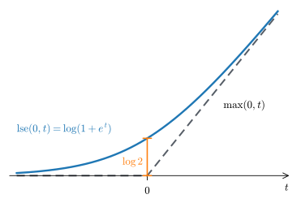
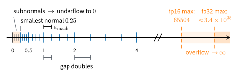
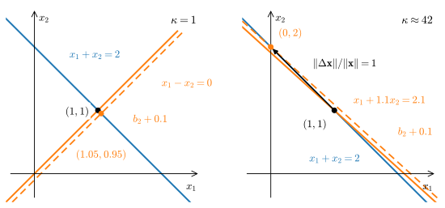

# Numerical Stability and Conditioning
:label:`sec_mdl-numerical-stability-conditioning`

The three logits $(1000, 1001, 1002)$ define an ordinary softmax, with
probabilities $(0.09, 0.24, 0.67)$. Evaluated as written, even in float64,
the formula returns `NaN` three times. Solve a $12\times12$ linear system with
`np.linalg.solve` and the answer is off by 30%, although the solver returned
the exact solution of a system that differs from the stated one in the
seventeenth digit. The first failure stops training with a `NaN` loss; the
second goes unnoticed.

The two failures have different causes. The softmax formula passes through
$e^{1000}$, which no floating-point format can hold, and an equivalent
formula that never forms it is accurate to a few units in the last place.
The linear system is so sensitive that rounding its entries in the
sixteenth digit moves its answer in the first, and no rewriting of the
solver can undo that.

This section shows what a computer stores and how much error each rounding
introduces. It then computes softmax and cross-entropy without passing
through values the format cannot hold, and the variance without subtracting
nearly equal numbers. A condition number for a function decides whether the
algorithm or the problem is to blame. The condition number of a
linear system sets how many digits a least-squares solve keeps and, as in
:numref:`sec_mdl-gradient-based-optimization`, how many steps gradient
descent needs. :numref:`sec_numerics` shows how training uses the
low-precision formats; here we derive why computations in them fail.

```{.python .input #numerical-stability-conditioning-imports}
#@tab mxnet
%matplotlib inline
from d2l import mxnet as d2l
from mxnet import np as mxnp, npx
npx.set_np()
import ml_dtypes
import numpy as np
```

```{.python .input #numerical-stability-conditioning-imports}
#@tab pytorch
%matplotlib inline
from d2l import torch as d2l
import torch
from torch.nn import functional as F
import numpy as np
```

```{.python .input #numerical-stability-conditioning-imports}
#@tab tensorflow
%matplotlib inline
from d2l import tensorflow as d2l
import tensorflow as tf
import ml_dtypes
import numpy as np
```

```{.python .input #numerical-stability-conditioning-imports}
#@tab jax
%matplotlib inline
from d2l import jax as d2l
import jax
from jax import numpy as jnp
import optax
import ml_dtypes
import numpy as np
```

## Floating-Point Arithmetic
:label:`subsec_mdl-floating-point`

### Representation and Spacing

What does a computer store when it stores $1.1$? The answer is easiest to see
in a toy format with only two bits after the binary point. Between $1$ and
$2$ it can hold $(1.00)_2=1$, $(1.01)_2=1.25$, $(1.10)_2=1.5$, and
$(1.11)_2=1.75$. Multiplying by powers of two gives the other intervals:
$2, 2.5, 3, 3.5$ between $2$ and $4$, and $0.5, 0.625, 0.75, 0.875$ between
$0.5$ and $1$. Each *octave*, an interval from $2^e$ to $2^{e+1}$, holds
four values, so the gap between neighbors doubles each time the magnitude
doubles.

A number that is not on the grid is rounded to the nearest one:
$1.1\mapsto1$, a relative error of $-0.091$; $1.3\mapsto1.25$, an error of
$-0.038$; $3.3\mapsto3.5$, an error of $+0.061$. The midpoint $1.125$ is a
tie, and ties go to the neighbor whose last bit is $0$, here $1$ (an error
of $-0.111$). No relative error exceeds $1/8$: rounding moves a number by
at most half a gap, and in every octave half a gap is $1/8$ of the octave's
smallest number. :numref:`fig_mdl-opt-fp-number-line` draws this format on
the real line.

![Floating-point numbers on the real line, drawn for a toy format with two mantissa bits (four values per octave, $\varepsilon_{\mathrm{mach}}=1/4$, smallest normal $0.25$). The absolute gap between neighbors doubles at every power of two while the relative gap stays near $\varepsilon_{\mathrm{mach}}$; below the smallest normal the subnormals continue with the same gap down to zero; after the axis break, each real format ends at its overflow threshold (fp16 at $65504$, fp32 at about $3.4\times10^{38}$).](../img/mdl-opt-fp-number-line.svg)
:label:`fig_mdl-opt-fp-number-line`

Real formats work the same way with more bits. A floating-point number is
scientific notation in base two with a fixed budget of $p$ binary digits
after the point,

$$
x = (-1)^s \cdot (1.b_1 b_2 \ldots b_p)_2 \cdot 2^{e},
$$
:eqlabel:`eq_mdl-opt-float-format`

with a sign bit $s$, *mantissa* bits $b_1,\ldots,b_p$, and an integer
exponent $e$ from a fixed range. The exponent sets the range of magnitudes,
and the mantissa sets the relative precision. In the octave
$[2^e, 2^{e+1})$ the values are spaced $2^{e-p}$ apart. The gap from $1$ to
the next number, $\varepsilon_{\mathrm{mach}}=2^{-p}$, is called *machine
epsilon*; the toy format has $p=2$ and $\varepsilon_{\mathrm{mach}}=1/4$.

Rounding to the nearest number moves $x$ by at most half a gap,
$2^{e-p-1}$, and $|x|\ge2^e$, so the relative error is at most $2^{-p-1}$.
A *normal* number is one of the form :eqref:`eq_mdl-opt-float-format` with
its exponent in range. For every real $x$ whose rounded value is normal,

$$
\mathrm{fl}(x) = x\,(1 + \delta), \qquad |\delta| \le u = \tfrac12\,\varepsilon_{\mathrm{mach}} = 2^{-p-1} .
$$
:eqlabel:`eq_mdl-opt-rounding-model`

Each rounding thus perturbs a number by at most one part in $2^{p+1}$: one
part in $8$ for the toy format, about one part in 17 million for fp32
($p=23$), and one part in $256$ for bfloat16 ($p=7$). The bound $u$ is
called the *unit roundoff*. IEEE arithmetic rounds the result of each basic
operation correctly, so the computed $x\oplus y$ equals $(x+y)(1+\delta)$
with $|\delta|\le u$, and the same holds for $-$, $\times$, and $/$
:cite:`IEEE.754.2019,Goldberg.1991`.

The model has three exceptions. Results too large to store overflow.
Results smaller than the smallest normal number underflow, passing through
the *subnormal* numbers that fill the gap to zero. Undefined results, such as $0/0$, become `NaN`. All three are absolute
effects rather than relative ones, and they are the subject of the third
subsection.

### Formats

Deep learning uses five formats below float64. The library reports each
one's $\varepsilon_{\mathrm{mach}}$, smallest normal number, and largest
finite number:

```{.python .input #numerical-stability-conditioning-finfo}
#@tab pytorch
print(f'{"dtype":>14} {"eps":>10} {"smallest normal":>16} {"max":>10}')
for dt in [torch.float16, torch.float32, torch.bfloat16,
           torch.float8_e4m3fn, torch.float8_e5m2]:
    fi = torch.finfo(dt)
    print(f'{str(dt).removeprefix("torch."):>14} {fi.eps:10.3e} '
          f'{fi.smallest_normal:16.3e} {fi.max:10.3e}')
```

```{.python .input #numerical-stability-conditioning-finfo}
#@tab mxnet, tensorflow, jax
print(f'{"dtype":>14} {"eps":>10} {"smallest normal":>16} {"max":>10}')
for dt in [np.float16, np.float32, ml_dtypes.bfloat16,
           ml_dtypes.float8_e4m3fn, ml_dtypes.float8_e5m2]:
    fi = ml_dtypes.finfo(dt)                   # values have dtype dt
    print(f'{np.dtype(dt).name:>14} {float(fi.eps):10.3e} '
          f'{float(fi.smallest_normal):16.3e} {float(fi.max):10.3e}')
```

**fp32** keeps $p=23$ bits, about seven decimal digits, and reaches
$3.4\times10^{38}$. **fp16** keeps $p=10$ bits but has a small exponent
range: it overflows above $65504$, and below $2^{-14}\approx6.1\times10^{-5}$
its numbers are subnormal. **bfloat16** makes the opposite choice. It keeps
fp32's eight exponent bits, and hence its range, and only $p=7$ mantissa
bits, $\varepsilon_{\mathrm{mach}}=2^{-7}\approx0.0078$, two to three
decimal digits. The value $2^{-8}$ that is often quoted for bfloat16 is its
unit roundoff $u=\varepsilon_{\mathrm{mach}}/2$. The two fp8 formats continue
the progression: E4M3 keeps three bits (about one decimal digit) and stops at
$448$, and E5M2 keeps two bits with fp16's range. With so little range,
fp8 is usable only with a scale factor per tensor or per block of values.

bfloat16 is the top half of a float32: the same sign bit, the same eight
exponent bits, and the first seven mantissa bits. Rounding a float32 to
bfloat16 therefore means rounding away its low 16 bits, which we can write
as integer arithmetic on the bit pattern. We add `0x7FFF`, plus one more
when the lowest kept bit is $1$, and then clear the low 16 bits. The
addition carries into the kept bits when the discarded part is above the
midpoint, or at the midpoint with an odd kept part, and only then. This is
round to nearest, ties to even, written as bit truncation; Exercise
:exref:`ex_mdl-numerical-stability-conditioning-stochastic-rounding` builds
stochastic rounding on it. The cell checks one input above a midpoint and
two ties:

```{.python .input #mdl-numerical-stability-conditioning-formats-1}
def to_bf16(x):
    """Round float32 to the nearest bfloat16, ties to even."""
    bits = np.atleast_1d(np.asarray(x, np.float32)).view(np.uint32)
    bits = (bits + 0x7FFF + ((bits >> 16) & 1)) & 0xFFFF0000
    return bits.astype(np.uint32).view(np.float32)

for x, expected in [(1 + 2**-8 + 2**-10, 1 + 2**-7),   # above the midpoint
                    (1 + 2**-8, 1.0),                  # tie, 1 is even
                    (1 + 3 * 2**-8, 1 + 2**-6)]:       # tie, 1 + 2^-6 is even
    print(f'{x:.8f} -> {to_bf16(x).item():.8f}   (expected {expected:.8f})')
```

The first input lies above the midpoint between $1$ and $1+2^{-7}$ and rounds
up. The second is that midpoint and rounds to the even neighbor $1$; the
third is the midpoint between $1+2^{-7}$ and $1+2^{-6}$ and rounds up to the
even neighbor. The next cell shows the same tie rule in float32, the growth
of the gap with the magnitude, and the largest logit each format can
exponentiate:

```{.python .input #numerical-stability-conditioning-spacing}
eps = np.finfo(np.float32).eps
one = np.float32(1.0)
print('1 + eps   != 1 :', one + eps != one)
print('1 + eps/2 == 1 :', one + np.float32(eps / 2) == one)
print('gap between float32 neighbors at 1    :', np.spacing(one))
print('gap between float32 neighbors at 2^20 :', np.spacing(np.float32(2.0**20)))
for dt in [np.float16, np.float32, np.float64]:
    print(f'{np.dtype(dt).name}: exp(x) overflows for x >',
          f'{np.log(np.finfo(dt).max):.2f}')
```

The value $1+\varepsilon_{\mathrm{mach}}/2$ is the midpoint between $1$ and
its upper neighbor and rounds to the even one, $1$, so the bound
$|\delta|\le u$ is attained. The gap at $2^{20}$ is $2^{20}$ times the gap at $1$, about a
million times. The last three lines locate the logits at which $e^x$
overflows: $11.09$ in fp16, $88.72$ in fp32, and $709.78$ in float64.

### Overflow, Underflow, and Small Updates

The exponential turns additive scale into multiplicative scale, so a modest
logit already overflows. In fp32, $e^x=\infty$ once
$x>\log(3.4\times10^{38})\approx88.72$, and in fp16 once
$x>\log 65504\approx11.09$, a value well inside the range of ordinary
unnormalized scores.

At the other end, $e^{-x}$ underflows. Below the smallest normal number the format continues through subnormal numbers, which
keep the last gap but have fewer and fewer significant bits, and then
reaches $0$. A later $\log$ of that $0$ returns $-\infty$, and the backward
pass returns `inf` or `NaN`. In fp16 the subnormals start below
$2^{-14}\approx6.1\times10^{-5}$, the smallest of them is
$2^{-24}\approx6\times10^{-8}$, and everything below
$2^{-25}\approx3\times10^{-8}$ rounds to zero.

Addition has a second absolute threshold. A training step replaces
a weight $w$ by $w-\eta g$. If the step $\eta g$ is small compared with the
gap next to $w$, the sum rounds back to $w$, and the step is lost.

**Proposition (small updates vanish).** *Let $w>0$ be a floating-point number
with $2^e\le w<2^{e+1}$ in a format with $p$ mantissa bits, and let
$\Delta$ be real. If $|\Delta|<2^{e-p-1}$, then $\mathrm{fl}(w+\Delta)=w$,
except when $w=2^e$ and $\Delta<0$; in that case the same holds for
$|\Delta|<2^{e-p-2}$.*

**Proof.** In $[2^e, 2^{e+1}]$ the representable numbers are $2^{e-p}$ apart,
so the neighbors of $w$ are $w\pm2^{e-p}$, except that below $w=2^e$ the
octave $[2^{e-1},2^e)$ begins and the gap halves to $2^{e-p-1}$. Rounding
to the nearest number returns $w$ whenever $w+\Delta$ is closer to $w$ than
to the neighbor on its side, that is, whenever $|\Delta|$ is less than half
of that gap. $\blacksquare$

For a weight update, $\Delta=-\eta g$, and for $2^e<w<2^{e+1}$ the
proposition says

$$
\mathrm{fl}(w-\eta g)=w \qquad \textrm{whenever } |\eta g|<2^{e-p-1}=u\,2^e .
$$
:eqlabel:`eq_mdl-opt-small-update`

An update smaller than about $u|w|$ is lost. The relative model
:eqref:`eq_mdl-opt-rounding-model` is accurate for products and quotients,
but for a sum of two numbers of very different size it hides this absolute
threshold.

In bfloat16 a weight equal to $1$ ignores any decrease below
$2^{-9}\approx0.002$, so a learning rate of $10^{-3}$ and a gradient of
order $1$ leave it unchanged. For a decrease from $1$ the threshold is
$2^{-12}\approx2.4\times10^{-4}$ in fp16 and
$2^{-25}\approx3\times10^{-8}$ in fp32. Mixed-precision training therefore
keeps a master copy of the weights in fp32. The cell below checks the
thresholds at $w=1$; the bfloat16 lines compute each step in fp32 and round the result
with `to_bf16`:

```{.python .input #mdl-numerical-stability-conditioning-overflow-underflow-and-small-updates}
one32, one16 = np.float32(1.0), np.float16(1.0)
print('bfloat16: 1 - 1e-3 ->', to_bf16(one32 - np.float32(1e-3)).item())
print('bfloat16: 1 - 2e-3 ->', to_bf16(one32 - np.float32(2e-3)).item())
print('fp16    : 1 - 1e-4 ->', one16 - np.float16(1e-4))
print('fp16    : 1 - 3e-4 ->', one16 - np.float16(3e-4))
print('fp32    : 1 - 1e-3 ->', one32 - np.float32(1e-3))
```

A step of $10^{-3}$ leaves the bfloat16 weight at $1$, while a step of
$2\times10^{-3}$, above the threshold $0.00195$, moves it to the neighbor
$1-2^{-8}=0.99609375$. fp16 loses $10^{-4}$ and keeps $3\times10^{-4}$,
which lands on its neighbor $1-2^{-11}\approx0.9995$; fp32 keeps the full
step.

Gradients meet the underflow threshold instead. fp16 gradients below
$6.1\times10^{-5}$ lose bits and those below $3\times10^{-8}$ become zero.
Multiplying the loss by a factor $S$ before the backward pass multiplies
every gradient by $S$ and moves them back into range; dividing by $S$ in
fp32 afterward undoes the scaling (:numref:`subsec_loss_scaling` shows the
practice, and Exercise :exref:`ex_mdl-numerical-stability-conditioning-loss-scale-window` finds the
admissible $S$).

*Stochastic rounding* :cite:`Gupta.Agrawal.Gopalakrishnan.ea.2015` removes
the lost-update threshold in a different way. It rounds up or down at random, with
probabilities chosen so that the expected stored value equals the exact
result, so updates too small for round-to-nearest still accumulate in
expectation (Exercise :exref:`ex_mdl-numerical-stability-conditioning-stochastic-rounding`).

## Stable Softmax and Cross-Entropy
:label:`subsec_mdl-stable-softmax`

Softmax, log-sum-exp, and cross-entropy all exponentiate logits, so all three
meet the overflow and underflow thresholds above. The running example of
this part is a classifier with two classes and logits $\mathbf z=(0,t)$,
whose label is the unlikely class $0$. Its probabilities are
$\mathrm{softmax}(\mathbf z)=\bigl(1/(1+e^t),\, e^t/(1+e^t)\bigr)$, its
log-sum-exp is $\log(1+e^t)$, and the cross-entropy of class $0$ is
$\log(1+e^t)\approx t$ for large $t$. None of these numbers is extreme: at
$t=100$ the probabilities are $3.7\times10^{-44}$ and $1$, and the loss is
$100$.

### The Max Shift

The softmax of logits $\mathbf z\in\mathbb R^n$ is

$$
\mathrm{softmax}(\mathbf{z})_i = \frac{e^{z_i}}{\sum_{j=1}^n e^{z_j}} .
$$

At $t=100$ the direct formula forms $e^{100}$, above fp32's threshold
$88.72$. The second entry becomes `inf/inf`, which is `NaN`, and the first
becomes $1/\infty=0$. The probabilities themselves are representable; only
the intermediate exponential is not. Multiplying numerator and denominator by
the positive constant $e^{-c}$ changes nothing, so softmax is
*shift-invariant*,

$$
\mathrm{softmax}(\mathbf{z} - c\mathbf{1}) = \mathrm{softmax}(\mathbf{z})
\qquad \textrm{for every } c \in \mathbb{R}.
$$
:eqlabel:`eq_mdl-opt-softmax-shift`

The same factoring under the logarithm rewrites the **log-sum-exp**
$\mathrm{lse}(\mathbf{z}) = \log \sum_j e^{z_j}$, the logarithm of the
softmax denominator:

$$
\mathrm{lse}(\mathbf{z}) = c + \log \sum_{j=1}^n e^{z_j - c} .
$$
:eqlabel:`eq_mdl-opt-stable-lse`

Both identities hold for every $c$, and the choice $c=\max_jz_j$ makes the
computation safe. Every exponent $z_j-c$ is then at most $0$, so no term
overflows, and the largest term equals $1$, so the sum lies in $[1,n]$ and
its logarithm cannot be $-\infty$. The cell compares the two softmax
implementations at $t=100$, and at $t=10$, where both are finite:

```{.python .input #numerical-stability-conditioning-stable-softmax}
def softmax_naive(z):
    e = np.exp(z)
    return e / e.sum()

def softmax_stable(z):
    e = np.exp(z - z.max())        # shift by the max: largest exponent is 0
    return e / e.sum()

z = np.array([0.0, 100.0], dtype=np.float32)
with np.errstate(over='ignore', invalid='ignore'):
    print('naive  softmax(0, 100):', softmax_naive(z))
print('stable softmax(0, 100):', softmax_stable(z))
z = np.array([0.0, 10.0], dtype=np.float32)
a, b = softmax_naive(z), softmax_stable(z)
print('softmax(0, 10), naive minus stable, in ulps:',
      (a - b) / np.spacing(b))
```

The shifted softmax returns $(3.8\times10^{-44}, 1)$, where the first entry
is a subnormal number; the direct formula returns $0$ and `NaN`. At $t=10$
the two agree to the last bit or differ by one or two units in the last
place (*ulps*): the shift identity holds for real numbers, and the two orders
of evaluation round differently. The shift does not handle non-finite
logits: a row of all $-\infty$ has $c=-\infty$, and $z_j-c$ is undefined.

### Bounds for Log-Sum-Exp

Log-sum-exp is the normalizer of every exponential-family model
(:numref:`sec_mdl-exponential-family`), and it is the cross-entropy loss up to
one subtraction. The shift :eqref:`eq_mdl-opt-stable-lse` also says how far it
is from the largest logit:

**Proposition (log-sum-exp sandwich).** *For every
$\mathbf{z} \in \mathbb{R}^n$,*

$$
\max_j z_j \;\le\; \mathrm{lse}(\mathbf{z}) \;\le\; \max_j z_j + \log n .
$$

**Proof.** Put $c = \max_j z_j$ in :eqref:`eq_mdl-opt-stable-lse`. Every
term $e^{z_j - c} \le 1$ and the maximizing term equals $1$, so the sum lies
in $[1, n]$ and its logarithm in $[0, \log n]$. Adding $c$ gives both
inequalities. $\blacksquare$

Log-sum-exp is therefore a *soft maximum*: it never falls below the largest
logit and exceeds it by at most $\log n$. On the running example,
$\mathrm{lse}(0,t)=\log(1+e^t)$ stays within $\log2\approx0.69$ of
$\max(0,t)$, with the full gap at $t=0$, where the two logits tie
(:numref:`fig_mdl-opt-softplus-max`).


:label:`fig_mdl-opt-softplus-max`

Its gradient is the softmax,
$\partial\,\mathrm{lse}(\mathbf z)/\partial z_i=e^{z_i}/\sum_je^{z_j}=\mathrm{softmax}(\mathbf z)_i$,
which is why the gradient of the cross-entropy below, for label $y$, is
$\mathrm{softmax}(\mathbf z)-\mathbf e_y$; :numref:`sec_mdl-convexity` proves
that log-sum-exp is convex.

Subtracting the shifted log-sum-exp from the shifted logit gives the **log-softmax**, the logarithm of a probability
computed without forming the probability:

$$
\log \mathrm{softmax}(\mathbf{z})_i = (z_i - c) - \log \sum_{j=1}^n e^{z_j - c},
\qquad c=\max_j z_j .
$$
:eqlabel:`eq_mdl-opt-log-softmax`

A tiny probability then never underflows to zero before its logarithm is
taken. The equivalent form $z_i-\mathrm{lse}(\mathbf z)$ is worse in
floating point: it stores the large number $\mathrm{lse}=c+\log\sum_j
e^{z_j-c}$ and then subtracts it from the large number $z_i$. The cell uses
the opening's logits $(1000,1001,1002)$ in float32 and computes both forms:

```{.python .input #numerical-stability-conditioning-logsumexp}
z = np.array([1000.0, 1001.0, 1002.0], dtype=np.float32)
c = z.max()
s = np.log(np.exp(z - c).sum())           # log sum exp(z - c), in [0, log 3]
with np.errstate(over='ignore'):
    print('naive log(sum(exp(z))):', np.log(np.exp(z).sum()))
lse = c + s
print('lse = c + s           :', lse, '  float32 gap at 1002:', np.spacing(c))
log_p_sub = z - lse                       # forms lse, then subtracts it
log_p = (z - c) - s                       # never forms c + s
print(f'sum of exp(z - lse)    : {np.exp(log_p_sub).sum():.8f}')
print(f'sum of exp((z - c) - s): {np.exp(log_p).sum():.8f}')
```

The direct computation overflows to `inf`, and it would in float64 too,
because $1000>709.78$. The stable value
$\mathrm{lse}=1002.4076$ lies in the sandwich $[1002, 1002+\log3]$. The two
log-softmax forms differ: the probabilities from $z_i-\mathrm{lse}$ sum to
$1.0000132$, those from :eqref:`eq_mdl-opt-log-softmax` to $1.0000000$.

The subtraction $z_i-\mathrm{lse}$ is exact, because two floating-point
numbers within a factor of two of each other have an exactly
representable difference (Sterbenz's lemma, Exercise
:exref:`ex_mdl-numerical-stability-conditioning-exact-subtraction`). The error is in
$\mathrm{lse}$ itself. Near $1002$, float32 numbers are
$2^{-14}\approx6.1\times10^{-5}$ apart, and the true value
$1002.4076060$ is stored $1.32\times10^{-5}$ too low. Every log-probability
is then $1.32\times10^{-5}$ too high, every probability is too large by the
factor $e^{1.32\times10^{-5}}$, and the sum exceeds $1$ by
$1.32\times10^{-5}$. An absolute error in an exponent becomes a relative
error of the same size in its exponential, and the subtraction exposed an
error that was already in its input, the theme of the next part.

### Cross-Entropy from Logits

The cross-entropy loss of label $y$ is the negative log-softmax, so
:eqref:`eq_mdl-opt-log-softmax` gives it directly from the logits,

$$
-\log \mathrm{softmax}(\mathbf{z})_y = \mathrm{lse}(\mathbf{z}) - z_y .
$$
:eqlabel:`eq_mdl-opt-ce-from-logits`

The loss needs one stable log-sum-exp and one subtraction, and no
probability. On the running example, the loss of class $0$ is
$\mathrm{lse}(0,t)-0=\log(1+e^t)$. If the probabilities are formed first,
the true-class probability $e^{-t}/(1+e^{-t})\approx e^{-t}$ leaves float32's
normal range once $t>87.3$ and reaches zero near $t=104$, and its negative
logarithm becomes infinite. The cell computes the loss both ways with the
library's functions for $t\in\{20,60,103,104\}$; the tab note says what the
probability route returns in this library:

```{.python .input #numerical-stability-conditioning-cross-entropy}
#@tab mxnet
print('gap    CE from logits    CE via probabilities')
for t in [20.0, 60.0, 103.0, 104.0]:
    logits = mxnp.array([[0.0, t]])        # the label is class 0, the unlikely one
    from_logits = -npx.log_softmax(logits, axis=1)[0, 0]
    from_probs = -mxnp.log(npx.softmax(logits, axis=1))[0, 0]
    print(f'{t:5.0f}  {float(from_logits):15.4f}  {float(from_probs):15.4f}')
```

```{.python .input #numerical-stability-conditioning-cross-entropy}
#@tab pytorch
print('gap    CE from logits    CE via probabilities')
for t in [20.0, 60.0, 103.0, 104.0]:
    logits = torch.tensor([[0.0, t]])
    y = torch.tensor([0])                        # label = the unlikely class
    from_logits = F.cross_entropy(logits, y)
    probs = F.softmax(logits, dim=1)             # stable softmax, then...
    from_probs = -torch.log(probs[0, y])         # ...take the log yourself
    print(f'{t:5.0f}  {from_logits.item():15.4f}  {from_probs.item():15.4f}')
```

```{.python .input #numerical-stability-conditioning-cross-entropy}
#@tab tensorflow
print('gap  CE from logits  CE via probabilities  Keras from_logits=False')
for t in [20.0, 60.0, 103.0, 104.0]:
    logits = tf.constant([[0.0, t]])
    y = tf.constant([0])                         # label = the unlikely class
    from_logits = tf.keras.losses.sparse_categorical_crossentropy(
        y, logits, from_logits=True)[0]
    probs = tf.nn.softmax(logits)                # stable softmax, then...
    from_probs = -tf.math.log(probs[0, 0])       # ...take the log yourself
    keras = tf.keras.losses.sparse_categorical_crossentropy(
        y, probs, from_logits=False)[0]          # Keras on probabilities
    print(f'{t:3.0f}  {float(from_logits):14.4f}  {float(from_probs):20.4f}'
          f'  {float(keras):23.4f}')
```

```{.python .input #numerical-stability-conditioning-cross-entropy}
#@tab jax
print('gap    CE from logits    CE via probabilities')
for t in [20.0, 60.0, 103.0, 104.0]:
    logits = jnp.array([[0.0, t]])
    y = jnp.array([0])                           # label = the unlikely class
    from_logits = optax.softmax_cross_entropy_with_integer_labels(logits, y)
    from_probs = -jnp.log(jax.nn.softmax(logits)[0, 0])
    print(f'{t:5.0f}  {float(from_logits[0]):15.4f}  {float(from_probs):15.4f}')
```

:begin_tab:`mxnet`
The from-logits column reads $20$, $60$, $103$, $104$ at every gap. The
probability column agrees at gaps $20$ and $60$. At gap $103$ the
probability $e^{-103}$ is a subnormal number, and MXNet's exponential
returns $0$ instead of a subnormal result, so the probability is $0$ and the
loss is `inf` at gaps $103$ and $104$.
:end_tab:

:begin_tab:`pytorch`
The from-logits column reads $20$, $60$, $103$, $104$ at every gap. The
probability column agrees at gaps $20$ and $60$. At gap $103$ the probability
$e^{-103}\approx1.32\times2^{-149}$ rounds to the smallest float32 subnormal,
$2^{-149}$: one significant bit survives, and the loss reads
$149\log2=103.2789$, wrong in the first decimal place and with no warning.
At gap $104$, $e^{-104}<2^{-150}$ rounds to $0$, and the loss is `inf`.
:end_tab:

:begin_tab:`tensorflow`
The from-logits column reads $20$, $60$, $103$, $104$ at every gap. The
probability column agrees at gaps $20$ and $60$; at gap $103$ the
probability $e^{-103}$ is a subnormal number, which TensorFlow's softmax
flushes to zero, so the loss is `inf` at gaps $103$ and $104$. The last
column shows that Keras hides the same failure instead of reporting it:
with `from_logits=False` it clips probabilities to $[10^{-7},1-10^{-7}]$
before taking the logarithm and returns $16.1181=-\log10^{-7}$ at every gap
above about $16$, a loss, and therefore a gradient, that no longer depends on
the model.
:end_tab:

:begin_tab:`jax`
The from-logits column reads $20$, $60$, $103$, $104$ at every gap. The
probability column agrees at gaps $20$ and $60$. At gap $103$ the
probability $e^{-103}$ is a subnormal number, and XLA runs compiled
operations with subnormal results flushed to zero, so the probability is $0$
and the loss is `inf` at gaps $103$ and $104$.
:end_tab:

Losses, likelihoods, and posteriors should therefore stay in log space until
a probability is needed. The fused loss of
:numref:`subsec_softmax-implementation-revisited` computes
:eqref:`eq_mdl-opt-ce-from-logits`, and
:numref:`sec_mdl-information_theory` explains what the cross-entropy
measures. :numref:`sec_mdl-naive_bayes` uses the same log-space principle
to combine hundreds of per-pixel probabilities: it adds log probabilities
instead of multiplying probabilities.

## Catastrophic Cancellation
:label:`subsec_mdl-catastrophic-cancellation`

### The Condition Number of a Function
:label:`subsec_mdl-relative-condition-number`

In float32, $\log(1+x)$ at $x=10^{-8}$ evaluates to $0$, a relative error of
100%, while the library function `log1p` returns $10^{-8}$. Is
$\log(1+x)$ near $x=0$ a hard function to compute, or is the formula to blame?
We need a number that says how much a function amplifies an error in its
input, independently of how the function is computed.

The **relative condition number** of a differentiable function $f$ at a
point $x$ with $f(x)\ne0$ is the factor by which a small relative change in
$x$ becomes a relative change in $f(x)$. A relative change $\delta$ of the
input gives, to first order,
$f(x(1+\delta))\approx f(x)+xf'(x)\,\delta$; dividing by $f(x)$ gives the
factor

$$
\kappa_f(x)=\left|\frac{x\,f'(x)}{f(x)}\right| .
$$
:eqlabel:`eq_mdl-opt-kappa-f`

The exponential has $\kappa_f=|x|$: at $x=88$ it turns an input error of one
unit roundoff into $88$ of them in the output. This is the mechanism seen in
the log-softmax cell, where an absolute error in an exponent became the same
relative error in a probability. The condition number is a first-order
statement about the exact function. It says nothing about how $f$ is
computed, and it fails where $f(x)=0$, where no relative error is defined.

Subtraction has two inputs, and the same reasoning applies to both. Let
$\hat a=a(1+\delta_a)$ and $\hat b=b(1+\delta_b)$ carry relative errors
$|\delta_a|,|\delta_b|\le u$, and let the subtraction itself be exact. Then
$\hat a-\hat b=(a-b)+(a\delta_a-b\delta_b)$, and the triangle inequality
bounds the relative error of the difference:

$$
\frac{|(\hat a-\hat b)-(a-b)|}{|a-b|}
=\frac{|a\delta_a-b\delta_b|}{|a-b|}
\le \frac{|a| + |b|}{|a - b|}\; u .
$$
:eqlabel:`eq_mdl-opt-cancellation-factor`

The factor $(|a|+|b|)/|a-b|$ is subtraction's condition number, and it is
large when $a\approx b$. Subtracting nearly equal numbers that already carry
errors is called **catastrophic cancellation**: the leading digits cancel,
and the errors in the trailing digits become the leading digits of the
result. The condition numbers of a few problems met in this section are:

| problem | $\kappa_f$ | regime |
|---|---|---|
| $a-b$ | $(\lvert a\rvert+\lvert b\rvert)/\lvert a-b\rvert$ | large when $a\approx b$ |
| $\log(1+x)$ | $x/((1+x)\log(1+x))$ | $1.000$ at $x=10^{-8}$, $0.82$ at $x=0.5$ |
| $e^x$ | $\lvert x\rvert$ | large for large $\lvert x\rvert$ |
| $1-\cos x$ | $x\sin x/(1-\cos x)$ | tends to $2$ as $x\to0$ |
| $\sqrt x$ | $1/2$ | always |
| variance of data with mean $m$, spread $s$ | at most $2(1+\lvert m\rvert/s)$ | derived below |

The second row answers the opening question: $\log(1+x)$ near $x=0$ is a
well-conditioned problem. The algorithm `log(1 + x)` is not, because it
passes through an ill-conditioned step. It first forms $y=1+x$ and then
evaluates $\log y$ at $y\approx1$, where the logarithm has
$\kappa_{\log}(y)=1/|\log y|\approx1/x=10^8$. Rounding $1+x$ introduces a
relative error of $u$ in $y$, which becomes a relative error of up to $10^8u$, more
than 100%, in the result. `log1p` evaluates a series in $x$ and never forms
$1+x$.

This is the principle on which this section is built: *an unstable
algorithm routes a well-conditioned problem through an ill-conditioned
intermediate step.* When $\kappa_f$ is small and the computed result is bad,
change the algorithm. When $\kappa_f$ itself is large, no algorithm helps and
only changing the problem does, the subject of the last part.

### Subtraction of Nearly Equal Numbers

The cell repeats the $\log(1+x)$ experiment and then subtracts two float32
numbers that agree in their first seven digits, $1.0002344$ and $1.0002341$,
whose true difference is $3.0\times10^{-7}$:

```{.python .input #numerical-stability-conditioning-log1p}
x = np.float32(1e-8)
print('float32 rounds 1 + x to:', np.float32(1.0) + x)
print('log(1 + x) =', np.log(np.float32(1.0) + x), '   log1p(x) =', np.log1p(x))
a, b = np.float32(1.0002344), np.float32(1.0002341)
print(f'stored a = {float(a):.10f}, b = {float(b):.10f}')
print('a - b =', a - b, '=', (a - b) / np.spacing(np.float32(1.0)), 'ulps of 1')
print('float64: log(1 + 1e-20) =', np.log(1 + 1e-20),
      '  log1p(1e-20) =', np.log1p(1e-20))
```

Between $1$ and $2$, float32 differences can only be whole multiples of
$\varepsilon_{\mathrm{mach}}=1.19\times10^{-7}$, and the true difference
$3.0\times10^{-7}$ is not one. The subtraction returned two ulps,
$2.38\times10^{-7}$, 20% too small, and it made no error of its own: the
inputs were stored as $1.0002343655$ and $1.0002341270$, and their
difference is what the cell printed. The error was in the stored inputs. The
factor :eqref:`eq_mdl-opt-cancellation-factor` is
$2.0005/(3\times10^{-7})\approx7\times10^6$, which times
$u\approx6\times10^{-8}$ allows a relative error of up to $0.4$; the observed
$0.2$ is inside the bound.

Cancellation is common in $\log(1+x)$ and $e^x-1$ near $0$ (use `log1p`
and `expm1`), in $1-\cos x$ near $0$ (use $2\sin^2(x/2)$), in the quadratic
formula near a double root (Exercise
:exref:`ex_mdl-numerical-stability-conditioning-blame`), and in finite
differences, which trade one error against another. The forward difference
$(f(x+h)-f(x))/h$ has truncation error about $\tfrac h2|f''(x)|$, from
Taylor's theorem. Each of the two function values carries a rounding error of
about $u|f(x)|$, and the division by $h$ turns them into an error of about
$2u|f(x)|/h$. The sum of the two errors is smallest where they are equal, at

$$
h^\star=2\sqrt{\frac{u\,|f(x)|}{|f''(x)|}},
\qquad \textrm{with error about } 2\sqrt{u\,|f(x)f''(x)|} .
$$

The best forward difference keeps about half of the format's digits. For
$f=\sin$ at $x=1$ in float64, $h^\star\approx2\times10^{-8}$, with predicted
error $1.8\times10^{-8}$. The measured error is $3\times10^{-9}$ at
$h=10^{-8}$, but $4\times10^{-5}$ at $h=10^{-12}$ (too much cancellation) and
$4\times10^{-3}$ at $h=10^{-2}$ (too much truncation).

Higher precision does not remove a cancellation; it moves the input at which
the failure starts. The last line of the cell shows $\log(1+x)$ returning $0$
in float64 at $x=10^{-20}$, just as float32 did at $10^{-8}$, while `log1p`
is accurate in both. Reformulation removes the ill-conditioned step itself
:cite:`Higham.2002`.

### One-Pass Variance

The variance of data $x_1,\ldots,x_N$ with mean $m$ and standard deviation
$s$ can be computed in one pass from the identity

$$
\frac1N\sum_{i=1}^N(x_i-m)^2 = \frac1N\sum_{i=1}^N x_i^2 - m^2 ,
$$

which needs only the running sums of $x_i$ and $x_i^2$. The identity is exact
in real arithmetic and unstable in floating point. When $s\ll|m|$, both terms
on the right are close to $m^2$ while their difference is $s^2$, so the
cancellation factor :eqref:`eq_mdl-opt-cancellation-factor` is about
$2m^2/s^2$. With $m=10^9$ and $s=1$ that is $2\times10^{18}$, more than the
$10^{16}$ that float64 can absorb.

How much of this does the problem itself force? Perturb each $x_i$ by a
relative error $\delta_i$ with $|\delta_i|\le u$, so that
$x_i\mapsto x_i+x_i\delta_i$. The derivative of the variance with respect to
$x_i$ is $\tfrac2N(x_i-m)$, because the change of $m$ multiplies
$\sum_i(x_i-m)=0$. To first order the variance therefore changes by

$$
\frac2N\sum_{i=1}^N(x_i-m)\,x_i\delta_i
=\frac2N\sum_{i=1}^N(x_i-m)^2\delta_i+\frac{2m}N\sum_{i=1}^N(x_i-m)\,\delta_i ,
$$

where we wrote $x_i=(x_i-m)+m$. The first sum is at most $2s^2u$ in
magnitude. The second is at most $2|m|u\cdot\frac1N\sum_i|x_i-m|\le2|m|s\,u$,
by the Cauchy–Schwarz inequality. Relative to $s^2$, the condition number of
the variance is at most $2(1+|m|/s)\approx2|m|/s$, about $2\times10^9$ here
(perturbing every $x_i$ by $\delta_i=u\,\mathrm{sign}(x_i-m)$ gives
$1.6\,|m|/s$ for Gaussian data). The problem allows an error of about
$2\times10^9u\approx2\times10^{-7}$, seven digits. The one-pass formula
behaves like $(m/s)^2u$: it *squares* the condition number, as the normal
equations will square the condition number of a matrix in the last part.

A better one-pass algorithm keeps the deviations at the scale $s$.
:citet:`Welford.1962` updates a running mean $m_k$ and the running sum of
*centered* squares $M_k = \sum_{i \le k} (x_i - m_k)^2$ with the deviation
$d_k=x_k-m_{k-1}$ of each new value from the old mean:

$$
m_k = m_{k-1} + \frac{d_k}{k},
\qquad
M_k = M_{k-1} + d_k\,(x_k - m_k).
$$
:eqlabel:`eq_mdl-opt-welford`

The update of $M_k$ multiplies two different deviations, from the old mean
and from the new mean. That asymmetry makes the recursion exact:

**Proposition (Welford's recursion is exact).** *With $m_0 = M_0 = 0$, the
recursions :eqref:`eq_mdl-opt-welford` satisfy, for every $k \ge 1$ and in
exact arithmetic,*

$$
m_k = \frac{1}{k} \sum_{i=1}^k x_i,
\qquad
M_k = \sum_{i=1}^k (x_i - m_k)^2 .
$$

**Proof.** The mean claim is the identity $k\, m_k = (k-1)\, m_{k-1} + x_k$,
immediate from the first recursion. For the second claim, induct on $k$.
Since $m_k - m_{k-1} = d_k/k$ and $x_k - m_k = d_k\,(k-1)/k$, splitting the
new sum of squares at its last term and centering the first $k-1$ terms at
$m_{k-1}$ gives

$$
\sum_{i=1}^{k} (x_i - m_k)^2
= \sum_{i=1}^{k-1} \left( (x_i - m_{k-1}) - \tfrac{d_k}{k} \right)^2 + (x_k - m_k)^2
= M_{k-1} + (k-1)\tfrac{d_k^2}{k^2} + \tfrac{(k-1)^2}{k^2}d_k^2 .
$$

The cross term vanished because $\sum_{i \le k-1} (x_i - m_{k-1}) = 0$, and
the inductive hypothesis named the first sum $M_{k-1}$. The two correction
terms combine to $\frac{k-1}{k}\,d_k^2 = d_k \cdot d_k\frac{k-1}{k}
= d_k(x_k - m_k)$, which is what the recursion adds. $\blacksquare$

Welford's recursion does subtract large numbers: $x_k$ and $m_{k-1}$ are both
near $10^9$. The subtraction itself is exact (Sterbenz's lemma, Exercise
:exref:`ex_mdl-numerical-stability-conditioning-exact-subtraction`), and $x_k$
is exact data, so the only error in $d_k$ is that of the running mean. That
error is absolute, a few dozen gaps at $|m|$ in a run of $10^5$ steps, and it
changes slowly, so it acts like a slightly wrong center. A wrong center
$m+\varepsilon$ changes a centered sum of squares only at second order,
$\sum_i(x_i-m-\varepsilon)^2=\sum_i(x_i-m)^2+N\varepsilon^2$, because the
first-order term multiplies $\sum_i(x_i-m)=0$. The squared terms thus stay at
the scale $s^2$, and the relative error stays within what the problem's own
amplification $|m|/s$ allows, $u|m|/s\approx1.1\times10^{-7}$, instead of
$(m/s)^2u$.

The cell runs the three methods on $10^5$ float64 samples with mean $10^9$
and variance $1$:

```{.python .input #numerical-stability-conditioning-welford}
rng = np.random.default_rng()
x = 1e9 + rng.normal(0.0, 1.0, size=100_000)    # mean 1e9, variance 1

naive = (x**2).mean() - x.mean()**2             # one pass, cancels
two_pass = ((x - x.mean())**2).mean()           # subtract the mean first

m, M = 0.0, 0.0                                 # Welford: one pass
for k, xk in enumerate(x, start=1):
    d = xk - m
    m += d / k                                  # m_k
    M += d * (xk - m)                           # M_k
welford = M / len(x)

print(f'naive E[x^2] - E[x]^2 : {naive:12.6f}   (= {naive / 128:.0f} x 128)')
print(f'Welford, one pass     : {welford:12.6f}')
print(f'two-pass reference    : {two_pass:12.6f}')
print(f'Welford vs two-pass   : {abs(welford - two_pass) / two_pass:.1e} relative')
print('float64 gap near 1e18 :', np.spacing(1e18))
```

The naive result is a whole multiple of $128$: typically $0$, $\pm128$, or
$\pm256$, never near the true value $1$, and sometimes negative. Both terms
of the formula lie in $[2^{59},2^{60})$, where float64 numbers are
$2^{59-52}=128$ apart, so their difference can only be a multiple of $128$.
The predicted size of the error, $(m/s)^2u\approx100$, matches. Welford's
estimate agrees with the two-pass reference to seven or more digits, as the
amplification $|m|/s$ predicts, and often to eight or nine, because the
rounding errors of the updates have both signs and partly cancel in the sum.

GPU batch-normalization kernels commonly compute the mean and variance of
each batch this way; the running moments used at test time are exponential
moving averages (:numref:`sec_batch_norm`).

### Summation Order

The naive variance and the two-pass reference both add up $10^5$ terms, and
the order of the additions changes their rounding errors. Each addition
contributes one factor $(1+\delta_k)$, and in a left-to-right sum the first
term passes through all $n-1$ of them. To first order in $u$, the sum
$\mathrm{fl}\bigl(\sum_ix_i\bigr)$ computed left to right satisfies

$$
\Bigl|\mathrm{fl}\Bigl(\sum_{i=1}^n x_i\Bigr)-\sum_{i=1}^n x_i\Bigr|
\le(n-1)\,u\sum_{i=1}^n|x_i| .
$$

The bound grows with the number of terms, because early terms collect the
rounding errors of every later addition. *Pairwise* summation adds the two
halves of the list recursively, so each term passes through only
$\log_2n$ additions and the bound becomes $u\log_2n\sum_i|x_i|$; NumPy's
`sum` uses a blocked version of it. Kahan's compensated summation carries the
rounding error of each addition in a second variable and achieves an error
bound independent of $n$ (Exercise
:exref:`ex_mdl-numerical-stability-conditioning-summation-error-growth`). The
cell adds $10^7$ copies of float32's $0.1$, which is $0.100000001490$, in order and pairwise:

```{.python .input #mdl-numerical-stability-conditioning-summation-order}
x = np.full(10_000_000, 0.1, dtype=np.float32)
exact = len(x) * float(x[0])                  # x[0] = 0.100000001490...
print(f'in order (cumsum): {np.cumsum(x)[-1]:16.4f}')
print(f'pairwise (np.sum): {np.sum(x):16.4f}')
print(f'exact            : {exact:16.4f}')
```

The in-order sum ends at $1{,}087{,}937$, 9% too high, inside its bound
$(n-1)u\sum_i|x_i|\approx6\times10^5$. Pairwise summation returns
$1{,}000{,}000.125$, within $0.11$ of the exact value and inside its bound
$u\log_2n\sum_i|x_i|\approx1.4$.

The in-order error has the mechanism behind lost small updates: each
addend is rounded to the gap of the running sum. Once the sum passes
$2^{19}=524{,}288$, float32 numbers are $1/16$ apart, and $0.1$ is $1.6$
gaps, so each addition rounds to two gaps, $0.125$, 25% too much (between
$2^{17}$ and $2^{19}$ it rounded to $0.09375$, too little). Welford's
recursion can be evaluated pairwise as well: the merge rule of Exercise
:exref:`ex_mdl-numerical-stability-conditioning-pairwise-merge` combines the
statistics of two partial sums, and it is how running moments are combined
across devices.

## Conditioning
:label:`subsec_mdl-conditioning-revisited`

### Two Nearly Parallel Lines
:label:`subsec_mdl-two-lines`

The variance and the cancellation examples had a scalar answer. For a linear
system the answer is a vector, and the smallest case is two equations,

$$
x_1+x_2=2, \qquad x_1+1.0001\,x_2=2.0001 ,
$$

the system $\mathbf K\mathbf x=\mathbf b$ of :numref:`subsec_mdl-condition-number`.
Subtracting the first equation from the second gives $10^{-4}x_2=10^{-4}$, so
$\mathbf x=(1,1)$. Change the second right-hand side to $2.0002$ and the same
subtraction gives $10^{-4}x_2=2\times10^{-4}$, so $\mathbf x=(0,2)$. A
relative change of $10^{-4}/\|\mathbf b\|=3.5\times10^{-5}$ in the data moved
the solution by $\|(-1,1)\|/\|(1,1)\|=100\%$, an amplification of
$2.8\times10^4$.

Each equation is a line in the plane, and the solution is where the lines
cross. These two lines have slopes $-1$ and $-0.9999$ and meet at an angle of $0.003^\circ$, so shifting one of them slightly slides
the crossing far along the other (:numref:`fig_mdl-opt-two-lines`).

![A linear system is sensitive when its lines are nearly parallel. (a) Two perpendicular lines meet at $(1,1)$; shifting the second by $0.1$ moves the crossing by 5%: amplification $1$, $\kappa=1$. (b) The lines $x_1+x_2=2$ and $x_1+1.1x_2=2.1$ also meet at $(1,1)$, but the same shift moves the crossing to $(0,2)$, a 100% change from a 3.4% change in $\mathbf{b}$: amplification $29$, bounded by $\kappa\approx42$. The text's system, with $1.0001$ in place of $1.1$, has the same geometry at an angle of $0.003^\circ$ and $\kappa\approx4\times10^4$.](../img/mdl-opt-two-lines.svg)
:label:`fig_mdl-opt-two-lines`

Suppose a solver returned $\hat{\mathbf x}=(0,2)$ for the original system.
Its **forward error**, the distance to the true solution, is 100%. Yet
$(0,2)$ is the exact solution of a nearby problem: the one with $b_2$ changed
by $10^{-4}$, a relative change of $3.5\times10^{-5}$. The smallest such
change of the data is the **backward error**. A solver with a tiny backward
error has solved a nearby problem exactly, and it can still be far from the
answer.

The amplification from backward to forward error is a property of the
problem. The condition number of :numref:`subsec_mdl-condition-number`
measures it: for a matrix with singular values $\sigma_1\ge\cdots\ge\sigma_d>0$,
$\kappa(\mathbf A)=\sigma_1/\sigma_d$, the ratio of the largest to the
smallest stretch. Here the singular values are $2.00005$ and
$5\times10^{-5}$, so $\kappa(\mathbf K)=4\times10^4$. The observed
amplification $2.8\times10^4$ stays below it because the shift $(0,10^{-4})$
is not along the most amplified direction (Exercise
:exref:`ex_mdl-numerical-stability-conditioning-residual-certificate`).

### Backward and Forward Error

For a linear system $\mathbf A\mathbf x=\mathbf b$ and a computed solution
$\hat{\mathbf x}$, the forward error is
$\|\hat{\mathbf x}-\mathbf x\|/\|\mathbf x\|$ and the backward error is the
size of the smallest change of the data that makes $\hat{\mathbf x}$ exact.
An algorithm is **backward stable** if its backward error is of the order of
$u$, so that it returns the exact answer of a problem that differs from the
given one by about one rounding of the data. The SVD and the QR decomposition
are backward stable, and so in practice is the LU decomposition with pivoting
that `np.linalg.solve` uses. The one-pass variance is not: the variance of
any data set is nonnegative, so a negative output is the exact variance of no
data at all (Exercise
:exref:`ex_mdl-numerical-stability-conditioning-construct-small-dataset-three`).

The definition asks for a minimization over all changes of the data, but for
changes of the matrix it has a closed form, computable from the residual.

**Proposition (backward error from the residual).** *Let
$\hat{\mathbf x}\ne\mathbf 0$ and $\mathbf r=\mathbf b-\mathbf A\hat{\mathbf x}$.
The smallest $\|\Delta\mathbf A\|_2$ with
$(\mathbf A+\Delta\mathbf A)\hat{\mathbf x}=\mathbf b$ is
$\|\mathbf r\|/\|\hat{\mathbf x}\|$, attained by
$\Delta\mathbf A=\mathbf r\hat{\mathbf x}^\top/\|\hat{\mathbf x}\|^2$.*

**Proof.** Any such $\Delta\mathbf A$ satisfies
$\Delta\mathbf A\hat{\mathbf x}=\mathbf b-\mathbf A\hat{\mathbf x}=\mathbf r$,
so $\|\mathbf r\|\le\|\Delta\mathbf A\|\,\|\hat{\mathbf x}\|$. The rank-one
matrix $\mathbf r\hat{\mathbf x}^\top/\|\hat{\mathbf x}\|^2$ maps
$\hat{\mathbf x}$ to $\mathbf r$, and its norm is
$\|\mathbf r\|\,\|\hat{\mathbf x}\|/\|\hat{\mathbf x}\|^2=\|\mathbf r\|/\|\hat{\mathbf x}\|$.
$\blacksquare$

Relative to the size of $\mathbf A$, the backward error is

$$
\omega=\frac{\|\mathbf b-\mathbf A\hat{\mathbf x}\|}{\|\mathbf A\|\,\|\hat{\mathbf x}\|} .
$$
:eqlabel:`eq_mdl-opt-residual-backward-error`

A small residual thus certifies a small backward error, whatever the
condition of the problem. For $\hat{\mathbf x}=(0,2)$ in the two-line system,
$\mathbf r=(0,-10^{-4})$ and $\omega=10^{-4}/(2.00005\cdot2)=2.5\times10^{-5}$.
The version that perturbs $\mathbf b$ as well is due to Rigal and Gaches
(see :citet:`Higham.2002`). In floating point the residual is itself computed
with rounding errors, so printed values of $\omega$ below about $u$ are
noise.

The condition number converts backward error into forward error. Its proof
uses the two norms $\|\mathbf A\|=\sigma_1$ and
$\|\mathbf A^{-1}\|=1/\sigma_d$: the largest stretch of $\mathbf A$, and the
largest stretch of its inverse, which undoes the smallest stretch of
$\mathbf A$ (:numref:`sec_mdl-svd-low-rank`).

**Proposition (forward error $\le$ condition number $\times$ backward
error).** *Let $\mathbf{A}$ be invertible, let
$\mathbf{A}\mathbf{x} = \mathbf{b}$, and suppose the computed
$\hat{\mathbf{x}}$ exactly solves a nearby system,
$(\mathbf{A} + \Delta\mathbf{A})\,\hat{\mathbf{x}} = \mathbf{b}$ with
$\|\Delta\mathbf{A}\| \le \omega \|\mathbf{A}\|$. Then*

$$
\frac{\|\hat{\mathbf{x}} - \mathbf{x}\|}{\|\hat{\mathbf{x}}\|}
\;\le\; \kappa(\mathbf{A})\, \omega .
$$
:eqlabel:`eq_mdl-opt-backward-forward`

**Proof.** Subtracting $\mathbf{A}\mathbf{x} = \mathbf{b}$ from
$(\mathbf{A} + \Delta\mathbf{A})\hat{\mathbf{x}} = \mathbf{b}$ gives
$\mathbf{A}(\hat{\mathbf{x}} - \mathbf{x}) = -\Delta\mathbf{A}\,\hat{\mathbf{x}}$,
hence $\hat{\mathbf{x}} - \mathbf{x} = -\mathbf{A}^{-1}\Delta\mathbf{A}\,\hat{\mathbf{x}}$
and

$$
\|\hat{\mathbf{x}} - \mathbf{x}\|
\le \|\mathbf{A}^{-1}\|\, \|\Delta\mathbf{A}\|\, \|\hat{\mathbf{x}}\|
\le \frac{1}{\sigma_d}\, \sigma_1\, \omega\, \|\hat{\mathbf{x}}\|
= \kappa(\mathbf{A})\,\omega\, \|\hat{\mathbf{x}}\| .
\qquad\blacksquare
$$

The error here is measured relative to $\hat{\mathbf x}$, the vector we have.
Relative to the true $\mathbf x$, substituting
$\|\hat{\mathbf x}\|\le\|\mathbf x\|+\|\hat{\mathbf x}-\mathbf x\|$ and
solving for $\|\hat{\mathbf x}-\mathbf x\|$ gives, when $\kappa\omega<1$,

$$
\frac{\|\hat{\mathbf x}-\mathbf x\|}{\|\mathbf x\|}\le\frac{\kappa(\mathbf A)\,\omega}{1-\kappa(\mathbf A)\,\omega},
$$

which agrees with :eqref:`eq_mdl-opt-backward-forward` to first order when
$\kappa\omega\ll1$. On the two-line system, $\kappa\omega=4\times10^4\cdot
2.5\times10^{-5}=1.0$, and the error relative to $\hat{\mathbf x}$ is
$\|(-1,1)\|/\|(0,2)\|=0.71$, inside the bound. A backward-stable solver has
$\omega\approx u$, and taking $\log_{10}$ of the bound gives the rule of thumb

$$
\textrm{correct digits in } \hat{\mathbf{x}}
\;\approx\; \textrm{digits carried by the format} \;-\; \log_{10} \kappa(\mathbf{A}).
$$

The rule is a worst case. A matrix with $\kappa=10^3$, the condition number of
the chapter's running example $\tfrac12(x_1^2+1000x_2^2)$, can lose three of
float32's seven digits and three of float64's sixteen. The running example
itself loses none: its matrix is diagonal, and each unknown takes one
correctly rounded division.

The same condition number bounds the effect of errors in the right-hand side
of a square system: if
$\mathbf A(\mathbf x+\Delta\mathbf x)=\mathbf b+\Delta\mathbf b$, then

$$
\frac{\|\Delta\mathbf x\|}{\|\mathbf x\|}\le\kappa(\mathbf A)\,\frac{\|\Delta\mathbf b\|}{\|\mathbf b\|},
$$

with equality for some $\mathbf b$ and $\Delta\mathbf b$
(:numref:`subsec_mdl-condition-number` proves both). In this chapter,
$\kappa$ also counts the steps of gradient descent, and gradient descent on
a least-squares problem sees the Hessian $\mathbf A^\top\mathbf A$, whose condition number is $\kappa(\mathbf A)^2$.
We return to this in the last two subsections.

### Example: The Hilbert Matrix

The **Hilbert matrix** $\mathbf H_{ij}=1/(i+j-1)$, $i,j=1,\ldots,n$, has a
condition number that grows exponentially with $n$, and its rows become
nearly parallel in the same way as the two lines above. We solve
$\mathbf H\mathbf x=\mathbf b$ with $\mathbf b=\mathbf H\mathbf 1$, whose
exact solution is $\mathbf 1$, and compare the forward error with the rule of
thumb and with the backward error :eqref:`eq_mdl-opt-residual-backward-error`.
Rounding the entries $1/3$, $1/7$, … to float64 is already a backward error
of size $u$: the exact solution of the *stored* system differs from
$\mathbf 1$ by $7\times10^{-8}$, $4.5\times10^{-5}$, and $0.14$ (relative)
for $n=8$, $10$, $12$, so even an exact solver would lose those digits.

```{.python .input #numerical-stability-conditioning-hilbert}
print(' n     kappa  forward error  digits kept  16 - log10 kappa  backward error')
for n in [4, 6, 8, 10, 12]:
    i = np.arange(n)
    H = 1.0 / (1.0 + i[:, None] + i[None, :])   # Hilbert matrix
    x_true = np.ones(n)
    b = H @ x_true
    x_hat = np.linalg.solve(H, b)
    kappa = np.linalg.cond(H)
    fwd = np.linalg.norm(x_hat - x_true) / np.linalg.norm(x_true)
    omega = (np.linalg.norm(b - H @ x_hat)
             / (np.linalg.norm(H, 2) * np.linalg.norm(x_hat)))
    print(f'{n:2d}  {kappa:8.1e}  {fwd:13.1e}  {-np.log10(fwd):11.1f}'
          f'  {16 - np.log10(kappa):16.1f}  {omega:14.1e}')
```

The digits kept fall from about $13$ at $n=4$ to well under one at $n=12$,
while the backward error stays of order $10^{-16}$ in every row: each
computed vector solves a system that differs from the stored one in the
sixteenth or seventeenth digit. The rule of thumb is pessimistic by about
one digit (between half a digit and one and a half, depending on the row),
because the error is not aligned with the most amplified direction
(Exercise
:exref:`ex_mdl-numerical-stability-conditioning-residual-certificate`). At
$n=12$, $\kappa u\approx2$ and the bound no longer constrains anything. The
last decimals vary with the LAPACK build; the trend does not.

Geometrically, a large $\kappa$ produces the elongated level sets of
:numref:`fig_mdl-la-condition`, the narrow valley that makes a linear solve
sensitive and gradient descent slow.

### Conditioning of the Normal Equations

The least-squares problem $\min_{\mathbf{w}}\|\mathbf{A}\mathbf{w}-\mathbf{b}\|^2$
with $\mathbf A\in\mathbb R^{n\times d}$ of full column rank has the
minimizer that solves the normal equations
$\mathbf{A}^\top\mathbf{A}\mathbf{w}=\mathbf{A}^\top\mathbf{b}$. Solving them
is an algebraically equivalent route that works with a worse-conditioned
matrix. The singular values of
$\mathbf{A}^\top\mathbf{A}=\mathbf{V}\boldsymbol{\Sigma}^2\mathbf{V}^\top$ are
$\sigma_i^2$ (:numref:`subsec_mdl-svd-via-ata`), so

$$
\kappa(\mathbf{A}^\top\mathbf{A}) = \kappa(\mathbf{A})^2 .
$$
:eqlabel:`eq_mdl-opt-kappa-squared`

By the rule of thumb, the normal equations can lose about $2\log_{10}\kappa$
digits. A solve by QR ($\mathbf A=\mathbf Q\mathbf R$ with orthonormal
$\mathbf Q$ and triangular $\mathbf R$) or by the SVD works on $\mathbf A$
directly and loses about $\log_{10}\kappa$, *when the residual
$\mathbf b-\mathbf A\mathbf w$ is small*. With a large residual the
least-squares problem itself is more sensitive. Its condition number is then
about $\kappa+\kappa^2\tan\theta$, where $\theta$ is the angle between
$\mathbf b$ and the column space of $\mathbf A$, and QR and SVD lose close
to $2\log_{10}\kappa$ digits too, but never more than the problem forces.
The normal equations lose about $2\log_{10}\kappa$ digits whatever the
residual.

The chapter's running example $\tfrac12(x_1^2+1000x_2^2)$ is the
least-squares objective of a design with $\mathbf A^\top\mathbf A=\mathrm{diag}(1,1000)$, so
$\kappa(\mathbf A)=\sqrt{1000}\approx32$. The cell builds designs with
$\kappa(\mathbf A)=10^3$ and $10^6$ from random orthonormal factors and a
right-hand side in the column space (zero residual), and solves each both
ways:

```{.python .input #numerical-stability-conditioning-normal-equations}
rng = np.random.default_rng()
n, d = 100, 10
for kappa in [1e3, 1e6]:
    U, _ = np.linalg.qr(rng.normal(size=(n, d)))    # orthonormal columns
    V, _ = np.linalg.qr(rng.normal(size=(d, d)))
    sigma = np.logspace(0, -np.log10(kappa), d)     # kappa(A) as chosen
    A = U * sigma @ V.T                             # A = U diag(sigma) V^T
    w_true = rng.normal(size=d)
    b = A @ w_true                                  # zero residual
    w_ne = np.linalg.solve(A.T @ A, A.T @ b)        # normal equations
    w_ls = np.linalg.lstsq(A, b, rcond=None)[0]     # SVD-based solve
    digits = [-np.log10(np.linalg.norm(w - w_true) / np.linalg.norm(w_true))
              for w in (w_ne, w_ls)]
    print(f'kappa(A) = {kappa:.0e}: normal equations keep {digits[0]:4.1f} '
          f'digits, lstsq keeps {digits[1]:4.1f}')
```

At $\kappa(\mathbf A)=10^3$ the normal equations keep about $10$ to $11$
digits against about $14$ for `lstsq`, a gap of about $3=\log_{10}\kappa$. At
$10^6$ they keep about $5$ against $11$ to $12$, a gap of about
$6=\log_{10}\kappa$. The exact digits vary from run to run by about a digit;
the gaps stay near $\log_{10}\kappa$. Libraries therefore implement
`lstsq` with QR or the SVD, and the pseudoinverse of
:numref:`subsec_mdl-pseudoinverse` is computed from the SVD rather than from
$(\mathbf A^\top\mathbf A)^{-1}\mathbf A^\top$ for the same reason.

### Ridge Regularization and Conditioning

When $\kappa(\mathbf A)$ itself is large, because features are nearly
collinear or the design is rank deficient, no choice of algorithm helps: the
problem must change. One change keeps the answer. A **preconditioner**
changes variables so that the new problem is better conditioned and its
solution maps back to the original one. Dividing each column of $\mathbf A$
by its norm is an example (Exercise
:exref:`ex_mdl-numerical-stability-conditioning-feature-scaling`), and the
per-coordinate step sizes of :numref:`sec_mdl-adaptive-stochastic-methods`
do the same inside an optimizer.

Ridge regularization changes the answer as well. It minimizes
$\tfrac12\|\mathbf{A}\mathbf{w}-\mathbf{b}\|^2+\tfrac\lambda2\|\mathbf{w}\|^2$,
whose minimizer is

$$
\mathbf{w}_\lambda = (\mathbf{A}^\top\mathbf{A} + \lambda \mathbf{I})^{-1} \mathbf{A}^\top \mathbf{b} .
$$
:eqlabel:`eq_mdl-opt-ridge-solution`

The added $\lambda\mathbf I$ acts on the spectrum, and two propositions say
how: it improves the conditioning, and it shrinks the solution most in the
directions that were badly conditioned.

**Proposition (ridge improves conditioning monotonically).** *Let
$\mathbf{A}\in\mathbb R^{n\times d}$ have singular values
$\sigma_1 \ge \cdots \ge \sigma_d \ge 0$, with $\sigma_i:=0$ for
$i>\min(n,d)$. For every $\lambda > 0$ the matrix
$\mathbf{A}^\top\mathbf{A} + \lambda\mathbf{I}$ is symmetric positive definite
(hence invertible, even when $\mathbf{A}$ is rank deficient), with*

$$
\kappa(\mathbf{A}^\top\mathbf{A} + \lambda\mathbf{I})
= \frac{\sigma_1^2 + \lambda}{\sigma_d^2 + \lambda},
$$
:eqlabel:`eq_mdl-opt-ridge-kappa`

*which is strictly decreasing in $\lambda$ whenever $\sigma_1 > \sigma_d$ and
tends to $1$ as $\lambda \to \infty$.*

**Proof.** Write $\mathbf{A}^\top\mathbf{A} = \mathbf{V}\boldsymbol{\Sigma}^2\mathbf{V}^\top$
with orthogonal $\mathbf V\in\mathbb R^{d\times d}$ and
$\boldsymbol\Sigma^2=\mathrm{diag}(\sigma_1^2,\ldots,\sigma_d^2)$. Then
$\mathbf{A}^\top\mathbf{A} + \lambda\mathbf{I} =
\mathbf{V}(\boldsymbol{\Sigma}^2 + \lambda\mathbf{I})\mathbf{V}^\top$ has
the same eigenvectors and every eigenvalue raised to $\sigma_i^2 + \lambda
\ge \lambda > 0$. Positive definiteness and :eqref:`eq_mdl-opt-ridge-kappa`
follow. For monotonicity, with $a = \sigma_1^2 > b = \sigma_d^2$,

$$
\frac{d}{d\lambda}\, \frac{a + \lambda}{b + \lambda}
= \frac{b - a}{(b + \lambda)^2} < 0,
$$

and as $\lambda \to \infty$ the ratio tends to $1$. $\blacksquare$

Adding $\lambda$ lifts the floor of the spectrum. While
$\lambda\ll\sigma_1^2$ it barely moves the ceiling, so $\kappa$ falls about
in proportion to $1/\lambda$ once $\lambda\gg\sigma_d^2$. Ridge also
changes the minimizer, and the SVD says which parts of it change.

**Proposition (filter factors).** *Let
$\mathbf A=\mathbf U\boldsymbol\Sigma\mathbf V^\top$ with right singular
vectors $\mathbf v_i$, let $\mathbf w_0=\mathbf A^+\mathbf b$ be the
minimum-norm least-squares solution, and let $\lambda>0$. Then*

$$
\mathbf w_\lambda=\sum_{i=1}^d\frac{\sigma_i^2}{\sigma_i^2+\lambda}\,(\mathbf v_i^\top\mathbf w_0)\,\mathbf v_i .
$$
:eqlabel:`eq_mdl-opt-filter-factors`

**Proof.** We have $\mathbf A^\top\mathbf b=\sum_i\sigma_i(\mathbf u_i^\top\mathbf b)\,\mathbf v_i$
and $\mathbf w_0=\sum_{\sigma_i>0}\sigma_i^{-1}(\mathbf u_i^\top\mathbf b)\,\mathbf v_i$.
Since $\mathbf A^\top\mathbf A+\lambda\mathbf I$ multiplies $\mathbf v_i$ by
$\sigma_i^2+\lambda$, its inverse divides by it, and
$\mathbf w_\lambda=\sum_i\frac{\sigma_i(\mathbf u_i^\top\mathbf b)}{\sigma_i^2+\lambda}\,\mathbf v_i
=\sum_i\frac{\sigma_i^2}{\sigma_i^2+\lambda}\,\frac{\mathbf u_i^\top\mathbf b}{\sigma_i}\,\mathbf v_i$.
Terms with $\sigma_i=0$ vanish on both sides. $\blacksquare$

Ridge multiplies the component of the solution along $\mathbf v_i$ by the
*filter factor* $\sigma_i^2/(\sigma_i^2+\lambda)$. It damps most the
directions with small $\sigma_i$, which are the directions in which the
unregularized solve amplifies data errors by $1/\sigma_i$. At
$\sigma_d=10^{-2}$ and $\lambda=10^{-4}$, half of the $\mathbf v_d$ component
is removed, while a direction with $\sigma_1=1$ keeps $99.99\%$.
:numref:`fig_mdl-opt-conditioning-ellipse` shows the effect on the level sets.

![Level sets of the least-squares objective before and after adding the ridge term $\tfrac\lambda2\|\mathbf{w}\|^2$, drawn for $\kappa=16$ so that both panels stay legible (the running example's $\kappa=1000$ would draw as a line). The penalty lifts every eigenvalue of $\mathbf{A}^\top\mathbf{A}$ by $\lambda$; the semi-axes, proportional to $1/\sqrt{\sigma_i^2+\lambda}$, are long where the curvature is small, and the valley rounds into a bowl. Orange: gradient-descent iterates from the same start at each panel's best fixed step; green arrows: the principal axes, labeled by their curvatures.](../img/mdl-opt-conditioning-ellipse.svg)
:label:`fig_mdl-opt-conditioning-ellipse`

The same $\kappa$ counts the steps of gradient descent on the ridge
objective. :numref:`sec_mdl-gradient-based-optimization` showed that with the
best fixed step, gradient descent on a quadratic contracts the error by
$(\kappa-1)/(\kappa+1)$ per step; the bound below turns that factor into a
step count.

**Proposition (iteration bound).** *Let $\mathbf M$ be symmetric positive
definite with eigenvalues in $[\mu,L]$, $0<\mu<L$, $\kappa=L/\mu$, and run
gradient descent on
$\tfrac12\mathbf w^\top\mathbf M\mathbf w-\mathbf c^\top\mathbf w$,
$\mathbf c\ne\mathbf 0$, with step $\eta=2/(L+\mu)$ from
$\mathbf w_0=\mathbf 0$. For $0<\mathrm{tol}<1$ the relative error
$\|\mathbf w_k-\mathbf w^\star\|/\|\mathbf w^\star\|$ falls below
$\mathrm{tol}$ within*

$$
k \le \left\lceil\frac{\log(1/\mathrm{tol})}{\log\frac{\kappa+1}{\kappa-1}}\right\rceil
\le \left\lceil\frac\kappa2\,\log\frac1{\mathrm{tol}}\right\rceil
\quad\textrm{steps.}
$$
:eqlabel:`eq_mdl-opt-gd-iteration-bound`

**Proof.** The error $\mathbf e_k=\mathbf w_k-\mathbf w^\star$ obeys
$\mathbf e_{k+1}=(\mathbf I-\eta\mathbf M)\mathbf e_k$. Each eigenvalue
$\nu\in[\mu,L]$ of $\mathbf M$ gives the eigenvalue $1-\eta\nu$ of
$\mathbf I-\eta\mathbf M$, and these lie in $[-\rho,\rho]$ with
$\rho=(L-\mu)/(L+\mu)=(\kappa-1)/(\kappa+1)$, so
$\|\mathbf e_k\|\le\rho^k\|\mathbf e_0\|$, and $\mathbf e_0=-\mathbf w^\star$.
Hence $\rho^k\le\mathrm{tol}$ suffices, which is the first bound. For the
second, $\log\frac{\kappa+1}{\kappa-1}=2\,\mathrm{artanh}(1/\kappa)\ge2/\kappa$,
because $\mathrm{artanh}\,y=y+y^3/3+\cdots\ge y$ for $0\le y<1$.
$\blacksquare$

For six digits, $\tfrac12\log10^6=6.9$ steps per unit of $\kappa$. In two
dimensions with this step both eigendirections contract at the same rate
$\rho$, so the count equals the first bound. In higher dimensions a start
with small components along the two extreme eigenvectors finishes sooner
(Exercise :exref:`ex_mdl-numerical-stability-conditioning-feature-scaling`).

The cells measure this dependence on $\lambda$ for the running example. Its
objective $\tfrac12(w_1^2+1000w_2^2)-w_1-1000w_2$ is least squares with
$\mathbf A^\top\mathbf A=\mathrm{diag}(1,1000)$ and
$\mathbf A^\top\mathbf b=(1,1000)$, so its minimizer is $(1,1)$. The function `gd_iterations` takes $\mathbf A^\top\mathbf A$,
$\mathbf A^\top\mathbf b$, and $\lambda$, runs gradient descent at the best fixed step, and returns the
step count and the ridge minimizer:

```{.python .input #numerical-stability-conditioning-ridge}
def gd_iterations(AtA, Atb, lam, tol=1e-6):
    """GD steps at step 2/(L+mu) to reach relative error tol on ridge."""
    M = AtA + lam * np.eye(len(Atb))
    w_star = np.linalg.solve(M, Atb)
    mu, L = np.linalg.eigvalsh(M)[[0, -1]]
    eta, w, k = 2 / (L + mu), np.zeros(len(Atb)), 0
    while np.linalg.norm(w - w_star) > tol * np.linalg.norm(w_star):
        w, k = w - eta * (M @ w - Atb), k + 1
    return k, w_star

AtA, Atb = np.diag([1.0, 1000.0]), np.array([1.0, 1000.0])
print('lambda   kappa  steps  steps/kappa  ridge minimizer')
for lam in [0, 1, 10, 100, 1000]:
    kappa = (1000 + lam) / (1 + lam)
    k, w_star = gd_iterations(AtA, Atb, lam)
    print(f'{lam:6d} {kappa:7.1f} {k:6d} {k / kappa:12.2f}  {w_star.round(4)}')
```

The condition number falls from $1000$ to $2$ as $\lambda$ goes from $0$ to
$1000$, and the step count falls with it, from $6{,}908$ (the "about 6,900
steps for six digits" of :numref:`sec_mdl-gradient-based-optimization`) to
$13$. The ratio of steps to $\kappa$ stays near $6.9$, as the bound predicts,
except at $\kappa\approx2$, where $\log\frac{\kappa+1}{\kappa-1}\approx\log3$
is no longer close to $2/\kappa$ and the first bound, $13$ steps, is the
sharper one.
The last column, the ridge minimizer, shows the filter factors, because the
unregularized minimizer is $(1,1)$. At $\lambda=1$ the slow direction, with
$\sigma^2=1$, is halved to $0.5$, while the stiff direction, with
$\sigma^2=1000$, moves by $0.1\%$. At $\lambda=1000$ the stiff direction is
halved too. A sweep over $\lambda$ shows both curves together:

```{.python .input #mdl-numerical-stability-conditioning-ridge-regularization-and-conditioning-1}
lams = np.logspace(-2, 3, 11)
kappas = (1000 + lams) / (1 + lams)
steps = [gd_iterations(AtA, Atb, lam)[0] for lam in lams]
d2l.plot(lams, [kappas, steps], 'lambda', None,
         legend=['kappa', 'GD steps to 1e-6'], xscale='log', yscale='log')
```

On log–log axes the two curves are parallel, a factor of $6.9$ apart, and
both fall with slope close to $-1$ while $\lambda$ lies well between the
two eigenvalues $1$ and $1000$. Ridge therefore conditions the linear solve and the gradient descent alike, and it
shrinks the solution while doing so. :numref:`subsec_mdl-weight-decay-duality`
shows that the penalty $\tfrac\lambda2\|\mathbf w\|^2$ corresponds to a
constraint on $\|\mathbf w\|$, so a $\lambda$ chosen for statistical reasons
also sets the conditioning of the computation.

You can now predict from $u$ and $\kappa$ how many digits a computation
keeps, and rewrite a formula that loses more than that. These tools do not
cover error that grows over many steps of an iteration, such as a gradient
through a hundred layers; :numref:`sec_numerical_stability` takes that up.

## Summary

A floating-point format stores numbers with about $p$ bits of relative
precision and a finite exponent range. Every rounding introduces a relative
error of at most $u=2^{-p-1}$, while overflow, underflow, and a lost small
update are absolute effects that the relative model does not show. Softmax
and cross-entropy fail because they pass through values the format cannot
hold, and the one-pass variance because it subtracts nearly equal large
numbers; none of their answers is extreme. The max shift, cross-entropy
computed from logits, and Welford's recursion avoid the detour. The
relative condition number $\kappa_f=|xf'/f|$ separates a bad algorithm from
a hard problem: when it is small and the computed answer is bad, the
algorithm is to blame. For a linear system, $\kappa(\mathbf A)$ bounds the
forward error by $\kappa$ times the backward error, which a residual
certifies, so about $\log_{10}\kappa$ digits are lost, and twice that through
the normal equations. Ridge adds $\lambda$ to every squared singular value,
which lowers $\kappa$ for the solve and for gradient descent alike and
shrinks the solution by the filter factors
$\sigma_i^2/(\sigma_i^2+\lambda)$.

## Exercises

1. **Loss-scale window.** Loss scaling multiplies the loss by a factor $S$,
   which multiplies every gradient by $S$, and divides the gradients by $S$
   after they have been converted to fp32. In fp16 the smallest normal
   number is $2^{-14} \approx 6.1 \times 10^{-5}$, the smallest subnormal
   number is $2^{-24} \approx 6.0 \times 10^{-8}$ (values below $2^{-25}$
   round to zero), and the largest finite number is $65504$. Suppose that
   the exact nonzero gradient entries of a network have magnitudes between
   $10^{-9}$ and $10^{-1}$, and that the backward pass computes the scaled
   gradients in fp16.
    1. Find all powers of two $S$ for which every scaled gradient is a
       normal fp16 number.
    1. The gradients of a deeper network have magnitudes between
       $10^{-12}$ and $10^{-1}$. Show that no scale keeps all of them
       normal. Take the largest power of two $S$ that avoids overflow. How
       many significant bits does a scaled gradient of magnitude $10^{-12}$
       keep, and what is its relative rounding error?
    1. Dynamic loss scaling (:numref:`subsec_loss_scaling`) picks the
       largest scale that avoids overflow and thereby sacrifices the
       smallest gradients. Why is that the better end to sacrifice?
    1. How do the answers to the first two sub-items change when the
       gradients are computed in bfloat16?
   :exlabel:`ex_mdl-numerical-stability-conditioning-loss-scale-window`

1. [code] **Blame the problem or the algorithm.** Each expression below is
   evaluated in float32. For each, compute the relative condition number
   :eqref:`eq_mdl-opt-kappa-f` of the *function* in the stated regime and the
   cancellation factor :eqref:`eq_mdl-opt-cancellation-factor` of the
   *formula as written*. Decide whether the problem or the algorithm is to
   blame, and rewrite the formula so that its error matches the problem's.
   Check both forms against float64.
    1. The root of smaller magnitude of $ax^2 + bx + c = 0$ for $b > 0$ and
       $b^2 \gg 4|ac|$, as a function of $c$, for example $a = c = 1$ and
       $b = 10^4$. (Hint: multiply by the conjugate.)
    1. The function $\log(1 - e^{-x})$ for $x > 0$, which computes
       $\log(1 - q)$ from $\log q = -x$, at
       $x \in \{10^{-6}, 10^{-3}, 1, 20\}$. Find one formulation that is
       accurate for small $x$ and one that is accurate for large $x$, and
       choose a switching point.
    1. The binary cross-entropy of a logit $t$ with label $1$,
       $\log(1+e^{-t})$, at $t\in\{-50,0,50,800\}$. Show that
       $\max(-t,0)+\mathrm{log1p}(e^{-|t|})$ equals it, never overflows, and
       loses no digits. Which part of the log-sum-exp sandwich is it?
    1. $\sqrt{x+1}-\sqrt x$ at $x=10^8$.
   :exlabel:`ex_mdl-numerical-stability-conditioning-blame`

    *Part 2 is adapted from Martin Mächler, [Accurately Computing log(1 − exp(−|a|))](https://cran.r-project.org/web/packages/Rmpfr/vignettes/log1mexp-note.pdf), Section 2.*

1. [code] **A negative variance.** The one-pass formula
   $\frac1N\sum_ix_i^2 - m^2$ of :numref:`subsec_mdl-catastrophic-cancellation`
   cancels badly when the mean is large compared with the standard
   deviation.
    1. Construct three float64 numbers for which the one-pass formula returns
       a strictly negative variance. Explain the magnitude of the result
       from the spacing of float64 numbers near $x_i^2$.
    1. Run Welford's recursion :eqref:`eq_mdl-opt-welford` on the same
       three numbers and compare with the exact variance.
    1. A backward-stable variance
       algorithm (:numref:`subsec_mdl-conditioning-revisited`) returns the exact
       variance of slightly perturbed data. Explain why a single negative
       output proves that the one-pass formula is not backward stable.
   :exlabel:`ex_mdl-numerical-stability-conditioning-construct-small-dataset-three`

1. [code] **Normal equations in floating point.** The normal equations
   square the condition number :eqref:`eq_mdl-opt-kappa-squared`.
    1. For $\tau > 0$, the $(m + 1) \times m$ matrix $\mathbf{A}$ of
       :citet:`Lauchli.1961` has a first row of ones and $\tau\mathbf{I}$
       below it. Compute $\mathbf{A}^\top\mathbf{A}$, the singular values
       of $\mathbf{A}$, and $\kappa(\mathbf{A})$. Show that for
       $\tau = 10^{-8}$ the matrix $\mathbf{A}^\top\mathbf{A}$ rounds to
       a singular matrix in float64. How many correct digits does the rule
       of thumb of :numref:`subsec_mdl-conditioning-revisited` predict for
       a QR-based least-squares solve with this $\mathbf{A}$ when
       $\mathbf b$ lies in the range of $\mathbf A$? What changes in the
       prediction when the residual is large?
    1. Modify the `#numerical-stability-conditioning-normal-equations` cell
       to sweep $\kappa(\mathbf{A}) = 10^k$ for $k = 2, \ldots, 10$. Plot
       the correct digits of the normal equations and of `lstsq` against
       $k$, together with the two rule-of-thumb lines $16-2k$ and $16-k$.
       At which $k$ does the rule predict that the normal equations keep no
       correct digit, and what do you observe there?

1. **Ridge as a conditioning dial.** Let $\mathbf{A}$ have singular values
   $\sigma_1 = 1$ and $\sigma_d = 10^{-3}$, and let
   $\mathbf{w}_0 = \mathbf{A}^+\mathbf{b}$ be the least-squares minimizer.
    1. For $\lambda \in \{0, 10^{-4}, 10^{-2}\}$, compute
       $\kappa(\mathbf{A}^\top\mathbf{A} + \lambda\mathbf{I})$ from
       :eqref:`eq_mdl-opt-ridge-kappa`, the number of correct float64
       digits that a direct solve of :eqref:`eq_mdl-opt-ridge-solution` can
       keep, and the number of gradient-descent steps that
       :eqref:`eq_mdl-opt-gd-iteration-bound` predicts for a relative error
       of $10^{-6}$.
    1. Using the filter factors :eqref:`eq_mdl-opt-filter-factors`, choose
       $\lambda$ so that 90% of the $\mathbf v_d$ component of $\mathbf w_0$
       survives. What are $\kappa(\mathbf A^\top\mathbf A+\lambda\mathbf I)$
       and the predicted digits and steps then? Is the trade worth it?
    1. Show that $\|\mathbf{w}_\lambda\|$ is strictly decreasing in
       $\lambda$ unless $\mathbf{A}^\top\mathbf{b} = \mathbf{0}$. Conclude
       that every norm budget $r$ with $0 < r < \|\mathbf{w}_0\|$ in
       :numref:`subsec_mdl-weight-decay-duality` corresponds to exactly one
       $\lambda > 0$.

1. [code] **Feature scaling as preconditioning.** Features measured in
   different units give the columns of a design matrix very different
   norms. Let $\mathbf{X}$ be a $200 \times 5$ matrix with standard normal
   entries, let $\mathbf{A} = \mathbf{X}\,\mathrm{diag}(1, 3, 10, 30, 100)$,
   and let $\mathbf{b} = \mathbf{A}\mathbf{w}^\star$ for a random
   $\mathbf{w}^\star$.
    1. Apply `gd_iterations` of the `#numerical-stability-conditioning-ridge`
       cell, which takes $\mathbf A^\top\mathbf A$ and $\mathbf A^\top\mathbf b$,
       to this design at $\lambda = 0$. Compute
       $\kappa(\mathbf{A}^\top\mathbf{A})$ and compare the step count with
       the bound :eqref:`eq_mdl-opt-gd-iteration-bound`. Explain the
       shortfall through the components of the start's error along the two
       extreme eigenvectors of $\mathbf A^\top\mathbf A$.
    1. Divide every column of $\mathbf{A}$ by its norm and repeat the
       measurement. How does the minimizer of the rescaled problem map back
       to $\mathbf{w}^\star$?
    1. Part 2 of Exercise
       :exref:`ex_mdl-gradient-based-optimization-newton-show-that-any` of
       :numref:`sec_mdl-gradient-based-optimization` writes gradient descent
       in new coordinates $\mathbf{u}$ with $\mathbf{w} = \mathbf T\mathbf{u}$
       as gradient descent on the original problem preconditioned by a
       positive definite matrix $\mathbf P$, with update
       $\mathbf{w} \leftarrow \mathbf{w} - \eta\,\mathbf{P}^{-1}\nabla f(\mathbf{w})$.
       Which $\mathbf T$ and which $\mathbf P$ correspond to column
       scaling? How is $\mathbf P$ related to the diagonal of
       $\mathbf{A}^\top\mathbf{A}$?
   :exlabel:`ex_mdl-numerical-stability-conditioning-feature-scaling`

1. [code] **Stochastic rounding.** ● Stochastic rounding
   :cite:`Gupta.Agrawal.Gopalakrishnan.ea.2015` rounds a real number $x$
   between adjacent representable values $x_- < x_+$ to $x_+$ with
   probability $q = (x - x_-)/(x_+ - x_-)$ and to $x_-$ otherwise.
    1. Show that the rounded value has expectation $x$ and variance
       $q(1 - q)\Delta^2 \le \Delta^2/4$, where $\Delta = x_+ - x_-$.
    1. A bfloat16 weight starts at $w = 1$ and receives $K = 1000$ updates
       of $-10^{-4}$, each followed by stochastic rounding. The weight stays
       in $[0.5, 1]$, where the bfloat16 spacing is $\Delta = 2^{-8}$. Show
       that the rounding errors of different steps are uncorrelated, and
       predict the mean and the standard deviation of the final weight.
       Which final weight does round-to-nearest produce?
    1. For a positive float32 number, adding a uniformly random integer
       from $\{0, \ldots, 2^{16} - 1\}$ to its bit pattern and then clearing
       the lower 16 bits rounds it stochastically to bfloat16. Explain why.
       Implement this rounding next to the `to_bf16` function of
       :numref:`subsec_mdl-floating-point` and check the predictions of the
       previous sub-item with 1000 independent runs. Compare with an fp32
       master copy that receives the same updates.
   :exlabel:`ex_mdl-numerical-stability-conditioning-stochastic-rounding`

1. **Exact subtraction.** ● Subtraction can be exact and still return an
   inaccurate difference.
    1. Show that the bound :eqref:`eq_mdl-opt-cancellation-factor` is
       attained for suitable $\delta_a$ and $\delta_b$ with
       $|\delta_a|,|\delta_b|\le u$.
    1. Prove Sterbenz's lemma :cite:`Sterbenz.1974`: if $a$ and $b$ are
       floating-point numbers in the format
       :eqref:`eq_mdl-opt-float-format` with $b/2 \le a \le 2b$, then
       $a - b$ is a floating-point number, so the computed difference is
       exact. Assume that the format includes subnormal numbers.
    1. In the `#numerical-stability-conditioning-log1p` cell, the float32
       difference $a - b$ misses the true value $3.0 \times 10^{-7}$ by
       about 20 percent. Use Sterbenz's lemma and the printed number of
       ulps to verify that the subtraction was exact, compute the relative
       errors of the stored $a$ and $b$, and check that the bound of the
       first sub-item covers the error.
   :exlabel:`ex_mdl-numerical-stability-conditioning-exact-subtraction`

1. [code] **Merging running moments.** ● Data-parallel training computes
   statistics on shards and combines them. Let shard $A$ hold $k_A$ values
   with mean $m_A$ and centered sum of squares $M_A$, and let shard $B$
   hold $k_B$ values with $m_B$ and $M_B$.
    1. Derive exact formulas for the mean $m$ and the centered sum of
       squares $M$ of the union of the two shards in terms of $k_A$, $m_A$,
       $M_A$, $k_B$, $m_B$, and $M_B$.
    1. Show that the case $k_B = 1$ is Welford's
       recursion :eqref:`eq_mdl-opt-welford`.
    1. Split the $10^5$ samples of the
       `#numerical-stability-conditioning-welford` cell into $2^j$ shards
       of nearly equal size (`np.array_split`) for $j \in \{1, 4, 8\}$.
       Compute each shard's statistics with
       Welford's recursion, merge them pairwise in a binary tree, and
       compare the variance with the two-pass reference. Merge the shards a
       second time by adding their sums $\sum_i x_i$ and $\sum_i x_i^2$ and
       applying the one-pass formula. Explain the difference.
   :exlabel:`ex_mdl-numerical-stability-conditioning-pairwise-merge`

1. [code] **Summation error growth.** ● Let $S_n = \sum_{i=1}^n x_i$ and
   let $\hat S_n$ be its computed value. In-order summation has the
   worst-case bound $|\hat S_n - S_n| \le (n - 1)\,u \sum_i |x_i| + O(u^2)$.
    1. For $n = 2^k$, recursive pairwise summation splits the terms into
       two halves, sums each half recursively, and adds the two results.
       Prove that it satisfies
       $|\hat S_n - S_n| \le u \log_2(n) \sum_i |x_i| + O(u^2)$.
    1. For $n \in \{2^4, 2^8, 2^{12}, 2^{16}, 2^{20}\}$ uniform random
       numbers in $[0, 1)$ stored as float32, measure the relative errors of
       in-order summation (`np.cumsum(x)[-1]`), of `np.sum` (a blocked
       pairwise summation), and of Kahan's compensated summation
       :cite:`Kahan.1965` against a float64 reference. Kahan's method keeps
       a correction $c$: after each addition $t = s + y$ it sets
       $c = (t - s) - y$ and subtracts $c$ from the next term. Plot the
       three errors against $n$ together with the two bounds.
    1. How does the measured error of in-order summation grow with $n$
       compared with its worst-case bound, and why? Why is the text's sum
       of $10^7$ copies of $0.1$ so much closer to the worst case?
    1. What limits the error of the two accurate methods at large $n$?
   :exlabel:`ex_mdl-numerical-stability-conditioning-summation-error-growth`

    *Adapted from Steven G. Johnson, [MIT 18.335 Introduction to Numerical Methods, Problem Set 1](https://ocw.mit.edu/courses/18-335j-introduction-to-numerical-methods-spring-2019/6e6730885b20bd046cbde805d15a4835_MIT18_335JS19_pset1.pdf), Problem 4.*

1. [code] **Residual as a certificate.** ● The two-line system of
   :numref:`subsec_mdl-two-lines` and the Hilbert systems of the
   `#numerical-stability-conditioning-hilbert` cell show how much of the
   condition number a perturbation uses.
    1. For the system $x_1+x_2=2$, $x_1+1.0001x_2=2.0001$, find the direction
       of $\Delta\mathbf b$, with $\|\Delta\mathbf b\|=10^{-4}$, that moves
       $\mathbf x$ the most, and the one that moves it the least. Show that
       the ratio of the two amplifications is $\kappa(\mathbf A)$, and that
       the text's shift $(0,10^{-4})$ reaches $2.8\times10^4$ of the
       possible $4\times10^4$.
    1. The computed solution $\hat{\mathbf{x}}$ of
       $\mathbf{H}\mathbf{x} = \mathbf{H}\mathbf{1}$ solves exactly the
       system whose right-hand side is $\mathbf{H}\mathbf{1}$ perturbed by
       $\Delta\mathbf{b} = \mathbf{H}(\hat{\mathbf{x}} - \mathbf{1})$, so the
       right-hand-side bound of the text gives
       $\|\hat{\mathbf{x}} - \mathbf{1}\|/\|\mathbf{1}\|
       \le \kappa(\mathbf{H})\,\|\Delta\mathbf{b}\|/\|\mathbf{H}\mathbf{1}\|$.
       Evaluate $\Delta\mathbf{b}$ in float64 as `H @ x_hat - b` for each
       $n$ of the cell, and compare the right-hand side of the bound with
       the forward error. In which row does the bound appear to fail? Why
       can a residual computed in working precision do that?
    1. Every float64 number is a rational number, so `fractions.Fraction`
       evaluates $\mathbf{H}(\hat{\mathbf{x}} - \mathbf{1})$ for the stored
       matrix $\mathbf{H}$ without any rounding. Recompute the bound this
       way and find, in each row, the ratio of the forward error to the
       bound.
    1. Write that ratio as a product of two factors, each at most $1$, one
       depending only on the right-hand side $\mathbf{H}\mathbf{1}$ and one
       depending only on the error vector $\hat{\mathbf{x}} - \mathbf{1}$.
       Evaluate both. What do their values say about the directions of
       $\mathbf{1}$ and of the error relative to the singular vectors of
       $\mathbf{H}$?
   :exlabel:`ex_mdl-numerical-stability-conditioning-residual-certificate`

1. [code] **Mixed-precision iterative refinement.** ●● Mixed-precision
   training does the bulk of its arithmetic in low precision and keeps the
   quantities that accumulate small corrections in high precision. Iterative
   refinement :cite:`Moler.1967,Carson.Higham.2018` applies the same split
   to $\mathbf{A}\mathbf{x} = \mathbf{b}$: the $O(n^3)$ factorization runs
   in low precision and only $O(n^2)$ residual work runs in high precision.
   Starting from a float32 solution $\mathbf{x}_0$, it repeats
   $$
   \mathbf{r}_k = \mathbf{b} - \mathbf{A}\mathbf{x}_k, \qquad
   (\mathbf{A} + \Delta\mathbf{A}_k)\,\mathbf{d}_k = \mathbf{r}_k, \qquad
   \mathbf{x}_{k+1} = \mathbf{x}_k + \mathbf{d}_k,
   $$
   where the residual and the update are computed in float64 and the
   correction $\mathbf{d}_k$ comes from a float32 solve.
    1. Model the float32 solve as backward stable,
       $\|\Delta\mathbf{A}_k\| \le c\,u_{32}\,\|\mathbf{A}\|$ with
       $u_{32} = 2^{-24}$ and a moderate constant $c$, and neglect the
       float64 rounding errors. Show that the error
       $\mathbf{e}_k = \mathbf{x}_k - \mathbf{x}$ satisfies
       $\mathbf{e}_{k+1} = (\mathbf{A} + \Delta\mathbf{A}_k)^{-1}
       \Delta\mathbf{A}_k\,\mathbf{e}_k$. Derive a contraction factor in
       terms of $c\,\kappa(\mathbf{A})\,u_{32}$, and state when it is below
       $1$.
    1. Implement the iteration for the Hilbert matrices of the
       `#numerical-stability-conditioning-hilbert` cell with
       $n = 3, \ldots, 10$, using `np.linalg.solve` on float32 copies of
       $\mathbf{H}$ and $\mathbf{r}_k$ for the correction. Record the
       forward error over ten iterations and compare its final value with
       that of a float64 solve. For which $n$ does refinement reach the
       accuracy of the float64 solve? For which $n$ does it still converge,
       but too slowly to reach that accuracy within ten iterations? For
       which $n$ does the error grow?
    1. Estimate the measured contraction per iteration for each $n$ and
       compare it with $\kappa(\mathbf{H})\,u_{32}$ and with the spectral
       radius of $\mathbf{I} - \hat{\mathbf{H}}^{-1}\mathbf{H}$, where
       $\hat{\mathbf{H}}$ is the float32 copy of $\mathbf{H}$ and the
       inverse is applied in float64. Which perturbation dominates
       $\Delta\mathbf{A}_k$ in this experiment, and how pessimistic is the
       bound of the first sub-item?

[Discussions](https://d2l.discourse.group/t/36832)

<!-- slides -->

::: {.slide}
::: {.cover}
[Dive into Deep Learning · §26.7]{.kicker}

Numerical Stability and Conditioning<br>**floating point · stable softmax · cancellation · conditioning**
:::
:::

::: {.slide title="Softmax of (1000, 1001, 1002) Is NaN in float64; a 12×12 Solve Is Off by 30%"}
[The problem]{.kicker}

- The logits $(1000,1001,1002)$ have softmax $(0.09,0.24,0.67)$.
  Evaluated as written, even in float64: `NaN NaN NaN`.
- `np.linalg.solve` on a $12\times12$ Hilbert system: 30% error, although
  the answer solves a system that differs in the 17th digit.
- The first failure stops training; the second goes unnoticed.

::: {.d2l-note}
Two causes. The formula passes through $e^{1000}$, which no format holds.
The system's rows are nearly parallel, so rounding the data moves the answer.
:::
:::

::: {.slide title="By the End of This Deck You Can"}
[Goals]{.kicker}

- predict how many digits a computation keeps from $u$ and $\kappa$;
- rewrite softmax, cross-entropy, and the variance to avoid overflow and
  cancellation;
- tell the algorithm's error from the problem's with $\kappa_f=|xf'/f|$;
- read a residual as a backward error, and see ridge lower $\kappa$.

**Running examples:** the logits $(0,t)$; two nearly parallel lines; the
$\kappa=10^3$ quadratic $\tfrac12(x_1^2+1000x_2^2)$.
:::

::: {.slide title="Finite Precision Is the Last Question of the Chapter"}
[Where this fits]{.kicker}

::: {.cols .vc}
::: {.col}
| section | adds |
|---|---|
| Gradient Descent and Curvature | safe steps, $\kappa$, momentum, Newton |
| Convexity | local = global, rates, Jensen |
| Stochastic Gradient Methods | noise floors, step decay |
| Adaptive Methods | per-coordinate steps |
| Constrained Optimization | KKT, projections, prox |
| Duality | lower bounds, prices |
| **Numerical Stability and Conditioning** | **rounding, conditioning** |
:::

::: {.col .narrow}
- **Uses:** singular values and $\kappa=\sigma_1/\sigma_d$.
- **Skips:** error growth across layers; fp8 training practice.
:::
:::
:::

::: {.slide}
::: {.divider}
[01]{.dnum}

[Floating point]{.dtitle}

[a number system with gaps]{.dsub}
:::
:::

::: {.slide title="Four Values per Octave: Every Rounding Errs by at Most One Part in 2^(p+1)"}
[Floating point]{.kicker}

{width=100%}

- Toy format, $p=2$ bits: $1, 1.25, 1.5, 1.75$, then $2, 2.5, 3, 3.5$; the
  gap doubles every octave.
- $1.1\mapsto1$ ($-9\%$), $3.3\mapsto3.5$ ($+6\%$): always
  $|\delta|\le u=2^{-p-1}=1/8$.
- fp32 is the same with $p=23$: $u\approx6\times10^{-8}$.
:::

::: {.slide title="bfloat16 Keeps fp32's Range and Gives Up Five Digits"}
[Floating point]{.kicker}

@!numerical-stability-conditioning-finfo

- eps $=2^{-p}$; bfloat16's often-quoted $2^{-8}$ is its $u=\mathrm{eps}/2$.
- $e^x$ overflows above $\log(\max)$: $11.1$ in fp16, $88.7$ in fp32,
  $709.8$ in float64.
- fp8 needs a scale factor per tensor or block.
:::

::: {.slide title="A Step Below Half the Gap Is Lost: fl(w − ηg) = w"}
[Floating point]{.kicker}

$$\mathrm{fl}(w-\eta g)=w\quad\text{if } |\eta g|<2^{e-p-1}=u\,2^e,\qquad 2^e< w<2^{e+1}$$

(below $w=2^e$ the gap halves: a decrease from $1$ needs $|\eta g|>2^{-p-2}$)

@!mdl-numerical-stability-conditioning-overflow-underflow-and-small-updates

::: {.d2l-note}
Hence the fp32 master copy of the weights in mixed-precision training.
:::
:::

::: {.slide title="Does a Learning-Rate Step Survive in Low Precision?"}
[Check]{.kicker}

A weight equals $1$. Gradient descent subtracts $\eta g=10^{-3}$. Does the
stored weight change in bfloat16 ($p=7$)? In fp16 ($p=10$)?

. . .

bfloat16: no. The threshold below $1$ is $2^{-9}\approx0.00195>10^{-3}$.

. . .

fp16: yes. The threshold is $2^{-12}\approx2.4\times10^{-4}<10^{-3}$, and
the weight lands on $0.99902$.
:::

::: {.slide}
::: {.divider}
[02]{.dnum}

[Softmax and cross-entropy]{.dtitle}

[subtract the max, stay in log space]{.dsub}
:::
:::

::: {.slide title="Softmax Is Shift-Invariant, So Subtract the Max"}
[Stable softmax]{.kicker}

$$\mathrm{softmax}(\mathbf z-c\mathbf 1)=\mathrm{softmax}(\mathbf z),\qquad c=\max_jz_j$$

- Every exponent is then $\le0$: no overflow. The largest term is $1$: the
  sum lies in $[1,n]$.
- Logits $(0,100)$ in fp32: $e^{100}=\infty$ above $88.7$.

@!numerical-stability-conditioning-stable-softmax
:::

::: {.slide title="Log-Sum-Exp Is a Soft Maximum Within log n of the Max"}
[Stable softmax]{.kicker}

::: {.cols .vc}
::: {.col}
$$\max_jz_j\le\mathrm{lse}(\mathbf z)\le\max_jz_j+\log n$$

- Proof: put $c=\max_jz_j$ in $\mathrm{lse}=c+\log\sum_je^{z_j-c}$; the
  sum lies in $[1,n]$.
- $\partial\,\mathrm{lse}/\partial z_i=\mathrm{softmax}(\mathbf z)_i$.
:::

::: {.col .fig .big}
{width=100%}
:::
:::
:::

::: {.slide title="Log-Softmax as (z − c) − s Never Forms the Large Number lse"}
[Stable softmax]{.kicker}

Logits $(1000,1001,1002)$ in fp32, $c=1002$, $s=\log\sum_je^{z_j-c}$:

@!numerical-stability-conditioning-logsumexp

- $z_i-\mathrm{lse}$ is an exact subtraction; the error is in storing
  $\mathrm{lse}=1002.4076$ to the gap $6\times10^{-5}$.
- Stored $1.3\times10^{-5}$ low, so every probability is too large by
  the factor $1+1.3\times10^{-5}$.
:::

::: {.slide title="Cross-Entropy from Logits Is Exact Where Probabilities Underflow" only="pytorch"}
[Stable softmax]{.kicker}

$-\log\mathrm{softmax}(\mathbf z)_y=\mathrm{lse}(\mathbf z)-z_y$; logits
$(0,t)$, label $0$, true loss $\log(1+e^t)\approx t$:

@!numerical-stability-conditioning-cross-entropy

::: {.d2l-note .warn}
Gap 103: $e^{-103}$ rounds to the smallest subnormal $2^{-149}$, one bit,
so the loss reads $149\log2=103.2789$. Gap 104: the probability is $0$.
:::
:::

::: {.slide title="Cross-Entropy from Logits Is Exact Where Probabilities Underflow" only="mxnet"}
[Stable softmax]{.kicker}

$-\log\mathrm{softmax}(\mathbf z)_y=\mathrm{lse}(\mathbf z)-z_y$; logits
$(0,t)$, label $0$, true loss $\log(1+e^t)\approx t$:

@!numerical-stability-conditioning-cross-entropy

::: {.d2l-note .warn}
Gap 103: $e^{-103}$ is subnormal, and MXNet's exponential returns $0$
instead, so the loss is `inf` already at gap 103.
:::
:::

::: {.slide title="Cross-Entropy from Logits Is Exact Where Probabilities Underflow" only="tensorflow"}
[Stable softmax]{.kicker}

$-\log\mathrm{softmax}(\mathbf z)_y=\mathrm{lse}(\mathbf z)-z_y$; logits
$(0,t)$, label $0$, true loss $\log(1+e^t)\approx t$:

@!numerical-stability-conditioning-cross-entropy

::: {.d2l-note .warn}
The softmax flushes the subnormal $e^{-103}$ to $0$: `inf`. Keras with
`from_logits=False` clips to $10^{-7}$: $16.1181$ at every gap, a gradient
that ignores the model.
:::
:::

::: {.slide title="Cross-Entropy from Logits Is Exact Where Probabilities Underflow" only="jax"}
[Stable softmax]{.kicker}

$-\log\mathrm{softmax}(\mathbf z)_y=\mathrm{lse}(\mathbf z)-z_y$; logits
$(0,t)$, label $0$, true loss $\log(1+e^t)\approx t$:

@!numerical-stability-conditioning-cross-entropy

::: {.d2l-note .warn}
Gap 103: $e^{-103}$ is subnormal, and XLA flushes subnormal results to
zero, so the loss is `inf` already at gap 103.
:::
:::

::: {.slide}
::: {.divider}
[03]{.dnum}

[Catastrophic cancellation]{.dtitle}

[the problem or the algorithm?]{.dsub}
:::
:::

::: {.slide title="κ_f = |x f′(x) / f(x)| Says Whether the Problem or the Algorithm Is to Blame"}
[Cancellation]{.kicker}

| problem | $\kappa_f$ |
|---|---|
| $a-b$ | $(\lvert a\rvert+\lvert b\rvert)/\lvert a-b\rvert$, large when $a\approx b$ |
| $\log(1+x)$, $x\to0$ | $\to1$ |
| $e^x$ | $\lvert x\rvert$ |
| variance, mean $m$, spread $s$ | $\le2(1+\lvert m\rvert/s)$ |

In fp32, `log(1 + x)` returns $0$ at $x=10^{-8}$. Who is to blame?

. . .

The algorithm: $\kappa_f=1$, but it forms $1+x$ and then $\log y$ at
$y\approx1$, where $\kappa_{\log}=10^8$. `log1p` never forms $1+x$.
:::

::: {.slide title="The Subtraction Was Exact; the Error Was in the Stored Inputs"}
[Cancellation]{.kicker}

$1.0002344-1.0002341=3.0\times10^{-7}$ in fp32:

@!numerical-stability-conditioning-log1p

- Near $1$, differences are whole multiples of $1.19\times10^{-7}$:
  two of them, 20% short.
- Bound: $\frac{\lvert a\rvert+\lvert b\rvert}{\lvert a-b\rvert}u\approx7\times10^6\cdot6\times10^{-8}=0.4$.
- More precision moves the failure ($10^{-20}$ in float64); `log1p`
  removes it.
:::

::: {.slide title="The One-Pass Variance Returns a Multiple of 128, Never 1"}
[Cancellation]{.kicker}

$10^5$ samples, mean $m=10^9$, $s=1$, float64:

@!numerical-stability-conditioning-welford

- $\frac1N\sum x_i^2-m^2$: both terms in $[2^{59},2^{60})$, gap $128$;
  error $\approx(m/s)^2u\approx100$.
- Welford $m_k=m_{k-1}+d_k/k$, $M_k=M_{k-1}+d_k(x_k-m_k)$: error
  $\approx(m/s)u\approx10^{-7}$.
:::

::: {.slide title="Summation Order Is an Algorithm: 1,087,937 Against 1,000,000"}
[Cancellation]{.kicker}

$10^7$ copies of fp32's $0.1$:

@!mdl-numerical-stability-conditioning-summation-order

- In order: error $\le(n-1)u\sum\lvert x_i\rvert$. Above $2^{19}$ the gap
  is $1/16$, and each $+0.1$ rounds to $+0.125$.
- Pairwise (`np.sum`): $u\log_2n\sum\lvert x_i\rvert$. Kahan: independent
  of $n$.
:::

::: {.slide}
::: {.divider}
[04]{.dnum}

[Conditioning]{.dtitle}

[backward error, forward error, and κ]{.dsub}
:::
:::

::: {.slide title="Two Nearly Parallel Lines: a 3.5×10⁻⁵ Change in b Moves x by 100%"}
[Conditioning]{.kicker}

{width=88%}

- $x_1+x_2=2$, $x_1+1.0001x_2=2.0001$: $(1,1)$; with $2.0002$: $(0,2)$;
  $\kappa=4\times10^4$.
- Forward error of $(0,2)$: 100%. Backward error: $b_2$ off by $10^{-4}$.
:::

::: {.slide title="Forward Error ≤ κ × Backward Error: Hilbert Loses Up to log₁₀ κ Digits"}
[Conditioning]{.kicker}

$$\frac{\|\hat{\mathbf x}-\mathbf x\|}{\|\hat{\mathbf x}\|}\le\kappa(\mathbf A)\,\omega,
\qquad \omega=\frac{\|\mathbf b-\mathbf A\hat{\mathbf x}\|}{\|\mathbf A\|\,\|\hat{\mathbf x}\|}\ \text{(backward error)}$$

@!numerical-stability-conditioning-hilbert

::: {.d2l-note}
The backward error stays near $10^{-16}$: the solver is fine, the matrix
amplifies. The rule $16-\log_{10}\kappa$ is a worst case.
:::
:::

::: {.slide title="Normal Equations Square κ: About 10 Against 14 Digits at κ(A) = 10³"}
[Conditioning]{.kicker}

$\kappa(\mathbf A^\top\mathbf A)=\kappa(\mathbf A)^2$, because
$\mathbf A^\top\mathbf A$ has singular values $\sigma_i^2$.

At $\kappa(\mathbf A)=10^6$ in float64, how many digits do the normal
equations keep?

. . .

Rule: $16-12=4$. Measured (zero residual):

@!numerical-stability-conditioning-normal-equations

[QR/SVD lose $\log_{10}\kappa$ only when the residual is small.]{.small}
:::

::: {.slide title="Ridge Lifts the Spectrum's Floor: κ 1000 → 11 and 6,908 → 76 Steps at λ = 100"}
[Conditioning]{.kicker}

$\kappa=\frac{\sigma_1^2+\lambda}{\sigma_d^2+\lambda}$; GD needs at most
$\lceil\frac\kappa2\log\frac1{\mathrm{tol}}\rceil$ steps. Running example
$\mathrm{diag}(1,1000)$, minimizer $(1,1)$:

@!numerical-stability-conditioning-ridge

- Filter factors $\sigma_i^2/(\sigma_i^2+\lambda)$: the slow direction
  shrinks first.
:::

::: {.slide title="Stable Algorithms Remove the Detour; Conditioning Sets What Any Algorithm Can Deliver"}
[Wrap-up]{.kicker}

- **Formats:** $|\delta|\le u$; a bfloat16 weight $1$ ignores steps below
  $0.002$.
- **Softmax:** subtract the max; NaN becomes $(0.09,0.24,0.67)$.
- **Cancellation:** `log1p`; the one-pass variance gives multiples of
  $128$, Welford seven digits.
- **Conditioning:** $3.5\times10^{-5}$ in $\mathbf b$ moved $\mathbf x$ by
  100%; normal equations keep 10 digits, `lstsq` 14.
- **Ridge:** $\lambda=100$ cuts $6{,}908$ steps to $76$.

::: {.d2l-note}
Next: error that grows over many steps, such as a gradient through a
hundred layers (initialization and normalization).
:::
:::
