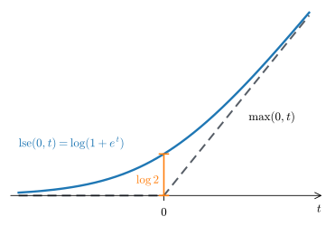
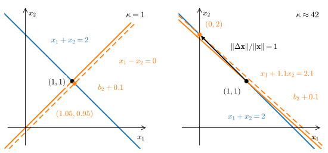

# Numerical Stability and Conditioning
:label:`sec_mdl-numerical-stability-conditioning`

Every computation in this chapter so far ran in floating point, and we read
its results as if they were exact real numbers. Most of the time, that
convenient fiction holds up. Occasionally, however, a training loss turns into
`NaN`, or a linear solver returns an answer that looks completely plausible
and is badly wrong. In this section we ask when finite-precision arithmetic,
rather than the optimization algorithm, decides the answer—and what we can do
about it.

Two small examples show the two ways numerical trouble arrives. First, the
three logits $(1000, 1001, 1002)$ define an entirely ordinary softmax, with
probabilities $(0.09, 0.24, 0.67)$. Yet if we evaluate the textbook formula as
written, it returns `NaN` three times, even in double precision (fp64).
Second, `np.linalg.solve` applied to a $12\times12$ linear system returns an
answer that is off by 30%, even though it is the exact solution of a system
that differs from the stated one only in the seventeenth decimal digit. The
first failure halts training with a `NaN` loss; the second slips past
unnoticed.

These two failures have fundamentally different causes. The naive softmax
formula passes through $e^{1000}$, a number too large for any standard
floating-point format to hold, whereas an algebraically equivalent rewrite
that never forms $e^{1000}$ is accurate to a few units in the last place. By
contrast, the $12\times12$ linear system is so sensitive that a rounding error
in the sixteenth digit of its data moves the solution in the first digit, and
no rewriting of the solver can undo that sensitivity.

To tell those two situations apart, we begin by examining how computers store
real numbers and how much error each rounding introduces. Next, we rewrite
softmax and cross-entropy so they never pass through numbers the format cannot
hold, and we rewrite the variance so it never subtracts nearly equal large
numbers. We then introduce a sensitivity measure—the condition number of a
function—that separates a bad algorithm from an inherently hard problem.
Finally, we see how the condition number of a linear system governs both the
digits a least-squares solve can keep and, as in
:numref:`sec_mdl-gradient-based-optimization`, the number of steps gradient
descent requires. While :numref:`sec_numerics` shows how modern training uses
low-precision formats in practice, here we derive why computations in them
succeed or fail.

Three ideas matter more than any individual formula: the relative rounding
model for floating-point arithmetic, the principle that an unstable algorithm
routes a well-conditioned problem through an ill-conditioned intermediate
step, and the bound linking a solver's solution error to the problem's
sensitivity. The subsections on summation order and ridge regularization can
be skipped on a first reading.

```{.python .input #numerical-stability-conditioning-imports}
#@tab mxnet
import math
import numpy as np
from mxnet import autograd, gluon, init, np as mnp, npx
from mxnet.gluon import nn
from d2l import mxnet as d2l
npx.set_np()
```

```{.python .input #numerical-stability-conditioning-imports}
#@tab pytorch
import math
import numpy as np
import torch
from torch import nn
from torch.nn import functional as F
from d2l import torch as d2l
```

```{.python .input #numerical-stability-conditioning-imports}
#@tab tensorflow
import math
import numpy as np
import tensorflow as tf
from d2l import tensorflow as d2l
```

```{.python .input #numerical-stability-conditioning-imports}
#@tab jax
import math
import numpy as np
import jax
from jax import numpy as jnp
from flax import nnx
import optax
from d2l import jax as d2l
```

```{.python .input #mdl-numerical-stability-conditioning-numerical-stability-and-conditioning-1}
#@tab mxnet, tensorflow, jax
import ml_dtypes
from fractions import Fraction
```

```{.python .input #mdl-numerical-stability-conditioning-numerical-stability-and-conditioning-1}
#@tab pytorch
from fractions import Fraction
```

## Floating-Point Arithmetic
:label:`subsec_mdl-floating-point`

### Representation and Spacing

What does a computer actually store when we ask it to store $1.1$? The
mechanism is easiest to see in a toy binary format that keeps only two bits
after the binary point. Between $1$ and $2$, this format can hold just four
values: $(1.00)_2=1$, $(1.01)_2=1.25$, $(1.10)_2=1.5$, and $(1.11)_2=1.75$.
Multiplying these four values by powers of two fills out the other intervals:
$2, 2.5, 3, 3.5$ between $2$ and $4$, and $0.5, 0.625, 0.75, 0.875$ between
$0.5$ and $1$. Each *octave*—an interval $[2^e, 2^{e+1})$ between consecutive
powers of two—holds exactly four values, so the absolute gap between adjacent
numbers doubles every time the magnitude doubles.

Any real number that falls between grid points is rounded to the nearest one:
$1.1\mapsto1$ (a relative error of $-0.091$), $1.3\mapsto1.25$ (an error of
$-0.038$), and $3.3\mapsto3.5$ (an error of $+0.061$). Halfway points are
ties, and standard arithmetic breaks ties toward the neighbor whose last bit
is $0$: the midpoint $1.125$ therefore rounds to $1$, an error of $-0.111$.
Notice that no relative error exceeds $1/8$. Rounding moves a number by at
most half a gap, and in every octave half a gap is $1/8$ of the octave's
smallest value. :numref:`fig_mdl-opt-fp-number-line` sketches this grid on the
real line.

![Floating-point numbers on the real line for a toy format with two mantissa bits (four values per octave, $\varepsilon_{\mathrm{mach}}=1/4$, smallest normal $0.25$). The absolute gap between neighbors doubles at every power of two while the relative gap stays near $\varepsilon_{\mathrm{mach}}$. Below the smallest normal, subnormal numbers continue with the same spacing down to zero; after the axis break, real formats end at their overflow thresholds (fp16 at $65504$, fp32 at about $3.4\times10^{38}$).](../img/mdl-opt-fp-number-line.svg)
:label:`fig_mdl-opt-fp-number-line`

Real floating-point formats work in the same way, simply with more bits. A
floating-point number is scientific notation in base two with a fixed budget
of $p$ binary digits after the binary point,

$$
x = (-1)^s \cdot (1.b_1 b_2 \ldots b_p)_2 \cdot 2^{e},
$$
:eqlabel:`eq_mdl-opt-float-format`

specified by a sign bit $s$, *mantissa* (or significand) bits
$b_1,\ldots,b_p$, and an integer exponent $e$ drawn from a fixed range. The
exponent sets the range of magnitudes the format can represent, while the
mantissa sets its relative precision. Within the octave $[2^e, 2^{e+1})$,
adjacent values are spaced $2^{e-p}$ apart. The gap from $1$ to the next
representable number, $\varepsilon_{\mathrm{mach}}=2^{-p}$, is called
*machine epsilon*; our toy format has $p=2$ and
$\varepsilon_{\mathrm{mach}}=1/4$.

Rounding a real number $x$ to the nearest representable value moves it by at
most half a gap, $2^{e-p-1}$. Because $|x|\ge2^e$ throughout the octave, the
relative error is at most $2^{-p-1}$. Calling a value *normal* when it has the
form :eqref:`eq_mdl-opt-float-format` with an in-range exponent, every real
$x$ that rounds to a normal number satisfies

$$
\mathrm{fl}(x) = x\,(1 + \delta), \qquad |\delta| \le u = \tfrac12\,\varepsilon_{\mathrm{mach}} = 2^{-p-1} .
$$
:eqlabel:`eq_mdl-opt-rounding-model`

In words, each rounding perturbs a number by at most one part in $2^{p+1}$:
one part in $8$ for our toy format, about one part in 17 million for fp32
($p=23$), and one part in $256$ for bf16 ($p=7$). The bound $u$ is called the
*unit roundoff*. Standard IEEE arithmetic rounds the result of every basic
operation to the nearest representable value, so the computed sum
$x\oplus y$ equals $(x+y)(1+\delta)$ with $|\delta|\le u$, and the same
guarantee holds for $-$, $\times$, and $/$
:cite:`IEEE.754.2019,Goldberg.1991`.

This clean relative model has three exceptions. Results larger than the format
can hold *overflow* to $\infty$. Results smaller than the smallest normal
number *underflow*, stepping down through *subnormal* numbers that fill the
remaining gap to zero. Undefined operations, such as $0/0$ or $\infty/\infty$,
produce `NaN`. All three are absolute-scale effects rather than relative ones,
and we will return to them right after putting the standard formats on the
table.

### Formats

Deep learning relies on five formats narrower than double precision (fp64).
Let us inspect each format's machine epsilon $\varepsilon_{\mathrm{mach}}$,
smallest normal number, and largest finite value directly from the library:

```{.python .input #numerical-stability-conditioning-finfo}
#@tab pytorch
print(f'{"dtype":>14} {"eps":>10} {"smallest normal":>16} {"max":>10}')
for dt in [torch.float16, torch.float32, torch.bfloat16,
           torch.float8_e4m3fn, torch.float8_e5m2]:
    fi = torch.finfo(dt)
    print(f'{str(dt).removeprefix("torch."):>14} {fi.eps:10.3e} '
          f'{fi.smallest_normal:16.3e} {fi.max:10.3e}')
```

```{.python .input #numerical-stability-conditioning-finfo}
#@tab mxnet, tensorflow, jax
print(f'{"dtype":>14} {"eps":>10} {"smallest normal":>16} {"max":>10}')
for dt in [np.float16, np.float32, ml_dtypes.bfloat16,
           ml_dtypes.float8_e4m3fn, ml_dtypes.float8_e5m2]:
    fi = ml_dtypes.finfo(dt)                   # values have dtype dt
    print(f'{np.dtype(dt).name:>14} {float(fi.eps):10.3e} '
          f'{float(fi.smallest_normal):16.3e} {float(fi.max):10.3e}')
```

**fp32** keeps $p=23$ mantissa bits—about seven decimal digits—and reaches up
to $3.4\times10^{38}$. **fp16** keeps $p=10$ bits (about three decimal digits)
but has a narrow exponent range: it overflows above $65504$, and below
$2^{-14}\approx6.1\times10^{-5}$ its values become subnormal. **bf16**
(`bfloat16` in the libraries) makes the opposite trade-off. It keeps all eight
exponent bits of fp32, preserving its vast dynamic range, at the cost of
keeping only $p=7$ mantissa bits ($\varepsilon_{\mathrm{mach}}=2^{-7}\approx
0.0078$, roughly two to three decimal digits). Notice that the value $2^{-8}$
often quoted for bf16 is its unit roundoff $u=\varepsilon_{\mathrm{mach}}/2$.
The two fp8 formats push this trade-off further still: E4M3 keeps three
mantissa bits (about one decimal digit) and tops out at $448$, while E5M2
keeps two mantissa bits with fp16's exponent range. With so little dynamic
range, fp8 is practical only when paired with a separate scale factor per
tensor or per block of values.

Because bf16 is simply the top 16 bits of an fp32 number—the same sign bit,
the same eight exponent bits, and the first seven mantissa bits—converting
fp32 to bf16 amounts to rounding off the low 16 bits. We can implement that
rounding directly with integer arithmetic on the raw bit pattern. The midpoint
of the discarded 16 bits is `0x8000`, so we add `0x7FFF` (one below the
midpoint), plus one more if the lowest kept bit is $1$, and then clear the
low 16 bits. This sum carries into the kept bits if and only if the discarded
part lies strictly above the midpoint, or sits right on the midpoint with an
odd kept bit. That is round-to-nearest, ties-to-even in a single line of bit
manipulation; Exercise
:exref:`ex_mdl-numerical-stability-conditioning-stochastic-rounding` builds
stochastic rounding on top of it. Let us verify it on one input above a
midpoint and two exact ties:

```{.python .input #mdl-numerical-stability-conditioning-formats-1}
def to_bf16(x):
    """Round float32 to the nearest bfloat16, ties to even."""
    bits = np.atleast_1d(np.asarray(x, np.float32)).view(np.uint32)
    bits = (bits + 0x7FFF + ((bits >> 16) & 1)) & 0xFFFF0000
    return bits.astype(np.uint32).view(np.float32)

for x, expected in [(1 + 2**-8 + 2**-10, 1 + 2**-7),   # above the midpoint
                    (1 + 2**-8, 1.0),                  # tie, 1 is even
                    (1 + 3 * 2**-8, 1 + 2**-6)]:       # tie, 1 + 2^-6 is even
    print(f'{x:.8f} -> {to_bf16(x).item():.8f}   (expected {expected:.8f})')
```

As expected, the first input lies above the midpoint between $1$ and
$1+2^{-7}$ and rounds up. The second sits right on that midpoint and rounds
down to the even neighbor $1$, whereas the third sits on the midpoint between
$1+2^{-7}$ and $1+2^{-6}$ and rounds up to the even neighbor $1+2^{-6}$. Next,
let us check the same tie rule in fp32, observe how the spacing grows with
magnitude, and find the largest logit each format can exponentiate without
overflow:

```{.python .input #numerical-stability-conditioning-spacing}
eps = np.finfo(np.float32).eps
one = np.float32(1.0)
print('1 + eps   != 1 :', one + eps != one)
print('1 + eps/2 == 1 :', one + np.float32(eps / 2) == one)
print('gap between float32 neighbors at 1    :', np.spacing(one))
print('gap between float32 neighbors at 2^20 :', np.spacing(np.float32(2.0**20)))
for dt in [np.float16, np.float32, np.float64]:
    print(f'{np.dtype(dt).name}: exp(x) overflows for x >',
          f'{np.log(np.finfo(dt).max):.2f}')
```

Here $1+\varepsilon_{\mathrm{mach}}/2$ is the midpoint between $1$ and its
upper neighbor, so ties-to-even sends it back to $1$. The worst-case rounding
error of half a gap really does occur, giving a relative error of $u/(1+u)$,
just inside the bound $|\delta|\le u$. Meanwhile, the gap at $2^{20}$ is
$2^{20}$ times—about a million times—the gap at $1$. Finally, the last three
lines pinpoint where $e^x$ overflows: above $11.09$ in fp16, $88.72$ in fp32,
and $709.78$ in fp64.

### Overflow, Underflow, and Small Updates

Because the exponential turns an additive scale into a multiplicative one,
even modest logits can overflow. In fp16, the ceiling
$\log 65504\approx11.09$ sits well inside the range of ordinary unnormalized
classifier scores.

At the opposite end, $e^{-x}$ underflows. Below the smallest normal number, a
format steps through subnormal numbers that keep the same absolute spacing
while shedding significant bits one by one, until values round all the way to
$0$. Taking $\log 0$ later produces $-\infty$, and the backward pass fills
with `inf` or `NaN`. In fp16, subnormals begin below
$2^{-14}\approx6.1\times10^{-5}$, the smallest subnormal is
$2^{-24}\approx6\times10^{-8}$, and anything below
$2^{-25}\approx3\times10^{-8}$ rounds straight to zero.

Addition introduces a second absolute threshold that matters directly for
training. A gradient step replaces a weight $w$ by $w-\eta g$. If the update
$\eta g$ is small compared with the spacing around $w$, the sum simply rounds
back to $w$, and the step vanishes without a trace.

**Proposition (small updates vanish).** *Let $w>0$ be a floating-point number
with $2^e\le w<2^{e+1}$ in a format with $p$ mantissa bits, and let
$\Delta$ be real. If $|\Delta|<2^{e-p-1}$, then $\mathrm{fl}(w+\Delta)=w$,
except when $w=2^e$ and $\Delta<0$; in that case the same holds for
$|\Delta|<2^{e-p-2}$.*

**Proof.** In $[2^e, 2^{e+1}]$ the representable numbers are $2^{e-p}$ apart,
so the neighbors of $w$ are $w\pm2^{e-p}$, except that below $w=2^e$ the
lower octave $[2^{e-1},2^e)$ begins and the spacing halves to $2^{e-p-1}$.
Rounding to the nearest number returns $w$ whenever $w+\Delta$ is closer to
$w$ than to the adjacent grid point on its side—that is, whenever $|\Delta|$
is strictly less than half of that gap. $\blacksquare$

For a weight update $\Delta=-\eta g$ with $2^e<w<2^{e+1}$, the proposition
reads

$$
\mathrm{fl}(w-\eta g)=w \qquad \textrm{whenever } |\eta g|<2^{e-p-1}=u\,2^e .
$$
:eqlabel:`eq_mdl-opt-small-update`

In short, any update smaller than roughly $u|w|$ is lost. The relative model
:eqref:`eq_mdl-opt-rounding-model` describes products and quotients well, but
when we add two numbers of very different magnitudes, it hides this sharp
absolute cutoff.

A weight sitting right on a power of two, such as $w=1$, falls into the
exceptional case of the proposition: because the spacing halves below $1$, an
increase vanishes below $u$ (as :numref:`sec_numerics` tests), whereas a
decrease already vanishes below $u/2$. In bf16, a weight equal to $1$ therefore
ignores any decrease smaller than $2^{-9}\approx0.002$, so a learning rate of
$10^{-3}$ with an order-$1$ gradient leaves the weight completely frozen. The
corresponding threshold is $2^{-12}\approx2.4\times10^{-4}$ in fp16 and
$2^{-25}\approx3\times10^{-8}$ in fp32—which is why mixed-precision training
keeps a master copy of the weights in fp32. Let us test steps straddling these
thresholds (computing the bf16 updates in fp32 and rounding with `to_bf16`):

```{.python .input #mdl-numerical-stability-conditioning-overflow-underflow-and-small-updates}
one32, one16 = np.float32(1.0), np.float16(1.0)
print('bfloat16: 1 - 1e-3 ->', to_bf16(one32 - np.float32(1e-3)).item())
print('bfloat16: 1 - 2e-3 ->', to_bf16(one32 - np.float32(2e-3)).item())
print('fp16    : 1 - 1e-4 ->', one16 - np.float16(1e-4))
print('fp16    : 1 - 3e-4 ->', one16 - np.float16(3e-4))
print('fp32    : 1 - 1e-3 ->', one32 - np.float32(1e-3))
```

Sure enough, a step of $10^{-3}$ leaves the bf16 weight stuck at $1$, whereas
$2\times10^{-3}$ clears the $0.00195$ threshold and jumps to the neighbor
$1-2^{-8}=0.99609375$. Similarly, fp16 swallows $10^{-4}$ and responds to
$3\times10^{-4}$ by stepping to $1-2^{-11}\approx0.9995$, while fp32 keeps the
full update.

Gradients run into the underflow threshold instead. In fp16, gradients below
$6.1\times10^{-5}$ lose precision and those below $3\times10^{-8}$ vanish to
zero. Multiplying the loss by a constant factor $S$ before the backward pass
scales every gradient up by $S$ and lifts them back into the normal range;
dividing by $S$ afterward in fp32 restores the true scale
(:numref:`subsec_loss_scaling` covers the practical workflow, and Exercise
:exref:`ex_mdl-numerical-stability-conditioning-loss-scale-window` determines
the admissible window for $S$).

*Stochastic rounding* :cite:`Gupta.Agrawal.Gopalakrishnan.ea.2015` removes the
lost-update cutoff in a different way. Instead of always rounding to the
nearest grid point, it rounds up or down at random with probabilities chosen
so that the expected stored value equals the exact result. Updates far too
small for round-to-nearest then still accumulate over many steps in
expectation
(Exercise :exref:`ex_mdl-numerical-stability-conditioning-stochastic-rounding`).

## Stable Softmax and Cross-Entropy
:label:`subsec_mdl-stable-softmax`

Softmax, log-sum-exp, and cross-entropy all exponentiate logits, so all three
collide head-on with the overflow and underflow thresholds we just computed.
To keep everything concrete, we will carry one running example through this
subsection: a two-class classifier with logits $\mathbf z=(0,t)$ whose true
label is the unlikely class $0$. Its probabilities are
$\mathrm{softmax}(\mathbf z)=\bigl(1/(1+e^t),\, e^t/(1+e^t)\bigr)$, its
log-sum-exp is $\log(1+e^t)$, and the cross-entropy loss for class $0$ is
$\log(1+e^t)\approx t$ for large $t$. None of these outputs is extreme: even
at $t=100$, the probabilities are $3.7\times10^{-44}$ and $1$, and the loss
is simply $100$.

### The Max Shift

Given logits $\mathbf z\in\mathbb R^n$, the softmax vector is defined by

$$
\mathrm{softmax}(\mathbf{z})_i = \frac{e^{z_i}}{\sum_{j=1}^n e^{z_j}} .
$$

At $t=100$, evaluating this formula directly forms $e^{100}$, which exceeds
fp32's overflow ceiling of $88.72$. The second entry turns into `inf/inf`
(`NaN`), and the first collapses to $1/\infty=0$. Notice that the true
probabilities themselves fit easily in fp32; only the intermediate exponential
does not.

Luckily, multiplying numerator and denominator by the same positive constant
$e^{-c}$ leaves the ratio untouched, so softmax is *shift-invariant*:

$$
\mathrm{softmax}(\mathbf{z} - c\mathbf{1}) = \mathrm{softmax}(\mathbf{z})
\qquad \textrm{for every } c \in \mathbb{R}.
$$
:eqlabel:`eq_mdl-opt-softmax-shift`

Factoring $e^c$ out of the sum inside a logarithm gives the companion
identity for **log-sum-exp**, $\mathrm{lse}(\mathbf{z}) = \log \sum_j e^{z_j}$,
which is the logarithm of the softmax denominator:

$$
\mathrm{lse}(\mathbf{z}) = c + \log \sum_{j=1}^n e^{z_j - c} .
$$
:eqlabel:`eq_mdl-opt-stable-lse`

Both identities hold for any $c\in\mathbb{R}$, and choosing $c=\max_j z_j$
makes both computations safe. Every shifted exponent $z_j-c$ is then at most
$0$, so no exponential can overflow. At the same time, the largest term
equals $e^0=1$, so the sum is guaranteed to lie in $[1,n]$ and its logarithm
cannot underflow to $-\infty$. Let us test this on $(0, 100)$ in fp32, on the
opening's $(1000, 1001, 1002)$ in fp64, and on $(0, 10)$ where both versions
stay finite—do they return the exact same bits there?

```{.python .input #numerical-stability-conditioning-stable-softmax}
def softmax_naive(z):
    e = np.exp(z)
    return e / e.sum()

def softmax_stable(z):
    e = np.exp(z - z.max())        # shift by the max: largest exponent is 0
    return e / e.sum()

z = np.array([0.0, 100.0], dtype=np.float32)
with np.errstate(over='ignore', invalid='ignore'):
    print('naive  softmax(0, 100):', softmax_naive(z))
print('stable softmax(0, 100):', softmax_stable(z))
z = np.array([1000.0, 1001.0, 1002.0])        # the opening's logits, fp64
with np.errstate(over='ignore', invalid='ignore'):
    print('naive  softmax(1000, 1001, 1002):', softmax_naive(z))
print('stable softmax(1000, 1001, 1002):', softmax_stable(z).round(4))
z = np.array([0.0, 10.0], dtype=np.float32)
a, b = softmax_naive(z), softmax_stable(z)
print('softmax(0, 10), naive minus stable, in ulps:',
      (a - b) / np.spacing(b))
```

At $t=100$, the shifted softmax returns $(3.8\times10^{-44}, 1)$—the true
$3.7\times10^{-44}$ rounded onto the subnormal grid with five significant
bits left—while the direct formula returns $0$ and `NaN`. Switching to higher
precision does not cure the problem: the logits $(1000, 1001, 1002)$ from the
opening overflow $e^{1000}$ even in fp64, turning the direct formula into
three `NaN`s where the shifted version cleanly returns $(0.09, 0.24, 0.67)$.
At $t=10$, the two formulas either agree to the last bit or differ by one or
two units in the last place (*ulps*), because real-number identities do not
guarantee identical rounding orders. One edge case remains: the max shift
cannot rescue non-finite logits—if an entire row is $-\infty$, then
$c=-\infty$ and $z_j-c$ is undefined.

### Bounds for Log-Sum-Exp

Log-sum-exp is the log-normalizer of every exponential-family model
(:numref:`sec_mdl-exponential-family`), and up to a single subtraction it is
the cross-entropy loss. The shift :eqref:`eq_mdl-opt-stable-lse` immediately
tells us how close it sits to the largest logit:

**Proposition (log-sum-exp sandwich).** *For every
$\mathbf{z} \in \mathbb{R}^n$,*

$$
\max_j z_j \;\le\; \mathrm{lse}(\mathbf{z}) \;\le\; \max_j z_j + \log n .
$$

**Proof.** Set $c = \max_j z_j$ in :eqref:`eq_mdl-opt-stable-lse`. Every
exponential $e^{z_j - c}$ lies in $(0, 1]$ and the maximizing term equals
$1$, so the sum lies in $[1, n]$ and its logarithm in $[0, \log n]$. Adding
$c$ yields both bounds. $\blacksquare$

Log-sum-exp is therefore a *soft maximum*. In our two-class example,
$\mathrm{lse}(0,t)=\log(1+e^t)$ stays within $\log 2\approx0.69$ of
$\max(0,t)$, attaining the full gap at $t=0$ where the two logits tie and
hugging the maximum closely as $|t|$ grows
(:numref:`fig_mdl-opt-softplus-max`).


:label:`fig_mdl-opt-softplus-max`

Moreover, its gradient is the softmax itself,
$\partial\,\mathrm{lse}(\mathbf z)/\partial z_i=e^{z_i}/\sum_j e^{z_j}=\mathrm{softmax}(\mathbf z)_i$.
That is why the gradient of cross-entropy with respect to the logits, for
label $y$, simplifies to $\mathrm{softmax}(\mathbf z)-\mathbf e_y$;
:numref:`sec_mdl-convexity` also shows that log-sum-exp is convex.

Subtracting the shifted log-sum-exp from the shifted logit yields the
**log-softmax**, computing log-probabilities directly without ever forming
the probabilities themselves:

$$
\log \mathrm{softmax}(\mathbf{z})_i = (z_i - c) - \log \sum_{j=1}^n e^{z_j - c},
\qquad c=\max_j z_j .
$$
:eqlabel:`eq_mdl-opt-log-softmax`

Because we never exponentiate the final result, a tiny probability cannot
underflow to zero before its logarithm is taken. Notice a subtle detail in
:eqref:`eq_mdl-opt-log-softmax`: the algebraically equivalent form
$z_i-\mathrm{lse}(\mathbf z)$ is noticeably worse in floating point, because
it first forms the large number $\mathrm{lse}=c+\log\sum_j e^{z_j-c}$ and
then subtracts it from the large number $z_i$. How much difference does that
parenthesization make? Let us compare both forms in fp32 on the logits
$(1000, 1001, 1002)$:

```{.python .input #numerical-stability-conditioning-logsumexp}
z = np.array([1000.0, 1001.0, 1002.0], dtype=np.float32)
c = z.max()
s = np.log(np.exp(z - c).sum())           # log sum exp(z - c), in [0, log 3]
with np.errstate(over='ignore'):
    print('naive log(sum(exp(z))):', np.log(np.exp(z).sum()))
lse = c + s
print('lse = c + s           :', lse, '  float32 gap at 1002:', np.spacing(c))
log_p_sub = z - lse                       # forms lse, then subtracts it
log_p = (z - c) - s                       # never forms c + s
print(f'sum of exp(z - lse)    : {np.exp(log_p_sub).sum():.8f}')
print(f'sum of exp((z - c) - s): {np.exp(log_p).sum():.8f}')
```

The direct computation overflows to `inf`—as it would even in fp64, since
$1000>709.78$, which is what turned `inf/inf` into three `NaN`s in the
opening. The shifted value $\mathrm{lse}=1002.4076$ sits comfortably inside
the sandwich $[1002, 1002+\log 3]$. More interestingly, the two log-softmax
forms disagree: exponentiating $z_i-\mathrm{lse}$ gives probabilities that
sum to $1.0000132$, whereas :eqref:`eq_mdl-opt-log-softmax` sums to
$1.0000000$.

Why did $z_i-\mathrm{lse}$ lose accuracy? Surprisingly, the subtraction
itself made no error at all. Whenever two floating-point numbers lie within a
factor of two of each other, their difference is exactly representable,
because both are multiples of the smaller number's spacing and their
difference needs no extra bits (Sterbenz's lemma, Exercise
:exref:`ex_mdl-numerical-stability-conditioning-exact-subtraction`).

The error entered earlier, when $\mathrm{lse}$ was stored. Near $1002$,
fp32 numbers are $2^{-14}\approx6.1\times10^{-5}$ apart, so the true value
$1002.4076060$ rounds down by $1.32\times10^{-5}$. Every log-probability
computed as $z_i-\mathrm{lse}$ is therefore $1.32\times10^{-5}$ too high,
every resulting probability is inflated by the factor $e^{1.32\times10^{-5}}$,
and their sum overshoots $1$ by $1.32\times10^{-5}$. An absolute error in an
exponent turns into a relative error of the same size after exponentiation,
and the subtraction merely exposed an error that was already sitting in its
input—the central theme of :numref:`subsec_mdl-catastrophic-cancellation`.

### Cross-Entropy from Logits

The cross-entropy loss for label $y$ is simply the negative log-softmax, so
:eqref:`eq_mdl-opt-log-softmax` gives it directly from the logits:

$$
-\log \mathrm{softmax}(\mathbf{z})_y = \mathrm{lse}(\mathbf{z}) - z_y .
$$
:eqlabel:`eq_mdl-opt-ce-from-logits`

Computing the loss this way requires one stable log-sum-exp and one
subtraction, without ever forming a probability. On our running example, the
loss for class $0$ is $\mathrm{lse}(0,t)-0=\log(1+e^t)$. If we instead
compute probabilities first, the true-class probability
$e^{-t}/(1+e^{-t})\approx e^{-t}$ drops below fp32's normal range once
$t>87.3$ and underflows completely to zero near $t=104$, sending its negative
logarithm to $\infty$. Let us compare the two routes using the library's
built-in functions, with $t=103$ and $104$ straddling that cliff:

```{.python .input #numerical-stability-conditioning-cross-entropy}
#@tab mxnet
print('    t  CE from logits    CE via probabilities')
for t in [20.0, 60.0, 103.0, 104.0]:
    logits = mnp.array([[0.0, t]])        # the label is class 0, the unlikely one
    from_logits = -npx.log_softmax(logits, axis=1)[0, 0]
    from_probs = -mnp.log(npx.softmax(logits, axis=1))[0, 0]
    print(f'{t:5.0f}  {float(from_logits):15.4f}  {float(from_probs):15.4f}')
```

```{.python .input #numerical-stability-conditioning-cross-entropy}
#@tab pytorch
print('    t  CE from logits    CE via probabilities')
for t in [20.0, 60.0, 103.0, 104.0]:
    logits = torch.tensor([[0.0, t]])
    y = torch.tensor([0])                        # label = the unlikely class
    from_logits = F.cross_entropy(logits, y)
    probs = F.softmax(logits, dim=1)             # stable softmax, then...
    from_probs = -torch.log(probs[0, y])         # ...take the log yourself
    print(f'{t:5.0f}  {from_logits.item():15.4f}  {from_probs.item():15.4f}')
```

```{.python .input #numerical-stability-conditioning-cross-entropy}
#@tab tensorflow
print('  t  CE from logits  CE via probabilities  Keras from_logits=False')
for t in [20.0, 60.0, 103.0, 104.0]:
    logits = tf.constant([[0.0, t]])
    y = tf.constant([0])                         # label = the unlikely class
    from_logits = tf.keras.losses.sparse_categorical_crossentropy(
        y, logits, from_logits=True)[0]
    probs = tf.nn.softmax(logits)                # stable softmax, then...
    from_probs = -tf.math.log(probs[0, 0])       # ...take the log yourself
    keras = tf.keras.losses.sparse_categorical_crossentropy(
        y, probs, from_logits=False)[0]          # Keras on probabilities
    print(f'{t:3.0f}  {float(from_logits):14.4f}  {float(from_probs):20.4f}'
          f'  {float(keras):23.4f}')
```

```{.python .input #numerical-stability-conditioning-cross-entropy}
#@tab jax
print('    t  CE from logits    CE via probabilities')
for t in [20.0, 60.0, 103.0, 104.0]:
    logits = jnp.array([[0.0, t]])
    y = jnp.array([0])                           # label = the unlikely class
    from_logits = optax.softmax_cross_entropy_with_integer_labels(logits, y)
    from_probs = -jnp.log(jax.nn.softmax(logits)[0, 0])
    print(f'{t:5.0f}  {float(from_logits[0]):15.4f}  {float(from_probs):15.4f}')
```

Computed directly from logits, the loss equals $t$ in every row, and the
probability route matches it at $t=20$ and $60$. At $t=103$, however, the
probability $e^{-103}$ falls into the subnormal range, and what happens next
depends on how the library handles subnormal numbers.

:begin_tab:`mxnet`
MXNet's exponential flushes subnormal results to $0$, so the probability
becomes $0$ and the loss jumps to `inf` already at $t=103$ as well as $104$.
:end_tab:

:begin_tab:`pytorch`
PyTorch preserves subnormals: $e^{-103}\approx1.32\times2^{-149}$ rounds to
the smallest fp32 subnormal, $2^{-149}$. Only a single significant bit
survives, so the loss reads $149\log 2=103.2789$—wrong in the first decimal
place with no warning. At $t=104$, $e^{-104}<2^{-150}$ rounds to $0$, and
the loss becomes `inf`.
:end_tab:

:begin_tab:`tensorflow`
TensorFlow's softmax flushes subnormals to zero, producing `inf` at both
$t=103$ and $104$. The rightmost column shows that Keras masks the same
failure rather than signaling it: with `from_logits=False`, it clips
probabilities to $[10^{-7}, 1-10^{-7}]$ before taking the logarithm and
returns $16.1181=-\log 10^{-7}$ for every $t$ above about $16$—a flat loss,
and hence a zero gradient, that ignores the model's logits.
:end_tab:

:begin_tab:`jax`
XLA runs compiled operations with subnormals flushed to zero, so the
probability becomes $0$ and the loss jumps to `inf` at both $t=103$ and $104$.
:end_tab:

The practical takeaway is simple: keep losses, likelihoods, and posteriors
in log space until you genuinely need a probability. The fused loss in
:numref:`subsec_softmax-implementation-revisited` implements
:eqref:`eq_mdl-opt-ce-from-logits` for this reason,
:numref:`sec_mdl-information_theory` interprets what cross-entropy measures,
and :numref:`sec_mdl-naive_bayes` sums hundreds of per-pixel
log-probabilities to avoid the same underflow.

## Catastrophic Cancellation
:label:`subsec_mdl-catastrophic-cancellation`

### The Condition Number of a Function
:label:`subsec_mdl-relative-condition-number`

In fp32, evaluating $\log(1+x)$ at $x=10^{-8}$ returns $0$—a relative error
of 100%—whereas the library function `log1p` returns $10^{-8}$. Is
$\log(1+x)$ near $x=0$ inherently hard to compute, or is the formula to
blame? To answer questions like this systematically, we need a quantity that
measures how strongly a function amplifies errors in its input, independent
of any particular algorithm.

The **relative condition number** of a differentiable function $f$ at a point
$x$ with $f(x)\ne0$ is the factor by which a small relative perturbation in
$x$ turns into a relative perturbation in $f(x)$. Perturbing $x$ to
$x(1+\delta)$ changes the output, to first order, to
$f(x(1+\delta))\approx f(x)+xf'(x)\,\delta$. Dividing the change by $f(x)$
gives the amplification factor

$$
\kappa_f(x)=\left|\frac{x\,f'(x)}{f(x)}\right| .
$$
:eqlabel:`eq_mdl-opt-kappa-f`

For example, the exponential has $\kappa_f(x)=|x|$: at $x=88$, an input error
of one unit roundoff becomes $88$ units in the output. That is the exact
mechanism we just saw in the log-softmax cell, where an absolute error in an
exponent became a relative error of the same size in the probability. Notice
that $\kappa_f$ is a first-order property of the exact mathematical function.
It says nothing about how $f$ is evaluated, and it breaks down where
$f(x)=0$, since relative error is undefined there.

Subtraction takes two inputs, and the same first-order reasoning applies to
both. Suppose $\hat a=a(1+\delta_a)$ and $\hat b=b(1+\delta_b)$ carry
relative errors $|\delta_a|,|\delta_b|\le u$, and suppose the subtraction
itself is exact. Then $\hat a-\hat b=(a-b)+(a\delta_a-b\delta_b)$, so the
triangle inequality bounds the relative error of the difference by

$$
\frac{|(\hat a-\hat b)-(a-b)|}{|a-b|}
=\frac{|a\delta_a-b\delta_b|}{|a-b|}
\le \frac{|a| + |b|}{|a - b|}\; u .
$$
:eqlabel:`eq_mdl-opt-cancellation-factor`

The factor $(|a|+|b|)/|a-b|$ is subtraction's condition number, and it blows
up whenever $a\approx b$. Subtracting two nearly equal numbers that already
carry rounding errors is called **catastrophic cancellation**: the accurate
leading digits cancel out, promoting the noise in the trailing digits into
the leading digits of the answer. For reference, the table below collects the
condition numbers of several common problems:

| problem | $\kappa_f$ | regime |
|----|----|----|
| $a-b$ | $(\lvert a\rvert+\lvert b\rvert)/\lvert a-b\rvert$ | large when $a\approx b$ |
| $\log(1+x)$ | $x/((1+x)\log(1+x))$ | $1.000$ at $x=10^{-8}$, $0.82$ at $x=0.5$ |
| $e^x$ | $\lvert x\rvert$ | large for large $\lvert x\rvert$ |
| $1-\cos x$ | $x\sin x/(1-\cos x)$ | tends to $2$ as $x\to0$ |
| $\sqrt x$ | $1/2$ | always |
| variance of data with mean $m$, spread $s$ | at most $2(1+\lvert m\rvert/s)$ | derived below |

The second row settles our opening question: $\log(1+x)$ near $x=0$ is
completely well conditioned ($\kappa_f\approx 1$). The naive algorithm
`log(1 + x)` fails because it takes a detour through an ill-conditioned
intermediate step. It first forms $y=1+x$ and then evaluates $\log y$ at
$y\approx 1$, where the logarithm has
$\kappa_{\log}(y)=1/|\log y|\approx 1/x=10^8$. Rounding $1+x$ introduces a
relative error of order $u$ in $y$, which $\log$ magnifies by $10^8$—more
than 100% in fp32. By contrast, `log1p` is written so that the rounding error
of $1+x$ never enters the result; for tiny $x$, it simply returns $x$.

This gives us the organizing principle of the entire section: *an unstable
algorithm routes a well-conditioned problem through an ill-conditioned
intermediate step.* Whenever $\kappa_f$ is small and the computed answer is
bad, the algorithm is at fault and we should rewrite it. Whenever $\kappa_f$
itself is large, no algorithm can rescue the answer—we must change the
problem instead, which is the subject of
:numref:`subsec_mdl-conditioning-revisited`.

### Subtraction of Nearly Equal Numbers

Let us test this in code. The cell below repeats the $\log(1+x)$ experiment
and then subtracts two fp32 numbers that agree in their first seven decimal
digits, $1.0002344$ and $1.0002341$, whose true difference is
$3.0\times10^{-7}$:

```{.python .input #numerical-stability-conditioning-log1p}
x = np.float32(1e-8)
print('float32 rounds 1 + x to:', np.float32(1.0) + x)
print('log(1 + x) =', np.log(np.float32(1.0) + x), '   log1p(x) =', np.log1p(x))
a, b = np.float32(1.0002344), np.float32(1.0002341)
print(f'stored a = {float(a):.10f}, b = {float(b):.10f}')
print('a - b =', a - b, '=', (a - b) / np.spacing(np.float32(1.0)), 'ulps of 1')
print('float64: log(1 + 1e-20) =', np.log(1 + 1e-20),
      '  log1p(1e-20) =', np.log1p(1e-20))
```

Between $1$ and $2$, every fp32 difference is an integer multiple of
$\varepsilon_{\mathrm{mach}}=1.19\times10^{-7}$, and the true difference
$3.0\times10^{-7}$ does not fall on that grid. The subtraction returned two
ulps, $2.38\times10^{-7}$—20% too small—yet once again it committed no error
of its own. The inputs were stored as $1.0002343655$ and $1.0002341270$, and
their exact difference is what the cell printed; the error was already baked
into the stored inputs. Here the cancellation factor
:eqref:`eq_mdl-opt-cancellation-factor` is
$2.0005/(3\times10^{-7})\approx7\times10^6$. Multiplied by
$u\approx6\times10^{-8}$, it allows a relative error of up to $0.4$, and the
observed $0.2$ falls squarely inside the bound.

The same cancellation appears in $\log(1+x)$ and $e^x-1$ near $0$ (where
`log1p` and `expm1` avoid it), in $1-\cos x$ near $0$ (rewritten as
$2\sin^2(x/2)$), and in the quadratic formula when $b^2\gg 4|ac|$ (Exercise
:exref:`ex_mdl-numerical-stability-conditioning-blame`). In every one of
these cases, an algebraic rewrite removes the offending subtraction.

Finite differences are the one place where we cannot eliminate the
subtraction and must settle for a compromise. A numerical gradient check
compares automatic differentiation against the forward difference
$(f(x+h)-f(x))/h$. How small should we make the step $h$? By Taylor's
theorem, the mathematical truncation error is about $\tfrac h2|f''(x)|$,
which shrinks as $h\to 0$. Meanwhile, each function evaluation carries a
rounding error of roughly $u|f(x)|$, and dividing their difference by $h$
magnifies that error to about $2u|f(x)|/h$, which blows up as $h\to 0$. The
total error is minimized where the two terms balance, at

$$
h^\star=2\sqrt{\frac{u\,|f(x)|}{|f''(x)|}},
\qquad \textrm{with error about } 2\sqrt{u\,|f(x)f''(x)|} .
$$

Because the optimal error scales as $\sqrt{u}$, the best possible forward
difference keeps only about half of the format's digits. For $f=\sin$ at
$x=1$, this predicts $h^\star\approx2\times10^{-8}$ (error
$1.8\times10^{-8}$) in fp64 and $h^\star\approx5\times10^{-4}$ in fp32. Let
us sweep $h$ from $10^{-2}$ down to $10^{-12}$ in both formats to see the
trade-off directly:

```{.python .input #mdl-numerical-stability-conditioning-subtraction-of-nearly-equal-numbers-1}
print('      h   error in fp64   error in fp32')
for h in 10.0 ** -np.arange(2, 13):
    err = [abs(float((np.sin(t(1) + t(h)) - np.sin(t(1))) / t(h)) - np.cos(1.0))
           for t in (np.float64, np.float32)]  # forward difference of sin at 1
    print(f'{h:7.0e}  {err[0]:14.1e}  {err[1]:14.1e}')
```

In fp64, the error drops linearly with $h$ from $4\times10^{-3}$ at
$h=10^{-2}$ (where truncation dominates) down to roughly $10^{-8}$ near
$h=10^{-8}$ (the exact value at any single $h$ fluctuates with rounding
noise), and then climbs back to $4\times10^{-5}$ at $h=10^{-12}$ as
cancellation takes over. In fp32, the sweet spot at $h=10^{-3}$ to $10^{-4}$
leaves only about three correct digits; from $h=10^{-8}$ downward, $1+h$
rounds straight to $1$, making the difference quotient $0$ and the error
equal to the entire derivative, $\cos 1=0.54$. That is why numerical gradient
checks should always run in fp64.

Notice, too, that switching to higher precision never cures cancellation—it
merely pushes the failure to smaller inputs. The last line of the earlier
`log1p` cell showed `log(1 + 1e-20)` returning $0$ in fp64 just as fp32 did
at $10^{-8}$, while `log1p` stayed accurate in both. Reformulating the
expression removes the ill-conditioned step itself :cite:`Higham.2002`.

### One-Pass Variance

Catastrophic cancellation also hides inside formulas that look completely
innocent. Computing a sample variance is the classic example—and it matters
directly in deep learning, where normalization layers and data-preprocessing
pipelines compute variances continuously.

For data $x_1,\ldots,x_N$ with mean $m$ and standard deviation $s$, the
textbook identity

$$
\frac1N\sum_{i=1}^N(x_i-m)^2 = \frac1N\sum_{i=1}^N x_i^2 - m^2 ,
$$

tempts us to compute the variance in a single pass by accumulating only the
sums of $x_i$ and $x_i^2$. In exact arithmetic the identity is flawless; in
floating point it is a trap. Whenever $s\ll|m|$, both terms on the right sit
near $m^2$ while their difference is $s^2$, so the cancellation factor
:eqref:`eq_mdl-opt-cancellation-factor` is roughly $2m^2/s^2$. For $m=10^9$
and $s=1$, that factor reaches $2\times10^{18}$—two orders of magnitude
larger than the $10^{16}$ that fp64 can absorb.

How much of this loss is forced by the problem itself? Let us check the
condition number of the variance. Perturb each input $x_i$ by a relative
error $\delta_i$ with $|\delta_i|\le u$, replacing $x_i$ by
$x_i+x_i\delta_i$. The derivative of the variance with respect to $x_i$ is
$\tfrac2N(x_i-m)$, because the induced change in $m$ multiplies
$\sum_i(x_i-m)=0$. Writing $x_i=(x_i-m)+m$, the first-order change in the
variance is therefore

$$
\frac2N\sum_{i=1}^N(x_i-m)\,x_i\delta_i
=\frac2N\sum_{i=1}^N(x_i-m)^2\delta_i+\frac{2m}N\sum_{i=1}^N(x_i-m)\,\delta_i .
$$

The first sum has magnitude at most $2s^2 u$. By the Cauchy–Schwarz
inequality, the second has magnitude at most
$2|m|u\cdot\frac1N\sum_i|x_i-m|\le 2|m|s\,u$. Dividing by $s^2$ shows that
the relative condition number of the variance is at most
$2(1+|m|/s)\approx 2|m|/s$, or about $2\times10^9$ here (choosing
$\delta_i=u\,\mathrm{sign}(x_i-m)$ gives $1.6\,|m|/s$ for Gaussian data).
The problem itself therefore permits an error of only
$2\times10^9 u\approx 2\times10^{-7}$—about seven accurate digits. The naive
one-pass formula, by contrast, suffers an error of order $(m/s)^2 u$: it
*squares* the condition number, just as the normal equations will square the
condition number of a matrix in :numref:`subsec_mdl-conditioning-revisited`.

A stable one-pass algorithm keeps all deviations at the scale $s$ rather than
$m^2$. :citet:`Welford.1962` maintains a running mean $m_k$ and a running sum
of *centered* squares $M_k = \sum_{i \le k} (x_i - m_k)^2$, updating both
from the deviation $d_k=x_k-m_{k-1}$ of each new sample from the previous
mean:

$$
m_k = m_{k-1} + \frac{d_k}{k},
\qquad
M_k = M_{k-1} + d_k\,(x_k - m_k).
$$
:eqlabel:`eq_mdl-opt-welford`

Notice the asymmetry in the update of $M_k$: it multiplies the deviation from
the *old* mean by the deviation from the *new* mean. That asymmetry is
precisely what makes the recursion exact:

**Proposition (Welford's recursion).** *With $m_0 = M_0 = 0$, the
recursions :eqref:`eq_mdl-opt-welford` satisfy, for every $k \ge 1$ and in
exact arithmetic,*

$$
m_k = \frac{1}{k} \sum_{i=1}^k x_i,
\qquad
M_k = \sum_{i=1}^k (x_i - m_k)^2 .
$$

**Proof.** The mean identity $k\, m_k = (k-1)\, m_{k-1} + x_k$ follows
immediately from the first recursion. For $M_k$, we induct on $k$. Using
$m_k - m_{k-1} = d_k/k$ and $x_k - m_k = d_k\,(k-1)/k$, we split off the
$k$-th term and recenter the first $k-1$ terms around $m_{k-1}$:

$$
\begin{aligned}
\sum_{i=1}^{k} (x_i - m_k)^2
&= \sum_{i=1}^{k-1} \left( (x_i - m_{k-1}) - \tfrac{d_k}{k} \right)^2 + (x_k - m_k)^2 \\
&= M_{k-1} + (k-1)\tfrac{d_k^2}{k^2} + \tfrac{(k-1)^2}{k^2}d_k^2 .
\end{aligned}
$$

The cross term vanishes because $\sum_{i \le k-1} (x_i - m_{k-1}) = 0$, and
the inductive hypothesis identifies the first sum as $M_{k-1}$. Combining the
remaining two terms gives
$\frac{k-1}{k}\,d_k^2 = d_k \cdot d_k\frac{k-1}{k} = d_k(x_k - m_k)$, which
is exactly what the recursion adds. $\blacksquare$

Proving that Welford's recursion also stays accurate in floating point is the
harder step, and we sketch only the intuition here (see :citet:`Higham.2002`
for the full analysis). At first glance, Welford's update still subtracts
large numbers, since $x_k$ and $m_{k-1}$ both sit near $10^9$. By Sterbenz's
lemma, however, that subtraction is exact, and $x_k$ is exact input data, so
the only error in $d_k$ comes from the running mean—at most a few dozen ulps
at $|m|$ over $10^5$ steps. Every quantity added into $M_k$ is therefore a
deviation of scale $s$, so rounding errors in the updates enter relative to
$s^2$ rather than $m^2$. Even a constant offset $\varepsilon$ in the mean
shifts a centered sum of squares only by $N\varepsilon^2$, because the
first-order term multiplies $\sum_i(x_i-m)=0$. In practice, Welford's error
matches the problem's own sensitivity, $u|m|/s\approx 1.1\times10^{-7}$,
whereas the naive one-pass formula suffers an error of
$(m/s)^2 u\approx 100$.

Let us compare all three methods—naive one-pass, Welford, and a two-pass
reference—on $10^5$ fp64 samples with mean $10^9$ and variance $1$:

```{.python .input #numerical-stability-conditioning-welford}
rng = np.random.default_rng()
x = 1e9 + rng.normal(0.0, 1.0, size=100_000)    # mean 1e9, variance 1

naive = (x**2).mean() - x.mean()**2             # one pass, cancels
two_pass = ((x - x.mean())**2).mean()           # subtract the mean first

m, M = 0.0, 0.0                                 # Welford: one pass
for k, xk in enumerate(x, start=1):
    d = xk - m
    m += d / k                                  # m_k
    M += d * (xk - m)                           # M_k
welford = M / len(x)

print(f'naive E[x^2] - E[x]^2 : {naive:12.6f}   (= {naive / 128:.0f} x 128)')
print(f'Welford, one pass     : {welford:12.6f}')
print(f'two-pass reference    : {two_pass:12.6f}')
print(f'Welford vs two-pass   : {abs(welford - two_pass) / two_pass:.1e} relative')
print('float64 gap near 1e18 :', np.spacing(1e18))
```

The naive one-pass estimate comes out as an exact multiple of $128$—typically
$0$, $\pm128$, or $\pm256$—nowhere near the true variance $1$, and frequently
negative. Why $128$? Both $\frac1N\sum x_i^2$ and $m^2$ lie in
$[2^{59}, 2^{60})$, where adjacent fp64 numbers are $2^{59-52}=128$ apart, so
their difference can only be a multiple of $128$: our predicted error of
about $100$, quantized to the grid. Welford's recursion, on the other hand,
matches the two-pass reference to at least seven digits—and often eight or
nine, because rounding errors of opposite signs partly cancel across the sum.

The same caution applies whenever a variance is accumulated in one pass, such
as computing streaming statistics over a dataset. (The running moments that
batch normalization maintains for inference are exponential moving averages,
:numref:`sec_batch_norm`, which do not subtract large running sums.)

### Summation Order

Both the naive variance and the two-pass reference sum $10^5$ numbers, and in
floating point the order of addition matters. Each addition introduces a
factor $(1+\delta_k)$, so in a plain left-to-right sum the first term passes
through all $n-1$ roundings. To first order in $u$, a left-to-right sum
satisfies

$$
\Bigl|\mathrm{fl}\Bigl(\sum_{i=1}^n x_i\Bigr)-\sum_{i=1}^n x_i\Bigr|
\le(n-1)\,u\sum_{i=1}^n|x_i| .
$$

Because early terms accumulate the rounding error of every subsequent
addition, the worst-case error grows linearly with $n$. *Pairwise* summation
avoids this by recursively summing the two halves of the array, so every term
passes through only $\log_2 n$ additions and the bound shrinks to
$u\log_2 n\sum_i|x_i|$; NumPy's `sum` uses a blocked version of this idea.
Kahan's compensated summation goes one step further, carrying each addition's
rounding error in a running correction variable to achieve an error bound
independent of $n$ (Exercise
:exref:`ex_mdl-numerical-stability-conditioning-summation-error-growth`). Let
us add $10^7$ copies of fp32's $0.1$ (whose stored value is
$0.100000001490\ldots$) both left to right and pairwise, padding the pairwise
array with zeros to $2^{24}$ entries and repeatedly adding adjacent pairs:

```{.python .input #mdl-numerical-stability-conditioning-summation-order}
x = np.full(10_000_000, 0.1, dtype=np.float32)
exact = len(x) * float(x[0])                  # x[0] = 0.100000001490...
s = np.concatenate([x, np.zeros(2**24 - len(x), np.float32)])  # pad to 2^24
while len(s) > 1:                             # pairwise: add neighbors, halve
    s = s[0::2] + s[1::2]
print(f'in order (cumsum): {np.cumsum(x)[-1]:16.4f}')
print(f'pairwise         : {s[0]:16.4f}')
print(f'exact            : {exact:16.4f}')
```

The left-to-right sum finishes at $1{,}087{,}937$—almost 9% too high, though
still inside its bound $(n-1)u\sum_i|x_i|\approx6\times10^5$. Pairwise
summation lands at $1{,}000{,}000$, within $0.015$ of the exact sum and well
inside its bound $u\log_2 n\sum_i|x_i|\approx1.4$.

The culprit behind the left-to-right drift is the same grid effect that
erased small weight updates: each addend is rounded to the spacing of the
current running sum. Once the sum crosses $2^{19}=524{,}288$, fp32 numbers
sit $1/16$ apart, so $0.1$ equals $1.6$ gaps and every addition rounds up to
two gaps, $0.125$—25% too large. Above $2^{20}$ the spacing doubles to $1/8$,
and each addend again rounds to $0.125$; earlier, between $2^{17}$ and
$2^{19}$, it rounded down to $0.09375$. Because floating-point addition is
not associative, a parallel reduction across GPU threads need not produce the
exact same bits from one device or run to another. Fortunately, Welford's
recursion also supports pairwise reduction: the merge rule in Exercise
:exref:`ex_mdl-numerical-stability-conditioning-pairwise-merge` combines
statistics from two partial sums, which is how running moments are merged
across devices in distributed training.

## Conditioning
:label:`subsec_mdl-conditioning-revisited`

The condition number of a matrix and the filter factors of ridge regression
are developed in :numref:`sec_mdl-svd-low-rank`. New here are forward and
backward error, a formula that measures the backward error, and the price in
digits of the normal equations.

### Two Nearly Parallel Lines
:label:`subsec_mdl-two-lines`

So far the answer of a computation was a number. For a linear system it is a
vector, and :numref:`subsec_mdl-condition-number` showed on the system

$$
x_1+x_2=2, \qquad x_1+1.0001\,x_2=2.0001 ,
$$

how fragile such an answer can be. The solution is $(1,1)$, and raising the
second right-hand side by $10^{-4}$, a relative change of $3.5\times10^{-5}$
in the data, moves it to $(0,2)$. Each equation is a line in the plane, and
the solution is where the lines cross. These two lines have slopes $-1$ and
$-0.9999$ and meet at an angle of $0.003^\circ$, so shifting one of them
slightly slides the crossing far along the other
(:numref:`fig_mdl-opt-two-lines`).

![A linear system is sensitive when its lines are nearly parallel. (a) Two perpendicular lines meet at $(1,1)$; shifting the second by $0.1$ moves the crossing by 5%: amplification $1$, $\kappa=1$. (b) The lines $x_1+x_2=2$ and $x_1+1.1x_2=2.1$ also meet at $(1,1)$, but the same shift moves the crossing to $(0,2)$, a 100% change from a 3.4% change in $\mathbf{b}$: amplification $29$, bounded by $\kappa\approx42$. The text's system, with $1.0001$ in place of $1.1$, has the same geometry at an angle of $0.003^\circ$ and $\kappa\approx4\times10^4$.](../img/mdl-opt-two-lines.svg)
:label:`fig_mdl-opt-two-lines`

Let us read the same numbers in the other direction. Suppose a solver returned
$\hat{\mathbf x}=(0,2)$ for the original system. Its **forward error**, the
distance to the true solution, is 100%. Yet $(0,2)$ is the exact solution of a
nearby problem, the one with $b_2$ changed by $10^{-4}$. The smallest such
change of the data is the **backward error**. A solver with a tiny backward
error has solved a nearby problem exactly, and it can still be far from the
answer.

How far is a property of the problem, not of the solver. It is the condition
number of :numref:`subsec_mdl-relative-condition-number` once more, now for
the function $\mathbf b\mapsto\mathbf A^{-1}\mathbf b$: the largest factor
by which a relative change of the input can become a relative change of the
output, taken over all right-hand sides and all directions of the change.
For a matrix with singular values $\sigma_1\ge\cdots\ge\sigma_d>0$ that
factor is $\kappa(\mathbf A)=\sigma_1/\sigma_d$, by
:eqref:`eq_mdl-condition-bound`, and it is about $4\times10^4$ for the two
lines. The shift $(0,10^{-4})$ realizes $2.8\times10^4$ of it, because it is
not along the most amplified direction.

### Backward and Forward Error

For a linear system $\mathbf A\mathbf x=\mathbf b$ and a computed solution
$\hat{\mathbf x}$, the forward error is
$\|\hat{\mathbf x}-\mathbf x\|/\|\mathbf x\|$ and the backward error is the
size of the smallest change of the data that makes $\hat{\mathbf x}$ exact.
An algorithm is **backward stable** if its backward error is of the order of
$u$, so that it returns the exact answer of a problem that differs from the
given one by about one rounding of the data. The SVD and the QR decomposition
are backward stable, and so in practice is the LU decomposition with pivoting
that `np.linalg.solve` uses. The one-pass variance is not: the variance of
any data set is nonnegative, so a negative output is the exact variance of no
data at all.

The definition asks for a minimization over all changes of the data. Luckily,
for changes of the matrix it has a closed form, computable from the residual.

**Proposition (backward error from the residual).** *Let
$\hat{\mathbf x}\ne\mathbf 0$ and $\mathbf r=\mathbf b-\mathbf A\hat{\mathbf x}$.
The smallest $\|\Delta\mathbf A\|_2$ with
$(\mathbf A+\Delta\mathbf A)\hat{\mathbf x}=\mathbf b$ is
$\|\mathbf r\|/\|\hat{\mathbf x}\|$, attained by
$\Delta\mathbf A=\mathbf r\hat{\mathbf x}^\top/\|\hat{\mathbf x}\|^2$.*

**Proof.** Any such $\Delta\mathbf A$ satisfies
$\Delta\mathbf A\hat{\mathbf x}=\mathbf b-\mathbf A\hat{\mathbf x}=\mathbf r$,
so $\|\mathbf r\|\le\|\Delta\mathbf A\|\,\|\hat{\mathbf x}\|$. The rank-one
matrix $\mathbf r\hat{\mathbf x}^\top/\|\hat{\mathbf x}\|^2$ maps
$\hat{\mathbf x}$ to $\mathbf r$, and its norm is
$\|\mathbf r\|\,\|\hat{\mathbf x}\|/\|\hat{\mathbf x}\|^2=\|\mathbf r\|/\|\hat{\mathbf x}\|$.
$\blacksquare$

Relative to the size of $\mathbf A$, the backward error is

$$
\omega=\frac{\|\mathbf b-\mathbf A\hat{\mathbf x}\|}{\|\mathbf A\|\,\|\hat{\mathbf x}\|} .
$$
:eqlabel:`eq_mdl-opt-residual-backward-error`

A small residual certifies a small backward error, whatever the condition of
the problem. For $\hat{\mathbf x}=(0,2)$ in the two-line system,
$\mathbf r=(0,-10^{-4})$ and
$\omega=10^{-4}/(2.00005\cdot2)=2.5\times10^{-5}$. The version that perturbs
$\mathbf b$ as well is due to Rigal and Gaches (see :citet:`Higham.2002`). In
floating point the residual is itself computed with rounding errors, so
printed values of $\omega$ below about $u$ are noise.

The condition number converts backward error into forward error. This is the
result to remember, and its proof needs only the two norms
$\|\mathbf A\|=\sigma_1$ and $\|\mathbf A^{-1}\|=1/\sigma_d$
(:numref:`sec_mdl-svd-low-rank`).

**Proposition (forward error $\le$ condition number $\times$ backward
error).** *Let $\mathbf{A}$ be invertible, let
$\mathbf{A}\mathbf{x} = \mathbf{b}$, and suppose the computed
$\hat{\mathbf{x}}$ exactly solves a nearby system,
$(\mathbf{A} + \Delta\mathbf{A})\,\hat{\mathbf{x}} = \mathbf{b}$ with
$\|\Delta\mathbf{A}\| \le \omega \|\mathbf{A}\|$. Then*

$$
\frac{\|\hat{\mathbf{x}} - \mathbf{x}\|}{\|\hat{\mathbf{x}}\|}
\;\le\; \kappa(\mathbf{A})\, \omega .
$$
:eqlabel:`eq_mdl-opt-backward-forward`

**Proof.** Subtracting $\mathbf{A}\mathbf{x} = \mathbf{b}$ from
$(\mathbf{A} + \Delta\mathbf{A})\hat{\mathbf{x}} = \mathbf{b}$ gives
$\mathbf{A}(\hat{\mathbf{x}} - \mathbf{x}) = -\Delta\mathbf{A}\,\hat{\mathbf{x}}$,
hence $\hat{\mathbf{x}} - \mathbf{x} = -\mathbf{A}^{-1}\Delta\mathbf{A}\,\hat{\mathbf{x}}$
and

$$
\|\hat{\mathbf{x}} - \mathbf{x}\|
\le \|\mathbf{A}^{-1}\|\, \|\Delta\mathbf{A}\|\, \|\hat{\mathbf{x}}\|
\le \frac{1}{\sigma_d}\, \sigma_1\, \omega\, \|\hat{\mathbf{x}}\|
= \kappa(\mathbf{A})\,\omega\, \|\hat{\mathbf{x}}\| .
\qquad\blacksquare
$$

The error here is measured relative to $\hat{\mathbf x}$, the vector we have.
Relative to the true $\mathbf x$, substituting
$\|\hat{\mathbf x}\|\le\|\mathbf x\|+\|\hat{\mathbf x}-\mathbf x\|$ and
solving for $\|\hat{\mathbf x}-\mathbf x\|$ gives the bound
$\kappa\omega/(1-\kappa\omega)$ when $\kappa\omega<1$, the same to first
order. On the two-line system, $\kappa\omega=4\times10^4\cdot
2.5\times10^{-5}=1.0$, and the error relative to $\hat{\mathbf x}$ is
$\|(-1,1)\|/\|(0,2)\|=0.71$, inside the bound. For an error in the
right-hand side instead of the matrix, the corresponding bound is
:eqref:`eq_mdl-condition-bound`.

A backward-stable solver has $\omega\approx u$, and taking $\log_{10}$ of the
bound gives the rule of thumb

$$
\textrm{correct digits in } \hat{\mathbf{x}}
\;\approx\; \textrm{digits carried by the format} \;-\; \log_{10} \kappa(\mathbf{A}).
$$

The rule is a worst case. A matrix with $\kappa=10^3$ can lose three of fp32's
seven digits. The chapter's running example $\tfrac12(x_1^2+1000x_2^2)$ has
that $\kappa$ and loses none: its matrix is diagonal, and each unknown takes
one correctly rounded division.

### Example: The Hilbert Matrix

The **Hilbert matrix** $\mathbf H_{ij}=1/(i+j-1)$, $i,j=1,\ldots,n$, has a
condition number that grows exponentially with $n$: its rows become nearly
parallel in the same way as the two lines above. We solve
$\mathbf H\mathbf x=\mathbf b$ with $\mathbf b=\mathbf H\mathbf 1$, whose
exact solution is $\mathbf 1$, and compare the forward error with the rule of
thumb and with the backward error :eqref:`eq_mdl-opt-residual-backward-error`.
One caveat before we judge the solver. Computing
$\mathbf b=\mathbf H\mathbf 1$ in fp64 rounds every entry of $\mathbf b$, a
change of the data of relative size $u$ before the solver starts. (Rounding
the entries $1/3$, $1/7$, … does no harm here, because $\mathbf b$ is built
from the matrix as stored.) How much does that alone cost? Every fp64
number is a rational number, so the stored system can also be solved without
any rounding, by Gauss–Jordan elimination on `Fraction` entries. The table
reports the error of that exact solve beside the error of `np.linalg.solve`.

```{.python .input #mdl-numerical-stability-conditioning-example-the-hilbert-matrix-1}
def solve_exact(A, b):
    """Gauss-Jordan elimination in exact rational arithmetic."""
    M = [[Fraction(a) for a in row] + [Fraction(c)] for row, c in zip(A, b)]
    n = len(M)
    for j in range(n):              # no pivoting: A is positive definite here
        for i in range(n):
            if i != j:
                r = M[i][j] / M[j][j]
                M[i] = [a - r * c for a, c in zip(M[i], M[j])]
    return np.array([float(M[i][n] / M[i][i]) for i in range(n)])
```

```{.python .input #numerical-stability-conditioning-hilbert}
print(' n     kappa  forward error  digits kept  16 - log10 kappa  backward error'
      '  exact solve error')
for n in [4, 6, 8, 10, 12]:
    i = np.arange(n)
    H = 1.0 / (1.0 + i[:, None] + i[None, :])   # Hilbert matrix
    x_true = np.ones(n)
    b = H @ x_true
    x_hat = np.linalg.solve(H, b)
    kappa = np.linalg.cond(H)
    fwd = np.linalg.norm(x_hat - x_true) / np.linalg.norm(x_true)
    omega = (np.linalg.norm(b - H @ x_hat)
             / (np.linalg.norm(H, 2) * np.linalg.norm(x_hat)))
    exact = np.linalg.norm(solve_exact(H, b) - x_true) / np.linalg.norm(x_true)
    print(f'{n:2d}  {kappa:8.1e}  {fwd:13.1e}  {-np.log10(fwd):11.1f}'
          f'  {16 - np.log10(kappa):16.1f}  {omega:14.1e}  {exact:17.1e}')
```

The digits kept fall from about $13$ at $n=4$ to well under one at $n=12$,
while the backward error stays at or below about $10^{-16}$: each computed
vector solves a system that differs from the stored one in the sixteenth or
seventeenth digit. Is the solver to blame for the lost digits, then? The
last column acquits it. The exact solve of the stored system, which commits
no rounding error at all, misses $\mathbf 1$ by an error of the same order
in every row, about $10^{-7}$, $10^{-4}$ and $10^{-1}$ for $n=8$, $10$ and
$12$. The digits were lost when $\mathbf b$ was stored, before any solver
ran. The rule of
thumb is pessimistic by about one digit (from about half a digit to about
one and a half, depending on the row), because the error is not aligned with
the most amplified direction. At
$n=12$, $\kappa u\approx2$ and the bound no longer constrains anything. The
last decimals vary with the LAPACK build; the trend does not.

### Conditioning of the Normal Equations

The least-squares problem
$\min_{\mathbf{w}}\|\mathbf{A}\mathbf{w}-\mathbf{b}\|^2$ with
$\mathbf A\in\mathbb R^{n\times d}$ of full column rank is solved by the
normal equations
$\mathbf{A}^\top\mathbf{A}\mathbf{w}=\mathbf{A}^\top\mathbf{b}$. This is an
algebraically equivalent route through a worse-conditioned matrix
(:numref:`subsec_mdl-condition-number`):

$$
\kappa(\mathbf{A}^\top\mathbf{A}) = \kappa(\mathbf{A})^2 .
$$
:eqlabel:`eq_mdl-opt-kappa-squared`

We have seen this before, in the one-pass variance: the convenient formula
squares the condition number of the problem. By the rule of thumb, the normal
equations can lose about $2\log_{10}\kappa$ digits. A solve by QR
($\mathbf A=\mathbf Q\mathbf R$ with orthonormal $\mathbf Q$ and triangular
$\mathbf R$) or by the SVD works on $\mathbf A$ directly and loses about
$\log_{10}\kappa$, *when the residual $\mathbf b-\mathbf A\mathbf w$ is
small*. With a large residual the least-squares problem itself is more
sensitive: its condition number is about $\kappa+\kappa^2\tan\theta$, where
$\theta$ is the angle between $\mathbf b$ and the column space of $\mathbf A$.
QR and SVD then lose close to $2\log_{10}\kappa$ digits too, but never more
than the problem forces; the normal equations lose that many whatever the
residual.

The chapter's running example is too well conditioned to show the difference:
its design has $\mathbf A^\top\mathbf A=\mathrm{diag}(1,1000)$, so
$\kappa(\mathbf A)=\sqrt{1000}\approx32$. The cell therefore builds harder
designs, with $\kappa(\mathbf A)=10^3$ and $10^6$, from random orthonormal
factors and a right-hand side in the column space (zero residual). We expect
gaps of three and of six digits:

```{.python .input #numerical-stability-conditioning-normal-equations}
rng = np.random.default_rng()
n, d = 100, 10
for kappa in [1e3, 1e6]:
    U, _ = np.linalg.qr(rng.normal(size=(n, d)))    # orthonormal columns
    V, _ = np.linalg.qr(rng.normal(size=(d, d)))
    sigma = np.logspace(0, -np.log10(kappa), d)     # kappa(A) as chosen
    A = U * sigma @ V.T                             # A = U diag(sigma) V^T
    w_true = rng.normal(size=d)
    b = A @ w_true                                  # zero residual
    w_ne = np.linalg.solve(A.T @ A, A.T @ b)        # normal equations
    w_ls = np.linalg.lstsq(A, b, rcond=None)[0]     # SVD-based solve
    digits = [-np.log10(np.linalg.norm(w - w_true) / np.linalg.norm(w_true))
              for w in (w_ne, w_ls)]
    print(f'kappa(A) = {kappa:.0e}: normal equations keep {digits[0]:4.1f} '
          f'digits, lstsq keeps {digits[1]:4.1f}')
```

At $\kappa(\mathbf A)=10^3$ the normal equations keep about $10$ to $12$
digits against about $14$ for `lstsq`, and at $10^6$ about $4$ to $6$
against about $11$ to $13$. The exact digits vary from run to run by a digit
or two; the gaps scatter around $\log_{10}\kappa$, mostly within a digit of
it. This is why `lstsq` and the pseudoinverse of
:numref:`subsec_mdl-pseudoinverse` work from the SVD and not from
$(\mathbf A^\top\mathbf A)^{-1}\mathbf A^\top$.

### Ridge Regularization and Conditioning

When $\kappa(\mathbf A)$ itself is large, because features are nearly
collinear or the design is rank deficient, no choice of algorithm helps: the
problem must change. One change keeps the answer. A **preconditioner**
changes variables so that the new problem is better conditioned and its
solution maps back to the original one. Dividing each column of $\mathbf A$
by its norm is an example (Exercise
:exref:`ex_mdl-numerical-stability-conditioning-feature-scaling`), and the
per-coordinate step sizes of :numref:`sec_mdl-adaptive-stochastic-methods`
do the same inside an optimizer.

Ridge regularization changes the answer as well. It minimizes
$\tfrac12\|\mathbf{A}\mathbf{w}-\mathbf{b}\|^2+\tfrac\lambda2\|\mathbf{w}\|^2$,
whose minimizer is

$$
\mathbf{w}_\lambda = (\mathbf{A}^\top\mathbf{A} + \lambda \mathbf{I})^{-1} \mathbf{A}^\top \mathbf{b} ,
$$
:eqlabel:`eq_mdl-opt-ridge-solution`

the ridge solution of :numref:`subsec_mdl-pseudoinverse`. Let $\sigma_1\ge\cdots\ge\sigma_d\ge0$ be the singular values
of $\mathbf A\in\mathbb R^{n\times d}$, with $\sigma_i=0$ beyond its rank. The
matrix $\mathbf A^\top\mathbf A+\lambda\mathbf I$ has the eigenvectors of
$\mathbf A^\top\mathbf A$ and the eigenvalues
$\sigma_i^2+\lambda\ge\lambda>0$. It is therefore positive definite, hence
invertible even when $\mathbf A$ is rank deficient, and

$$
\kappa(\mathbf{A}^\top\mathbf{A} + \lambda\mathbf{I})
= \frac{\sigma_1^2 + \lambda}{\sigma_d^2 + \lambda} .
$$
:eqlabel:`eq_mdl-opt-ridge-kappa`

Whenever $\sigma_1>\sigma_d$ this ratio decreases strictly in $\lambda$ (its
derivative is $(\sigma_d^2-\sigma_1^2)/(\sigma_d^2+\lambda)^2<0$) and tends to
$1$ as $\lambda\to\infty$. Adding $\lambda$ lifts the floor of the spectrum.
While $\lambda\ll\sigma_1^2$ it barely moves the ceiling, so $\kappa$ falls
about in proportion to $1/\lambda$ once $\lambda\gg\sigma_d^2$. The damping
term of second-order optimizers and the jitter added to a kernel matrix in
Gaussian process regression (:numref:`chap_gp`) are this $\lambda\mathbf I$
under other names.

The price is a different minimizer. In the present notation, with
$\mathbf v_i$ the right singular vectors of $\mathbf A$ and
$\mathbf w_0=\mathbf A^+\mathbf b$ the minimum-norm least-squares solution,
the filter factors of :eqref:`eq_mdl-ridge-filter` read

$$
\mathbf w_\lambda=\sum_{i=1}^d\frac{\sigma_i^2}{\sigma_i^2+\lambda}\,(\mathbf v_i^\top\mathbf w_0)\,\mathbf v_i .
$$
:eqlabel:`eq_mdl-opt-filter-factors`

Ridge damps most the directions with small $\sigma_i$, and these are the very
directions in which the unregularized solve amplifies data errors by
$1/\sigma_i$. :numref:`fig_mdl-opt-conditioning-ellipse` shows the effect on
the level sets; each panel is centered on its own minimizer, so the shift of
the minimizer toward the origin is not drawn.

![Level sets of the least-squares objective before and after adding the ridge term $\tfrac\lambda2\|\mathbf{w}\|^2$, drawn for $\kappa=16$ so that both panels stay legible (the running example's $\kappa=1000$ would draw as a line). The penalty lifts every eigenvalue of $\mathbf{A}^\top\mathbf{A}$ by $\lambda$; the semi-axes, proportional to $1/\sqrt{\sigma_i^2+\lambda}$, are long where the curvature is small, and the valley rounds into a bowl. Orange: gradient-descent iterates from the same start at each panel's best fixed step; green arrows: the principal axes, labeled by their curvatures.](../img/mdl-opt-conditioning-ellipse.svg)
:label:`fig_mdl-opt-conditioning-ellipse`

The same $\kappa$ counts the steps of gradient descent on the ridge objective.
At the best fixed step, gradient descent on a quadratic with condition number
$\kappa>1$ contracts the error by $\rho=(\kappa-1)/(\kappa+1)$ per step,
by :eqref:`eq_mdl-opt-optimal-step`. Started at the origin, where the error is
$-\mathbf w^\star$, it has relative error
$\|\mathbf w_k-\mathbf w^\star\|/\|\mathbf w^\star\|\le\rho^k$ after $k$
steps, so a tolerance $0<\mathrm{tol}<1$ is met within

$$
k \le \left\lceil\frac{\log(1/\mathrm{tol})}{\log\frac{\kappa+1}{\kappa-1}}\right\rceil
\le \left\lceil\frac\kappa2\,\log\frac1{\mathrm{tol}}\right\rceil
\quad\textrm{steps.}
$$
:eqlabel:`eq_mdl-opt-gd-iteration-bound`

The second inequality holds because
$\log\frac{\kappa+1}{\kappa-1}=2\,\mathrm{artanh}(1/\kappa)\ge2/\kappa$. For
six digits it allows $\tfrac12\log10^6=6.9$ steps per unit of $\kappa$; a
run in more than two dimensions can finish sooner (Exercise
:exref:`ex_mdl-numerical-stability-conditioning-feature-scaling`).

How many steps does a given $\lambda$ save, and what does it cost? We measure
both on the running example. Its objective
$\tfrac12(w_1^2+1000w_2^2)-w_1-1000w_2$ is least squares with
$\mathbf A^\top\mathbf A=\mathrm{diag}(1,1000)$ and
$\mathbf A^\top\mathbf b=(1,1000)$. Its minimizer is $(1,1)$, so the ridge
minimizer displays the two filter factors directly. The function
`gd_iterations` runs gradient descent at the best fixed step and returns the
step count and the ridge minimizer:

```{.python .input #numerical-stability-conditioning-ridge}
def gd_iterations(AtA, Atb, lam, tol=1e-6):
    """GD steps at step 2/(L+mu) to reach relative error tol on ridge."""
    M = AtA + lam * np.eye(len(Atb))
    w_star = np.linalg.solve(M, Atb)
    mu, L = np.linalg.eigvalsh(M)[[0, -1]]
    eta, w, k = 2 / (L + mu), np.zeros(len(Atb)), 0
    while np.linalg.norm(w - w_star) > tol * np.linalg.norm(w_star):
        w, k = w - eta * (M @ w - Atb), k + 1
    return k, w_star

AtA, Atb = np.diag([1.0, 1000.0]), np.array([1.0, 1000.0])
print('lambda   kappa  steps  steps/kappa  ridge minimizer')
for lam in [0, 1, 10, 100, 1000]:
    kappa = (1000 + lam) / (1 + lam)
    k, w_star = gd_iterations(AtA, Atb, lam)
    print(f'{lam:6d} {kappa:7.1f} {k:6d} {k / kappa:12.2f}  {w_star.round(4)}')
```

The condition number falls from $1000$ to $2$ as $\lambda$ goes from $0$ to
$1000$, and the step count falls with it, from $6{,}908$ to $13$. The ratio of
steps to $\kappa$ stays near $6.9$ (at small $\kappa$ the approximation
$2/\kappa$ is loose, and rounding up to a whole step matters). The last column
shows what the saved steps cost. At $\lambda=1$ the slow direction, with
$\sigma^2=1$, is halved to $0.5$, while the stiff direction, with
$\sigma^2=1000$, moves by $0.1\%$. At $\lambda=1000$ the stiff direction is
halved too. A sweep over $\lambda$ shows $\kappa$ and the step count together:

```{.python .input #mdl-numerical-stability-conditioning-ridge-regularization-and-conditioning-1}
lams = np.logspace(-2, 3, 11)
kappas = (1000 + lams) / (1 + lams)
steps = [gd_iterations(AtA, Atb, lam)[0] for lam in lams]
d2l.plot(lams, [kappas, steps], 'lambda', None,
         legend=['kappa', 'GD steps to 1e-6'], xscale='log', yscale='log')
```

On log–log axes the two curves are parallel, a factor of $6.9$ apart, with
slope close to $-1$ while $\lambda$ lies well between the eigenvalues $1$
and $1000$. Ridge thus conditions the linear solve and
gradient descent alike, and it pays for both by shrinking the solution.
:numref:`subsec_mdl-weight-decay-duality` shows that the penalty
$\tfrac\lambda2\|\mathbf w\|^2$ corresponds to a constraint on
$\|\mathbf w\|$, so a $\lambda$ chosen for statistical reasons also sets the
conditioning of the computation.

None of these tools covers error that grows over many steps of an iteration,
such as a gradient through a hundred layers;
:numref:`sec_numerical_stability` takes that up.

## Summary

A floating-point format stores numbers with about $p$ bits of relative
precision and a finite exponent range. Every rounding introduces a relative
error of at most $u=2^{-p-1}$, while overflow, underflow, and a lost small
update are absolute effects that the relative model does not show. Softmax and
cross-entropy fail because they pass through values the format cannot hold,
and the one-pass variance because it subtracts nearly equal large numbers;
none of their answers is extreme. The max shift, cross-entropy computed from
logits, and Welford's recursion avoid the detour. The relative condition
number $\kappa_f=|xf'/f|$ separates a bad algorithm from a hard problem: when
it is small and the computed answer is bad, the algorithm is to blame. For a
linear system, $\kappa(\mathbf A)$ bounds the forward error by $\kappa$ times
the backward error, which a residual certifies, so about $\log_{10}\kappa$
digits are lost, and twice that through the normal equations. Ridge adds
$\lambda$ to every squared singular value, which lowers $\kappa$ for the solve
and for gradient descent alike, at the price of shrinking the solution by the
filter factors $\sigma_i^2/(\sigma_i^2+\lambda)$.

## Exercises

1. **Loss-scale window.** Loss scaling multiplies the loss by a factor $S$,
   which multiplies every gradient by $S$, and divides the gradients by $S$
   after they have been converted to fp32. In fp16 the smallest normal
   number is $2^{-14} \approx 6.1 \times 10^{-5}$, the smallest subnormal
   number is $2^{-24} \approx 6.0 \times 10^{-8}$ (values below $2^{-25}$
   round to zero), and the largest finite number is $65504$. Suppose that
   the exact nonzero gradient entries of a network have magnitudes between
   $10^{-9}$ and $10^{-1}$, and that the backward pass computes the scaled
   gradients in fp16.
    1. Find all powers of two $S$ for which every scaled gradient is a
       normal fp16 number.
    1. The gradients of a deeper network have magnitudes between
       $10^{-12}$ and $10^{-1}$. Show that no scale keeps all of them
       normal. Take the largest power of two $S$ that avoids overflow. How
       many significant bits does a scaled gradient of magnitude $10^{-12}$
       keep, and what is its relative rounding error?
    1. Dynamic loss scaling (:numref:`subsec_loss_scaling`) picks the
       largest scale that avoids overflow and thereby sacrifices the
       smallest gradients. Why is that the better end to sacrifice?
    1. How do the answers to the first two sub-items change when the
       gradients are computed in bf16?
   :exlabel:`ex_mdl-numerical-stability-conditioning-loss-scale-window`

1. [code] **Blame the problem or the algorithm.** Each expression below is
   evaluated in fp32. For each, compute the relative condition number
   :eqref:`eq_mdl-opt-kappa-f` of the *function* in the stated regime and the
   cancellation factor :eqref:`eq_mdl-opt-cancellation-factor` of the
   *formula as written*. Decide whether the problem or the algorithm is to
   blame, and rewrite the formula so that its error matches the problem's.
   Check both forms against fp64.
    1. The root of smaller magnitude of $ax^2 + bx + c = 0$ for $b > 0$ and
       $b^2 \gg 4|ac|$, as a function of $c$, for example $a = c = 1$ and
       $b = 10^4$. (Hint: multiply by the conjugate.)
    1. The function $\log(1 - e^{-x})$ for $x > 0$, which computes
       $\log(1 - q)$ from $\log q = -x$, at
       $x \in \{10^{-6}, 10^{-3}, 1, 20\}$. Find one formulation that is
       accurate for small $x$ and one that is accurate for large $x$, and
       choose a switching point.
    1. The binary cross-entropy of a logit $t$ with label $1$,
       $\log(1+e^{-t})$, at $t\in\{-800,-50,0,50\}$. At which of these
       does the formula as written overflow, and at which does it return
       $0$? Show that $\max(-t,0)+\mathrm{log1p}(e^{-|t|})$ equals it,
       never overflows, and loses no digits. Which part of the log-sum-exp
       sandwich is it?
    1. $\sqrt{x+1}-\sqrt x$ at $x=10^8$.
   :exlabel:`ex_mdl-numerical-stability-conditioning-blame`

    *Part 2 is adapted from Martin Mächler, [Accurately Computing log(1 − exp(−|a|))](https://cran.r-project.org/web/packages/Rmpfr/vignettes/log1mexp-note.pdf), Section 2.*

1. [code] **Normal equations in floating point.** The normal equations
   square the condition number :eqref:`eq_mdl-opt-kappa-squared`.
    1. For $\tau > 0$, the $(m + 1) \times m$ matrix $\mathbf{A}$ of
       :citet:`Lauchli.1961` has a first row of ones and $\tau\mathbf{I}$
       below it. Compute $\mathbf{A}^\top\mathbf{A}$, the singular values
       of $\mathbf{A}$, and $\kappa(\mathbf{A})$. Show that for
       $\tau = 10^{-8}$ the matrix $\mathbf{A}^\top\mathbf{A}$ rounds to
       a singular matrix in fp64. How many correct digits does the rule
       of thumb of :numref:`subsec_mdl-conditioning-revisited` predict for
       a QR-based least-squares solve with this $\mathbf{A}$ when
       $\mathbf b$ lies in the range of $\mathbf A$? What changes in the
       prediction when the residual is large?
    1. Modify the `#numerical-stability-conditioning-normal-equations` cell
       to sweep $\kappa(\mathbf{A}) = 10^k$ for $k = 2, \ldots, 10$. Plot
       the correct digits of the normal equations and of `lstsq` against
       $k$, together with the two rule-of-thumb lines $16-2k$ and $16-k$.
       At which $k$ does the rule predict that the normal equations keep no
       correct digit, and what do you observe there?

1. [code] **Feature scaling as preconditioning.** Features measured in
   different units give the columns of a design matrix very different
   norms. Let $\mathbf{X}$ be a $200 \times 5$ matrix with standard normal
   entries, let $\mathbf{A} = \mathbf{X}\,\mathrm{diag}(1, 3, 10, 30, 100)$,
   and let $\mathbf{b} = \mathbf{A}\mathbf{w}^\star$ for a random
   $\mathbf{w}^\star$.
    1. Apply `gd_iterations` of the `#numerical-stability-conditioning-ridge`
       cell, which takes $\mathbf A^\top\mathbf A$ and $\mathbf A^\top\mathbf b$,
       to this design at $\lambda = 0$. Compute
       $\kappa(\mathbf{A}^\top\mathbf{A})$ and compare the step count with
       the bound :eqref:`eq_mdl-opt-gd-iteration-bound`. Explain the
       shortfall through the components of the start's error along the two
       extreme eigenvectors of $\mathbf A^\top\mathbf A$.
    1. Divide every column of $\mathbf{A}$ by its norm and repeat the
       measurement. How does the minimizer of the rescaled problem map back
       to $\mathbf{w}^\star$?
    1. Part 2 of Exercise
       :exref:`ex_mdl-gradient-based-optimization-newton-show-that-any` of
       :numref:`sec_mdl-curvature-methods` writes gradient descent
       in new coordinates $\mathbf{u}$ with $\mathbf{w} = \mathbf T\mathbf{u}$
       as gradient descent on the original problem preconditioned by a
       positive definite matrix $\mathbf P$, with update
       $\mathbf{w} \leftarrow \mathbf{w} - \eta\,\mathbf{P}^{-1}\nabla f(\mathbf{w})$.
       Which $\mathbf T$ and which $\mathbf P$ correspond to column
       scaling? How is $\mathbf P$ related to the diagonal of
       $\mathbf{A}^\top\mathbf{A}$?
   :exlabel:`ex_mdl-numerical-stability-conditioning-feature-scaling`

1. [code] **Stochastic rounding.** ● Stochastic rounding
   :cite:`Gupta.Agrawal.Gopalakrishnan.ea.2015` rounds a real number $x$
   between adjacent representable values $x_- < x_+$ to $x_+$ with
   probability $q = (x - x_-)/(x_+ - x_-)$ and to $x_-$ otherwise.
    1. Show that the rounded value has expectation $x$ and variance
       $q(1 - q)\Delta^2 \le \Delta^2/4$, where $\Delta = x_+ - x_-$.
    1. A bf16 weight starts at $w = 1$ and receives $K = 1000$ updates
       of $-10^{-4}$, each followed by stochastic rounding. The weight stays
       in $[0.5, 1]$, where the bf16 spacing is $\Delta = 2^{-8}$. Show
       that the rounding errors of different steps are uncorrelated, and
       predict the mean and the standard deviation of the final weight.
       Which final weight does round-to-nearest produce?
    1. For a positive fp32 number, adding a uniformly random integer
       from $\{0, \ldots, 2^{16} - 1\}$ to its bit pattern and then clearing
       the lower 16 bits rounds it stochastically to bf16. Explain why.
       Implement this rounding next to the `to_bf16` function of
       :numref:`subsec_mdl-floating-point` and check the predictions of the
       previous sub-item with 1000 independent runs. Compare with an fp32
       master copy that receives the same updates.
   :exlabel:`ex_mdl-numerical-stability-conditioning-stochastic-rounding`

1. **Exact subtraction.** ● Subtraction can be exact and still return an
   inaccurate difference.
    1. Show that the bound :eqref:`eq_mdl-opt-cancellation-factor` is
       attained for suitable $\delta_a$ and $\delta_b$ with
       $|\delta_a|,|\delta_b|\le u$.
    1. Prove Sterbenz's lemma :cite:`Sterbenz.1974`: if $a$ and $b$ are
       floating-point numbers in the format
       :eqref:`eq_mdl-opt-float-format` with $b/2 \le a \le 2b$, then
       $a - b$ is a floating-point number, so the computed difference is
       exact. Assume that the format includes subnormal numbers.
    1. In the `#numerical-stability-conditioning-log1p` cell, the fp32
       difference $a - b$ misses the true value $3.0 \times 10^{-7}$ by
       about 20 percent. Use Sterbenz's lemma and the printed number of
       ulps to verify that the subtraction was exact, compute the relative
       errors of the stored $a$ and $b$, and check that the bound of the
       first sub-item covers the error.
   :exlabel:`ex_mdl-numerical-stability-conditioning-exact-subtraction`

1. [code] **Merging running moments.** ● Data-parallel training computes
   statistics on shards and combines them. Let shard $A$ hold $k_A$ values
   with mean $m_A$ and centered sum of squares $M_A$, and let shard $B$
   hold $k_B$ values with $m_B$ and $M_B$.
    1. Derive exact formulas for the mean $m$ and the centered sum of
       squares $M$ of the union of the two shards in terms of $k_A$, $m_A$,
       $M_A$, $k_B$, $m_B$, and $M_B$.
    1. Show that the case $k_B = 1$ is Welford's
       recursion :eqref:`eq_mdl-opt-welford`.
    1. Split the $10^5$ samples of the
       `#numerical-stability-conditioning-welford` cell into $2^j$ shards
       of nearly equal size (`np.array_split`) for $j \in \{1, 4, 8\}$.
       Compute each shard's statistics with
       Welford's recursion, merge them pairwise in a binary tree, and
       compare the variance with the two-pass reference. Merge the shards a
       second time by adding their sums $\sum_i x_i$ and $\sum_i x_i^2$ and
       applying the one-pass formula. Explain the difference.
   :exlabel:`ex_mdl-numerical-stability-conditioning-pairwise-merge`

1. [code] **Summation error growth.** ● Let $S_n = \sum_{i=1}^n x_i$ and
   let $\hat S_n$ be its computed value. In-order summation has the
   worst-case bound $|\hat S_n - S_n| \le (n - 1)\,u \sum_i |x_i| + O(u^2)$.
    1. For $n = 2^k$, recursive pairwise summation splits the terms into
       two halves, sums each half recursively, and adds the two results.
       Prove that it satisfies
       $|\hat S_n - S_n| \le u \log_2(n) \sum_i |x_i| + O(u^2)$.
    1. For $n \in \{2^4, 2^8, 2^{12}, 2^{16}, 2^{20}\}$ uniform random
       numbers in $[0, 1)$ stored as fp32, measure the relative errors of
       in-order summation (`np.cumsum(x)[-1]`), of `np.sum` (a blocked
       pairwise summation), and of Kahan's compensated summation
       :cite:`Kahan.1965` against a float64 reference. Kahan's method keeps
       a correction $c$: after each addition $t = s + y$ it sets
       $c = (t - s) - y$ and subtracts $c$ from the next term. Plot the
       three errors against $n$ together with the two bounds.
    1. How does the measured error of in-order summation grow with $n$
       compared with its worst-case bound, and why? Why is the text's sum
       of $10^7$ copies of $0.1$ so much closer to the worst case?
    1. What limits the error of the two accurate methods at large $n$?
   :exlabel:`ex_mdl-numerical-stability-conditioning-summation-error-growth`

    *Adapted from Steven G. Johnson, [MIT 18.335 Introduction to Numerical Methods, Problem Set 1](https://ocw.mit.edu/courses/18-335j-introduction-to-numerical-methods-spring-2019/6e6730885b20bd046cbde805d15a4835_MIT18_335JS19_pset1.pdf), Problem 4.*

1. [code] **Mixed-precision iterative refinement.** ●● Mixed-precision
   training does the bulk of its arithmetic in low precision and keeps the
   quantities that accumulate small corrections in high precision. Iterative
   refinement :cite:`Moler.1967,Carson.Higham.2018` applies the same split
   to $\mathbf{A}\mathbf{x} = \mathbf{b}$: the $O(n^3)$ factorization runs
   in low precision and only $O(n^2)$ residual work runs in high precision.
   Starting from an fp32 solution $\mathbf{x}_0$, it repeats
   $$
   \mathbf{r}_k = \mathbf{b} - \mathbf{A}\mathbf{x}_k, \qquad
   (\mathbf{A} + \Delta\mathbf{A}_k)\,\mathbf{d}_k = \mathbf{r}_k, \qquad
   \mathbf{x}_{k+1} = \mathbf{x}_k + \mathbf{d}_k,
   $$
   where the residual and the update are computed in fp64 and the
   correction $\mathbf{d}_k$ comes from an fp32 solve.
    1. Model the fp32 solve as backward stable,
       $\|\Delta\mathbf{A}_k\| \le c\,u_{32}\,\|\mathbf{A}\|$ with
       $u_{32} = 2^{-24}$ and a moderate constant $c$, and neglect the
       fp64 rounding errors. Show that the error
       $\mathbf{e}_k = \mathbf{x}_k - \mathbf{x}$ satisfies
       $\mathbf{e}_{k+1} = (\mathbf{A} + \Delta\mathbf{A}_k)^{-1}
       \Delta\mathbf{A}_k\,\mathbf{e}_k$. Derive a contraction factor in
       terms of $c\,\kappa(\mathbf{A})\,u_{32}$, and state when it is below
       $1$.
    1. Implement the iteration for the Hilbert matrices of the
       `#numerical-stability-conditioning-hilbert` cell with
       $n = 3, \ldots, 10$, using `np.linalg.solve` on fp32 copies of
       $\mathbf{H}$ and $\mathbf{r}_k$ for the correction. Record the
       forward error over ten iterations and compare its final value with
       that of an fp64 solve. For which $n$ does refinement reach the
       accuracy of the fp64 solve? For which $n$ does it still converge,
       but too slowly to reach that accuracy within ten iterations? For
       which $n$ does the error grow?
    1. Estimate the measured contraction per iteration for each $n$ and
       compare it with $\kappa(\mathbf{H})\,u_{32}$ and with the spectral
       radius of $\mathbf{I} - \hat{\mathbf{H}}^{-1}\mathbf{H}$, where
       $\hat{\mathbf{H}}$ is the fp32 copy of $\mathbf{H}$ and the
       inverse is applied in fp64. Which perturbation dominates
       $\Delta\mathbf{A}_k$ in this experiment, and how pessimistic is the
       bound of the first sub-item?

[Discussions](https://d2l.discourse.group/t/36832)

<!-- slides -->

::: {.slide}
::: {.cover}
[Dive into Deep Learning · §35.8]{.kicker}

Numerical Stability and Conditioning<br>**IEEE floating point · max-shifted softmax · catastrophic cancellation · Welford variance · matrix conditioning & ridge**
:::
:::

::: {.slide title="Two Faces of Numerical Failure: NaN vs. Silent Drift"}
[Motivation]{.kicker}

Every derivation so far assumed exact real arithmetic. In finite precision, numerical failure arrives in two fundamentally different ways:

::: {.cols}
::: {.col}
- **Failure Mode 1 — An unstable algorithm on an easy problem:**
  - The logits $\mathbf{z} = (1000, 1001, 1002)$ define a completely benign softmax distribution $(0.090, 0.245, 0.665)$.
  - Yet evaluating $e^{z_i}/\sum_j e^{z_j}$ directly overflows $e^{1000} = \infty$ even in `fp64`, returning `NaN NaN NaN` and halting training.
  - **Cure:** An algebraically equivalent rewrite (`z - max(z)`) avoids the intermediate overflow and restores full machine accuracy.
:::

::: {.col}
- **Failure Mode 2 — A stable solver on an ill-conditioned problem:**
  - Applying `np.linalg.solve` to a $12 \times 12$ Hilbert system $\mathbf{H}\mathbf{x} = \mathbf{b}$ returns an answer that is **off by $30\%$** in `fp64`—with no warning!
  - Yet the returned vector is the *exact* solution of a linear system that differs from the stated one only in the $17\text{th}$ decimal digit.
  - **Cure:** No solver rewrite can fix inherent problem sensitivity; we must change or regularize the problem itself.
:::
:::
:::

::: {.slide title="Binary Floating-Point Grid and Relative Spacing"}
[Floating-Point Arithmetic]{.kicker}

::: {.cols .vc}
::: {.col}
A normal floating-point number is base-2 scientific notation with $p$ mantissa (significand) bits after the binary point and an integer exponent $e$:

$$x = (-1)^s \cdot (1.b_1 b_2 \ldots b_p)_2 \cdot 2^e$$

- **Constant relative spacing:** Each octave $[2^e, 2^{e+1})$ holds $2^p$ equally spaced grid points separated by $2^{e-p}$.
- **Machine epsilon & unit roundoff:** The gap above $1$ is $\varepsilon_{\mathrm{mach}} = 2^{-p}$. Rounding any real $x$ to the nearest grid point moves it by at most half a gap, so $\mathrm{fl}(x) = x(1 + \delta)$ with relative error bounded by the unit roundoff $u$:
  $$|\delta| \le u = \tfrac12\varepsilon_{\mathrm{mach}} = 2^{-p-1}$$
:::

::: {.col .fig}
@fig:mdl-opt-fp-number-line
:::
:::
:::

::: {.slide title="Deep Learning Formats: Dynamic Range vs. Precision"}
[Floating-Point Arithmetic]{.kicker}

Modern deep learning trades mantissa precision ($p$) against exponent dynamic range across five formats narrower than `fp64` ($p = 52$, $u \approx 1.1 \times 10^{-16}$):

@!numerical-stability-conditioning-finfo

- **`fp16` vs. `bfloat16`:** `fp16` keeps $p = 10$ mantissa bits ($\sim 3$ decimal digits) but only $5$ exponent bits, overflowing at $65{,}504$. `bfloat16` keeps all $8$ exponent bits of `fp32` (reaching $3.4 \times 10^{38}$) while truncating the mantissa to $p = 7$ bits ($\varepsilon_{\mathrm{mach}} = 2^{-7} \approx 7.8 \times 10^{-3}$, $u = 2^{-8} \approx 3.9 \times 10^{-3}$).
:::

::: {.slide title="Round-to-Nearest Ties-to-Even and Overflow Ceilings"}
[Floating-Point Arithmetic]{.kicker}

Because `bfloat16` is simply the top 16 bits of an `fp32` word, converting `fp32` to `bfloat16` rounds off the lower 16 bits, breaking exact midpoint ties (`0x8000`) toward the neighbor whose lowest kept bit is even ($0$):

@!mdl-numerical-stability-conditioning-formats-1

@!numerical-stability-conditioning-spacing
:::

::: {.slide title="When Small Gradient Updates Vanish Completely"}
[Floating-Point Arithmetic]{.kicker}

While multiplication and division obey the relative model $\mathrm{fl}(x \odot y) = (x \odot y)(1 + \delta)$, adding a small update $\Delta = -\eta g$ to a weight $w \in (2^e, 2^{e+1})$ hits a sharp absolute cutoff whenever $|\eta g|$ is less than half the grid spacing $2^{e-p}$ around $w$:

$$\mathrm{fl}(w - \eta g) = w \qquad \text{whenever } |\eta g| < 2^{e-p-1} = u\,2^e \quad (\text{or } u/2 = 2^{-p-2} \text{ when decreasing from } w = 1)$$

@!mdl-numerical-stability-conditioning-overflow-underflow-and-small-updates

::: {.d2l-note .warn}
In `bfloat16` ($p = 7$), a weight at $w = 1$ ignores any decrease smaller than $2^{-9} \approx 0.00195$, freezing completely on $\eta g = 10^{-3}$. Mixed-precision training therefore accumulates updates into an **`fp32` master copy of the weights** (or uses unbiased **stochastic rounding**).
:::
:::

::: {.slide title="Shift Invariance and the Max-Shifted Softmax"}
[Stable Softmax]{.kicker}

Evaluating $\mathrm{softmax}(\mathbf{z})_i = \frac{e^{z_i}}{\sum_{j=1}^n e^{z_j}}$ directly overflows whenever any logit exceeds $\log(\text{max float})$ ($11.09$ in `fp16`, $88.72$ in `fp32`, $709.78$ in `fp64`). Multiplying numerator and denominator by $e^{-c}$ leaves softmax invariant for any $c \in \mathbb{R}$:

$$\mathrm{softmax}(\mathbf{z}) = \mathrm{softmax}(\mathbf{z} - c\mathbf{1}), \qquad \mathrm{lse}(\mathbf{z}) = \log\sum_{j=1}^n e^{z_j} = c + \log\sum_{j=1}^n e^{z_j - c}$$

@!numerical-stability-conditioning-stable-softmax

- **Why $c = \max_j z_j$ is optimal:** Every shifted exponent satisfies $z_j - c \le 0$ (making overflow impossible), while the largest term is $e^0 = 1$, keeping the denominator sum in $[1, n]$ (making denominator underflow to $0$ impossible).
:::

::: {.slide title="Log-Sum-Exp as a Soft Maximum Sandwich"}
[Stable Softmax]{.kicker}

::: {.cols .vc}
::: {.col}
Setting $c = \max_j z_j$ in $\mathrm{lse}(\mathbf{z}) = c + \log\sum_{j=1}^n e^{z_j - c}$ proves that $\mathrm{lse}(\mathbf{z})$ is a smooth upper envelope of the hard maximum:

$$\max_{1 \le j \le n} z_j \;\le\; \mathrm{lse}(\mathbf{z}) \;\le\; \max_{1 \le j \le n} z_j + \log n$$

- **Proof:** Since each $e^{z_j - c} \in (0, 1]$ and the maximizing term equals $1$, the sum lies in $[1, n]$ and its logarithm lies in $[0, \log n]$.
- **Gradient & cross-entropy:** $\nabla\mathrm{lse}(\mathbf{z}) = \mathrm{softmax}(\mathbf{z})$, and for $n = 2$ with $\mathbf{z} = (0, t)$, $\mathrm{lse}(0, t) = \log(1 + e^t)$ is the **softplus** activation (within $\log 2 \approx 0.693$ of $\mathrm{ReLU}(t) = \max(0, t)$).
:::

::: {.col .fig}
{.nostretch width=100%}
:::
:::
:::

::: {.slide title="Parenthesizing Log-Softmax to Avoid Rounding Loss"}
[Stable Softmax]{.kicker}

To compute log-probabilities $\log\mathrm{softmax}(\mathbf{z})_i$ without underflowing small probabilities, compare two algebraically identical formulas with $c = \max_j z_j$ and $s = \log\sum_{j=1}^n e^{z_j - c} \in [0, \log n]$:

$$\text{Stable:}\quad (z_i - c) - s \qquad \text{vs.} \qquad \text{Naive subtraction:}\quad z_i - \underbrace{(c + s)}_{\mathrm{lse}(\mathbf{z})}$$

@!numerical-stability-conditioning-logsumexp

- **Where did $z_i - \mathrm{lse}(\mathbf{z})$ lose precision?** Near $c = 1002$, `fp32` grid points sit $2^{-14} \approx 6.1 \times 10^{-5}$ apart. Forming $c + s = 1002.4076$ rounds $s$ to the coarse grid of $1002$, losing $1.32 \times 10^{-5}$ before $z_i$ is subtracted!
:::

::: {.slide title="Cross-Entropy from Logits vs. Probability Underflow" only="pytorch"}
[Stable Softmax]{.kicker}

The cross-entropy loss for true class $y$ is $-\log\mathrm{softmax}(\mathbf{z})_y = \mathrm{lse}(\mathbf{z}) - z_y$. On $\mathbf{z} = (0, t)$ with true label $y = 0$, the exact loss is $\log(1 + e^t) \approx t$. If we compute `softmax` probabilities first, $p_0 \approx e^{-t}$ underflows to subnormals above $t = 87.3$ and to $0$ at $t = 104$:

@!numerical-stability-conditioning-cross-entropy

::: {.d2l-note .warn}
At $t = 103$, PyTorch rounds $e^{-103} \approx 1.32 \times 2^{-149}$ to the smallest `fp32` subnormal $2^{-149}$ (keeping just 1 bit!), returning $149\log 2 = 103.2789$. At $t = 104$, $p_0 = 0$ and $-\log p_0 = \infty$, whereas `F.cross_entropy` on logits is exact.
:::
:::

::: {.slide title="Cross-Entropy from Logits vs. Probability Underflow" only="mxnet"}
[Stable Softmax]{.kicker}

The cross-entropy loss for true class $y$ is $-\log\mathrm{softmax}(\mathbf{z})_y = \mathrm{lse}(\mathbf{z}) - z_y$. On $\mathbf{z} = (0, t)$ with true label $y = 0$, the exact loss is $\log(1 + e^t) \approx t$. If we compute `softmax` probabilities first, $p_0 \approx e^{-t}$ underflows below the `fp32` normal limit at $t > 87.3$:

@!numerical-stability-conditioning-cross-entropy

::: {.d2l-note .warn}
Because MXNet flushes subnormal exponentials directly to $0$, the intermediate probability $p_0$ vanishes and $-\log p_0$ explodes to `inf` already at $t = 103$, whereas `-npx.log_softmax(logits)` remains exact.
:::
:::

::: {.slide title="Cross-Entropy from Logits vs. Probability Underflow" only="tensorflow"}
[Stable Softmax]{.kicker}

The cross-entropy loss for true class $y$ is $-\log\mathrm{softmax}(\mathbf{z})_y = \mathrm{lse}(\mathbf{z}) - z_y$. On $\mathbf{z} = (0, t)$ with true label $y = 0$, the exact loss is $\log(1 + e^t) \approx t$. Compare direct logit cross-entropy against probability cross-entropy:

@!numerical-stability-conditioning-cross-entropy

::: {.d2l-note .warn}
TensorFlow flushes subnormal probabilities to $0$ (`inf` at $t = 103$). Worse, Keras with `from_logits=False` clips probabilities to $10^{-7}$, freezing the loss at $-\log 10^{-7} = 16.1181$ with **zero gradient** for all $t > 16$!
:::
:::

::: {.slide title="Cross-Entropy from Logits vs. Probability Underflow" only="jax"}
[Stable Softmax]{.kicker}

The cross-entropy loss for true class $y$ is $-\log\mathrm{softmax}(\mathbf{z})_y = \mathrm{lse}(\mathbf{z}) - z_y$. On $\mathbf{z} = (0, t)$ with true label $y = 0$, the exact loss is $\log(1 + e^t) \approx t$. If we compute `softmax` probabilities first, $p_0 \approx e^{-t}$ underflows below the `fp32` normal range at $t > 87.3$:

@!numerical-stability-conditioning-cross-entropy

::: {.d2l-note .warn}
Because XLA flushes subnormal floating-point values to zero, `jax.nn.softmax` returns $p_0 = 0$ and $-\log p_0 = \infty$ already at $t = 103$, whereas `optax.softmax_cross_entropy_with_integer_labels` on raw logits is exact.
:::
:::

::: {.slide title="Relative Condition Number of a Mathematical Function"}
[Catastrophic Cancellation]{.kicker}

To distinguish a bad algorithm from an inherently sensitive mathematical problem, the **relative condition number** $\kappa_f(x)$ measures the factor by which a small relative input perturbation $\delta$ is amplified in the relative output $\frac{f(x(1+\delta)) - f(x)}{f(x)} \approx \frac{x f'(x)}{f(x)}\delta$:

$$\kappa_f(x) = \left|\frac{x\,f'(x)}{f(x)}\right|, \qquad \text{and for subtraction } f(a, b) = a - b:\quad \kappa_{-}(a, b) = \frac{|a| + |b|}{|a - b|}$$

| Mathematical Problem $f$ | Relative Condition Number $\kappa_f$ | Sensitive Regime |
| :--- | :--- | :--- |
| **Subtraction** $a - b$ | $(|a| + |b|) / |a - b|$ | Ill-conditioned when $a \approx b$ (**catastrophic cancellation**) |
| **Shifted Logarithm** $\log(1 + x)$ | $\left|\frac{x}{(1+x)\log(1+x)}\right|$ | Well-conditioned near $x = 0$ ($\kappa_f \to 1$ as $x \to 0$) |
| **Exponential** $e^x$ | $|x|$ | Ill-conditioned for large $|x|$ (absolute error in $x$ $\to$ relative error) |
| **Sample Variance** (mean $m$, std $s$) | $\le 2(1 + |m|/s)$ | Loses $\approx \log_{10}(|m|/s)$ digits when $s \ll |m|$ |
:::

::: {.slide title="Separating an Unstable Algorithm from a Hard Problem"}
[Catastrophic Cancellation]{.kicker}

In `fp32`, evaluating `np.log(1.0 + x)` at $x = 10^{-8}$ returns $0$ (a $100\%$ relative error), whereas `np.log1p(x)` returns $10^{-8}$ accurate to machine precision. Why?

- **The problem itself is perfectly well-conditioned:** For $f(x) = \log(1 + x)$ near $x = 0$, Taylor expansion $\log(1 + x) = x - \tfrac12 x^2 + \cdots$ gives $\kappa_f(x) = \left|\frac{x}{(1+x)\log(1+x)}\right| \to 1$.
- **The naive algorithm takes an ill-conditioned detour:** Evaluating `log(1 + x)` decomposes $f$ into two steps:
  1. $y = \mathrm{fl}(1 + x)$: Because $10^{-8} < u = 2^{-24} \approx 5.96 \times 10^{-8}$, `fp32` rounds $y = 1 + 10^{-8}$ to $1.0$ (a tiny relative error of $10^{-8}$ in $y$).
  2. $z = \log(y)$ near $y = 1$: Here $\kappa_{\log}(y) = \frac{1}{|\log y|} \approx \frac{1}{x} = 10^8$, which magnifies the $10^{-8}$ rounding error in $y$ by **$10^8\times$** to $100\%$ error!
- **The golden rule of numerical stability:** *An unstable algorithm routes a well-conditioned problem through an ill-conditioned intermediate step.*
:::

::: {.slide title="Sterbenz's Lemma and Cancellation in Stored Inputs"}
[Catastrophic Cancellation]{.kicker}

Subtracting two nearly equal `fp32` numbers $a = 1.0002344$ and $b = 1.0002341$ (true difference $3.0 \times 10^{-7}$) returns $2.384 \times 10^{-7}$—an error of $20\%$:

@!numerical-stability-conditioning-log1p

- **Sterbenz's Lemma (1974):** Whenever two floating-point numbers satisfy $b/2 \le a \le 2b$, their difference $a - b$ is *exactly representable* with zero rounding error!
- **Why the result is still off by $20\%$:** The subtraction operation itself committed zero error; it merely cancelled the shared leading bits and exposed the prior rounding errors committed when $a$ and $b$ were first stored on the $2^{-23} \approx 1.19 \times 10^{-7}$ grid.
:::

::: {.slide title="Truncation vs. Cancellation in Finite Differences"}
[Catastrophic Cancellation]{.kicker}

In one place—numerical gradient checks via the forward difference $\frac{f(x + h) - f(x)}{h}$—we cannot algebraically eliminate the subtraction of nearly equal numbers:

$$\text{Total Error}(h) \;\approx\; \underbrace{\frac{h}{2}\,|f''(x)|}_{\text{Taylor truncation error}} \;+\; \underbrace{\frac{2u\,|f(x)|}{h}}_{\text{cancellation of rounding noise}}$$

@!mdl-numerical-stability-conditioning-subtraction-of-nearly-equal-numbers-1

- **Optimal step $h^\star = 2\sqrt{\frac{u|f(x)|}{|f''(x)|}}$:** Minimizing the sum yields minimum error $\approx 2\sqrt{u|f(x)f''(x)|} \propto \sqrt{u}$, retaining only **half the digits** of the format ($\sim 8$ digits at $h^\star \approx 10^{-8}$ in `fp64`, vs. $\sim 3.5$ digits at $h^\star \approx 5 \times 10^{-4}$ in `fp32`).
:::

::: {.slide title="Why Naive One-Pass Variance Squares Conditioning"}
[Catastrophic Cancellation]{.kicker}

Normalization layers and data pipelines continuously compute sample variances $s^2 = \frac{1}{N}\sum_{i=1}^N (x_i - m)^2$. When the spread $s$ is small compared with the mean $|m|$, compare the problem's inherent sensitivity against the textbook one-pass formula:

$$\text{Two-Pass:}\quad \frac{1}{N}\sum_{i=1}^N (x_i - m)^2 \qquad \text{vs.} \qquad \text{Naive One-Pass:}\quad \frac{1}{N}\sum_{i=1}^N x_i^2 - m^2$$

- **Condition number of the variance problem:** Perturbing each input $x_i \mapsto x_i(1 + \delta_i)$ with $|\delta_i| \le u$ changes the variance by $\frac{2}{N}\sum_i (x_i - m)x_i\delta_i$, yielding relative condition number $\kappa_{\mathrm{var}} \le 2(1 + |m|/s) \approx 2|m|/s$. For $m = 10^9, s = 1$ in `fp64` ($u \approx 1.1 \times 10^{-16}$), the problem permits $\approx 7$ accurate digits ($\kappa_{\mathrm{var}} u \approx 2 \times 10^{-7}$).
- **Catastrophic cancellation in $\frac{1}{N}\sum x_i^2 - m^2$:** Both terms have magnitude $\approx m^2 = 10^{18}$ while their difference is $s^2 = 1$, so the subtraction condition number is $\frac{2m^2}{s^2} = 2 \times 10^{18} > 1/u$, **squaring the condition number** and destroying every single digit!
:::

::: {.slide title="Welford's Stable One-Pass Variance Recursion"}
[Catastrophic Cancellation]{.kicker}

**Welford's algorithm (1962)** computes the exact mean and variance in a single streaming pass without ever forming $\sum x_i^2$. Maintain the running mean $m_k$ and running centered sum of squares $M_k = \sum_{i=1}^k (x_i - m_k)^2$ from $m_0 = M_0 = 0$:

$$d_k = x_k - m_{k-1}, \qquad m_k = m_{k-1} + \frac{d_k}{k}, \qquad M_k = M_{k-1} + d_k\,(x_k - m_k)$$

- **Why the asymmetric product $d_k(x_k - m_k)$ is exact:** Since $m_k - m_{k-1} = \frac{d_k}{k}$ and $x_k - m_k = \frac{k-1}{k}d_k$, expanding $M_k$ around $m_{k-1}$ gives:
  $$\sum_{i=1}^k (x_i - m_k)^2 = \sum_{i=1}^{k-1}\left((x_i - m_{k-1}) - \frac{d_k}{k}\right)^{\!2} + (x_k - m_k)^2 = M_{k-1} + \frac{k-1}{k^2}d_k^2 + \frac{(k-1)^2}{k^2}d_k^2 = M_{k-1} + d_k(x_k - m_k)$$
- **Why Welford stays stable:** Every increment added to $M_k$ is a centered deviation of scale $s^2 = O(1)$ rather than $m^2 = 10^{18}$, achieving the optimal error $O(u|m|/s)$.
:::

::: {.slide title="Naive Variance vs. Welford at Mean 10⁹"}
[Catastrophic Cancellation]{.kicker}

On $N = 10^5$ `fp64` samples drawn from $\mathcal{N}(10^9, 1)$, compare naive one-pass $\mathbb{E}[x^2] - (\mathbb{E}[x])^2$, Welford's one-pass recursion, and the two-pass reference:

@!numerical-stability-conditioning-welford

- Because $10^{18} \in [2^{59}, 2^{60})$, adjacent `fp64` numbers are spaced $2^{59-52} = 128$ apart—so the naive formula can only return integer multiples of $128$ (often $0$ or negative!), whereas Welford matches the two-pass reference to $7+$ digits.
:::

::: {.slide title="Summation Order: Left-to-Right vs. Pairwise Trees"}
[Summation Stability]{.kicker}

In floating point, addition is not associative: when summing $n$ numbers, the accumulation tree determines how many roundings each term passes through:

$$\text{Left-to-Right Error} \le (n - 1)\,u\sum_{i=1}^n |x_i| \qquad \text{vs.} \qquad \text{Pairwise Tree Error} \le (\log_2 n)\,u\sum_{i=1}^n |x_i|$$

@!mdl-numerical-stability-conditioning-summation-order

- **Why left-to-right drifts by $+8.8\%$ on $10^7$ copies of $0.1$:** Once the running `fp32` sum crosses $2^{19} = 524{,}288$, grid spacing is $1/16 = 0.0625$, so every $+0.1$ rounds up to two grid steps ($+0.125$). Pairwise summation keeps partial sums of equal scale, cutting the error bound by $O(n / \log_2 n)$.
:::

::: {.slide title="Geometric Conditioning of Linear Systems"}
[Matrix Conditioning]{.kicker}

::: {.cols .vc}
::: {.col}
Consider solving a linear system $\mathbf{A}\mathbf{x} = \mathbf{b}$ where the two equations $x_1 + x_2 = 2$ and $x_1 + 1.0001\,x_2 = 2.0001$ represent two nearly parallel lines meeting at $\mathbf{x} = (1, 1)$:

$$\mathbf{A} = \begin{pmatrix} 1 & 1 \\ 1 & 1.0001 \end{pmatrix}, \;\; \kappa(\mathbf{A}) \approx 4 \times 10^4$$

- **Extreme sensitivity:** Perturbing $b_2$ by $+10^{-4}$ (a relative data change of $3.5 \times 10^{-5}$) shifts the intersection to $\hat{\mathbf{x}} = (0, 2)$—a **$100\%$ forward error**!
- **Forward vs. backward error:** For the original system, $\hat{\mathbf{x}} = (0, 2)$ has $100\%$ **forward error**, yet its **backward error** (the smallest relative data perturbation for which $\hat{\mathbf{x}}$ is exact) is only $3.5 \times 10^{-5}$.
:::

::: {.col .fig}
{.nostretch width=100%}
:::
:::
:::

::: {.slide title="Backward Error, Residuals, and Backward Stability"}
[Matrix Conditioning]{.kicker}

An algorithm for $\mathbf{A}\mathbf{x} = \mathbf{b}$ is **backward stable** if its computed solution $\hat{\mathbf{x}}$ is the exact solution of a nearby system $(\mathbf{A} + \Delta\mathbf{A})\hat{\mathbf{x}} = \mathbf{b}$ with relative backward error $\omega = \|\Delta\mathbf{A}\|_2 / \|\mathbf{A}\|_2 = O(u)$:

- **Exact formula for backward error from the residual $\mathbf{r} = \mathbf{b} - \mathbf{A}\hat{\mathbf{x}}$:**
  - Any perturbation satisfying $(\mathbf{A} + \Delta\mathbf{A})\hat{\mathbf{x}} = \mathbf{b}$ must map $\Delta\mathbf{A}\hat{\mathbf{x}} = \mathbf{b} - \mathbf{A}\hat{\mathbf{x}} = \mathbf{r}$, so $\|\mathbf{r}\|_2 \le \|\Delta\mathbf{A}\|_2\,\|\hat{\mathbf{x}}\|_2$.
  - The rank-one perturbation $\Delta\mathbf{A}^\star = \frac{\mathbf{r}\hat{\mathbf{x}}^\top}{\|\hat{\mathbf{x}}\|_2^2}$ achieves equality with spectral norm $\|\Delta\mathbf{A}^\star\|_2 = \frac{\|\mathbf{r}\|_2}{\|\hat{\mathbf{x}}\|_2}$, giving the exact relative backward error:
    $$\omega = \min_{(\mathbf{A} + \Delta\mathbf{A})\hat{\mathbf{x}} = \mathbf{b}} \frac{\|\Delta\mathbf{A}\|_2}{\|\mathbf{A}\|_2} = \frac{\|\mathbf{b} - \mathbf{A}\hat{\mathbf{x}}\|_2}{\|\mathbf{A}\|_2\,\|\hat{\mathbf{x}}\|_2}$$
- **Certificate of solver quality:** A small relative residual $\omega \approx u$ proves that the solver did its job to machine precision—regardless of how large the forward error turns out to be!
:::

::: {.slide title="Forward Error Bound and the Lost-Digits Rule"}
[Matrix Conditioning]{.kicker}

How does the matrix condition number $\kappa(\mathbf{A}) = \|\mathbf{A}\|_2\,\|\mathbf{A}^{-1}\|_2 = \sigma_1 / \sigma_d$ link backward error $\omega$ to forward error?

- **Two-line proof:** Subtract $\mathbf{A}\mathbf{x} = \mathbf{b}$ from $(\mathbf{A} + \Delta\mathbf{A})\hat{\mathbf{x}} = \mathbf{b}$ to obtain $\mathbf{A}(\hat{\mathbf{x}} - \mathbf{x}) = -\Delta\mathbf{A}\hat{\mathbf{x}}$, so $\hat{\mathbf{x}} - \mathbf{x} = -\mathbf{A}^{-1}\Delta\mathbf{A}\hat{\mathbf{x}}$. Taking norms with $\|\Delta\mathbf{A}\|_2 \le \omega\|\mathbf{A}\|_2$ gives:
  $$\frac{\|\hat{\mathbf{x}} - \mathbf{x}\|_2}{\|\hat{\mathbf{x}}\|_2} \le \|\mathbf{A}^{-1}\|_2\,\|\Delta\mathbf{A}\|_2 \le \|\mathbf{A}^{-1}\|_2\,\|\mathbf{A}\|_2\,\omega = \kappa(\mathbf{A})\,\omega$$
- **The Lost-Digits Rule of Thumb:** For any backward-stable solver ($\omega \approx u$):
  $$\text{Accurate decimal digits in }\hat{\mathbf{x}} \;\approx\; \log_{10}(1/u) \;-\; \log_{10}\kappa(\mathbf{A})$$
  In `fp32` ($\sim 7$ digits), a matrix with $\kappa(\mathbf{A}) = 10^5$ loses up to $5$ digits; in `fp64` ($\sim 16$ digits), a matrix with $\kappa(\mathbf{A}) \ge 10^{16}$ can lose all $16$ digits.
:::

::: {.slide title="Acquitting the Solver on the Hilbert Matrix"}
[Matrix Conditioning]{.kicker}

The Hilbert matrix $H_{ij} = \frac{1}{i + j - 1}$ has $\kappa(\mathbf{H})$ growing as $O\big((1 + \sqrt{2})^{4n}/\sqrt{n}\big)$. Solving $\mathbf{H}\mathbf{x} = \mathbf{b}$ ($\mathbf{b} = \mathbf{H}\mathbf{1}$, true solution $\mathbf{1}$) in `fp64` vs. exact rational arithmetic (`Fraction`) reveals where the digits are actually lost:

@!numerical-stability-conditioning-hilbert

- At $n = 12$ ($\kappa \approx 1.7 \times 10^{16}$), `np.linalg.solve` has backward error $\omega \approx 10^{-17}$, and an *exact* rational solve of the stored `fp64` system has the exact same $30\%$ forward error—the digits were already lost when $\mathbf{b} = \mathbf{H}\mathbf{1}$ was rounded to `fp64`!
:::

::: {.slide title="Why the Normal Equations Square κ(A)"}
[Least-Squares Conditioning]{.kicker}

To solve linear least squares $\min_{\mathbf{w}}\|\mathbf{A}\mathbf{w} - \mathbf{b}\|_2^2$ ($\mathbf{A} \in \mathbb{R}^{n \times d}$ of full column rank), forming the normal equations $\mathbf{A}^\top\mathbf{A}\mathbf{w} = \mathbf{A}^\top\mathbf{b}$ squares the singular values $\sigma_i(\mathbf{A}^\top\mathbf{A}) = \sigma_i(\mathbf{A})^2$ and **squares the condition number**:

$$\kappa(\mathbf{A}^\top\mathbf{A}) = \frac{\sigma_1(\mathbf{A})^2}{\sigma_d(\mathbf{A})^2} = \kappa(\mathbf{A})^2 \implies \text{loses } 2\log_{10}\kappa(\mathbf{A}) \text{ digits instead of } \log_{10}\kappa(\mathbf{A})$$

@!numerical-stability-conditioning-normal-equations

- At $\kappa(\mathbf{A}) = 10^6$ in `fp64`, solving $\mathbf{A}^\top\mathbf{A}\mathbf{w} = \mathbf{A}^\top\mathbf{b}$ has $\kappa(\mathbf{A}^\top\mathbf{A}) = 10^{12}$ and keeps only $\sim 5$ digits, whereas SVD/QR (`np.linalg.lstsq`) works directly on $\mathbf{A}$ and keeps $\sim 11$–$12$ digits.
:::

::: {.slide title="Ridge Regularization Lifts the Spectral Floor"}
[Regularization & Conditioning]{.kicker}

::: {.cols .vc}
::: {.col}
When $\kappa(\mathbf{A})$ itself is huge, no solver algorithm can prevent data noise amplification; we must regularize the problem. Adding $\tfrac{\lambda}{2}\|\mathbf{w}\|_2^2$ shifts every eigenvalue of $\mathbf{A}^\top\mathbf{A}$ upward by $\lambda > 0$:

$$\kappa(\mathbf{A}^\top\mathbf{A} + \lambda\mathbf{I}) = \frac{\sigma_1^2 + \lambda}{\sigma_d^2 + \lambda}$$

- **SVD filter factors:** With $\mathbf{w}_0 = \mathbf{A}^+\mathbf{b}$,
  $$\mathbf{w}_\lambda = \sum_{i=1}^d \frac{\sigma_i^2}{\sigma_i^2 + \lambda}\,(\mathbf{v}_i^\top\mathbf{w}_0)\,\mathbf{v}_i$$
  Ridge damps noisy directions ($\sigma_i^2 \ll \lambda$) while preserving strong directions ($\sigma_i^2 \gg \lambda$).
:::

::: {.col .fig}
@fig:mdl-opt-conditioning-ellipse
:::
:::
:::

::: {.slide title="How Ridge Simultaneously Speeds Up Gradient Descent"}
[Regularization & Conditioning]{.kicker}

The condition number $\kappa(\lambda) = \frac{\sigma_1^2 + \lambda}{\sigma_d^2 + \lambda}$ governs *both* the numerical sensitivity of the linear solve and the iteration count $k \le \big\lceil\frac{\kappa(\lambda)}{2}\log\frac{1}{\mathrm{tol}}\big\rceil$ of gradient descent at $\eta^\star = \frac{2}{L + \mu}$:

@!numerical-stability-conditioning-ridge

- On our chapter benchmark $\mathbf{A}^\top\mathbf{A} = \mathrm{diag}(1, 1000)$ with true unregularized minimizer $\mathbf{w}_0 = (1, 1)$, setting $\lambda = 100$ lowers $\kappa$ from $1000$ to $10.9$ and cuts GD steps from $6{,}908$ to $76$—at the bias cost of shrinking the flat coordinate by the filter factor $\frac{1}{1 + 100} \approx 0.0099$.
:::

::: {.slide title="Log–Log Scaling of Condition Number and GD Steps"}
[Regularization & Conditioning]{.kicker}

Sweeping $\lambda$ from $10^{-2}$ to $10^3$ on $\mathbf{A}^\top\mathbf{A} = \mathrm{diag}(1, 1000)$ shows the GD iteration count to reach $10^{-6}$ relative error tracking $\kappa(\lambda) = \frac{1000 + \lambda}{1 + \lambda}$ across three orders of magnitude:

@!mdl-numerical-stability-conditioning-ridge-regularization-and-conditioning-1

- The two curves stay parallel on log–log axes, separated by the constant factor $\tfrac12\ln(10^6) \approx 6.9$ steps per unit of $\kappa$.
:::

::: {.slide title="Concept Check: Precision, Cancellation, and κ"}
[Concept Check]{.kicker}

Test your grasp of floating-point arithmetic, cancellation, and conditioning:

1. A parameter equals $w = 1.0$, and gradient descent applies an update $\eta g = 10^{-3}$. Does the stored parameter change in `bfloat16` ($p = 7$)? What about in `fp16` ($p = 10$)?
2. In `fp64` ($u \approx 1.1 \times 10^{-16}$), why does the one-pass variance formula $\frac{1}{N}\sum x_i^2 - m^2$ fail completely for data with mean $m = 10^9$ and standard deviation $s = 1$, whereas Welford's one-pass algorithm keeps $\sim 7$ digits?
3. If a design matrix $\mathbf{A}$ has condition number $\kappa(\mathbf{A}) = 10^6$ and zero residual, roughly how many accurate decimal digits do the normal equations $\mathbf{A}^\top\mathbf{A}\mathbf{w} = \mathbf{A}^\top\mathbf{b}$ vs. QR/SVD keep in `fp64` ($\sim 16$ digits)?

::: {.d2l-note .fragment .fade-up}
**Answers:** **(1) `bfloat16`: No.** Decreasing from $w = 1$ requires $|\eta g| > 2^{-p-2} = 2^{-9} \approx 0.00195 > 10^{-3}$, so $\mathrm{fl}(1 - 10^{-3}) = 1$. **`fp16`: Yes.** Its threshold below $1$ is $2^{-12} \approx 2.44 \times 10^{-4} < 10^{-3}$, stepping to $0.99902$. **(2)** The variance problem has $\kappa_{\mathrm{var}} \approx 2|m|/s = 2 \times 10^9$, losing $9$ of `fp64`'s $16$ digits ($\sim 7$ digits kept by Welford). The naive formula subtracts two numbers of size $m^2 = 10^{18}$, squaring the condition factor to $2m^2/s^2 = 2 \times 10^{18} > 1/u$ (grid gap $128$). **(3) Normal equations** square $\kappa$ to $\kappa(\mathbf{A}^\top\mathbf{A}) = 10^{12}$, keeping roughly $16 - 12 = \mathbf{4\text{ digits}}$. **QR/SVD** works directly on $\mathbf{A}$ ($\kappa = 10^6$), keeping roughly $16 - 6 = \mathbf{10\text{ digits}}$.
:::
:::

::: {.slide title="Summary: Numerical Stability and Conditioning"}
[Key Takeaways]{.kicker}

| Phenomenon / Task | Naive / Unstable Route | Numerical Failure Mode | Stable Algorithm / Remedy |
| :--- | :--- | :--- | :--- |
| **Low-Precision Updates** | Direct weight update in `bf16`/`fp16` | $\mathrm{fl}(w - \eta g) = w$ when $|\eta g| < u\,2^e$ | Master weights in `fp32` + loss scaling / stochastic rounding |
| **Softmax & Log-Sum-Exp** | $\frac{e^{z_i}}{\sum_j e^{z_j}}$ and $\log\sum_j e^{z_j}$ | $e^{z_i} \to \infty$ (`NaN`) for $z_i > 88.7$ (`fp32`) | Max shift $c = \max_j z_j$: $\mathrm{lse}(\mathbf{z}) = c + \log\sum_j e^{z_j - c}$ |
| **Cross-Entropy Loss** | $-\log(\mathrm{softmax}(\mathbf{z})_y)$ | $p_y \to 0 \implies -\log p_y = \infty$ | Fused logit loss $(c - z_y) + \log\sum_j e^{z_j - c}$ |
| **Near-Zero & Variance** | $\log(1 + x)$ and $\frac{1}{N}\sum x_i^2 - m^2$ | Catastrophic cancellation ($\kappa \to \kappa^2$) | `log1p(x)` and Welford's centered recursion $M_k = M_{k-1} + d_k(x_k - m_k)$ |
| **Large Array Sums** | Left-to-right loop $\sum_{i=1}^n x_i$ | Error grows linearly: $(n-1)u\sum |x_i|$ | Pairwise tree sum ($u\log_2 n\sum|x_i|$) or Kahan compensation |
| **Least Squares & Ridge** | Normal equations $\mathbf{A}^\top\mathbf{A}\mathbf{w} = \mathbf{A}^\top\mathbf{b}$ | Squares condition number $\kappa(\mathbf{A}^\top\mathbf{A}) = \kappa(\mathbf{A})^2$ | QR/SVD (`lstsq`) + ridge damping $\kappa = \frac{\sigma_1^2 + \lambda}{\sigma_d^2 + \lambda}$ |
:::

