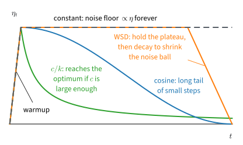

# Stochastic Gradient Methods
:label:`sec_mdl-stochastic-gradient-methods`

Training a network almost never uses the exact gradient of its loss. Each
step computes the gradient on a minibatch of a few hundred examples instead
of the whole training set. The two previous sections assumed exact
gradients: curvature set the number of steps, and convexity made a
stationary point a global minimizer. A minibatch gradient is right on
average, but it is noisy, and the noise changes the question from how many
steps a run needs to how close to the minimizer it can get. This section
asks what the noise costs and how that cost can be removed.

The simplest loss already shows the cost. Take $f(x) = \tfrac12 x^2$, whose
minimizer is $0$, add noise of unit variance to every gradient, and use the
step $\eta = 0.1$. With exact gradients each step would shrink $x$ by a tenth,
and the iterate would approach $0$ as closely as we like. With noise it never
settles: its mean square tends to $0.1/1.9 \approx 0.053$, so it stays about
$0.23$ away from the minimizer however many steps we take. Three numbers set
the loss at which a run ends: the size of the noise, the step, and the number
of steps we can afford.

We first measure the noise of a minibatch gradient. On a quadratic we then
compute exactly where a fixed step stalls and how long it takes to get there.
Next we show how a decaying step removes the stall and what its constant must
be, and we bound the loss that a constant step tuned to a fixed budget reaches
on convex and on nonconvex losses. Finally, we cancel the noise on a finite
training set with a stored gradient. Every method in this section uses one
step size for all coordinates, and the next section lets each coordinate
choose its own.

```{.python .input #mdl-stochastic-gradient-methods-stochastic-gradient-methods}
#@tab mxnet
%matplotlib inline
from d2l import mxnet as d2l
import numpy as np
```

```{.python .input #mdl-stochastic-gradient-methods-stochastic-gradient-methods}
#@tab pytorch
%matplotlib inline
from d2l import torch as d2l
import numpy as np
```

```{.python .input #mdl-stochastic-gradient-methods-stochastic-gradient-methods}
#@tab tensorflow
%matplotlib inline
from d2l import tensorflow as d2l
import numpy as np
```

```{.python .input #mdl-stochastic-gradient-methods-stochastic-gradient-methods}
#@tab jax
%matplotlib inline
from d2l import jax as d2l
import numpy as np
```

## Minibatch Gradients
:label:`subsec_mdl-stochastic-gradients`

### The Cost of a Full Gradient

A training loss averages the losses of $n$ examples,

$$
f(\mathbf{x}) = \frac{1}{n} \sum_{i=1}^n f_i(\mathbf{x}),
$$

where $f_i$ is the loss on example $i$ and $\mathbf{x} \in \mathbb{R}^d$ holds
the parameters. Its gradient $\nabla f = \tfrac1n \sum_i \nabla f_i$ is an
average too, so computing it touches all $n$ examples. With $n = 10^9$
examples, one step of gradient descent is one pass over the data, and
gradient descent needs thousands of steps: on the chapter's running example
$\tfrac12(x_1^2 + 1000\,x_2^2)$, whose two curvatures differ by a factor of
$1000$, the best fixed step needs about $7{,}000$ steps to shrink the error a
million-fold. **Stochastic gradient descent** (SGD) replaces the average
over all examples by the average over a random **minibatch** $\mathcal{B}$
of $b$ indices,

$$
\hat{\mathbf{g}}_b(\mathbf{x}) = \frac{1}{b} \sum_{i \in \mathcal{B}} \nabla f_i(\mathbf{x}),
\qquad
\mathbf{x}_{k+1} = \mathbf{x}_k - \eta_k\, \hat{\mathbf{g}}_b(\mathbf{x}_k).
$$
:eqlabel:`eq_mdl-opt-minibatch`

Each step thus reads $b$ examples instead of $n$. A minibatch of $b = 256$
out of $10^9$ examples costs about four million times less than a full pass,
and the next subsection shows that its gradient is right on average.
Throughout the section, $k$ counts optimizer steps, and the step size
$\eta_k$ may change with $k$. In the analysis, a fresh minibatch is drawn at
every step and its $b$ indices are independent and uniform on
$\{1, \ldots, n\}$, that is,
drawn with replacement. Training loops usually shuffle the data and draw
without replacement, which multiplies the variance below by
$(n-b)/(n-1)$, a factor close to one when $b \ll n$ (:numref:`sec_sgd` derives
it).

### Unbiasedness and the $1/b$ Law

How good is the estimate? Two numbers answer this: its mean, and its mean
squared distance from the true gradient, which we call its noise power. The
noise power depends on how much the
example gradients spread around their average, which their covariance
measures.

**Proposition (minibatch gradients are unbiased with noise power
$\operatorname{tr}\boldsymbol{\Sigma}/b$).** *Fix $\mathbf{x}$ and let*

$$
\boldsymbol{\Sigma} = \frac{1}{n} \sum_{i=1}^n \big(\nabla f_i(\mathbf{x}) - \nabla f(\mathbf{x})\big)\big(\nabla f_i(\mathbf{x}) - \nabla f(\mathbf{x})\big)^\top
$$

*be the covariance of the gradient of one uniformly drawn example. If the $b$
indices of $\mathcal{B}$ are independent and uniform on $\{1, \ldots, n\}$, then*

$$
\mathbb{E}\big[\hat{\mathbf{g}}_b(\mathbf{x})\big] = \nabla f(\mathbf{x}),
\qquad
\mathbb{E}\big[\|\hat{\mathbf{g}}_b(\mathbf{x}) - \nabla f(\mathbf{x})\|^2\big] = \frac{\operatorname{tr} \boldsymbol{\Sigma}}{b}.
$$
:eqlabel:`eq_mdl-opt-variance`

**Proof.** A uniform index $i$ gives
$\mathbb{E}[\nabla f_i(\mathbf{x})] = \tfrac1n \sum_i \nabla f_i(\mathbf{x}) = \nabla f(\mathbf{x})$,
so each of the $b$ terms has mean $\nabla f(\mathbf{x})$, and so does their
average. The terms are independent, each with covariance $\boldsymbol{\Sigma}$.
Covariances of independent terms add, so their sum has covariance
$b\boldsymbol{\Sigma}$ and their average $b\boldsymbol{\Sigma}/b^2 = \boldsymbol{\Sigma}/b$.
The expected squared norm of a mean-zero vector is the trace of its
covariance. $\blacksquare$

The minibatch gradient therefore points the right way on average, and its
error has power $\operatorname{tr}\boldsymbol{\Sigma}/b$. In a run, $\mathbf{x}$
is the current iterate $\mathbf{x}_k$ and the minibatch is drawn after it, so
both statements hold conditionally on $\mathbf{x}_k$. Unbiasedness rests on
uniform sampling: a sampler that draws example $i$ with probability $p_i$
must weight its gradient by $1/(np_i)$ to stay unbiased.

The noise power falls like $1/b$, so its root mean square falls only like
$1/\sqrt{b}$: a hundred times more examples per step make the gradient ten
times quieter. The signal $\nabla f$ has power $\|\nabla f\|^2$ at every batch size, and the two
powers are equal at the batch size
$b_{\textrm{noise}} = \operatorname{tr}\boldsymbol{\Sigma}/\|\nabla f\|^2$, which
the main text calls the gradient-noise scale (:numref:`sec_batch_size`);
exercise :exref:`ex_mdl-gradient-based-optimization-use-eqref-eq-mdl` derives
the version weighted by curvature.

For the running example we model this noise directly. The gradient of
$f(\mathbf{x}) = \tfrac12(x_1^2 + 1000\,x_2^2)$ is $(x_1, 1000\,x_2)$, and we add
to it noise of mean zero and variance $\sigma^2 = 1$ on each coordinate, drawn
afresh at every step. The variance $\sigma^2$ stands for a diagonal entry of
$\boldsymbol{\Sigma}/b$.

To check the proposition on data, we use a small logistic-regression problem,
which serves all the measurements of this section. It has $n = 200$ examples
$\mathbf{a}_i \in \mathbb{R}^5$ with standard normal entries, labels
$y_i \in \{-1, +1\}$ drawn from the logistic model with weights
$(1, -2, 1.5, 0, 2)$, and the loss

$$
f(\mathbf{x}) = \frac{1}{n} \sum_{i=1}^n \log\big(1 + e^{-y_i \mathbf{a}_i^\top \mathbf{x}}\big) + \frac{0.1}{2} \|\mathbf{x}\|^2.
$$

Each example contributes a log-loss that is small when its margin
$y_i \mathbf{a}_i^\top \mathbf{x}$ is large and positive, and the penalty makes
$f$ strongly convex with $\mu \ge 0.1$. The gradient of example $i$ is
$\nabla f_i(\mathbf{x}) = -y_i s_i \mathbf{a}_i + 0.1\,\mathbf{x}$, where
$s_i = 1/(1 + e^{y_i \mathbf{a}_i^\top \mathbf{x}})$ is the probability that
the model assigns to the wrong label. The cell defines the data, the loss, and
all $n$ example gradients at once, as the rows of an $n \times d$ matrix.

```{.python .input #mdl-stochastic-gradient-methods-unbiasedness-and-the-1-b-law-1}
n, d, reg = 200, 5, 0.1                          # examples, parameters, l2 weight
x_true = np.array([1.0, -2.0, 1.5, 0.0, 2.0])
rng = np.random.default_rng()
A = rng.normal(size=(n, d))                       # row i: the features a_i
y = np.where(rng.random(n) < 1 / (1 + np.exp(-A @ x_true)), 1.0, -1.0)

def loss(x, A, y, reg):
    """The regularized logistic loss f(x)."""
    return np.mean(np.log1p(np.exp(-y * (A @ x)))) + 0.5 * reg * x @ x

def example_grads(x, A, y, reg):
    """The n x d matrix whose row i is the gradient of f_i at x."""
    s = 1 / (1 + np.exp(y * (A @ x)))             # probability of the wrong label
    return -(y * s)[:, None] * A + reg * x
```

Does the error of the minibatch gradient fall like $1/b$? The next cell
computes $\operatorname{tr}\boldsymbol{\Sigma}$ at $\mathbf{x} = \mathbf{0}$ from
the example gradients, draws $10{,}000$ minibatches of each size, and compares
the measured mean squared error with $\operatorname{tr}\boldsymbol{\Sigma}/b$.

```{.python .input #gradient-based-optimization-sgd-variance}
G = example_grads(np.zeros(d), A, y, reg)        # per-example gradients at x = 0
g = G.mean(axis=0)                                # the full gradient
tr_sigma = ((G - g)**2).sum(axis=1).mean()
print(f'tr Sigma = {tr_sigma:.3f}')
for b in [1, 4, 16, 64]:
    idx = rng.integers(0, n, size=(10000, b))    # minibatches, with replacement
    err = ((G[idx].mean(axis=1) - g)**2).sum(axis=1).mean()
    print(f'b = {b:2d}: measured {err:.4f}, tr Sigma / b = {tr_sigma / b:.4f}, '
          f'ratio {err * b / tr_sigma:.3f}')
```

The single-example noise power $\operatorname{tr}\boldsymbol{\Sigma}$ is about
$1.1$, and the measured error matches $\operatorname{tr}\boldsymbol{\Sigma}/b$
within a few percent at every batch size: the ratio stays near one from
$b = 1$ to $b = 64$. The proposition describes the estimate at one point. What
the noise does to a whole run is the next question.

### The Noise Floor

Does the noise average out over a run, or does it accumulate? The smallest
case answers this completely: one coordinate of a quadratic,
$f(x) = \tfrac12 \lambda x^2$ with curvature $\lambda > 0$ and minimizer $0$. A
stochastic gradient is the true gradient $\lambda x_k$ plus noise $\xi_k$ that
has mean zero given $x_k$ and variance $\sigma^2$, so one step reads

$$
x_{k+1} = x_k - \eta\,(\lambda x_k + \xi_k) = \rho\, x_k - \eta\, \xi_k,
\qquad \rho = 1 - \eta\lambda.
$$

Each step shrinks the distance to the minimizer by the factor $\rho$, as
gradient descent does, and then adds a random kick $-\eta\xi_k$. We follow the
size of the iterate through its second moment $e_k = \mathbb{E}[x_k^2]$.
When we square the step and take expectations, the cross term
$-2\rho\eta\,\mathbb{E}[x_k \xi_k]$ vanishes because the noise has mean zero
given $x_k$:

$$
e_{k+1} = \rho^2 e_k + \eta^2 \sigma^2.
$$

The second moment thus contracts by the factor $\rho^2$ and grows by the noise
power $\eta^2\sigma^2$ at every step. A linear recursion with a constant input
is solved through its fixed point. The fixed point $V$ satisfies $V = \rho^2 V + \eta^2\sigma^2$; subtracting the two equations shows
that the remainder $e_k - V$ is multiplied by $\rho^2$ at every step. Hence

$$
e_k = V + \rho^{2k}\,(e_0 - V)
$$
:eqlabel:`eq_mdl-opt-noise-floor-trajectory`

with the **noise floor**

$$
V = \frac{\eta^2 \sigma^2}{1 - \rho^2}
= \frac{\eta\, \sigma^2}{\lambda\, (2 - \eta\lambda)}
\;\approx\; \frac{\eta\, \sigma^2}{2\lambda}
\qquad (\eta\lambda \ll 1).
$$
:eqlabel:`eq_mdl-opt-noise-ball`

The floor grows in proportion to the step and to the noise variance, and it
shrinks as the curvature grows. These formulas hold for
$0 < \eta < 2/\lambda$. At $\eta = 2/\lambda$ we have $\rho = -1$ and the
transient no longer decays, and for $\eta > 2/\lambda$ the second moment grows
even without noise. The value $2/\lambda$ is the stability ceiling of gradient
descent on a quadratic.

The second moment has two parts. The transient $\rho^{2k}(e_0 - V)$ is the one
gradient descent also has, and it decays geometrically. The floor $V$ exists
only because of the noise. Far from the minimizer the transient dominates and
SGD moves like gradient descent. Near it, the contraction removes
$(1 - \rho^2)\,e$ per step while the noise adds $\eta^2\sigma^2$, and the two
balance at $e = V$.

The iterate therefore does not converge to the minimizer. Its distribution
settles into a stationary distribution with mean square $V$, a **noise ball**
around the minimizer. Intuitively, the noise kicks the iterate by the same
amount at every step, while the pull $\eta\lambda x$ toward the minimizer
weakens as the iterate approaches it. The two balance at a root mean square
distance of about $\sqrt{\eta\sigma^2/(2\lambda)}$, which grows like
$\sqrt{\eta}$. :numref:`fig_mdl-opt-sgd-noise-ball` shows both phases on a
two-dimensional bowl.


:label:`fig_mdl-opt-sgd-noise-ball`

Training is judged by the loss rather than by the distance. Since
$\mathbb{E} f(x_k) = \tfrac12 \lambda e_k$, the loss floor is

$$
\tfrac12 \lambda V = \frac{\eta\, \sigma^2}{2\,(2 - \eta\lambda)} \;\approx\; \frac{\eta\, \sigma^2}{4}.
$$

The loss floor is proportional to the step and to the noise power and, for
small steps, independent of the curvature: a flat direction lets the iterate
wander farther, by exactly the factor that its flatness takes off the loss.

On a quadratic in $d$ dimensions, each coordinate along an eigenvector of the
Hessian obeys this scalar recursion with its own eigenvalue $\lambda_i$ and
the noise variance $\sigma_i^2$ along that eigenvector, so the loss floors
$\eta\sigma_i^2/(2(2 - \eta\lambda_i))$ add. The $\sigma_i^2$ are the diagonal
entries of $\boldsymbol{\Sigma}/b$ in the eigenbasis and sum to
$\operatorname{tr}\boldsymbol{\Sigma}/b$. When every $\eta\lambda_i \ll 1$,
the total floor is therefore about
$\eta\operatorname{tr}\boldsymbol{\Sigma}/(4b)$, and it depends on the step
and the batch only through $\eta/b$. Halving the step and doubling the batch
lower it by the same factor. This coupling is behind the learning-rate rules
for large batches in :numref:`sec_batch_size`.

Take $\lambda = \sigma = 1$. At $\eta = 0.1$ the floor is $V = 0.1/1.9 = 0.053$,
a root mean square of $0.23$ and a loss floor of $0.026$. At $\eta = 0.3$ it is
$V = 0.176$, a root mean square of $0.42$ and a loss floor of $0.088$. Starting
from $x_0 = 3$, so $e_0 = 9$, the remainder $e_k - V$ falls below a tenth of $V$
after $36$ steps at $\eta = 0.1$ (where $\rho^2 = 0.81$) and after $9$ steps at
$\eta = 0.3$ (where $\rho^2 = 0.49$). A third of the step gives about a third of
the floor and takes four times as many steps to reach it. Every remedy in this
section manages this trade-off between the floor and the speed.

On the running example the two coordinates of
$\tfrac12(x_1^2 + 1000\,x_2^2)$ obey the scalar recursion with $\lambda_1 = 1$
and $\lambda_2 = 1000$. Take $\eta = 1/L = 10^{-3}$, where $L = 1000$ is the
largest curvature; this step is half the stability ceiling $2/1000$. The stiff coordinate has $\rho_2 = 0$: one step erases its transient,
and from then on it sits on its floor $V_2 = 10^{-3}/1000 = 10^{-6}$. The slow
coordinate has $\rho_1 = 0.999$ and the floor
$V_1 = 10^{-3}/1.999 = 5.0 \times 10^{-4}$, and its transient needs
$\log 1000/(-2\log 0.999) \approx 3{,}450$ steps to fall a thousandfold. The
loss floor is $7.5 \times 10^{-4}$: $2.5 \times 10^{-4}$ from the slow
coordinate and $5 \times 10^{-4}$ from the stiff one. The coordinate that
gradient descent handles in one step holds the larger share of the floor,
because its step sits at $\eta\lambda_2 = 1$, where the loss floor is
$\eta\sigma^2/2$ rather than $\eta\sigma^2/4$. Ill-conditioning costs steps on
the slow coordinate; noise costs loss on both.

The floor formula is exact only for a quadratic with additive noise. On other
losses the law "floor proportional to $\eta$" holds approximately, but the
constant changes. The logistic experiment of the next part checks this law.

## Step-Size Decay
:label:`subsec_mdl-step-size-decay`

### The Robbins--Monro Conditions

The floor is proportional to $\eta$, so reaching the minimizer requires steps
that shrink to zero. Steps that shrink too fast, however, stop the iterate
short: a gradient of unit size moves it by at most $\sum_k \eta_k$ in total.
The conditions of :citet:`Robbins.Monro.1951` state both demands,

$$
\sum_{k} \eta_k = \infty,
\qquad
\sum_{k} \eta_k^2 < \infty.
$$
:eqlabel:`eq_mdl-opt-robbins-monro`

The first condition lets the iterate travel any distance. The second keeps the
total injected noise variance, $\sigma^2 \sum_k \eta_k^2$, finite. The steps
$\eta_k = c/k$ satisfy both; $\eta_k = c/\sqrt{k}$ and a constant step satisfy
only the first. These are the step conditions of the Robbins--Monro theorem.
Together with unbiased stochastic gradients whose variance grows at most
quadratically with the distance from the minimizer, they make SGD converge to
the minimizer of a strongly convex loss
:cite:`Robbins.Monro.1951,Bottou.Curtis.Nocedal.2018`.

On the quadratic model, mean-square convergence needs less. Unrolling the
recursion shows that $e_k \to 0$ whenever $\eta_k \to 0$ and
$\sum_k \eta_k = \infty$ (with $\eta_k < 2/\lambda$), and $\eta_k = c/\sqrt{k}$
gives $e_k \approx c\sigma^2/(2\lambda\sqrt{k})$, the floor of the current step
(exercise :exref:`ex_mdl-stochastic-gradient-methods-robbins-monro-quadratic`).
The square-summable condition is what the general theorem needs for its
stronger claim, the convergence of almost every run.

Does the law "floor proportional to $\eta$" hold on a loss that is not
quadratic, and does a decaying step go below the floor? We first compute a
reference optimum $f^\star$ of the logistic problem by $4{,}000$
full-gradient steps. We then write a minibatch SGD loop with batch size $b$
that records the gap $f(\mathbf{x}_k) - f^\star$ after every step.

```{.python .input #mdl-stochastic-gradient-methods-the-robbins-monro-conditions-1}
x_star = np.zeros(d)
for _ in range(4000):                             # full-gradient reference optimum
    x_star -= 0.5 * example_grads(x_star, A, y, reg).mean(axis=0)
f_star = loss(x_star, A, y, reg)

def sgd(schedule, A, y, reg, f_star, rng, steps=4000, b=8):
    """Minibatch SGD from x = 0; returns the gap f(x_k) - f* after every step."""
    x, gaps = np.zeros(A.shape[1]), np.empty(steps)
    for k in range(steps):
        idx = rng.integers(0, len(y), size=b)
        x -= schedule(k) * example_grads(x, A[idx], y[idx], reg).mean(axis=0)
        gaps[k] = loss(x, A, y, reg) - f_star
    return gaps
```

The cell below runs $4{,}000$ steps with $b = 8$ for two fixed steps,
$\eta = 0.8$ and $\eta = 0.4$, and for the decaying step
$\eta_k = 0.8/(1 + k/100)$, which is $c/(k + k_0)$ with $c = 80$ and
$k_0 = 100$. It prints the mean gap over the last $1{,}000$ steps of each run
and two ratios, and plots the gaps averaged over windows of $100$ steps.

```{.python .input #gradient-based-optimization-sgd-schedule}
rules = {'fixed 0.8': lambda k: 0.8, 'fixed 0.4': lambda k: 0.4,
         'decay 0.8/(1+k/100)': lambda k: 0.8 / (1 + k / 100)}
gaps = {name: sgd(s, A, y, reg, f_star, rng) for name, s in rules.items()}
tail = [gap[-1000:].mean() for gap in gaps.values()]
print('mean gap, last 1000 steps: ' + ', '.join(f'{t:.1e}' for t in tail))
print(f'floor(0.8) / floor(0.4) = {tail[0] / tail[1]:.2f}, '
      f'floor(0.8) / decay = {tail[0] / tail[2]:.0f}')
window = np.ones(100) / 100                       # plot 100-step moving averages
d2l.plot(np.arange(100, 4001), [np.convolve(gap, window, 'valid') for gap in gaps.values()],
         'step k', 'f(x_k) - f*', xscale='log', yscale='log', legend=list(gaps))
```

Both fixed steps stall. The mean gap over the last $1{,}000$ steps is about
$1$ to $2 \times 10^{-2}$ at $\eta = 0.8$, and halving the step about halves
it. The ratio scatters between about $1.7$ and $2.8$ across runs, around the
factor $2$ that the quadratic model predicts, although the loss is not
quadratic. The decaying run ends roughly $20$ to $90$ times below the $\eta = 0.8$
floor, and on the log–log plot its curve still trends down, jagged with
minibatch noise. Its
early large steps cover the distance to the minimizer, and its late small
steps shrink the noise ball.

### The Constant in a $1/k$ Schedule

The schedule $\eta_k = c/(k + k_0)$ satisfies both Robbins--Monro conditions
for every $c > 0$, and the shift $k_0$ keeps the first steps below the
stability ceiling. Does every $c$ give the rate $1/k$? The scalar model with
curvature $\lambda = \mu$ answers exactly. Writing $t = k + k_0$, its recursion
becomes

$$
e_{k+1} = \Big(1 - \frac{c\mu}{t}\Big)^2 e_k + \frac{c^2 \sigma^2}{t^2}.
$$

The contraction now weakens like $1/t$, while the injected noise falls like
$1/t^2$. Which of the two wins depends on $c$.

**Proposition (the constant of a $1/k$ schedule).** *On the scalar model with
curvature $\mu$ and steps $\eta_k = c/(k + k_0)$, if $2c\mu > 1$ then
$k\, e_k \to A$ with*

$$
A = \frac{c^2 \sigma^2}{2c\mu - 1}.
$$
:eqlabel:`eq_mdl-opt-one-over-k-constant`

*If $2c\mu < 1$, then $e_k$ decays like $k^{-2c\mu}$, more slowly than $1/k$.
For every $c > 0$, $e_k \to 0$.*

**Derivation of the constant.** We find $A$ to leading order; exercise
:exref:`ex_mdl-gradient-based-optimization-one-over-k-constant` turns this into
an induction. Substitute $e_k \approx A/t$ into the recursion. The left side is
$A/(t+1) \approx A/t - A/t^2$. On the right,
$(1 - c\mu/t)^2 \approx 1 - 2c\mu/t$, so the right side is
$A/t - 2c\mu A/t^2 + c^2\sigma^2/t^2$ up to terms of order $t^{-3}$. The $1/t$
terms agree, and matching the $1/t^2$ terms gives
$-A = -2c\mu A + c^2\sigma^2$, that is, $A(2c\mu - 1) = c^2\sigma^2$. The step
that is not routine is the shift on the left: moving from $t$ to $t + 1$
contributes $-A/t^2$, of the same order as the contraction, and it is the
source of the threshold. Without it we would find $A = c\sigma^2/(2\mu)$ for
every $c$.

Below the threshold, the contractions decide the rate, both for the
initial error and for the noise injected early: their product is
$\prod_{j}(1 - c\mu/(j + k_0))^2 \approx (k_0/t)^{2c\mu}$, because
$\log(1 - u) \approx -u$ and $\sum_{j \le t} 1/j \approx \log t$, and for
$2c\mu < 1$ this decays more slowly than $1/t$. $\blacksquare$

Take $\mu = \sigma = 1$. The constant $c = 1$ gives $A = 1$; iterating the
recursion from $e_0 = 1$ with $k_0 = 10$ gives $k\, e_k = 1.0001$ at
$k = 10^6$. The constant $c = 2$ gives $A = 4/3$ and $c = 0.75$ gives
$A = 1.125$. Below the threshold, $c = 0.25$ gives a log–log slope of $-0.50$
between $k = 10^5$ and $10^6$, and $c = 0.1$ a slope of $-0.20$. The constant
$A$ is smallest at $c = 1/\mu$, where $A = \sigma^2/\mu^2$: the best $1/k$
schedule reaches $e_k \approx \sigma^2/(\mu^2 k)$. Averaging the iterates of a
run with a small constant step reaches the same constant, with no decay at all
(exercise :exref:`ex_mdl-stochastic-gradient-methods-iterate-averaging`).

Intuitively, with $c < 1/(2\mu)$ the steps shrink faster than the iterate can
use them, so the schedule limits the progress before the noise does. This is
one reason practical schedules decay more slowly than $1/k$.

On the running example the shift $k_0$ cannot be small either. The first step must respect the stiff
coordinate's ceiling, $c/k_0 < 2/L$, so $k_0 > cL/2$, and the best constant
for the slow coordinate, $c = 1/\mu = 1$, forces $k_0 > 500$. With
$k_0 = 1000$ and $\mathbf{x}_0 = (1, 1)$, the slow coordinate's transient still holds a fraction
$(k_0/(k + k_0))^2 \approx 0.008$ of its initial value at $k = 10^4$, and the
expected loss ends at $4.2 \times 10^{-3}$, more than five times the constant
step's floor of $7.5 \times 10^{-4}$. The small early steps that the stiff
coordinate demands leave the slow coordinate far from its minimizer, and the
condition number reappears in $k_0$.

### Schedule Shapes under the Exact Recursion

Practice uses other shapes than $1/k$, above all cosine decay and
warmup–stable–decay. No theorem ranks them on a deep network. On the quadratic
model, however, the expected loss of any schedule can be computed exactly,
with no runs and no random numbers. The derivation of the floor holds step by
step when the step size changes, so

$$
e_{k+1} = (1 - \eta_k \lambda)^2 e_k + \eta_k^2 \sigma^2,
\qquad
\mathbb{E} f(x_k) = \tfrac12 \lambda e_k.
$$

Iterating this recursion computes the expected loss of a whole run in $K$
multiplications. We compare four shapes over a budget of $K$ steps, which
:numref:`fig_mdl-opt-schedule-zoo` draws. They are a constant step $\eta_0$; the decay
$\eta_0/(1 + k/k_0)$; **cosine decay** :cite:`Loshchilov.Hutter.2016`; and
**warmup–stable–decay** (WSD) :cite:`Hu.Tu.Han.ea.2024`, which holds $\eta_0$
for the first $80\%$ of the budget and then decays linearly to zero:

$$
\eta_k^{\textrm{cos}} = \tfrac12 \eta_0 \Big(1 + \cos\frac{\pi k}{K}\Big),
\qquad
\eta_k^{\textrm{WSD}} =
\begin{cases}
\eta_0, & k < 0.8K, \\
\eta_0\, \dfrac{K - k}{0.2K}, & k \ge 0.8K.
\end{cases}
$$

Both start at $\eta_0$ and end at zero; cosine decays throughout the run, WSD
only at its end. WSD is popular for an operational reason: any checkpoint of
its constant phase can be decayed to any budget, so the budget need not be
fixed at launch. The quadratic model ranks the final losses of the shapes, not
such operational merits.


:label:`fig_mdl-opt-schedule-zoo`

Which shape ends lowest? The cell iterates the exact recursion with
$\lambda = \sigma = 1$, $K = 2000$, $\eta_0 = 0.3$ and $x_0 = 3$ (without the
warmup), prints the expected loss at $80\%$ of the budget and at the end, and
plots $\mathbb{E} f(x_k)$.

```{.python .input #adaptive-stochastic-methods-schedules}
lam, sigma, K, eta0, x0 = 1.0, 1.0, 2000, 0.3, 3.0

def expected_loss(schedule, lam, sigma, K, x0):
    """E f(x_k) = lam e_k / 2 for k = 1..K from the exact second-moment recursion."""
    e, Ef = x0**2, np.empty(K)
    for k in range(K):
        eta = schedule(k)
        e = (1 - eta * lam)**2 * e + eta**2 * sigma**2
        Ef[k] = 0.5 * lam * e
    return Ef

schedules = {
    'constant': lambda k: eta0,
    'c/k': lambda k: eta0 / (1 + k / 50),
    'cosine': lambda k: 0.5 * eta0 * (1 + np.cos(np.pi * k / K)),
    'WSD': lambda k: eta0 if k < 0.8 * K else eta0 * (K - k) / (0.2 * K)}
traces = {name: expected_loss(s, lam, sigma, K, x0) for name, s in schedules.items()}
print(f'floor {eta0 * sigma**2 / (2 * (2 - eta0 * lam)):.4f}   '
      + ''.join(f'{name:>10s}' for name in traces))
for label, k in [('E f at 80%', int(0.8 * K) - 1), ('E f at end', K - 1)]:
    print(f'{label:15s}' + ''.join(f'{Ef[k]:10.2e}' for Ef in traces.values()))
d2l.plot(np.arange(1, K + 1), list(traces.values()), 'step k', 'E f(x_k)',
         yscale='log', legend=list(traces))
```

The output is the same on every run. The constant step comes within a tenth
of its loss floor $0.0882$ by step $9$ and stays there. WSD *is* the constant
run until its decay begins, so at $80\%$ of the budget it sits on the same
floor. Its last $400$ steps lower the loss $14.4$ times, to
$6.1 \times 10^{-3}$, so all of its improvement comes from the decay. Cosine
and $c/k$ end close together, at $1.7 \times 10^{-3}$ and
$1.9 \times 10^{-3}$, and WSD ends three to four times higher.

The $c/k$ value checks the proposition: the schedule $0.3/(1 + k/50)$ is
$c/(k + k_0)$ with $c = 15$ and $k_0 = 50$, so $A = 225/29 = 7.8$ and
$\mathbb{E} f(x_K) \approx \tfrac12 A/(K + k_0) = 1.9 \times 10^{-3}$. The
ordering is exact for these parameters but does not carry over to a network,
where WSD's plateau is valued for the operational reason above. On the model
itself, the plateau does not help the final loss: lengthening WSD's decay
phase lowers the final loss steadily, down to $2.7 \times 10^{-3}$ for a
linear decay over the whole run (exercise
:exref:`ex_mdl-stochastic-gradient-methods-wsd-fraction`).

## Rates for a Fixed Budget
:label:`subsec_mdl-fixed-budget-rates`

A decaying schedule is designed for a run of unlimited length. In practice the
budget $K$ is fixed in advance, and the question becomes which constant step
to use and what loss it guarantees. Without strong convexity there is no
contraction factor and no exact floor, so we bound instead of compute. Both
results of this part have the same two-term shape: a transient that falls like
$1/(\eta K)$ plus a floor that grows like $\eta$. The two terms balance at
$\eta \propto 1/\sqrt{K}$, as :numref:`fig_mdl-opt-budget-tradeoff` shows.


:label:`fig_mdl-opt-budget-tradeoff`

### Averaged Iterates on Convex Losses

What can a constant step guarantee in $K$ steps on a convex loss? The result
needs only convexity, through the subgradient inequality: a vector
$\mathbf{s}$ is a subgradient of $f$ at $\mathbf{x}$ if
$f(\mathbf{y}) \ge f(\mathbf{x}) + \mathbf{s}^\top(\mathbf{y} - \mathbf{x})$ for
all $\mathbf{y}$, and the set $\partial f(\mathbf{x})$ of subgradients is
$\{\nabla f(\mathbf{x})\}$ wherever $f$ is differentiable
(:numref:`sec_mdl-convexity`).

**Proposition (SGD on a convex loss, averaged iterate).** *Let $f$ be convex
with a minimizer $\mathbf{x}^\star$ and $f^\star = f(\mathbf{x}^\star)$. Run
$\mathbf{x}_{k+1} = \mathbf{x}_k - \eta\, \mathbf{g}_k$ from a point with
$\|\mathbf{x}_0 - \mathbf{x}^\star\| \le D$, where the stochastic gradient
satisfies $\mathbb{E}[\mathbf{g}_k \mid \mathbf{x}_k] \in \partial f(\mathbf{x}_k)$
and $\mathbb{E}[\|\mathbf{g}_k\|^2 \mid \mathbf{x}_k] \le G^2$. Then the average
$\bar{\mathbf{x}}_K = \frac1K \sum_{k=0}^{K-1} \mathbf{x}_k$ satisfies*

$$
\mathbb{E}\big[f(\bar{\mathbf{x}}_K)\big] - f^\star \;\le\; \frac{D^2}{2\eta K} + \frac{\eta\, G^2}{2},
$$
:eqlabel:`eq_mdl-opt-convex-averaged`

*and the step $\eta = D/(G\sqrt{K})$ gives
$\mathbb{E}[f(\bar{\mathbf{x}}_K)] - f^\star \le DG/\sqrt{K}$.*

**Proof.** We follow the squared distance to the minimizer. Expanding the
step,

$$
\|\mathbf{x}_{k+1} - \mathbf{x}^\star\|^2
= \|\mathbf{x}_k - \mathbf{x}^\star\|^2 - 2\eta\, \mathbf{g}_k^\top(\mathbf{x}_k - \mathbf{x}^\star) + \eta^2 \|\mathbf{g}_k\|^2.
$$

Take the expectation given $\mathbf{x}_k$. The middle term becomes
$-2\eta\, \mathbf{s}_k^\top(\mathbf{x}_k - \mathbf{x}^\star)$ with the
subgradient $\mathbf{s}_k = \mathbb{E}[\mathbf{g}_k \mid \mathbf{x}_k]$, and the
subgradient inequality at $\mathbf{y} = \mathbf{x}^\star$ gives
$\mathbf{s}_k^\top(\mathbf{x}_k - \mathbf{x}^\star) \ge f(\mathbf{x}_k) - f^\star$.
This is the step that is not routine: the inner product of the gradient with
the displacement from the minimizer is at least the loss gap, so a large gap
forces the distance down. The last term is at most $\eta^2 G^2$. Taking total
expectations and writing $r_k = \mathbb{E}\|\mathbf{x}_k - \mathbf{x}^\star\|^2$,

$$
2\eta\, \mathbb{E}\big[f(\mathbf{x}_k) - f^\star\big] \;\le\; r_k - r_{k+1} + \eta^2 G^2 .
$$

Summing over $k < K$ telescopes the distances, and $r_0 - r_K \le D^2$, so
$2\eta \sum_{k<K} \mathbb{E}[f(\mathbf{x}_k) - f^\star] \le D^2 + K\eta^2 G^2$.
Divide by $2\eta K$ and apply Jensen's inequality to the convex $f$,
$f(\bar{\mathbf{x}}_K) \le \frac1K \sum_k f(\mathbf{x}_k)$. The two terms of the
bound are equal at $\eta = D/(G\sqrt{K})$, where each is $DG/(2\sqrt{K})$.
$\blacksquare$

The transient $D^2/(2\eta K)$ is the distance that $K$ steps of size $\eta$
must cover, and the floor $\eta G^2/2$ is the noise that each step injects.
The proof needs no smoothness, so the loss may have corners, as the hinge loss
does. With $D = G = 1$ and $K = 10^4$, the best step is $\eta = 0.01$ and the
bound is $0.01$; with $K = 10^2$, the step is $0.1$ and the bound $0.1$. A
hundred times the budget lowers both the best step and the bound tenfold. This
is also the best possible order: over the class of the proposition, no method
that sees only unbiased stochastic gradients with
$\mathbb{E}\|\mathbf{g}\|^2 \le G^2$ can guarantee less than a fixed positive
multiple of $DG/\sqrt{K}$ in the worst case :cite:`Nemirovski.Yudin.1983`.

Strong convexity changes the order. On the scalar quadratic, the best constant
step for a budget $K$ reaches $e_K = \Theta(\log K/K)$ (exercise
:exref:`ex_mdl-stochastic-gradient-methods-best-constant-step`), because the
transient there decays geometrically, like $\rho^{2K}$, rather than like
$1/(\eta K)$.

The proposition bounds the *average* of the iterates. The last iterate obeys a
weaker bound, and for the last iterate the worst-case optimal schedule over a
known budget decays linearly to zero :cite:`Defazio.Cutkosky.Mehta.ea.2023`.
The hypothesis $\mathbb{E}\|\mathbf{g}_k\|^2 \le G^2$ also limits the result:
it fails for a quadratic on all of $\mathbb{R}^d$, whose gradient is
unbounded. It holds for Lipschitz
losses with bounded features, such as the logistic loss, or for iterates that
stay in a bounded set. As a worst-case bound it can be loose on a particular
problem: on the logistic problem of this section it overestimates the gap by
more than an order of magnitude (exercise
:exref:`ex_mdl-stochastic-gradient-methods-convex-bound-logistic`).

### Random Iterates on Nonconvex Losses
:label:`subsec_mdl-nonconvex-sgd`

Networks have nonconvex losses *and* noisy gradients, and the results so far
handle one of these at a time. For a function $f$ whose gradient is
$L$-Lipschitz (an $L$-smooth function), the graph lies below a parabola of
curvature $L$ tangent at any point,

$$
f(\mathbf{y}) \;\le\; f(\mathbf{x}) + \nabla f(\mathbf{x})^\top(\mathbf{y} - \mathbf{x}) + \frac{L}{2}\|\mathbf{y} - \mathbf{x}\|^2
\quad \textrm{for all } \mathbf{x}, \mathbf{y}.
$$

This quadratic ceiling bounds the loss after any step by the loss before it,
a linear decrease, and a penalty for the length of the step. With exact
gradients and $\eta = 1/L$, the ceiling gives
$\min_{k<K}\|\nabla f(\mathbf{x}_k)\|^2 \le 2L\Delta/K$ without any convexity,
where $f^\star$ is a lower bound of $f$ and $\Delta = f(\mathbf{x}_0) - f^\star$
(:numref:`sec_mdl-gradient-based-optimization`). With noisy gradients on a
quadratic, a fixed step parks on a floor. The theorem of
:citet:`Ghadimi.Lan.2013` combines the two. Model one SGD step as
$\mathbf{x}_{k+1} = \mathbf{x}_k - \eta\, \mathbf{g}_k$, where the stochastic
gradient satisfies

$$
\mathbb{E}\left[\mathbf{g}_k \mid \mathbf{x}_k\right] = \nabla f(\mathbf{x}_k),
\qquad
\mathbb{E}\left[\|\mathbf{g}_k - \nabla f(\mathbf{x}_k)\|^2 \mid \mathbf{x}_k\right] \;\le\; \sigma^2.
$$
:eqlabel:`eq_mdl-opt-sgd-oracle`

On average the stochastic gradient points the right way, and its error has
mean square at most $\sigma^2$ wherever the iterate is. A minibatch gradient
meets both conditions with $\sigma^2 = \sup_{\mathbf{x}} \operatorname{tr}\boldsymbol{\Sigma}(\mathbf{x})/b$
by :eqref:`eq_mdl-opt-variance`, provided this supremum is finite. It is
finite for the bounded $\tanh$ model below; it is infinite for least squares
on all of $\mathbb{R}^d$, whose gradient noise grows with the distance from
the minimizer.

**Proposition (SGD finds approximate stationary points).** *Let $f$ be
$L$-smooth and bounded below by $f^\star$, write
$\Delta = f(\mathbf{x}_0) - f^\star$, and run SGD with stochastic gradients
satisfying :eqref:`eq_mdl-opt-sgd-oracle` and a constant step $\eta \le 1/L$.
Then*

$$
\frac{1}{K} \sum_{k=0}^{K-1} \mathbb{E}\left[\|\nabla f(\mathbf{x}_k)\|^2\right]
\;\le\; \frac{2\Delta}{\eta K} + L\eta\sigma^2,
$$
:eqlabel:`eq_mdl-opt-ghadimi-lan`

*and the step $\eta = \min\bigl(1/L,\ \sqrt{2\Delta/(L\sigma^2 K)}\bigr)$ gives,
for an index $R$ drawn uniformly from $\{0, \ldots, K-1\}$ independently of the
run,*

$$
\mathbb{E}\left[\|\nabla f(\mathbf{x}_R)\|^2\right]
\;\le\; \frac{2L\Delta}{K} + 2\sigma\,\sqrt{\frac{2L\Delta}{K}}.
$$
:eqlabel:`eq_mdl-opt-ghadimi-lan-balanced`

**Proof.** Apply the quadratic ceiling to the step actually taken,
$\mathbf{y} - \mathbf{x} = -\eta\, \mathbf{g}_k$:

$$
f(\mathbf{x}_{k+1}) \;\le\; f(\mathbf{x}_k) - \eta\, \nabla f(\mathbf{x}_k)^\top \mathbf{g}_k + \tfrac{L\eta^2}{2}\, \|\mathbf{g}_k\|^2.
$$

Take the expectation given $\mathbf{x}_k$. This is the step that is not
routine: conditioning on the iterate turns the middle term into
$-\eta\,\|\nabla f(\mathbf{x}_k)\|^2$ by unbiasedness, and splits the last term
into signal plus noise,
$\mathbb{E}[\|\mathbf{g}_k\|^2 \mid \mathbf{x}_k] = \|\nabla f(\mathbf{x}_k)\|^2 + \mathbb{E}[\|\mathbf{g}_k - \nabla f(\mathbf{x}_k)\|^2 \mid \mathbf{x}_k] \le \|\nabla f(\mathbf{x}_k)\|^2 + \sigma^2$.
Collecting,

$$
\mathbb{E}\left[f(\mathbf{x}_{k+1}) \mid \mathbf{x}_k\right]
\;\le\; f(\mathbf{x}_k) - \eta\left(1 - \tfrac{L\eta}{2}\right) \|\nabla f(\mathbf{x}_k)\|^2 + \tfrac{L\eta^2 \sigma^2}{2}.
$$

This is the descent lemma of gradient descent with an extra variance term
$\tfrac12 L\eta^2\sigma^2$ per step. For $\eta \le 1/L$ the bracket is at least
$\tfrac12$. Take total expectations and sum over $k = 0, \ldots, K-1$: the
losses telescope to $\mathbb{E}[f(\mathbf{x}_K)] - f(\mathbf{x}_0) \ge -\Delta$,
and dividing by $\eta K/2$ gives :eqref:`eq_mdl-opt-ghadimi-lan`. The average
over $k$ is the expectation at the uniformly random index $R$. For the
balanced step there are two cases. If $\sqrt{2\Delta/(L\sigma^2K)} \le 1/L$,
the two terms of :eqref:`eq_mdl-opt-ghadimi-lan` are equal, each
$\sigma\sqrt{2L\Delta/K}$. Otherwise $\eta = 1/L$ and $\sigma^2 < 2L\Delta/K$,
so the bound is $2L\Delta/K + \sigma^2 \le 2L\Delta/K + \sigma\sqrt{2L\Delta/K}$.
Both are at most the stated bound. $\blacksquare$

With $\sigma = 0$ the second term vanishes, and the deterministic rate
$2L\Delta/K$ returns. With noise and $K > 2L\Delta/\sigma^2$, the case in which
$\eta < 1/L$, the second term is the larger one, and it decays like $K^{-1/2}$. With
$L = \Delta = \sigma = 1$ and $K = 10^4$, the step is $\eta = 0.014$ and the
bound is $2 \times 10^{-4} + 0.028$: the noise term is $140$ times the
transient. At $K = 10^6$ the step is $0.0014$ and the bound $0.0028$. The
bound controls the *squared* gradient norm: a hundred times the budget gives
ten times less $\mathbb{E}\|\nabla f\|^2$, but a ten times smaller gradient
norm needs $10^4$ times the budget. With a biased estimator the proof leaves
an extra inner product, and the bound acquires a term that does not shrink
with $K$ (exercise :exref:`ex_mdl-stochastic-gradient-methods-biased-estimators`).

Why does the guarantee speak of a *random* iterate? With exact gradients the
best iterate can be identified, since $\|\nabla f(\mathbf{x}_k)\|$ is observed.
With stochastic gradients it is not, so an algorithm cannot pick the iterate
with the smallest gradient; drawing $R$ at random is a choice it can make, and
the average over the run is what that choice controls.

Compared with the convex case, the two terms and the step
$\eta \propto 1/\sqrt{K}$ are the same. The bound now controls a squared
gradient at a random iterate instead of a function value at the average.
Without convexity a small gradient is all that can be certified, and a
stationary point need not be a minimizer. This rate is optimal as well: no method with access only to such
stochastic gradients can guarantee a better order in the worst case over this
class :cite:`Arjevani.Carmon.Duchi.ea.2023`.

### The Rate on a Single $\tanh$ Neuron

Does $\mathbb{E}\|\nabla f(\mathbf{x}_R)\|^2$ fall like $K^{-1/2}$ when
$\eta \propto 1/\sqrt{K}$? We measure it on a small nonconvex problem, a single
$\tanh$ neuron fit by least squares to noisy labels: $n = 64$ examples in five
dimensions and

$$
f(\mathbf{x}) = \frac1n \sum_{i=1}^n \big(\tanh(\mathbf{a}_i^\top \mathbf{x}) - y_i\big)^2 .
$$

Each term is bounded and smooth, but the sum is not convex: $\tanh$ flattens
for large arguments, so the loss has plateaus. The cell defines the data and
the exact gradient for a batch of iterates, one per row of $\mathbf{X}$.

```{.python .input #mdl-stochastic-gradient-methods-the-measured-slope-1}
n_nc, d_nc = 64, 5                                # a small nonconvex problem
A_nc = rng.normal(size=(n_nc, d_nc))
y_nc = np.tanh(A_nc @ rng.normal(size=d_nc)) + 0.5 * rng.normal(size=n_nc)

def full_grad(X, A, y):
    """Exact gradient of mean_i (tanh(a_i^T x) - y_i)^2 at each row x of X."""
    t = np.tanh(X @ A.T)                          # (runs, n)
    return 2 * ((t - y) * (1 - t**2)) @ A / len(y)
```

The next cell runs SGD with single-example gradients for the budgets
$K = 125, 500, 2000, 8000$ with $\eta = 0.5/\sqrt{K}$, twenty runs at a time as
the rows of `X`. Along each run it records the average of
$\|\nabla f(\mathbf{x}_k)\|^2$, which is the random-iterate quantity, and its
minimum, the best iterate. It prints both against $K$ with their log–log
slopes and plots the first with a reference line of slope $-1/2$.

```{.python .input #adaptive-stochastic-methods-ghadimi-lan}
runs, Ks, avg, best = 20, np.array([125, 500, 2000, 8000]), [], []
for K in Ks:
    eta = 0.5 / np.sqrt(K)                        # the theorem's eta ~ 1/sqrt(K)
    X = np.zeros((runs, d_nc))                    # one row per independent run
    total, low = np.zeros(runs), np.full(runs, np.inf)
    for k in range(K):
        g2 = (full_grad(X, A_nc, y_nc)**2).sum(axis=1)   # |grad f(x_k)|^2
        total, low = total + g2, np.minimum(low, g2)
        i = rng.integers(0, n_nc, size=runs)             # one example per run
        t = np.tanh((X * A_nc[i]).sum(axis=1))
        X -= eta * (2 * (t - y_nc[i]) * (1 - t**2))[:, None] * A_nc[i]
    avg.append(total.mean() / K), best.append(low.mean())

def slope(v):
    return np.polyfit(np.log(Ks), np.log(v), 1)[0]

for name, v in [('random iterate', avg), ('best iterate', best)]:
    print(f'{name:15s}' + ' '.join(f'{u:.1e}' for u in v) + f'   slope {slope(v):.2f}')
d2l.plot(Ks, [avg, avg[0] * (Ks / Ks[0])**-0.5], 'budget K', 'E |grad f(x_R)|^2',
         xscale='log', yscale='log', legend=['random iterate', 'slope -1/2'])
```

The random-iterate quantity falls by a factor of about $12$ (between roughly
$9$ and $16$ across runs) for a $64$ times larger budget, a log–log slope of about $-0.6$. The theorem gives an upper
bound of slope $-1/2$, so a slightly steeper measured slope is consistent with
it. The best iterate falls faster, with a slope near $-1$ or steeper, but noisy
gradients do not tell us which iterate it is, so no guarantee can use it.

## Variance Reduction
:label:`sec_mdl-variance-reduction`

### Control Variates

A decaying step removes the floor by shrinking $\eta$, at the cost of slower
progress. On a *finite* sum there is another way: remove the noise itself. At
the minimizer the full gradient is zero, but each
$\nabla f_i(\mathbf{x}^\star)$ is not, and these nonzero example gradients are
the noise that a fixed step keeps injecting. When a model fits every example
exactly, they vanish, and on a strongly convex loss a fixed step then
converges linearly with no correction (exercise
:exref:`ex_mdl-stochastic-gradient-methods-interpolation`).

The idea is to subtract from the noisy $\nabla f_i(\mathbf{x})$ a quantity
that moves with it and whose mean we know, and then add the mean back. A quantity of this kind is called a **control variate**. On a finite sum
one is available: the gradient $\nabla f_i(\tilde{\mathbf{x}})$ of the same
example at a stored snapshot $\tilde{\mathbf{x}}$, whose mean over $i$ is the
full gradient $\nabla f(\tilde{\mathbf{x}})$, computed once per pass over the
data. The **SVRG** estimator (stochastic variance-reduced gradient)
:cite:`Johnson.Zhang.2013` is

$$
\tilde{\mathbf{g}}_i(\mathbf{x})
= \nabla f_i(\mathbf{x}) - \nabla f_i(\tilde{\mathbf{x}}) + \nabla f(\tilde{\mathbf{x}}).
$$
:eqlabel:`eq_mdl-opt-svrg`

It corrects the full gradient at the snapshot by the change of one example's
gradient between the snapshot and the current point. For a uniformly drawn
index it is unbiased,

$$
\mathbb{E}_i\big[\tilde{\mathbf{g}}_i(\mathbf{x})\big]
= \nabla f(\mathbf{x}) - \nabla f(\tilde{\mathbf{x}}) + \nabla f(\tilde{\mathbf{x}})
= \nabla f(\mathbf{x}),
$$

and its advantage is its variance.

**Proposition (the variance of the control variate vanishes at the
optimum).** *If each $f_i$ has an $L_i$-Lipschitz gradient and
$L_{\max} = \max_i L_i$, then for a uniformly drawn index $i$*

$$
\mathbb{E}_i\big\|\tilde{\mathbf{g}}_i(\mathbf{x}) - \nabla f(\mathbf{x})\big\|^2
\;\le\; \mathbb{E}_i\big\|\nabla f_i(\mathbf{x}) - \nabla f_i(\tilde{\mathbf{x}})\big\|^2
\;\le\; L_{\max}^2\, \|\mathbf{x} - \tilde{\mathbf{x}}\|^2 .
$$
:eqlabel:`eq_mdl-opt-svrg-variance`

**Proof.** The left side is the variance of the random vector
$\nabla f_i(\mathbf{x}) - \nabla f_i(\tilde{\mathbf{x}})$, whose mean is
$\nabla f(\mathbf{x}) - \nabla f(\tilde{\mathbf{x}})$; a variance is at most
the second moment. Each term of the second moment is at most
$L_i^2\|\mathbf{x} - \tilde{\mathbf{x}}\|^2$ by the Lipschitz gradient.
$\blacksquare$

The noise of the estimator is thus proportional to the distance between the
iterate and the snapshot, so it vanishes as both approach $\mathbf{x}^\star$,
and a fixed step no longer has a floor. Intuitively, two gradients of the same
example at nearby points share most of their noise. Their difference keeps the
change, which is small, and discards the shared part, which is large.

### SVRG and SAGA

The control variate needs a snapshot and its full gradient, and the snapshot
must follow the iterate, or the distance in
:eqref:`eq_mdl-opt-svrg-variance` stops shrinking. A full gradient at every
step would defeat the purpose. SVRG refreshes the snapshot once per epoch;
SAGA replaces it by a table of stored gradients, refreshed one example at a
time.

SVRG works in epochs. At the start of each epoch it stores a snapshot
$\tilde{\mathbf{x}}$ and computes the full gradient $\nabla f(\tilde{\mathbf{x}})$;
it then takes $m$ inner steps
$\mathbf{x} \leftarrow \mathbf{x} - \eta\, \tilde{\mathbf{g}}_i(\mathbf{x})$ with
fresh random indices, and the last inner iterate becomes the next snapshot. An
epoch costs $n + 2m$ example gradients. The guarantee of
:citet:`Johnson.Zhang.2013` (Theorem 1) needs three hypotheses: every $f_i$ is
convex with an $L_{\max}$-Lipschitz gradient, $f$ is $\mu$-strongly convex,
and the step satisfies $\eta < 1/(4L_{\max})$ with an inner loop long enough
for the theorem's contraction factor to be below one. Under them, the expected
gap $\mathbb{E}[f(\tilde{\mathbf{x}})] - f^\star$ at the snapshot falls
geometrically with the number of epochs. (The theorem takes a random inner iterate as the next
snapshot; the last one behaves the same in practice.)

We test SVRG on ridge regression, a finite sum with
$f_i(\mathbf{x}) = \tfrac12(\mathbf{a}_i^\top\mathbf{x} - y_i)^2 + \tfrac{0.1}{2}\|\mathbf{x}\|^2$,
$n = 300$ examples and $d = 12$ parameters. Its minimizer solves the normal
equations, and each $f_i$ has an $L_i$-Lipschitz gradient with
$L_i = \|\mathbf{a}_i\|^2 + 0.1$. The cell defines the data and the component
and full gradients, and prints $L_{\max}$.

```{.python .input #mdl-stochastic-gradient-methods-svrg-and-saga-1}
n_r, d_r, reg_r = 300, 12, 0.1                    # ridge regression, a finite sum
A_r = rng.standard_normal((n_r, d_r))
y_r = A_r @ rng.standard_normal(d_r) + 0.5 * rng.standard_normal(n_r)
H_r = A_r.T @ A_r / n_r + reg_r * np.eye(d_r)     # Hessian of f
x_star_r = np.linalg.solve(H_r, A_r.T @ y_r / n_r)

def component_grad(x, i, A, y, reg):
    """Gradient of f_i(x) = (a_i^T x - y_i)^2 / 2 + reg |x|^2 / 2 (i: index or array)."""
    return A[i] * (A[i] @ x - y[i])[..., None] + reg * x

def full_grad_sum(x, A, y, reg):
    """Gradient of the finite sum f = mean_i f_i."""
    return A.T @ (A @ x - y) / len(y) + reg * x

def objective(x, A, y, reg):
    """The ridge objective f(x)."""
    return 0.5 * np.mean((A @ x - y)**2) + 0.5 * reg * x @ x

L_max = (A_r**2).sum(axis=1).max() + reg_r       # largest per-example smoothness
print(f'L_max = {L_max:.0f}, 1 / (4 L_max) = {1 / (4 * L_max):.4f}')
```

$L_{\max}$ is about $30$ (typically between $25$ and $40$ across draws of the data), so
the theorem asks for $\eta$ below about $0.008$.

Does a fixed step converge without a floor once the noise is cancelled? The
cell runs SVRG with $m = n$ and SGD with single-example gradients at the same
fixed $\eta = 0.02$, more than twice the theorem's limit, for $12$ epochs of
$3n$ example gradients each. It also predicts SGD's floor from the first part
of this section, as the sum of the loss floors $\eta\sigma_i^2/(2(2 - \eta\lambda_i))$
over the eigenvectors of the Hessian, with $\sigma_i^2$ the variance of the
example gradients at $\mathbf{x}^\star$ along eigenvector $i$.

```{.python .input #mdl-adaptive-svrg}
eta, epochs = 0.02, 12
f_star_r = objective(x_star_r, A_r, y_r, reg_r)
snap, gaps_svrg = np.zeros(d_r), []
for _ in range(epochs):                           # n + 2n example gradients per epoch
    g_snap = full_grad_sum(snap, A_r, y_r, reg_r)
    x = snap.copy()
    for i in rng.integers(0, n_r, size=n_r):
        x -= eta * (component_grad(x, i, A_r, y_r, reg_r)
                    - component_grad(snap, i, A_r, y_r, reg_r) + g_snap)
    snap = x
    gaps_svrg.append(objective(snap, A_r, y_r, reg_r) - f_star_r)
x, gaps_sgd = np.zeros(d_r), []
for _ in range(epochs):
    for i in rng.integers(0, n_r, size=3 * n_r):  # the same 3n budget per epoch
        x -= eta * component_grad(x, i, A_r, y_r, reg_r)
    gaps_sgd.append(objective(x, A_r, y_r, reg_r) - f_star_r)
G_r = component_grad(x_star_r, np.arange(n_r), A_r, y_r, reg_r)  # noise at x*
ev, Q = np.linalg.eigh(H_r)                       # Hessian eigenvalues, eigenvectors
s2 = ((G_r @ Q)**2).mean(axis=0)                  # noise variance per eigenvector
floor = (eta * s2 / (2 * (2 - eta * ev))).sum()   # the loss floors add
print(f'SGD: predicted floor {floor:.1e}, mean gap in epochs 4-12 '
      f'{np.mean(gaps_sgd[3:]):.1e}')
print('SVRG: gap after epochs 1, 4, 12: '
      + ', '.join(f'{gaps_svrg[e - 1]:.0e}' for e in (1, 4, 12)))
d2l.plot(np.arange(1, epochs + 1), [gaps_sgd, gaps_svrg], 'epoch (3n gradients)',
         'f(x) - f*', yscale='log', legend=['SGD', 'SVRG'])
```

SGD drops quickly and then fluctuates at a few times $10^{-2}$, where the floor
formula of the first part puts it. The plateau usually lies between about
$10\%$ below and $40\%$ above the prediction, always within a factor of two
of it, and more often above. The formula counts only the
noise at $\mathbf{x}^\star$, and the example gradients spread more away from
it. SVRG falls by a factor of about eight per epoch (between roughly five and
thirteen across runs), to between about $10^{-13}$ and $10^{-8}$ by epoch $12$. It does so at a step more than twice the theorem's
limit, so the theorem's constants are loose. Three hypotheses carry this result: a finite
sum, repeated passes over it, and strong convexity for the linear rate. On
streaming data there is no sum to store.

**SAGA** :cite:`Defazio.Bach.Lacoste-Julien.2014` replaces the snapshot by a
table that holds the most recent gradient computed for each example, and uses
the table's average as the known mean. With $\mathbf{t}_i$ the table entry of
example $i$, its estimator is
$\nabla f_i(\mathbf{x}) - \mathbf{t}_i + \tfrac1n\sum_j \mathbf{t}_j$, after
which $\mathbf{t}_i$ is overwritten by $\nabla f_i(\mathbf{x})$. SAGA needs one new example gradient per step and no
full passes, but stores $n \times d$ numbers in this literal form. For a
generalized linear model, where $\nabla f_i$ is a scalar times $\mathbf{a}_i$
plus a shared term, one scalar per example suffices (exercise
:exref:`ex_mdl-adaptive-stochastic-methods-svrg-inner-loop`).

Variance reduction differs from momentum. Momentum averages gradients across
recent iterates and smooths high-frequency noise, but its average is biased
for the gradient at the current point. SVRG and SAGA build an estimator that
is unbiased at the current point and whose variance shrinks as the
optimization converges. On deep networks these estimators have not given
consistent gains: the control variate goes stale when the loss landscape
changes under the iterate, for instance through data augmentation.

We can now measure the noise of a minibatch gradient, predict where a fixed
step stalls and how soon, choose and compare decay schedules, tune a constant
step to a budget, and cancel the noise of a finite sum. All of these methods
share one step size across coordinates, so on the running example the stiff
coordinate capped it at $2/1000$ while the slow coordinate needed $3{,}450$
steps to cut its transient a thousandfold. The next section lets each coordinate set its own
step from the gradients it has seen.

## Summary

A minibatch gradient is unbiased, and its error has power
$\operatorname{tr}\boldsymbol{\Sigma}/b$. On a quadratic, a fixed step $\eta$
parks the second moment of each coordinate on the floor
$\eta\sigma^2/(\lambda(2 - \eta\lambda))$, reached geometrically at the rate
$(1 - \eta\lambda)^2$, and the loss floors $\eta\sigma^2/(2(2 - \eta\lambda))$
add over coordinates. The floor is linear in $\eta$ while the transient decays
faster for larger $\eta$, so no fixed step reaches the minimizer, and every
remedy trades the two. A Robbins--Monro schedule removes the floor, and
$\eta_k = c/k$ reaches $O(1/k)$ only for $c > 1/(2\mu)$. For a fixed budget
$K$, a constant step $\eta \propto 1/\sqrt{K}$ gives $DG/\sqrt{K}$ for the
averaged iterate of a convex loss and, for large $K$,
$O(\sigma\sqrt{L\Delta/K})$ for the squared gradient at a random iterate of a
smooth nonconvex loss. On a finite sum, the SVRG estimator is unbiased with
variance at most $L_{\max}^2\|\mathbf{x} - \tilde{\mathbf{x}}\|^2$, so a fixed
step converges linearly on a strongly convex loss; the next section replaces
the single $\eta$ by one step per coordinate.

## Exercises

1. [code] **Noise scale and critical batch size.** ● How much does one
   minibatch step lower the loss, and how does the gain depend on $b$? Write
   $\mathbf{g} = \nabla f(\mathbf{x})$ and $\mathbf{H} = \nabla^2 f(\mathbf{x})$,
   and approximate the loss after the step
   $\mathbf{x} - \eta\,\hat{\mathbf{g}}_b$ of :eqref:`eq_mdl-opt-minibatch`
   by its second-order Taylor expansion at $\mathbf{x}$. The analysis follows
   :citet:`McCandlish.Kaplan.Amodei.ea.2018`.
    1. Use the covariance $\boldsymbol{\Sigma}/b$ of $\hat{\mathbf{g}}_b$,
       established in the proof of :eqref:`eq_mdl-opt-variance`, to show that
       the expected loss after the step is minimized by
       $\eta_{\textrm{opt}}(b) = \eta_{\max} / (1 + B_{\textrm{noise}}/b)$,
       with expected improvement $\Delta_{\max} / (1 + B_{\textrm{noise}}/b)$,
       where

       $$
       \eta_{\max} = \frac{\|\mathbf{g}\|^2}{\mathbf{g}^\top \mathbf{H} \mathbf{g}},
       \qquad
       \Delta_{\max} = \frac{\|\mathbf{g}\|^4}{2\,\mathbf{g}^\top \mathbf{H} \mathbf{g}},
       \qquad
       B_{\textrm{noise}} = \frac{\operatorname{tr}(\mathbf{H} \boldsymbol{\Sigma})}{\mathbf{g}^\top \mathbf{H} \mathbf{g}}.
       $$

    1. The linear scaling rule of :citet:`Goyal.Dollar.Girshick.ea.2017`
       multiplies $\eta$ by the same factor as $b$. For which
       batch sizes does this rule follow from $\eta_{\textrm{opt}}(b)$? What
       does a larger batch gain per step once $b \gg B_{\textrm{noise}}$?
    1. For $\mathbf{H}$ proportional to the identity, $B_{\textrm{noise}}$
       reduces to $B_{\textrm{simple}} = \operatorname{tr}\boldsymbol{\Sigma} / \|\mathbf{g}\|^2$,
       the gradient-noise scale $b_{\textrm{noise}}$ of the text. Compute
       $B_{\textrm{simple}}$ and $B_{\textrm{noise}}$ for the logistic-regression
       problem of this section at $\mathbf{x} = \mathbf{0}$ and after $5$, $10$,
       and $20$ full-gradient steps with $\eta = 0.5$, using `example_grads`
       and the Hessian
       $\mathbf{H}(\mathbf{x}) = \frac1n \sum_i s_i(1 - s_i)\,\mathbf{a}_i \mathbf{a}_i^\top + 0.1\,\mathbf{I}$
       with $s_i = 1/(1 + e^{y_i \mathbf{a}_i^\top \mathbf{x}})$. How does the
       noise scale change as the iterates approach the optimum? Treat
       $B_{\textrm{noise}}$ as the critical batch size that separates the two
       regimes of (b). How should the batch size change over a training run?
   :exlabel:`ex_mdl-gradient-based-optimization-use-eqref-eq-mdl`

1. [code] **The constant in a $1/k$ schedule.** ●● The text found the
   constant $A$ of :eqref:`eq_mdl-opt-one-over-k-constant` to leading order.
   This exercise makes it rigorous and carries it to the running example.
    1. Let $t = k + k_0$ and suppose
       $u_{k+1} \le (1 - a/t)\, u_k + q/t^2$ for all $k \ge 0$, with $a > 1$,
       $q > 0$, $u_k \ge 0$ and $k_0 \ge a$. Prove by induction that
       $u_k \le \nu/(k + k_0)$ with $\nu = \max\{q/(a - 1),\ k_0 u_0\}$.
       (Hint: $1 - a/t \ge 0$, and $1/t - 1/t^2 \le 1/(t + 1)$.)
    1. Apply the lemma to the recursion
       $e_{k+1} = (1 - c\mu/t)^2 e_k + c^2\sigma^2/t^2$. Show that
       $(1 - c\mu/t)^2 \le 1 - (2c\mu - (c\mu)^2/k_0)/t$ for $t \ge k_0$, so
       that any $2c\mu > 1$ gives $e_k = O(1/k)$ once $k_0$ is large enough.
       Identify $a$ and $q$, and show that $q/(a - 1) \to A$ as $k_0 \to \infty$.
    1. For $2c\mu < 1$, show $e_k = \Theta(k^{-2c\mu})$ from the product
       $\prod_{j<k}(1 - c\mu/(j + k_0))^2$ and the unrolled noise sum.
    1. Iterate the recursion with $\mu = \sigma = 1$, $k_0 = 10$ and $e_0 = 1$
       up to $k = 10^6$ for $c \in \{0.1, 0.25, 0.5, 1, 2\}$. Report the
       log–log slope between $k = 10^5$ and $10^6$ and the value of $k\, e_k$
       at $10^6$. Which costs more, a constant twice the minimizer of $A$ or
       half of it?
    1. On the running example $\tfrac12(x_1^2 + 1000\,x_2^2)$ with unit
       noise per coordinate, stability at the first step forces
       $c/k_0 < 2/1000$. Take $c = 1/\mu = 1$, $k_0 = 1000$,
       $\mathbf{x}_0 = (1, 1)$ and $K = 10^4$. Compute the expected loss by the
       two-coordinate recursion (it is about $4.2 \times 10^{-3}$) and compare
       it with the constant step $\eta = 10^{-3}$ ($7.5 \times 10^{-4}$) and with
       cosine decay from the same $\eta_0$ ($1.0 \times 10^{-4}$). Which
       coordinate does the $1/k$ decay starve, and why does the condition
       number reappear in $k_0$?
   :exlabel:`ex_mdl-gradient-based-optimization-one-over-k-constant`

1. [code] **SVRG inner loop and SAGA.** Use the ridge data and the functions
   `component_grad`, `full_grad_sum` and `objective` of this section with a
   budget of $36n = 10{,}800$ example-gradient evaluations, the budget behind
   the $12$ reported epochs of the SVRG cell. Measure each run by the number
   of evaluations it needs to bring the gap below $10^{-10}$, checking once per
   epoch.
    1. Let the inner loop run $m$ steps, so that one epoch costs $n + 2m$
       evaluations, and vary $m \in \{10, 30, 75, 300, 1200\}$ at
       $\eta \in \{0.01, 0.02\}$. Which $m$ is best at each step size?
       Explain the trade-off between amortizing the snapshot gradient and
       letting the control variate go stale, and why the best $m$ moves
       with $\eta$.
    1. Implement SAGA: keep a table with the most recent gradient of every
       example, filled at $\mathbf{x}_0$ for $n$ evaluations, and use
       $\nabla f_i(\mathbf{x}) - \mathbf{t}_i + \tfrac1n \sum_j \mathbf{t}_j$
       as the estimator, where $\mathbf{t}_i$ is the table entry of example
       $i$. Compare SAGA with the best SVRG run at both step sizes. How many
       numbers does the table hold for this problem, and how many would
       suffice if you stored only the scalar $\mathbf{a}_i^\top\mathbf{x} - y_i$
       per example?
   :exlabel:`ex_mdl-adaptive-stochastic-methods-svrg-inner-loop`

1. **Biased gradient estimators.** ● Keep the variance bound of
   :eqref:`eq_mdl-opt-sgd-oracle`, now measured around the conditional mean,
   but replace unbiasedness by
   $\mathbb{E}[\mathbf{g}_k \mid \mathbf{x}_k] = \nabla f(\mathbf{x}_k) + \boldsymbol{\delta}_k$
   with $\|\boldsymbol{\delta}_k\| \le \delta$.
    1. Redo the proof of :eqref:`eq_mdl-opt-ghadimi-lan` for
       $\eta \le 1/L$ and show

       $$\frac{1}{K} \sum_{k=0}^{K-1} \mathbb{E}\left[\|\nabla f(\mathbf{x}_k)\|^2\right] \;\le\; \frac{2\Delta}{\eta K} + L\eta\sigma^2 + \delta^2.$$

       Use $L\eta \le 1$ on the term
       $\tfrac{L\eta^2}{2}\|\nabla f(\mathbf{x}_k) + \boldsymbol{\delta}_k\|^2$
       before expanding it.
    1. Show that the term $\delta^2$ cannot be removed: give a
       one-dimensional $f$ and a constant bias for which SGD with $\sigma = 0$
       converges to a point where $|f'|^2 = \delta^2$.
    1. A single minibatch drawn uniformly without replacement is still an
       unbiased estimator of the full gradient. Which of the following
       estimators are biased in this sense: the example gradient
       at a step of random reshuffling (:numref:`sec_sgd`), which visits
       every example once per epoch in a fresh random order; a stochastic
       gradient clipped to a fixed maximum norm; the gradient evaluated at the
       iterate of $\tau$ steps earlier, as in asynchronous training?
   :exlabel:`ex_mdl-stochastic-gradient-methods-biased-estimators`

1. [code] **The best constant step for a budget.** ● On the scalar model with
   $\lambda = \sigma = 1$ and $e_0 = 1$,
   :eqref:`eq_mdl-opt-noise-floor-trajectory` gives
   $e_K = (1 - \eta)^{2K}(1 - V) + V$ with $V = \eta/(2 - \eta)$.
    1. Show that the minimizing step satisfies $\eta^\star = \Theta(\log K/K)$
       and that $\min_\eta e_K = \Theta(\log K/K)$. (Hint: use
       $(1 - \eta)^{2K} \approx e^{-2\eta K}$ and $V \approx \eta/2$, and set the
       derivative to zero.)
    1. Minimize numerically for $K = 10^2, 10^3, 10^4$ (you should find
       $\eta^\star \approx 0.030, 0.0041, 0.0005$ and
       $e_K \approx 1.7 \times 10^{-2}, 2.3 \times 10^{-3}, 2.9 \times 10^{-4}$),
       and check that $\eta^\star K/\log K$ and $e_K K/\log K$ stay of order one.
    1. Apply the budget rule $\eta = 1/\sqrt{K}$ of the convex bound to this
       quadratic anyway. Show that $e_K \approx 1/(2\sqrt{K})$, worse than (b)
       by a factor $\Theta(\sqrt{K}/\log K)$.
    1. Which term of the bound :eqref:`eq_mdl-opt-convex-averaged` does strong
       convexity improve, and why does that change the best step from
       $\propto 1/\sqrt{K}$ to $\propto \log K/K$?
   :exlabel:`ex_mdl-stochastic-gradient-methods-best-constant-step`

1. [code] **Iterate averaging.** ● :citet:`Polyak.Juditsky.1992` showed that
   averaging the iterates of a slowly decaying or constant-step run reaches
   the best possible constant. Consider the scalar model with a constant step
   $\eta \in (0, 2/\lambda)$, started in its stationary distribution.
    1. Show that $\textrm{Cov}(x_j, x_k) = V\rho^{|j - k|}$.
    1. Show that the average $\bar{x}_K = \frac1K \sum_{k<K} x_k$ has
       $\mathbb{E}[\bar{x}_K^2] = \frac{V}{K}\cdot\frac{1 + \rho}{1 - \rho} - O(K^{-2})$,
       and that $V(1 + \rho)/(1 - \rho) = \sigma^2/\lambda^2$ for every such
       $\eta$: to leading order the averaged iterate does not depend on the
       step.
    1. Check by simulation with $K = 2000$ and $4{,}000$ runs at $\eta = 0.3$ and
       $\eta = 0.1$, with $\lambda = \sigma = 1$. You should find
       $\mathbb{E}[\bar{x}_K^2] \approx 5 \times 10^{-4}$ in both cases, against
       last-iterate floors of $0.18$ and $0.053$.
    1. Started at $x_0 = 3$ instead, the average remembers the transient. Show
       that its contribution to $\mathbb{E}[\bar{x}_K^2]$ is about
       $(x_0/(\eta\lambda K))^2$, and decide when averaging only the second half
       of the run is better.
    1. Compare with the best $1/k$ schedule, whose constant is
       $A = \sigma^2/\mu^2$. What does each of the two routes to the rate
       $\sigma^2/(\mu^2 K)$ require?
   :exlabel:`ex_mdl-stochastic-gradient-methods-iterate-averaging`

1. **Which Robbins--Monro condition does the quadratic need?** ● On the scalar
   model with steps $\eta_k$ and $\rho_j = 1 - \eta_j\lambda$:
    1. Unroll the recursion to
       $e_k = \prod_{j<k}\rho_j^2\, e_0 + \sigma^2 \sum_{j<k} \eta_j^2 \prod_{j<i<k} \rho_i^2$.
    1. Show that $e_k \to 0$ whenever $\eta_k \to 0$,
       $\sum_k \eta_k = \infty$ and $0 < \eta_k < 2/\lambda$: the square-summable
       condition is not needed for convergence in mean square on this model.
       (Hint: split the sum at an index $m$ beyond which $\eta_j \le \epsilon$,
       and compare the tail with the floor of the step $\epsilon$.)
    1. For $\eta_k = c/\sqrt{k}$, show that
       $e_k \approx c\sigma^2/(2\lambda\sqrt{k})$, and check numerically with
       $\lambda = \sigma = 1$ and $c = 0.5$ ($2.5 \times 10^{-3}$ at $k = 10^4$,
       $2.5 \times 10^{-4}$ at $10^6$).
    1. In words: what does $\sum_k \eta_k^2 < \infty$ provide in the general
       theorem, which claims convergence for almost every run with noise that
       need not be additive? (Consider the accumulated noise
       $\sum_k \eta_k \xi_k$.)
   :exlabel:`ex_mdl-stochastic-gradient-methods-robbins-monro-quadratic`

1. [code] **The decay fraction of WSD.** Use the exact recursion of the
   schedule cell ($\lambda = \sigma = 1$, $K = 2000$, $\eta_0 = 0.3$, $x_0 = 3$).
    1. Tabulate the final expected loss of WSD for the decay fractions
       $0.05, 0.1, 0.2, 0.3, 0.5, 0.7, 0.9, 1$. (It falls steadily from
       $1.24 \times 10^{-2}$ to $2.73 \times 10^{-3}$.)
    1. A linear decay over the whole run ends at $2.73 \times 10^{-3}$, cosine at
       $1.68 \times 10^{-3}$. Explain the difference from the shapes of the two
       schedules near the end of the run.
    1. On this model the plateau gives no advantage in final loss. State what
       it gives in practice, and why a model with one fixed curvature and
       stationary noise cannot show it.
   :exlabel:`ex_mdl-stochastic-gradient-methods-wsd-fraction`

1. [code] **Interpolation and linear convergence.** ●● Suppose each $f_i$ is
   convex with an $L_i$-Lipschitz gradient, $f$ is $\mu$-strongly convex, and
   every $f_i$ is minimized at the same point $\mathbf{x}^\star$, as when a
   model fits every training example exactly. The analysis follows
   :citet:`Vaswani.Bach.Schmidt.2019`.
    1. Show that $\mathbb{E}_i\|\nabla f_i(\mathbf{x})\|^2 \le 2L_{\max}(f(\mathbf{x}) - f^\star)$.
       (Hint: a convex $L$-smooth $h$ minimized at $\mathbf{x}^\star$ satisfies
       $\|\nabla h(\mathbf{x})\|^2 \le 2L(h(\mathbf{x}) - h(\mathbf{x}^\star))$.)
    1. Deduce that single-example SGD with a constant $\eta \le 1/L_{\max}$
       satisfies
       $\mathbb{E}\|\mathbf{x}_{k+1} - \mathbf{x}^\star\|^2 \le (1 - \eta\mu)\,\mathbb{E}\|\mathbf{x}_k - \mathbf{x}^\star\|^2$:
       linear convergence with no floor. What is
       $\operatorname{tr}\boldsymbol{\Sigma}(\mathbf{x}^\star)$ in this case?
    1. Check it on least squares with $n = 50$ examples and $d = 100$
       parameters, $\eta = 1/L_{\max}$ and $\mathbf{x}_0 = \mathbf{0}$. The
       iterates stay in the row space of $\mathbf{A}$, where $f$ is strongly
       convex, so (b) applies there. Show that the gap falls linearly with
       consistent labels and also with labels corrupted by noise of standard
       deviation $0.5$, and explain why the noise does not matter here.
    1. Repeat with $n = 200$ and $d = 100$. Now the noisy labels bring the
       floor back. Why?
   :exlabel:`ex_mdl-stochastic-gradient-methods-interpolation`

1. [code] **The convex bound on the logistic problem.** For the
   logistic-regression problem of this section:
    1. Set $D = \|\mathbf{x}^\star\|$ for the reference optimum `x_star`, and
       bound $G^2$ on the ball of radius $2D$ around the origin from
       $\|\nabla f_i(\mathbf{x})\| \le \|\mathbf{a}_i\| + 0.1\,\|\mathbf{x}\|$.
    1. Run SGD with $b = 1$, $\eta = D/(G\sqrt{K})$ and $K = 4000$, check that
       the iterates stay in the ball, and compare the gap of the averaged
       iterate with the bound $DG/\sqrt{K}$. By what factor is the bound loose?
    1. Which inequalities of the proof are loose here? The regularizer makes
       $f$ strongly convex with $\mu \ge 0.1$; what rate does that allow
       instead?
    1. Compare the last iterate with the average at the same $\eta$.
   :exlabel:`ex_mdl-stochastic-gradient-methods-convex-bound-logistic`

<!-- slides -->

::: {.slide}
::: {.cover}
[Dive into Deep Learning · §26.3]{.kicker}

Stochastic Gradient Methods<br>**minibatch noise · the noise floor · step-size decay · a budgeted step · variance reduction**
:::
:::

::: {.slide title="One Exact Gradient Is One Pass over $10^9$ Examples"}
[The problem]{.kicker}

- Gradient descent on $\tfrac12(x_1^2 + 1000\,x_2^2)$ needs about $7{,}000$
  steps for six digits; each step reads every example.
- A minibatch of $256$ is four million times cheaper and right on average.
- But noisy: on $\tfrac12 x^2$ with unit noise and $\eta = 0.1$, the mean
  square tends to $0.053$. The iterate stays about $0.23$ from the minimizer
  forever.

::: {.d2l-note .warn}
How large is the noise, where does it park the iterate, and how do we get
below that point?
:::
:::

::: {.slide title="By the End of This Deck You Can"}
[Goals]{.kicker}

- compute the noise power $\operatorname{tr}\boldsymbol{\Sigma}/b$ from per-example gradients;
- predict the floor of a fixed step and the steps to reach it;
- choose the constant of a $c/k$ schedule;
- tune a constant step to a budget $K$, convex or not;
- cancel the noise of a finite sum with SVRG.

**The idea:** a fixed step parks the iterate on a floor proportional to
$\eta$; shrink the step or shrink the noise.
**Running example:** $\tfrac12(x_1^2 + 1000\,x_2^2)$ with gradient noise of
variance $1$ per coordinate.
:::

::: {.slide title="Noise Changes the Question from How Many Steps to How Close"}
[Where this fits]{.kicker}

::: {.cols .vc}
::: {.col}
| section | adds |
|---|---|
| Gradient Descent and Curvature | safe steps, $\kappa$, momentum, Newton |
| Convexity | local = global, rates, Jensen |
| **Stochastic Gradient Methods** | **noise floors, step decay** |
| Adaptive Methods | per-coordinate steps |
| Constrained Optimization | KKT, projections, prox |
| Duality | lower bounds, prices |
| Numerical Stability and Conditioning | rounding, conditioning |
:::

::: {.col .narrow}
- **Uses:** the descent lemma, strong convexity, the subgradient inequality.
- **Skips:** warmup, per-coordinate steps, reshuffling.
:::
:::
:::

::: {.slide title="A Minibatch Gradient Is Unbiased with Noise Power $\operatorname{tr}\boldsymbol{\Sigma}/b$"}
[Minibatch gradients]{.kicker}

$f = \frac1n\sum_i f_i$; $b$ indices drawn uniformly with replacement;
$\boldsymbol{\Sigma}$ the covariance of one example's gradient.

$$\mathbb{E}[\hat{\mathbf{g}}_b] = \nabla f, \qquad
\mathbb{E}\|\hat{\mathbf{g}}_b - \nabla f\|^2 = \frac{\operatorname{tr}\boldsymbol{\Sigma}}{b}$$

- Each term has mean $\nabla f$; independent covariances add: $b\boldsymbol{\Sigma}/b^2$.

::: {.d2l-note}
Power $\propto 1/b$, amplitude $\propto 1/\sqrt{b}$: $100\times$ the examples
for a $10\times$ quieter gradient.
:::
:::

::: {.slide title="Measured Error Tracks $\operatorname{tr}\boldsymbol{\Sigma}/b$ at Every Batch Size"}
[Minibatch gradients]{.kicker}

Logistic regression, $200$ examples, $5$ features, at $\mathbf{x} = \mathbf{0}$;
$10{,}000$ minibatches per size:

@!gradient-based-optimization-sgd-variance

::: {.d2l-note}
The ratio measured / predicted stays within a few percent of one.
:::
:::

::: {.slide title="Derivation I: A Fixed Step Contracts the Error and Injects Noise"}
[The noise floor]{.kicker}

$f(x) = \tfrac12\lambda x^2$; gradient $\lambda x_k + \xi_k$, noise mean zero
given $x_k$, variance $\sigma^2$.

$$x_{k+1} = \rho\, x_k - \eta\,\xi_k, \qquad \rho = 1 - \eta\lambda$$

Square, take expectations; the cross term vanishes because
$\mathbb{E}[\xi_k \mid x_k] = 0$:

$$e_{k+1} = \rho^2 e_k + \eta^2\sigma^2, \qquad e_k = \mathbb{E}[x_k^2]$$
:::

::: {.slide title="Derivation II: The Floor Is $\eta\sigma^2/(\lambda(2-\eta\lambda))$, Reached Geometrically"}
[The noise floor]{.kicker}

::: {.cols .vc}
::: {.col}
$$e_k = V + \rho^{2k}(e_0 - V), \quad
\boxed{V = \frac{\eta\sigma^2}{\lambda(2 - \eta\lambda)}}$$

- $\lambda = \sigma = 1$, $e_0 = 9$: within $10\%$ of $V = 0.053$ after
  $36$ steps at $\eta = 0.1$, of $V = 0.176$ after $9$ steps at $\eta = 0.3$.
- Loss floor $\tfrac12\lambda V \approx \eta\sigma^2/4$; valid for
  $0 < \eta < 2/\lambda$.
:::

::: {.col .fig}
@fig:mdl-opt-sgd-noise-ball
:::
:::
:::

::: {.slide title="On the $\kappa = 10^3$ Valley the Stiff Coordinate Holds Most of the Floor"}
[Running example]{.kicker}

$\tfrac12(x_1^2 + 1000\,x_2^2)$, unit noise per coordinate, $\eta = 10^{-3}$:

| coordinate | $\rho$ | time to floor | loss floor |
|---|---|---|---|
| slow, $\lambda = 1$ | $0.999$ | $\approx 3{,}450$ steps | $2.5 \times 10^{-4}$ |
| stiff, $\lambda = 1000$ | $0$ | $1$ step | $5 \times 10^{-4}$ |

::: {.d2l-note}
Total $7.5 \times 10^{-4}$. Ill-conditioning costs steps on the slow
coordinate; noise costs loss on both.
:::
:::

::: {.slide title="Check: The Loss Floor at $\eta = 0.3$ and at $\eta = 0.15$"}
[Check]{.kicker}

$\lambda = \sigma = 1$. What is the loss floor at $\eta = 0.3$? Does halving
the step halve it?

::: {.fragment .fade-up}
::: {.d2l-note}
**Answer.** $\eta/(2(2 - \eta))$: $0.088$ at $\eta = 0.3$ and $0.041$ at
$\eta = 0.15$, slightly less than half, because $2 - \eta\lambda$ grows.
:::
:::
:::

::: {.slide title="Robbins–Monro: Travel Any Distance, Inject Finite Noise"}
[Step-size decay]{.kicker}

$\sum_k \eta_k = \infty$ (reach the minimizer);
$\sum_k \eta_k^2 < \infty$ (finite noise). Logistic problem:

@!gradient-based-optimization-sgd-schedule

Fixed steps stall near $10^{-2}$; $0.8/(1 + k/100)$ keeps falling.
:::

::: {.slide title="With $\eta_k = c/(k+k_0)$ the Constant Sets the Rate"}
[Step-size decay]{.kicker}

$t = k + k_0$: $\;e_{k+1} = (1 - c\mu/t)^2 e_k + c^2\sigma^2/t^2$.

- Try $e_k \approx A/t$. Left: $A/t - A/t^2$. Right: $A/t - 2c\mu A/t^2 + c^2\sigma^2/t^2$.
- Match $1/t^2$: $\boxed{A = c^2\sigma^2/(2c\mu - 1)}$, needs $2c\mu > 1$.
- Below the threshold: $e_k \sim k^{-2c\mu}$, slower than $1/k$.

::: {.d2l-note}
Best $c = 1/\mu$: $e_k \approx \sigma^2/(\mu^2 k)$. With $\mu = \sigma = 1$,
$c = 2$ gives $A = 4/3$.
:::
:::

::: {.slide title="Four Schedule Shapes over One Budget"}
[Schedules]{.kicker}

::: {.cols .vc}
::: {.col .narrow}
- **cosine:** $\tfrac12\eta_0(1 + \cos(\pi k/K))$
- **WSD:** hold $\eta_0$ for $80\%$, then linear to $0$
- On a quadratic, $e_{k+1} = (1 - \eta_k\lambda)^2 e_k + \eta_k^2\sigma^2$
  gives the expected loss of any shape exactly.
:::

::: {.col .fig .big}
@fig:mdl-opt-schedule-zoo
:::
:::
:::

::: {.slide title="The Exact Recursion Ranks Schedule Shapes Without a Single Run"}
[Schedules]{.kicker}

$\lambda = \sigma = 1$, $K = 2000$, $\eta_0 = 0.3$, $x_0 = 3$:

@!adaptive-stochastic-methods-schedules

WSD sits on the floor until its decay, then drops $14\times$; cosine and
$c/k$ end near $2 \times 10^{-3}$.
:::

::: {.slide title="Derivation I: The Distance to $\mathbf{x}^\star$ Falls with the Loss Gap"}
[Convex losses]{.kicker}

$f$ convex, $\mathbb{E}[\mathbf{g}_k \mid \mathbf{x}_k]$ a subgradient,
$\mathbb{E}\|\mathbf{g}_k\|^2 \le G^2$, $\|\mathbf{x}_0 - \mathbf{x}^\star\| \le D$.

$$\|\mathbf{x}_{k+1} - \mathbf{x}^\star\|^2 = \|\mathbf{x}_k - \mathbf{x}^\star\|^2 - 2\eta\,\mathbf{g}_k^\top(\mathbf{x}_k - \mathbf{x}^\star) + \eta^2\|\mathbf{g}_k\|^2$$

Convexity, with $\mathbf{s}_k = \mathbb{E}[\mathbf{g}_k \mid \mathbf{x}_k]$:
$\mathbf{s}_k^\top(\mathbf{x}_k - \mathbf{x}^\star) \ge f(\mathbf{x}_k) - f^\star$, so,
with $r_k = \mathbb{E}\|\mathbf{x}_k - \mathbf{x}^\star\|^2$,

$$2\eta\,\mathbb{E}[f(\mathbf{x}_k) - f^\star] \le r_k - r_{k+1} + \eta^2 G^2$$
:::

::: {.slide title="Derivation II: Telescoping Gives $D^2/(2\eta K) + \eta G^2/2$"}
[Convex losses]{.kicker}

::: {.cols .vc}
::: {.col .narrow}
Sum over $k < K$, divide by $2\eta K$, Jensen on the average:

$$\mathbb{E} f(\bar{\mathbf{x}}_K) - f^\star \le \frac{D^2}{2\eta K} + \frac{\eta G^2}{2}$$

$\eta = D/(G\sqrt{K})$: $\boxed{DG/\sqrt{K}}$. No smoothness needed.
:::

::: {.col .fig}
@fig:mdl-opt-budget-tradeoff
:::
:::
:::

::: {.slide title="Check: The Best Step and Bound for $K = 10^4$"}
[Check]{.kicker}

$D = G = 1$, a budget of $K = 10^4$ steps. Which constant step, and which
bound? What does a $100\times$ larger budget give?

::: {.fragment .fade-up}
::: {.d2l-note}
**Answer.** $\eta = 0.01$, bound $0.01$. At $K = 10^6$: $\eta = 0.001$,
bound $0.001$; both fall $10\times$.
:::
:::
:::

::: {.slide title="Without Convexity the Same Balance Bounds $\mathbb{E}\|\nabla f\|^2$ at a Random Iterate"}
[Nonconvex losses]{.kicker}

$f$ $L$-smooth, $\Delta = f(\mathbf{x}_0) - f^\star$, unbiased gradients with
noise $\le \sigma^2$, $\eta \le 1/L$, $R$ uniform on $\{0, \ldots, K-1\}$:

$$\mathbb{E}\|\nabla f(\mathbf{x}_R)\|^2 \le \frac{2\Delta}{\eta K} + L\eta\sigma^2
\;\le\; \frac{2L\Delta}{K} + 2\sigma\sqrt{\frac{2L\Delta}{K}}$$

$L = \Delta = \sigma = 1$, $K = 10^4$: $\eta = 0.014$, bound
$2 \times 10^{-4} + 0.028$.

::: {.d2l-note}
$10\times$ less $\mathbb{E}\|\nabla f\|^2$ costs $100\times$ the budget; a
$10\times$ smaller norm costs $10^4\times$.
:::
:::

::: {.slide title="The Measured Slope Is About $-0.6$ Against the Guaranteed $-1/2$"}
[Nonconvex losses]{.kicker}

One $\tanh$ neuron, $64$ noisy examples, single-example gradients,
$\eta = 0.5/\sqrt{K}$, $20$ runs:

@!adaptive-stochastic-methods-ghadimi-lan

The best iterate falls faster, but noisy gradients cannot identify it.
:::

::: {.slide title="Check: $K = 10^6$ with $L = \Delta = \sigma = 1$"}
[Check]{.kicker}

Which step does the theorem prescribe, and what is the bound on
$\mathbb{E}\|\nabla f(\mathbf{x}_R)\|^2$?

::: {.fragment .fade-up}
::: {.d2l-note}
**Answer.** $\eta = \sqrt{2/10^6} = 0.0014$; bound
$2 \times 10^{-6} + 0.0028 \approx 0.0028$.
:::
:::
:::

::: {.slide title="A Control Variate Cancels Noise Whose Mean Is Known"}
[Variance reduction]{.kicker}

At $\mathbf{x}^\star$, $\nabla f = \mathbf{0}$ but $\nabla f_i \ne \mathbf{0}$:
that is the noise a fixed step keeps injecting. Store a snapshot
$\tilde{\mathbf{x}}$ and its full gradient:

$$\tilde{\mathbf{g}}_i(\mathbf{x}) = \nabla f_i(\mathbf{x}) - \nabla f_i(\tilde{\mathbf{x}}) + \nabla f(\tilde{\mathbf{x}})$$

- Unbiased: $\mathbb{E}_i\tilde{\mathbf{g}}_i = \nabla f(\mathbf{x}) - \nabla f(\tilde{\mathbf{x}}) + \nabla f(\tilde{\mathbf{x}})$.
- SVRG epoch: one full gradient, $m$ inner steps; $n + 2m$ example gradients.
:::

::: {.slide title="SVRG's Variance Is at Most $L_{\max}^2\|\mathbf{x} - \tilde{\mathbf{x}}\|^2$"}
[Variance reduction]{.kicker}

$$\mathbb{E}_i\|\tilde{\mathbf{g}}_i - \nabla f\|^2 \le \mathbb{E}_i\|\nabla f_i(\mathbf{x}) - \nabla f_i(\tilde{\mathbf{x}})\|^2 \le L_{\max}^2\|\mathbf{x} - \tilde{\mathbf{x}}\|^2$$

- A variance is at most the second moment.
- Each $\nabla f_i$ is $L_i$-Lipschitz.

::: {.d2l-note}
The noise vanishes as iterate and snapshot approach $\mathbf{x}^\star$: a
fixed step without a floor.
:::
:::

::: {.slide title="SVRG Falls About Eightfold per Epoch Where SGD Sits at a Few Times $10^{-2}$"}
[Variance reduction]{.kicker}

Ridge regression, $n = 300$, $d = 12$, $\eta = 0.02$, $3n$ example gradients
per epoch:

@!mdl-adaptive-svrg

[Finite sum, strongly convex. The SGD plateau is the floor formula evaluated
at $\mathbf{x}^\star$.]{.small}
:::

::: {.slide title="Wrap-up"}
[Wrap-up]{.kicker}

- Noise $\operatorname{tr}\boldsymbol{\Sigma}/b$; floor $V = \eta\sigma^2/(\lambda(2 - \eta\lambda))$, rate $\rho^2$.
- Valley, $\eta = 10^{-3}$: loss floor $7.5 \times 10^{-4}$; slow coordinate $3{,}450$ steps.
- $c/k$: $O(1/k)$ only for $c > 1/(2\mu)$; best constant $\sigma^2/\mu^2$.
- Budget $K$, $\eta \propto 1/\sqrt{K}$: $DG/\sqrt{K}$ convex; $K^{-1/2}$ for $\mathbb{E}\|\nabla f\|^2$ nonconvex.
- SVRG: variance $\le L_{\max}^2\|\mathbf{x} - \tilde{\mathbf{x}}\|^2$, no floor.

**Next:** one step size per coordinate.
:::
