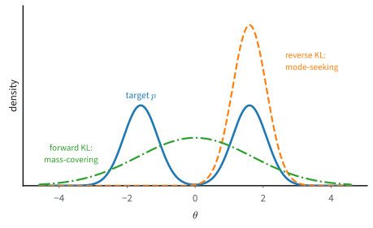

# Bayesian Computation
:label:`sec_mdl-bayesian-computation`

Throughout the Basics part of this book, we trained each model to a single
parameter vector, either by maximum likelihood or, with a regularizer, by the
maximum a posteriori (MAP) estimate at the peak of the posterior. In
:numref:`sec_mdl-maximum_likelihood`, we went a step further and placed an error
bar on that estimate. Even then, our predictions still came from that single
vector, despite the fact that many other parameter vectors explain the training
data almost as well. How much do those plausible models disagree, and what
should we predict when they do?

Consider a concrete example: logistic regression with an intercept and a slope,
fitted to twenty labeled points whose inputs lie between $0$ and $4$. At a test
input of $-3$, well below the training data, the fitted MAP line assigns the
label $1$ a probability of about four in a thousand. Yet other parameter
vectors that fit the twenty points nearly as well disagree there by orders of
magnitude. If we average their predictions, weighting each vector by how
plausible it is given the data, the resulting probability is almost five times
larger. At an input of $2$, right inside the training data, the single-vector
and averaged predictions agree to within $0.01$. For a rare event, such as a
fraud alert or a medical diagnosis, a factor of five in the predicted
probability can change the decision we make.

That weighted average is the Bayesian prediction, and computing it is a problem
as old as Bayes' rule itself. The posterior distribution divides by the
evidence, an integral over all parameter vectors that rarely has a closed form.
In 1774, Laplace bypassed the integral by replacing the posterior of a
proportion with the Gaussian that matches its peak. In 1953, Metropolis and his
colleagues showed how to let a random walk visit states in proportion to a
distribution whose normalizing constant is unknown
:cite:`Metropolis.Rosenbluth.Rosenbluth.ea.1953`. By the 1990s, researchers had
also turned the integration problem into an optimization problem. One unifying
trick runs through all of these methods: we can average over a distribution
known only up to a normalizing constant because every method relies solely on
ratios of densities, where the unknown constant cancels.

In this section, we develop four approaches by asking four questions in turn.
First, can we approximate the posterior by the Gaussian that matches its peak?
Second, can we draw from a simpler distribution and correct each draw? Third,
can a random walk spend time in each region in proportion to its posterior
mass? Fourth, can we optimize a simple distribution to be as close to the
posterior as possible? Each of the first three methods remedies a limitation of
the one before it, while the fourth replaces sampling with optimization. A
low-dimensional posterior is the cleanest setting for a distribution known only
up to a constant, though the same ideas reappear across the book;
:numref:`sec_mdl-bayes-decision-map` maps out where each returns. All four
methods aim to compute the **posterior predictive** distribution of a label
$y_\star$ at a new input $\mathbf x_\star$,

$$
p(y_\star\mid\mathbf x_\star,\mathcal D)
=\int p(y_\star\mid\mathbf x_\star,\boldsymbol\theta)\,
       p(\boldsymbol\theta\mid\mathcal D)\,d\boldsymbol\theta,
$$
:eqlabel:`eq_mdl-bayes-predictive`

which averages the predictions of every parameter vector, weighted by its
posterior density given the data $\mathcal D$.

```{.python .input #bayesian-computation-imports}
#@tab mxnet
import math
import numpy as np
from mxnet import autograd, gluon, init, np as mnp, npx
from mxnet.gluon import nn
from d2l import mxnet as d2l
npx.set_np()
```

```{.python .input #bayesian-computation-imports}
#@tab pytorch
import math
import numpy as np
import torch
from torch import nn
from torch.nn import functional as F
from d2l import torch as d2l
```

```{.python .input #bayesian-computation-imports}
#@tab tensorflow
import math
import numpy as np
import tensorflow as tf
from d2l import tensorflow as d2l
```

```{.python .input #bayesian-computation-imports}
#@tab jax
import math
import numpy as np
import jax
from jax import numpy as jnp
from flax import nnx
import optax
from d2l import jax as d2l
```

## The Posterior of Bayesian Logistic Regression
:label:`sec_mdl-bayes-target`

To compare approximation methods fairly, we need a posterior that has no closed
form yet can still be checked against the exact answer. Recall that a prior is
*conjugate* to a likelihood when the posterior stays in the same family as the
prior, just as a Beta prior on a coin stays Beta after any number of flips
(:numref:`sec_mdl-exponential-family`). A Gaussian prior is not conjugate to
the logistic likelihood: we can evaluate the unnormalized posterior at any
parameter vector, but we cannot integrate it analytically. Because our running
example has only two parameters, however, a fine two-dimensional grid still
gives an exact reference against which every approximation can be judged.

### The Model and Its Unnormalized Posterior

In one-dimensional logistic regression, each binary label $y_i\in\{0,1\}$ has a
probability determined by a linear function of the input $x_i$,

$$
P(y_i=1\mid x_i,\boldsymbol\theta)
=\operatorname{sigmoid}(\theta_0+\theta_1x_i)
=\operatorname{sigmoid}(\mathbf z_i^\top\boldsymbol\theta),
\qquad
\operatorname{sigmoid}(z)=\frac{1}{1+e^{-z}},
$$

where $\mathbf z_i=(1,x_i)^\top$. The predicted probability crosses $\tfrac12$
where the linear function crosses zero, at $x=-\theta_0/\theta_1$, while the
slope $\theta_1$ controls how sharply the curve rises there. We place
independent Gaussian priors $\theta_j\sim\mathcal N(0,\tau^2)$ on the intercept
and slope, with prior standard deviation $\tau$. By Bayes' rule, the posterior
is proportional to the likelihood of the $n$ labels times the prior:

$$
p(\boldsymbol\theta\mid\mathcal D)
\propto
\left[\prod_{i=1}^n
 \operatorname{sigmoid}(\mathbf z_i^\top\boldsymbol\theta)^{y_i}
 \big(1-\operatorname{sigmoid}(\mathbf z_i^\top\boldsymbol\theta)\big)^{1-y_i}\right]
\exp\!\left(-\frac{\|\boldsymbol\theta\|^2}{2\tau^2}\right).
$$
:eqlabel:`eq_mdl-bayes-logistic-posterior`

The bracketed product is the likelihood and the exponential factor is the
prior. The missing normalizing constant is the **evidence**
$p(\mathcal D)=\int p(\mathcal D,\boldsymbol\theta)\,d\boldsymbol\theta$, an
integral over all parameter vectors that has no closed form. We denote the
right-hand side by $\widetilde p(\boldsymbol\theta)=p(\mathcal D,\boldsymbol\theta)$,
the *unnormalized posterior*, so that the normalized posterior is simply
$\widetilde p/p(\mathcal D)$.

For our running dataset, we take $n=20$ inputs drawn uniformly from $[0,4]$ and
generate labels from the true parameter vector $\boldsymbol\theta^\star=(-3,1.5)$,
whose probability curve crosses $\tfrac12$ at $x=2$ and rises from
$\operatorname{sigmoid}(-3)\approx0.05$ at $x=0$ to
$\operatorname{sigmoid}(3)\approx0.95$ at $x=4$. We set the prior variance to
$\tau^2=4$. With twenty data points, the posterior remains wide enough for
every approximation effect in this section to stand out clearly. Rather than
drawing a fresh dataset on each run, we fix one representative draw of twenty
points (selected as the most typical among 1,500 simulated datasets on the
posterior summaries measured below) so that we can quote concrete reference
numbers. Every sampler we run still uses fresh random numbers, so sampler
results are reported as typical ranges. In code, `log_joint` evaluates
$\log\widetilde p$, using `logaddexp(0, z)` for $\log(1+e^z)$ to prevent
overflow at large logits.

```{.python .input #bayesian-computation-model}
rng = np.random.default_rng()
n, prior_var = 20, 4.0                        # prior_var is tau^2
theta_star = np.array([-3.0, 1.5])

def sigmoid(z):
    return np.exp(-np.logaddexp(0.0, -z))

x = np.array([0.1, 0.3, 0.3, 0.4, 0.8, 1.4, 1.5, 1.6, 1.8, 2.1,
              2.2, 2.3, 2.6, 2.7, 3.0, 3.1, 3.4, 3.5, 3.6, 3.7])
y = np.array([0, 0, 1, 0, 0, 0, 0, 0, 0, 0, 1, 1, 1, 0, 1, 1, 1, 1, 1, 1])
Z = np.column_stack([np.ones(n), x])          # rows z_i = (1, x_i)

def log_joint(theta, Z=Z, y=y, prior_var=prior_var):
    """log p(D, theta) up to a constant; theta has final dimension 2."""
    logits = np.einsum('...d,nd->...n', theta, Z)
    log_lik = (y * logits - np.logaddexp(0.0, logits)).sum(axis=-1)
    return log_lik - 0.5 * (theta**2).sum(axis=-1) / prior_var

print(f'{n} points, {y.sum()} of them labeled 1')
```

### The Gradient and the Hessian

Several methods below rely on the slope and curvature of $\log\widetilde p$, so
it pays to derive them once up front. Differentiating each log-likelihood term
$y_i\,\mathbf z_i^\top\boldsymbol\theta-\log(1+e^{\mathbf z_i^\top\boldsymbol\theta})$
gives $(y_i-p_i)\,\mathbf z_i$, where
$p_i=\operatorname{sigmoid}(\mathbf z_i^\top\boldsymbol\theta)$, while the
Gaussian prior contributes $-\boldsymbol\theta/\tau^2$. Stacking the input rows
$\mathbf z_i^\top$ into the $n\times2$ matrix $\mathbf Z$, we obtain the
gradient
$\nabla\log\widetilde p(\boldsymbol\theta)=\mathbf Z^\top(\mathbf y-\mathbf p)-\boldsymbol\theta/\tau^2$.
Its geometry is transparent: each training point nudges $\boldsymbol\theta$
along $\mathbf z_i$ in proportion to its prediction residual $y_i-p_i$, and the
prior gently pulls the parameters back toward the origin. Differentiating a
second time yields the negative Hessian

$$
\mathbf H(\boldsymbol\theta)
=-\nabla^2\log\widetilde p(\boldsymbol\theta)
=\mathbf Z^\top\operatorname{diag}\!\big(p_i(1-p_i)\big)\mathbf Z
+\tau^{-2}\mathbf I.
$$
:eqlabel:`eq_mdl-bayes-hessian`

Here the data term is a weighted Gram matrix of the inputs. Because each weight
$p_i(1-p_i)\le\tfrac14$ peaks at $p_i=\tfrac12$, the points the model is most
uncertain about contribute the most curvature. Adding the prior term
$\tau^{-2}\mathbf I$ lifts every eigenvalue by at least $\tau^{-2}$, so
$\mathbf H(\boldsymbol\theta)$ is strictly positive definite everywhere. Thus
the log posterior is strictly concave and has a unique maximum. Even when the
training data are linearly separable, that maximum stays finite, because the
log-likelihood is never positive while the quadratic prior penalty drops
without bound in every direction.

```{.python .input #mdl-bayesian-computation-the-gradient-and-the-hessian-1}
def grad_log_joint(theta, Z=Z, y=y, prior_var=prior_var):
    """Gradient of log p(D, theta); one row per row of theta."""
    theta = np.atleast_2d(theta)
    return (y - sigmoid(theta @ Z.T)) @ Z - theta / prior_var

def neg_hessian(theta, Z=Z, y=y, prior_var=prior_var):
    """H(theta) = Z^T diag(p (1 - p)) Z + I / tau^2."""
    p = sigmoid(Z @ theta)
    return Z.T @ (Z * (p * (1 - p))[:, None]) + np.eye(2) / prior_var
```

With only two parameters, writing these derivatives by hand is painless. For
larger models, we would implement only $\log\widetilde p$ and let automatic
differentiation supply the gradient and Hessian.

Notice that every method in this section accesses the posterior solely through
$\widetilde p$, whether via its values, its gradient, or its Hessian.

### The Posterior Mode and the Laplace Approximation
:label:`subsec_mdl-bayes-laplace`

Our first and cheapest approximation builds directly on an optimization we
already know how to run. The peak of the posterior is the MAP estimate, the
penalized fit from :numref:`sec_mdl-maximum_likelihood`, and Newton's method,
$\boldsymbol\theta\leftarrow\boldsymbol\theta+\mathbf H(\boldsymbol\theta)^{-1}\nabla\log\widetilde p(\boldsymbol\theta)$,
reaches it in just a few iterations. One extra Hessian evaluation then turns
that point estimate into a Gaussian distribution.

Specifically, we fit a Gaussian centered at the mode
$\boldsymbol\theta_{\mathrm{MAP}}$. Expanding $\log\widetilde p$ to second
order around $\boldsymbol\theta_{\mathrm{MAP}}$, with
$\mathbf H=\mathbf H(\boldsymbol\theta_{\mathrm{MAP}})$, gives

$$
\log\widetilde p(\boldsymbol\theta)
\approx\log\widetilde p(\boldsymbol\theta_{\mathrm{MAP}})
-\tfrac12(\boldsymbol\theta-\boldsymbol\theta_{\mathrm{MAP}})^\top
\mathbf H(\boldsymbol\theta-\boldsymbol\theta_{\mathrm{MAP}}).
$$
:eqlabel:`eq_mdl-bayes-laplace-taylor`

There is no linear term because the gradient vanishes at the mode. Up to an
additive constant, the right-hand side is simply the log density of a Gaussian
with mean $\boldsymbol\theta_{\mathrm{MAP}}$ and covariance $\mathbf H^{-1}$.
Exponentiating therefore gives the **Laplace approximation**,

$$
p(\boldsymbol\theta\mid\mathcal D)
\approx\mathcal N(\boldsymbol\theta_{\mathrm{MAP}},\mathbf H^{-1}).
$$
:eqlabel:`eq_mdl-bayes-laplace`

For this approximation to be well defined, $\log\widetilde p$ must be twice
differentiable at an interior mode with a positive definite negative Hessian
$\mathbf H$, both of which hold here. Intuitively, a sharp peak has large
curvature and therefore produces a narrow Gaussian with small variance. The
Gaussian matches the location and local curvature of the posterior's peak, and
nothing else.

A one-dimensional example makes the behavior immediately visible. Consider the
skewed posterior $\mathrm{Gamma}(4,1)$, whose unnormalized density is
$\theta^3e^{-\theta}$ for $\theta>0$. Its log density, $3\log\theta-\theta$,
has derivative $3/\theta-1$, which vanishes at the mode $\theta=3$, and
negative second derivative $3/\theta^2=\tfrac13$ there. The Laplace
approximation is therefore $\mathcal N(3,3)$, with standard deviation
$\sqrt{3}\approx1.73$. Because the exact posterior has mean $4$ and variance
$4$, the Gaussian sits too far to the left, is too narrow, and even places
$\Phi(-\sqrt3)\approx4.2\%$ of its mass below $\theta=0$, where the true
density is zero (:numref:`fig_mdl-prob-bayes-laplace`).

Applying the same calculation to a coin that landed 9 heads and 4 tails under a
uniform prior recovers the maximum likelihood estimate $9/13$ and its standard
error $0.128$ from :numref:`subsec_mdl-coin-error-bar`. Under a flat prior, in
fact, the Laplace approximation is simply the MLE paired with its asymptotic
error bar (Exercise
:exref:`ex_mdl-bayesian-computation-laplace-parameterization`).


:label:`fig_mdl-prob-bayes-laplace`

Notice that the unknown evidence never enters the calculation:
$\log p(\mathcal D)$ is an additive constant in
$\log p(\boldsymbol\theta\mid\mathcal D)$, so it vanishes upon differentiation.
Better still, integrating the exponential of the right-hand side of
:eqref:`eq_mdl-bayes-laplace-taylor` even yields an estimate of the evidence
itself,
$p(\mathcal D)\approx\widetilde p(\boldsymbol\theta_{\mathrm{MAP}})(2\pi)^{d/2}\det(\mathbf H)^{-1/2}$
in $d$ dimensions (Exercise :exref:`ex_mdl-bayesian-computation-evidence`).

Because the Laplace approximation uses only local derivatives at a single peak,
it is blind to skewness, heavy tails, parameter boundaries, and additional
modes, and it centers the distribution at the mode rather than the mean.
Scaling is also an issue: for a neural network with $d$ parameters, $\mathbf H$
has $d^2$ entries, so practical applications typically keep only its diagonal
or restrict the approximation to the last layer.

In code, ten Newton steps starting from the origin locate the mode, and a
single matrix inverse yields the Laplace covariance.

```{.python .input #bayesian-computation-map-predictive}
theta_map = np.zeros(2)
for _ in range(10):                                   # Newton's method
    theta_map += np.linalg.solve(neg_hessian(theta_map),
                                 grad_log_joint(theta_map)[0])
laplace_cov = np.linalg.inv(neg_hessian(theta_map))
laplace_sd = np.sqrt(np.diag(laplace_cov))
laplace_rho = laplace_cov[0, 1] / (laplace_sd[0] * laplace_sd[1])
print('MAP                :', theta_map.round(3))
print('Laplace sd         :', laplace_sd.round(3))
print('Laplace correlation:', round(laplace_rho, 3))
```

The posterior mode lies at $(-2.14,\,1.12)$, a shallower line than the
generating parameters $(-3,1.5)$. The Laplace standard deviations are $1.00$
for the intercept and $0.46$ for the slope, placing the true values a little
less than one standard deviation away in each coordinate. Notice also the
strong negative correlation, $-0.86$: a steeper line must start lower to pass
through the same cloud of points.

### A Grid Reference

To see how accurate the Laplace approximation really is, we need the exact
posterior as a benchmark. With only two parameters, we can evaluate
$\log\widetilde p$ on a fine $m\times m$ grid, subtract the maximum for
numerical stability, exponentiate, and normalize the weights to sum to one. In
$d$ dimensions, such a lattice requires $m^d$ evaluations, so grid integration
is purely a low-dimensional reference. Even in two dimensions we must know
where to place the box: we center the grid at $\boldsymbol\theta_{\mathrm{MAP}}$
and span seven Laplace standard deviations in each direction, leaving only a
negligible tail outside.

```{.python .input #bayesian-computation-grid}
k, m = 7, 241                    # half-width in Laplace sds, points per axis
grid_axes = [np.linspace(c - k * s, c + k * s, m)
             for c, s in zip(theta_map, laplace_sd)]
B0, B1 = np.meshgrid(*grid_axes, indexing='ij')
grid_theta = np.stack([B0.ravel(), B1.ravel()], axis=1)
grid_logp = log_joint(grid_theta)
grid_weight = np.exp(grid_logp - grid_logp.max())
grid_weight /= grid_weight.sum()
post_mean = grid_weight @ grid_theta
centered = grid_theta - post_mean
post_cov = (centered * grid_weight[:, None]).T @ centered
post_sd = np.sqrt(np.diag(post_cov))
post_rho = post_cov[0, 1] / (post_sd[0] * post_sd[1])
print('grid mean       :', post_mean.round(3), '  MAP:', theta_map.round(3))
print('grid sd         :', post_sd.round(3), '  Laplace:', laplace_sd.round(3))
print('grid correlation:', round(post_rho, 3))
print('(mean - MAP)/sd :', ((post_mean - theta_map) / post_sd).round(2))
```

The grid exposes the skewness that Laplace missed. The posterior mean of the
slope, $1.24$, sits a quarter of a posterior standard deviation above the MAP
estimate of $1.12$, while the intercept's mean, $-2.35$, sits a fifth of a
standard deviation below its MAP. The Laplace standard deviations are $4$ to
$5\%$ too narrow, and the correlation agrees to two digits. Those width errors
are modest; the more consequential discrepancy is that the posterior is skewed
toward steeper lines, so its mean and its mode do not coincide.

### The Plug-in and the Posterior Predictive

We can now answer our opening question directly. The *plug-in* prediction
$\operatorname{sigmoid}(\mathbf z_\star^\top\boldsymbol\theta_{\mathrm{MAP}})$
relies on the mode alone, whereas the posterior predictive
:eqref:`eq_mdl-bayes-predictive` averages
$\operatorname{sigmoid}(\mathbf z_\star^\top\boldsymbol\theta)$ across the grid
using the posterior weights. Let us compare both predictions at three test
inputs, $x_\star\in\{-3,2,7\}$, lying below, inside, and above the training
data, alongside the interval containing the middle 90% of predictions across
plausible parameter vectors.

```{.python .input #mdl-bayesian-computation-the-plug-in-and-the-posterior-predictive-1}
x_new = np.array([-3.0, 2.0, 7.0])
Z_new = np.column_stack([np.ones(len(x_new)), x_new])
grid_probs = sigmoid(grid_theta @ Z_new.T)     # each grid vector's answer
plug_in = sigmoid(Z_new @ theta_map)
predictive = grid_weight @ grid_probs
for j, x0 in enumerate(x_new):
    order = np.argsort(grid_probs[:, j])
    cdf = np.cumsum(grid_weight[order])
    lo, hi = grid_probs[order[np.searchsorted(cdf, [0.05, 0.95])], j]
    print(f'x={x0:+.0f}: plug-in {plug_in[j]:.4f}, predictive '
          f'{predictive[j]:.4f}, middle 90%: [{lo:.2g}, {hi:.4f}]')
a = grid_theta @ Z_new[0]                      # logits at x = -3
mu = grid_weight @ a
s2 = grid_weight @ (a - mu)**2
print(f'x=-3, log scale: plug-in {np.log(plug_in[0]):.2f}, '
      f'mean logit {mu:.2f}, plus s^2/2 {mu + s2 / 2:.2f},')
print(f'                 log E[e^a] {np.log(grid_weight @ np.exp(a)):.2f}, '
      f'predictive {np.log(predictive[0]):.2f}')
```

Inside the training range at $x_\star=2$, the two predictions ($0.524$ and
$0.529$) agree to within $0.01$, and the plausible parameter vectors span a
moderate range from $0.32$ to $0.74$. Far outside the data at $x_\star=-3$, the
middle 90% of plausible predictions stretch across more than three orders of
magnitude, from $4\times10^{-5}$ to $0.09$, and the posterior predictive
($0.019$) is $4.6$ times the plug-in value ($0.0041$). At $x_\star=7$, the same
amplification occurs for the probability of label $0$ ($0.017$ versus $0.003$).
Because probabilities this close to $0$ or $1$ are easiest to compare on the
log-odds scale $\log\frac{P}{1-P}$, we plot both curves across a wider range
with the training inputs marked along the bottom.

```{.python .input #mdl-bayesian-computation-the-plug-in-and-the-posterior-predictive-2}
def log_odds(p):
    return np.log(p) - np.log1p(-p)

xs = np.linspace(-4, 8, 121)
Z_xs = np.column_stack([np.ones_like(xs), xs])
plug_xs = Z_xs @ theta_map                       # log-odds of the plug-in
pred_xs = log_odds(grid_weight @ sigmoid(grid_theta @ Z_xs.T))
rug = np.full(n, min(plug_xs.min(), pred_xs.min()) - 1)
d2l.plot([xs, xs, x], [plug_xs, pred_xs, rug],
         xlabel='x', ylabel='log-odds of y = 1', fmts=('-', 'm--', 'k|'),
         legend=['plug-in (MAP)', 'posterior predictive', 'training inputs'],
         figsize=(5, 3))
```

On the log-odds scale, the plug-in prediction is simply the straight line
$\theta_0+\theta_1x$. Inside $[0,4]$, the posterior predictive hugs that line;
outside the training data, it bends back toward zero. Two competing effects
create this gap. First, the posterior mean has a steeper slope than the MAP
estimate, which pushes extreme predictions *away* from $\tfrac12$. Second,
averaging the sigmoid over a spread of logits pulls predictions *toward*
$\tfrac12$: far from the data, plausible parameter vectors with shallower
slopes produce much larger probabilities than the typical vector, and those
larger probabilities dominate the average.

Which effect wins, and by how much? A quick back-of-the-envelope calculation
estimates the size of the averaging effect. Where the probability is small,
$\operatorname{sigmoid}(a)\approx e^a$, so the predictive probability is
roughly the posterior average of $e^a$ for the logit
$a=\mathbf z_\star^\top\boldsymbol\theta$. If $a$ were Gaussian with mean $\mu$
and variance $s^2$, its moment generating function would give
$\mathbb{E}[e^a]=e^{\mu+s^2/2}$, raising the log-probability by $s^2/2$ above
the value at the mean logit. At $x_\star=-3$, the grid gives $s^2/2=2.87$,
which would predict a factor of $e^{2.87}\approx18$. Yet the actual factor is
$4.6$, a rise of only $1.51$ on the log scale. Where did the missing $1.36$
nats go? The last two lines of the code above walk from the plug-in to the
posterior predictive one step at a time:

| step at $x_\star=-3$ | log-probability | change |
|:--|:--:|--:|
| plug-in: the logit at the mode | $-5.49$ | |
| the posterior mean of the logit | $-6.06$ | $-0.57$ |
| add $s^2/2$, as for a Gaussian logit | $-3.19$ | $+2.87$ |
| average $e^a$ over the logit's actual distribution | $-3.66$ | $-0.47$ |
| average $\operatorname{sigmoid}(a)$ instead of $e^a$: the predictive | $-3.98$ | $-0.32$ |

Three downward corrections account for the entire difference between $2.87$ and
$1.51$. First, the $s^2/2$ boost starts from the mean logit rather than the
plug-in logit, and the steeper posterior mean sits $0.57$ lower. Second, the
logit is skewed rather than Gaussian: it has a long tail toward very negative
values and a shorter tail toward zero, where the average of $e^a$ gets almost
all of its mass, trimming another $0.47$. Third, the vectors that dominate the
average have probabilities at $x_\star=-3$ that are no longer tiny, so the
sigmoid bends below $e^a$ and subtracts the final $0.32$. Altogether,
$2.87-0.57-0.47-0.32=1.51$.

The Gaussian calculation is therefore a useful guide rather than an exact law:
it gets the direction, the rough scale, and the asymptotic dependence on
$x_\star$ right. Specifically, the logit variance
$\textrm{Var}(\theta_0)+2x_\star\textrm{Cov}(\theta_0,\theta_1)+x_\star^2\textrm{Var}(\theta_1)$
grows quadratically with distance from the data, whereas the mean shift grows
only linearly. Far from the training inputs, the variance term inevitably wins,
while inside the data both effects remain negligible (Exercise
:exref:`ex_mdl-bayesian-computation-moderated-predictions`).

Notice that the larger predictive probability is not necessarily closer to the
data-generating truth. The true line gives
$\operatorname{sigmoid}(-3-1.5\cdot3)=\operatorname{sigmoid}(-7.5)\approx0.0006$
at $x_\star=-3$, which lies below both the plug-in and the posterior predictive
because twenty points cannot pin down the slope and the prior shrinks it toward
zero. That true probability does fall comfortably inside the 90% posterior
interval, as expected for a typical dataset. The posterior predictive does not
claim to know the true parameter; rather, it gives the exact probability of
$y_\star=1$ averaged over all parameter vectors consistent with the prior and
the twenty observations. The rest of this section asks how to compute such
averages when the parameter space is too large for a grid.

## Rejection and Importance Sampling
:label:`sec_mdl-bayes-importance`

The Laplace approximation is fast, but it centers on the mode and ignores
skewness. If we could draw samples directly from the exact posterior, their
empirical average would estimate any posterior expectation cleanly, capturing
skewness and tails automatically. The two methods in this section turn draws
from a tractable *proposal* distribution $q$ into exact or weighted draws from
the posterior, relying only on the ratio $\widetilde p/q$.

### Rejection Sampling
:label:`subsec_mdl-bayes-rejection`

The simplest exact sampler draws candidates from $q$, keeps some, and discards
the rest. Choose a proposal $q$ that is easy to sample and evaluate, along with
a constant $M$ such that $Mq(\boldsymbol\theta)\ge\widetilde p(\boldsymbol\theta)$
for every $\boldsymbol\theta$, forming an envelope above the unnormalized
posterior. For each draw $\boldsymbol\theta\sim q$, we keep it with probability

$$
a(\boldsymbol\theta)=\frac{\widetilde p(\boldsymbol\theta)}{M\,q(\boldsymbol\theta)}.
$$
:eqlabel:`eq_mdl-bayes-rejection`

Geometrically, the acceptance probability is the ratio of the target height to
the envelope height at the proposed point. Every accepted draw is an exact
sample from $p(\boldsymbol\theta\mid\mathcal D)$, and the overall acceptance
rate is $p(\mathcal D)/M$. The verification takes two lines: a proposal lands
in an infinitesimal region $d\boldsymbol\theta$ around $\boldsymbol\theta$ with
probability $q(\boldsymbol\theta)\,d\boldsymbol\theta$ and is accepted with
probability $a(\boldsymbol\theta)$, so the joint probability of landing there
and being kept is $\widetilde p(\boldsymbol\theta)\,d\boldsymbol\theta/M$.
Integrating over all $\boldsymbol\theta$ yields the marginal acceptance
probability $\int\widetilde p/M=p(\mathcal D)/M$, and dividing the joint
density by this marginal gives the conditional density of a kept draw,
$\widetilde p(\boldsymbol\theta)/p(\mathcal D)=p(\boldsymbol\theta\mid\mathcal D)$.

Crucially, the unknown evidence appears only in the acceptance rate, never in
the accept-or-reject rule itself. If we choose the prior as the proposal $q$,
then $\widetilde p/q$ is simply the likelihood and $M$ is its maximum value: we
draw parameter vectors from the prior and keep each with probability equal to
its likelihood divided by the maximum likelihood.

To see how quickly rejection sampling degrades as data accumulate, consider the
coin with 9 heads and 4 tails under a uniform prior. The likelihood
$\theta^9(1-\theta)^4$ peaks at $\theta=9/13$ with height
$M=(9/13)^9(4/13)^4\approx3.3\times10^{-4}$, while the evidence is
$p(\mathcal D)=\int_0^1\theta^9(1-\theta)^4\,d\theta=9!\,4!/14!\approx1.0\times10^{-4}$,
giving an acceptance rate of $0.305$. Multiply the data by ten (90 heads and 40
tails) and the acceptance rate falls to $0.10$; multiply by a hundred and it
drops to $0.03$. Because the posterior width shrinks like $1/\sqrt n$ while the
prior stays fixed, the acceptance rate decays as $1/\sqrt n$ in one dimension
and as $n^{-d/2}$ in $d$ dimensions. A quick simulation with 100,000 draws from
the uniform prior confirms the calculation.

```{.python .input #mdl-bayesian-computation-rejection-sampling}
N = 100_000
theta_coin = rng.random(N)                    # draws from the uniform prior
lik = theta_coin**9 * (1 - theta_coin)**4     # likelihood of 9 heads, 4 tails
M = (9 / 13)**9 * (4 / 13)**4                 # its maximum, at theta = 9/13
kept = theta_coin[rng.random(N) < lik / M]
print(f'acceptance {len(kept) / N:.3f}, mean {kept.mean():.3f}, '
      f'sd {kept.std():.3f}')
```

Two serious obstacles limit rejection sampling in practice. First, we must know
a valid upper bound $M$, which is rarely available outside simple models.
Second, even with a fixed number of observations per parameter, the acceptance
rate decays at least exponentially with the dimension $d$.

### Importance Weights

Rejection sampling throws away most of the draws it generates. Rather than
using the ratio $w=\widetilde p/q$ to flip a coin and discard candidates, we
can keep every draw and weight it by $w$. To see why this works, express any
posterior expectation as a ratio of two integrals and multiply and divide by
$q$ inside both:

$$
\begin{aligned}
\mathbb{E}_{p(\cdot\mid\mathcal D)}[h(\boldsymbol\theta)]
&=\frac{\int h\,\widetilde p\,d\boldsymbol\theta}{\int\widetilde p\,d\boldsymbol\theta}
=\frac{\int h\,\frac{\widetilde p}{q}\,q\,d\boldsymbol\theta}
      {\int\frac{\widetilde p}{q}\,q\,d\boldsymbol\theta} \\
&=\frac{\mathbb{E}_q[w(\boldsymbol\theta)h(\boldsymbol\theta)]}
     {\mathbb{E}_q[w(\boldsymbol\theta)]},
\qquad
w(\boldsymbol\theta)=\frac{\widetilde p(\boldsymbol\theta)}
                           {q(\boldsymbol\theta)}.
\end{aligned}
$$
:eqlabel:`eq_mdl-bayes-importance`

The denominator $\mathbb{E}_q[w]$ equals the unknown evidence
$p(\mathcal D)=\int\widetilde p$, and we never need to compute it explicitly
because the same normalizing constant scales both numerator and denominator.
Replacing the two expectations with sample averages over draws
$\boldsymbol\theta_1,\ldots,\boldsymbol\theta_N\sim q$ gives
**self-normalized importance sampling**,
$\sum_sw_sh(\boldsymbol\theta_s)/\sum_sw_s$. By the law of large numbers, this
ratio converges to the exact posterior expectation as $N\to\infty$, though at
finite $N$ it carries a small bias because it is a ratio of two random
averages. Since products of many likelihood terms quickly underflow in floating
point, we always compute log-weights and subtract the largest log-weight before
exponentiating, just as in the log-sum-exp trick. When $q$ is the prior, the
importance weight reduces to the likelihood: every prior draw is weighted by
how well it explains the observed data.

### The Effective Sample Size

Keeping every draw does not mean every draw helps equally. A weighted sample in
which a single draw carries nearly all the weight is effectively worth just one
draw, no matter how large $N$ is. To quantify this, we define the
**effective sample size** (ESS) from the normalized weights
$\bar w_s=w_s/\sum_rw_r$:

$$
N_{\mathrm{eff}}=\frac{1}{\sum_{s=1}^N\bar w_s^2}.
$$
:eqlabel:`eq_mdl-bayes-is-ess`

When all weights are equal ($\bar w_s=1/N$), $N_{\mathrm{eff}}=N$; when one
draw takes all the weight, $N_{\mathrm{eff}}=1$. Roughly speaking, the ESS
estimates how many independent draws from the exact posterior the weighted
sample is worth. As we will soon see, however, it can still mislead in two
important ways.

**Proposition.** As $N\to\infty$,

$$
\frac{N_{\mathrm{eff}}}{N}\to\frac{(\mathbb{E}_q[w])^2}{\mathbb{E}_q[w^2]}
=\frac{1}{1+\chi^2(p\,\|\,q)},
\qquad
\chi^2(p\,\|\,q)=\int\frac{p^2}{q}\,d\boldsymbol\theta-1,
$$
:eqlabel:`eq_mdl-bayes-ess-limit`

where $p$ is the normalized posterior. For the same proposal $q$, this limiting
efficiency is always at least the acceptance rate $p(\mathcal D)/M$ of
rejection sampling.

**Proof.** Dividing numerator and denominator of :eqref:`eq_mdl-bayes-is-ess`
by $N^2$ gives
$N_{\mathrm{eff}}/N=(\frac1N\sum_sw_s)^2/(\frac1N\sum_sw_s^2)$, and the law
of large numbers applies to both averages. Substituting $w=p(\mathcal D)\,p/q$
yields $\mathbb{E}_q[w^2]=p(\mathcal D)^2\int p^2/q$ and
$\mathbb{E}_q[w]=p(\mathcal D)$, giving the $\chi^2$-divergence expression.
Finally, since $w\le M$, we have $\mathbb{E}_q[w^2]\le M\,\mathbb{E}_q[w]$, so
the limit is at least $\mathbb{E}_q[w]/M=p(\mathcal D)/M$. $\blacksquare$

The ESS is therefore an empirical measure of how closely $q$ matches $p$. In
the large-$N$ limit, importance sampling retains at least as many effective
draws as rejection sampling accepts, without ever needing an envelope bound $M$.
Returning to the coin with a uniform prior proposal,
$\mathbb{E}_q[w^2]=\int_0^1\theta^{18}(1-\theta)^8\,d\theta$, which gives a
limiting ESS fraction of $0.42$ compared with the rejection acceptance rate of
$0.305$. We can reuse the exact same draws from the rejection cell and simply
reweight them instead of discarding two-thirds of them.

```{.python .input #mdl-bayesian-computation-the-effective-sample-size}
w = lik / lik.sum()                           # normalized weights
post_coin = w @ theta_coin
print(f'ESS fraction {1 / (w @ w) / N:.3f}, mean {post_coin:.3f}, '
      f'sd {np.sqrt(w @ (theta_coin - post_coin)**2):.3f}')
```

The limiting formula also exposes how sharply a poorly scaled proposal can
fail. For a one-dimensional Gaussian target with standard deviation $s_p$ and a
centered Gaussian proposal with standard deviation $s_q=rs_p$, the limiting ESS
fraction is $\sqrt{2r^2-1}/r^2$ (Exercise
:exref:`ex_mdl-bayesian-computation-weight-ess`). That curve equals $0.83$ at
$r=0.8$, peaks at $1$ when $r=1$, and declines gently to $0.66$ at $r=2$ and
$0.46$ at $r=3$. For $r\le1/\sqrt2$, however, it collapses abruptly to zero
because $\mathbb{E}_q[w^2]=\infty$. A proposal that is too narrow fails far
more catastrophically than one that is too wide.

Two conditions guarantee that the importance identity
:eqref:`eq_mdl-bayes-importance` holds: $q(\boldsymbol\theta)>0$ everywhere
$\widetilde p(\boldsymbol\theta)>0$, and $\mathbb{E}_q|wh|<\infty$. For a
central limit theorem, and hence $O(1/\sqrt N)$ error bars, we additionally need
$\mathbb{E}_q[w^2]$ and $\mathbb{E}_q[w^2h^2]$ to be finite. Even when those
conditions hold, the finite-sample ESS can be dangerously optimistic, as
:numref:`fig_mdl-prob-bayes-importance` illustrates.


:label:`fig_mdl-prob-bayes-importance`

### Proposals for the Logistic Posterior

How should we choose a proposal for our logistic regression posterior? Let us
compare two Gaussians, the prior with 20,000 draws and the Laplace approximation
with 5,000 draws, by recording the ESS as a fraction of the draws, the largest
normalized weight, and the error in the estimated posterior mean relative to
the grid reference, measured in units of posterior standard deviations.

```{.python .input #bayesian-computation-importance}
def gaussian_logpdf(samples, mean, cov):
    diff = samples - mean
    _, logdet = np.linalg.slogdet(cov)
    maha = np.einsum('ni,ij,nj->n', diff, np.linalg.inv(cov), diff)
    return -0.5 * (len(mean) * np.log(2 * np.pi) + logdet + maha)

def importance(log_target, mean, cov, N):
    """Self-normalized importance sampling from a Gaussian proposal."""
    samples = rng.multivariate_normal(mean, cov, N)
    log_w = log_target(samples) - gaussian_logpdf(samples, mean, cov)
    w = np.exp(log_w - log_w.max())
    w /= w.sum()
    return w @ samples, 1 / (w @ w), w.max()

for name, mean, cov, N in [('prior', np.zeros(2), prior_var * np.eye(2), 20000),
                           ('Laplace', theta_map, laplace_cov, 5000)]:
    estimate, ess, w_max = importance(log_joint, mean, cov, N)
    error = np.abs(estimate - post_mean) / post_sd
    print(f'{name:8s}: ESS {ess / N:.1%} of {N}, largest weight '
          f'{w_max:.4f}, error in sds {error.round(3)}')
```

Using the prior as the proposal yields an ESS of only about 1% to 10% of the
draws, because most prior samples land where the likelihood is negligible.
Aiming the proposal at the posterior with the Laplace Gaussian raises the ESS
dramatically, typically keeping between 55% and 95% of the draws effective.
Both proposals usually estimate the posterior mean within a few hundredths of a
posterior standard deviation of the grid reference, and rarely err by more than
$0.15$.

Yet the Laplace proposal hides a subtle defect that a typical ESS printout
never reveals. Far from the origin, the posterior's tails are governed by the
prior: along any ray $\boldsymbol\theta=t\mathbf v$, the log-likelihood decays
at most linearly in $t$ (Exercise
:exref:`ex_mdl-bayesian-computation-posterior-tails`), whereas the log prior
decays quadratically as $-t^2/(2\tau^2)$. Consequently, for a Gaussian proposal
$\mathcal N(\mathbf m,\mathbf S)$, the integral
$\mathbb{E}_q[w^2]=\int\widetilde p^2/q$ diverges whenever any eigenvalue of
$\mathbf S$ falls below $\tau^2/2=2$. Here both eigenvalues of the Laplace
covariance (roughly $1.17$ and $0.05$) lie well below $2$, so the importance
weights have infinite variance in *every* direction, not just along a single
thin axis.

Why did our 5,000-draw run look so healthy? Because the region where the
weights blow up sits many Laplace standard deviations away, so most runs of
5,000 draws never stumble into it. In a few runs out of a hundred, however, a
single distant draw captures a huge share of the total weight and the ESS
plummets. A single run cannot expose this instability; only repeated runs or a
tail analysis can. Two simple fixes restore finite weight variance: replacing
the Gaussian with a heavier-tailed Student-$t$ proposal (Exercise
:exref:`ex_mdl-bayesian-computation-posterior-tails`), or using a *defensive
mixture* such as
$q=0.9\,\mathcal N(\boldsymbol\theta_{\mathrm{MAP}},\mathbf H^{-1})+0.1\,\text{prior}$.
Because the mixture density is always at least one-tenth of the prior density,
every weight is bounded above by ten times the likelihood, which never exceeds
$1$.

Importance sampling cancels the unknown evidence automatically, but it still
demands a single global proposal $q$ that covers the entire posterior. In high
dimensions, no simple global distribution can do that.

## Markov Chain Monte Carlo
:label:`sec_mdl-bayes-mcmc`

Rather than searching for one global proposal that blankets the whole
posterior, we can explore the parameter space through local moves, designing a
random walk that spends time in each region in proportion to its posterior
mass. Such a walk is a *Markov chain*: its next state depends only on its
current state through a *transition rule*
$T(\boldsymbol\theta'\mid\boldsymbol\theta)$, the probability of moving from
$\boldsymbol\theta$ to $\boldsymbol\theta'$. A distribution $\pi$ is
*stationary* for the chain if drawing the current state from $\pi$ leaves the
next state distributed as $\pi$ as well:

$$
\sum_{\boldsymbol\theta}\pi(\boldsymbol\theta)\,
T(\boldsymbol\theta'\mid\boldsymbol\theta)=\pi(\boldsymbol\theta')
\quad\text{for every }\boldsymbol\theta',
$$
:eqlabel:`eq_mdl-bayes-stationary`

where the sum becomes an integral for continuous parameters. Our goal is to
construct a simple transition rule whose stationary distribution is the
posterior.

### The Metropolis Rule

The Metropolis algorithm builds such a chain from any symmetric proposal
$g(\boldsymbol\theta'\mid\boldsymbol\theta)=g(\boldsymbol\theta\mid\boldsymbol\theta')$,
such as a local Gaussian step
$\boldsymbol\theta'=\boldsymbol\theta+\mathbf L\boldsymbol\epsilon$. From the
current state $\boldsymbol\theta$, we propose a candidate
$\boldsymbol\theta'\sim g(\cdot\mid\boldsymbol\theta)$. If the candidate has
higher or equal posterior density,
$\widetilde p(\boldsymbol\theta')\ge\widetilde p(\boldsymbol\theta)$, we always
move to $\boldsymbol\theta'$. If it moves downhill, we accept it with
probability $\widetilde p(\boldsymbol\theta')/\widetilde p(\boldsymbol\theta)$
and otherwise remain at $\boldsymbol\theta$. Crucially, a rejected proposal
repeats the current state, and that repeat counts as the next state in the
chain (:numref:`fig_mdl-prob-bayes-metropolis`).


:label:`fig_mdl-prob-bayes-metropolis`

Hastings :cite:`Hastings.1970` generalized the rule to asymmetric proposals by
multiplying the density ratio by a correction factor,
$g(\boldsymbol\theta\mid\boldsymbol\theta')/g(\boldsymbol\theta'\mid\boldsymbol\theta)$,
that compensates for any directional bias in the proposal. A candidate is then
accepted with probability

$$
\alpha(\boldsymbol\theta,\boldsymbol\theta')
=\min\!\left(1,
\frac{\widetilde p(\boldsymbol\theta')\,
      g(\boldsymbol\theta\mid\boldsymbol\theta')}
     {\widetilde p(\boldsymbol\theta)\,
      g(\boldsymbol\theta'\mid\boldsymbol\theta)}\right).
$$
:eqlabel:`eq_mdl-bayes-mh`

Moves toward states that the proposal rarely visits are accepted more readily,
and when $g$ is symmetric the correction factor equals $1$. Once again, the
unknown evidence cancels in the ratio of $\widetilde p$ values.

The smallest possible chain illustrates why counting rejections is essential.
Consider two states with target distribution $\pi=(\tfrac14,\tfrac34)$, and a
symmetric proposal that always suggests the *other* state. From state $1$, the
target ratio is $3$, so the chain always jumps to state $2$. From state $2$,
the ratio is $\tfrac13$, so it jumps to state $1$ with probability $\tfrac13$
and stays at state $2$ with probability $\tfrac23$. Writing the transition
matrix with rows for the current state, we can check stationarity directly:

$$
\mathbf T=\begin{pmatrix}0&1\\\tfrac13&\tfrac23\end{pmatrix},
\qquad
\left(\tfrac14,\,\tfrac34\right)\mathbf T
=\left(\tfrac34\cdot\tfrac13,\;\tfrac14+\tfrac34\cdot\tfrac23\right)
=\left(\tfrac14,\,\tfrac34\right).
$$

If we discarded rejections and recorded only accepted moves, the sequence would
simply alternate $2, 1, 2, 1$, yielding $(\tfrac12,\tfrac12)$ instead of
$(\tfrac14,\tfrac34)$. It is precisely the repeated visits to state $2$ after
rejections that give state $2$ its proper weight
(:numref:`fig_mdl-prob-bayes-two-state`).


:label:`fig_mdl-prob-bayes-two-state`

### Detailed Balance and Stationarity

:numref:`fig_mdl-prob-bayes-two-state` captures the core mechanism behind
Metropolis–Hastings: in one step, the probability mass flowing from state $1$
to state $2$ equals the probability mass flowing back, so neither state gains
nor loses probability. When this pairwise equilibrium holds for every pair of
states, the target distribution is guaranteed to be stationary. If you remember
one theoretical result from this section, make it this one.

**Proposition.** If a transition rule satisfies *detailed balance*,

$$
\pi(\boldsymbol\theta)\,T(\boldsymbol\theta'\mid\boldsymbol\theta)
=\pi(\boldsymbol\theta')\,T(\boldsymbol\theta\mid\boldsymbol\theta')
\quad\text{for all }\boldsymbol\theta,\boldsymbol\theta',
$$
:eqlabel:`eq_mdl-bayes-detailed-balance`

then $\pi$ is stationary for the chain. Moreover, the Metropolis–Hastings chain
satisfies detailed balance with $\pi\propto\widetilde p$.

**Proof.** Summing both sides of :eqref:`eq_mdl-bayes-detailed-balance` over
$\boldsymbol\theta$ yields the left-hand side of
:eqref:`eq_mdl-bayes-stationary`, while the right-hand side simplifies to
$\pi(\boldsymbol\theta')\sum_{\boldsymbol\theta}T(\boldsymbol\theta\mid\boldsymbol\theta')=\pi(\boldsymbol\theta')$
because the transition probabilities from $\boldsymbol\theta'$ sum to $1$. For
the second claim, detailed balance is automatic when
$\boldsymbol\theta'=\boldsymbol\theta$. When
$\boldsymbol\theta'\ne\boldsymbol\theta$, a move occurs if and only if
$\boldsymbol\theta'$ is proposed and accepted, so

$$
\begin{aligned}
\pi(\boldsymbol\theta)\,T(\boldsymbol\theta'\mid\boldsymbol\theta)
&=\pi(\boldsymbol\theta)\,g(\boldsymbol\theta'\mid\boldsymbol\theta)\,
\alpha(\boldsymbol\theta,\boldsymbol\theta') \\
&=\min\big\{\pi(\boldsymbol\theta)\,g(\boldsymbol\theta'\mid\boldsymbol\theta),\;
\pi(\boldsymbol\theta')\,g(\boldsymbol\theta\mid\boldsymbol\theta')\big\},
\end{aligned}
$$

which is visibly symmetric in $\boldsymbol\theta$ and $\boldsymbol\theta'$.
Because the normalizing constant of $\pi$ cancels inside $\alpha$, we can
substitute $\widetilde p$ for $\pi$. $\blacksquare$

The key algebraic step is pulling $\pi g$ inside the minimum, which reveals the
symmetry at a glance. On a continuous state space, the point mass of rejected
moves requires slightly more care (Exercise
:exref:`ex_mdl-bayesian-computation-mh-acceptance`).

Stationarity alone does not guarantee that a chain converges to $\pi$ from an
arbitrary starting point. The chain must also be able to reach every region of
positive posterior mass, and it must not cycle deterministically between
regions. Under these two mild conditions, the long-run fraction of time the
chain spends in any region converges to its posterior probability.

Implementing Metropolis takes only a few lines. Below we shape the Gaussian
proposal using the Cholesky factor of the Laplace covariance,
$\mathbf L\mathbf L^\top=\mathbf H^{-1}$.

```{.python .input #bayesian-computation-metropolis}
def metropolis(log_target, start, proposal_chol, n_steps):
    current = np.array(start, dtype=float)
    current_logp = log_target(current)
    states, accepted = np.empty((n_steps, len(current))), 0
    for t in range(n_steps):
        proposal = current + proposal_chol @ rng.standard_normal(len(current))
        proposal_logp = log_target(proposal)
        if np.log(rng.random()) < proposal_logp - current_logp:   # accept
            current, current_logp = proposal, proposal_logp
            accepted += 1
        states[t] = current            # a rejection repeats the state
    return states, accepted / n_steps
```

We launch four independent chains of 12,000 steps each from over-dispersed
starting points scattered twice as widely as the Laplace Gaussian,
$\boldsymbol\theta_{\mathrm{MAP}}+2\mathbf L\boldsymbol\epsilon$, proposing
steps of size $1.1\,\mathbf L\boldsymbol\epsilon$. Because early states still
remember where each chain began, we discard the first 2,000 iterations of each
chain, the *warm-up* period, before computing averages.

```{.python .input #mdl-bayesian-computation-detailed-balance-and-stationarity-1}
def run_chains(scale, n_chains=4, n_steps=12000, warmup=2000):
    L = np.linalg.cholesky(laplace_cov)
    chains, rates = [], []
    for _ in range(n_chains):
        start = theta_map + 2 * L @ rng.standard_normal(2)  # over-dispersed
        states, rate = metropolis(log_joint, start, scale * L, n_steps)
        chains.append(states[warmup:])
        rates.append(rate)
    return np.array(chains), np.array(rates)

chains, rates = run_chains(1.1)
print('acceptance rates:', rates.round(3))
```

Roughly half of all proposals are accepted across every chain. Remember that
the Metropolis acceptance rule, not the Gaussian proposal, determines the
stationary distribution, so a badly shaped proposal would slow the chain down
without introducing bias.

### Diagnostics for Markov Chain Mixing
:label:`subsec_mdl-bayes-mcmc-diagnostics`

Unlike independent samples, consecutive states in a Markov chain are
correlated, and every chain begins wherever we initialize it. Before trusting
any average computed from a chain, we ask three diagnostic questions and answer
each with a concrete metric.

*Have the chains forgotten their starting points and converged to the same
distribution?* Visually, a trace plot of each chain exposes sticking or drift,
while $\widehat R$ quantifies disagreement across chains. Given multiple chains
of $N$ states each, let $W$ denote the average within-chain variance and $B$
denote $N$ times the variance of the chain means. Then

$$
\widehat R^2=\frac{\frac{N-1}{N}W+\frac1NB}{W}.
$$
:eqlabel:`eq_mdl-bayes-split-rhat`

The numerator estimates the total posterior variance and tends to overestimate
it while the chains remain separated, whereas $W$ underestimates it while each
chain has explored only a piece of the posterior. Thus $\widehat R$ compares
two variance estimates and approaches $1$ as the chains mix together. In
practice, we compute **split $\widehat R$** by splitting every chain into two
halves first, so that even a single drifting chain registers as two disagreeing
chains. Staying within $0.01$ of $1$ is necessary before trusting the output,
though never sufficient on its own: chains that all miss the same distant mode
will happily agree with one another.

*How many independent draws are these correlated states actually worth?* Let
$\rho_k$ be the autocorrelation between states $k$ steps apart. The integrated
autocorrelation time $\kappa=1+2\sum_{k\ge1}\rho_k$ counts how many chain
steps carry the same information as a single independent draw. Consequently,
$c$ chains of $N$ states each yield an effective sample size of
$N_{\mathrm{eff}}=cN/\kappa$, carrying the same meaning and symbol as in
importance sampling.

The simplest model of serial correlation is the first-order autoregressive
process, AR(1), given by $x_t=\phi x_{t-1}+\varepsilon_t$ with independent
noise $\varepsilon_t$ and $|\phi|<1$: at each step the chain retains a fraction
$\phi$ of its previous value. Its lag-$k$ autocorrelation is $\rho_k=\phi^k$,
which gives

$$
\kappa=1+2\sum_{k\ge1}\phi^k=\frac{1+\phi}{1-\phi}.
$$

At $\phi=0.9$, we get $\kappa=19$, meaning 10,000 states are worth only about
530 independent draws; at $\phi=0.99$, $\kappa=199$, leaving barely 50
independent draws.

Because estimated autocorrelations at very large lags are dominated by noise,
our implementation groups them into consecutive pairs $\rho_{2k}+\rho_{2k+1}$
and truncates the sum at the first negative pair. Production inference packages
refine both diagnostics further, using rank-normalized $\widehat R$ and
separate effective sample sizes for the bulk and tails of the distribution.

*How accurate is our estimated posterior mean?* By the Markov chain central
limit theorem, the **Monte Carlo standard error** (MCSE) of an estimated
posterior mean is the posterior standard deviation divided by
$\sqrt{N_{\mathrm{eff}}}$.

```{.python .input #bayesian-computation-mcmc-diagnostics}
def split_rhat(chains):
    """Split R-hat per coordinate; chains has shape (c, N, d)."""
    half = chains.shape[1] // 2
    halves = np.concatenate([chains[:, :half], chains[:, half:2 * half]])
    W = halves.var(axis=1, ddof=1).mean(axis=0)
    B = half * halves.mean(axis=1).var(axis=0, ddof=1)
    return np.sqrt(((half - 1) / half * W + B / half) / W)

def autocorrelation(x):
    """rho_k of one sequence for k = 0, ..., N - 1, by FFT."""
    x = x - x.mean()
    f = np.fft.rfft(x, n=2 * len(x))
    acov = np.fft.irfft(f * np.conj(f))[:len(x)]
    return acov / acov[0]

def chain_ess(chains):
    """c N / kappa per coordinate, summing rho in pairs (Geyer)."""
    c, N, d = chains.shape
    ess = np.empty(d)
    for j in range(d):
        rho = np.mean([autocorrelation(chain[:, j]) for chain in chains],
                      axis=0)
        pairs = rho[:N - 1:2] + rho[1:N:2]        # rho_2k + rho_2k+1
        negative = np.flatnonzero(pairs < 0)
        n_pairs = negative[0] if len(negative) else len(pairs)
        ess[j] = c * N / (-1 + 2 * pairs[:n_pairs].sum())
    return ess
```

Let us put these diagnostics to the test. If our error bar is calibrated, the
MCMC mean from our four chains should sit within roughly one MCSE of the exact
grid mean. We also check how closely the measured autocorrelation time $\kappa$
of the slope matches the AR(1) formula evaluated at the lag-1 autocorrelation
$\rho_1$.

```{.python .input #mdl-bayesian-computation-diagnostics-for-markov-chain-mixing-1}
flat = chains.reshape(-1, 2)
ess = chain_ess(chains)
mcmc_mean, mcmc_sd = flat.mean(axis=0), flat.std(axis=0, ddof=1)
mcse = mcmc_sd / np.sqrt(ess)
rho1 = np.mean([autocorrelation(chain[:, 1])[1] for chain in chains])
print('split R-hat       :', split_rhat(chains).round(3))
print('ESS               :', ess.round().astype(int), 'of', len(flat))
print('(MCMC - grid)/MCSE:', ((mcmc_mean - post_mean) / mcse).round(1))
print(f'slope: rho_1 {rho1:.2f}, AR(1) kappa {(1 + rho1) / (1 - rho1):.1f},'
      f' measured kappa {len(flat) / ess[1]:.1f}')
```

A trace plot of the first 600 post-warm-up iterations for the slope rounds out
our diagnostic checks.

```{.python .input #mdl-bayesian-computation-diagnostics-for-markov-chain-mixing-2}
d2l.plot(np.arange(600), [chain[:600, 1] for chain in chains],
         xlabel='iteration', ylabel='slope', figsize=(6, 2.5))
```

The diagnostics look clean: split $\widehat R$ sits within $0.01$ of $1$, and
the four trace plots interleave closely. The ESS is roughly one-tenth of the
40,000 kept states, giving $\kappa\approx10$, right in line with the AR(1)
prediction from the lag-1 autocorrelation $\rho_1\approx0.8$. Most reassuringly,
the MCMC mean differs from the exact grid mean by roughly one MCSE, verifying
that our uncertainty estimate actually matches the true estimation error.

### Proposal Scale and Mixing Failures

The acceptance rate is the easiest number to print from a Metropolis run, yet
by itself it tells us very little. Let us rerun the four chains with the
proposal scale set to $0.05$ and to $10$ instead of $1.1$. Before looking at
the numbers, pause and guess which of the two extremes produces fewer effective
draws.

```{.python .input #mdl-bayesian-computation-proposal-scale-and-mixing-failures}
for scale in [0.05, 10]:
    bad_chains, bad_rates = run_chains(scale)
    print(f'scale {scale:5}: acceptance {bad_rates.mean():.3f}, max R-hat '
          f'{split_rhat(bad_chains).max():.2f}, '
          f'min ESS {chain_ess(bad_chains).min():.0f}')
```

With tiny steps (scale $0.05$), roughly 97% of proposals are accepted, yet
$\widehat R$ rises well above $1.01$ and 40,000 iterations yield only a few
dozen effective draws because each step barely moves. With huge steps (scale
$10$), only about 2% of proposals are accepted and the chain gets stuck
repeating states for long stretches, though it still achieves a few hundred
effective draws. The optimal step size lies comfortably between these two
extremes (Exercise :exref:`ex_mdl-bayesian-computation-proposal-scale`). More
fundamentally, a blind random walk moves uphill only by luck, whereas a
proposal guided by the gradient of $\log\widetilde p$ drifts uphill by design.
Such gradient-informed moves arise from Langevin dynamics
(:numref:`sec_mdl-langevin-sampling`), and their Metropolis-adjusted version is
developed in Exercise :exref:`ex_mdl-bayesian-computation-mala`.

## Variational Inference
:label:`sec_mdl-bayes-approximations`

Sampling methods estimate each posterior expectation anew and always carry
Monte Carlo noise. *Variational inference* takes a fundamentally different
route, turning integration into optimization. We choose a tractable family of
distributions $q_\psi$ indexed by variational parameters $\psi$, optimize
$\psi$ so that $q_\psi$ approximates the posterior as closely as possible, and
then compute expectations under $q_\psi$ either in closed form or by fast
independent sampling.

### The Evidence Lower Bound

To optimize $q_\psi$, we need an objective that measures closeness to the
posterior without requiring the unknown normalizing constant $p(\mathcal D)$.
Fortunately, we already derived such an objective in
:numref:`sec_mdl-latent-em-elbo`, where an approximating distribution $q$ over a
latent variable gave a lower bound on the log evidence whose gap was a KL
divergence :eqref:`eq_mdl-elbo-gap`. Treating the parameter vector
$\boldsymbol\theta$ as the latent variable and the dataset $\mathcal D$ as the
observation yields the exact same identity:

$$
\log p(\mathcal D)
=\underbrace{\mathbb{E}_{q_\psi}\big[\log p(\mathcal D,\boldsymbol\theta)
-\log q_\psi(\boldsymbol\theta)\big]}_{\mathcal L(\psi)}
+D_{\textrm{KL}}\big(q_\psi\,\|\,p(\cdot\mid\mathcal D)\big).
$$
:eqlabel:`eq_mdl-bayes-elbo-gap`

Since the KL divergence is always non-negative, $\mathcal L(\psi)$ is the
**evidence lower bound** (ELBO) of $q_\psi$,

$$
\mathcal L(\psi)
=\mathbb{E}_{q_\psi}
 [\log p(\mathcal D,\boldsymbol\theta)-\log q_\psi(\boldsymbol\theta)]
\le\log p(\mathcal D).
$$
:eqlabel:`eq_mdl-bayes-vi-elbo`

Because the two terms on the right-hand side of
:eqref:`eq_mdl-bayes-elbo-gap` sum to the fixed constant $\log p(\mathcal D)$,
every unit increase in $\mathcal L(\psi)$ decreases
$D_{\textrm{KL}}(q_\psi\,\|\,p(\cdot\mid\mathcal D))$ by exactly one unit.
Maximizing the ELBO over $\psi$ is therefore equivalent to minimizing the KL
divergence, with the unknown evidence dropping out as an additive constant.
Every term inside the expectation can be evaluated pointwise, and the
expectation itself can be estimated easily using draws from $q_\psi$.

### The Direction of the KL Divergence

Notice the order of arguments in :eqref:`eq_mdl-bayes-elbo-gap`: variational
inference minimizes $D_{\textrm{KL}}(q\|p)=\int q\log(q/p)$, the *reverse* KL
divergence, with $q$ in the first slot. Because its integrand blows up wherever
$q>0$ while $p\approx0$, reverse KL penalizes $q$ heavily for placing mass
where the posterior has none. As a result, $q$ shrinks away from low-density
regions and tends to lock onto a single mode: reverse KL is *mode-seeking*. By
contrast, the *forward* divergence $D_{\textrm{KL}}(p\|q)=\int p\log(p/q)$
penalizes regions where $p>0$ and $q\approx0$, forcing $q$ to stretch across
all of the posterior's mass: forward KL is *mass-covering*. For a Gaussian
family, minimizing forward KL simply matches the posterior's exact mean and
covariance, but computing it requires expectations under the intractable
posterior $p$, whereas reverse KL needs only expectations under $q$.
:numref:`fig_mdl-prob-bayes-kl-modes` contrasts the two behaviors on a bimodal
target.


:label:`fig_mdl-prob-bayes-kl-modes`

### A Mean-Field Gaussian Fit

The simplest variational family is the *mean-field* Gaussian
$q=\mathcal N(\mathbf m,\operatorname{diag}(\mathbf s^2))$, which models the
parameters as independent. To compute gradients of the ELBO with respect to
$\mathbf m$ and $\log\mathbf s$, we reparameterize a draw as
$\boldsymbol\theta=\mathbf m+\mathbf s\odot\boldsymbol\epsilon$ with
$\boldsymbol\epsilon\sim\mathcal N(\mathbf 0,\mathbf I)$. Because the noise
distribution does not depend on the variational parameters, we can move the
gradient inside the expectation
(:numref:`subsec_mdl-stochastic-gradient-estimators`). The entropy
$-\mathbb{E}_q[\log q]$ equals $\sum_j\log s_j$ up to an additive constant,
giving the unbiased gradient formulas

$$
\nabla_{\mathbf m}\mathcal L
=\mathbb{E}[\nabla_{\boldsymbol\theta}\log p(\mathcal D,\boldsymbol\theta)],
\qquad
\nabla_{\log\mathbf s}\mathcal L
=\mathbb{E}[\nabla_{\boldsymbol\theta}\log p(\mathcal D,\boldsymbol\theta)
 \odot\mathbf s\odot\boldsymbol\epsilon]+\mathbf1,
$$
:eqlabel:`eq_mdl-bayes-vi-gradients`

where $\mathbf 1$ comes from differentiating the entropy $\sum_j\log s_j$ with
respect to $\log\mathbf s$. The first gradient shifts the mean uphill on
average; the second expands $q$ until the entropy's outward push balances the
posterior's downward curvature. Before running the optimizer on our logistic
posterior, we can predict what will happen by solving the Gaussian target case
exactly.

**Proposition.** For a Gaussian target
$p=\mathcal N(\boldsymbol\mu,\boldsymbol\Lambda^{-1})$ with precision matrix
$\boldsymbol\Lambda$, the mean-field Gaussian minimizing
$D_{\textrm{KL}}(q\|p)$ has mean $\boldsymbol\mu$ and variances
$s_j^2=1/\Lambda_{jj}$, the *conditional* variances of the target. In two
dimensions with correlation $\rho$, each $s_j$ is $\sqrt{1-\rho^2}$ times the
true marginal standard deviation.

**Proof.** Dropping constants independent of $q$,
$D_{\textrm{KL}}(q\|p)=-\sum_j\log s_j+\tfrac12\mathbb{E}_q[(\boldsymbol\theta-\boldsymbol\mu)^\top\boldsymbol\Lambda(\boldsymbol\theta-\boldsymbol\mu)]$.
Because the coordinates are independent under $q$ with means $m_j$ and
variances $s_j^2$, all cross terms in the fluctuations vanish in expectation,
leaving
$\sum_j\Lambda_{jj}s_j^2+(\mathbf m-\boldsymbol\mu)^\top\boldsymbol\Lambda(\mathbf m-\boldsymbol\mu)$.
Since $\boldsymbol\Lambda$ is positive definite, the quadratic in $\mathbf m$
is minimized at $\mathbf m=\boldsymbol\mu$. Setting the derivative with respect
to $s_j$ to zero, $-1/s_j+\Lambda_{jj}s_j=0$, gives $s_j^2=1/\Lambda_{jj}$.
For $d=2$, inverting the $2\times2$ covariance matrix yields
$1/\Lambda_{jj}=\sigma_j^2(1-\rho^2)$, where $\sigma_j$ is the marginal
standard deviation. $\blacksquare$

A diagonal Gaussian cannot rotate its axes to align with a correlated
posterior, and under reverse KL it pays a steep penalty for spilling into
low-density corners. It therefore contracts to the width of a conditional slice
through the posterior rather than the full marginal width
(:numref:`fig_mdl-prob-bayes-mean-field`). Notice that this contraction is
specifically a consequence of combining a factorized family with reverse KL: a
full-covariance Gaussian fitted by the exact same ELBO objective to a Gaussian
target recovers it without error. In our logistic regression example,
$\rho=-0.86$, so the proposition predicts that mean-field standard deviations
will be roughly $\sqrt{1-0.86^2}=0.51$ times the true marginal standard
deviations, about half as wide.


:label:`fig_mdl-prob-bayes-mean-field`

Let us check this prediction numerically. We initialize at the Laplace
approximation and run 3,000 iterations of stochastic gradient ascent using
:eqref:`eq_mdl-bayes-vi-gradients`, with 256 reparameterized draws per step and
a learning rate decaying as $1/\sqrt t$. Averaging the final 1,000 iterates
smooths out optimization noise, letting us compare the fitted standard
deviations directly against the proposition's prediction using the grid
correlation $\rho$.

```{.python .input #bayesian-computation-variational}
m_vi, log_s_vi = theta_map.copy(), np.log(laplace_sd)
m_avg, log_s_avg = np.zeros(2), np.zeros(2)
n_steps, n_avg = 3000, 1000
for t in range(1, n_steps + 1):
    eps = rng.standard_normal((256, 2))
    s_vi = np.exp(log_s_vi)
    g = grad_log_joint(m_vi + s_vi * eps)        # at theta = m + s * eps
    lr = 0.05 / np.sqrt(t)
    m_vi += lr * g.mean(axis=0)
    log_s_vi += lr * ((g * eps * s_vi).mean(axis=0) + 1)
    if t > n_steps - n_avg:                      # average the last iterates
        m_avg += m_vi / n_avg
        log_s_avg += log_s_vi / n_avg
s_avg = np.exp(log_s_avg)
print('             mean             sd')
print('grid      ', post_mean.round(3), post_sd.round(3))
print('Laplace   ', theta_map.round(3), laplace_sd.round(3))
print('mean-field', m_avg.round(3), s_avg.round(3))
print('predicted sd, grid sd * sqrt(1 - rho^2):',
      (post_sd * np.sqrt(1 - post_rho**2)).round(3))
```

The mean-field mean lands within roughly a tenth of a posterior standard
deviation of the grid mean, while its standard deviations shrink to about half
the true widths, matching our analytical predictions ($0.54$ and $0.25$) to
within $2\%$. The optimizer has converged cleanly, so the remaining discrepancy
comes entirely from the restrictive variational family. Richer families, such as
full-covariance Gaussians, mixtures, or normalizing flows, close that gap at
higher computational cost. Keep in mind that a converged ELBO only confirms that
optimization has finished *within the chosen family*; by itself, it never
certifies that the family actually fits the posterior.

## Comparison of the Methods
:label:`sec_mdl-bayes-decision-map`

We now have four distinct approximations to the exact same posterior. A single
plot brings them side by side on the marginal density of the slope $\theta_1$:
the exact grid curve, the Laplace and mean-field Gaussians, and a histogram of
the Metropolis samples.

```{.python .input #bayesian-computation-comparison-plot}
def gauss_pdf(t, mean, sd):
    return np.exp(-0.5 * ((t - mean) / sd)**2) / (sd * np.sqrt(2 * np.pi))

b1 = grid_axes[1]
exact = grid_weight.reshape(m, m).sum(axis=0) / (b1[1] - b1[0])
hist, edges = np.histogram(flat[:, 1], bins=60, density=True)
d2l.plot([b1, b1, b1, (edges[:-1] + edges[1:]) / 2],
         [exact, gauss_pdf(b1, theta_map[1], laplace_sd[1]),
          gauss_pdf(b1, m_avg[1], s_avg[1]), hist],
         xlabel='slope', ylabel='density', figsize=(5, 3),
         xlim=(post_mean[1] - 4 * post_sd[1], post_mean[1] + 4 * post_sd[1]),
         legend=['grid (exact)', 'Laplace', 'mean-field', 'Metropolis'])
```

The Metropolis histogram tracks the exact posterior faithfully, skewness and
all. The Laplace curve sits centered at the mode to the left of the true mean
and is slightly too narrow. The mean-field Gaussian is roughly half as wide as
the exact marginal, and by construction it reports a correlation of zero
against the true $\rho=-0.86$.

| Method | Representation | Main diagnostic | Characteristic failure |
|----|----|----|----|
| Grid | weighted points on a lattice | mass at the edge of the grid | cost $m^d$ in dimension $d$ |
| Laplace | one Gaussian at the mode | comparison with samples | skew, tails, boundaries, other modes |
| Rejection sampling | independent exact draws | acceptance rate | rate falls like $n^{-d/2}$; needs a bound $M$ |
| Importance sampling | independent weighted draws | weight ESS, largest weight, reruns | light-tailed or misplaced proposal |
| MCMC | correlated posterior draws | traces, split $\widehat R$, ESS, MCSE | slow mixing, unvisited modes |
| Variational inference | optimized member of a family | comparison with samples | family too narrow; factorized $q$ too confident |

Which method should you reach for in practice? With only a handful of
parameters, use a grid. For a smooth, unimodal posterior, the Laplace
approximation gives a fast first answer and a strong starting proposal. When an
expectation requires a trustworthy error bar, turn to MCMC paired with its
three diagnostics. Variational inference shines when posterior approximation
must sit inside a larger optimization loop, provided you remember that
factorized families underestimate uncertainty. Because neither Gaussian
approximation provides a self-contained accuracy check, both should be
validated against a sampler whenever feasible.

It is worth being candid about scale: none of these four methods scales cleanly
to the full parameter posterior of a large neural network. Importance weights
collapse as dimension grows, random-walk MCMC needs
progressively more steps per independent draw, the full Hessian has $d^2$
entries, and mean-field $q$ understates uncertainty by the correlation factor
we just derived. Worse still, a neural network's architectural symmetries
duplicate every posterior mode for every permutation and sign flip of its
hidden units (Exercise :exref:`ex_mdl-bayesian-computation-two-modes`). Even
so, the core ideas of this section reappear throughout deep learning wherever a
distribution is known only up to a normalizing constant. The evidence lower
bound trains variational autoencoders :cite:`Kingma.Welling.2014`
(:numref:`sec_diffusion-latent`), where an encoder network outputs $q$, as well
as discrete diffusion models (:numref:`sec_diffusion-discrete`). Importance
weights and effective sample size allow policy-gradient methods to reuse past
trajectories (:numref:`sec_ppo`). And gradient-guided proposals, stripped of
their accept–reject step, become the Langevin samplers powering score-based
generative models (:numref:`sec_diffusion-denoising`). Finally, every sampling
method returns an empirical average over finitely many draws; the next section
asks how tightly such finite-sample averages concentrate around their
expectations when the draws are independent.

## Summary

Training a model to a single parameter vector treats that point estimate as if
it were known with certainty. Far from the training data, plausible parameter
vectors can disagree by orders of magnitude, and averaging over them in the
posterior predictive can shift rare-event probabilities by a factor of several.
Computing that average requires integrating against a posterior known only up
to its normalizing constant. All four methods in this section sidestep the
unknown constant by working only with ratios or differences where it cancels:
local curvature at the mode (Laplace), density ratios $\widetilde p/q$
(rejection and importance sampling), acceptance ratios
$\widetilde p(\boldsymbol\theta')/\widetilde p(\boldsymbol\theta)$
(Metropolis–Hastings), and an optimization objective that differs from reverse
KL divergence by a constant (variational inference). The samplers bring built-in
diagnostics (weight ESS for importance sampling, and split $\widehat R$,
autocorrelation time $\kappa$, and MCSE for MCMC), while Gaussian approximations
must be checked against samples. Although full Bayesian inference remains
intractable for large neural networks, the evidence lower bound, importance
weights, and Langevin dynamics return across the book whenever we work with
unnormalized distributions.

## Exercises

1. **Metropolis–Hastings acceptance.** The acceptance probability
   :eqref:`eq_mdl-bayes-mh` turns any proposal into a chain that targets the
   posterior.
    1. On a continuous state space the transition kernel has a density part
       $g(\boldsymbol\theta'\mid\boldsymbol\theta)\alpha(\boldsymbol\theta,\boldsymbol\theta')$
       and an atom at the current state $\boldsymbol\theta$ of mass
       $r(\boldsymbol\theta)=1-\int g(\boldsymbol\theta'\mid\boldsymbol\theta)\alpha(\boldsymbol\theta,\boldsymbol\theta')\,d\boldsymbol\theta'$,
       the probability of a rejection. Show that the posterior is
       stationary, accounting for the atom. *Hint:* the atom contributes
       $\pi(\boldsymbol\theta')r(\boldsymbol\theta')$ to the density at
       $\boldsymbol\theta'$ after one step.
    1. An independence sampler proposes $\boldsymbol\theta'\sim q$
       regardless of the current state. Show that its acceptance probability
       is $\min(1,w(\boldsymbol\theta')/w(\boldsymbol\theta))$ with the
       importance weight $w$ of :eqref:`eq_mdl-bayes-importance`. What does
       the chain do after it reaches a state whose weight is far larger than
       the weights of typical proposals?
    1. Barker's rule accepts a symmetric proposal with probability
       $\widetilde p(\boldsymbol\theta')/(\widetilde
       p(\boldsymbol\theta)+\widetilde p(\boldsymbol\theta'))$. Show that it
       satisfies detailed balance. Write its transition matrix for the
       two-state chain of the text, and show that the Metropolis chain moves
       more often from both states. For a two-state chain the autocorrelation
       of any function of the state is $\rho_k=\lambda^k$, where $\lambda$ is
       the second eigenvalue of the transition matrix. Compute $\lambda$ and
       $\kappa=(1+\lambda)/(1-\lambda)$ for both rules. Which gives the smaller
       Monte Carlo error for the same number of steps? *Hint:* Barker gives
       the off-diagonal entries $3/4$ and $1/4$, against Metropolis' $1$ and
       $1/3$.
   :exlabel:`ex_mdl-bayesian-computation-mh-acceptance`

1. [code] **Proposal scale.** The function `run_chains` multiplies the
   Cholesky factor of `laplace_cov` by a scale, $1.1$ in the text.
    1. Sweep the scale over $\{0.05,0.2,0.5,1.1,1.7,2.4,3,10\}$, keeping the
       12,000 steps per chain and the warm-up. For each value, record the
       acceptance rate, the split $\widehat R$, and the smallest ESS of
       `chain_ess` divided by the $48{,}000$ log-joint evaluations of the four
       chains. Plot the ESS per evaluation against the acceptance rate. Over
       which range of acceptance rates does the ESS per evaluation stay
       within a factor of two of its maximum?
    1. For a $d$-dimensional standard Gaussian target and the proposal
       $\mathcal N(\boldsymbol\theta,(\ell^2/d)\mathbf I)$,
       :citet:`Roberts.Gelman.Gilks.1997` show that as $d\to\infty$ the
       efficiency is largest at $\ell\approx2.38$, where the acceptance rate
       is about $0.234$. The logistic posterior is close to its Laplace
       approximation, so the Cholesky factor makes it roughly standard. Which
       scale does this result suggest for $d=2$? How do the best scale of
       your sweep and its acceptance rate compare?
    1. Which of the diagnostics of the text flag the run with scale $0.05$?
       Is the acceptance rate one of them? How far is that run's posterior
       mean from the grid mean, in units of its own MCSE?
   :exlabel:`ex_mdl-bayesian-computation-proposal-scale`

1. **Laplace and parameterization.** A coin shows 9 heads and 4 tails. Under
   a uniform prior, the posterior of its heads probability $\theta$ is
   $\mathrm{Beta}(10,5)$, with mean $2/3$, standard deviation $0.118$, and
   central $95\%$ interval $[0.419,0.872]$.
    1. The Laplace approximation :eqref:`eq_mdl-bayes-laplace` in the
       parameter $\theta$ has mean $9/13$ and standard deviation $0.128$,
       as computed in the text. Give its central $95\%$ interval and the
       probability it places outside $[0,1]$.
    1. In the log-odds $\eta=\log(\theta/(1-\theta))$ the posterior density
       is proportional to
       $\operatorname{sigmoid}(\eta)^{10}(1-\operatorname{sigmoid}(\eta))^5$,
       because the Jacobian $d\theta/d\eta=\theta(1-\theta)$ adds one count to
       each side. Show that its mode is $\eta=\log2$, compute the curvature of
       the log density there, and map the central $95\%$ interval of the
       Laplace approximation back to $\theta$.
    1. Which of the two approximations is closer to the exact posterior?
       Why does the Laplace approximation depend on the parameterization,
       whereas the exact posterior probability of an event such as
       $\theta>1/2$ does not?
   :exlabel:`ex_mdl-bayesian-computation-laplace-parameterization`

1. [code] **Moderated predictions.** ● Under the Laplace approximation
   :eqref:`eq_mdl-bayes-laplace`, the logit
   $a=\mathbf z_\star^\top\boldsymbol\theta$ at a test input with
   $\mathbf z_\star=(1,x_\star)^\top$ is Gaussian with mean
   $\mu_a=\mathbf z_\star^\top\boldsymbol\theta_{\mathrm{MAP}}$ and variance
   $s_a^2=\mathbf z_\star^\top\mathbf H^{-1}\mathbf z_\star$. The probit
   approximation $\operatorname{sigmoid}(a)\approx\Phi(\lambda a)$ with
   $\lambda^2=\pi/8$, where $\Phi$ is the standard normal c.d.f., turns the
   predictive integral :eqref:`eq_mdl-bayes-predictive` into a closed form
   :cite:`MacKay.1992`.
    1. Show that
       $\mathbb{E}[\Phi(\lambda a)]=\Phi\bigl(\lambda\mu_a/\sqrt{1+\lambda^2s_a^2}\bigr)$
       for $a\sim\mathcal N(\mu_a,s_a^2)$. *Hint:* write $\Phi(\lambda a)$ as
       $P(U\le\lambda a)$ for an independent standard normal $U$. Conclude
       that the moderated prediction
       $\operatorname{sigmoid}\bigl(\mu_a/\sqrt{1+\pi s_a^2/8}\bigr)$ lies
       between $\operatorname{sigmoid}(\mu_a)$ and $1/2$.
    1. Compute the moderated predictions at $x_\star\in\{-3,2,7\}$ from
       `theta_map` and `laplace_cov`, and compare them with the plug-in and
       posterior predictive values that your run prints.
    1. Compute three quantities at the same inputs: the plug-in
       $\operatorname{sigmoid}(\mathbf z_\star^\top\boldsymbol\theta_{\mathrm{MAP}})$,
       the prediction at the posterior mean
       $\operatorname{sigmoid}(\mathbf z_\star^\top\mathbb{E}[\boldsymbol\theta\mid\mathcal D])$,
       and the posterior predictive
       $\mathbb{E}[\operatorname{sigmoid}(\mathbf z_\star^\top\boldsymbol\theta)\mid\mathcal D]$.
       Which of the two steps, from mode to mean and from mean to average,
       moves the prediction away from $1/2$, and which toward it? Why are
       both steps small at $x_\star=2$ but not at $x_\star=-3$ or
       $x_\star=7$?
       What does this imply for using the Laplace approximation to moderate
       overconfident predictions?
   :exlabel:`ex_mdl-bayesian-computation-moderated-predictions`

1. [code] **Predicting the weight ESS.** ● By the proposition of the text,
   $N_{\mathrm{eff}}/N$ approaches $(\mathbb{E}_q[w])^2/\mathbb{E}_q[w^2]$ as
   the number $N$ of draws grows.
    1. Let the normalized target be $\mathcal N(\mu,s_p^2)$ and the proposal
       $\mathcal N(\nu,s_q^2)$ in one dimension, and let $r=s_q/s_p$. Show
       that for $s_q^2>s_p^2/2$

       $$\frac{\mathbb{E}_q[w^2]}{(\mathbb{E}_q[w])^2}=\frac{r^2}{\sqrt{2r^2-1}}\exp\!\left(\frac{(\mu-\nu)^2}{2s_q^2-s_p^2}\right),$$

       and that the ratio is infinite for $s_q^2\le s_p^2/2$. Which $r$
       minimizes the ratio when $\mu=\nu$?
    1. Approximate the posterior by independent Gaussians with the grid means
       and standard deviations, ignoring the correlation, so that the ratio
       factorizes over the coordinates. Predict the ESS of the 20,000
       prior-proposal draws and compare it with the printed value. Repeat for
       the prior proposals with $\tau=0.5$ and $\tau=10$: set `prior_var`
       $=\tau^2$ in the model cell, rerun the cells through the importance
       cell, and compare prediction and measurement. Which factor of the
       formula makes a narrow prior a poor proposal, and which makes a broad
       prior a poor one?
    1. Under the same approximation, for which coordinates of your run does
       the proposal $\mathcal N(\boldsymbol\theta_{\mathrm{MAP}},0.3\,\mathbf I)$
       have infinite weight variance? Run it ten times with 5,000 draws and
       record the ESS, the largest normalized weight, and the estimated
       posterior mean. Why does a run whose estimate looks plausible not show
       that the proposal is adequate?
    1. Rejection sampling from the prior keeps a draw with probability
       $L(\boldsymbol\theta)/\max L$, where $L$ is the likelihood and $\max L$
       its value at the maximum-likelihood estimate (for separable data, its
       supremum 1). Measure the acceptance rate on your data and on data with
       ten times as many points. Explain the decay with $n$ from the volume of the
       posterior, and compare the rate with the ESS fraction of importance
       sampling from the same prior.
   :exlabel:`ex_mdl-bayesian-computation-weight-ess`

1. [code] **Estimating the evidence.** ● Let $q$ be a normalized proposal,
   let $w=p(\mathcal D,\boldsymbol\theta)/q(\boldsymbol\theta)$, and let
   $\hat Z_N=\frac1N\sum_{s=1}^Nw(\boldsymbol\theta_s)$ for independent draws
   $\boldsymbol\theta_s\sim q$.
    1. Show that $\hat Z_N$ is an unbiased estimate of $p(\mathcal D)$ and
       that $\mathbb{E}[\log\hat Z_N]\le\log p(\mathcal D)$. Show that
       $\mathbb{E}[\log\hat Z_1]$ is the ELBO :eqref:`eq_mdl-bayes-vi-elbo` of
       $q$ and that $\mathbb{E}[\log\hat Z_N]$ does not decrease with $N$
       :cite:`Burda.Grosse.Salakhutdinov.2016`.
    1. The function `log_joint` omits the normalizing constant
       $-\log(2\pi\tau^2)$ of the two-dimensional prior. Add it, and compute
       $\log p(\mathcal D)$ in three ways: by summing the density over the
       grid and multiplying by the area of a grid cell, by $\hat Z_N$ with
       5,000 Laplace-proposal draws, and by the Laplace evidence
       $\log\widetilde p(\boldsymbol\theta_{\mathrm{MAP}})+\log2\pi-\tfrac12\log\det\mathbf H$.
       The Laplace estimate of $p(\mathcal D)$ comes out a few percent low,
       about $0.04$ in $\log p(\mathcal D)$. Which feature of
       the posterior, seen in the grid cell, explains the sign?
    1. Estimate the ELBO of the Laplace approximation and the mean-field fit
       using $10^5$ draws from each and report the MCSE of each estimate. By
       :eqref:`eq_mdl-bayes-elbo-gap`, the gap between $\log p(\mathcal D)$
       and the ELBO of $q$ is $D_{\textrm{KL}}(q\|p(\cdot\mid\mathcal D))$.
       Compare the two Gaussians by this divergence.
   :exlabel:`ex_mdl-bayesian-computation-evidence`

1. [code] **A posterior with two modes.** ● Fifty observations are drawn as
   $y_i\sim\mathcal N(\theta^2,1)$ with the true value $\theta=1$, and
   $\theta$ has the prior $\mathcal N(0,4)$. The likelihood depends on
   $\theta$ only through $\theta^2$, just as the loss of a neural network
   does not change when the incoming weights, the bias, and the outgoing
   weights of a $\tanh$ hidden unit flip sign together. The posterior is
   therefore symmetric under $\theta\mapsto-\theta$.
    1. Compute the posterior on a one-dimensional grid. Report
       $\mathbb{E}[\theta\mid\mathcal D]$,
       $\mathbb{E}[\theta^2\mid\mathcal D]$, and the ratio of the posterior
       density at $\theta=0$ to its value at a mode.
    1. Show that the Gaussian that minimizes the forward divergence
       $D_{\textrm{KL}}(p\|q)$ matches the mean and the variance of $p$.
       Where does this Gaussian put its mode for the present posterior, and
       how plausible is that point under $p$?
    1. Fit three local approximations: the Laplace approximation at the
       positive mode, a one-dimensional Gaussian fitted by the ELBO ascent of
       the variational cell started at $m=0.5$, and four Metropolis chains
       with proposal standard deviation $0.2$ started at
       $\theta\in\{0.5,1,1.5,2\}$. Then rerun the chains from
       $\theta\in\{-2,-0.5,0.5,2\}$. Which methods report a single mode? For
       each run, which of its diagnostics (split $\widehat R$ and the ESS for
       the chains, the ELBO for the variational fit) reveal the problem?
    1. Which posterior expectations does a single-mode approximation still
       estimate correctly? A network with $h$ hidden $\tanh$ units has the
       sign flip of this problem for every unit and, in addition, the $h!$
       permutations of its hidden units (Exercise
       :exref:`ex_mdl-maximum-likelihood-relu-symmetries`). How many
       equivalent copies of a mode does its posterior have under an isotropic
       Gaussian prior? What does this suggest about approximating the
       posterior of a neural network by one of the methods of this section?
   :exlabel:`ex_mdl-bayesian-computation-two-modes`

1. [code] **Tails of the logistic posterior.** ●● A central limit theorem
   for importance sampling needs a finite second moment of the weights. The
   Laplace proposal of the importance cell usually reaches a high ESS.
   Throughout, $\tau^2=$ `prior_var` $=4$ is the prior variance in
   the posterior :eqref:`eq_mdl-bayes-logistic-posterior`.
    1. Fix a unit vector $\mathbf v$ and let $\boldsymbol\theta=t\mathbf v$.
       Show that the log-likelihood in
       :eqref:`eq_mdl-bayes-logistic-posterior` equals $-c(\mathbf v)t+O(1)$
       as $t\to\infty$, where $c(\mathbf v)$ is the sum of
       $|\mathbf z_i^\top\mathbf v|$ over the observations with $y_i=1$ and
       $\mathbf z_i^\top\mathbf v<0$ or with $y_i=0$ and
       $\mathbf z_i^\top\mathbf v>0$. For which datasets is
       $c(\mathbf v)>0$ for every $\mathbf v$?
    1. Conclude that a Gaussian proposal $\mathcal N(\mathbf m,\mathbf S)$
       has $\mathbb{E}_q[w^2]=\infty$ when some eigenvalue of $\mathbf S$ is
       smaller than $\tau^2/2$, and $\mathbb{E}_q[w^2]<\infty$ when every
       eigenvalue of $\mathbf S$ exceeds $\tau^2/2$. Which of the two
       proposals of the importance cell has weights with finite variance?
       Compare this answer with the one that the formula of Exercise
       :exref:`ex_mdl-bayesian-computation-weight-ess`a gives for the Laplace
       proposal when the posterior is approximated by a Gaussian.
    1. Along each eigenvector of `laplace_cov`, in both directions, find the
       Mahalanobis distance from $\boldsymbol\theta_{\mathrm{MAP}}$ beyond
       which $\widetilde p^2/q$ exceeds its value at
       $\boldsymbol\theta_{\mathrm{MAP}}$. How likely is a single
       Laplace-proposal draw to land that far out? Reconcile your answer
       with the ESS that your run prints.
    1. :citet:`Geweke.1989` builds importance densities from multivariate
       Student-$t$ approximations at the posterior mode. Use a Student-$t$
       proposal with $3$ degrees of freedom, location
       $\boldsymbol\theta_{\mathrm{MAP}}$, and scale matrix `laplace_cov`, and
       show that its weights have finite variance. Compare it with the
       Laplace proposal over 20 runs on the ESS and on the estimate of the
       tail probability $P(\theta_1>\bar\theta_1+3s_1\mid\mathcal D)$, where
       $\bar\theta_1$ and $s_1$ are the grid mean and standard deviation of
       the slope; for a reference value, evaluate the posterior on a grid
       twice as wide. Also try the defensive mixture of the text, and explain
       why its weights are bounded.
   :exlabel:`ex_mdl-bayesian-computation-posterior-tails`

1. [code] **Langevin proposals.** ●● The Metropolis-adjusted Langevin
   algorithm proposes
   $\boldsymbol\theta'=\boldsymbol\theta+\tfrac{\epsilon^2}{2}\mathbf
   C\nabla\log\widetilde p(\boldsymbol\theta)+\epsilon\,\mathbf
   C^{1/2}\boldsymbol\xi$ with $\boldsymbol\xi\sim\mathcal N(\mathbf
   0,\mathbf I)$ and a preconditioner $\mathbf C$; take $\mathbf C$ to be the
   Laplace covariance $\mathbf H^{-1}$ and $\mathbf C^{1/2}$ its Cholesky
   factor.
    1. Write down the proposal density
       $g(\boldsymbol\theta'\mid\boldsymbol\theta)$ and the Hastings
       factor of the acceptance rule :eqref:`eq_mdl-bayes-mh`. Why is the proposal not symmetric?
    1. Implement the sampler with `grad_log_joint` and run four chains for
       $\epsilon\in\{0.5,1,1.5\}$. Report the acceptance rate, the split
       $\widehat R$, and the ESS per gradient evaluation, and compare with
       the random walk's ESS per log-joint evaluation.
    1. Without the accept step the chain is the unadjusted Langevin
       algorithm. Run it at $\epsilon=1$ and compare its mean and standard
       deviations with the grid. Which of the two errors, the bias of the
       discretization or the Monte Carlo error, does the Metropolis step
       remove?
   :exlabel:`ex_mdl-bayesian-computation-mala`

[Discussions](https://d2l.discourse.group/t/36833)

<!-- slides -->

::: {.slide}
::: {.cover}
[Dive into Deep Learning · §36.8]{.kicker}

Bayesian Computation: Laplace, Importance Sampling, MCMC, and VI<br>**posterior predictive · Laplace approximation · importance sampling & ESS · Metropolis–Hastings · mixing diagnostics · variational inference**
:::
:::

::: {.slide title="Why Point Estimates Fail Far from Training Data"}
[Motivation & Core Problem]{.kicker}

::: {.cols .vc}
::: {.col}
- **1D logistic regression on $n = 20$ points ($x_i \in [0, 4]$):** Inside the training range at $x_\star = 2$, the MAP plug-in ($0.524$) and the posterior average ($0.529$) agree to within $0.01$.
- **Orders-of-magnitude disagreement outside data:** At $x_\star = -3$, plausible parameter vectors predict anywhere from $4 \times 10^{-5}$ to $0.09$.
- **Five-fold rare-event shift:** The posterior predictive average is $0.019$—roughly **$4.6\times$ larger** than the MAP plug-in ($0.0041$), bending the log-odds curve back toward zero outside the data.
:::

::: {.col .fig}
@!mdl-bayesian-computation-the-plug-in-and-the-posterior-predictive-2
:::
:::
:::

::: {.slide title="The Posterior Predictive and Unnormalized Target"}
[The Integration Problem]{.kicker}

Instead of trusting a single point estimate $\hat{\boldsymbol{\theta}}$, Bayesian prediction averages the predictions of all parameter vectors weighted by their posterior density:

$$p(y_\star \mid \mathbf{x}_\star, \mathcal{D}) = \int p(y_\star \mid \mathbf{x}_\star, \boldsymbol{\theta})\,p(\boldsymbol{\theta} \mid \mathcal{D})\,d\boldsymbol{\theta}$$

- **Bayesian logistic regression target:** With inputs $\mathbf{z}_i = (1, x_i)^\top$, likelihood $P(y_i = 1 \mid x_i, \boldsymbol{\theta}) = \operatorname{sigmoid}(\mathbf{z}_i^\top \boldsymbol{\theta})$, and prior $\theta_j \sim \mathcal{N}(0, \tau^2)$ ($\tau^2 = 4$), the unnormalized joint density is:
  $$\widetilde{p}(\boldsymbol{\theta}) = p(\mathcal{D}, \boldsymbol{\theta}) = \Biggl[\prod_{i=1}^n \operatorname{sigmoid}(\mathbf{z}_i^\top \boldsymbol{\theta})^{y_i}\bigl(1 - \operatorname{sigmoid}(\mathbf{z}_i^\top \boldsymbol{\theta})\bigr)^{1-y_i}\Biggr] \exp\!\left(-\frac{\|\boldsymbol{\theta}\|^2}{2\tau^2}\right)$$
- **The intractable normalizer:** A Gaussian prior is not conjugate to the logistic likelihood, so the evidence $p(\mathcal{D}) = \int \widetilde{p}(\boldsymbol{\theta})\,d\boldsymbol{\theta}$ has no closed form. Every algorithm in this section works solely with ratios or differences where $p(\mathcal{D})$ cancels.
:::

::: {.slide title="Slope and Curvature of the Log-Posterior"}
[Gradient and Negative Hessian]{.kicker}

Differentiating $\log \widetilde{p}(\boldsymbol{\theta})$ with respect to $\boldsymbol{\theta}$ gives the gradient and negative Hessian matrix used by optimization, Laplace, and gradient-guided samplers:

$$\nabla \log \widetilde{p}(\boldsymbol{\theta}) = \mathbf{Z}^\top(\mathbf{y} - \mathbf{p}) - \tau^{-2}\boldsymbol{\theta}, \qquad \mathbf{H}(\boldsymbol{\theta}) = -\nabla^2 \log \widetilde{p}(\boldsymbol{\theta}) = \mathbf{Z}^\top \operatorname{diag}\bigl(p_i(1-p_i)\bigr)\mathbf{Z} + \tau^{-2}\mathbf{I}$$

- **Residual-driven gradient:** Each observation $i$ pulls $\boldsymbol{\theta}$ along $\mathbf{z}_i$ in proportion to its prediction error $y_i - p_i$, while the prior pulls $\boldsymbol{\theta}$ radially toward the origin.
- **Uncertainty-weighted curvature:** Because $p_i(1-p_i) \le 1/4$ peaks at $p_i = 1/2$, examples near the decision boundary contribute the most curvature to $\mathbf{H}(\boldsymbol{\theta})$.
- **Strict log-concavity:** The prior adds $\tau^{-2}\mathbf{I}$, lifting every eigenvalue of $\mathbf{H}(\boldsymbol{\theta})$ to at least $\tau^{-2} > 0$ so the posterior has a unique, finite global mode $\boldsymbol{\theta}_{\mathrm{MAP}}$ even on linearly separable data.
:::

::: {.slide title="The Laplace Approximation: A Gaussian at the Mode"}
[Method 1: Local Quadratic Fit]{.kicker}

::: {.cols .vc}
::: {.col}
- **Second-order Taylor expansion at $\boldsymbol{\theta}_{\mathrm{MAP}}$:** Because $\nabla \log \widetilde{p}(\boldsymbol{\theta}_{\mathrm{MAP}}) = \mathbf{0}$, expanding around the mode with $\mathbf{H} = \mathbf{H}(\boldsymbol{\theta}_{\mathrm{MAP}})$ gives:
  $$\log \widetilde{p}(\boldsymbol{\theta}) \approx \log \widetilde{p}(\boldsymbol{\theta}_{\mathrm{MAP}}) - \frac{1}{2}(\boldsymbol{\theta} - \boldsymbol{\theta}_{\mathrm{MAP}})^\top \mathbf{H}(\boldsymbol{\theta} - \boldsymbol{\theta}_{\mathrm{MAP}})$$
- **Exponentiating yields a Gaussian:** $p(\boldsymbol{\theta} \mid \mathcal{D}) \approx \mathcal{N}\bigl(\boldsymbol{\theta}_{\mathrm{MAP}},\, \mathbf{H}^{-1}\bigr)$.
- **Blind to skewness and boundaries:** On $\mathrm{Gamma}(4,1) \propto \theta^3 e^{-\theta}$ ($\theta > 0$), Laplace fits $\mathcal{N}(3, 3)$ at the mode $\theta = 3$, missing the true mean $4$ and leaking $4.2\%$ mass below $\theta = 0$.
:::

::: {.col .fig}
@fig:mdl-prob-bayes-laplace
:::
:::
:::

::: {.slide title="Computing the Laplace Approximation by Newton's Method"}
[Mode and Curvature in Code]{.kicker}

Ten Newton steps $\boldsymbol{\theta} \leftarrow \boldsymbol{\theta} + \mathbf{H}(\boldsymbol{\theta})^{-1}\nabla \log \widetilde{p}(\boldsymbol{\theta})$ from the origin locate $\boldsymbol{\theta}_{\mathrm{MAP}}$, and one matrix inverse $\mathbf{H}(\boldsymbol{\theta}_{\mathrm{MAP}})^{-1}$ provides the covariance:

@!bayesian-computation-map-predictive

- **Shrinkage toward the origin:** The prior pulls the fitted mode $\boldsymbol{\theta}_{\mathrm{MAP}} = (-2.14, 1.12)$ toward zero relative to the true generating parameters $\boldsymbol{\theta}^\star = (-3.0, 1.5)$.
- **Strong negative correlation ($\rho = -0.86$):** Because all training inputs $x_i \in [0, 4]$ are positive, increasing the slope $\theta_1$ requires decreasing the intercept $\theta_0$ so the decision boundary $-\theta_0/\theta_1 \approx 2$ stays inside the data cloud.
:::

::: {.slide title="Exact Grid Benchmark: Skewness Shifts the Mean"}
[Low-Dimensional Ground Truth]{.kicker}

With $d = 2$ parameters, evaluating $\widetilde{p}(\boldsymbol{\theta})$ on a $241 \times 241$ lattice spanning $\boldsymbol{\theta}_{\mathrm{MAP}} \pm 7$ Laplace standard deviations provides an exact benchmark:

@!bayesian-computation-grid

- **Skewness separates mean from mode:** Because steeper slopes remain plausible once all points far from the boundary are classified with probability near $0$ or $1$, the posterior is skewed toward larger slopes: the true mean slope ($1.24$) sits $+0.25$ standard deviations above the MAP slope ($1.12$).
- **Curse of dimensionality:** A lattice with $m$ points per axis requires $m^d$ evaluations ($241^2 \approx 5.8 \times 10^4$ in $2\text{D}$, but $241^{100} \approx 10^{238}$ in $100\text{D}$), making grid integration purely a low-dimensional reference.
:::

::: {.slide title="Plug-In vs. Posterior Predictive Extrapolation"}
[Predictive Moderation]{.kicker}

Comparing the MAP plug-in $\operatorname{sigmoid}(\mathbf{z}_\star^\top \boldsymbol{\theta}_{\mathrm{MAP}})$ against the exact grid posterior predictive at $x_\star \in \{-3, 2, 7\}$ reveals how parameter uncertainty moderates extreme predictions:

@!mdl-bayesian-computation-the-plug-in-and-the-posterior-predictive-1

- **Why uncertainty pulls predictions toward $1/2$:** For negative logits $a = \mathbf{z}_\star^\top \boldsymbol{\theta} \ll 0$, $\operatorname{sigmoid}(a) \approx e^a$ is strictly convex. By Jensen's inequality, $\mathbb{E}[e^a] > e^{\mathbb{E}[a]}$: models with shallower slopes produce much larger probabilities at $x_\star = -3$ and dominate the posterior average.
:::

::: {.slide title="Accounting for the 1.51-Nat Predictive Shift at x = -3"}
[Dissecting the Log-Probability]{.kicker}

If the logit $a = \mathbf{z}_\star^\top \boldsymbol{\theta}$ at $x_\star = -3$ were exactly Gaussian $\mathcal{N}(\mu, s^2)$, its MGF would give $\log \mathbb{E}[e^a] = \mu + s^2/2$, predicting a $+2.87$-nat boost. Walking from the MAP plug-in to the exact predictive explains why the actual boost is $+1.51$ nats ($4.6\times$):

| Step in the Decomposition at $x_\star = -3$ | Log-Probability | Incremental Shift | Physical Explanation |
| :--- | :---: | :---: | :--- |
| **1. MAP plug-in** ($\log \operatorname{sigmoid}(\mathbf{z}_\star^\top \boldsymbol{\theta}_{\mathrm{MAP}})$) | $-5.49$ | — | Single point prediction at the posterior mode |
| **2. Shift from mode logit to mean logit** ($\mu$) | $-6.06$ | $-0.57$ | Posterior skewness makes the mean slope steeper than MAP |
| **3. Gaussian variance boost** ($\mu + s^2/2$) | $-3.19$ | $+2.87$ | Quadratic logit variance $s^2 = \mathbf{z}_\star^\top \operatorname{Cov}(\boldsymbol{\theta})\mathbf{z}_\star$ |
| **4. Exact MGF of skewed logit** ($\log \mathbb{E}[e^a]$) | $-3.66$ | $-0.47$ | Short upper tail toward $0$ trims the Gaussian MGF |
| **5. Sigmoid saturation** ($\log \mathbb{E}[\operatorname{sigmoid}(a)]$) | $-3.98$ | $-0.32$ | $\operatorname{sigmoid}(a) < e^a$ for the shallow-slope draws that dominate |
:::

::: {.slide title="Rejection Sampling and Dimensional Collapse"}
[Method 2A: Envelope Acceptance]{.kicker}

Given a tractable proposal $q(\boldsymbol{\theta})$ and an upper envelope constant $M$ such that $M q(\boldsymbol{\theta}) \ge \widetilde{p}(\boldsymbol{\theta})$ everywhere, **rejection sampling** accepts each draw $\boldsymbol{\theta} \sim q$ with probability $a(\boldsymbol{\theta}) = \frac{\widetilde{p}(\boldsymbol{\theta})}{M q(\boldsymbol{\theta})}$:

@!mdl-bayesian-computation-rejection-sampling

- **Exactness without knowing $p(\mathcal{D})$:** The accepted draws follow $\widetilde{p}(\boldsymbol{\theta})/p(\mathcal{D}) = p(\boldsymbol{\theta} \mid \mathcal{D})$ exactly, while the unknown evidence determines only the marginal acceptance rate $\int \frac{\widetilde{p}(\boldsymbol{\theta})}{M}\,d\boldsymbol{\theta} = \frac{p(\mathcal{D})}{M}$.
- **Exponential collapse in $d$:** Because the posterior contracts around $\boldsymbol{\theta}^\star$ at rate $n^{-1/2}$ along each of the $d$ coordinates, its volume relative to the prior shrinks as $n^{-d/2}$ ($30.5\%$ for $9\text{H}, 4\text{T}$ $\to$ $10\%$ for $90\text{H}, 40\text{T}$ $\to$ $3\%$ for $900\text{H}, 400\text{T}$).
:::

::: {.slide title="Self-Normalized Importance Sampling"}
[Method 2B: Reweighting All Draws]{.kicker}

Instead of discarding proposals, **importance sampling** keeps every draw $\boldsymbol{\theta}_1, \dots, \boldsymbol{\theta}_N \sim q$ and weights it by the unnormalized ratio $w(\boldsymbol{\theta}) = \frac{\widetilde{p}(\boldsymbol{\theta})}{q(\boldsymbol{\theta})}$:

$$\mathbb{E}_{p(\cdot \mid \mathcal{D})}\bigl[h(\boldsymbol{\theta})\bigr] = \frac{\int h(\boldsymbol{\theta})\,\frac{\widetilde{p}(\boldsymbol{\theta})}{q(\boldsymbol{\theta})}\,q(\boldsymbol{\theta})\,d\boldsymbol{\theta}}{\int \frac{\widetilde{p}(\boldsymbol{\theta})}{q(\boldsymbol{\theta})}\,q(\boldsymbol{\theta})\,d\boldsymbol{\theta}} = \frac{\mathbb{E}_q\bigl[w(\boldsymbol{\theta})\,h(\boldsymbol{\theta})\bigr]}{\mathbb{E}_q\bigl[w(\boldsymbol{\theta})\bigr]} \approx \sum_{s=1}^N \bar{w}_s\,h(\boldsymbol{\theta}_s)$$

where $\bar{w}_s = \frac{w_s}{\sum_{r=1}^N w_r}$ are the self-normalized weights (computed stably via log-sum-exp) and $\mathbb{E}_q[w] = p(\mathcal{D})$ cancels in the ratio:

@!mdl-bayesian-computation-the-effective-sample-size
:::

::: {.slide title="Effective Sample Size and Chi-Squared Divergence"}
[Diagnosing Weight Degeneracy]{.kicker}

::: {.cols .vc}
::: {.col}
- **Effective sample size (ESS):** When one draw carries nearly all the weight, $N$ weighted samples are worth only one draw. The ESS quantifies this via the normalized weights $\bar{w}_s$:
  $$N_{\mathrm{eff}} = \frac{1}{\sum_{s=1}^N \bar{w}_s^2}$$
- **Large-sample limit:** As $N \to \infty$, $\frac{N_{\mathrm{eff}}}{N} \to \frac{(\mathbb{E}_q[w])^2}{\mathbb{E}_q[w^2]} = \frac{1}{1 + \chi^2(p \,\|\, q)} \ge \frac{p(\mathcal{D})}{M}$, always beating rejection sampling ($42.0\%$ vs $30.5\%$ on the coin).
- **The unseen-mass hazard:** Empirical ESS measures weight inequality among observed draws, not whether $q$ covered all modes of $p$!
:::

::: {.col .fig}
@fig:mdl-prob-bayes-importance
:::
:::
:::

::: {.slide title="Pitfall: Light Tails and Infinite Weight Variance"}
[Proposal Tails on Logistic Regression]{.kicker}

Comparing the broad Gaussian prior ($N = 20{,}000$) against the targeted Laplace Gaussian ($N = 5{,}000$) on our logistic posterior reveals a crucial tail hazard:

@!bayesian-computation-importance

- **Why the Laplace proposal has infinite weight variance ($\mathbb{E}_q[w^2] = \infty$):** Along any ray $\boldsymbol{\theta} = t\mathbf{v}$, the logistic log-likelihood decays only linearly in $t$, so the posterior's tails are Gaussian with the *prior's* variance $\tau^2 = 4$. Consequently, $\int (\widetilde{p}^2 / q)\,d\boldsymbol{\theta} = \infty$ whenever any eigenvalue of the proposal covariance $\mathbf{S}$ satisfies $\lambda_{\min}(\mathbf{S}) \le \tau^2/2 = 2$.
- **Defensive fixes:** Both Laplace eigenvalues ($1.17$ and $0.05$) are below $2$, causing rare catastrophic ESS collapses across repeated runs. Using a heavier-tailed **Student-$t$ proposal** or a **defensive mixture** $q = 0.9\,\mathcal{N}(\boldsymbol{\theta}_{\mathrm{MAP}}, \mathbf{H}^{-1}) + 0.1\,\text{prior}$ guarantees bounded weights $w \le 10$.
:::

::: {.slide title="Markov Chain Monte Carlo and the Metropolis Rule"}
[Method 3: Local Random Walks]{.kicker}

::: {.cols .vc}
::: {.col}
- **Stationary Markov chain:** Rather than one global proposal $q$, MCMC constructs a transition kernel $T(\boldsymbol{\theta}' \mid \boldsymbol{\theta})$ that leaves the posterior invariant: $\int \pi(\boldsymbol{\theta})T(\boldsymbol{\theta}' \mid \boldsymbol{\theta})\,d\boldsymbol{\theta} = \pi(\boldsymbol{\theta}')$.
- **Metropolis–Hastings acceptance probability:** From state $\boldsymbol{\theta}$, propose $\boldsymbol{\theta}' \sim g(\cdot \mid \boldsymbol{\theta})$ and accept with probability:
  $$\alpha(\boldsymbol{\theta}, \boldsymbol{\theta}') = \min\!\left(1,\, \frac{\widetilde{p}(\boldsymbol{\theta}')\,g(\boldsymbol{\theta} \mid \boldsymbol{\theta}')}{\widetilde{p}(\boldsymbol{\theta})\,g(\boldsymbol{\theta}' \mid \boldsymbol{\theta})}\right)$$
- **Evidence cancels in the ratio:** For symmetric proposals $g(\boldsymbol{\theta}'\mid\boldsymbol{\theta}) = g(\boldsymbol{\theta}\mid\boldsymbol{\theta}')$, uphill moves ($\widetilde{p}' \ge \widetilde{p}$) always accept and downhill moves accept with probability $\widetilde{p}'/\widetilde{p}$.
:::

::: {.col .fig}
@fig:mdl-prob-bayes-metropolis
:::
:::
:::

::: {.slide title="Why Rejected Proposals Must Repeat the Current State"}
[Two-State Metropolis Worked Example]{.kicker}

::: {.cols .vc}
::: {.col}
- **Target $\pi = (1/4, 3/4)$ with swap proposal:** When the proposal always suggests the *other* state, moving $1 \to 2$ is uphill ($\widetilde{p}_2/\widetilde{p}_1 = 3 \implies \alpha = 1$), while moving $2 \to 1$ is downhill ($\alpha = 1/3$).
- **Stationarity check:** The transition matrix $\mathbf{T} = \begin{pmatrix}0 & 1 \\ 1/3 & 2/3\end{pmatrix}$ preserves $\pi$:
  $$\bigl(\tfrac{1}{4},\, \tfrac{3}{4}\bigr)\begin{pmatrix}0 & 1 \\ 1/3 & 2/3\end{pmatrix} = \bigl(\tfrac{1}{4},\, \tfrac{3}{4}\bigr)$$
- **Why repeats matter:** The self-loop $T_{22} = 2/3$ records rejected moves from state $2$. Discarding rejections would alternate $2, 1, 2, 1$ and converge to $(1/2, 1/2)$!
:::

::: {.col .fig}
@fig:mdl-prob-bayes-two-state
:::
:::
:::

::: {.slide title="Detailed Balance Guarantees Posterior Stationarity"}
[The Fundamental MCMC Theorem]{.kicker}

A transition rule $T(\boldsymbol{\theta}' \mid \boldsymbol{\theta})$ satisfies **detailed balance** with respect to $\pi$ if the probability flux from $\boldsymbol{\theta}$ to $\boldsymbol{\theta}'$ equals the reverse flux from $\boldsymbol{\theta}'$ to $\boldsymbol{\theta}$ for every pair of states:

$$\pi(\boldsymbol{\theta})\,T(\boldsymbol{\theta}' \mid \boldsymbol{\theta}) = \pi(\boldsymbol{\theta}')\,T(\boldsymbol{\theta} \mid \boldsymbol{\theta}')$$

1. **Proof that Metropolis–Hastings satisfies detailed balance:** For $\boldsymbol{\theta}' \neq \boldsymbol{\theta}$, a transition occurs if and only if $\boldsymbol{\theta}'$ is proposed and accepted. Pulling $\pi(\boldsymbol{\theta})g(\boldsymbol{\theta}'\mid\boldsymbol{\theta}) > 0$ inside the minimum gives:
   $$\pi(\boldsymbol{\theta})\,g(\boldsymbol{\theta}' \mid \boldsymbol{\theta})\,\alpha(\boldsymbol{\theta}, \boldsymbol{\theta}') = \min\bigl\{\pi(\boldsymbol{\theta})\,g(\boldsymbol{\theta}' \mid \boldsymbol{\theta}),\; \pi(\boldsymbol{\theta}')\,g(\boldsymbol{\theta} \mid \boldsymbol{\theta}')\bigr\}$$
   which is symmetric in $\boldsymbol{\theta}$ and $\boldsymbol{\theta}'$.
2. **Proof that detailed balance implies stationarity:** Summing (or integrating) both sides over $\boldsymbol{\theta}$ gives $\sum_{\boldsymbol{\theta}} \pi(\boldsymbol{\theta})T(\boldsymbol{\theta}' \mid \boldsymbol{\theta}) = \pi(\boldsymbol{\theta}')\sum_{\boldsymbol{\theta}} T(\boldsymbol{\theta} \mid \boldsymbol{\theta}') = \pi(\boldsymbol{\theta}')$.
:::

::: {.slide title="Implementing Preconditioned Metropolis in NumPy"}
[Cholesky-Scaled Random Walk]{.kicker}

Shaping local Gaussian proposals $\boldsymbol{\theta}' = \boldsymbol{\theta} + s\mathbf{L}\boldsymbol{\epsilon}$ with the Cholesky factor $\mathbf{L}\mathbf{L}^\top = \mathbf{H}^{-1}$ of the Laplace covariance aligns the random walk with the posterior's $-0.86$ correlation:

@bayesian-computation-metropolis

Launching $4$ chains from over-dispersed starts $\boldsymbol{\theta}_{\mathrm{MAP}} + 2\mathbf{L}\boldsymbol{\epsilon}$ with scale $s = 1.1$ and discarding $2{,}000$ warm-up steps yields roughly $50\%$ acceptance:

@!mdl-bayesian-computation-detailed-balance-and-stationarity-1
:::

::: {.slide title="Three Diagnostics for MCMC Mixing and Accuracy"}
[Split R-Hat, Autocorrelation Time, and MCSE]{.kicker}

Because Markov chain states are serially correlated and start away from equilibrium, every MCMC run requires three quantitative checks:

- **1. Split $\widehat{R}$ (potential scale reduction factor):** Split $c$ chains of length $N$ into $2c$ half-chains of length $N/2$, and compare between-chain variance $B$ to average within-chain variance $W$:
  $$\widehat{R} = \sqrt{\frac{\frac{N-1}{N}W + \frac{1}{N}B}{W}} \qquad (\text{require } \widehat{R} < 1.01)$$
- **2. Integrated autocorrelation time $\kappa$ and $N_{\mathrm{eff}}$:** With lag-$k$ autocorrelation $\rho_k$, $\kappa = 1 + 2\sum_{k \ge 1} \rho_k$ counts how many correlated steps equal one independent draw, giving $N_{\mathrm{eff}} = \frac{cN}{\kappa}$. For an AR(1) chain $x_t = \phi x_{t-1} + \varepsilon_t$, $\rho_k = \phi^k \implies \kappa = \frac{1+\phi}{1-\phi}$ ($\phi = 0.9 \implies \kappa = 19$; $\phi = 0.99 \implies \kappa = 199$).
- **3. Monte Carlo standard error (MCSE):** By the Markov chain CLT, the standard error of the chain mean is $\mathrm{MCSE} = \frac{\hat{\sigma}_{\mathrm{post}}}{\sqrt{N_{\mathrm{eff}}}}$.
:::

::: {.slide title="Verifying MCMC Convergence on the Logistic Posterior"}
[Diagnostics & Trace Plots in Action]{.kicker}

::: {.cols .vc}
::: {.col}
@!mdl-bayesian-computation-diagnostics-for-markov-chain-mixing-1

- **Healthy mixing:** Split $\widehat{R} \le 1.002$, and the $4$ chains interleave tightly in the trace plot.
- **Calibrated uncertainty:** With $\rho_1 \approx 0.80$, $\kappa \approx 10$ ($N_{\mathrm{eff}} \approx 4{,}000$ of $40{,}000$ steps), and the MCMC mean lands within $\sim 1\ \mathrm{MCSE}$ of the exact grid mean.
:::

::: {.col .fig}
@!mdl-bayesian-computation-diagnostics-for-markov-chain-mixing-2
:::
:::
:::

::: {.slide title="The Goldilocks Proposal Scale and Gradient Guidance"}
[Step-Size Trade-Offs]{.kicker}

Why does the acceptance rate alone never certify convergence? Rerunning our $4$ chains at extreme proposal scales $s = 0.05$ and $s = 10$ exposes both failure modes:

@!mdl-bayesian-computation-proposal-scale-and-mixing-failures

- **Tiny steps ($s = 0.05$, acceptance $97\%$):** Almost every step is accepted, but the random walk diffuses so slowly that $\widehat{R} > 1.04$ and $40{,}000$ steps yield only $\sim 40$ effective draws.
- **Huge steps ($s = 10$, acceptance $2\%$):** Proposals almost always jump into low-density tails and reject, leaving the chain stuck at the same state for dozens of steps.
- **High-dimensional scaling & Langevin dynamics:** Random-walk Metropolis requires proposal variance $O(1/d)$ (targeting $23.4\%$ acceptance), whereas **Langevin proposals** $\boldsymbol{\theta}' = \boldsymbol{\theta} + \frac{\epsilon^2}{2}\mathbf{C}\nabla\log\widetilde{p}(\boldsymbol{\theta}) + \epsilon\mathbf{C}^{1/2}\boldsymbol{\xi}$ use gradient drift to move uphill purposefully.
:::

::: {.slide title="Variational Inference: Integration via Optimization"}
[Method 4: Parametric ELBO Maximization]{.kicker}

Instead of drawing correlated samples, **variational inference (VI)** posits a tractable family of densities $q_{\boldsymbol{\psi}}(\boldsymbol{\theta})$ and optimizes $\boldsymbol{\psi}$ to minimize KL divergence to the posterior. Treating $\boldsymbol{\theta}$ as the latent variable in our §36.7 ELBO identity yields:

$$\log p(\mathcal{D}) = \underbrace{\mathbb{E}_{q_{\boldsymbol{\psi}}}\bigl[\log \widetilde{p}(\boldsymbol{\theta}) - \log q_{\boldsymbol{\psi}}(\boldsymbol{\theta})\bigr]}_{\mathcal{L}(\boldsymbol{\psi})\ (\mathrm{ELBO})} + D_{\mathrm{KL}}\bigl(q_{\boldsymbol{\psi}}(\boldsymbol{\theta}) \,\|\, p(\boldsymbol{\theta} \mid \mathcal{D})\bigr)$$

- **Unknown evidence drops out:** Because $\log p(\mathcal{D})$ does not depend on $\boldsymbol{\psi}$, every $1$-nat increase in the computable ELBO $\mathcal{L}(\boldsymbol{\psi})$ reduces $D_{\mathrm{KL}}(q_{\boldsymbol{\psi}} \,\|\, p(\cdot \mid \mathcal{D}))$ by $1$ nat.
- **Reparameterization gradients:** Writing $\boldsymbol{\theta} = \mathbf{m} + \mathbf{s} \odot \boldsymbol{\epsilon}$ with $\boldsymbol{\epsilon} \sim \mathcal{N}(\mathbf{0}, \mathbf{I})$ moves $\boldsymbol{\psi} = (\mathbf{m}, \log\mathbf{s})$ inside $\log \widetilde{p}$, giving low-variance unbiased stochastic gradients $\nabla_{\mathbf{m}}\mathcal{L} = \mathbb{E}[\nabla_{\boldsymbol{\theta}}\log \widetilde{p}]$ and $\nabla_{\log\mathbf{s}}\mathcal{L} = \mathbb{E}[\nabla_{\boldsymbol{\theta}}\log \widetilde{p} \odot \mathbf{s} \odot \boldsymbol{\epsilon}] + \mathbf{1}$.
:::

::: {.slide title="Reverse KL (Mode-Seeking) vs. Forward KL"}
[Asymmetry of KL Divergence]{.kicker}

::: {.cols .vc}
::: {.col}
- **Reverse KL ($D_{\mathrm{KL}}(q \,\|\, p) = \int q \log\frac{q}{p}$, used by VI):** Blows up to $+\infty$ wherever $p(\boldsymbol{\theta} \mid \mathcal{D}) \approx 0$ and $q(\boldsymbol{\theta}) > 0$. This **zero-avoiding** penalty forces $q$ to lock onto a single mode and underestimate support width.
- **Forward KL ($D_{\mathrm{KL}}(p \,\|\, q) = \int p \log\frac{p}{q}$):** Blows up wherever $p > 0$ and $q \approx 0$. This **mass-covering** penalty forces $q$ to bridge across all modes (putting its peak in an empty valley), and requires expectations under the intractable $p$.
:::

::: {.col .fig}
{.nostretch width=100%}
:::
:::
:::

::: {.slide title="Why Mean-Field VI Underestimates Posterior Uncertainty"}
[Conditional vs. Marginal Variance]{.kicker}

::: {.cols .vc}
::: {.col}
- **Mean-field theorem on a correlated Gaussian:** When $p = \mathcal{N}(\boldsymbol{\mu}, \boldsymbol{\Lambda}^{-1})$ has precision matrix $\boldsymbol{\Lambda}$ and correlation $\rho$, minimizing $D_{\mathrm{KL}}(q \,\|\, p)$ over factorized Gaussians $q = \mathcal{N}(\mathbf{m}, \operatorname{diag}(\mathbf{s}^2))$ yields $\mathbf{m} = \boldsymbol{\mu}$ and:
  $$s_j^2 = \frac{1}{\Lambda_{jj}} = \sigma_j^2(1 - \rho^2)$$
- **Slice width vs. projection width:** Because an axis-aligned ellipse cannot tilt, reverse KL shrinks each $s_j$ by $\sqrt{1 - \rho^2}$ ($0.51\times$ for $\rho = -0.86$) to avoid low-density corners:

@!bayesian-computation-variational
:::

::: {.col .fig}
@fig:mdl-prob-bayes-mean-field
:::
:::
:::

::: {.slide title="Comparing Approximations on the Slope Marginal"}
[Side-by-Side Synthesis]{.kicker}

::: {.cols .vc}
::: {.col}
- **Metropolis (histogram):** Faithfully recovers the exact grid marginal, including its rightward skew and true width.
- **Laplace (orange):** Centered at the MAP mode ($1.12$) to the left of the posterior mean ($1.24$), and $4\%$ too narrow.
- **Mean-field VI (green):** Captures the posterior mean ($1.22$) accurately, but contracts to half the true marginal width ($s_1 = 0.25$ vs $0.48$) and assumes $\rho = 0$.
:::

::: {.col .fig}
@!bayesian-computation-comparison-plot
:::
:::
:::

::: {.slide title="Concept Check: Bayesian Computation"}
[Check Your Understanding]{.kicker}

1. **Autocorrelation and effective sample size:** An MCMC chain of $N = 19{,}000$ post-warm-up steps behaves like an AR(1) process with lag-1 autocorrelation $\phi = 0.90$. What is its integrated autocorrelation time $\kappa$, and how many independent draws is the chain worth?
2. **Diagnosing a $97\%$ acceptance rate:** Why is a Metropolis random walk with a $97\%$ acceptance rate almost certainly failing to explore the posterior, and which diagnostic reveals the failure?
3. **Mean-field variance contraction:** A $2\text{D}$ Gaussian posterior has marginal standard deviations $(\sigma_1, \sigma_2) = (2.0, 1.0)$ and correlation $\rho = -0.80$. What standard deviations $(s_1, s_2)$ will mean-field variational inference converge to?

::: {.d2l-note .fragment .fade-up}
**Answers:**

1. $\kappa = \frac{1 + \phi}{1 - \phi} = \frac{1.90}{0.10} = 19$, so $N_{\mathrm{eff}} = \frac{19{,}000}{19} = 1{,}000$ independent draws (reducing Monte Carlo standard errors by $\sqrt{1000} \approx 31.6$, not $\sqrt{19000} \approx 137.8$).
2. A $97\%$ acceptance rate means the proposal step size is tiny ($s \ll 1$), so the chain creeps diffusively; **split $\widehat{R} \gg 1.01$** and a tiny **$N_{\mathrm{eff}}$** immediately expose the slow mixing.
3. By $s_j = \sigma_j\sqrt{1 - \rho^2}$ with $\sqrt{1 - (-0.80)^2} = \sqrt{0.36} = 0.60$, mean-field VI converges to $(s_1, s_2) = (1.20, 0.60)$—underestimating marginal uncertainty by $40\%$.
:::
:::

::: {.slide title="Summary: Bayesian Computation Methods"}
[Key Takeaways]{.kicker}

| Method | Posterior Representation | How Normalizer $p(\mathcal{D})$ Cancels | Primary Diagnostic | Characteristic Failure Mode |
| :--- | :--- | :--- | :--- | :--- |
| **Laplace Approximation** | $\mathcal{N}(\boldsymbol{\theta}_{\mathrm{MAP}}, \mathbf{H}^{-1})$ at mode | Additive constant $\log p(\mathcal{D})$ vanishes in $\nabla, \nabla^2$ | Compare against MCMC samples | Misses skewness, heavy tails, boundaries, multimodality |
| **Rejection Sampling** | Independent exact draws | Appears only in acceptance rate $p(\mathcal{D})/M$ | Empirical acceptance rate | Rate collapses as $n^{-d/2}$; requires global bound $M$ |
| **Importance Sampling** | Weighted draws $(\boldsymbol{\theta}_s, \bar{w}_s)$ | Cancels in self-normalized ratio $\frac{\sum w_s h_s}{\sum w_s}$ | Weight ESS $1/\sum \bar{w}_s^2$ & max weight | Infinite weight variance if $q$ has lighter tails than $p$ |
| **Metropolis–Hastings** | Correlated Markov chain states | Cancels in acceptance ratio $\frac{\widetilde{p}(\boldsymbol{\theta}')}{\widetilde{p}(\boldsymbol{\theta})}$ | Split $\widehat{R} < 1.01$, ESS $cN/\kappa$, MCSE | Slow random-walk mixing in high $d$; trapped in single mode |
| **Variational Inference** | Optimized parametric $q_{\boldsymbol{\psi}}(\boldsymbol{\theta})$ | Shifts ELBO $\mathcal{L}(\boldsymbol{\psi})$ by fixed constant | Compare against MCMC / held-out NLL | Mode-seeking reverse KL; mean-field shrinks sd by $\sqrt{1-\rho^2}$ |
:::

