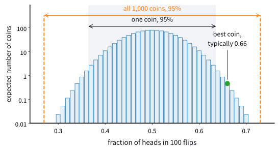
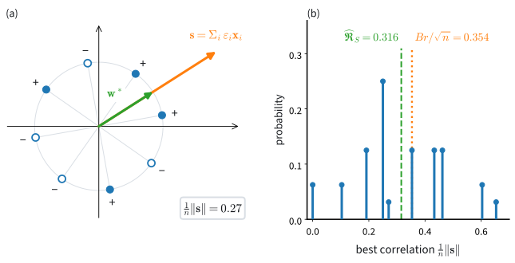

# Uniform Convergence and Generalization
:label:`sec_mdl-generalization-bounds`

The previous section put an error bar on a number computed from data. A
classifier scored on 10,000 held-out images has a true error within about 1.4
percentage points of its test error, with 95% confidence. The guarantee rests
on a hypothesis that is easy to overlook: the classifier was fixed before the
test images were drawn. Little of what we report is like that. We train many
configurations, look at their validation scores, and keep the best one. The
reported score belongs to the winner of a contest, and the winner is partly
the configuration whose luck was best.

A simple experiment shows how much luck there is to choose from. Flip each of
1,000 fair coins 100 times and report the coin with the most heads. It shows
about 66 heads, although every coin is fair and any one coin, named in
advance, lands between 37 and 63 heads in at least 95% of experiments.
The winning coin is no different from the others; the 66 comes from the
selection. A validation set is the same experiment with the roles renamed.
Each configuration is a coin, each example is a flip, and the most heads is
the fewest errors. How optimistic is the winner's score, and how much data
does it take to correct for the choice?

Vapnik and Chervonenkis answered this question by asking for a guarantee that
holds for every candidate function at once, so that it also holds for
whichever one the learner picks :cite:`Vapnik.Chervonenkis.1971`. For a
finite list of candidates, the extra data this needs grows only with the
logarithm of their number. For the infinite families of functions we train,
a later idea measures a family by how well it can fit labels that are pure
coin flips. The answers tell us how many configurations a validation set can
rank, and why the capacity of a linear model depends on its weight norm
rather than on its number of parameters. They also show where this way of
arguing stops: at models that fit random labels, as the networks of the main
text do. The section ends with the double-descent experiment of
:numref:`subsec_double_descent`, repeated in a model small enough that its
mechanism can be computed.

The code in this section is plain NumPy, the same in every framework tab.

```{.python .input #mdl-generalization-bounds-uniform-convergence-and-generalization}
#@tab mxnet
%matplotlib inline
from d2l import mxnet as d2l
import numpy as np

rng = np.random.default_rng()
```

```{.python .input #mdl-generalization-bounds-uniform-convergence-and-generalization}
#@tab pytorch
%matplotlib inline
from d2l import torch as d2l
import numpy as np

rng = np.random.default_rng()
```

```{.python .input #mdl-generalization-bounds-uniform-convergence-and-generalization}
#@tab tensorflow
%matplotlib inline
from d2l import tensorflow as d2l
import numpy as np

rng = np.random.default_rng()
```

```{.python .input #mdl-generalization-bounds-uniform-convergence-and-generalization}
#@tab jax
%matplotlib inline
from d2l import jax as d2l
import numpy as np

rng = np.random.default_rng()
```

## Uniform Convergence

A test-set certificate and a learner differ only in the order of two events:
choosing the function and drawing the sample. This part measures how much
choosing after the sample distorts the score, and how much more data a
guarantee needs once the order is reversed.

### The Best of Many Coins
:label:`subsec_mdl-best-of-many-coins`

We first state the guarantee for one function in the notation of learning,
because the rest of the section modifies it. A sample
$S=\{(\mathbf x_1,y_1),\ldots,(\mathbf x_n,y_n)\}$ consists of $n$ independent
draws from an unknown distribution. A loss $\ell$ with values in $[0,1]$
scores a prediction, for instance the 0-1 loss, which is $1$ for a mistake and
$0$ otherwise.

The *empirical risk* of a function $f$ is its average loss on the sample,
$\hat R(f)=\frac1n\sum_{i=1}^n\ell(f(\mathbf x_i),y_i)$, and its *risk* is the
expected loss on a fresh draw, $R(f)=\mathbb{E}[\ell(f(\mathbf x),y)]$. If $f$
is fixed before $S$ is drawn, $\hat R(f)$ is an average of $n$ independent
terms in $[0,1]$ with mean $R(f)$, and Hoeffding's inequality
(:numref:`sec_mdl-concentration-generalization`) applies:

$$
P\bigl(|\hat R(f)-R(f)|\ge t\bigr)\le 2e^{-2nt^2}.
$$

So the empirical risk of a fixed function misses its risk by $t$ or more with
a probability that falls exponentially in $nt^2$. Setting the right-hand side
to $\delta=0.05$ and solving for $t$ gives the half-width
$\sqrt{\log(2/\delta)/(2n)}$. For $n=10{,}000$ it is $0.0136$, the 1.4
points of the opening.

A learner reverses the order. It searches a class $\mathcal F$ of functions
and returns the $\hat f$ with the smallest $\hat R$ on the sample it saw. Each
$\hat R(f)$ fluctuates around its own $R(f)$, and the learner keeps the
function whose fluctuation was most favorable. The empirical risk
$\hat R(\hat f)$ is therefore a minimum of fluctuating quantities, and the
inequality above, which holds for each $f$ separately, says nothing about it.

The coins make this concrete. Let $k=1{,}000$ fair coins each be flipped
$m=100$ times. For one coin named in advance, Hoeffding at $\delta=0.05$
allows a deviation of $\sqrt{\log 40/200}=0.136$ in the fraction of heads, so
the coin shows between 37 and 63 heads with probability at least 95% (the
exact probability is 99.3%). The cell below repeats the experiment 2,000
times and asks how far the best of the 1,000 coins strays, and how often it
leaves the single-coin band.

```{.python .input #mdl-generalization-bounds-the-best-of-many-coins}
k, m, repeats = 1000, 100, 2000          # coins, flips per coin, experiments
best = rng.binomial(m, 0.5, size=(repeats, k)).max(axis=1) / m
one = np.sqrt(np.log(2 / 0.05) / (2 * m))       # Hoeffding, one fixed coin
many = np.sqrt(np.log(2 * k / 0.05) / (2 * m))  # union bound over k coins
print(f'best of {k} coins: median {np.median(best):.2f}, 90% of experiments '
      f'in [{np.percentile(best, 5):.2f}, {np.percentile(best, 95):.2f}]')
print(f'95% half-width: one coin {one:.3f}, all {k} coins {many:.3f}')
print(f'experiments in which the best coin leaves the one-coin band: '
      f'{np.mean(best > 0.5 + one):.0%}')
```

The best coin shows 66 heads in a typical experiment and between 64 and 69 in
nine experiments out of ten. It leaves the single-coin band in about 96% of
experiments, so a guarantee that is valid for every coin named in advance
fails almost always for the coin chosen afterwards. No coin is biased. The
selected coin is off by 16 points because we looked at 1,000 fluctuations and
reported the largest.

:numref:`fig_mdl-gen-best-of-many` shows why. Each coin leaves the band with
probability $0.0033$ on the upper side, a rare event, but among 1,000 coins
about $3.3$ are expected to do so. The tail that one coin almost never
reaches is populated when a thousand coins are drawn.


:label:`fig_mdl-gen-best-of-many`

The validation set of the opening differs from the coins in two ways, and
neither matters for what follows. The configurations are scored on the same
examples, so their scores are correlated, and their true errors differ. The
bound below needs neither independence nor equal means.

What would cover the chosen function? If the largest deviation over the whole
class,

$$
\sup_{f\in\mathcal F}\ \bigl|\hat R(f) - R(f)\bigr|,
$$

is at most $t$, then every function's empirical risk is within $t$ of its
risk, including the one the learner picked. Bounds on this supremum are
called *uniform convergence* bounds :cite:`Vapnik.Chervonenkis.1971`.
Choosing after seeing the data is safe if the guarantee was made for all
candidates before seeing it, because the one we pick is one of them.

### Finite Classes and the Union Bound
:label:`subsec_mdl-finite-class`

The simplest class is a finite list of candidates fixed in advance, such as a
grid of hyperparameter configurations. For it, one fact from probability
suffices: the probability that at least one of several events occurs is at
most the sum of their probabilities. This is the *union bound*.

**Proposition (finite-class uniform convergence).** *Let $\mathcal F$ be a
finite class fixed before the sample is drawn, let the loss take values in
$[0,1]$, and let $S$ be an i.i.d. sample of size $n$. Then with probability at
least $1-\delta$,*

$$
\bigl|\hat R(f) - R(f)\bigr|
 \le \sqrt{\frac{\log(2|\mathcal F|/\delta)}{2n}}
\qquad\textrm{simultaneously for every } f\in\mathcal F .
$$
:eqlabel:`eq_mdl-finite-class`

**Proof.** For each fixed $f$, Hoeffding gives
$P(|\hat R(f)-R(f)|\ge t)\le 2e^{-2nt^2}$. The union bound over the
$|\mathcal F|$ bad events bounds the probability that any of them occurs by
$2|\mathcal F|e^{-2nt^2}$. Setting this to $\delta$ and solving for $t$ gives
the claim. $\blacksquare$

The only new step is the union bound; everything else is the single-function
inequality. Compared with one function, the half-width has
$\log(2|\mathcal F|/\delta)$ in place of $\log(2/\delta)$, so choosing among
$|\mathcal F|$ candidates adds $\log|\mathcal F|$ under the square root.

On the coins, $|\mathcal F|=1{,}000$ and $n=100$ give the half-width
$\sqrt{\log(2{,}000/0.05)/200}=0.230$, so with probability at least 95% every
coin, the best one included, shows between 27 and 73 heads. The typical best
coin, at 66, is inside. The bound is conservative: the exact probability that
some coin falls outside 27 to 73 heads is about 0.17%, against the 5% the
bound allows. But it is valid, which the single-coin band was not.

At the scale of a validation set the logarithm keeps the extra data small.
With $n=10{,}000$ and $\delta=0.05$, one function is certified to
$\pm0.0136$, 2,000 configurations to $\pm0.0238$, and a million to
$\pm0.0296$. The million candidates widen the band by a factor of $2.18$.
Solving the bound for the sample size shows the dependence directly:

$$
n=\frac{\log(2/\delta)+\log|\mathcal F|}{2t^2}.
$$

Each additional unit of $\log|\mathcal F|$ adds $1/(2t^2)$ examples. At a
tolerance of $t=0.01$, doubling the number of candidates adds
$\log 2/(2\cdot 10^{-4})\approx3{,}500$ validation examples.

The exponential tail of Hoeffding's inequality is what makes the dependence
logarithmic. Chebyshev's inequality bounds the same deviation by
$\textrm{Var}(\hat R(f))/t^2\le 1/(4nt^2)$, because a $[0,1]$-valued loss has
variance at most $\tfrac14$. The same union bound then gives
$|\mathcal F|/(4nt^2)=\delta$, that is,

$$
t=\sqrt{\frac{|\mathcal F|}{4n\delta}} .
$$

For 2,000 configurations on 10,000 examples at $\delta=0.05$ this is $t=1$,
which says nothing about a loss in $[0,1]$. Hoeffding gives $t=0.024$ for the
same pool. A polynomial tail makes the sample size grow like $|\mathcal F|$,
an exponential tail like $\log|\mathcal F|$.

The proof uses one hypothesis in its first step, where Hoeffding is applied
to each $f$ separately: the class is fixed before the sample is drawn. A
public leaderboard breaks this hypothesis. Each submission is chosen after
seeing the scores of earlier ones on the same test set, so the submissions
are not a fixed list and "for each fixed $f$" no longer applies.
The guarantee then degrades much faster, as the analysis of adaptive data
reuse shows :cite:`Dwork.Feldman.Hardt.ea.2015`, and exercise
:exref:`ex_mdl-concentration-generalization-leaderboard-attack` builds a
submission that beats a random holdout without any knowledge of the task.
The proposition thus turns the test-set-reuse warning of
:numref:`chap_classification_generalization` into a number, and the
leaderboard shows where that number stops applying.

## Rademacher Complexity

The classes we train are infinite. Every weight vector
$\mathbf w\in\mathbb{R}^d$ defines a different linear classifier, and a union
bound over infinitely many events gives nothing. The classical remedies
either replace the class by finitely many representatives (covering numbers)
or count the labelings it can produce on $n$ points (the VC dimension,
sketched in :numref:`chap_classification_generalization`). The tool of this
part is due to Koltchinskii and Panchenko and to
:citet:`Bartlett.Mendelson.2002`. It asks a question a practitioner can act
on: how well can the class fit pure noise?

### Correlation with Random Signs
:label:`subsec_mdl-rademacher-definition`

If a class can fit labels that carry no information, it can also fit the
noise in real labels, and then its empirical risks say little about its
risks. To measure this we feed the class fictitious labels. Let
$\varepsilon_1,\ldots,\varepsilon_n$ be independent fair random signs, each
$+1$ or $-1$ with probability $\tfrac12$; they are called *Rademacher
variables*. For a sign vector $\boldsymbol\varepsilon$, the quantity
$\frac1n\sum_i\varepsilon_if(\mathbf x_i)$ is the correlation of $f$ with the
signs on the sample, and the best a class can do is its supremum over the
class.

**Definition.** The *empirical Rademacher complexity* of a class
$\mathcal F$ of real-valued functions on the points
$S=(\mathbf x_1,\ldots,\mathbf x_n)$ is the expected best correlation the class
achieves with random signs,

$$
\widehat{\mathfrak R}_S(\mathcal F)
 = \mathbb{E}_{\boldsymbol\varepsilon}\!\left[\,
   \sup_{f\in\mathcal F}\ \frac1n \sum_{i=1}^n \varepsilon_i\, f(\mathbf x_i)
 \right],
$$
:eqlabel:`eq_mdl-rademacher`

and its *Rademacher complexity* $\mathfrak R_n(\mathcal F)=\mathbb{E}_S[\widehat{\mathfrak R}_S(\mathcal F)]$
is its average over samples of size $n$.

A class that can match any sign pattern scores high; a class that cannot
choose scores zero. The scale is set by the range of the functions. For a
class with values in $[-1,1]$ each correlation is at most $1$, and the value
$1$ is reached by the class of all functions into $[-1,1]$, which contains
$f(\mathbf x_i)=\varepsilon_i$ for every pattern (when the points are
distinct). For a class with values in $[0,1]$ the largest possible value is
$\tfrac12$: the best choice is $f(\mathbf x_i)=1$ exactly where
$\varepsilon_i=+1$, which scores the fraction of plus signs, $\tfrac12$ on
average. Below, predictors take values in $[-1,1]$ and losses in $[0,1]$.

The smallest case with something to choose is the class of the two constant
functions $\{+1,-1\}$. Its best correlation with a sign vector is
$\max(\bar\varepsilon,-\bar\varepsilon)=|\bar\varepsilon|$, where
$\bar\varepsilon$ is the average of the signs. For $n=2$ the four patterns
$(+,+),(+,-),(-,+),(-,-)$ give $|\bar\varepsilon|=1,0,0,1$, so
$\widehat{\mathfrak R}_S=\tfrac12$. For $n=4$ the sum of the signs is $\pm4$
with probability $\tfrac2{16}$, $\pm2$ with probability $\tfrac8{16}$ and $0$
otherwise, which gives $\widehat{\mathfrak R}_S=\tfrac38$. For large $n$ the
average $\bar\varepsilon$ is approximately normal with variance $1/n$, so
$\widehat{\mathfrak R}_S\approx\sqrt{2/(\pi n)}$; at $n=100$ the exact value is
$0.0796$ against $0.0798$. Even a class with only two members correlates with
noise at the rate $1/\sqrt n$, because the average of $n$ signs has that
spread. A class with one member has complexity $0$: with nothing to choose,
$\mathbb{E}[\frac1n\sum_i\varepsilon_if(\mathbf x_i)]=0$.

For a linear class the best correlation has a geometric meaning, which
:numref:`fig_mdl-gen-rademacher` previews: it is the length of a signed sum
of the inputs, divided by $n$. :numref:`subsec_mdl-linear-class` proves this.

![Rademacher complexity of a linear class, for eight unit vectors in the plane and the class of unit-norm linear functions. (a) For one sign pattern, filled dots are $+1$ and hollow dots $-1$. The best correlation is attained by the weight vector $\mathbf w^*$ aligned with the signed sum $\mathbf s=\sum_i\varepsilon_i\mathbf x_i$, and equals $\|\mathbf s\|/n=0.27$. (b) The exact distribution of the best correlation over all 256 sign patterns. Its mean, the empirical Rademacher complexity, is 0.316, against the bound $Br/\sqrt n=0.354$ proved in the text.](../img/mdl-prob-gen-rademacher.svg)
:label:`fig_mdl-gen-rademacher`

Two more cases mark the ends of the scale. A finite class with values in
$[-1,1]$ obeys *Massart's lemma*,
$\widehat{\mathfrak R}_S(\mathcal F)\le\sqrt{2\log|\mathcal F|/n}$ (exercise
:exref:`ex_mdl-concentration-generalization-massart-l1`), so its complexity
grows only logarithmically with its size. The class of all functions into
$[-1,1]$ reaches the maximum $1$. Rademacher complexity therefore measures
how freely the class can vary on the actual sample points, whatever the
number of its parameters or members.

### The Uniform Convergence Theorem
:label:`subsec_mdl-rademacher-theorem`

We now show that the Rademacher complexity bounds the largest deviation
between empirical risk and risk. One distinction must be made first, because
the predictions and the losses live in different classes. The predictor class
$\mathcal F$ contains the functions we fit. The functions whose averages we
compare are the losses, so define the *loss class*

$$
\mathcal G=\bigl\{(\mathbf x,y)\mapsto\ell(f(\mathbf x),y):f\in\mathcal F\bigr\},
$$

with values in $[0,1]$. For $g\in\mathcal G$ write $z=(\mathbf x,y)$,
$R(g)=\mathbb{E}[g(z)]$ and $\hat R_S(g)=\frac1n\sum_ig(z_i)$. The risk of a
predictor is the risk of its loss.

**Proposition (uniform convergence via Rademacher complexity)**
:cite:`Bartlett.Mendelson.2002`. *Let $S=(z_1,\ldots,z_n)$ be an i.i.d.
sample and let $\mathcal G$ be a class of functions with values in $[0,1]$.
Then with probability at least $1-\delta$,*

$$
R(g) \le \hat R_S(g) + 2\,\mathfrak R_n(\mathcal G)
 + \sqrt{\frac{\log(1/\delta)}{2n}}
\qquad\textrm{simultaneously for every } g\in\mathcal G .
$$
:eqlabel:`eq_mdl-rademacher-bound`

The bound has the shape of the finite-class one: an empirical risk, a term
for the richness of the class, and a confidence term that would be there for
a single function. The richness term is twice the class's ability to fit
random signs.

**Proof.** We show
$\mathbb{E}_S\bigl[\sup_g(R(g)-\hat R_S(g))\bigr]\le2\mathfrak R_n(\mathcal G)$
in three steps; the high-probability form follows afterwards.

I. *Ghost sample.* Let $S'=(z'_1,\ldots,z'_n)$ be an independent copy of $S$,
used only inside the proof. Since $R(g)=\mathbb{E}_{S'}[\hat R_{S'}(g)]$, and a
supremum of expectations is at most the expectation of the supremum,

$$
\mathbb{E}_S\Bigl[\sup_{g\in\mathcal G}\bigl(R(g)-\hat R_S(g)\bigr)\Bigr]
 \le \mathbb{E}_{S,S'}\Bigl[\sup_{g\in\mathcal G}\ \frac1n\sum_{i=1}^n
 \bigl(g(z'_i)-g(z_i)\bigr)\Bigr].
$$
:eqlabel:`eq_mdl-symmetrization`

The unknown risk has been replaced by a second sample.

II. *Sign swap.* Exchanging $z_i$ with $z'_i$ leaves the joint distribution of
$(S,S')$ unchanged, because the two points are independent draws from the
same distribution. The exchange flips the sign of the $i$-th difference
$g(z'_i)-g(z_i)$ for every $g$ at once. So for any fixed signs
$\varepsilon_1,\ldots,\varepsilon_n$ the right-hand side of
:eqref:`eq_mdl-symmetrization` does not change if the $i$-th difference is
multiplied by $\varepsilon_i$. Nor does it change when the signs are drawn at
random:

$$
\mathbb{E}_{S,S'}\Bigl[\sup_{g}\ \frac1n\sum_i\bigl(g(z'_i)-g(z_i)\bigr)\Bigr]
 = \mathbb{E}_{S,S',\boldsymbol\varepsilon}\Bigl[\sup_{g}\ \frac1n\sum_i
 \varepsilon_i\bigl(g(z'_i)-g(z_i)\bigr)\Bigr].
$$

III. *Split.* The supremum of a sum is at most the sum of the suprema, so the
right-hand side is at most

$$
\mathbb{E}_{S',\boldsymbol\varepsilon}\Bigl[\sup_{g}\ \frac1n\sum_i
 \varepsilon_i\,g(z'_i)\Bigr]
 + \mathbb{E}_{S,\boldsymbol\varepsilon}\Bigl[\sup_{g}\ \frac1n\sum_i
 (-\varepsilon_i)\,g(z_i)\Bigr]
 = 2\,\mathfrak R_n(\mathcal G),
$$

because $-\boldsymbol\varepsilon$ has the same distribution as
$\boldsymbol\varepsilon$, so each term is $\mathfrak R_n(\mathcal G)$. The
split produces the factor $2$.

For the high-probability form, consider
$\Phi(S)=\sup_g(R(g)-\hat R_S(g))$. Changing one sample point changes each
$\hat R_S(g)$ by at most $1/n$, and therefore changes $\Phi$ by at most $1/n$.
*McDiarmid's inequality* :cite:`McDiarmid.1989`, the extension of Hoeffding's
inequality from sums to functions that no single input can move much, then
gives $P(\Phi-\mathbb{E}\Phi\ge t)\le e^{-2nt^2}$ (exercise
:exref:`ex_mdl-concentration-generalization-mcdiarmid-s-inequality`). Setting
the right-hand side to $\delta$ and combining with the bound on
$\mathbb{E}\Phi$ gives :eqref:`eq_mdl-rademacher-bound`. $\blacksquare$

The intuition is that the ghost sample stands in for the population.
Swapping a real point with its ghost changes nothing, because the two are
exchangeable, and after the swaps only coin flips remain: the deviation of
the class from the truth is controlled by how well it can follow random signs.

The theorem can be checked at its ends. For a class with one member,
$\mathfrak R_n=0$ and :eqref:`eq_mdl-rademacher-bound` is one-sided
Hoeffding. For a finite class, Massart's lemma turns it into
:eqref:`eq_mdl-finite-class` with larger constants: for 2,000 configurations
on 10,000 examples the complexity term alone is $2\sqrt{2\log 2000/n}=0.078$,
against the union bound's whole half-width of $0.024$. The Rademacher route
is weaker for finite classes, but it also applies to infinite ones. For
classes of binary classifiers, counting the labelings the class can realize
on $n$ points gives $\mathfrak R_n\lesssim\sqrt{d_{\mathrm{VC}}\log n/n}$
:cite:`boucheron2005theory`. Here $d_{\mathrm{VC}}$ is the VC dimension, the
largest number of points on which the class realizes every labeling.

At the other end, a loss class with values in $[0,1]$ has
$\mathfrak R_n(\mathcal G)\le\tfrac12$. When equality holds, the complexity
term is $1$ and the bound says nothing. For classifiers with the 0-1 loss,
the two complexities stand in a fixed ratio. Let the predictors take values in
$\{-1,+1\}$ and use the 0-1
loss, $g(\mathbf x,y)=(1-yf(\mathbf x))/2$. Then
$\sum_i\varepsilon_ig(z_i)=\tfrac12\sum_i\varepsilon_i+\tfrac12\sum_i(-\varepsilon_iy_i)f(\mathbf x_i)$.
The first sum has mean zero and does not depend on $f$, and for fixed labels
$-\varepsilon_iy_i$ is again a fair random sign, so

$$
\widehat{\mathfrak R}_S(\mathcal G)=\tfrac12\,\widehat{\mathfrak R}_S(\mathcal F).
$$

A predictor class that fits every sign pattern on the sample has
$\widehat{\mathfrak R}_S(\mathcal F)=1$, so twice the loss complexity is $1$
and the theorem guarantees nothing for it.

### The Linear Class
:label:`subsec_mdl-linear-class`

The theorem is useful only if the complexity can be computed for a class we
care about. For linear functions with a bounded weight norm the computation
takes four lines, and its answer does not involve the dimension.

**Proposition (Rademacher complexity of a norm-bounded linear class).** *Let
$\mathcal F=\{\mathbf x\mapsto\langle\mathbf w,\mathbf x\rangle :
\|\mathbf w\|_2\le B\}$ and suppose the sample satisfies
$\|\mathbf x_i\|_2\le r$ for all $i$. Then*

$$
\widehat{\mathfrak R}_S(\mathcal F)
 = \frac Bn\,\mathbb{E}_{\boldsymbol\varepsilon}\Bigl\|\sum_{i=1}^n\varepsilon_i\mathbf x_i\Bigr\|
 \le \frac{B\,r}{\sqrt n}.
$$
:eqlabel:`eq_mdl-linear-rademacher`

**Proof.** The supremum is explicit. By linearity and Cauchy--Schwarz, with
equality at $\mathbf w$ of length $B$ aligned with the signed sum,

$$
\sup_{\|\mathbf w\|\le B}\ \frac1n\sum_{i=1}^n
 \varepsilon_i \langle\mathbf w,\mathbf x_i\rangle
 = \sup_{\|\mathbf w\|\le B}\ \frac1n
   \Bigl\langle\mathbf w,\ \sum_i \varepsilon_i\mathbf x_i\Bigr\rangle
 = \frac Bn\,\Bigl\|\sum_{i=1}^n \varepsilon_i\mathbf x_i\Bigr\| .
$$

Taking the expectation gives the equality in the proposition. For the bound,
the square root is concave, so $\mathbb{E}\|\cdot\|\le\sqrt{\mathbb{E}\|\cdot\|^2}$,
and expanding the square,

$$
\mathbb{E}_{\boldsymbol\varepsilon}\Bigl\|\sum_i\varepsilon_i\mathbf x_i\Bigr\|
 \le \sqrt{\sum_{i,j} \mathbb{E}[\varepsilon_i\varepsilon_j]\,
   \langle\mathbf x_i,\mathbf x_j\rangle}
 = \sqrt{\sum_i \|\mathbf x_i\|^2}
 \le r\sqrt n .
$$

The cross terms vanish because independent signs have
$\mathbb{E}[\varepsilon_i\varepsilon_j]=0$ for $i\ne j$. Multiplying by $B/n$
gives $Br/\sqrt n$. $\blacksquare$

Panel (a) of :numref:`fig_mdl-gen-rademacher` draws the first step of this
proof: the best weight vector points along the signed sum.

Only one step of the proof loses anything. The identity
$\mathbb{E}\|\sum_i\varepsilon_i\mathbf x_i\|^2=\sum_i\|\mathbf x_i\|^2$ is
exact, so the slack is all in the step from the mean length of the signed sum
to its root-mean-square length. That step is tight when the length varies
little from one sign pattern to the next. For the eight points of the figure
the slack is 11% ($0.316$ against $0.354$). In the plane, a signed sum of many
unit vectors in spread-out directions is approximately a two-dimensional
Gaussian vector, whose length has mean $\sqrt\pi/2\approx0.89$ times its
root-mean-square, so the slack stays near 11% however many points there are.
In twenty dimensions the length of the signed sum concentrates, by the thin
shell of :numref:`subsec_mdl-thin-shell`, and the slack falls to about 1%.

The dimension $d$ does not appear in :eqref:`eq_mdl-linear-rademacher`. Two
linear classes have the same bound whenever the product $Br$ is the same,
whether they act on ten features or on a million; the dimension matters only
through its effect on $B$ and $r$. In this bound the capacity of a linear
model is set by the product of its weight norm and its input radius, not by
its number of parameters. Weight decay (:numref:`sec_weight_decay`) keeps
$\|\mathbf w\|$ small, and so keeps the class that contains the fitted model
small.

A reader may object that the proposition needs $B$ fixed before the data,
while the norm of a trained weight vector is known only afterwards. The
objection is right, and a union bound over radii answers it. Apply the bound
to each radius $B_j=2^j$ with failure probability $\delta_j=\delta/(j(j+1))$,
which sum to $\delta$, and use the smallest radius that contains the fitted
vector. For $\|\mathbf w\|>1$ this loses at most a factor $2$ in the
complexity term and adds a term of order $\sqrt{\log\log\|\mathbf w\|/n}$
(exercise
:exref:`ex_mdl-concentration-generalization-margin-bound`).

The theorem needs the complexity of the loss class, and the proposition
computes that of the predictor class. A Lipschitz loss connects them.

**Lemma (contraction)** :cite:`Boucheron.Lugosi.Massart.2013`. *Let
$\phi_1,\ldots,\phi_n:\mathbb{R}\to\mathbb{R}$ each be $L$-Lipschitz. Then for
any class $\mathcal F$ and points $\mathbf x_1,\ldots,\mathbf x_n$,*

$$
\mathbb{E}_{\boldsymbol\varepsilon}\Bigl[\sup_{f\in\mathcal F}\sum_{i=1}^n
 \varepsilon_i\,\phi_i\bigl(f(\mathbf x_i)\bigr)\Bigr]
 \le L\,\mathbb{E}_{\boldsymbol\varepsilon}\Bigl[\sup_{f\in\mathcal F}
 \sum_{i=1}^n\varepsilon_i\,f(\mathbf x_i)\Bigr].
$$
:eqlabel:`eq_mdl-contraction`

Composing with a function that stretches distances by at most $L$ multiplies
the complexity by at most $L$. Each $\phi_i$ may differ, which is what a loss
needs: at the point $i$ the loss is the function $u\mapsto\ell(u,y_i)$ of the
prediction, with the label $y_i$ fixed. No centering is required, since adding
a constant $c$ to $\phi_i$ adds $c\,\varepsilon_i$, whose expectation is zero.
We state the lemma without proof.

The theorem also needs losses in $[0,1]$. The hinge and logistic losses are
not bounded by $1$: on the class they reach about $1+Br$, so they must be
divided by that maximum before the theorem applies. A loss that is bounded
from the start is the *ramp loss* on the margin $u=yf(\mathbf x)$,

$$
\phi_\gamma(u)=\min\bigl\{1,\max\{0,\,1-u/\gamma\}\bigr\},
$$

which is $1$ for a mistake, $0$ for a correct prediction with margin at least
$\gamma$, and linear in between. It lies above the 0-1 loss and is
$(1/\gamma)$-Lipschitz.

Write $\hat R_\gamma(\mathbf w)$ for the average of the ramp loss
$\frac1n\sum_i\phi_\gamma(y_i\langle\mathbf w,\mathbf x_i\rangle)$ on the
sample. With $\|\mathbf x\|\le r$ for every input, the contraction lemma and
the linear-class proposition give a loss-class complexity of at most
$Br/(\gamma\sqrt n)$, and the theorem gives, with probability at least
$1-\delta$, for every $\mathbf w$ with $\|\mathbf w\|\le B$,

$$
P\bigl(y\langle\mathbf w,\mathbf x\rangle\le0\bigr)
 \le \hat R_\gamma(\mathbf w) + \frac{2Br}{\gamma\sqrt n}
 + \sqrt{\frac{\log(1/\delta)}{2n}} .
$$
:eqlabel:`eq_mdl-margin-bound`

The left side is the true error rate of the linear classifier; the right side
is its training ramp loss plus two terms we can evaluate. For $Br/\gamma=10$,
$n=50{,}000$ and $\delta=0.05$, the complexity term is $0.089$ and the
confidence term $0.005$, together $0.095$. With $B=10\gamma/r$ fixed in
advance, a linear classifier in the class that separates its training data
with margin $\gamma$ has, with probability at least 95%, a true error below
$9.5\%$. Fitting random labels with a margin forces $Br/\gamma$ up. Once it
passes about $10.6$ the two terms exceed $0.1$, and near
$Br/\gamma\approx110$ the complexity term alone reaches $1$.

### Rademacher Complexity in Numbers
:label:`subsec_mdl-coin-flips-code`

The proposition gives the complexity of the linear class as an expected
length, and the expectation can be estimated by averaging over random sign
vectors. The cell below does this for 50 unit-norm points in $d=2$, $20$ and
$1{,}000$ dimensions, and compares with the bound $Br/\sqrt n=1/\sqrt{50}$.

```{.python .input #mdl-concentration-generalization-coin-flips-in-code}
n, B, num_signs = 50, 1.0, 2000
signs = rng.choice([-1.0, 1.0], size=(num_signs, n))  # rows: sign vectors
for d in (2, 20, 1000):
    X = rng.standard_normal((n, d))
    X /= np.linalg.norm(X, axis=1, keepdims=True)       # ||x_i|| = r = 1
    sup_corr = B * np.linalg.norm(signs @ X, axis=1) / n  # closed-form sup
    print(f'd = {d:4d}: Monte-Carlo R_S = {sup_corr.mean():.3f}, '
          f'bound B r / sqrt(n) = {B / np.sqrt(n):.3f}')
```

The estimate is about $0.125$ in the plane and $0.139$ to $0.141$ in 20 and
1,000 dimensions, against the bound $0.141$. The value in the plane is the
Gaussian prediction $0.89\times0.141=0.125$, and in higher dimensions the
bound is nearly exact. Going from 20 to 1,000 dimensions leaves the
complexity unchanged. A unit-norm linear class on fifty unit-norm points
reaches an average correlation of about $0.14$ with pure noise, and in 2 and
20 dimensions single sign draws reach above $0.2$.

The other end of the scale is a class rich enough to *interpolate*, that is,
to reproduce any labels exactly on the sample. Least squares on $p=2n$
Gaussian features, fit with the pseudoinverse of
:numref:`subsec_mdl-pseudoinverse`, returns for every sign vector the
interpolant $\mathbf w=\boldsymbol\Phi^+\boldsymbol\varepsilon$ of smallest
norm, where $\boldsymbol\Phi\in\mathbb{R}^{n\times p}$ holds the features of
the points as rows. Its correlation with the signs is $1$ for every pattern,
by construction. The informative number is the norm the fits need. Since
$\mathbf w=\boldsymbol\Phi^\top(\boldsymbol\Phi\boldsymbol\Phi^\top)^{-1}\boldsymbol\varepsilon$,

$$
\|\mathbf w\|^2=\boldsymbol\varepsilon^\top(\boldsymbol\Phi\boldsymbol\Phi^\top)^{-1}\boldsymbol\varepsilon,
\qquad
\mathbb{E}\|\mathbf w\|^2=\operatorname{tr}\,\mathbb{E}\bigl[(\boldsymbol\Phi\boldsymbol\Phi^\top)^{-1}\bigr]=\frac{n}{p-n-1},
$$

where the last step uses the mean of an inverse Wishart matrix,
$\mathbb{E}[(\boldsymbol\Phi\boldsymbol\Phi^\top)^{-1}]=\mathbf I_n/(p-n-1)$
for standard Gaussian entries and $p>n+1$ (exercise
:exref:`ex_mdl-concentration-generalization-fitting-random-signs`). For
$n=50$ and $p=100$ the prediction is $\|\mathbf w\|\approx\sqrt{50/49}=1.01$.
The cell measures the norms and the bound $Br/\sqrt n$ of the smallest ball
that contains all 2,000 fits.

```{.python .input #mdl-generalization-bounds-rademacher-complexity-in-numbers-1}
p = 2 * n                                     # more features than points
Phi = rng.standard_normal((n, p))
W = np.linalg.pinv(Phi) @ signs.T             # min-norm fit of each sign vector
w_norm = np.linalg.norm(W, axis=0)
r = np.linalg.norm(Phi, axis=1).max()         # input radius: largest row norm
print(f'mean ||w|| = {w_norm.mean():.2f} (predicted '
      f'{np.sqrt(n / (p - n - 1)):.2f}), largest {w_norm.max():.2f}')
print(f'r = {r:.1f}, B r / sqrt(n) with B = largest ||w||: '
      f'{w_norm.max() * r / np.sqrt(n):.1f}')
```

The mean norm matches the prediction, $1.0$ against $1.01$. The rows of
$\boldsymbol\Phi$ have length about $\sqrt p=10$, the longest about 11 to 12.5,
and the ball that holds the 2,000 fits gives $Br/\sqrt n$ between about 2
and 2.8. A ball that holds an interpolant of every one of the $2^{50}$ sign
vectors is at least as large, and for that ball the value must be at least
$1$. The class then fits every sign pattern, so its
$\widehat{\mathfrak R}_S$ is at least $1$, and the proposition bounds
$\widehat{\mathfrak R}_S$ by $Br/\sqrt n$.

The same arithmetic applies to networks. In :numref:`subsec_random_labels`
an MLP was trained to zero error on random labels of its training images, as
:citet:`zhang2021understanding` did for image classifiers. The class "this
architecture, trained this way" therefore fits every sign pattern on those
inputs, and its Rademacher complexity there is about $1$. Twice the
complexity of the loss class is then also about $1$, and
:eqref:`eq_mdl-rademacher-bound` certifies nothing. Yet the same network
generalizes on real labels. What decides its test error is therefore
invisible to a bound over the whole class: the data, the optimizer, and the
solution it reached. The next part examines a model in which the solution
can be computed in closed form. There, the solution's norm and the
conditioning of the fit explain a test curve that the class bound cannot.

## Interpolation and Double Descent

In :numref:`sec_generalization_basics`, the test error of polynomial fits
followed a U: it fell as the degree grew, then rose sharply as the fit
approached an exact match of the training points.
:numref:`subsec_double_descent` continued past that point with a
network whose hidden layer stayed frozen at its random initialization. The
test error peaked at the width $h=n$ at which an exact fit first became
possible and fell again beyond it, and the smallest singular value of the
hidden representation was tiny at the peak. Here we repeat the construction
on synthetic data, where every quantity in the mechanism can be computed. The
features are $\boldsymbol\phi(\mathbf x)=\mathrm{ReLU}(\mathbf V\mathbf x)$
with a frozen random matrix $\mathbf V$, a *random-features* model
:cite:`Rahimi.Recht.2007`, and only the linear head $\mathbf w$ is fit.

### The Minimum-Norm Interpolant
:label:`subsec_mdl-min-norm-interpolant`

To see why the threshold is special we need the solution in closed form. With
$p$ features and $n$ points, the feature matrix
$\boldsymbol\Phi\in\mathbb{R}^{n\times p}$ has the feature vectors of the
training points as rows, and we fit $\mathbf w=\boldsymbol\Phi^+\mathbf y$.
Below $p=n$ least squares cannot match all $n$ labels and returns the best
compromise. At $p=n$ it must invert a square matrix. Above $p=n$ infinitely
many weight vectors fit exactly, and the pseudoinverse returns the one of
smallest norm.

The singular value decomposition shows all three cases at once. Let
$\boldsymbol\Phi$ have full rank $q=\min(n,p)$ and singular value
decomposition $\boldsymbol\Phi=\sum_{i=1}^q\sigma_i\mathbf u_i\mathbf v_i^\top$,
with $\sigma_1\ge\cdots\ge\sigma_q>0$. Then

$$
\mathbf w=\boldsymbol\Phi^+\mathbf y=\sum_{i=1}^{q}
 \frac{\langle\mathbf u_i,\mathbf y\rangle}{\sigma_i}\,\mathbf v_i .
$$
:eqlabel:`eq_mdl-svd-interpolant`

Every component of $\mathbf y$ along a left singular vector is divided by its
singular value, so the smallest singular value $\sigma_{\min}=\sigma_q$
amplifies most. Whatever part of $\mathbf y$ lies along $\mathbf u_q$ enters
the solution with the factor $1/\sigma_{\min}$. This holds for label noise
and equally for the part of the target that the features represent badly.

For $p<n$ the fit $\boldsymbol\Phi\mathbf w$ is the projection of $\mathbf y$
onto the $p$ directions $\mathbf u_i$, and the rest of $\mathbf y$ is left as
residual. At $p=n$ there are $n$ directions, the fit is exact, and nothing is
left over to absorb the badly represented part. A random square ReLU-feature
matrix is invertible with overwhelming probability, but almost never *well*
invertible: its smallest singular value is small, and the condition-number
analysis of :numref:`subsec_mdl-condition-number` says that the solution then
moves far in the direction $\mathbf v_q$. Adding features beyond $n$ gives
the matrix more room, and its smallest singular value grows again.

Past the threshold the norm of the solution can only fall as features are
added, provided the features are nested: the model with $p+1$ features uses
the first $p$ features of the model with $p$, plus one more.

**Proposition (nesting).** *For nested features and $p\ge n$, with
$\boldsymbol\Phi_p$ of full row rank, the minimum-norm interpolants satisfy
$\|\mathbf w^{(p+1)}_{\min}\|\le\|\mathbf w^{(p)}_{\min}\|$.*

**Proof.** Padding $\mathbf w^{(p)}_{\min}$ with a zero weight for the new
feature gives an interpolant with $p+1$ features of the same norm. The
minimum-norm interpolant with $p+1$ features is no longer than any
interpolant, in particular this one. $\blacksquare$

The argument needs exact interpolation. Below $p=n$ the least-squares solution
is not an interpolant, and its norm grows with $p$: in the sweep below it
rises from about $0.5$ at $p=2$ to about $2$ at $p=15$.

The linear-class bound suggests what to track along the sweep. Its capacity
term for the class that contains the fitted head is the product
$\|\mathbf w\|\cdot\max_i\|\boldsymbol\phi(\mathbf x_i)\|/\sqrt n$: the norm
of the solution times the radius of the features, divided by $\sqrt n$. The
feature radius grows like $\sqrt p$ as features are added, while the norm of
the solution falls past the threshold, so the product could go either way. We
measure it.

### A Double-Descent Sweep
:label:`subsec_mdl-double-descent-example`

We now compute the whole curve. The data are forty training points from a
linear teacher $y=\langle\boldsymbol\beta,\mathbf x\rangle$ in fifteen
dimensions, with $\|\boldsymbol\beta\|=1$ and label noise of standard
deviation $0.1$. The features are ReLU random features with nested columns,
and the head is fit by `pinv`: least squares below the threshold, the
minimum-norm interpolant above it. We sweep $p$ from $2$ to $400$ through
$p=n=40$, with the neighbours $p=39$ and $41$ included so that the peak is
resolved. For every fit we record the test error, the training error,
$\|\mathbf w\|$, $\sigma_{\min}$ and the capacity product. We also record the
two parts of the test error that :numref:`subsec_mdl-benign-overfitting`
separates: the clean part, the error of the same fit made to noise-free
labels, and the noise part, the extra error that the label noise adds.
Medians over 20
independent runs keep the curve readable.

```{.python .input #mdl-concentration-generalization-double-descent-in-twenty-five-lines}
n, n_test, d_in, p_max, trials, noise = 40, 500, 15, 400, 20, 0.1
p_grid = np.array([2, 5, 10, 15, 20, 25, 30, 35, 38, 39, 40, 41, 42, 45, 50,
                   60, 80, 120, 200, 400])
keys = ('test', 'train', 'norm', 's_min', 'capacity', 'clean', 'noise')
stats = np.zeros((len(keys), trials, len(p_grid)))
for tr in range(trials):
    beta = rng.standard_normal(d_in)
    beta /= np.linalg.norm(beta)                     # teacher: y = <beta, x>
    X, X_te = (rng.standard_normal((size, d_in)) for size in (n, n_test))
    y_clean, y_te = X @ beta, X_te @ beta
    y = y_clean + noise * rng.standard_normal(n)     # noisy training labels
    V = rng.standard_normal((p_max, d_in)) / np.sqrt(d_in)
    Phi, Phi_te = np.maximum(X @ V.T, 0), np.maximum(X_te @ V.T, 0)
    for j, p in enumerate(p_grid):                   # nested feature prefixes
        F, F_te = Phi[:, :p], Phi_te[:, :p]
        P = np.linalg.pinv(F)                        # least squares / min norm
        w = P @ y
        r = np.linalg.norm(F, axis=1).max()          # feature radius
        stats[:, tr, j] = (
            np.mean((F_te @ w - y_te) ** 2),                 # test MSE
            np.mean((F @ w - y) ** 2),                       # training MSE
            np.linalg.norm(w),                               # ||w||
            np.linalg.svd(F, compute_uv=False).min(),        # sigma_min
            np.linalg.norm(w) * r / np.sqrt(n),              # capacity
            np.mean((F_te @ (P @ y_clean) - y_te) ** 2),     # clean part
            noise ** 2 * np.linalg.norm(F_te @ P) ** 2 / n_test)  # noise part
med = dict(zip(keys, np.median(stats, axis=1)))
```

The plot shows the medians of the test error, the solution norm, and the
capacity product against $p$ on logarithmic axes, with the threshold $p=n$
marked.

```{.python .input #mdl-generalization-bounds-a-double-descent-sweep-1}
d2l.plot([p_grid] * 3 + [[n, n]],
         [med['test'], med['norm'], med['capacity'], [1e-2, 1e2]],
         'number of random features p', 'median over 20 runs',
         legend=['test MSE', '||w||', 'capacity', 'p = n'], xscale='log',
         yscale='log', fmts=('-', 'm--', 'g-.', 'k:'), figsize=(6, 3.5))
```

The table lists the medians at seven feature counts: below the threshold, at
it, and above it.

```{.python .input #mdl-generalization-bounds-a-double-descent-sweep-2}
print('   p ' + ' '.join(f'{key:>8}' for key in keys))
for p in (15, 38, 40, 42, 50, 80, 400):
    row = [med[key][p_grid == p][0] for key in keys]
    print(f'{p:4d} ' + ' '.join(f'{v:8.2g}' for v in row))
```

Below the threshold the test error first falls, from about $1$ at $p=2$ to a
minimum of roughly $0.6$ to $0.8$ somewhere between $p=15$ and $p=30$, then
rises, as the U-curve leads us to expect. At $p=40=n$ the training error drops
from a few times $10^{-3}$ at $p=38$ to about $10^{-28}$, which is exact
interpolation up to floating point. At the same point the test error peaks,
typically one to two orders of magnitude above the underparameterized minimum. The
median over 20 trials lands anywhere between about 5 and 50 from one run of
the cell to the next, because the peak is heavy-tailed: for a square Gaussian
matrix $\mathbb{E}[1/\sigma_{\min}^2]$ is infinite. The solution norm jumps
to between about 6 and 20, and $\sigma_{\min}$ falls to about $0.01$ to $0.04$,
against $0.05$ to $0.12$ at $p=38$ and about $2.8$ at $p=400$.

Past the threshold the norm falls steadily, as the nesting proposition
requires (it does so in every trial, not only in the medians), down to
about $0.4$ at $p=400$. The test error follows: between about $0.5$ and $0.9$
at $p=50$, $0.2$ at $p=80$, about $0.12$ at $p=120$, and $0.04$ to $0.07$ at
$p=400$, roughly ten times below the best underparameterized model. The training error
is zero up to floating point everywhere past the threshold, so no criterion
based on the training error can tell $p=42$ from $p=400$. The norm, the
smallest singular value and the capacity product all can. The best model in
the experiment is the most overparameterized one, fitting noisy data exactly,
with ten times more parameters than data points.

The capacity product peaks at the threshold with values of about 8 to 25,
falls past it, and reaches about $1.2$ to $1.3$ at $p=400$. It follows the
shape of the test curve, but it certifies nothing, for two reasons. First,
past the threshold it stays above $1$. A complexity bound of $1$ or more
allows the class to fit every sign pattern, so the resulting bound on the
test error is empty. Second, its $B$ was read off the fit rather than fixed
in advance.

The peak is not caused by the label noise. Rerunning the sweep with
`noise = 0` leaves a peak of the same size, and the table shows why. At
$p=40$ the clean part of the test error is larger than the noise part,
usually several times larger. The linear teacher is not a combination of
finitely many ReLU features, and the part of the target that the features
represent badly is what $\sigma_{\min}$ divides. With a target that is an
exact combination of the first ten features and no noise, there is no peak
at all (exercise :exref:`ex_mdl-generalization-bounds-square-case`).

### Benign Overfitting
:label:`subsec_mdl-benign-overfitting`

One puzzle remains. The $p=400$ model reproduces every noisy training label
exactly, yet it tests best. Why does fitting the noise cost so little there?

The test error separates into two parts we can compute. Write the training
labels as $\mathbf y=\mathbf y_0+\boldsymbol\xi$, with $\mathbf y_0$ the
noise-free labels and $\boldsymbol\xi$ independent noise of variance
$\sigma_\xi^2=0.01$ per label. Then
$\mathbf w=\boldsymbol\Phi^+\mathbf y_0+\boldsymbol\Phi^+\boldsymbol\xi$, and the
predictions at the test points are
$\boldsymbol\Phi_{\mathrm{te}}\boldsymbol\Phi^+\mathbf y_0+\boldsymbol\Phi_{\mathrm{te}}\boldsymbol\Phi^+\boldsymbol\xi$.
In the squared test error, the cross term between these two parts has mean
zero because $\boldsymbol\xi$ does. Averaged over
the noise, the test error over $n_{\mathrm{te}}$ test points is

$$
\mathbb{E}_{\boldsymbol\xi}\bigl[\textrm{test error}\bigr]
 = \underbrace{\frac{1}{n_{\mathrm{te}}}\bigl\|\boldsymbol\Phi_{\mathrm{te}}\boldsymbol\Phi^+\mathbf y_0-\mathbf y_{\mathrm{te}}\bigr\|^2}_{\textrm{clean part}}
 + \underbrace{\frac{\sigma_\xi^2}{n_{\mathrm{te}}}\bigl\|\boldsymbol\Phi_{\mathrm{te}}\boldsymbol\Phi^+\bigr\|_F^2}_{\textrm{noise part}} .
$$

The clean part is the error the same procedure would make with noise-free
labels; the noise part is what the noise adds. The last two columns of the
table print them. At $p=40$ the noise part is about $1$ to $4$, a hundred
times or more the noise variance $0.01$, and the clean part is larger still.
At $p=42$ the noise part is a few tenths, at $p=80$ about $0.02$, and at
$p=400$ just under $0.01$. Far past the threshold, interpolating the noise
adds about the noise variance itself to the test error.

The clean part falls from about 5 to 40 at the peak to about $0.04$ to $0.06$
at $p=400$. Most of the gain past the threshold therefore comes from a better
approximation of the target.

:eqref:`eq_mdl-svd-interpolant` explains why the noise costs so little. The signal is carried by the few
directions with large $\sigma_i$. Minimizing the norm spreads the
interpolated noise across the many directions with small $\sigma_i$, and each
of them changes the predictions at new points only slightly. Overfitting is
*benign* when the spectrum has this shape: a few strong directions to carry
the signal, and many weak ones to absorb the noise.

:citet:`Bartlett.Long.Lugosi.Tsigler.2020` make this precise for linear
regression, through two effective ranks of the covariance of the inputs, and
exercise :exref:`ex_mdl-concentration-generalization-benign-spectra` measures
them. In deep networks the features are learned and change the spectrum
during training, and a theory that predicts a given network's test error from
first principles is still open.

We can now say how much more data a choice among a fixed list of candidates
requires: a $\log|\mathcal F|$ under the square root. We can compute the
Rademacher complexity of a norm-bounded linear class and turn it into a margin
bound with numbers. We can also read a double-descent curve as a conditioning
event at the threshold, followed by a shrinking minimum-norm solution. Every
bound in this section covers the worst function in a class fixed before the
data, while the function we use is the one an algorithm reached, and the sweep
shows that this function can be excellent while the class bound stays above
$1$. A guarantee that depends on the algorithm and the data, rather than on
the class alone, is the open question this section leaves.

## Summary

A guarantee for one function fixed before the data says nothing about the
function chosen because it looked best on the data. The best of 1,000 fair
coins shows about 66 heads in 100 flips, outside the band that holds for each
coin named in advance. Uniform convergence repairs this by asking for a
guarantee that holds for every function in the class at once. For a finite
class the union bound and Hoeffding's inequality give it with an extra
$\log|\mathcal F|$ under the square root, which lets a 10,000-example
validation set rank a million configurations, fixed in advance, to within
three points. For infinite classes, symmetrization with a ghost sample turns
the unknown risk into a correlation with random signs, and the bound adds
twice the Rademacher complexity. For the linear class with weight norm $B$ and inputs of norm $r$,
the complexity is at most $Br/\sqrt n$, with no dependence on the dimension.
The bound certifies nothing for a class that fits every sign pattern, such as
a network that fits random labels. In the random-features sweep the
minimum-norm interpolant tests roughly ten times better than the best
classical fit while its capacity product stays above $1$. The quantities
that explain the curve, $\sigma_{\min}$ and the norm of the solution, belong
to the solution rather than to the class.

## Exercises

1. **McDiarmid's inequality.** ● The inequality of :citet:`McDiarmid.1989`
   extends Hoeffding's from sums to functions with *bounded differences*.
   Suppose that changing only the $i$-th argument of $g(x_1,\ldots,x_n)$
   moves its value by at most $c_i$, and that $X_1,\ldots,X_n$ are
   independent. Then

   $$P\bigl(g(X_1,\ldots,X_n)-\mathbb{E}[g(X_1,\ldots,X_n)]\ge t\bigr)\le\exp\left(-\frac{2t^2}{\sum_{i=1}^n c_i^2}\right),$$

   and the same bound holds for the lower tail. Take this statement on
   faith; its proof uses martingales.
    1. Recover Hoeffding's inequality for an average of independent terms
       $X_i\in[a_i,b_i]$ from it.
    1. Let $\Phi(S)=\sup_{g\in\mathcal G}\bigl(R(g)-\hat R_S(g)\bigr)$ for a
       loss class $\mathcal G$ with values in $[0,1]$. Show that $\Phi$ has
       bounded differences $c_i=1/n$. Combine McDiarmid's inequality with the
       symmetrization bound $\mathbb{E}_S[\Phi(S)]\le 2\mathfrak R_n(\mathcal G)$
       of the text and derive :eqref:`eq_mdl-rademacher-bound`.
    1. For data in $[0,1]$, the sample mean has bounded differences $1/n$.
       Construct a sample of odd size $n$ in $[0,1]$ in which changing one
       point moves the sample median by $1$. What does this imply for using
       McDiarmid's inequality to put an error bar on the bootstrap estimate
       of the median in :numref:`sec_mdl-statistics`?
   :exlabel:`ex_mdl-concentration-generalization-mcdiarmid-s-inequality`

1. **Massart's lemma and $\ell_1$ balls.** ● Massart's lemma for finite
   classes and the Rademacher complexity of $\ell_1$-bounded linear classes
   rest on one bound for the expected maximum of sub-Gaussian variables.
    1. Let $Z_1,\ldots,Z_N$ be centered and sub-Gaussian with variance proxy
       $\sigma^2$, that is,
       $\mathbb{E}[e^{\lambda Z_j}]\le e^{\lambda^2\sigma^2/2}$ for all
       $\lambda$, but not necessarily independent. Show that
       $\mathbb{E}[\max_j Z_j]\le\sigma\sqrt{2\log N}$ by bounding
       $e^{\lambda \mathbb{E}[\max_j Z_j]}$ by $\sum_j \mathbb{E}[e^{\lambda Z_j}]$ and
       optimizing over $\lambda>0$. Deduce Massart's lemma,
       $\widehat{\mathfrak R}_S(\mathcal F)\le\sqrt{2\log|\mathcal F|/n}$,
       for a finite class with values in $[-1,1]$.
    1. Let $\mathcal F=\{\mathbf x\mapsto\langle\mathbf w,\mathbf x\rangle:
       \|\mathbf w\|_1\le B\}$ and $\|\mathbf x_i\|_\infty\le r$ for all $i$.
       Follow the proof of :eqref:`eq_mdl-linear-rademacher`, with the
       duality $\sup_{\|\mathbf w\|_1\le B}\langle\mathbf w,\mathbf
       v\rangle=B\|\mathbf v\|_\infty$ in place of Cauchy--Schwarz, and show
       that $\widehat{\mathfrak R}_S(\mathcal F)\le Br\sqrt{2\log(2d)/n}$.
       Why does the dimension $d$ now enter, and why only logarithmically?
    1. Let the inputs lie in $\{-1,+1\}^d$ and let the target weight vector
       have $k$ nonzero entries, each equal to $\pm1$. Compare the bound
       of (b) with :eqref:`eq_mdl-linear-rademacher`, each with the smallest
       radius $B$ that contains the target. For which $k$ is the $\ell_1$
       bound smaller when $d=10^4$?
   :exlabel:`ex_mdl-concentration-generalization-massart-l1`

1. **Margin bound.** ● Let $\mathcal F=\{\mathbf x\mapsto\langle\mathbf
   w,\mathbf x\rangle:\|\mathbf w\|_2\le B\}$ with $\|\mathbf x\|_2\le r$,
   let the labels be $y\in\{-1,+1\}$, and let the ramp loss
   $\phi_\gamma(u)=\min\{1,\max\{0,1-u/\gamma\}\}$ with a fixed $\gamma>0$
   act on the margin $u=yf(\mathbf x)$.
    1. Show that $\phi_\gamma(yf(\mathbf x))$ is at least the 0-1 loss
       $\mathbf 1\{yf(\mathbf x)\le 0\}$ and that $\phi_\gamma$ is
       $(1/\gamma)$-Lipschitz. Show that multiplying each prediction
       $f(\mathbf x_i)$ by a fixed label $y_i$ leaves
       $\widehat{\mathfrak R}_S(\mathcal F)$ unchanged.
    1. Combine (a), the contraction lemma :eqref:`eq_mdl-contraction`,
       :eqref:`eq_mdl-rademacher-bound`, and
       :eqref:`eq_mdl-linear-rademacher` into :eqref:`eq_mdl-margin-bound`.
       For $n=50{,}000$ and $\delta=0.05$, find the largest ratio $Br/\gamma$
       for which the complexity and confidence terms together stay below
       $0.1$.
    1. The bound holds for a radius $B$ fixed before the data are drawn,
       whereas the norm of a trained weight vector is known only afterwards.
       Apply the bound with radius $B_j=2^j$ and confidence
       $\delta_j=\delta/(j(j+1))$ for every $j\ge1$, and take a union bound
       over $j$. State the bound that holds for a weight vector with
       $\|\mathbf w\|>1$ chosen after seeing the data. Show that the freedom
       to choose the radius costs at most a factor $2$ in the complexity term
       and an additional term of order $\sqrt{\log\log\|\mathbf w\|/n}$.
   :exlabel:`ex_mdl-concentration-generalization-margin-bound`

1. [code] **Fitting random signs.** ● The second cell of
   :numref:`subsec_mdl-coin-flips-code` fits $2{,}000$ sign vectors
   $\boldsymbol\varepsilon\in\{-1,+1\}^n$ with
   $\mathbf w=\boldsymbol\Phi^+\boldsymbol\varepsilon$ on $p=2n$ standard
   Gaussian features and measures the norms of the fits.
    1. Let $p<n$ and let $\boldsymbol\Phi$ have full column rank. Show that
       the correlation $\frac1n\sum_i\varepsilon_i(\boldsymbol\Phi\mathbf w)_i$
       has expectation $p/n$ over the signs. The matrix
       $\boldsymbol\Phi\boldsymbol\Phi^+$ is a projection.
    1. Let $p>n$, let $r$ be the largest row norm of $\boldsymbol\Phi$, and
       let $B$ be large enough that the class $\{\|\mathbf w\|\le B\}$
       contains an interpolant of every sign vector. Explain why
       $Br/\sqrt n$ cannot then be smaller than $1$. For a standard Gaussian
       $\boldsymbol\Phi$ with $p>n+1$,
       $\mathbb{E}[(\boldsymbol\Phi\boldsymbol\Phi^\top)^{-1}]=\mathbf I_n/(p-n-1)$.
       Use this identity to predict the typical $\|\mathbf w\|$, and the
       typical value of $\|\mathbf w\|$ times a typical row norm of
       $\boldsymbol\Phi$ divided by $\sqrt n$, as functions of $p$ and
       $n$.
    1. Rerun the cell with $n=50$ for $p\in\{10,25,45,55,100,400,1000\}$
       (for $p<n$ print the correlation instead of the norm) and compare
       with (a) and (b). What happens to the capacity value of (b) as
       $p\to\infty$, and why does the version with the largest row norm stay
       above $1$?
   :exlabel:`ex_mdl-concentration-generalization-fitting-random-signs`

1. [code] **Leaderboard attack.** ●● A leaderboard reports the 0-1 loss of
   each submitted label vector on a holdout set of $n=4{,}000$ examples with
   labels $\mathbf y\in\{0,1\}^n$. The *boosting attack* of
   :citet:`Blum.Hardt.2015` uses no knowledge of the task: submit $k$
   uniformly random label vectors, keep those with reported loss at most
   $\tfrac12$, and submit their coordinatewise majority vote. On fresh data,
   the majority vote has loss $\tfrac12$.
    1. Implement the attack for uniformly random $\mathbf y$ and
       $k\in\{10,30,100,300,1000,3000\}$, and record the reported loss of
       the majority vote. Compare its distance from $\tfrac12$ with the
       deviation that :eqref:`eq_mdl-finite-class` allows for a
       pre-registered pool of $k+1$ models at $\delta=0.05$. From which $k$
       on does the attack exceed this deviation, and which hypothesis of the
       proposition does it violate?
    1. :citet:`Blum.Hardt.2015` prove that the reported loss is
       $\tfrac12-\Omega(\sqrt{k/n})$ but do not give the constant. Derive it
       heuristically with Gaussian approximations: estimate the expected
       excess agreement with $\mathbf y$ of a kept vector, then the
       probability that the majority of about $k/2$ such vectors is correct
       on one coordinate. Compare the constant with the measurements
       of (a).
    1. The *Ladder* mechanism of :citet:`Blum.Hardt.2015` releases a new
       score only when a submission beats the best released score by more
       than a step $\eta$, rounds it to a multiple of $\eta$, and otherwise
       repeats the previous score. Against the Ladder, the attacker can only
       keep the vectors that lowered the released score. Implement both for
       $\eta\in\{0.005,0.01\}$ and $k\in\{100,1000,3000\}$. How far below
       $\tfrac12$ does the majority vote now get, and how does this compare
       with the deviation of (a)?
   :exlabel:`ex_mdl-concentration-generalization-leaderboard-attack`

1. **Ranking configurations on a holdout.** ● A validation set has
   $n=10{,}000$ examples, the loss takes values in $[0,1]$, and
   $\delta=0.05$.
    1. From :eqref:`eq_mdl-finite-class`, how many configurations, fixed in
       advance, can be ranked with a simultaneous guarantee of $\pm2\%$,
       $\pm2.5\%$ and $\pm3\%$? Why is the count so sensitive to the
       tolerance?
    1. Repeat (a) with Chebyshev's inequality (variance at most $\tfrac14$)
       in place of Hoeffding's, with the same union bound. How many
       configurations does it allow at $\pm2\%$, and how many at $\pm5\%$?
    1. *The winner's curse.* Let all $k$ configurations have true error
       $10\%$, and treat their validation errors as independent. With the
       Gaussian approximation to each error and the estimate
       $\mathbb{E}[\max]\approx\sqrt{2\log k}$ for the maximum of $k$
       independent standard normals, show that the best reported error is
       about $10\%-0.3\%\cdot\sqrt{2\log k}$, and evaluate it at $k=1{,}000$.
       Then compute the exact median and the 5th and 95th percentiles of the
       minimum of $k=1{,}000$ independent $\textrm{Binomial}(10{,}000,0.1)$
       counts, divided by $n$, from the distribution function of the
       binomial.
    1. The reported score of the chosen configuration is biased downward by
       about one point. Explain in one sentence why scoring it on a fresh
       test set removes the bias. Does the bias violate a hypothesis of
       :eqref:`eq_mdl-finite-class`, and does the bound cover it?
   :exlabel:`ex_mdl-generalization-bounds-ranking-configurations`

1. **Thresholds on the line.** ● Let
   $\mathcal F=\{x\mapsto\mathbf 1\{x\ge\theta\}:\theta\in\mathbb{R}\}$ act on
   $n$ distinct real points $x_1<\cdots<x_n$.
    1. Show that $\mathcal F$ realizes exactly $n+1$ labelings of the points
       and that its VC dimension (the largest number of points on which it
       realizes all labelings) is $1$. Show that with both orientations,
       $\mathbf 1\{x\ge\theta\}$ and $\mathbf 1\{x\le\theta\}$, the count is
       $2n$ and the VC dimension is $2$.
    1. Compute $\widehat{\mathfrak R}_S(\mathcal F)$ for the one-sided class
       exactly for $n=2$ and $n=3$ by enumerating the sign patterns.
    1. Show that in general
       $\widehat{\mathfrak R}_S(\mathcal F)=\frac1n\mathbb{E}\bigl[\max(0,\max_kT_k)\bigr]$,
       where $T_k$ is the sum of the signs at the $k$ largest points, a
       simple random walk. Argue with the reflection principle, or simulate,
       that this is about $\sqrt{2/(\pi n)}$ for large $n$, and check the
       values at $n=100$ and $n=1{,}000$.
    1. Compare with Massart's lemma applied to the $n+1$ labelings. By what
       factor is it loose at $n=100$, and which property of the labelings
       does it ignore?
   :exlabel:`ex_mdl-generalization-bounds-thresholds-on-the-line`

1. [code] **The square case.** ● Use the sweep of the double-descent
   experiment in :numref:`subsec_mdl-double-descent-example`.
    1. Show from the stored norms that the nesting monotonicity fails below
       the threshold, and explain why the proof does not apply there.
    1. At $p=n$, decompose $\mathbf w$ along :eqref:`eq_mdl-svd-interpolant`.
       Report, as a median over trials, the coefficient
       $|\langle\mathbf u_n,\mathbf y\rangle|/\sigma_{\min}$ of the smallest
       singular direction next to $\|\mathbf w\|$. Which share of the norm
       does this one direction carry?
    1. Rerun the sweep with `noise = 0`. Then replace the teacher by a target
       $y=\langle\mathbf c,\boldsymbol\phi_{1:10}(\mathbf x)\rangle$ that is an
       exact combination of the first ten features, with $\|\mathbf c\|=1$
       and no noise. Describe the two curves. In each case, what does
       $\sigma_{\min}$ divide? Why does the minimum-norm interpolant become
       *worse* as features are added when the target uses only ten of them?
    1. Add label noise of standard deviation $0.1$ to the target of (c).
       Where is the test error now highest, how does the peak compare with
       the noise variance, and where is the error lowest?
   :exlabel:`ex_mdl-generalization-bounds-square-case`

1. [extended] **Benign spectra.** ●●
   :citet:`Bartlett.Long.Lugosi.Tsigler.2020` characterize when the minimum-norm interpolant in linear regression has
   small excess risk, the mechanism that
   :numref:`subsec_mdl-benign-overfitting` describes in words. Let
   $\mathbf x\sim\mathcal N(\mathbf 0,\boldsymbol\Sigma)$ with
   $\boldsymbol\Sigma=\operatorname{diag}(\lambda_1,\ldots,\lambda_p)$ and
   $\lambda_1\ge\lambda_2\ge\cdots$, let
   $y=\langle\boldsymbol\theta^*,\mathbf x\rangle+\xi$ with
   $\xi\sim\mathcal N(0,\sigma^2)$, stack $n<p$ training inputs into
   $\mathbf X\in\mathbb R^{n\times p}$, and let
   $\hat{\boldsymbol\theta}=\mathbf X^+\mathbf y$. The excess risk is
   $(\hat{\boldsymbol\theta}-\boldsymbol\theta^*)^\top\boldsymbol\Sigma
   (\hat{\boldsymbol\theta}-\boldsymbol\theta^*)$.
    1. Show that its expectation over the noise is the sum of a bias term
       $\boldsymbol\theta^{*\top}(\mathbf I-\mathbf P)\boldsymbol\Sigma
       (\mathbf I-\mathbf P)\boldsymbol\theta^*$, where
       $\mathbf P=\mathbf X^+\mathbf X$, and a variance term
       $\sigma^2\operatorname{tr}\bigl((\mathbf X^+)^\top\boldsymbol\Sigma
       \mathbf X^+\bigr)$. Implement both terms; no test set is needed.
    1. The paper's effective ranks are
       $\rho_k=\sum_{i>k}\lambda_i/\lambda_{k+1}$ and
       $\varrho_k=\bigl(\sum_{i>k}\lambda_i\bigr)^2/\sum_{i>k}\lambda_i^2$. With
       $k^*$ the smallest $k$ such that $\rho_k\ge bn$, the variance term is of
       order $\sigma^2(k^*/n+n/\varrho_{k^*})$ up to constants; take $b=1$. Use
       $n=100$, $\sigma=1$, five strong directions with $\lambda_i=1$ that
       contain a unit-norm $\boldsymbol\theta^*$, and $q$ weak directions
       with $\lambda_i=1/q$ each, for $q\in\{100,300,10^3,3\cdot10^3,10^4\}$.
       Compare the measured variance with $\sigma^2(k^*/n+n/\varrho_{k^*})$. What
       happens at $q=100$, and why?
    1. Repeat with power-law spectra $\lambda_i=i^{-\alpha}$ truncated at
       $p=40n$, for $\alpha\in\{0.5,1,2\}$, $\boldsymbol\theta^*=\mathbf e_1$,
       and $n\in\{50,100,200,400\}$. For which spectra does the excess risk
       decrease with $n$? For the others, does the bias or the variance
       fail, and how do $\rho_0/n$, $k^*/n$, and $n/\varrho_{k^*}$ show it?
   :exlabel:`ex_mdl-concentration-generalization-benign-spectra`

1. **Norms, not widths: a two-layer network.** ●● Let
   $\mathcal F_1=\{\mathbf x\mapsto\mathrm{ReLU}(\langle\mathbf v,\mathbf x\rangle):\|\mathbf v\|_2\le B_2\}$
   and
   $\mathcal F_2=\{\mathbf x\mapsto\sum_{j=1}^hw_j\,\mathrm{ReLU}(\langle\mathbf v_j,\mathbf x\rangle):\|\mathbf w\|_1\le B_1,\ \|\mathbf v_j\|_2\le B_2\}$,
   on points with $\|\mathbf x_i\|\le r$.
    1. Show that $\widehat{\mathfrak R}_S(\mathcal F_1)\le B_2r/\sqrt n$.
    1. Show that $\mathcal F_2$ is contained in $B_1$ times the convex hull of
       $\mathcal F_1\cup(-\mathcal F_1)$, and that taking the convex hull of a
       class does not change its empirical Rademacher complexity. Hint:
       $\sum_jw_jf_j=\|\mathbf w\|_1\sum_j\frac{|w_j|}{\|\mathbf w\|_1}(\pm f_j)$.
    1. Using $0\in\mathcal F_1$, show that
       $\mathbb{E}_{\boldsymbol\varepsilon}\sup_{f\in\mathcal F_1}|\sum_i\varepsilon_if(\mathbf x_i)|\le2n\,\widehat{\mathfrak R}_S(\mathcal F_1)$,
       and conclude that $\widehat{\mathfrak R}_S(\mathcal F_2)\le2B_1B_2r/\sqrt n$.
    1. The width $h$ does not appear in the bound. What does the bound say
       about weight decay on both layers? Why does it not explain the
       random-label experiment of :numref:`subsec_random_labels`?
   :exlabel:`ex_mdl-generalization-bounds-two-layer-norm-bound`

[Discussions](https://d2l.discourse.group/)

<!-- slides -->

::: {.slide}
::: {.cover}
[Dive into Deep Learning · §27.8]{.kicker}

Guarantees for the model you chose<br>**uniform convergence · Rademacher complexity · double descent**
:::
:::

::: {.slide title="The Best of 1,000 Fair Coins Shows 66 Heads in 100"}
[The problem]{.kicker}

{width=72%}

- One coin named in advance: Hoeffding allows $\pm13.6$ points at 95%, so 37 to 63 heads.
- The best of 1,000: 64 to 69 heads in 90% of experiments. No coin is biased.

::: {.d2l-note}
A validation set is this experiment: configurations are coins, examples are flips.
:::
:::

::: {.slide title="By the End of This Deck You Can"}
[Goals]{.kicker}

- size a validation set for a choice among $|\mathcal F|$ fixed candidates;
- compute the Rademacher complexity of a norm-bounded linear class;
- turn it into a margin bound with numbers;
- read a double-descent curve through $\sigma_{\min}$ and the solution norm;
- say where guarantees for a whole class stop.

**Idea:** a guarantee that holds for every candidate at once also holds for the winner.
**Running example:** 1,000 fair coins, 100 flips each.
:::

::: {.slide title="From One Fixed Function to the Function We Chose"}
[Where this fits]{.kicker}

::: {.cols .vc}
::: {.col}
| section | adds |
|---|---|
| Random Variables | densities, moments, covariance |
| Distributions | the named laws and their losses |
| The Exponential Family | one form, convex fits, conjugacy |
| Statistics | error bars, tests, intervals |
| Maximum Likelihood | losses, Fisher information, MAP, EM |
| Bayesian Computation | averaging over a posterior |
| Concentration Inequalities | exponential tails of averages |
| **Uniform Convergence** | **guarantees after selection** |
| Naive Bayes | one classifier, end to end |
:::

::: {.col .narrow}
- **Uses:** Hoeffding, the SVD, the pseudoinverse.
- **Skips:** VC proofs, covering numbers, PAC-Bayes, stability.
:::
:::
:::

::: {.slide title="A Certificate for a Fixed f Does Not Cover the f̂ Chosen on the Data"}
[Uniform convergence]{.kicker}

- Loss in $[0,1]$; $\hat R(f)$ = average loss on $n$ samples, $R(f)$ = expected loss.
- Fixed $f$, then draw $S$: $P(|\hat R(f)-R(f)|\ge t)\le2e^{-2nt^2}$.
- A learner draws $S$, then picks $\hat f=\arg\min_f\hat R(f)$: the most favorable fluctuation.
- Cover every candidate at once:

$$\sup_{f\in\mathcal F}\bigl|\hat R(f)-R(f)\bigr|\le t .$$

::: {.d2l-note}
The function we pick is one of the candidates.
:::
:::

::: {.slide title="The Union Bound Adds Only log|F| for a Choice among |F|"}
[Finite classes]{.kicker}

- $P(\text{any } f \text{ off by } t)\le2|\mathcal F|e^{-2nt^2}$, so with probability $1-\delta$:

$$\bigl|\hat R(f)-R(f)\bigr|\le\sqrt{\frac{\log(2|\mathcal F|/\delta)}{2n}}\quad\text{for all } f\in\mathcal F.$$

- Coins ($|\mathcal F|=1{,}000$, $n=100$): $\pm0.230$, band 27 to 73 heads; the best coin's 66 is inside.
- Validation, $n=10{,}000$: $\pm0.0136$ for 1, $\pm0.0238$ for 2,000, $\pm0.0296$ for $10^6$.
:::

::: {.slide title="Chebyshev Plus a Union Bound Gives t = 1 for 2,000 Configurations"}
[Why exponential tails]{.kicker}

- Chebyshev: $P(|\hat R-R|\ge t)\le1/(4nt^2)$ for a loss in $[0,1]$.
- Union over $|\mathcal F|$: $t=\sqrt{|\mathcal F|/(4n\delta)}$.
- $|\mathcal F|=2{,}000$, $n=10{,}000$, $\delta=0.05$: $t=1$, no information.
- Hoeffding for the same pool: $t=0.024$.
- Sample size: $n=(\log(2/\delta)+\log|\mathcal F|)/(2t^2)$.

::: {.d2l-note}
Polynomial tails make $n$ grow like $|\mathcal F|$, exponential tails like $\log|\mathcal F|$.
:::
:::

::: {.slide title="Check: 1,000 Configurations, All at 10% Error, Validated on 10,000"}
[Check]{.kicker}

What does the best reported error look like, and does the union bound cover it?

::: {.fragment .fade-up}
::: {.d2l-note}
**Answer.** Each score has standard error $\sqrt{0.1\cdot0.9/10^4}=0.3\%$; the
best of 1,000 is about $\sqrt{2\log1000}\approx3.7$ of them below: about 9%
(exactly, a median of 9.05%). The union bound allows $\pm2.3\%$ and covers
it. A fresh test set removes the bias.
:::
:::
:::

::: {.slide title="Leaderboards Break the Hypothesis: the Pool Must Be Fixed First"}
[The boundary]{.kicker}

- Each new submission is chosen after seeing earlier scores on the same holdout.
- The submissions are no longer a fixed list, so "for each fixed $f$" fails.
- Boosting attack: submit random label vectors, keep those scoring at most ½, submit their majority vote.
- The vote beats a random holdout by order $\sqrt{k/n}$ with no knowledge of the task.
- Limiting what each score reveals (the Ladder) restores a guarantee.
:::

::: {.slide title="Rademacher Complexity Asks How Well a Class Fits Coin Flips"}
[Infinite classes]{.kicker}

$$\widehat{\mathfrak R}_S(\mathcal F)=\mathbb{E}_{\boldsymbol\varepsilon}\Bigl[\sup_{f\in\mathcal F}\tfrac1n\textstyle\sum_i\varepsilon_if(\mathbf x_i)\Bigr],\qquad \varepsilon_i=\pm1\text{ fair, independent.}$$

- $\{+1,-1\}$: best correlation $|\bar\varepsilon|$; $\tfrac12$ at $n=2$, $\tfrac38$ at $n=4$, $\approx\sqrt{2/(\pi n)}$.
- One function: $0$. Finite class: $\le\sqrt{2\log|\mathcal F|/n}$ (Massart).
- All functions into $[-1,1]$: $1$. Into $[0,1]$: $\tfrac12$.
- $\mathfrak R_n=\mathbb{E}_S\widehat{\mathfrak R}_S$.
:::

::: {.slide title="For a Linear Class, the Best Correlation Is the Length of a Signed Sum"}
[Geometry]{.kicker}

{width=86%}

- Eight unit vectors, unit-norm weights: one pattern gives $0.27$.
- Mean over all 256 patterns $0.316$; bound $Br/\sqrt n=1/\sqrt8=0.354$.
:::

::: {.slide title="With Probability 1 − δ, R ≤ R̂ + 2ℜₙ(G) + √(log(1/δ)/2n) for Every g"}
[The theorem]{.kicker}

- Predictors $\mathcal F$; loss class $\mathcal G=\{(\mathbf x,y)\mapsto\ell(f(\mathbf x),y)\}$, values in $[0,1]$.

$$R(g)\le\hat R_S(g)+2\,\mathfrak R_n(\mathcal G)+\sqrt{\frac{\log(1/\delta)}{2n}}\quad\text{for all }g\in\mathcal G.$$

- Same shape as the finite bound: empirical risk, richness, confidence.
- $\pm1$ predictors, 0-1 loss: $\widehat{\mathfrak R}_S(\mathcal G)=\tfrac12\widehat{\mathfrak R}_S(\mathcal F)$.

*Hypotheses: i.i.d. sample; losses in $[0,1]$.*
:::

::: {.slide title="Symmetrization: a Ghost Sample, a Sign Swap, a Split"}
[The proof]{.kicker}

- I. Ghost $S'$: $R(g)=\mathbb{E}_{S'}\hat R_{S'}(g)$, and $\sup\mathbb{E}\le\mathbb{E}\sup$:
  $\ \mathbb{E}\sup_g(R-\hat R_S)\le\mathbb{E}\sup_g\tfrac1n\sum_i(g(z'_i)-g(z_i))$.
- II. Swapping $z_i\leftrightarrow z'_i$ keeps the law: insert random signs $\varepsilon_i$.
- III. $\sup(a+b)\le\sup a+\sup b$, and $-\boldsymbol\varepsilon\sim\boldsymbol\varepsilon$: total $2\,\mathfrak R_n(\mathcal G)$.

::: {.d2l-note}
One point moves the supremum by $\le1/n$; McDiarmid adds $\sqrt{\log(1/\delta)/2n}$.
:::
:::

::: {.slide title="The Linear Class: R̂ ≤ Br/√n, and the Dimension Is Absent"}
[Linear class]{.kicker}

$\|\mathbf w\|\le B$, $\|\mathbf x_i\|\le r$:

- I. Cauchy–Schwarz: $\sup_{\mathbf w}\tfrac1n\langle\mathbf w,\sum_i\varepsilon_i\mathbf x_i\rangle=\tfrac Bn\|\sum_i\varepsilon_i\mathbf x_i\|$.
- II. Concavity of $\sqrt{\cdot}$: $\mathbb{E}\|\cdot\|\le\sqrt{\mathbb{E}\|\cdot\|^2}$.
- III. $\mathbb{E}[\varepsilon_i\varepsilon_j]=0$: $\mathbb{E}\|\sum_i\varepsilon_i\mathbf x_i\|^2=\sum_i\|\mathbf x_i\|^2\le nr^2$.
- 50 unit points: Monte Carlo about $0.125$, $0.139$, $0.141$ at $d=2,20,1000$; bound $0.141$.

::: {.d2l-note}
Capacity is the product $Br$, not the parameter count.
:::
:::

::: {.slide title="A Margin Bound Certifies 9.5% at Br/γ = 10 and n = 50,000"}
[Contraction]{.kicker}

- Contraction: $L$-Lipschitz $\phi_i$ multiply the complexity by at most $L$.
- Ramp loss $\phi_\gamma(u)=\min\{1,\max\{0,1-u/\gamma\}\}$ on $u=yf(\mathbf x)$: bounded, $1/\gamma$-Lipschitz, above the 0-1 loss.

$$P(\text{error})\le\hat R_\gamma+\frac{2Br}{\gamma\sqrt n}+\sqrt{\frac{\log(1/\delta)}{2n}}=\hat R_\gamma+0.089+0.005 .$$

- Fitting random labels pushes $Br/\gamma$ up until the bound passes 1.
:::

::: {.slide title="Check: Which Classes Have Rademacher Complexity 0, and Which 1?"}
[Check]{.kicker}

A single function; $\{\mathbf x\mapsto\langle\mathbf w,\mathbf x\rangle:\|\mathbf w\|\le0\}$;
$\{+1,-1\}$; all functions into $[-1,1]$ on distinct points.

::: {.fragment .fade-up}
::: {.d2l-note}
**Answer.** A single function and the ball of radius 0: $0$, nothing to choose.
$\{+1,-1\}$: about $\sqrt{2/(\pi n)}$, small but not zero. All functions into
$[-1,1]$: $1$, they fit every sign pattern.
:::
:::
:::

::: {.slide title="An Interpolating Class Fits Every Sign Vector, So Its Bound Exceeds 1"}
[Fitting noise]{.kicker}

- $n=50$ points, $p=100$ Gaussian features; min-norm fit $\mathbf w=\boldsymbol\Phi^+\boldsymbol\varepsilon$ to 2,000 sign vectors.
- Correlation 1 by construction; $\mathbb{E}\|\mathbf w\|^2=n/(p-n-1)$.

@!mdl-generalization-bounds-rademacher-complexity-in-numbers-1

- A network trained to zero error on random labels: $2\,\mathfrak R_n(\mathcal G)\approx1$, no guarantee.
:::

::: {.slide title="Past p = n the Pseudoinverse Returns the Smallest Interpolant"}
[Minimum norm]{.kicker}

$$\mathbf w=\boldsymbol\Phi^+\mathbf y=\sum_{i=1}^{\min(n,p)}\frac{\langle\mathbf u_i,\mathbf y\rangle}{\sigma_i}\,\mathbf v_i$$

- $\boldsymbol\Phi$: $n$ points by $p$ features, singular values $\sigma_i$.
- Nested features: pad the $p$-feature interpolant with a zero, an interpolant with $p+1$.
- So past $p=n$ the minimum norm is **no larger** with each added feature.
- Below $p=n$ no interpolant exists, and the norm grows with $p$.
:::

::: {.slide title="The Peak Is a Conditioning Event: σ_min Divides What y Has along u_min"}
[The threshold]{.kicker}

- 40 points, linear teacher in 15 dimensions, ReLU random features, label noise 0.1.
- $\sigma_{\min}$: $0.05$ to $0.12$ at $p=38$, about $0.01$ to $0.04$ at $p=40$, about $2.8$ at $p=400$.
- What is divided: label noise and the part of the target ReLU features represent badly.
- With noise 0 the peak stays; a target made of ten features has no peak.
:::

::: {.slide title="Double Descent Measured: Test Error, Norm and Capacity All Peak at p = n"}
[The sweep]{.kicker}

::: {.cols .vc}
::: {.col}
- Minimum below the threshold about $0.7$; at $p=40$ typically one to two orders of magnitude higher.
- $p=400$: about $0.05$, roughly ten times below the classical minimum, with zero training error.
:::

::: {.col .fig .big}
@!mdl-generalization-bounds-a-double-descent-sweep-1
:::
:::
:::

::: {.slide title="The Capacity Product Tracks the Curve but Never Certifies"}
[Reading the sweep]{.kicker}

@!mdl-generalization-bounds-a-double-descent-sweep-2

- Capacity $\|\mathbf w\|\,r/\sqrt n$: about 8 to 25 at $p=40$, about 1.2 at $p=400$.
- It stays above 1, and its $B$ was read off the fit.
:::

::: {.slide title="Check: Training Error Is Zero at p = 42 and at p = 400. What Tells Them Apart?"}
[Check]{.kicker}

Name two quantities that separate the two fits, with their values.

::: {.fragment .fade-up}
::: {.d2l-note}
**Answer.** The norm: about 5 against 0.4. The smallest singular value: about
0.08 against 2.8. The noise part of the test error: a few tenths against
just under 0.01. Training error cannot separate them.
:::
:::
:::

::: {.slide title="A Bound for the Whole Class Covers the Winner, until the Class Fits Noise"}
[Wrap-up]{.kicker}

- Best of 1,000 coins: 66 of 100. Union bound: $\log|\mathcal F|$, band 27 to 73.
- Rademacher: $R\le\hat R+2\mathfrak R_n+\sqrt{\log(1/\delta)/2n}$; linear class $Br/\sqrt n$.
- Margin bound: $0.095$ at $Br/\gamma=10$, $n=50{,}000$.
- Double descent: $\sigma_{\min}$ at $p=n$, then a shrinking minimum-norm solution.
- $p=400$: clean part about $0.05$ plus noise part just under $0.01$, the noise variance.

**Open:** guarantees for the solution an algorithm reaches, not for the whole class.
:::
