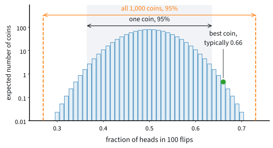
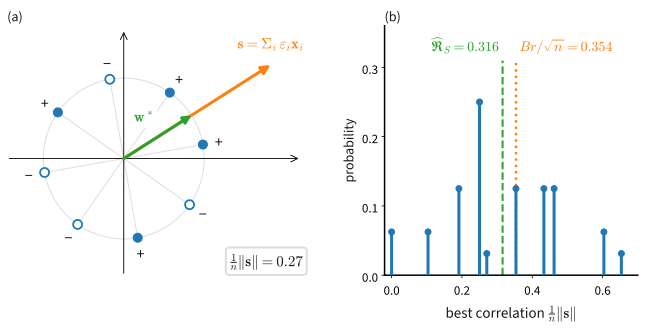

# Uniform Convergence and Generalization
:label:`sec_mdl-generalization-bounds`

The previous section showed how to put an error bar on an average computed
from data. A classifier evaluated on 10,000 held-out images has a true error
within about 1.4 percentage points of its test error, with 95% confidence.
That guarantee rests on a condition that is easy to overlook: the classifier
must be fixed *before* the test images are drawn. In practice, we rarely work
that way. We train many configurations, inspect their validation scores, and
keep the best one. The score we report belongs to the winner of a contest,
and the winner is partly the configuration that got luckiest on the sample.

:numref:`chap_classification_generalization` introduced this problem together
with the remedy of Vapnik and Chervonenkis :cite:`Vapnik.Chervonenkis.1971`:
demand a guarantee that holds for every candidate function simultaneously, so
that it automatically covers whichever one the learner selects. When the list
of candidates is finite, the bound widens only with the logarithm of the
number of candidates. We briefly recall that finite-class result here and
pair it with a concrete experiment that shows just how much luck there is to
pick from: flip each of 1,000 fair coins 100 times and keep the coin with
the most heads. How many heads does it show?

The heart of this section, however, is the infinite function classes we
actually train. For them, a later idea measures the richness of a class by
how well it can fit pure coin-flip labels, its *Rademacher complexity*. This
measure explains why the capacity of a linear model depends on its weight
norm rather than its parameter count, and it also reveals where uniform
convergence reaches its limit: at models flexible enough to fit random
labels, such as the deep networks of the main text. In the final part, we
revisit the double-descent experiment of :numref:`subsec_double_descent` in a
model simple enough that we can compute every piece of the mechanism in
closed form.

```{.python .input #mdl-generalization-bounds-uniform-convergence-and-generalization}
#@tab mxnet
import math
import numpy as np
from mxnet import autograd, gluon, init, np as mnp, npx
from mxnet.gluon import nn
from d2l import mxnet as d2l
npx.set_np()
```

```{.python .input #mdl-generalization-bounds-uniform-convergence-and-generalization}
#@tab pytorch
import math
import numpy as np
import torch
from torch import nn
from torch.nn import functional as F
from d2l import torch as d2l
```

```{.python .input #mdl-generalization-bounds-uniform-convergence-and-generalization}
#@tab tensorflow
import math
import numpy as np
import tensorflow as tf
from d2l import tensorflow as d2l
```

```{.python .input #mdl-generalization-bounds-uniform-convergence-and-generalization}
#@tab jax
import math
import numpy as np
import jax
from jax import numpy as jnp
from flax import nnx
import optax
from d2l import jax as d2l
```

```{.python .input #mdl-generalization-bounds-uniform-convergence-and-generalization-1}
rng = np.random.default_rng()
```

## Uniform Convergence

Evaluating a fixed model on a test set and training a learner differ only in
the order of two events: choosing the function and drawing the sample. Here
we measure how much reversing that order distorts the score, and how much
more data we need once the choice depends on the sample.

### The Best of Many Coins
:label:`subsec_mdl-best-of-many-coins`

Let us first state the single-function guarantee in the notation we will use
throughout this section. A sample
$S=\{(\mathbf x_1,y_1),\ldots,(\mathbf x_n,y_n)\}$ consists of $n$
independent draws from an unknown distribution, and a loss $\ell$ taking
values in $[0,1]$ scores each prediction, for instance the 0-1 loss, which is
$1$ for a mistake and $0$ otherwise.

The *empirical risk* of a function $f$ is its average loss on the sample,
$\hat R(f)=\frac1n\sum_{i=1}^n\ell(f(\mathbf x_i),y_i)$, while its *risk* is
its expected loss on a fresh draw, $R(f)=\mathbb{E}[\ell(f(\mathbf x),y)]$.
(For the 0-1 loss, these are the empirical error $\epsilon_\mathcal{S}(f)$
and population error $\epsilon(f)$ of the main text.) When $f$ is fixed
before $S$ is drawn, $\hat R(f)$ is an average of $n$ independent terms in
$[0,1]$ with mean $R(f)$. Hoeffding's inequality
(:numref:`sec_mdl-concentration-generalization`) therefore bounds
$P(|\hat R(f)-R(f)|\ge t)$ by $2e^{-2nt^2}$. Setting this failure
probability to $\delta=0.05$ and solving for $t$ yields the half-width
$\sqrt{\log(2/\delta)/(2n)}$, which the main text calls the Hoeffding
radius. For $n=10{,}000$ this gives $0.0136$, the 1.4 percentage points
quoted above.

A learner reverses the order of events. It searches a class $\mathcal F$ of
functions and returns the predictor $\hat f$ with the smallest empirical risk
$\hat R$ on the observed sample. Each $\hat R(f)$ fluctuates around its true
risk $R(f)$, and the learner naturally picks a function whose random
fluctuation happened to be favorable. Because $\hat R(\hat f)$ is the
minimum of many fluctuating quantities, an inequality that holds for each
fixed $f$ individually no longer covers it.

Our coin-flipping experiment shows just how large this selection effect can
be. Suppose we flip each of $k=1{,}000$ fair coins $m=100$ times. For a
single coin named in advance, Hoeffding's inequality at $\delta=0.05$ allows
a deviation of $\sqrt{\log 40/200}=0.136$ in the fraction of heads, so that
coin lands between 37 and 63 heads with probability at least 95% (the exact
probability is 99.3%). The best of the 1,000 coins carries no such
guarantee. Let us repeat the experiment 2,000 times and measure how far the
winning coin strays and how often it escapes the single-coin band.

```{.python .input #mdl-generalization-bounds-the-best-of-many-coins}
k, m, repeats = 1000, 100, 2000          # coins, flips per coin, experiments
best = rng.binomial(m, 0.5, size=(repeats, k)).max(axis=1) / m
one = np.sqrt(np.log(2 / 0.05) / (2 * m))       # Hoeffding, one fixed coin
many = np.sqrt(np.log(2 * k / 0.05) / (2 * m))  # union bound over k coins
print(f'best of {k} coins: median {np.median(best):.2f}, 90% of experiments '
      f'in [{np.percentile(best, 5):.2f}, {np.percentile(best, 95):.2f}]')
print(f'95% half-width: one coin {one:.3f}, all {k} coins {many:.3f}')
print(f'experiments in which the best coin leaves the one-coin band: '
      f'{np.mean(best > 0.5 + one):.0%}')
```

In a typical experiment, the best coin shows 66 heads, and in nine
experiments out of ten it lands between 64 and 69. It escapes the
single-coin band in 96% to 97% of runs, so a guarantee that holds for every
coin named in advance fails almost every time for the coin chosen
afterwards. None of the coins is biased. The winner is off by 16 percentage
points simply because we inspected 1,000 random fluctuations and kept the
largest.

:numref:`fig_mdl-gen-best-of-many` makes the reason visible. Any individual
coin crosses the upper edge of the band with probability $0.0033$, a rare
event on its own; among 1,000 coins, however, about $3.3$ are expected to do
so. A tail that one coin almost never reaches becomes well populated once a
thousand coins are tossed.


:label:`fig_mdl-gen-best-of-many`

Model selection on a validation set is the exact same experiment with
different labels: each configuration is a coin, and each validation example
is a flip. Validation configurations share the same examples and have
different true errors, unlike our independent fair coins, yet the bound we
derive next requires neither independence across candidates nor equal means.

How, then, can we obtain a guarantee that still covers the chosen function?
Suppose the largest deviation across the entire class,

$$
\sup_{f\in\mathcal F}\ \bigl|\hat R(f) - R(f)\bigr|,
$$

is at most $t$. Then every function's empirical risk lies within $t$ of its
true risk, and in particular so does the function the learner picked. Bounds
on this supremum are called *uniform convergence* bounds
:cite:`Vapnik.Chervonenkis.1971`. Choosing after seeing the data becomes
safe once the guarantee holds for all candidates before the data arrive,
because whichever candidate we pick is already covered
(:numref:`fig_mdl-gen-uniform-sup`).


:label:`fig_mdl-gen-uniform-sup`

### Finite Classes and the Union Bound
:label:`subsec_mdl-finite-class`

The simplest setting is a finite list of candidates fixed in advance, such
as a pre-specified grid of hyperparameter configurations. For this case the
main text already stated the result in
:numref:`chap_classification_generalization`, and its proof takes only
two lines. Hoeffding's inequality bounds the probability that a single fixed
$f$ deviates by $t$ or more by $2e^{-2nt^2}$. Applying the union bound
(:numref:`sec_mdl-concentration-generalization`) across all $|\mathcal F|$
candidates bounds the probability that *any* of them deviates by $t$ or more
by $2|\mathcal F|e^{-2nt^2}$. Setting this total failure probability equal
to $\delta$ and solving for $t$ gives our first uniform convergence theorem:
for a loss taking values in $[0,1]$ and an i.i.d. sample of size $n$, with
probability at least $1-\delta$,

$$
\bigl|\hat R(f) - R(f)\bigr|
 \le \sqrt{\frac{\log(2|\mathcal F|/\delta)}{2n}}
\qquad\textrm{simultaneously for every } f\in\mathcal F .
$$
:eqlabel:`eq_mdl-finite-class`

Compared with evaluating a single fixed function, choosing among
$|\mathcal F|$ candidates adds $\log|\mathcal F|$ inside the square root and
nothing more.

On our coin experiment, setting $|\mathcal F|=1{,}000$ and $n=100$ produces
a half-width of $\sqrt{\log(2{,}000/0.05)/200}=0.230$, so with probability
at least 95% every coin, the winning coin included, falls between 27 and 73
heads. The bound is admittedly conservative: the true probability that some
coin falls outside 27 to 73 heads is about 0.17%, well below the 5% budget.
Almost all of this factor-of-30 slack comes from Hoeffding's inequality on a
single coin, which leaves that range with probability $1.7\times10^{-6}$
where Hoeffding allows $5\times10^{-5}$; the union bound itself is nearly
tight for rare independent events. Conservative or not, the band is valid,
whereas the single-coin band was not.

For a validation set of 10,000 examples, the main text records the
half-widths: $0.014$ for a single function and $0.030$ for a million.
Solving :eqref:`eq_mdl-finite-class` for the sample size $n$ makes the cost
of searching more transparent:

$$
n=\frac{\log(2/\delta)+\log|\mathcal F|}{2t^2}.
$$

Each additional unit of $\log|\mathcal F|$ requires $1/(2t^2)$ more
examples. At a tolerance of $t=0.01$, doubling the number of candidate
models costs $\log 2/(2\cdot 10^{-4})\approx3{,}500$ extra validation
examples.

This logarithmic dependence is a direct gift of Hoeffding's exponential
tail. If we used Chebyshev's inequality instead (noting that a $[0,1]$-valued
loss has variance at most $\tfrac14$), the same union bound would yield
$t=\sqrt{|\mathcal F|/(4n\delta)}$. For 2,000 configurations on 10,000
examples at $\delta=0.05$, Chebyshev gives $t=1$, spanning the entire range
of the loss and telling us nothing, whereas Hoeffding gives $t=0.024$.

The proof relies on one crucial hypothesis in its very first step: the
candidate class $\mathcal F$ must be fixed before the sample is drawn. A
public benchmark leaderboard violates this assumption whenever each new
submission is chosen after inspecting the test scores of earlier ones
:cite:`Dwork.Feldman.Hardt.ea.2015`. Once the candidates adapt to the
holdout set, the error guarantee degrades from order $\sqrt{\log k/n}$ for
$k$ fixed candidates to order $\sqrt{k/n}$ for an adaptive majority vote
built from $k$ random guessers (exercise
:exref:`ex_mdl-concentration-generalization-leaderboard-attack`).

## Rademacher Complexity

The function classes we actually train are infinite. Every weight vector
$\mathbf w\in\mathbb{R}^d$ defines a distinct linear classifier, and a union
bound over infinitely many events is vacuous. Classical learning theory gets
around this either by approximating the class with finitely many
representatives (covering numbers) or by counting how many distinct labelings
it can realize on $n$ points (the VC dimension, sketched in
:numref:`chap_classification_generalization`). Here we take a more direct
approach :cite:`Bartlett.Mendelson.2002` that asks an operational question
any practitioner can test: how well can the class fit pure noise?

The two central results of this section live in this part: the uniform
convergence theorem :eqref:`eq_mdl-rademacher-bound` and the complexity
bound $Br/\sqrt n$ for norm-bounded linear models,
:eqref:`eq_mdl-linear-rademacher`. The one subtle step is the
symmetrization argument in the proof of the first.

### Correlation with Random Signs
:label:`subsec_mdl-rademacher-definition`

If a function class can fit labels that carry no signal at all, it can just
as easily fit the noise in real labels, and its empirical risk then tells us
very little about its true risk. To test a class's capacity for memorizing
noise, we feed it fictitious random labels. Let
$\varepsilon_1,\ldots,\varepsilon_n$ be independent fair random signs, each
taking the value $+1$ or $-1$ with probability $\tfrac12$; these are called
*Rademacher variables*. For a given sign vector $\boldsymbol\varepsilon$, the
average $\frac1n\sum_i\varepsilon_if(\mathbf x_i)$ measures how well $f$
correlates with those signs on the sample, and the supremum over $f\in\mathcal F$
measures the best correlation the class can achieve.

**Definition.** The *empirical Rademacher complexity* of a class
$\mathcal F$ of real-valued functions on the sample points
$S=(\mathbf x_1,\ldots,\mathbf x_n)$ is the expected best correlation the
class achieves with random signs,

$$
\widehat{\mathfrak R}_S(\mathcal F)
 = \mathbb{E}_{\boldsymbol\varepsilon}\!\left[\,
   \sup_{f\in\mathcal F}\ \frac1n \sum_{i=1}^n \varepsilon_i\, f(\mathbf x_i)
 \right],
$$
:eqlabel:`eq_mdl-rademacher`

and its *Rademacher complexity*
$\mathfrak R_n(\mathcal F)=\mathbb{E}_S[\widehat{\mathfrak R}_S(\mathcal F)]$
is the average of this quantity over random samples of size $n$.

A class that can match any sign pattern scores high, whereas a class with
little freedom scores near zero. The exact ceiling depends on the range of
the functions. If every $f\in\mathcal F$ takes values in $[-1,1]$, then
every correlation is at most $1$, and the class of *all* functions into
$[-1,1]$ achieves $1$ on distinct points by setting
$f(\mathbf x_i)=\varepsilon_i$ for every sign pattern. For a class taking
values in $[0,1]$, the maximum possible complexity is $\tfrac12$: the best
choice sets $f(\mathbf x_i)=1$ wherever $\varepsilon_i=+1$ and $0$
elsewhere, scoring the fraction of plus signs, which averages to $\tfrac12$.
An unbounded class, such as the linear functions we study shortly, has no
such ceiling: if it can interpolate every sign pattern on the sample, its
complexity is at least $1$, and can be larger still.

To get a feel for the numbers, consider the simplest nontrivial class: the
two constant functions $\{+1,-1\}$. Its best correlation with a sign vector
is $\max(\bar\varepsilon,-\bar\varepsilon)=|\bar\varepsilon|$, where
$\bar\varepsilon$ is the sample average of the signs. For $n=2$, the four
equally likely patterns $(+,+),(+,-),(-,+),(-,-)$ give
$|\bar\varepsilon|=1,0,0,1$, so $\widehat{\mathfrak R}_S=\tfrac12$. For
$n=4$, the sum of the signs is $\pm4$ with probability $\tfrac2{16}$, $\pm2$
with probability $\tfrac8{16}$, and $0$ otherwise, giving
$\widehat{\mathfrak R}_S=\tfrac38$. For large $n$, $\bar\varepsilon$ is
approximately normal with mean $0$ and variance $1/n$, so
$\widehat{\mathfrak R}_S\approx\sqrt{2/(\pi n)}$; at $n=100$, the exact
value is $0.0796$ compared with $0.0798$ from the normal approximation. Even
a class with just two functions correlates with noise at rate $1/\sqrt n$,
simply because the average of $n$ random signs fluctuates at that scale. By
contrast, a singleton class $\{f\}$ has complexity $0$: with nothing to
choose from, $\mathbb{E}[\frac1n\sum_i\varepsilon_if(\mathbf x_i)]=0$.

For a linear class, the best correlation has a clean geometric
interpretation, previewed in :numref:`fig_mdl-gen-rademacher`: it is the
length of a signed sum of the input vectors, divided by $n$. We prove this
shortly in :numref:`subsec_mdl-linear-class`.

![Rademacher complexity of a linear class for eight unit vectors in the plane and the class of unit-norm linear functions. (a) For a single sign pattern, filled dots denote $+1$ and hollow dots $-1$. The best correlation is achieved by the unit weight vector $\mathbf w^*$ aligned with the signed sum $\mathbf s=\sum_i\varepsilon_i\mathbf x_i$, and equals $\|\mathbf s\|/n=0.27$. (b) The exact distribution of the best correlation across all 256 sign patterns. Its mean, the empirical Rademacher complexity, is 0.316, compared with the bound $Br/\sqrt n=0.354$ proved in the text.](../img/mdl-prob-gen-rademacher.svg)
:label:`fig_mdl-gen-rademacher`

A finite class taking values in $[-1,1]$ satisfies *Massart's lemma*,
$\widehat{\mathfrak R}_S(\mathcal F)\le\sqrt{2\log|\mathcal F|/n}$ (exercise
:exref:`ex_mdl-concentration-generalization-massart-l1`), so its complexity
grows only logarithmically with the number of functions. More generally,
Rademacher complexity captures how freely a class can vary on the actual
sample points, regardless of how many parameters or members it has.

### The Uniform Convergence Theorem
:label:`subsec_mdl-rademacher-theorem`

We are now ready to show that Rademacher complexity controls the largest
gap between empirical risk and true risk across the entire class. One small
bookkeeping distinction comes first, because predictions and losses belong
to different function classes. The *predictor class* $\mathcal F$ contains
the models we fit, whereas the quantities whose averages we compare are the
losses. We therefore define the *loss class*

$$
\mathcal G=\bigl\{(\mathbf x,y)\mapsto\ell(f(\mathbf x),y):f\in\mathcal F\bigr\},
$$

whose functions take values in $[0,1]$. Writing $z=(\mathbf x,y)$ for a
labeled example, let $R(g)=\mathbb{E}[g(z)]$ and
$\hat R_S(g)=\frac1n\sum_ig(z_i)$ for $g\in\mathcal G$. The risk of a
predictor is simply the risk of its corresponding loss function.

**Proposition (uniform convergence via Rademacher complexity)**
:cite:`Bartlett.Mendelson.2002`. *Let $S=(z_1,\ldots,z_n)$ be an i.i.d.
sample and let $\mathcal G$ be a class of functions taking values in
$[0,1]$. Then with probability at least $1-\delta$,*

$$
R(g) \le \hat R_S(g) + 2\,\mathfrak R_n(\mathcal G)
 + \sqrt{\frac{\log(1/\delta)}{2n}}
\qquad\textrm{simultaneously for every } g\in\mathcal G .
$$
:eqlabel:`eq_mdl-rademacher-bound`

Notice that this bound has the exact same three-part anatomy as the
finite-class bound: the empirical risk on the training sample, a complexity
term measuring the richness of the class, and a confidence term that would
appear even for a single fixed function. Here, the richness term is twice
the class's ability to fit random signs.

**Proof.** We first bound the expected worst-case gap,
$\mathbb{E}_S\bigl[\sup_g(R(g)-\hat R_S(g))\bigr]\le2\mathfrak R_n(\mathcal G)$,
in three steps; the high-probability statement follows from concentration.

I. *Ghost sample.* Introduce an independent copy
$S'=(z'_1,\ldots,z'_n)$ of the sample $S$, which serves purely as an
analytical device inside the proof. Because
$R(g)=\mathbb{E}_{S'}[\hat R_{S'}(g)]$, and because the supremum of an
expectation is always at most the expectation of the supremum, we obtain

$$
\mathbb{E}_S\Bigl[\sup_{g\in\mathcal G}\bigl(R(g)-\hat R_S(g)\bigr)\Bigr]
 \le \mathbb{E}_{S,S'}\Bigl[\sup_{g\in\mathcal G}\ \frac1n\sum_{i=1}^n
 \bigl(g(z'_i)-g(z_i)\bigr)\Bigr].
$$
:eqlabel:`eq_mdl-symmetrization`

The unknown population risk has been replaced by the empirical risk on a
fresh sample.

II. *Sign swap.* Swapping $z_i$ with $z'_i$ leaves the joint distribution of
$(S,S')$ completely unchanged, since both points are independent draws from
the same distribution. Yet that swap negates the $i$-th difference
$g(z'_i)-g(z_i)$ for every $g\in\mathcal G$ simultaneously. Consequently,
for any fixed choice of signs $\varepsilon_1,\ldots,\varepsilon_n\in\{-1,+1\}$,
multiplying the $i$-th difference by $\varepsilon_i$ does not change the
right-hand side of :eqref:`eq_mdl-symmetrization`. Averaging over random
signs leaves it unchanged as well:

$$
\mathbb{E}_{S,S'}\Bigl[\sup_{g}\ \frac1n\sum_i\bigl(g(z'_i)-g(z_i)\bigr)\Bigr]
 = \mathbb{E}_{S,S',\boldsymbol\varepsilon}\Bigl[\sup_{g}\ \frac1n\sum_i
 \varepsilon_i\bigl(g(z'_i)-g(z_i)\bigr)\Bigr].
$$

III. *Split.* Since the supremum of a sum is at most the sum of the suprema,
the right-hand side is bounded above by

$$
\mathbb{E}_{S',\boldsymbol\varepsilon}\Bigl[\sup_{g}\ \frac1n\sum_i
 \varepsilon_i\,g(z'_i)\Bigr]
 + \mathbb{E}_{S,\boldsymbol\varepsilon}\Bigl[\sup_{g}\ \frac1n\sum_i
 (-\varepsilon_i)\,g(z_i)\Bigr]
 = 2\,\mathfrak R_n(\mathcal G),
$$

because $-\boldsymbol\varepsilon$ has the same distribution as
$\boldsymbol\varepsilon$, making both expectations equal to
$\mathfrak R_n(\mathcal G)$. This split is where the factor of $2$ comes
from.

To pass from the expectation to a high-probability bound, define
$\Phi(S)=\sup_g(R(g)-\hat R_S(g))$. Replacing a single sample point $z_i$
changes each empirical risk $\hat R_S(g)$ by at most $1/n$ (since $g$ takes
values in $[0,1]$), and therefore changes the supremum $\Phi(S)$ by at most
$1/n$. *McDiarmid's inequality* :cite:`McDiarmid.1989`, which generalizes
Hoeffding's inequality from sums to any function that no single input can
shift by much, then gives $P(\Phi-\mathbb{E}\Phi\ge t)\le e^{-2nt^2}$
(exercise :exref:`ex_mdl-concentration-generalization-mcdiarmid-s-inequality`).
Setting the right-hand side to $\delta$ and combining with
$\mathbb{E}\Phi\le2\mathfrak R_n(\mathcal G)$ yields
:eqref:`eq_mdl-rademacher-bound`. $\blacksquare$

The intuition behind this *symmetrization* argument is remarkably clean. The
ghost sample stands in for the population. Because real and ghost points are
exchangeable, swapping any pair changes nothing in distribution, and once
those swaps are randomized, only coin flips remain: the worst-case gap
between training and population risk is governed by how well the class can
chase random signs.

One practical detail remains. The theorem states the bound in terms of the
expected complexity $\mathfrak R_n(\mathcal G)$, whereas on a real dataset
we can only evaluate the empirical complexity $\widehat{\mathfrak R}_S(\mathcal G)$
on the sample at hand. Because changing one sample point also moves
$\widehat{\mathfrak R}_S(\mathcal G)$ by at most $1/n$, a second application
of McDiarmid's inequality lets us substitute
$\widehat{\mathfrak R}_S(\mathcal G)$ for $\mathfrak R_n(\mathcal G)$ in
:eqref:`eq_mdl-rademacher-bound` at the cost of widening the confidence term
to $3\sqrt{\log(2/\delta)/(2n)}$. Our numerical checks below use this
empirical form.

It is always worth checking a theorem at its extremes. For a singleton
class, $\mathfrak R_n=0$ and :eqref:`eq_mdl-rademacher-bound` reduces
directly to one-sided Hoeffding. For a finite class, Massart's lemma
recovers the shape of :eqref:`eq_mdl-finite-class`, though with looser
constants: for 2,000 configurations on 10,000 examples, the complexity term
alone is $2\sqrt{2\log 2000/n}=0.078$, compared with the union bound's
entire half-width of $0.024$. Rademacher complexity pays a constant-factor
penalty on finite classes, in exchange for handling infinite classes
effortlessly. For binary classifiers, counting the labelings realizable on
$n$ points bounds $\mathfrak R_n$ by a constant times
$\sqrt{d_{\mathrm{VC}}\log n/n}$ :cite:`boucheron2005theory`, where
$d_{\mathrm{VC}}$ is the VC dimension from the main text, the largest number
of points on which the class can realize every possible labeling.

At the opposite extreme, any loss class taking values in $[0,1]$ satisfies
$\mathfrak R_n(\mathcal G)\le\tfrac12$. When equality holds, the complexity
term $2\mathfrak R_n(\mathcal G)$ equals $1$, and the bound becomes vacuous,
allowing any risk up to 100%. For binary classifiers taking values in
$\{-1,+1\}$ under the 0-1 loss $g(\mathbf x,y)=(1-yf(\mathbf x))/2$, the
loss complexity and predictor complexity stand in an exact factor-of-two
ratio. Expanding the correlation gives
$\sum_i\varepsilon_ig(z_i)=\tfrac12\sum_i\varepsilon_i+\tfrac12\sum_i(-\varepsilon_iy_i)f(\mathbf x_i)$.
The first sum has mean zero and does not depend on $f$, while for fixed
labels $y_i\in\{-1,+1\}$, the products $-\varepsilon_iy_i$ are again
independent fair random signs. Taking the supremum and expectation yields

$$
\widehat{\mathfrak R}_S(\mathcal G)=\tfrac12\,\widehat{\mathfrak R}_S(\mathcal F).
$$

Therefore, if a binary predictor class can fit every sign pattern on the
sample, we have $\widehat{\mathfrak R}_S(\mathcal F)=1$, twice the loss
complexity is $1$, and the uniform convergence theorem promises nothing
better than an error rate below 100%.

### The Linear Class
:label:`subsec_mdl-linear-class`

A generalization theorem is only as useful as our ability to evaluate its
complexity term on classes we actually care about. For linear predictors
with a bounded weight norm, the calculation takes just four lines, and its
answer is surprisingly independent of the input dimension.

**Proposition (Rademacher complexity of a norm-bounded linear class).** *Let
$\mathcal F=\{\mathbf x\mapsto\langle\mathbf w,\mathbf x\rangle :
\|\mathbf w\|_2\le B\}$ and suppose every sample input satisfies
$\|\mathbf x_i\|_2\le r$. Then*

$$
\widehat{\mathfrak R}_S(\mathcal F)
 = \frac Bn\,\mathbb{E}_{\boldsymbol\varepsilon}\Bigl\|\sum_{i=1}^n\varepsilon_i\mathbf x_i\Bigr\|
 \le \frac{B\,r}{\sqrt n}.
$$
:eqlabel:`eq_mdl-linear-rademacher`

**Proof.** The inner supremum has a closed form. By linearity of the inner
product and the Cauchy--Schwarz inequality, the maximum is attained by the
weight vector $\mathbf w$ of length $B$ pointing in the direction of the
signed sum:

$$
\sup_{\|\mathbf w\|\le B}\ \frac1n\sum_{i=1}^n
 \varepsilon_i \langle\mathbf w,\mathbf x_i\rangle
 = \sup_{\|\mathbf w\|\le B}\ \frac1n
   \Bigl\langle\mathbf w,\ \sum_i \varepsilon_i\mathbf x_i\Bigr\rangle
 = \frac Bn\,\Bigl\|\sum_{i=1}^n \varepsilon_i\mathbf x_i\Bigr\| .
$$

Taking the expectation over $\boldsymbol\varepsilon$ yields the equality in
the proposition. To obtain the upper bound, invoke the concavity of the
square root ($\mathbb{E}\|\cdot\|\le\sqrt{\mathbb{E}\|\cdot\|^2}$) and
expand the squared norm:

$$
\mathbb{E}_{\boldsymbol\varepsilon}\Bigl\|\sum_i\varepsilon_i\mathbf x_i\Bigr\|
 \le \sqrt{\sum_{i,j} \mathbb{E}[\varepsilon_i\varepsilon_j]\,
   \langle\mathbf x_i,\mathbf x_j\rangle}
 = \sqrt{\sum_i \|\mathbf x_i\|^2}
 \le r\sqrt n .
$$

All cross terms vanish because independent fair signs satisfy
$\mathbb{E}[\varepsilon_i\varepsilon_j]=0$ for $i\ne j$. Multiplying by
$B/n$ gives $Br/\sqrt n$. $\blacksquare$

Panel (a) of :numref:`fig_mdl-gen-rademacher` illustrates the first step of
this proof: for any sign pattern, the optimal weight vector simply aligns
with the signed sum of the inputs.

Remarkably, only one step in this proof introduces any slack. Because the
identity $\mathbb{E}\|\sum_i\varepsilon_i\mathbf x_i\|^2=\sum_i\|\mathbf x_i\|^2$
is exact, the entire gap comes from replacing the mean length of the signed
sum by its root-mean-square length. That inequality is tight whenever the
length varies little across sign patterns. For the eight points in the
figure, the slack is 11% ($0.316$ versus $0.354$). In two dimensions, a
signed sum of many well-spread unit vectors behaves like a two-dimensional
Gaussian vector, whose mean length is $\sqrt\pi/2\approx0.89$ times its
root-mean-square length, so the slack stays near 11% regardless of $n$. In
twenty dimensions, however, the length of the signed sum concentrates
tightly around its root-mean-square by the thin-shell phenomenon of
:numref:`subsec_mdl-thin-shell`, and the slack drops to about 1%.

Notice what is missing from :eqref:`eq_mdl-linear-rademacher`: the input
dimension $d$ does not appear at all. It enters only indirectly through $B$
and $r$. In this bound, the capacity of a linear model is governed by the
product of its weight norm and its input radius, whether it operates on ten
features or on a million. This gives a clean theoretical motivation for
weight decay (:numref:`sec_weight_decay`): keeping $\|\mathbf w\|$ small
shrinks the function class that contains the trained model. Nor is this
dimension-free behavior restricted to linear models: a two-layer ReLU
network whose output weights have $\ell_1$ norm at most $B_1$ and whose
hidden weight vectors have $\ell_2$ norm at most $B_2$ has Rademacher
complexity at most $2B_1B_2r/\sqrt n$, regardless of its width (exercise
:exref:`ex_mdl-generalization-bounds-two-layer-norm-bound`).

A careful reader may raise a natural objection: the proposition requires
fixing the radius $B$ *before* seeing the data, whereas the norm of a
trained weight vector is known only *after* training. That objection is
valid, and a union bound over a ladder of radii resolves it. Apply the
theorem to each radius $B_j=2^j$ with failure probability
$\delta_j=\delta/(j(j+1))$ (which sum to $\delta$), and evaluate the bound
at the smallest $B_j$ containing the fitted weight vector. For
$\|\mathbf w\|>1$, this costs at most a factor of $2$ in the complexity
term and adds a mild $\sqrt{\log\log\|\mathbf w\|/n}$ penalty (exercise
:exref:`ex_mdl-concentration-generalization-margin-bound`).

One link remains before we can turn :eqref:`eq_mdl-linear-rademacher` into a
generalization bound for linear classifiers. The uniform convergence theorem
requires the complexity of the *loss* class $\mathcal G$, whereas our
proposition bounded the *predictor* class $\mathcal F$. A Lipschitz loss
bridges the two.

**Lemma (contraction)** :cite:`Boucheron.Lugosi.Massart.2013`. *Let
$\phi_1,\ldots,\phi_n:\mathbb{R}\to\mathbb{R}$ each be $L$-Lipschitz. Then
for any function class $\mathcal F$ and points $\mathbf x_1,\ldots,\mathbf x_n$,*

$$
\mathbb{E}_{\boldsymbol\varepsilon}\Bigl[\sup_{f\in\mathcal F}\sum_{i=1}^n
 \varepsilon_i\,\phi_i\bigl(f(\mathbf x_i)\bigr)\Bigr]
 \le L\,\mathbb{E}_{\boldsymbol\varepsilon}\Bigl[\sup_{f\in\mathcal F}
 \sum_{i=1}^n\varepsilon_i\,f(\mathbf x_i)\Bigr].
$$
:eqlabel:`eq_mdl-contraction`

In plain terms, composing a function class with transformations that stretch
distances by at most $L$ can multiply its Rademacher complexity by at most
$L$. Allowing each $\phi_i$ to be different is precisely what a supervised
loss requires: at example $i$, $\phi_i$ is the map $u\mapsto\ell(u,y_i)$
with the label $y_i$ held fixed. No centering condition is needed, because
adding a constant $c$ to $\phi_i$ shifts the sum by $c\,\varepsilon_i$,
which has expectation zero. We state the contraction lemma without proof.

The uniform convergence theorem also requires losses bounded in $[0,1]$.
Common training losses such as hinge and logistic loss are unbounded: on our
norm-bounded linear class they can reach roughly $1+Br$, so applying the
theorem directly would require dividing by that maximum and bounding a
rescaled loss. A cleaner choice for analysis is a loss that is bounded from
the outset: the *ramp loss* applied to the classification margin
$u=yf(\mathbf x)$,

$$
\phi_\gamma(u)=\min\bigl\{1,\max\{0,\,1-u/\gamma\}\bigr\}.
$$

The ramp loss equals $1$ on a mistake ($u\le0$), drops to $0$ once a
prediction is correct by at least the margin $\gamma$ ($u\ge\gamma$), and
interpolates linearly in between. It upper-bounds the 0-1 loss everywhere
and is $(1/\gamma)$-Lipschitz, as :numref:`fig_mdl-gen-ramp-margin` shows.


:label:`fig_mdl-gen-ramp-margin`

Write $\hat R_\gamma(\mathbf w)=\frac1n\sum_i\phi_\gamma(y_i\langle\mathbf w,\mathbf x_i\rangle)$
for the empirical ramp loss on the sample. When every input satisfies
$\|\mathbf x\|\le r$, combining the contraction lemma with our linear-class
proposition bounds the loss-class complexity by $Br/(\gamma\sqrt n)$.
Plugging this into :eqref:`eq_mdl-rademacher-bound` yields a *margin bound*:
with probability at least $1-\delta$, simultaneously for every $\mathbf w$
with $\|\mathbf w\|\le B$,

$$
P\bigl(y\langle\mathbf w,\mathbf x\rangle\le0\bigr)
 \le \hat R_\gamma(\mathbf w) + \frac{2Br}{\gamma\sqrt n}
 + \sqrt{\frac{\log(1/\delta)}{2n}} .
$$
:eqlabel:`eq_mdl-margin-bound`

The left-hand side is the true classification error rate, while the
right-hand side is the training ramp loss plus two computable terms. To see
the scale of these numbers, take an illustrative setting with
$Br/\gamma=10$, $n=50{,}000$, and $\delta=0.05$ (choosing the ratio rather
than measuring it on a specific dataset). The complexity term is $0.089$ and
the confidence term is $0.005$, totaling $0.095$. Thus, with $B=10\gamma/r$
fixed in advance, any linear classifier in the class that separates its
training set with margin $\gamma$ is guaranteed, with 95% confidence, to
have a true error rate below $9.5\%$. By contrast, forcing a linear model to
fit random labels with margin $\gamma$ drives $Br/\gamma$ upward: past
$Br/\gamma\approx10.6$ the two penalty terms exceed $0.1$, and near
$Br/\gamma\approx110$ the complexity term alone reaches $1$, rendering the
bound vacuous.

### Rademacher Complexity in Numbers
:label:`subsec_mdl-coin-flips-code`

Because :eqref:`eq_mdl-linear-rademacher` expresses the empirical Rademacher
complexity of a linear class as an expected Euclidean norm, we can estimate
it directly by averaging over random sign vectors. Below we do this for 50
unit-norm points in $d=2$, $20$, and $1{,}000$ dimensions. Our slack
analysis predicts an estimate roughly 11% below the bound
$Br/\sqrt n=1/\sqrt{50}$ in two dimensions, and within about 1% of the bound
once we reach twenty dimensions.

```{.python .input #mdl-concentration-generalization-coin-flips-in-code}
n, B, num_signs = 50, 1.0, 2000
signs = rng.choice([-1.0, 1.0], size=(num_signs, n))  # rows: sign vectors
for d in (2, 20, 1000):
    X = rng.standard_normal((n, d))
    X /= np.linalg.norm(X, axis=1, keepdims=True)       # ||x_i|| = r = 1
    sup_corr = B * np.linalg.norm(signs @ X, axis=1) / n  # closed-form sup
    print(f'd = {d:4d}: Monte-Carlo R_S = {sup_corr.mean():.3f}, '
          f'bound B r / sqrt(n) = {B / np.sqrt(n):.3f}')
```

The Monte Carlo estimate lands around $0.125$ in the plane and between
$0.139$ and $0.141$ in 20 and 1,000 dimensions, right against the bound of
$0.141$, just as predicted. Increasing the dimension fifty-fold from 20 to
1,000 leaves the complexity unchanged.

At the opposite end of the spectrum lies a class rich enough to
*interpolate*, meaning it can reproduce any assignment of labels on the
training sample exactly. Consider least squares on $p=2n$ standard Gaussian
features, where the feature matrix $\boldsymbol\Phi\in\mathbb{R}^{n\times p}$
holds the feature vectors of the $n$ points as rows. Using the pseudoinverse
from :numref:`subsec_mdl-pseudoinverse`, the solution
$\mathbf w=\boldsymbol\Phi^+\boldsymbol\varepsilon$ returns the minimum-norm
interpolant for every sign vector $\boldsymbol\varepsilon$, achieving a
correlation of $1$ on every pattern by construction. Our proposition tells
us how large a weight ball is needed to hold all of these fits: any class
that interpolates every sign pattern must have $\widehat{\mathfrak R}_S\ge1$,
while :eqref:`eq_mdl-linear-rademacher` bounds it by $Br/\sqrt n$, so any
ball containing all the interpolants must satisfy $Br/\sqrt n\ge1$. How
close to this lower limit do actual fits come? Next, we fit 2,000 random
sign vectors, compare their weight norms with the theoretical prediction
$\sqrt{n/(p-n-1)}$ (derived in exercise
:exref:`ex_mdl-concentration-generalization-fitting-random-signs`), and
evaluate $Br/\sqrt n$ for the smallest ball enclosing them.

```{.python .input #mdl-generalization-bounds-rademacher-complexity-in-numbers-1}
p = 2 * n                                     # more features than points
Phi = rng.standard_normal((n, p))
W = np.linalg.pinv(Phi) @ signs.T             # min-norm fit of each sign vector
w_norm = np.linalg.norm(W, axis=0)
r = np.linalg.norm(Phi, axis=1).max()         # input radius: largest row norm
row_norm = np.linalg.norm(Phi, axis=1).mean()
print(f'mean ||w|| = {w_norm.mean():.2f} (predicted '
      f'{np.sqrt(n / (p - n - 1)):.2f}), largest {w_norm.max():.2f}')
print(f'typical fit: mean ||w|| * mean row norm / sqrt(n) = '
      f'{w_norm.mean() * row_norm / np.sqrt(n):.2f}')
print(f'r = {r:.1f}, B r / sqrt(n) with B = largest ||w||: '
      f'{w_norm.max() * r / np.sqrt(n):.1f}')
```

Each fit has a weight norm near $1$, and the rows of $\boldsymbol\Phi$ have
average length near $\sqrt p=10$, placing a typical fit at
$\|\mathbf w\|r/\sqrt n\approx1.4$. Across 2,000 sign patterns, the largest
weight norm falls between $1.3$ and $1.8$ and the longest row between $11$
and $12.5$, so the ball enclosing all 2,000 fits has $Br/\sqrt n$ between
$2$ and $3$. Interpolating pure noise therefore requires a norm only 1.5 to
3 times the theoretical floor: the linear-class bound $Br/\sqrt n$ remains
nearly tight even in the regime where it ceases to be informative.

The same arithmetic applies directly to neural networks. Consider the class
of all classifiers a given architecture can represent. Whenever training on
random signs $\boldsymbol\varepsilon$ finds a function matching them at
nearly every point, the supremum in :eqref:`eq_mdl-rademacher` is close to
$1$ for that $\boldsymbol\varepsilon$; if this happens for typical sign
vectors, the Rademacher complexity itself is close to $1$. In
:numref:`subsec_random_labels`, an MLP fit random labels on its training
images with zero error, mirroring the image-classification experiments of
:citet:`zhang2021understanding`. (Those experiments tested a few labelings
with ten classes, so they are empirical evidence rather than a formal
proof.) Twice the loss-class complexity is then close to $1$, and
:eqref:`eq_mdl-rademacher-bound` allows any test error whatsoever. Yet the
very same network generalizes well when trained on real labels. Whatever
governs its test error is therefore invisible to any worst-case bound over
the entire function class: it depends on the data, the optimizer, and the
specific solution training reaches. To see how that works, we turn to a
model where the learned solution can be analyzed in closed form.

## Interpolation and Double Descent

In :numref:`subsec_double_descent`, we swept the width $h$ of a network
whose hidden layer remained frozen at its random initialization. The test
error spiked at $h=n$, the exact threshold where interpolation first became
possible and the smallest singular value of the hidden representation
collapsed, and then descended again as $h$ grew further. Here we recreate
that construction on synthetic data where every piece of the mechanism can
be computed explicitly, adding two ingredients to the main text's account:
a closed-form formula for the fitted weights in terms of singular values,
and a decomposition of the test error into the part caused by the true
target and the part caused by label noise. The features are
$\boldsymbol\phi(\mathbf x)=\mathrm{ReLU}(\mathbf V\mathbf x)$ with a
frozen random matrix $\mathbf V$, known as a *random-features* model
:cite:`Rahimi.Recht.2007`, and we fit only the linear output head
$\mathbf w$. Readers on a first pass may skip this part without losing the
thread of the chapter.

### The Minimum-Norm Interpolant
:label:`subsec_mdl-min-norm-interpolant`

To understand why the interpolation threshold $p=n$ behaves so dramatically,
let us write the solution in closed form. With $p$ features and $n$ training
points, stack the training feature vectors as the rows of
$\boldsymbol\Phi\in\mathbb{R}^{n\times p}$, and fit
$\mathbf w=\boldsymbol\Phi^+\mathbf y$. Below $p=n$, this is ordinary least
squares; above $p=n$, it is the interpolant of smallest Euclidean norm.

The minimum-norm interpolant is not an arbitrary choice among the many
interpolants: it is the one that training finds. The gradient of the squared
loss, $\boldsymbol\Phi^\top(\boldsymbol\Phi\mathbf w-\mathbf y)$, is a
combination of the training feature vectors, so gradient descent started at
$\mathbf w=\mathbf 0$ never leaves the row space of $\boldsymbol\Phi$. The
only interpolant in that row space is $\boldsymbol\Phi^+\mathbf y$, and
gradient descent converges to it without any penalty on the norm. This
preference of an optimizer for one solution among many that fit the data
equally well is called its *implicit bias*.

The singular value decomposition illuminates all three regimes: below, at,
and above the threshold. Suppose $\boldsymbol\Phi$ has full rank
$q=\min(n,p)$ and singular value decomposition
$\boldsymbol\Phi=\sum_{i=1}^q\sigma_i\mathbf u_i\mathbf v_i^\top$, with
$\sigma_1\ge\cdots\ge\sigma_q>0$. Then the pseudoinverse solution is

$$
\mathbf w=\boldsymbol\Phi^+\mathbf y=\sum_{i=1}^{q}
 \frac{\langle\mathbf u_i,\mathbf y\rangle}{\sigma_i}\,\mathbf v_i .
$$
:eqlabel:`eq_mdl-svd-interpolant`

Each component of $\mathbf y$ along a left singular vector $\mathbf u_i$ is
divided by its singular value $\sigma_i$, so the smallest singular value
$\sigma_{\min}=\sigma_q$ acts as the strongest amplifier. Whatever component
of $\mathbf y$ falls along $\mathbf u_q$ enters $\mathbf w$ magnified by
$1/\sigma_{\min}$, and this amplification hits both label noise and the
part of the true target that the features approximate poorly.

When $p<n$, the fitted predictions $\boldsymbol\Phi\mathbf w$ simply project
$\mathbf y$ onto the $p$-dimensional span of the $\mathbf u_i$, leaving the
remainder as training residual. At $p=n$, however, those $n$ directions
span all of $\mathbb{R}^n$: the fit becomes exact, and no residual is left
to absorb the poorly represented component. A square random ReLU-feature
matrix is almost surely invertible, yet rarely *well* conditioned: its
smallest singular value is typically tiny, and by the condition-number
analysis of :numref:`subsec_mdl-condition-number`, the solution shoots far
out along $\mathbf v_q$. Adding features beyond $p=n$ gives the matrix
extra room to span $\mathbb{R}^n$, and $\sigma_{\min}$ climbs back up.

Past the threshold, the solution norm can only decrease as we add features,
provided the feature sets are nested (the $(p+1)$-feature model keeps all
$p$ previous features and appends one more). This follows from the padding
argument of :numref:`subsec_double_descent`: assigning weight zero to the
new feature turns the minimum-norm $p$-feature interpolant into a valid
$(p+1)$-feature interpolant of identical norm, so the new minimum norm can
be no larger. Notice that this monotonicity relies on exact interpolation.
Below $p=n$, the least-squares fit does not interpolate, and its norm
actually *grows* with $p$: in the sweep below, it climbs from roughly $0.5$
at $p=2$ to nearly $2$ at $p=15$.

Our linear-class bound suggests a natural quantity to monitor along the
sweep: the *capacity product*
$\|\mathbf w\|\cdot\max_i\|\boldsymbol\phi(\mathbf x_i)\|/\sqrt n$, which
corresponds to $Br/\sqrt n$ for the smallest ball containing the fitted
weights. We borrow it purely as a diagnostic, not as a formal bound, because
this sweep uses squared loss on unbounded regression targets rather than a
bounded classification loss. Past the threshold, the feature radius grows
like $\sqrt p$ while $\|\mathbf w\|$ shrinks, so the product's net behavior
is not obvious in advance.

### A Double-Descent Sweep
:label:`subsec_mdl-double-descent-example`

Let us watch these quantities move together on a concrete problem. We draw
$n=40$ training points from a linear teacher
$y=\langle\boldsymbol\beta,\mathbf x\rangle$ in $d=15$ dimensions, with
$\|\boldsymbol\beta\|=1$ and Gaussian label noise of standard deviation
$0.1$. We construct nested ReLU random features and fit the linear head via
`pinv`, giving least squares below $p=40$ and the minimum-norm interpolant
above it. We sweep $p$ from $2$ to $400$, including $p=39$, $40$, and $41$
so the threshold peak is sharply resolved. At each $p$, we log the test
MSE, training MSE, $\|\mathbf w\|$, $\sigma_{\min}$, and the capacity
product, along with the two components of test error analyzed in
:numref:`subsec_mdl-benign-overfitting`: the *clean part* (the test error
of fitting noise-free labels) and the *noise part* (the additional test
error injected by label noise). Taking medians across 20 independent trials
keeps the curves readable.

```{.python .input #mdl-concentration-generalization-double-descent-in-twenty-five-lines}
n, n_test, d_in, p_max, trials, noise = 40, 500, 15, 400, 20, 0.1
p_grid = np.array([2, 5, 10, 15, 20, 25, 30, 35, 38, 39, 40, 41, 42, 45, 50,
                   60, 80, 120, 200, 400])
keys = ('test', 'train', 'norm', 's_min', 'capacity', 'clean', 'noise',
        'ratio_q', 'ratio')
stats = np.zeros((len(keys), trials, len(p_grid)))
ols = np.zeros(trials)                               # least squares on x itself
for tr in range(trials):
    beta = rng.standard_normal(d_in)
    beta /= np.linalg.norm(beta)                     # teacher: y = <beta, x>
    X, X_te = (rng.standard_normal((size, d_in)) for size in (n, n_test))
    y_clean, y_te = X @ beta, X_te @ beta
    y = y_clean + noise * rng.standard_normal(n)     # noisy training labels
    ols[tr] = np.mean((X_te @ np.linalg.lstsq(X, y, rcond=None)[0] - y_te) ** 2)
    V = rng.standard_normal((p_max, d_in)) / np.sqrt(d_in)
    Phi, Phi_te = np.maximum(X @ V.T, 0), np.maximum(X_te @ V.T, 0)
    for j, p in enumerate(p_grid):                   # nested feature prefixes
        F, F_te = Phi[:, :p], Phi_te[:, :p]
        P = np.linalg.pinv(F)                        # least squares / min norm
        w = P @ y
        r = np.linalg.norm(F, axis=1).max()          # feature radius
        _, S, Vt = np.linalg.svd(F, full_matrices=False)
        ratio = ((np.linalg.norm(F_te @ Vt.T, axis=0) ** 2 / n_test)
                 / (S ** 2 / n))                     # test/train feature power
        stats[:, tr, j] = (
            np.mean((F_te @ w - y_te) ** 2),                 # test MSE
            np.mean((F @ w - y) ** 2),                       # training MSE
            np.linalg.norm(w),                               # ||w||
            S.min(),                                         # sigma_min
            np.linalg.norm(w) * r / np.sqrt(n),              # capacity
            np.mean((F_te @ (P @ y_clean) - y_te) ** 2),     # clean part
            noise ** 2 * np.linalg.norm(F_te @ P) ** 2 / n_test,  # noise part
            ratio[-1], ratio.mean())                 # along v_q, average
med = dict(zip(keys, np.median(stats, axis=1)))
```

The figure below plots the medians of test MSE, solution norm, and the
capacity product on logarithmic axes.

```{.python .input #mdl-generalization-bounds-a-double-descent-sweep-1}
d2l.plot([p_grid] * 3 + [[n, n]],
         [med['test'], med['norm'], med['capacity'], [1e-2, 1e2]],
         'number of random features p', 'median over 20 runs',
         legend=['test MSE', '||w||', 'capacity', 'p = n'], xscale='log',
         yscale='log', fmts=('-', 'm--', 'g-.', 'k:'), figsize=(6, 3.5))
```

The table below prints the full breakdown at seven representative feature
counts. Its final two columns belong to
:numref:`subsec_mdl-benign-overfitting`, and the last line reports the
classical baseline that fits least squares directly on the raw inputs.

```{.python .input #mdl-generalization-bounds-a-double-descent-sweep-2}
print('   p ' + ' '.join(f'{key:>8}' for key in keys))
for p in (15, 38, 40, 42, 50, 80, 400):
    row = [med[key][p_grid == p][0] for key in keys]
    print(f'{p:4d} ' + ' '.join(f'{v:8.2g}' for v in row))
print(f'least squares on the {d_in} raw inputs: test MSE {np.median(ols):.4f}')
```

The table reads best in three regimes: below the threshold, at the
threshold, and beyond it.

*Below the threshold*, the model behaves classically, with fewer parameters
than training points. Its test error first drops from roughly $1$ at $p=2$
to about $0.65$–$0.85$ near $p=15$, and then climbs again as $p$ approaches
$40$, tracing the familiar classical U-curve. Two caveats are essential
before we compare anything against this regime. First, even at its best,
this classical fit is weak: the targets have variance $1$ (the error of
always predicting zero), so the minimum of the U-curve removes no more than
about a third of the variance. Second, a far better classical model
exists. Because the true teacher is linear in the 15 raw inputs, ordinary
least squares on those raw inputs has expected test error
$0.01\cdot15/(40-15-1)\approx0.006$ (the noise variance times $d/(n-d-1)$
for $d=15$), confirmed by the last line of the output. The random-features
model is handicapped by design: it must reconstruct a linear function from
ReLU ridges, and forty points are far too few for that.

*At the threshold*, three columns move in lockstep. The training error
plummets from a few times $10^{-3}$ at $p=38$ to roughly $10^{-28}$, exact
interpolation up to floating-point precision. Simultaneously, the smallest
singular value drops to around $0.01$–$0.04$, several times smaller than at
$p=38$ or $p=42$. Because :eqref:`eq_mdl-svd-interpolant` divides by
$\sigma_{\min}$, the solution explodes: $\|\mathbf w\|$ jumps to between
$10$ and $30$, and test MSE spikes to between $10$ and $70$, one to two
orders of magnitude above the U-curve minimum. Those ranges are wide because
the peak is heavy-tailed, just as for a square Gaussian matrix where
$\mathbb{E}[1/\sigma_{\min}^2]=\infty$; even a median over 20 trials
fluctuates noticeably from run to run.

*Beyond the threshold*, everything that spiked comes back down. The smallest
singular value recovers to roughly $2.8$ at $p=400$. As the padding argument
guarantees, $\|\mathbf w\|$ declines monotonically in every trial (not just
in the medians), reaching roughly $0.4$. Test MSE follows it downward, to
about $0.2$ at $p=80$ and $0.04$–$0.07$ at $p=400$. Meanwhile, one column
goes completely silent: training error sits at zero (up to floating point)
everywhere past $p=40$, so no criterion based on training loss can tell
$p=42$ apart from $p=400$, even though their test errors differ by more than
an order of magnitude. The solution norm, $\sigma_{\min}$, and the capacity
product all distinguish them clearly.

What, then, does this sweep actually prove? Less than the dramatic curve
might suggest at first glance. Within the nested family of random features,
the widest model beats every narrower one, including the best underparameterized
model, by roughly a factor of ten, even far past the point where it memorizes
all label noise. That is a genuine and surprising phenomenon. Yet it still
loses to ordinary least squares on the raw inputs by another factor of ten.
Whether an interpolating model can outperform a well-specified small model
is a separate question, and here the answer is no.

The capacity product peaks near 10 to 35 at $p=40$ and drops back to roughly
$1.2$–$1.3$ at $p=400$. It mirrors the shape of the test curve, but we
should not mistake it for a generalization certificate: no theorem in this
section covers unbounded squared loss, the product is not invariant to
rescaling the targets, and $B$ was read off the fitted solution rather than
fixed before seeing the data.

Finally, notice that label noise is *not* what causes the peak. Rerunning
the sweep with `noise = 0` produces a peak of almost the same height, and
the table shows why: at $p=40$, the clean part of the test error is already
larger than the noise part, typically several times larger. Because a linear
teacher cannot be written as a finite combination of ReLU features, the
approximation error along $\mathbf u_q$ is what $\sigma_{\min}$ divides. If
we replace the teacher with an exact linear combination of the first ten
features and remove the noise, the peak disappears altogether (exercise
:exref:`ex_mdl-generalization-bounds-square-case`).

### Benign Overfitting
:label:`subsec_mdl-benign-overfitting`

One puzzle remains. At $p=400$, the model interpolates every noisy training
label with zero residual, yet it achieves the lowest test error in the
sweep. Why does fitting the noise do so little damage there?

We can answer this by splitting the test error into two computable parts.
Write the noisy training labels as $\mathbf y=\mathbf y_0+\boldsymbol\xi$,
where $\mathbf y_0$ are the noise-free labels and $\boldsymbol\xi$ is
independent noise with variance $\sigma_\xi^2=0.01$ per example. By
linearity of the pseudoinverse,
$\mathbf w=\boldsymbol\Phi^+\mathbf y_0+\boldsymbol\Phi^+\boldsymbol\xi$,
so the test predictions split into
$\boldsymbol\Phi_{\mathrm{te}}\boldsymbol\Phi^+\mathbf y_0+\boldsymbol\Phi_{\mathrm{te}}\boldsymbol\Phi^+\boldsymbol\xi$.
Because $\boldsymbol\xi$ has mean zero, the cross term vanishes in
expectation, leaving an exact decomposition of the expected test MSE over
$n_{\mathrm{te}}$ test points:

$$
\begin{aligned}
\mathbb{E}_{\boldsymbol\xi}\bigl[\textrm{test error}\bigr]
 &= \underbrace{\frac{1}{n_{\mathrm{te}}}\bigl\|\boldsymbol\Phi_{\mathrm{te}}\boldsymbol\Phi^+\mathbf y_0-\mathbf y_{\mathrm{te}}\bigr\|^2}_{\textrm{clean part}} \\
 &\quad + \underbrace{\frac{\sigma_\xi^2}{n_{\mathrm{te}}}\bigl\|\boldsymbol\Phi_{\mathrm{te}}\boldsymbol\Phi^+\bigr\|_F^2}_{\textrm{noise part}} .
\end{aligned}
$$

The `clean` and `noise` columns of our table print these two terms. At
$p=40$, the noise part is roughly $1$ to $4$ (a hundred times or more the
label-noise variance of $0.01$), and the clean part is larger still. By
$p=42$ the noise part drops to a few tenths, at $p=80$ to about $0.02$, and
at $p=400$ to just under $0.01$. Over the same stretch, the clean part
falls from roughly 8–60 at the peak to about $0.05$ at $p=400$, so most of
the improvement past the threshold comes from approximating the target
better.

Why does dividing by small singular values, the very mechanism that created
the spike at $p=40$, become nearly harmless at $p=400$? By
:eqref:`eq_mdl-svd-interpolant`, a noise component along $\mathbf u_i$
enters the weights scaled by $1/\sigma_i$ along $\mathbf v_i$, and shifts a
test prediction in proportion to the test feature's component along
$\mathbf v_i$. Using
$\|\boldsymbol\Phi_{\mathrm{te}}\boldsymbol\Phi^+\|_F^2=\sum_i\|\boldsymbol\Phi_{\mathrm{te}}\mathbf v_i\|^2/\sigma_i^2$
together with $\sigma_i^2=\|\boldsymbol\Phi\mathbf v_i\|^2$, the noise part
for $p\ge n$ takes the illuminating form

$$
\sigma_\xi^2\cdot\frac1n\sum_{i=1}^{n}
 \frac{\|\boldsymbol\Phi_{\mathrm{te}}\mathbf v_i\|^2/n_{\mathrm{te}}}
      {\|\boldsymbol\Phi\mathbf v_i\|^2/n} ,
$$

the noise variance multiplied by the average ratio of mean-squared test
feature energy to mean-squared training feature energy along each right
singular direction $\mathbf v_i$. A tiny singular value $\sigma_i$ only
causes trouble when test inputs carry substantial energy in that same
direction. At $p=n$, a tiny $\sigma_{\min}$ is an accident of the forty
training points: along $\mathbf v_q$, the test features are typically
thousands of times larger in mean square than the training features. At
$p=400$, by contrast, a small $\sigma_i$ marks a direction where the
features are small for training and test points alike. The final
two columns of the table confirm this: `ratio_q` (along $\mathbf v_q$) is
only about $2$, and `ratio` (averaged over all directions) sits just below
$1$, so the small denominator is cancelled by a small numerator. This is
the sense in which overfitting is called *benign*. Notice that benign means
*bounded*, not zero: at $p=400$, the predictions still carry roughly the
variance of a single noisy training label.

:citet:`Bartlett.Long.Lugosi.Tsigler.2020` make this phenomenon precise for
linear regression through two effective ranks of the input covariance
matrix, which exercise
:exref:`ex_mdl-concentration-generalization-benign-spectra` computes directly.
In deep neural networks, the features themselves are learned and their
spectrum evolves throughout training, so a first-principles theory that
predicts a trained network's test error remains out of reach. Every formal
bound in this section covers the worst function in a class chosen before
seeing the data, whereas the predictor we deploy is the specific solution an
optimizer finds. Bridging that gap, with guarantees that depend on the
algorithm and the data rather than on the function class alone, is the central open
question this section leaves behind.

## Summary

A concentration bound for a single function fixed before the data does not
cover a model chosen because it scored best on the sample. Uniform
convergence closes that gap by bounding the estimation error of every
function in the class simultaneously. For a finite class $\mathcal F$,
Hoeffding's inequality and the union bound achieve this at a cost of
$\log|\mathcal F|/(2t^2)$ additional examples at tolerance $t$. For
infinite classes, symmetrization with a ghost sample reduces the worst-case
gap to correlation with random signs, adding twice the Rademacher
complexity of the loss class to the empirical risk. For norm-bounded linear
models ($\|\mathbf w\|_2\le B$, $\|\mathbf x_i\|_2\le r$), this complexity
is at most $Br/\sqrt n$, independent of dimension. Uniform convergence
reaches its boundary on classes flexible enough to interpolate arbitrary
sign patterns, such as deep networks that fit random labels, where the bound
becomes vacuous. Our random-features sweep illustrates why generalization
can still succeed in that regime: test error spikes where $\sigma_{\min}$
collapses and falls as the minimum-norm interpolant shrinks, properties of
the learned solution rather than of the whole function class.

## Exercises

1. **McDiarmid's inequality.** ● The inequality of :citet:`McDiarmid.1989`
   extends Hoeffding's from sums to functions with *bounded differences*.
   Suppose that changing only the $i$-th argument of $g(x_1,\ldots,x_n)$
   moves its value by at most $c_i$, and that $X_1,\ldots,X_n$ are
   independent. Then

   $$P\bigl(g(X_1,\ldots,X_n)-\mathbb{E}[g(X_1,\ldots,X_n)]\ge t\bigr)\le\exp\left(-\frac{2t^2}{\sum_{i=1}^n c_i^2}\right),$$

   and the same bound holds for the lower tail. Take this statement on
   faith; its proof uses martingales.
    1. Recover Hoeffding's inequality for an average of independent terms
       $X_i\in[a_i,b_i]$ from it.
    1. Let $\Phi(S)=\sup_{g\in\mathcal G}\bigl(R(g)-\hat R_S(g)\bigr)$ for a
       loss class $\mathcal G$ with values in $[0,1]$. Show that $\Phi$ has
       bounded differences $c_i=1/n$. Combine McDiarmid's inequality with the
       symmetrization bound $\mathbb{E}_S[\Phi(S)]\le 2\mathfrak R_n(\mathcal G)$
       of the text and derive :eqref:`eq_mdl-rademacher-bound`.
    1. For data in $[0,1]$, the sample mean has bounded differences $1/n$.
       Construct a sample of odd size $n$ in $[0,1]$ in which changing one
       point moves the sample median by $1$. What does this imply for using
       McDiarmid's inequality to put an error bar on the bootstrap estimate
       of the median in :numref:`sec_mdl-statistics`?
   :exlabel:`ex_mdl-concentration-generalization-mcdiarmid-s-inequality`

1. **Massart's lemma and $\ell_1$ balls.** ● Massart's lemma for finite
   classes and the Rademacher complexity of $\ell_1$-bounded linear classes
   rest on one bound for the expected maximum of sub-Gaussian variables.
    1. Let $Z_1,\ldots,Z_N$ be centered and sub-Gaussian with variance proxy
       $\sigma^2$, that is,
       $\mathbb{E}[e^{\lambda Z_j}]\le e^{\lambda^2\sigma^2/2}$ for all
       $\lambda$, but not necessarily independent. Show that
       $\mathbb{E}[\max_j Z_j]\le\sigma\sqrt{2\log N}$ by bounding
       $e^{\lambda \mathbb{E}[\max_j Z_j]}$ by $\sum_j \mathbb{E}[e^{\lambda Z_j}]$ and
       optimizing over $\lambda>0$. Deduce Massart's lemma,
       $\widehat{\mathfrak R}_S(\mathcal F)\le\sqrt{2\log|\mathcal F|/n}$,
       for a finite class with values in $[-1,1]$.
    1. Let $\mathcal F=\{\mathbf x\mapsto\langle\mathbf w,\mathbf x\rangle:
       \|\mathbf w\|_1\le B\}$ and $\|\mathbf x_i\|_\infty\le r$ for all $i$.
       Follow the proof of :eqref:`eq_mdl-linear-rademacher`, with the
       duality $\sup_{\|\mathbf w\|_1\le B}\langle\mathbf w,\mathbf
       v\rangle=B\|\mathbf v\|_\infty$ in place of Cauchy--Schwarz, and show
       that $\widehat{\mathfrak R}_S(\mathcal F)\le Br\sqrt{2\log(2d)/n}$.
       Why does the dimension $d$ now enter, and why only logarithmically?
    1. Let the inputs lie in $\{-1,+1\}^d$ and let the target weight vector
       have $k$ nonzero entries, each equal to $\pm1$. Compare the bound
       of (b) with :eqref:`eq_mdl-linear-rademacher`, each with the smallest
       radius $B$ that contains the target. For which $k$ is the $\ell_1$
       bound smaller when $d=10^4$?
   :exlabel:`ex_mdl-concentration-generalization-massart-l1`

1. **Margin bound.** ● Let $\mathcal F=\{\mathbf x\mapsto\langle\mathbf
   w,\mathbf x\rangle:\|\mathbf w\|_2\le B\}$ with $\|\mathbf x\|_2\le r$,
   let the labels be $y\in\{-1,+1\}$, and let the ramp loss
   $\phi_\gamma(u)=\min\{1,\max\{0,1-u/\gamma\}\}$ with a fixed $\gamma>0$
   act on the margin $u=yf(\mathbf x)$.
    1. Show that $\phi_\gamma(yf(\mathbf x))$ is at least the 0-1 loss
       $\mathbf 1\{yf(\mathbf x)\le 0\}$ and that $\phi_\gamma$ is
       $(1/\gamma)$-Lipschitz. Show that multiplying each prediction
       $f(\mathbf x_i)$ by a fixed label $y_i$ leaves
       $\widehat{\mathfrak R}_S(\mathcal F)$ unchanged.
    1. Combine (a), the contraction lemma :eqref:`eq_mdl-contraction`,
       :eqref:`eq_mdl-rademacher-bound`, and
       :eqref:`eq_mdl-linear-rademacher` into :eqref:`eq_mdl-margin-bound`.
       For $n=50{,}000$ and $\delta=0.05$, find the largest ratio $Br/\gamma$
       for which the complexity and confidence terms together stay below
       $0.1$.
    1. The bound holds for a radius $B$ fixed before the data are drawn,
       whereas the norm of a trained weight vector is known only afterwards.
       Apply the bound with radius $B_j=2^j$ and confidence
       $\delta_j=\delta/(j(j+1))$ for every $j\ge1$, and take a union bound
       over $j$. State the bound that holds for a weight vector with
       $\|\mathbf w\|>1$ chosen after seeing the data. Show that the freedom
       to choose the radius costs at most a factor $2$ in the complexity term
       and an additional term of order $\sqrt{\log\log\|\mathbf w\|/n}$.
   :exlabel:`ex_mdl-concentration-generalization-margin-bound`

1. [code] **Fitting random signs.** ● The second cell of
   :numref:`subsec_mdl-coin-flips-code` fits $2{,}000$ sign vectors
   $\boldsymbol\varepsilon\in\{-1,+1\}^n$ with
   $\mathbf w=\boldsymbol\Phi^+\boldsymbol\varepsilon$ on $p=2n$ standard
   Gaussian features and measures the norms of the fits.
    1. Let $p<n$ and let $\boldsymbol\Phi$ have full column rank. Show that
       the correlation $\frac1n\sum_i\varepsilon_i(\boldsymbol\Phi\mathbf w)_i$
       has expectation $p/n$ over the signs. The matrix
       $\boldsymbol\Phi\boldsymbol\Phi^+$ is a projection.
    1. Let $p>n$, let $r$ be the largest row norm of $\boldsymbol\Phi$, and
       let $B$ be large enough that the class $\{\|\mathbf w\|\le B\}$
       contains an interpolant of every sign vector. Explain why
       $Br/\sqrt n$ cannot then be smaller than $1$. For a standard Gaussian
       $\boldsymbol\Phi$ with $p>n+1$,
       $\mathbb{E}[(\boldsymbol\Phi\boldsymbol\Phi^\top)^{-1}]=\mathbf I_n/(p-n-1)$.
       Use this identity to predict the typical $\|\mathbf w\|$, and the
       typical value of $\|\mathbf w\|$ times a typical row norm of
       $\boldsymbol\Phi$ divided by $\sqrt n$, as functions of $p$ and
       $n$.
    1. Rerun the cell with $n=50$ for $p\in\{10,25,45,55,100,400,1000\}$
       (for $p<n$ print the correlation instead of the norm) and compare
       with (a) and (b). What happens to the capacity value of (b) as
       $p\to\infty$, and why does the version with the largest row norm stay
       above $1$?
   :exlabel:`ex_mdl-concentration-generalization-fitting-random-signs`

1. [code] **Leaderboard attack.** ●● A leaderboard reports the 0-1 loss of
   each submitted label vector on a holdout set of $n=4{,}000$ examples with
   labels $\mathbf y\in\{0,1\}^n$. The *boosting attack* of
   :citet:`Blum.Hardt.2015` uses no knowledge of the task: submit $k$
   uniformly random label vectors, keep those with reported loss at most
   $\tfrac12$, and submit their coordinatewise majority vote. On fresh data,
   the majority vote has loss $\tfrac12$.
    1. Implement the attack for uniformly random $\mathbf y$ and
       $k\in\{10,30,100,300,1000,3000\}$, and record the reported loss of
       the majority vote. Compare its distance from $\tfrac12$ with the
       deviation that :eqref:`eq_mdl-finite-class` allows for a
       pre-registered pool of $k+1$ models at $\delta=0.05$. From which $k$
       on does the attack exceed this deviation, and which hypothesis of the
       proposition does it violate?
    1. :citet:`Blum.Hardt.2015` prove that the reported loss is
       $\tfrac12-\Omega(\sqrt{k/n})$ but do not give the constant. Derive it
       heuristically with Gaussian approximations: estimate the expected
       excess agreement with $\mathbf y$ of a kept vector, then the
       probability that the majority of about $k/2$ such vectors is correct
       on one coordinate. Compare the constant with the measurements
       of (a).
    1. The *Ladder* mechanism of :citet:`Blum.Hardt.2015` releases a new
       score only when a submission beats the best released score by more
       than a step $\eta$, rounds it to a multiple of $\eta$, and otherwise
       repeats the previous score. Against the Ladder, the attacker can only
       keep the vectors that lowered the released score. Implement both for
       $\eta\in\{0.005,0.01\}$ and $k\in\{100,1000,3000\}$. How far below
       $\tfrac12$ does the majority vote now get, and how does this compare
       with the deviation of (a)?
   :exlabel:`ex_mdl-concentration-generalization-leaderboard-attack`

1. [code] **The square case.** ● Use the sweep of the double-descent
   experiment in :numref:`subsec_mdl-double-descent-example`.
    1. Show from the stored norms that the nesting monotonicity fails below
       the threshold, and explain why the padding argument does not apply
       there.
    1. At $p=n$, decompose $\mathbf w$ along :eqref:`eq_mdl-svd-interpolant`.
       Report, as a median over trials, the coefficient
       $|\langle\mathbf u_n,\mathbf y\rangle|/\sigma_{\min}$ of the smallest
       singular direction next to $\|\mathbf w\|$. Which share of the norm
       does this one direction carry?
    1. Rerun the sweep with `noise = 0`. Then replace the teacher by a target
       $y=\langle\mathbf c,\boldsymbol\phi_{1:10}(\mathbf x)\rangle$ that is an
       exact combination of the first ten features, with $\|\mathbf c\|=1$
       and no noise. Describe the two curves. In each case, what does
       $\sigma_{\min}$ divide? Why does the minimum-norm interpolant become
       *worse* as features are added when the target uses only ten of them?
    1. Add label noise of standard deviation $0.1$ to the target of (c).
       Where is the test error now highest, how does the peak compare with
       the noise variance, and where is the error lowest?
   :exlabel:`ex_mdl-generalization-bounds-square-case`

1. [extended] **Benign spectra.** ●●
   :citet:`Bartlett.Long.Lugosi.Tsigler.2020` characterize when the minimum-norm interpolant in linear regression has
   small excess risk, the mechanism that
   :numref:`subsec_mdl-benign-overfitting` describes in words. Let
   $\mathbf x\sim\mathcal N(\mathbf 0,\boldsymbol\Sigma)$ with
   $\boldsymbol\Sigma=\operatorname{diag}(\lambda_1,\ldots,\lambda_p)$ and
   $\lambda_1\ge\lambda_2\ge\cdots$, let
   $y=\langle\boldsymbol\theta^*,\mathbf x\rangle+\xi$ with
   $\xi\sim\mathcal N(0,\sigma^2)$, stack $n<p$ training inputs into
   $\mathbf X\in\mathbb R^{n\times p}$, and let
   $\hat{\boldsymbol\theta}=\mathbf X^+\mathbf y$. The excess risk is
   $(\hat{\boldsymbol\theta}-\boldsymbol\theta^*)^\top\boldsymbol\Sigma
   (\hat{\boldsymbol\theta}-\boldsymbol\theta^*)$.
    1. Show that its expectation over the noise is the sum of a bias term
       $\boldsymbol\theta^{*\top}(\mathbf I-\mathbf P)\boldsymbol\Sigma
       (\mathbf I-\mathbf P)\boldsymbol\theta^*$, where
       $\mathbf P=\mathbf X^+\mathbf X$, and a variance term
       $\sigma^2\operatorname{tr}\bigl((\mathbf X^+)^\top\boldsymbol\Sigma
       \mathbf X^+\bigr)$. Implement both terms; no test set is needed.
    1. The paper's effective ranks are
       $\rho_k=\sum_{i>k}\lambda_i/\lambda_{k+1}$ and
       $\varrho_k=\bigl(\sum_{i>k}\lambda_i\bigr)^2/\sum_{i>k}\lambda_i^2$. With
       $k^*$ the smallest $k$ such that $\rho_k\ge bn$, the variance term is of
       order $\sigma^2(k^*/n+n/\varrho_{k^*})$ up to constants; take $b=1$. Use
       $n=100$, $\sigma=1$, five strong directions with $\lambda_i=1$ that
       contain a unit-norm $\boldsymbol\theta^*$, and $q$ weak directions
       with $\lambda_i=1/q$ each, for $q\in\{100,300,10^3,3\cdot10^3,10^4\}$.
       Compare the measured variance with $\sigma^2(k^*/n+n/\varrho_{k^*})$. What
       happens at $q=100$, and why?
    1. Repeat with power-law spectra $\lambda_i=i^{-\alpha}$ truncated at
       $p=40n$, for $\alpha\in\{0.5,1,2\}$, $\boldsymbol\theta^*=\mathbf e_1$,
       and $n\in\{50,100,200,400\}$. For which spectra does the excess risk
       decrease with $n$? For the others, does the bias or the variance
       fail, and how do $\rho_0/n$, $k^*/n$, and $n/\varrho_{k^*}$ show it?
   :exlabel:`ex_mdl-concentration-generalization-benign-spectra`

1. **Norms, not widths: a two-layer network.** ●● Let
   $\mathcal F_1=\{\mathbf x\mapsto\mathrm{ReLU}(\langle\mathbf v,\mathbf x\rangle):\|\mathbf v\|_2\le B_2\}$
   and
   $\mathcal F_2=\{\mathbf x\mapsto\sum_{j=1}^hw_j\,\mathrm{ReLU}(\langle\mathbf v_j,\mathbf x\rangle):\|\mathbf w\|_1\le B_1,\ \|\mathbf v_j\|_2\le B_2\}$,
   on points with $\|\mathbf x_i\|\le r$.
    1. Show that $\widehat{\mathfrak R}_S(\mathcal F_1)\le B_2r/\sqrt n$.
    1. Show that $\mathcal F_2$ is contained in $B_1$ times the convex hull of
       $\mathcal F_1\cup(-\mathcal F_1)$, and that taking the convex hull of a
       class does not change its empirical Rademacher complexity. Hint:
       $\sum_jw_jf_j=\|\mathbf w\|_1\sum_j\frac{|w_j|}{\|\mathbf w\|_1}(\pm f_j)$.
    1. Using $0\in\mathcal F_1$, show that
       $\mathbb{E}_{\boldsymbol\varepsilon}\sup_{f\in\mathcal F_1}|\sum_i\varepsilon_if(\mathbf x_i)|\le2n\,\widehat{\mathfrak R}_S(\mathcal F_1)$,
       and conclude that $\widehat{\mathfrak R}_S(\mathcal F_2)\le2B_1B_2r/\sqrt n$.
    1. The width $h$ does not appear in the bound. What does the bound say
       about weight decay on both layers? Why does it not explain the
       random-label experiment of :numref:`subsec_random_labels`?
   :exlabel:`ex_mdl-generalization-bounds-two-layer-norm-bound`

[Discussions](https://d2l.discourse.group/t/36863)

<!-- slides -->

::: {.slide}
::: {.cover}
[Dive into Deep Learning · §36.10]{.kicker}

Generalization Bounds, Symmetrization, and Rademacher Complexity<br>**uniform convergence · union bound · ghost-sample symmetrization · Rademacher complexity · margin bounds · double descent & benign overfitting**
:::
:::

::: {.slide title="The Best of 1,000 Fair Coins Shows 66 Heads"}
[Motivation & Selection Bias]{.kicker}

::: {.cols .vc}
::: {.col}
- **One coin named in advance ($m = 100$ flips):** By Hoeffding's inequality, a single fair coin lands within $50 \pm 13.6$ heads ($[37, 63]$) with at least $95\%$ probability ($99.3\%$ exact).
- **Selecting the winner of $k = 1{,}000$ fair coins:** Although each individual coin exceeds $63$ heads with probability only $0.0033$, among $1{,}000$ coins roughly $3.3$ are expected to cross that threshold.
- **Pure fluctuation looks like signal:** The winning coin typically shows **$66$ heads** ($[64, 69]$ in $90\%$ of trials) even though every coin is completely fair.
:::

::: {.col .fig}
{.nostretch width=100%}
:::
:::
:::

::: {.slide title="Simulating the Winner's Curse in Model Selection"}
[Empirical Verification]{.kicker}

Repeating the $1{,}000$-coin experiment $2{,}000$ times shows that the single-coin $95\%$ confidence band fails almost every time ($96\%\text{--}97\%$) when applied to the post-hoc winner:

@!mdl-generalization-bounds-the-best-of-many-coins

- **Validation sets are coin-flip tournaments:** Every hyperparameter configuration or training checkpoint is a coin, and every validation example is a flip.
- **Reversing the order of choice and sampling:** When we pick $\hat{f} = \operatorname{argmin}_{f \in \mathcal{F}} \hat{R}_S(f)$ *after* seeing the sample $S$, we systematically harvest the most favorable downward fluctuation.
:::

::: {.slide title="From Pointwise Concentration to Uniform Convergence"}
[The Supremum Over a Function Class]{.kicker}

::: {.cols .vc}
::: {.col}
$$\bigl\lvert\hat{R}_S(\hat{f}) - R(\hat{f})\bigr\rvert \le \sup_{f \in \mathcal{F}} \bigl\lvert\hat{R}_S(f) - R(f)\bigr\rvert$$

- **Why pointwise bounds fail:** Because $\hat{f} = \operatorname{argmin}_{f \in \mathcal{F}} \hat{R}_S(f)$ depends on $S$, it systematically picks the largest downward dip in empirical risk.
- **Uniform convergence remedy:** Bounding the supremum over all $f \in \mathcal{F}$ simultaneously certifies every candidate, including $\hat{f}(S)$.
:::

::: {.col .fig}
@fig:ch36-prob-uniform-sup
:::
:::
:::

::: {.slide title="Finite Function Classes and the Union Bound"}
[Logarithmic Cost of Search]{.kicker}

::: {.cols .vc}
::: {.col}
$$\sup_{f \in \mathcal{F}} \bigl\lvert\hat{R}_S(f) - R(f)\bigr\rvert \le \sqrt{\frac{\log(2\lvert\mathcal{F}\rvert/\delta)}{2n}}$$

- **Logarithmic penalty for search:** Under Hoeffding's exponential tail, searching $\lvert\mathcal{F}\rvert$ fixed models on $n = 10{,}000$ examples widens the $95\%$ band gently from $\pm 1.36\%$ ($1$ model) to $\pm 2.38\%$ ($2{,}000$ models) and $\pm 2.96\%$ ($10^6$ models).
- **Polynomial tails collapse:** Under Chebyshev's $1/n$ tail, a union bound over $2{,}000$ models gives a vacuous $\pm 100\%$ bound.
:::

::: {.col .fig}
@fig:ch36-prob-union-log-cost
:::
:::
:::

::: {.slide title="Pitfall: Adaptive Leaderboards Break the Union Bound"}
[Non-Adaptive vs. Adaptive Queries]{.kicker}

::: {.cols .vc}
::: {.col}
- **Non-adaptive pool ($\sqrt{\log k / n}$):** Fixing all $k$ candidates *before* seeing holdout scores preserves the logarithmic union bound even for $k = 10^6$.
- **Adaptive Blum–Hardt attack ($\sqrt{k / n}$):** Inspecting the leaderboard after each query lets an attacker submit $k$ random coin-flip vectors, keep those with error $\le 1/2$, and take their majority vote—driving holdout error to $\frac{1}{2} - \Omega(\sqrt{k/n})$ while true error stays $50\%$.
:::

::: {.col .fig .big}
@fig:ch36-prob-leaderboard-attack
:::
:::
:::

::: {.slide title="Rademacher Complexity: Correlation with Coin-Flip Noise"}
[Measuring Infinite Function Classes]{.kicker}

::: {.cols .vc}
::: {.col}
$$\widehat{\mathfrak{R}}_S(\mathcal{F}) = \mathbb{E}_{\boldsymbol{\varepsilon}}\Biggl[\sup_{f \in \mathcal{F}} \frac{1}{n}\sum_{i=1}^n \varepsilon_i\,f(\mathbf{x}_i)\Biggr]$$

- **Operational richness measure:** Measures how well $\mathcal{F}$ can align with random coin-flip signs $\varepsilon_i \in \{\pm 1\}$ on the observed inputs $S$.
- **Three capacity tiers:** Singleton $\{f\}$ has $\widehat{\mathfrak{R}}_S = 0$; two constants $\{\pm 1\}$ have $\mathbb{E}|\bar{\varepsilon}| \approx \sqrt{2/(\pi n)}$; a shattering class in $[-1, 1]$ has $\widehat{\mathfrak{R}}_S = 1.0$.
:::

::: {.col .fig}
@fig:ch36-prob-rademacher-noise
:::
:::
:::

::: {.slide title="The Rademacher Complexity Spectrum Across Classes"}
[From Singletons to Shattering Classes]{.kicker}

Rademacher complexity scales smoothly from zero for a fixed function up to $1$ for a class that memorizes arbitrary sign patterns on $S = (\mathbf{x}_1, \dots, \mathbf{x}_n)$:

| Function Class $\mathcal{F}$ | Empirical Rademacher Complexity $\widehat{\mathfrak{R}}_S(\mathcal{F})$ | Scaling with Sample Size $n$ |
| :--- | :--- | :--- |
| **Singleton class** $\{f\}$ | $\mathbb{E}_{\boldsymbol{\varepsilon}}\bigl[\frac{1}{n}\sum_i \varepsilon_i f(\mathbf{x}_i)\bigr] = 0$ | Identically $0$ (no selection) |
| **Two constants** $\{+1, -1\}$ | $\mathbb{E}_{\boldsymbol{\varepsilon}}\bigl[\lvert\bar{\varepsilon}\rvert\bigr] \approx \sqrt{\frac{2}{\pi n}}$ | Shrinks at rate $O(n^{-1/2})$ |
| **Finite class** in $[-1, 1]$ | $\le \sqrt{\frac{2\log\lvert\mathcal{F}\rvert}{n}}$ (**Massart's lemma**) | Logarithmic in $\lvert\mathcal{F}\rvert$, $O(\sqrt{\log\lvert\mathcal{F}\rvert / n})$ |
| **VC binary class** in $\{-1, +1\}$ | $\le C\sqrt{\frac{d_{\mathrm{VC}}\log n}{n}}$ | Controlled by VC dimension $d_{\mathrm{VC}}$ |
| **All functions** into $[0, 1]$ | $\mathbb{E}_{\boldsymbol{\varepsilon}}\bigl[\frac{1}{n}\sum_i \mathbf{1}\{\varepsilon_i = +1\}\bigr] = \frac{1}{2}$ | Constant $\frac{1}{2}$ (no generalization) |
| **All functions** into $[-1, 1]$ | $\mathbb{E}_{\boldsymbol{\varepsilon}}\bigl[\frac{1}{n}\sum_i \varepsilon_i^2\bigr] = 1$ (on distinct $\mathbf{x}_i$) | Constant $1$ (complete memorization) |
:::

::: {.slide title="Theorem: Uniform Convergence via Rademacher Complexity"}
[Generalization Bound for Infinite Classes]{.kicker}

To bound generalization risk, we apply Rademacher complexity to the **$[0, 1]$-valued loss class** $\mathcal{G} = \{z = (\mathbf{x}, y) \mapsto \ell(f(\mathbf{x}), y) : f \in \mathcal{F}\}$. With probability at least $1 - \delta$ over an i.i.d. sample $S$ of size $n$, simultaneously for every $g \in \mathcal{G}$:

$$R(g) \le \hat{R}_S(g) + 2\,\mathfrak{R}_n(\mathcal{G}) + \sqrt{\frac{\log(1/\delta)}{2n}}$$

- **Data-dependent empirical form:** Applying McDiarmid's inequality a second time replaces the population average $\mathfrak{R}_n(\mathcal{G})$ with the computable sample quantity $\widehat{\mathfrak{R}}_S(\mathcal{G})$ at the cost of widening the confidence term to $3\sqrt{\frac{\log(2/\delta)}{2n}}$.
- **Exact relation for binary $0\text{--}1$ classification:** For predictors $f(\mathbf{x}) \in \{-1, +1\}$ and labels $y \in \{-1, +1\}$, the $0\text{--}1$ loss is $g(\mathbf{x}, y) = \frac{1 - yf(\mathbf{x})}{2}$. Since $-\varepsilon_i y_i$ has the exact same distribution as $\varepsilon_i$, $\widehat{\mathfrak{R}}_S(\mathcal{G}) = \frac{1}{2}\widehat{\mathfrak{R}}_S(\mathcal{F})$ and $2\widehat{\mathfrak{R}}_S(\mathcal{G}) = \widehat{\mathfrak{R}}_S(\mathcal{F})$.
:::

::: {.slide title="Proof by Symmetrization: Ghost Sample and Sign Swaps"}
[The Three-Step Symmetrization Argument]{.kicker}

::: {.cols .vc}
::: {.col}
$$\mathbb{E}_S\Bigl[\sup_{g \in \mathcal{G}}\bigl(R(g) - \hat{R}_S(g)\bigr)\Bigr] \le 2\,\mathfrak{R}_n(\mathcal{G})$$

- **1. Ghost sample $S'$:** Pull the expectation $R(g) = \mathbb{E}_{S'}[\hat{R}_{S'}(g)]$ outside the supremum by Jensen's inequality.
- **2. Exchangeable sign swaps ($z_i \leftrightarrow z'_i$):** Multiply each difference $g(z'_i) - g(z_i)$ by an independent Rademacher sign $\varepsilon_i \in \{\pm 1\}$ and split the supremum into $2\,\mathfrak{R}_n(\mathcal{G})$.
:::

::: {.col .fig}
@fig:ch36-prob-symmetrization-ghost
:::
:::
:::

::: {.slide title="Geometry of Rademacher Complexity for Linear Models"}
[Norm-Bounded Linear Predictors]{.kicker}

::: {.cols .vc}
::: {.col}
- **Norm-bounded linear class:** Consider $\mathcal{F} = \bigl\{\mathbf{x} \mapsto \langle\mathbf{w}, \mathbf{x}\rangle : \|\mathbf{w}\|_2 \le B\bigr\}$ on sample inputs satisfying $\|\mathbf{x}_i\|_2 \le r$.
- **Exact inner supremum via Cauchy–Schwarz:** By linearity of the inner product, $\frac{1}{n}\sum_{i=1}^n \varepsilon_i \langle\mathbf{w}, \mathbf{x}_i\rangle = \bigl\langle\mathbf{w},\, \frac{1}{n}\sum_{i=1}^n \varepsilon_i \mathbf{x}_i\bigr\rangle$, which is maximized when $\mathbf{w}^*$ points along the signed vector sum $\mathbf{s} = \sum_{i=1}^n \varepsilon_i \mathbf{x}_i$:
  $$\widehat{\mathfrak{R}}_S(\mathcal{F}) = \frac{B}{n}\,\mathbb{E}_{\boldsymbol{\varepsilon}}\Biggl[\Biggl\|\sum_{i=1}^n \varepsilon_i \mathbf{x}_i\Biggr\|_2\Biggr]$$
:::

::: {.col .fig}
{.nostretch width=100%}
:::
:::
:::

::: {.slide title="Dimension-Free Linear Rademacher Complexity"}
[Proving R_S(F) <= B r / sqrt(n)]{.kicker}

Bounding the expected Euclidean norm of $\mathbf{s} = \sum_{i=1}^n \varepsilon_i \mathbf{x}_i$ by its root-mean-square norm via Jensen's inequality ($\mathbb{E}\|\mathbf{s}\|_2 \le \sqrt{\mathbb{E}\|\mathbf{s}\|_2^2}$) yields a closed-form upper bound:

$$\mathbb{E}_{\boldsymbol{\varepsilon}}\Biggl[\Biggl\|\sum_{i=1}^n \varepsilon_i \mathbf{x}_i\Biggr\|_2\Biggr] \le \sqrt{\sum_{i=1}^n \sum_{j=1}^n \mathbb{E}[\varepsilon_i \varepsilon_j]\,\langle\mathbf{x}_i, \mathbf{x}_j\rangle} = \sqrt{\sum_{i=1}^n \|\mathbf{x}_i\|_2^2} \le r\sqrt{n} \implies \widehat{\mathfrak{R}}_S(\mathcal{F}) \le \frac{Br}{\sqrt{n}}$$

- **Orthogonality of independent signs:** Every cross term $i \neq j$ vanishes because $\mathbb{E}[\varepsilon_i \varepsilon_j] = \mathbb{E}[\varepsilon_i]\mathbb{E}[\varepsilon_j] = 0$, while $\varepsilon_i^2 = 1$.
- **Ambient dimension $d$ is completely absent:** Whether $\mathbf{x}_i$ lives in $\mathbb{R}^{10}$ or $\mathbb{R}^{10^6}$, the complexity is governed solely by the norm product $Br$, justifying **$L_2$ weight decay**.
- **Extension to two-layer ReLU networks:** For $f(\mathbf{x}) = \sum_{j=1}^h w_j \mathrm{ReLU}(\langle\mathbf{v}_j, \mathbf{x}\rangle)$ with $\|\mathbf{w}\|_1 \le B_1$ and $\|\mathbf{v}_j\|_2 \le B_2$, $\widehat{\mathfrak{R}}_S \le \frac{2B_1 B_2 r}{\sqrt{n}}$ independent of hidden width $h$.
:::

::: {.slide title="Talagrand's Contraction Lemma and Margin Bounds"}
[From Real-Valued Scores to Classification Risk]{.kicker}

::: {.cols .vc}
::: {.col}
$$P\bigl(y\langle\mathbf{w}, \mathbf{x}\rangle \le 0\bigr) \le \hat{R}_\gamma(\mathbf{w}) + \frac{2Br}{\gamma\sqrt{n}} + \sqrt{\frac{\log(1/\delta)}{2n}}$$

- **Ramp loss $\phi_\gamma(u)$:** Upper-bounds the $0\text{--}1$ step loss everywhere and is $(1/\gamma)$-Lipschitz on $[0, \gamma]$.
- **Talagrand contraction:** Multiplies linear Rademacher complexity $Br/\sqrt{n}$ by $1/\gamma$, proving that large margin $\gamma / B$ certifies low test error in any dimension $d$.
:::

::: {.col .fig}
@fig:ch36-prob-ramp-margin
:::
:::
:::

::: {.slide title="Monte Carlo Verification of Dimension-Free Complexity"}
[Empirical Rademacher Complexity in Code]{.kicker}

Averaging the exact supremum $\frac{B}{n}\bigl\|\sum_{i=1}^n \varepsilon_i \mathbf{x}_i\bigr\|_2$ over $2{,}000$ random sign vectors for $n = 50$ unit vectors ($B = r = 1$) across dimensions $d \in \{2, 20, 1000\}$ confirms our theory:

@!mdl-concentration-generalization-coin-flips-in-code

- **Why the bound becomes sharper in high dimensions:** The only inequality in our proof was Jensen's $\mathbb{E}\|\mathbf{s}\|_2 \le \sqrt{\mathbb{E}\|\mathbf{s}\|_2^2}$. In $d = 2$, a 2D Gaussian's mean length is $\frac{\sqrt{\pi}}{2} \approx 0.89$ of its RMS length ($0.125$ vs $0.141$); in $d \ge 20$, thin-shell norm concentration (§{sec_mdl-concentration-generalization}) makes $\|\mathbf{s}\|_2$ nearly constant across sign patterns, reducing the slack to $< 1\%$.
:::

::: {.slide title="Where Uniform Convergence Stops: Fitting Random Labels"}
[The Interpolation Boundary]{.kicker}

What happens when a model family is overparameterized ($p = 2n = 100$ standard Gaussian features on $n = 50$ points) and can interpolate every random sign vector $\boldsymbol{\varepsilon} \in \{\pm 1\}^n$ via $\mathbf{w} = \boldsymbol{\Phi}^+\boldsymbol{\varepsilon}$?

@!mdl-generalization-bounds-rademacher-complexity-in-numbers-1

- **Interpolating noise forces $Br/\sqrt{n} \ge 1$:** Because $\boldsymbol{\Phi}\mathbf{w} = \boldsymbol{\varepsilon}$ achieves correlation $1$ on every sign pattern, any weight ball $\|\mathbf{w}\|_2 \le B$ containing these interpolants has $\widehat{\mathfrak{R}}_S(\mathcal{F}) \ge 1$ and $Br/\sqrt{n} \approx 2.4 > 1$.
- **The Zhang et al. (2017) random-label puzzle:** Because deep neural networks can fit random labels with zero training error, $2\mathfrak{R}_n(\mathcal{G}) \approx 1$ for the unconstrained architecture class, making uniform convergence bounds over the whole class vacuous: generalization depends on the specific solution the optimizer selects.
:::

::: {.slide title="Minimum-Norm Interpolation and the SVD Spectrum"}
[Analytical Mechanism of Double Descent]{.kicker}

::: {.cols .vc}
::: {.col}
$$\mathbf{w} = \boldsymbol{\Phi}^+\mathbf{y} = \sum_{i=1}^{\min(n,p)} \frac{\langle\mathbf{u}_i, \mathbf{y}\rangle}{\sigma_i}\,\mathbf{v}_i$$

- **Why $p = n$ explodes:** At the interpolation threshold $p = n$, the residual vanishes and a square random matrix has a tiny singular value $\sigma_n \ll 1$, blowing up $1/\sigma_n$ and $\|\mathbf{w}\|_2$.
- **Why $p \gg n$ recovers:** Adding features lifts $\sigma_n$ and monotonically shrinks the minimum-norm interpolant ($\|\mathbf{w}_{p+1}\|_2 \le \|\mathbf{w}_p\|_2$).
:::

::: {.col .fig}
@fig:ch36-prob-svd-interpolant
:::
:::
:::

::: {.slide title="Simulating Double Descent on Random ReLU Features"}
[The Three Regimes in Code]{.kicker}

::: {.cols .vc}
::: {.col}
- **Setup ($n = 40, d_{\mathrm{in}} = 15, \sigma_\xi = 0.1$):** Sweeping $p \in [2, 400]$ nested random ReLU features across $20$ trials traces the complete double-descent curve.
- **Underparameterized ($p < 40$):** Classical U-curve dipping near $p = 15$ ($\mathrm{MSE} \approx 0.7$) before rising toward the threshold while $\|\mathbf{w}\|_2$ grows.
- **Interpolation peak ($p = n = 40$) & second descent ($p > 40$):** Test MSE spikes by $10\text{--}50\times$ at $p = 40$, then drops monotonically to $\approx 0.06$ at $p = 400$ as $\|\mathbf{w}\|_2$ shrinks to $0.4$.
:::

::: {.col .fig}
@!mdl-generalization-bounds-a-double-descent-sweep-1
:::
:::
:::

::: {.slide title="Dissecting the Double-Descent Sweep Table"}
[Singular Values, Norms, and Baselines]{.kicker}

Inspecting all nine diagnostics across $p \in \{15, 38, 40, 42, 50, 80, 400\}$ reveals three essential nuances:

@!mdl-generalization-bounds-a-double-descent-sweep-2

- **Training error is blind past $p = 40$:** For every $p \ge 40$, training MSE is floating-point zero ($\sim 10^{-28}$), yet test MSE drops over $100\times$ from $p = 40$ to $400$, tracked by $\sigma_{\min}$ ($0.02 \to 2.8$) and $\|\mathbf{w}\|_2$ ($10$–$30 \to 0.4$).
- **Target misspecification alone triggers the spike:** Even at $p = 40$, the noise-free `clean` error exceeds the `noise` error because a linear teacher is poorly approximated by $40$ ReLU ridges along $\mathbf{u}_n$.
- **Well-specified small models still win:** While $p = 400$ beats every smaller ReLU model, ordinary least squares directly on the $15$ raw inputs achieves $\mathrm{MSE} \approx 0.006$, another $10\times$ lower.
:::

::: {.slide title="Bias–Variance Decomposition of Interpolating Fits"}
[Clean Error vs. Noise Error]{.kicker}

::: {.cols .vc}
::: {.col}
$$\mathbb{E}_{\boldsymbol{\xi}}\bigl[\mathrm{MSE}_{\mathrm{test}}\bigr] = \frac{1}{n_{\mathrm{te}}}\bigl\|\boldsymbol{\Phi}_{\mathrm{te}}\boldsymbol{\Phi}^+\mathbf{y}_0 - \mathbf{y}_{\mathrm{te}}\bigr\|_2^2 + \frac{\sigma_\xi^2}{n}\sum_{i=1}^n \frac{\|\boldsymbol{\Phi}_{\mathrm{te}}\mathbf{v}_i\|_2^2 / n_{\mathrm{te}}}{\|\boldsymbol{\Phi}\mathbf{v}_i\|_2^2 / n}$$

- **Linearity of $\boldsymbol{\Phi}^+$:** Writing $\mathbf{w} = \boldsymbol{\Phi}^+\mathbf{y}_0 + \boldsymbol{\Phi}^+\boldsymbol{\xi}$ separates noise-free target approximation error from label-noise amplification.
- **Average energy ratio:** For $p \ge n$, the noise error equals $\sigma_\xi^2$ times the average test-to-train feature energy ratio across the $n$ singular directions.
:::

::: {.col .fig}
@fig:ch36-prob-clean-vs-noise
:::
:::
:::

::: {.slide title="Why Overfitting Becomes Benign at Large Width (p >> n)"}
[Test-to-Train Feature Energy Ratios]{.kicker}

::: {.cols .vc}
::: {.col}
- **Threshold $p = n = 40$ (catastrophic):** $\mathbf{v}_n$ is an accidental pinch on the $40$ training points ($\sigma_{\min}^2/n \approx 10^{-5}$) while test inputs carry $O(1)$ energy, giving a $\sim 10^4\times$ energy ratio.
- **Wide limit $p = 400$ (benign overfitting):** Label noise is absorbed into low-variance directions where test inputs *also* have small projections, keeping the mean energy ratio $\approx 0.9\times$.
:::

::: {.col .fig .big}
@fig:ch36-prob-benign-directions
:::
:::
:::

::: {.slide title="Diagnostic vs. Certificate: Limits of Uniform Bounds"}
[What Theory Certifies and What Remains Open]{.kicker}

How do we reconcile our Rademacher margin bound $\frac{Br}{\gamma\sqrt{n}}$ with the empirical double-descent sweep?

- **Why $B$ cannot simply be plugged in post-hoc:** The linear Rademacher bound requires the norm radius $B$ to be fixed *before* observing $S$. To cover a data-dependent norm $\|\hat{\mathbf{w}}\|_2$, **structural risk minimization** applies a union bound over a geometric ladder of radii $B_j = 2^j$ with failure budgets $\delta_j = \frac{\delta}{j(j+1)}$ ($\sum_{j=1}^\infty \delta_j = \delta$), paying at most a factor of $2$ on $\|\hat{\mathbf{w}}\|_2$ plus an $O\bigl(\sqrt{\frac{\log\log\|\hat{\mathbf{w}}\|_2}{n}}\bigr)$ confidence term.
- **When the capacity product is a diagnostic rather than a bound:** In our regression sweep, $\|\hat{\mathbf{w}}\|_2 r/\sqrt{n}$ tracks the test MSE peak and descent ($15 \to 1.2$), explaining *which* subclass the minimum-norm interpolant lands in, even though unbounded squared loss lies outside the $[0, 1]$-loss theorem.
- **The open frontier of deep learning theory:** Uniform convergence bounds the *worst* function in a pre-specified class $\mathcal{F}$, whereas modern overparameterized training relies on the **implicit bias of the optimizer** (e.g., minimum norm or maximum margin) to select a benign solution from a class large enough to fit noise.
:::

::: {.slide title="Comparing Generalization Frameworks"}
[Single Model, Finite Pool, Linear Margin, Interpolating Regime]{.kicker}

| Setting | Complexity Measure | Generalization Gap Bound / Scaling | Key Requirement or Limitation |
| :--- | :--- | :--- | :--- |
| **Single Fixed Model** $\{f\}$ | $\mathfrak{R}_n = 0$ | $\sqrt{\frac{\log(2/\delta)}{2n}}$ | $f$ must be fixed *before* drawing test set $S$ |
| **Finite Candidate Pool** $\mathcal{F}$ | $\log\lvert\mathcal{F}\rvert$ | $\sqrt{\frac{\log(2\lvert\mathcal{F}\rvert/\delta)}{2n}}$ | Pool $\mathcal{F}$ must be non-adaptive (no leaderboard feedback) |
| **General Infinite Class** $\mathcal{G}$ | $2\,\mathfrak{R}_n(\mathcal{G})$ | $2\,\mathfrak{R}_n(\mathcal{G}) + \sqrt{\frac{\log(1/\delta)}{2n}}$ | Requires losses bounded in $[0, 1]$ and i.i.d. data |
| **Linear Margin Classifier** | $\frac{Br}{\gamma\sqrt{n}}$ | $\hat{R}_\gamma(\mathbf{w}) + \frac{2Br}{\gamma\sqrt{n}} + \sqrt{\frac{\log(1/\delta)}{2n}}$ | Dimension-free; vacuous once $Br/\gamma \gtrsim \sqrt{n}$ |
| **Two-Layer ReLU Network** | $\frac{2B_1 B_2 r}{\sqrt{n}}$ | Controlled by $\ell_1 \times \ell_2$ path norms | Width-independent, but trained norms often exceed $\sqrt{n}$ |
| **Minimum-Norm Interpolant** | $\sigma_{\min}(\boldsymbol{\Phi})$ & effective ranks | Noise error $\frac{\sigma_\xi^2}{n}\sum_i \frac{\|\boldsymbol{\Phi}_{\mathrm{te}}\mathbf{v}_i\|^2/n_{\mathrm{te}}}{\|\boldsymbol{\Phi}\mathbf{v}_i\|^2/n}$ | Algorithm-dependent; spikes at $p = n$, benign for $p \gg n$ |
:::

::: {.slide title="Concept Check: Uniform Convergence and Double Descent"}
[Check Your Understanding]{.kicker}

1. **Sample cost of doubling a hyperparameter grid:** Using the finite-class union bound $n = \frac{\log(2/\delta) + \log\lvert\mathcal{F}\rvert}{2t^2}$, how many extra validation examples are needed to maintain a tolerance of $t = 0.01$ whenever you double the number of candidate models $\lvert\mathcal{F}\rvert$?
2. **Rademacher complexity of an interpolating classifier:** Suppose a binary classifier family $\mathcal{F} \subseteq \{\pm 1\}^{\mathcal{X}}$ can shatter (fit every sign pattern $\boldsymbol{\varepsilon} \in \{\pm 1\}^n$ on) the training set $S$. What are $\widehat{\mathfrak{R}}_S(\mathcal{F})$ and the resulting Rademacher $0\text{--}1$ risk bound?
3. **Distinguishing two zero-training-error fits:** In our random-features sweep, both $p = 42$ and $p = 400$ achieve training MSE $\approx 10^{-28}$. Name three quantities from the SVD analysis that separate their generalization behavior.

::: {.d2l-note .fragment .fade-up}
**Answers:**

1. Doubling $\lvert\mathcal{F}\rvert$ adds $\log 2 \approx 0.693$ to $\log\lvert\mathcal{F}\rvert$, requiring $\frac{\log 2}{2(0.01)^2} \approx 3{,}466$ additional validation examples regardless of the current pool size.
2. Since $\mathcal{F}$ matches every $\boldsymbol{\varepsilon}$ exactly, $\widehat{\mathfrak{R}}_S(\mathcal{F}) = 1$. For the $0\text{--}1$ loss class $\mathcal{G}$, $\widehat{\mathfrak{R}}_S(\mathcal{G}) = \frac{1}{2}\widehat{\mathfrak{R}}_S(\mathcal{F}) = \frac{1}{2}$, so the complexity penalty $2\widehat{\mathfrak{R}}_S(\mathcal{G}) = 1.0$ ($100\%$) makes the bound vacuous.
3. From $p = 42$ to $p = 400$: (1) the solution norm $\|\mathbf{w}\|_2$ drops from $\sim 5$ to $0.4$; (2) the smallest singular value $\sigma_{\min}$ rises from $\sim 0.08$ to $2.8$; and (3) the test-to-train feature energy ratio along $\mathbf{v}_{\min}$ drops from $\sim 500$–$800$ to $\sim 2$.
:::
:::

::: {.slide title="Summary: Generalization and Double Descent"}
[Key Takeaways]{.kicker}

| Concept | Mathematical Form | Statistical & Deep Learning Role |
| :--- | :--- | :--- |
| **Uniform Convergence** | $\sup_{f \in \mathcal{F}} \lvert\hat{R}_S(f) - R(f)\rvert \le t$ | Protects data-dependent model selection $\hat{f} = \operatorname{argmin}_f \hat{R}_S(f)$ |
| **Finite-Class Union Bound** | $\lvert\hat{R}_S(f) - R(f)\rvert \le \sqrt{\frac{\log(2\lvert\mathcal{F}\rvert/\delta)}{2n}}$ | Searching $\lvert\mathcal{F}\rvert$ fixed models costs only $\log\lvert\mathcal{F}\rvert$ thanks to exponential tails |
| **Rademacher Complexity** | $\widehat{\mathfrak{R}}_S(\mathcal{F}) = \mathbb{E}_{\boldsymbol{\varepsilon}}\bigl[\sup_{f \in \mathcal{F}} \frac{1}{n}\sum_i \varepsilon_i f(\mathbf{x}_i)\bigr]$ | Ghost-sample symmetrization reduces generalization gap to fitting random signs |
| **Linear & Margin Bounds** | $\widehat{\mathfrak{R}}_S(\mathcal{F}) \le \frac{Br}{\sqrt{n}}$; $R_{0\text{--}1} \le \hat{R}_\gamma + \frac{2Br}{\gamma\sqrt{n}} + \sqrt{\frac{\log(1/\delta)}{2n}}$ | Capacity depends on norm product $Br/\gamma$, not dimension $d$ |
| **SVD Interpolation Peak** | $\mathbf{w} = \boldsymbol{\Phi}^+\mathbf{y} = \sum_{i=1}^q \frac{\langle\mathbf{u}_i, \mathbf{y}\rangle}{\sigma_i}\mathbf{v}_i$ | Collapse of $\sigma_{\min}$ at $p = n$ explodes $\|\mathbf{w}\|_2$ and test error |
| **Benign Overfitting** | $\text{Noise MSE} = \frac{\sigma_\xi^2}{n}\sum_{i=1}^n \frac{\|\boldsymbol{\Phi}_{\mathrm{te}}\mathbf{v}_i\|^2/n_{\mathrm{te}}}{\|\boldsymbol{\Phi}\mathbf{v}_i\|^2/n}$ | For $p \gg n$, noise is absorbed in low-energy directions where test features are also small |
:::

