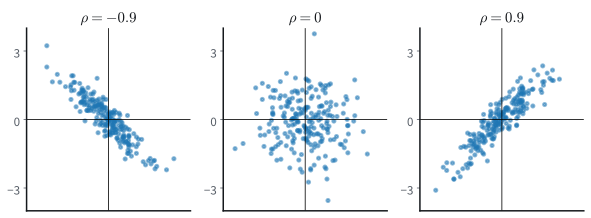

# Joint Distributions and Transformations
:label:`sec_mdl-joint-distributions`

The dart of :numref:`sec_mdl-random_variables` was reduced to one number, its
distance $R$ from the center of a board of radius $1$, with density $2r$. But
a dart lands at a point, and a point has two coordinates, a horizontal $X$ and
a vertical $Y$. Most of what we model comes in such groups. An image is
thousands of pixels whose values depend on each other, and every supervised
problem is a pair, an input and a target. One density per variable cannot
describe a group, because it is silent on how the variables move together.

Two questions occupy this section. The first is what one variable tells us
about another. If the dart lands near the top of the board, at $Y=0.9$, then
$X$ must lie within $0.44$ of the center line, so $Y$ certainly carries
information about $X$. Yet we will find that the best guess for $X$ is $0$
whatever $Y$ is, and that the covariance of the two is zero. Dependence,
predictability and correlation are three different things, and it takes the
density of the pair to tell them apart. The second question is what a
transformation does to a density, as when a layer acts on its input or a
sampler on its noise. The dart's distance can be drawn as $R=\sqrt U$ from a
uniform $U$, and the square root has turned a flat density into $2r$.
Evidently a map does more to a density than relabel its axis.

Three results carry most of the weight later in the book: the law of total
variance :eqref:`eq_mdl-tower`, the conditional mean as the best
squared-error predictor :eqref:`eq_mdl-best_predictor`, and the change of
variables :eqref:`eq_mdl-cov_density`. The covariance matrix and the remark
that a correlation is a cosine can be skipped on a first reading.


```{.python .input #mdl-joint-distributions-joint-distributions-and-transformations-1}
#@tab mxnet
import math
import numpy as np
from mxnet import autograd, gluon, init, np as mnp, npx
from mxnet.gluon import nn
from d2l import mxnet as d2l
npx.set_np()
```

```{.python .input #mdl-joint-distributions-joint-distributions-and-transformations-1}
#@tab pytorch
import math
import numpy as np
import torch
from torch import nn
from torch.nn import functional as F
from d2l import torch as d2l
```

```{.python .input #mdl-joint-distributions-joint-distributions-and-transformations-1}
#@tab tensorflow
import math
import numpy as np
import tensorflow as tf
from d2l import tensorflow as d2l
```

```{.python .input #mdl-joint-distributions-joint-distributions-and-transformations-1}
#@tab jax
import math
import numpy as np
import jax
from jax import numpy as jnp
from flax import nnx
import optax
from d2l import jax as d2l
```

```{.python .input #mdl-joint-distributions-joint-distributions-and-transformations-2}
rng = np.random.default_rng()
```

## Joint and Conditional Densities

Everything that can be asked about a pair is answered by one function of two
arguments. We define it, and then extract three things from it: the
distribution of one coordinate alone, the distribution of one coordinate once
the other is known, and the average of one given the other, which is what a
regression model estimates.

### Joint and Marginal Densities

The density extends to two variables with small squares in place of short
intervals. The *joint density* $p_{X,Y}$ of a pair $(X,Y)$ is probability per
unit area: a small square of side $\epsilon$ at $(x,y)$ has probability about
its area times the density,

$$
P\bigl(X\in[x,x+\epsilon],\ Y\in[y,y+\epsilon]\bigr)\approx\epsilon^2\,p_{X,Y}(x,y).
$$

As for one variable, slicing a region into such squares leads to the property
that we take as the definition: $p_{X,Y}\ge0$, and
$P((X,Y)\in\mathcal{D})=\iint_{\mathcal{D}} p_{X,Y}(x,y)\,dx\,dy$ for a
region $\mathcal D$ of the plane, so that the total volume under the joint
density is one. For $n$ variables the same holds with $n$-dimensional boxes.

The dart's position has the joint density $p_{X,Y}(x,y)=1/\pi$ on the unit
disk and $0$ outside, since every part of the board is equally likely and the
board has area $\pi$. Although it is constant on the disk, it is not a function
of $x$ times a function of $y$: the edge of the board ties the two coordinates
together.

Often we hold a joint density but want the distribution of one coordinate
alone, its *marginal distribution*. A thin vertical strip $X\in[x,x+\epsilon]$
has probability about $\epsilon\,p_X(x)$. Slicing the strip into squares in
$y$ and adding their probabilities,

$$
\epsilon\,p_X(x) \approx \sum_i P\bigl(X\in[x,x{+}\epsilon],\ Y\in[\epsilon i,\epsilon(i{+}1)]\bigr)
                 \approx \sum_i \epsilon^{2}\,p_{X,Y}(x,\epsilon i).
$$

Cancelling one $\epsilon$ and recognizing the remaining sum as a Riemann sum
in $y$,

$$
p_X(x) = \int_{-\infty}^\infty p_{X, Y}(x, y)\,dy.
$$
:eqlabel:`eq_mdl-marginal`

The marginal density at $x$ is the joint density integrated up the vertical
strip at $x$, as in :numref:`fig_mdl-prob-marginal`. We *integrate out* the
variable we do not care about. For the dart, the strip at $x$ crosses the board
from $-\sqrt{1-x^2}$ to $\sqrt{1-x^2}$, so

$$
p_X(x)=\int_{-\sqrt{1-x^2}}^{\sqrt{1-x^2}}\frac1\pi\,dy=\frac2\pi\sqrt{1-x^2},
\qquad -1\le x\le 1,
$$

a semicircle. As a check, $\int_{-1}^1\sqrt{1-x^2}\,dx$ is the area of half
the unit disk, $\pi/2$, so the marginal integrates to $1$. The joint density is
flat, but the marginal is not: a strip through the middle of the board is
longer than one near the edge.


:label:`fig_mdl-prob-marginal`

### Conditional Densities and Independence

Once we learn that $Y=y$, how should the density of $X$ change? For discrete
variables the answer is $P(X=x\mid Y=y)=P(X=x,Y=y)/P(Y=y)$. With densities
this formula divides zero by zero, because $P(Y=y)=0$. The way out is the one
that defined the density. We condition on a thin horizontal strip
$Y\in[y,y+\epsilon]$, which has positive probability, and let the strip shrink.
By the square approximation and the one-variable rule,

$$
P\bigl(X\in[x,x+\epsilon]\bigm| Y\in[y,y+\epsilon]\bigr)
\approx\frac{\epsilon^2\,p_{X,Y}(x,y)}{\epsilon\,p_Y(y)}
=\epsilon\,\frac{p_{X,Y}(x,y)}{p_Y(y)}.
$$

Inside the strip, the probability of a short $x$-interval is its length times
$p_{X,Y}(x,y)/p_Y(y)$. This ratio is the probability per unit length of $X$
given $Y=y$, and we define the *conditional density*

$$
p_{X\mid Y}(x\mid y) = \frac{p_{X,Y}(x,y)}{p_Y(y)}, \qquad p_Y(y) > 0.
$$
:eqlabel:`eq_mdl-cond_density`

For each $y$ it is a density in $x$: it is non-negative, and by the marginal
rule :eqref:`eq_mdl-marginal` it integrates to $p_Y(y)/p_Y(y)=1$.
Geometrically, we cut the joint density along the line $Y=y$ and rescale the
profile to unit area. For the dart, the line $Y=y$ crosses the board on
$[-\sqrt{1-y^2},\sqrt{1-y^2}]$, and

$$
p_{X\mid Y}(x\mid y)=\frac{1/\pi}{(2/\pi)\sqrt{1-y^2}}=\frac{1}{2\sqrt{1-y^2}}
\qquad\textrm{for } |x|\le\sqrt{1-y^2}.
$$

Given $Y=y$, the horizontal position is uniform on the chord at height $y$. The
chord shrinks as $|y|$ grows, so learning $Y$ changes the distribution of $X$.

Rearranging :eqref:`eq_mdl-cond_density` gives the *chain rule*
$p_{X,Y}(x,y)=p_{X\mid Y}(x\mid y)\,p_Y(y)$. Writing it both ways,
$p_{X\mid Y}\,p_Y=p_{Y\mid X}\,p_X$, and solving for $p_{X\mid Y}$ gives
*Bayes' rule for densities*,

$$
p_{X\mid Y}(x\mid y) = \frac{p_{Y\mid X}(y\mid x)\,p_X(x)}{p_Y(y)}.
$$
:eqlabel:`eq_mdl-bayes_density`

It turns a model of how $Y$ arises from $X$ into a statement about $X$ after
seeing $Y$, as Bayes' theorem did for discrete variables in
:numref:`sec_prob`.

In the special case where learning $Y$ tells us nothing about $X$, that is,
$p_{X\mid Y}(x\mid y)=p_X(x)$ whenever $p_Y(y)>0$, the two variables are
called *independent*, written $X\perp Y$. By the chain rule this is the same
as saying that the joint density factorizes,
$p_{X,Y}(x,y)=p_X(x)\,p_Y(y)$ (up to sets of probability zero): multiply by
$p_Y(y)$ to go one way and divide by it to go the other.

Independence means that the conditional density of $X$ is the same function of
$x$, with the same location and the same shape, at every $y$. Take the joint
density $p_{X,Y}(x,y)=4xy$ on the unit square $[0,1]^2$. Its marginal is
$p_Y(y)=\int_0^1 4xy\,dx=2y$, so $p_{X\mid Y}(x\mid y)=4xy/(2y)=2x$, the same
for every $y$, and $X\perp Y$. The dart is the opposite case: its conditional
density is uniform at every $y$, but on a chord whose length depends on $y$.

:numref:`fig_mdl-prob-conditional-slice` shows that a common shape is not
enough. For a correlated pair, the conditional densities at three heights have
the same shape but different centers, so the pair is dependent; only when the
joint factorizes do the three coincide.


:label:`fig_mdl-prob-conditional-slice`

Independence also gives the density of a sum. The pair $(X,X+Y)$ has the joint
density $p_X(x)\,p_Y(s-x)$ at $(x,s)$, and integrating out $x$ as in
:eqref:`eq_mdl-marginal` leaves the *convolution*
$p_{X+Y}(s)=\int p_X(x)\,p_Y(s-x)\,dx$.

### Conditional Expectation
:label:`subsec_mdl-conditional-expectation`

A regression model predicts a target from an input. We keep the letters of the
previous subsection, so here the target is $X$ and the input, the variable we
observe, is $Y$; the main text writes the pair the other way round. Training
with the squared loss looks for the function $h$ that makes
$\mathbb{E}[(X-h(Y))^2]$ small. Which function is best? Within a thin strip $Y\approx y$ the model must
predict one number for a whole spread of targets. The number $c$ closest on
average, in squared distance, to a variable $X$ is its mean, since expanding
the square around $\mu_X$ gives
$\mathbb{E}[(X-c)^2]=\textrm{Var}(X)+(\mu_X-c)^2$. This suggests predicting
the average of $X$ within the strip. The *conditional expectation* of $X$
given $Y=y$ is the mean of the conditional density,

$$
\mathbb{E}[X\mid Y{=}y] = \int x\,p_{X\mid Y}(x\mid y)\,dx.
$$
:eqlabel:`eq_mdl-cond_exp`

It is the average of $X$ among the outcomes with $Y=y$. As $y$ varies it traces
a function of $y$; evaluated at the random $Y$, it becomes a random variable
$\mathbb{E}[X\mid Y]$ that depends on $Y$ alone. The same strip average defines
$\mathbb{E}[g(X,Y)\mid Y{=}y]=\int g(x,y)\,p_{X\mid Y}(x\mid y)\,dx$ for any
function $g$. A factor $h(Y)$ is constant within each strip, so it comes out of
the average:

$$
\mathbb{E}[h(Y)\,g(X,Y)\mid Y]=h(Y)\,\mathbb{E}[g(X,Y)\mid Y].
$$

The spread within a strip is the *conditional variance*
$\textrm{Var}(X\mid Y)=\mathbb{E}[X^2\mid Y]-(\mathbb{E}[X\mid Y])^2$, the
computational form :eqref:`eq_mdl-var_comp` applied within each strip.

Averaging the strip averages should give back the overall average, and the
overall spread should split into a spread within strips and a spread between
them. Both are true, and the second is the more useful.

**Proposition (laws of total expectation and variance).** *Let $X,Y$ have a
joint density, and let $X$ have finite variance (for discrete pairs, the same
identities hold with integrals replaced by sums). Then*

$$
\mathbb{E}[X] = \mathbb{E}\bigl[\mathbb{E}[X\mid Y]\bigr],
\qquad
\textrm{Var}(X) = \mathbb{E}\bigl[\textrm{Var}(X\mid Y)\bigr] + \textrm{Var}\bigl(\mathbb{E}[X\mid Y]\bigr).
$$
:eqlabel:`eq_mdl-tower`

**Proof.** For the first identity, the *tower property*, write out the inner
mean and use the chain rule $p_{X\mid Y}(x\mid y)\,p_Y(y)=p_{X,Y}(x,y)$ to
put the strips back together into the joint density:

$$
\mathbb{E}\bigl[\mathbb{E}[X\mid Y]\bigr]
 = \int\!\Bigl(\int x\,p_{X\mid Y}(x\mid y)\,dx\Bigr)p_Y(y)\,dy
 = \iint x\,p_{X,Y}(x,y)\,dx\,dy
 = \mathbb{E}[X].
$$

The values of $y$ with $p_Y(y)=0$, where the conditional density is undefined,
contribute to neither side: $Y$ lands there with probability zero. The same
computation with $g(x,y)$ in place of $x$ gives
$\mathbb{E}\bigl[\mathbb{E}[g(X,Y)\mid Y]\bigr]=\mathbb{E}[g(X,Y)]$. For the
second identity, expand both terms on the right. By the tower property applied
to $X^2$,

$$
\mathbb{E}\bigl[\textrm{Var}(X\mid Y)\bigr]
=\mathbb{E}\bigl[\mathbb{E}[X^2\mid Y]\bigr]-\mathbb{E}\bigl[(\mathbb{E}[X\mid Y])^2\bigr]
=\mathbb{E}[X^2]-\mathbb{E}\bigl[(\mathbb{E}[X\mid Y])^2\bigr].
$$

By the computational form :eqref:`eq_mdl-var_comp` applied to the variable
$\mathbb{E}[X\mid Y]$, whose mean is $\mathbb{E}[X]$ by the tower property,

$$
\textrm{Var}\bigl(\mathbb{E}[X\mid Y]\bigr)
=\mathbb{E}\bigl[(\mathbb{E}[X\mid Y])^2\bigr]-\mathbb{E}[X]^2 .
$$

Adding the two lines, the term $\mathbb{E}[(\mathbb{E}[X\mid Y])^2]$ cancels and
leaves $\mathbb{E}[X^2]-\mathbb{E}[X]^2=\textrm{Var}(X)$. $\blacksquare$

The second identity is sometimes called *Eve's law*, after the pattern E, V,
V, E of its right side. It splits the spread of $X$ into the average spread
within each strip, the part that knowing $Y$ cannot remove, and the spread of
the strip averages, the part that $Y$ explains. Statisticians use this split to
attribute the variation in data to groups, under the name analysis of variance.
The split also answers the regression question.

**Proposition (the conditional mean is the best squared-error predictor).**
*Let $X$ have finite variance, and let $h$ be any function with
$\mathbb{E}[h(Y)^2]<\infty$. Then*

$$
\mathbb{E}\bigl[(X-h(Y))^2\bigr]
=\mathbb{E}\bigl[\textrm{Var}(X\mid Y)\bigr]
+\mathbb{E}\bigl[(\mathbb{E}[X\mid Y]-h(Y))^2\bigr].
$$
:eqlabel:`eq_mdl-best_predictor`

**Proof.** Write $m(Y)=\mathbb{E}[X\mid Y]$ and split the error into two parts,
$X-h(Y)=(X-m(Y))+(m(Y)-h(Y))$. Squaring gives two squares and a cross term,
and the cross term is the only step that needs thought.
The mean of the first square is $\mathbb{E}[\textrm{Var}(X\mid Y)]$ by the tower
property. The cross term $2(X-m(Y))(m(Y)-h(Y))$ has conditional mean zero,
because the factor $m(Y)-h(Y)$ depends on $Y$ alone and comes out of the strip
average, leaving $\mathbb{E}[X-m(Y)\mid Y]=m(Y)-m(Y)=0$. By the tower property
its mean is zero too. $\blacksquare$

The first term does not depend on $h$, and the second is never negative and
vanishes for $h(Y)=\mathbb{E}[X\mid Y]$. So the conditional mean is the best
predictor in squared error, and no predictor can do better than the average
spread within the strips. A network trained with the squared loss is
estimating $\mathbb{E}[\textrm{target}\mid\textrm{input}]$, which is how
:numref:`sec_linear_regression` reads its model, there written
$\mathbb{E}[y\mid\mathbf x]$.

Two examples show the split with numbers. For the dart, predict $X$ from $Y$.
Given $Y=y$, $X$ is uniform on a chord symmetric about $0$, so
$\mathbb{E}[X\mid Y=y]=0$. A variable uniform on an interval of half-width $w$
has variance $w^2/3$, so $\textrm{Var}(X\mid Y=y)=(1-y^2)/3$. By symmetry
$\mathbb{E}[X^2]=\mathbb{E}[Y^2]=\tfrac12\mathbb{E}[R^2]=\tfrac14$, and Eve's
law gives

$$
\textrm{Var}(X)=\mathbb{E}\Bigl[\frac{1-Y^2}{3}\Bigr]+\textrm{Var}(0)
=\frac{1-1/4}{3}+0=\frac14 .
$$

All of the variance is unexplained. Knowing $Y$ narrows the range of $X$ but
never shifts its center, so the best predictor of $X$ from $Y$ is the constant
$0$, although $X$ and $Y$ are dependent.

For the second example, draw a label $Z$ that is $1$ with probability $0.2$
and $0$ with probability $0.8$. Given $Z=1$, draw $X$ from the normal
distribution $\mathcal N(3,1)$ with mean $3$ and variance $1$, and given $Z=0$
from $\mathcal N(-1,1)$. This mixture has the two-bump density of
:numref:`fig_mdl-prob-pdf-area`. Its mean is $0.2\cdot3+0.8\cdot(-1)=-0.2$.
Within each component the variance is $1$, so
$\mathbb{E}[\textrm{Var}(X\mid Z)]=1$. Between the components, $\mathbb{E}[X\mid
Z]$ takes the values $3$ and $-1$, whose variance is
$0.2\cdot0.8\cdot(3-(-1))^2=2.56$. The total variance is $3.56$, and the label
explains $2.56/3.56=72\%$ of it. In a sample of a million draws the two parts
will come out near $1$ and $2.56$. Should their sum match the variance of the
sample only as roughly as the parts match their targets, or exactly?

```{.python .input #mdl-random-variables-conditional-expectation}
n = 10**6
z = rng.uniform(size=n) < 0.2                          # component label Z
x = np.where(z, rng.normal(3, 1, n), rng.normal(-1, 1, n))
w = np.array([np.mean(~z), np.mean(z)])                # P(Z=0), P(Z=1)
cond_mean = np.array([x[~z].mean(), x[z].mean()])      # E[X | Z]
within = w @ np.array([x[~z].var(), x[z].var()])       # E[Var(X | Z)]
between = w @ (cond_mean - x.mean())**2                # Var(E[X | Z])
print(f'Var(X) {x.var():.3f} = within {within:.3f} + between {between:.3f}')
```

Exactly. The within and between parts are close to $1$ and $2.56$, with
sampling noise in the third decimal, but their sum equals the variance of the
sample in every run, up to rounding in the last printed digit. Eve's law
holds for the sample itself, with the group fractions and group variances in
place of the probabilities and conditional variances.

## Covariance and Correlation

The conditional mean describes how the average of $X$ moves with $Y$, and it
is a whole function. Often a single number is enough: do $X$ and $Y$ tend to
be large together, or does one tend to be large when the other is small? The
covariance is that number. It has two defects, which the rest of this part
repairs or at least exposes: it carries units, which the correlation removes,
and it sees only straight-line trends, which nothing removes.

### Covariance
:label:`subsec_mdl-covariance`

:numref:`sec_prob` defined the *covariance* as the average product of the two
deviations. For discrete $X,Y$ taking $(x_i,y_j)$ with probability
$p_{ij}$ it is

$$\sigma_{XY} = \textrm{Cov}(X, Y) = \sum_{i, j} (x_i - \mu_X)(y_j-\mu_Y)\,p_{ij} = \mathbb{E}[XY] - \mathbb{E}[X]\,\mathbb{E}[Y],$$
:eqlabel:`eq_mdl-cov_def`

where the second form follows by expanding the product, as for the
computational form of the variance. In particular
$\textrm{Cov}(X,X)=\textrm{Var}(X)$. We assume
throughout that both variances are finite; since $|xy|\le(x^2+y^2)/2$, the mean
of $XY$ then exists.

As an example, let $X\in\{1,3\}$ and $Y\in\{-1,3\}$ with

$$
\begin{aligned}
P(X{=}1, Y{=}{-}1) &= \tfrac{\theta}{2}, &\quad P(X{=}1, Y{=}3) &= \tfrac{1-\theta}{2}, \\
P(X{=}3, Y{=}{-}1) &= \tfrac{1-\theta}{2}, &\quad P(X{=}3, Y{=}3) &= \tfrac{\theta}{2},
\end{aligned}
$$

for a parameter $\theta\in[0,1]$. We call this the *four-cell example*. Each
variable takes its two values with probability $\tfrac12$, so $\mu_X=2$ and
$\mu_Y=1$. The mean of the product is

$$
\mathbb{E}[XY]=\tfrac12\bigl(-\theta+3(1-\theta)-3(1-\theta)+9\theta\bigr)=4\theta,
$$

so $\textrm{Cov}(X,Y)=4\theta-2$: it is $+2$ at $\theta=1$, $-2$ at
$\theta=0$, and $0$ at $\theta=\tfrac12$.

For variables with a joint density, the sum becomes an integral,

$$
\sigma_{XY} = \iint (x-\mu_X)(y-\mu_Y)\,p_{X,Y}(x, y)\,dx\,dy ,
$$
:eqlabel:`eq_mdl-cov_cont`

the deviation product averaged over the joint density. For the dart, both
coordinates have mean $0$, and
$\textrm{Cov}(X,Y)=\mathbb{E}[XY]=\frac1\pi\iint_{\textrm{disk}}xy\,dx\,dy=0$,
because the integrand is odd in $x$ and the disk is symmetric. Yet $X$ and $Y$
are dependent, as the shrinking chords showed. Covariance detects a linear
trend. The dart's dependence is symmetric and has none, so zero covariance
does not mean independence (:numref:`sec_prob` has a discrete example,
$Y=X^2$).

Covariance carries the units of both variables. In
:numref:`fig_mdl-prob-covariance` the bottom row repeats the draws of the top
row with $Y$ in cents instead of dollars. Every sample covariance grows by a
factor of $100$, while no cloud changes shape. Only the sign of a covariance
means something without the units; the correlation coefficient below removes
them.


:label:`fig_mdl-prob-covariance`

Covariance is linear in each argument. Shifts drop out of the deviations and
scales pull through, so $\textrm{Cov}(cX+d,Y)=c\,\textrm{Cov}(X,Y)$. The
deviation of a sum is the sum of the deviations, so
$\textrm{Cov}(X+Z,Y)=\textrm{Cov}(X,Y)+\textrm{Cov}(Z,Y)$ by linearity of the
mean. The same holds in the second slot. Independent variables have zero
covariance: when the joint density factorizes, the double integral for
$\mathbb{E}[XY]$ splits into $\mathbb{E}[X]\,\mathbb{E}[Y]$.

Covariance also completes the rule for the variance of a sum. Write
$\tilde X=X-\mu_X$ and $\tilde Y=Y-\mu_Y$. By linearity $X+Y$ has mean
$\mu_X+\mu_Y$, so its deviation is $\tilde X+\tilde Y$. Expanding
$\mathbb{E}[(\tilde X+\tilde Y)^2]=\mathbb{E}[\tilde X^2]+2\,\mathbb{E}[\tilde X\tilde Y]+\mathbb{E}[\tilde Y^2]$
gives

$$
\textrm{Var}(X+Y) = \textrm{Var}(X) + \textrm{Var}(Y) + 2\,\textrm{Cov}(X, Y).
$$
:eqlabel:`eq_mdl-var_sum`

For independent $X$ and $Y$ the covariance vanishes and the variances add.

The most important use of this rule is the average of many draws. Expanding
the square of a sum of $n$ deviations in the same way gives
$\textrm{Var}(\sum_i X_i)=\sum_i\sum_j\textrm{Cov}(X_i,X_j)$. Let
$X_1,\ldots,X_n$ be independent with common variance $\sigma^2$. Every cross
term vanishes, so the sum has variance $n\sigma^2$, and the affine rule with
$c=1/n$ divides it by $n^2$. The average $\bar X_n=\frac1n\sum_{i=1}^n X_i$
therefore has

$$
\textrm{Var}(\bar X_n)=\frac{1}{n^2}\cdot n\sigma^2=\frac{\sigma^2}{n}.
$$
:eqlabel:`eq_mdl-var_mean`

Averaging $n$ independent draws divides the variance by $n$ and the standard
deviation by $\sqrt n$, so four times as many draws halve the error. This is
the rule behind every *Monte Carlo* estimate, an average of computed samples
that stands in for an expectation (:numref:`subsec_mdl-monte-carlo`). For
the dart, the average distance of $n$ darts has variance $1/(18n)$, and $556$
darts bring its standard deviation down to $0.01$. The $\sigma/\sqrt n$ rule needs a
finite variance. The *law of large numbers* itself, that $\bar X_n$ converges
to the mean, needs only a finite mean (:numref:`sec_mdl-statistics`). The
Cauchy distribution has neither, and averages of its draws do not settle
however large $n$ is.

### Correlation

Whether the covariance $4\theta-2$ of the four-cell example is large depends
on the units of $X$ and $Y$. To remove the units, divide by the two standard
deviations, which carry the same units. The *correlation coefficient* is

$$\rho(X, Y) = \frac{\textrm{Cov}(X, Y)}{\sigma_{X}\sigma_{Y}}.$$
:eqlabel:`eq_mdl-cor_def`

:numref:`sec_prob` stated that $\rho$ lies between $-1$ and $1$. Here is the
proof, and with it the cases of equality.

**Proposition (correlation bound).** *For any $X,Y$ with finite, nonzero
variances, $-1\le\rho(X,Y)\le 1$. Equality holds if and only if $Y=cX+d$ with
probability one for constants $c\ne0$ and $d$, with $\rho=1$ when $c>0$ and
$\rho=-1$ when $c<0$.*

**Proof.** A variance is never negative, so $\textrm{Var}(tX+Y)\ge 0$ for every
real $t$. By the variance-of-a-sum rule and the affine rule this is a quadratic
in $t$,

$$
\textrm{Var}(tX+Y) = \textrm{Var}(X)\,t^2 + 2\,\textrm{Cov}(X,Y)\,t + \textrm{Var}(Y) \;\ge\; 0
\quad\textrm{for every } t.
$$

A quadratic with positive leading coefficient that is never negative has at
most one real root, so its discriminant is not positive:

$$
\bigl(2\,\textrm{Cov}(X,Y)\bigr)^2 - 4\,\textrm{Var}(X)\,\textrm{Var}(Y)\le 0,
\qquad\textrm{that is}\qquad
\textrm{Cov}(X,Y)^2 \le \textrm{Var}(X)\,\textrm{Var}(Y).
$$

Dividing by $\sigma_X^2\sigma_Y^2$ gives $\rho^2\le 1$. If $\rho^2=1$, the
discriminant vanishes and the quadratic has a double root $t^\star$ with
$\textrm{Var}(t^\star X+Y)=0$. A variable of zero variance is constant with
probability one, so $Y=-t^\star X+d$ with probability one, and $t^\star\ne0$
because $\textrm{Var}(Y)>0$. Conversely, if $Y=cX+d$ with $c\ne0$, then
$\textrm{Cov}(X,Y)=c\,\textrm{Var}(X)$ and $\sigma_Y=|c|\sigma_X$, so
$\rho=c/|c|=\pm1$. $\blacksquare$

The correlation measures how tightly $X$ and $Y$ follow a straight line, and
the sign of the line's slope, but not the slope itself: $Y=0.5X$ and $Y=2X$
both have $\rho=1$. For the four-cell example $\sigma_X=1$ and $\sigma_Y=2$, so
$\rho=(4\theta-2)/2=2\theta-1$, running from $-1$ to $1$ as $\theta$ runs from
$0$ to $1$. :numref:`fig_mdl-prob-correlation` shows two blind spots of $\rho$: two
clouds with the same correlation and different slopes, and a cloud on a
parabola whose correlation is zero.


:label:`fig_mdl-prob-correlation`

The proof is the standard proof of the Cauchy--Schwarz inequality
$|\mathbf u^\top\mathbf v|\le\|\mathbf u\|\,\|\mathbf v\|$, and the
correlation is a cosine. On random variables with mean zero and finite
variance, the mean of a product is an inner product (counting two variables as
the same when they agree with probability one). For the centered variables
$\tilde X$ and $\tilde Y$ the inner product is
$\langle \tilde X,\tilde Y\rangle=\mathbb{E}[\tilde X\tilde Y]=\textrm{Cov}(X,Y)$,
the length it defines is the standard deviation,
$\|\tilde X\|=\sqrt{\mathbb{E}[\tilde X^2]}=\sigma_X$, and the correlation
is the cosine $\langle \tilde X,\tilde Y\rangle/(\|\tilde X\|\,\|\tilde Y\|)$.
Uncorrelated variables are orthogonal, and $\rho=\pm1$ means parallel.

### The Covariance Matrix

With $n$ variables there is a covariance for every pair, and the natural way to
keep them is a matrix. For a random vector $\mathbf X=(X_1,\ldots,X_n)^\top$
with mean $\boldsymbol\mu$, the *covariance matrix* is the mean of the outer
product of the deviation with itself,

$$
\boldsymbol\Sigma=\mathbb{E}\bigl[(\mathbf X-\boldsymbol\mu)(\mathbf X-\boldsymbol\mu)^\top\bigr],
\qquad \Sigma_{ij}=\textrm{Cov}(X_i,X_j).
$$
:eqlabel:`eq_mdl-cov_matrix`

The diagonal holds the variances and the off-diagonal entries the covariances.
The matrix is symmetric, because covariance is. It is also positive
semidefinite. For any fixed vector $\mathbf a$, the variable $\mathbf
a^\top\mathbf X=\sum_i a_iX_i$ has deviation $\mathbf
a^\top(\mathbf X-\boldsymbol\mu)$, so

$$
\textrm{Var}(\mathbf a^\top\mathbf X)
 = \mathbb{E}\bigl[\mathbf a^\top(\mathbf X-\boldsymbol\mu)(\mathbf X-\boldsymbol\mu)^\top\mathbf a\bigr]
 = \mathbf a^\top \boldsymbol\Sigma\,\mathbf a \;\ge\; 0 .
$$

The quadratic form of $\boldsymbol\Sigma$ in the direction $\mathbf a$ is the
variance of the data projected onto $\mathbf a$, and a variance is never
negative. For the dart, $\boldsymbol\Sigma=\operatorname{diag}(\tfrac14,\tfrac14)$:
the coordinates are uncorrelated and spread equally.

The eigenvectors of $\boldsymbol\Sigma$ are the directions of principal
component analysis (:numref:`sec_mdl-svd-low-rank`) and the axes of the
multivariate Gaussian's elliptical contours (:numref:`sec_mdl-distributions`).

## Transformations of Random Variables

Machine learning creates new random variables from old ones all the time: an
activation function applied to a pre-activation, a sampler applied to uniform
noise, a normalizing flow applied to a Gaussian. If $X$ has a known density and
$Y=g(X)$, what is the density of $Y$?

### The One-Dimensional Rule
:label:`subsec_mdl-change-of-variables`

The obvious guess, $p_Y(y)=p_X(g^{-1}(y))$, is wrong, and the dart already
shows why. Its distance is sampled as $R=\sqrt U$ with $U$ uniform on $[0,1]$,
and this map turns the flat density of $U$ into the density $2r$, which is not
flat. The probability in a short interval must survive the
map. An interval of width $\Delta x$ at $x$ carries probability about
$p_X(x)\,\Delta x$, and $g$ sends it to an interval of width about
$\Delta y=|g'(x)|\,\Delta x$ at $y=g(x)$, which must carry the same probability:

$$
p_Y(y)\,|g'(x)|\,\Delta x\approx p_X(x)\,\Delta x .
$$

Where $g$ stretches the line, the density must thin by the stretch factor
$|g'(x)|$; where $g$ compresses, the density must rise.
:numref:`fig_mdl-prob-change-of-variables` shows the two equal areas for
$Y=e^X$.


:label:`fig_mdl-prob-change-of-variables`

**Proposition (change of variables in one dimension).** *Let $X$ have a
density $p_X$ that is continuous on an open interval $I$ with $P(X\in I)=1$,
and let $g:I\to\mathbb{R}$ be continuously differentiable with $g'\ne0$ on
$I$, so that $g$ is strictly monotone and one-to-one. Then $Y=g(X)$ has the
density*

$$
p_Y(y) = p_X\!\big(g^{-1}(y)\big)\,\left|\frac{d g^{-1}}{dy}(y)\right|
$$
:eqlabel:`eq_mdl-cov_density_1d`

*on the interval $g(I)$, and $0$ outside it.*

**Proof.** Let $g$ be increasing. Then $g(X)\le y$ exactly when $X\le
g^{-1}(y)$, so the c.d.f.s satisfy $F_Y(y)=F_X(g^{-1}(y))$ for $y$ in $g(I)$.
Differentiating with the chain rule and :eqref:`eq_mdl-cdf_deriv` gives
$p_Y(y)=p_X(g^{-1}(y))\,\frac{dg^{-1}}{dy}(y)$. If $g$ is decreasing, then
$g(X)\le y$ exactly when $X\ge g^{-1}(y)$, so $F_Y(y)=1-F_X(g^{-1}(y))$. Its
derivative carries a minus sign, which cancels the negative sign of
$dg^{-1}/dy$; the absolute value covers both cases. In either case $F_Y$ is
continuously differentiable on $g(I)$, which carries all the probability, so
by the fundamental theorem of calculus its derivative is a density of $Y$.
$\blacksquare$

The new density is the old one, read at the point that maps to $y$, times the
local compression of the inverse map. Since $dg^{-1}/dy=1/g'(x)$ at
$x=g^{-1}(y)$, this is the factor $1/|g'(x)|$ of the stretching argument.

Inverse-transform sampling is a change of variables, and the rule recovers
the dart's density from its sampler. Take $X=U$, uniform on $I=(0,1)$, and
$g(u)=\sqrt u$, so $g^{-1}(r)=r^2$ and $|dg^{-1}/dr|=2r$. The rule gives
$p_R(r)=1\cdot 2r$, the density of the dart's distance.

When $g$ is not one-to-one, several points map to the same $y$, and their
contributions add:

$$
p_Y(y)=\sum_{x:\,g(x)=y}\frac{p_X(x)}{|g'(x)|},
$$

for values $y$ with finitely many preimages, each with $g'(x)\ne0$. For
$Y=X^2$ and $y>0$, the two preimages $\pm\sqrt y$ have $|g'|=2\sqrt y$, so
$p_Y(y)=[p_X(\sqrt y)+p_X(-\sqrt y)]/(2\sqrt y)$. The hypothesis $g'\ne0$
matters. The ReLU has $g'=0$ on the whole half-line $(-\infty,0)$, which it
collapses to the single point $0$, and the result is an atom rather than a
density (Exercise :exref:`ex_mdl-random-variables-rectified-gaussian`).

As a worked example, let $X\sim\mathcal N(0,1)$ have the standard normal
density $p_X(x)=e^{-x^2/2}/\sqrt{2\pi}$, and let $Y=e^X$. Then
$g^{-1}(y)=\log y$ and $|dg^{-1}/dy| = 1/y$ for $y>0$, and the rule gives the
*log-normal* density

$$
p_Y(y) = \frac{1}{y\sqrt{2\pi}}\,\exp\!\Big(-\tfrac12(\log y)^2\Big), \qquad y>0.
$$

The factor $1/y$ is the change-of-variables correction. Setting the derivative
of $\log p_Y(y)=-\log y-\tfrac12(\log y)^2+\textrm{const}$ to zero gives
$\log y=-1$, so the density peaks at $y=e^{-1}\approx0.368$. The naive guess
$p_X(\log y)$ peaks at $y=1$, and it is not even a density. Substituting
$y=e^x$, its total area is $\int p_X(x)\,e^x\,dx=\mathbb{E}[e^X]=e^{1/2}\approx1.65$
(complete the square, $x-x^2/2=\tfrac12-\tfrac12(x-1)^2$).

The same computation gives the moments $\mathbb{E}[Y^k]=\mathbb{E}[e^{kX}]=e^{k^2/2}$,
all finite. Yet the tail $P(Y>t)=P(X>\log t)$ decays more slowly than any
exponential in $t$. The log-normal is therefore heavy-tailed, although, unlike
the Cauchy distribution, it has every moment.

The cell draws a histogram of $10^5$ samples of $e^X$ over both candidates.
The naive curve must enclose $0.65$ too much area; it is worth guessing where
the excess sits before looking.

```{.python .input #random-variables-change-of-variables}
y = np.exp(rng.standard_normal(10**5))                 # Y = e^X
edges = np.linspace(0, 5, 101)
mids = (edges[:-1] + edges[1:]) / 2
hist = np.histogram(y, edges)[0] / (len(y) * (edges[1] - edges[0]))
p_X = lambda x: np.exp(-x**2 / 2) / np.sqrt(2 * np.pi)
d2l.plot(mids, [hist, p_X(np.log(mids)) / mids, p_X(np.log(mids))],
         'y', 'p(y)', figsize=(5, 3),
         legend=['histogram of exp(X)', 'log-normal', 'naive p_X(log y)'])
```

The histogram follows the log-normal curve up to sampling noise, with its peak
well left of $y=1$, near $e^{-1}$. The naive curve peaks in the wrong place. It
is the true density times $y$, so it lies below the data for $y<1$ and above
it for $y>1$, by a factor that grows into the tail.

### The Multivariate Rule

In several dimensions, a map stretches areas and volumes rather than lengths,
and the stretch factor becomes a determinant. The smallest case is a linear
map. Let $\mathbf Y=\mathbf A\mathbf X$ with $\mathbf A=\operatorname{diag}(2,3)$.
A unit square becomes a $2\times3$ rectangle, which must carry the same
probability as the square, spread over area $6=\det\mathbf A$. So the density
of $\mathbf Y$ is one sixth of the density of $\mathbf X$ at the
corresponding point, $p_{\mathbf Y}(\mathbf y)=p_{\mathbf X}(\mathbf A^{-1}\mathbf y)/6$.

For a nonlinear map, the stretch varies from point to point, and the change of
variables theorem for integrals accounts for it
(:numref:`sec_mdl-integral_calculus`). Let $g$ be a continuously
differentiable bijection between two regions of $\mathbb{R}^n$, with
continuously differentiable inverse, and write $J_{g^{-1}}$ for the Jacobian
matrix of partial derivatives of the inverse. Locally, $g^{-1}$ scales volume
by $|\det J_{g^{-1}}|$, and substituting $\mathbf x=g^{-1}(\mathbf y)$ in an
integral over the preimage of a region $\mathcal D$ gives

$$
\int_{g^{-1}(\mathcal D)} f(\mathbf x)\,d\mathbf x=\int_{\mathcal D} f\bigl(g^{-1}(\mathbf y)\bigr)\,\bigl|\det J_{g^{-1}}(\mathbf y)\bigr|\,d\mathbf y .
$$

Now let $\mathbf Y=g(\mathbf X)$. The event $\mathbf Y\in\mathcal D$ is the
event $\mathbf X\in g^{-1}(\mathcal D)$, so the theorem with
$f=p_{\mathbf X}$ reads

$$
P(\mathbf Y\in \mathcal D)=\int_{g^{-1}(\mathcal D)}p_{\mathbf X}(\mathbf x)\,d\mathbf x
=\int_{\mathcal D} p_{\mathbf X}\bigl(g^{-1}(\mathbf y)\bigr)\,\bigl|\det J_{g^{-1}}(\mathbf y)\bigr|\,d\mathbf y .
$$

The integrand on the right is therefore the density of $\mathbf Y$:

$$
\begin{aligned}
p_{\mathbf Y}(\mathbf y) &= p_{\mathbf X}\!\big(g^{-1}(\mathbf y)\big)\,\big|\det J_{g^{-1}}(\mathbf y)\big|, \\
\textrm{equivalently}\qquad
\log p_{\mathbf Y}(\mathbf y) &= \log p_{\mathbf X}(\mathbf x) - \log\big|\det J_{g}(\mathbf x)\big|
\quad\textrm{at }\mathbf x = g^{-1}(\mathbf y).
\end{aligned}
$$
:eqlabel:`eq_mdl-cov_density`

The second form uses $J_{g^{-1}}(\mathbf y)=J_g(\mathbf x)^{-1}$. Passing a
sample through $g$ subtracts the log of the local volume stretch from its
log-density. Because $\log|\det(J_2 J_1)| = \log|\det J_1| + \log|\det J_2|$,
a composition of maps subtracts the sum of their log-determinants. This is how
*normalizing flows* compute exact likelihoods: they stack invertible layers
whose log-determinants are cheap :cite:`rezende2015variational`, and
:numref:`sec_mdl-continuous-normalizing-flows` builds one whose layers are
the steps of a differential equation.
Exercise :exref:`ex_mdl-random-variables-affine-coupling` builds a coupling layer.

The dart gives a last example. Describe its position in polar coordinates, the
distance $R$ and the angle $\Theta$, with $(x,y)=(r\cos\theta,r\sin\theta)$.
The Jacobian determinant of this map from $(r,\theta)$ to $(x,y)$ is
$\cos\theta\cdot r\cos\theta-(-r\sin\theta)\sin\theta=r$, so the rule gives

$$
p_{R,\Theta}(r,\theta)=\frac1\pi\cdot r=2r\cdot\frac{1}{2\pi},
\qquad 0\le r\le1,\ 0\le\theta<2\pi .
$$

The joint density factorizes. The angle is uniform on $[0,2\pi)$, the distance
has the density $2r$ once more, now from a Jacobian, and the two are
independent. In Cartesian coordinates the dart's $X$ and $Y$ were dependent;
in the right coordinates the same dart is described by two independent
variables.

The section leaves a question about averages. We know the variance of an
average of $n$ independent draws, $\sigma^2/n$ :eqref:`eq_mdl-var_mean`, but
not its distribution. Chebyshev's inequality
(:numref:`sec_mdl-random_variables`) turns the variance into a bound,
$\sigma^2/(n\epsilon^2)$, on the chance that the average errs by $\epsilon$ or
more, and for bounded or Gaussian draws this is far too pessimistic: the
chance falls exponentially fast in $n$. Which distribution an average
approaches is settled in :numref:`subsec_mdl-gaussian-clt`, and the
exponential rate in :numref:`sec_mdl-concentration-generalization`. Before
either, we need densities other than the dart's.

## Summary

Marginals come from integrating out, and conditionals from
slicing the joint density along a thin strip. The conditional mean is the best
squared-error predictor, and the law of total variance splits a variance into
the part that the conditioning variable explains and the part it cannot.
Covariance and correlation measure a linear trend, not dependence in general,
and the average of $n$ independent draws with finite variance has variance
$\sigma^2/n$. A smooth invertible map changes a density by the factor of its
local stretch, the absolute Jacobian determinant. The dart shows all of it:
its coordinates are dependent and uncorrelated, and in polar coordinates
they become two independent variables.

## Exercises

1. [code] **Classes missing from a minibatch.** A minibatch holds $B$
   labels drawn independently and uniformly from $K$ classes. Let $M$ be
   the number of classes that do not appear in it, and write
   $M = \sum_{k=1}^K I_k$, where $I_k = 1$ if class $k$ is missing and
   $I_k = 0$ otherwise.
    1. Compute $\mathbb{E}[M]$ with linearity :eqref:`eq_mdl-exp_linear`, and
       evaluate it for $K = 1000$ and $B = 256$.
    1. Compute $\textrm{Cov}(I_j, I_k)$ for $j \neq k$. Are the indicators
       independent?
    1. Extend the variance-of-a-sum rule :eqref:`eq_mdl-var_sum` to $K$
       terms, and compute the standard deviation of $M$ for $K = 1000$ and
       $B = 256$. Compare it with the value that independent indicators
       would give, and check both against $10^4$ simulated minibatches. How
       can covariances as small as those in (b) change the answer this much?
   :exlabel:`ex_mdl-random-variables-missing-classes`

1. **Uncorrelated but dependent.** Whitening, for example with the
   principal components of :numref:`sec_mdl-svd-low-rank`, makes
   coordinates uncorrelated. The following pair has Gaussian coordinates
   and zero covariance. Let $X \sim \mathcal{N}(0, 1)$, let $S$ be a random
   sign independent of $X$ with $P(S = 1) = P(S = -1) = \tfrac12$, and let
   $Y = SX$.
    1. Show that $Y \sim \mathcal{N}(0, 1)$ by computing its c.d.f., and
       that $\textrm{Cov}(X, Y) = 0$.
    1. Compare $P(|X| \le 1, |Y| \le 1)$ with
       $P(|X| \le 1)\,P(|Y| \le 1)$. Are $X$ and $Y$ independent?
    1. Show that $X + Y$ has an atom at $0$, so that $X + Y$ is not
       Gaussian. With probability one the point $(X, Y)$ lies on one of the
       two lines $y = \pm x$, and a double integral over a line is zero,
       because a line has no area. Conclude that the pair $(X, Y)$ has no
       joint density, although each coordinate has one.
   :exlabel:`ex_mdl-random-variables-uncorrelated-dependent`

1. **Averaging correlated estimates.** The text derives
   $\textrm{Var}(\bar X_n) = \sigma^2/n$ for independent draws. Averages of
   dependent estimates behave differently.
    1. Let $Y_1, \ldots, Y_n$ each have variance $\sigma^2$, with
       correlation $\rho$ between every pair, as the predictions of $n$
       ensemble members trained on the same data might. Show that

       $$\textrm{Var}\Bigl(\frac1n\sum_{i=1}^n Y_i\Bigr) = \sigma^2\Bigl(\rho + \frac{1-\rho}{n}\Bigr).$$

       What does averaging achieve as $n \to \infty$?
    1. Use $\mathbf{a}^\top \boldsymbol\Sigma\, \mathbf{a} \ge 0$ for the
       covariance matrix $\boldsymbol\Sigma$ of $Y_1, \ldots, Y_n$ to show
       that $\rho \ge -1/(n-1)$. Give variables that attain this bound.
   :exlabel:`ex_mdl-random-variables-using-textrmvar-x-y`

1. [code] **Sigmoid of a Gaussian.** Let $X \sim \mathcal{N}(0, s^2)$ be
   the pre-activation of a sigmoid unit, and let
   $Y = \operatorname{sigmoid}(X)$, whose inverse is
   $\operatorname{logit}(y) = \log\bigl(y/(1-y)\bigr)$.
    1. Use :eqref:`eq_mdl-cov_density_1d` to find the density $p_Y$ on
       $(0, 1)$.
    1. For which $s$ is $y = \tfrac12$ a local minimum of $p_Y$? Writing
       $\log p_Y$ as a function of $z = \operatorname{logit}(y)$ simplifies
       the computation.
    1. Modify the `#random-variables-change-of-variables` cell to compare a
       histogram of $Y$ with $p_Y$ for $s \in \{1, \sqrt{2}, 3\}$. What does
       the histogram at $s = 3$ imply for the derivative
       $\operatorname{sigmoid}'(X) = Y(1 - Y)$, through which
       backpropagation passes the gradient of these units?
   :exlabel:`ex_mdl-random-variables-sigmoid-gaussian`

1. **Explained variance.** ● A regression model $h$ predicts a target $X$
   from an input $Y$. The fraction of the variance that it explains is
   $R^2 = 1 - \mathbb{E}\bigl[(X - h(Y))^2\bigr]/\textrm{Var}(X)$.
    1. Use :eqref:`eq_mdl-best_predictor` and the law of total variance
       :eqref:`eq_mdl-tower` to show that every predictor has
       $R^2 \le \textrm{Var}\bigl(\mathbb{E}[X \mid Y]\bigr)/\textrm{Var}(X)$.
       Evaluate this ceiling for the two-component mixture of the text,
       predicting $X$ from the label $Z$, and for the dart, predicting $X$
       from $Y$.
    1. Given the input, the target is $-1$ or $+1$ with probability
       $\tfrac12$ each. Which prediction minimizes the expected squared
       error, and how often does the target take that value? Which
       predictions minimize the expected absolute error
       $\mathbb{E}\bigl[|X - h(Y)|\bigr]$?
   :exlabel:`ex_mdl-random-variables-best-predictor`

1. [code] **Affine coupling layer and Box--Muller.** ● Normalizing flows
   stack invertible maps whose log-determinants in
   :eqref:`eq_mdl-cov_density` are cheap to compute. The affine coupling
   layer of RealNVP :cite:`dinh2017density` maps $\mathbf{x} \in
   \mathbb{R}^2$ to

   $$y_1 = x_1, \qquad y_2 = x_2\, e^{s(x_1)} + t(x_1),$$

   where $s$ and $t$ are arbitrary functions, for example small neural
   networks.
    1. Write down the inverse map and the Jacobian $J_g(\mathbf{x})$. Show
       that $\log|\det J_g(\mathbf{x})| = s(x_1)$, however complicated $s$
       and $t$ are.
    1. Let $X_1$ and $X_2$ be independent standard normal variables, and
       take $s(x_1) = \tanh(x_1)$ and $t(x_1) = x_1^2/2$. Use
       :eqref:`eq_mdl-cov_density` to write $\log p_{\mathbf{Y}}(\mathbf{y})$
       in closed form. With NumPy, evaluate $p_{\mathbf{Y}}$ on a grid over
       $[-6, 6] \times [-12, 24]$ with spacing $0.02$ and check that its
       Riemann sum is close to $1$. Check the log-determinant against the
       determinant of a finite-difference Jacobian at a few random points.
    1. The first coordinate passes through the layer unchanged. What is the
       distribution of $Y_1$, whatever $s$ and $t$ are? How must a second
       coupling layer be arranged so that the composition can change both
       marginals, and what is the log-determinant of the composition?
    1. Flows can also run from uniform noise to Gaussians. Let $U_1, U_2$
       be independent and uniform on $(0, 1)$, and set
       $R = \sqrt{-2\log U_1}$, $\Theta = 2\pi U_2$, and
       $(Z_1, Z_2) = (R\cos\Theta, R\sin\Theta)$. Find the density of $R$
       with the one-dimensional rule, then the joint density of
       $(R, \Theta)$, and change to Cartesian coordinates with the polar
       Jacobian of the text to show that $Z_1$ and $Z_2$ are independent
       standard normal variables. This is the Box--Muller method. Check
       with $10^5$ samples that the sample covariance matrix of
       $(Z_1, Z_2)$ is close to the identity.
   :exlabel:`ex_mdl-random-variables-affine-coupling`

[Discussions](https://d2l.discourse.group/t/36880)

<!-- slides -->

::: {.slide}
::: {.cover}
[Dive into Deep Learning · §36.2]{.kicker}

Two coordinates, a conditional slice, a Jacobian<br>**joint distributions and transformations**
:::
:::

::: {.slide title="The Dart's Coordinates Are Dependent, Yet Their Covariance Is 0"}
[The problem]{.kicker}

A dart lands uniformly on the unit disk, at position $(X, Y)$.

| question | answer for the dart |
|:--|:--|
| Does $Y$ tell us about $X$? | yes: $Y=0.9$ forces $\lvert X\rvert\le0.44$ |
| Best guess for $X$ given $Y$? | $0$, whatever $Y$ is |
| Covariance of $X$ and $Y$? | $0$ |

::: {.d2l-note .warn}
Dependence, predictability and correlation are three different things. One
density per coordinate cannot tell them apart.
:::
:::

::: {.slide title="By the End of This Deck You Can"}
[Goals]{.kicker}

- find marginal and conditional densities from a joint density;
- name the best squared-error predictor, and split a variance into the part it
  explains and the part it cannot;
- compute covariances, correlations and the variance of an average;
- find the density of a transformed variable $g(X)$.

**Running example:** the dart on the unit disk, joint density $1/\pi$.
**Idea:** slice the joint density to condition; divide by the local stretch
to transform.
:::

::: {.slide title="Second in the Chapter: Several Variables at Once"}
[Where this fits]{.kicker}

::: {.cols .vc}
::: {.col}
| section | adds |
|---|---|
| Random Variables | densities, moments, tail bounds |
| **Joint Distributions** | **conditioning, covariance, change of variables** |
| Distributions | the named distributions and their losses |
| The Exponential Family | one form, convex fits, conjugacy |
| Statistics | error bars, tests, intervals |
| Maximum Likelihood | losses, Fisher information, MAP |
| Latent Variables and EM | the ELBO, EM |
| Bayesian Computation | averaging over a posterior |
| Concentration Inequalities | exponential tails of averages |
| Uniform Convergence | guarantees after selection |
| Naive Bayes | one classifier, end to end |
:::

::: {.col .narrow}
- **Uses:** density, c.d.f., mean and variance of one variable.
- **Skips:** named distributions, estimation.
:::
:::
:::

::: {.slide title="A Joint Density Is Probability per Unit Area"}
[Joint densities]{.kicker}

A small square of side $\epsilon$ at $(x,y)$ has probability
$\approx\epsilon^2\,p_{X,Y}(x,y)$, and for a region $\mathcal D$

$$P\bigl((X,Y)\in\mathcal D\bigr)=\iint_{\mathcal D}p_{X,Y}(x,y)\,dx\,dy .$$

- Dart: the disk has area $\pi$, so $p_{X,Y}=1/\pi$ on the disk, $0$ outside.
- Constant on the disk, yet not of the form $a(x)\,b(y)$: the rim ties the
  coordinates together.
:::

::: {.slide title="A Marginal Integrates the Joint Density Along a Strip"}
[Joint densities]{.kicker}

::: {.cols .vc}
::: {.col}
$$p_X(x)=\int p_{X,Y}(x,y)\,dy$$

Dart: the strip at $x$ runs from $-\sqrt{1-x^2}$ to $\sqrt{1-x^2}$, so
$p_X(x)=\tfrac2\pi\sqrt{1-x^2}$, a semicircle.

A flat joint density has a curved marginal: strips through the middle are
longer.
:::

::: {.col .fig}
@fig:mdl-prob-marginal
:::
:::
:::

::: {.slide title="Conditioning on Y = y Means Conditioning on a Thin Strip"}
[Conditioning]{.kicker}

::: {.cols .vc}
::: {.col}
$P(Y=y)=0$, so condition on $Y\in[y,y+\epsilon]$ and shrink:

$$p_{X\mid Y}(x\mid y)=\frac{p_{X,Y}(x,y)}{p_Y(y)}.$$

Cut the joint density along the line $Y=y$; rescale the profile to area $1$.

Dart: $X\mid Y=y$ is uniform on the chord $\lvert x\rvert\le\sqrt{1-y^2}$.
:::

::: {.col .fig}
@fig:mdl-prob-conditional-slice
:::
:::
:::

::: {.slide title="Independent Means the Same Conditional at Every y"}
[Conditioning]{.kicker}

$X\perp Y$ when $p_{X\mid Y}(x\mid y)=p_X(x)$, equivalently
$p_{X,Y}(x,y)=p_X(x)\,p_Y(y)$.

| joint density | $p_{X\mid Y}(x\mid y)$ | independent? |
|:--|:--|:--|
| $4xy$ on $[0,1]^2$ | $2x$ for every $y$ | yes |
| dart, $1/\pi$ on the disk | uniform on a chord that shrinks with $\lvert y\rvert$ | no |

::: {.d2l-note}
Writing the chain rule both ways gives Bayes' rule for densities:
$p_{X\mid Y}(x\mid y)=p_{Y\mid X}(y\mid x)\,p_X(x)/p_Y(y)$.
:::
:::

::: {.slide title="The Conditional Mean Is the Best Squared-Error Predictor"}
[Conditional expectation]{.kicker}

$\mathbb{E}[X\mid Y=y]=\int x\,p_{X\mid Y}(x\mid y)\,dx$: the average of $X$
on the strip at $y$. For any predictor $h$ of $X$ from $Y$,

$$\mathbb{E}\bigl[(X-h(Y))^2\bigr]=\underbrace{\mathbb{E}[\textrm{Var}(X\mid Y)]}_{\textrm{no }h\textrm{ removes this}}+\underbrace{\mathbb{E}\bigl[(\mathbb{E}[X\mid Y]-h(Y))^2\bigr]}_{\textrm{zero for }h=\mathbb{E}[X\mid Y]}.$$

*Why:* split $X-h=(X-\mathbb{E}[X\mid Y])+(\mathbb{E}[X\mid Y]-h)$; the cross
term averages to zero within every strip.

::: {.d2l-note}
A network trained with the squared loss estimates
$\mathbb{E}[\textrm{target}\mid\textrm{input}]$.
:::
:::

::: {.slide title="A Variance Splits Into Within-Strip and Between-Strip Parts"}
[Law of total variance]{.kicker}

$$\textrm{Var}(X)=\mathbb{E}[\textrm{Var}(X\mid Y)]+\textrm{Var}(\mathbb{E}[X\mid Y])$$

Mixture: label $Z=1$ with probability $0.2$, then $X\sim\mathcal N(3,1)$;
otherwise $X\sim\mathcal N(-1,1)$.

- within: $1$; between: $0.2\cdot0.8\cdot4^2=2.56$; the label explains $72\%$.

@!mdl-random-variables-conditional-expectation

::: {.d2l-note}
The parts are noisy in the third decimal; their sum matches the sample
variance exactly. The identity holds for the sample itself.
:::
:::

::: {.slide title="For the Dart, Knowing Y Explains None of the Variance of X"}
[Law of total variance]{.kicker}

- The chord at height $y$ is symmetric: $\mathbb{E}[X\mid Y=y]=0$.
- Uniform on half-width $w$ has variance $w^2/3$:
  $\textrm{Var}(X\mid Y=y)=(1-y^2)/3$.
- $\mathbb{E}[Y^2]=\tfrac12\mathbb{E}[R^2]=\tfrac14$, so

$$\textrm{Var}(X)=\underbrace{\frac{1-1/4}{3}}_{\textrm{within}}+\underbrace{0}_{\textrm{between}}=\frac14 .$$

::: {.d2l-note}
$Y$ narrows the range of $X$ but never shifts its center. The best predictor
is the constant $0$, although the two are dependent.
:::
:::

::: {.slide title="Covariance Is One Number for a Linear Trend, and It Has Units"}
[Covariance]{.kicker}

::: {.cols .vc}
::: {.col}
$\textrm{Cov}(X,Y)=\mathbb{E}[(X-\mu_X)(Y-\mu_Y)]=\mathbb{E}[XY]-\mu_X\mu_Y$

- Dart: $\mathbb{E}[XY]=0$ by symmetry, so $\textrm{Cov}=0$, yet dependent.
- Independent implies $\textrm{Cov}=0$; the converse fails.
- $Y$ in cents instead of dollars: every covariance $\times100$.
:::

::: {.col .fig}
@fig:mdl-prob-covariance
:::
:::
:::

::: {.slide title="An Average of n Independent Draws Has Variance σ²/n"}
[Covariance]{.kicker}

$$\textrm{Var}(X+Y)=\textrm{Var}(X)+\textrm{Var}(Y)+2\,\textrm{Cov}(X,Y)$$

For independent $X_1,\ldots,X_n$ with variance $\sigma^2$ every cross term
vanishes:

$$\textrm{Var}(\bar X_n)=\frac{1}{n^2}\cdot n\sigma^2=\frac{\sigma^2}{n}.$$

- Four times the draws halve the standard deviation.
- Dart: $\textrm{Var}(R)=\tfrac1{18}$, so $556$ darts give the mean distance
  to $\pm0.01$.

::: {.d2l-note}
Needs a finite variance: Cauchy averages never settle.
:::
:::

::: {.slide title="Correlation Measures Tightness and Sign, Not Slope"}
[Correlation]{.kicker}

::: {.cols .vc}
::: {.col}
$\rho=\dfrac{\textrm{Cov}(X,Y)}{\sigma_X\sigma_Y}$ has no units, and
$-1\le\rho\le1$.

*Proof.* $\textrm{Var}(tX+Y)\ge0$ is a quadratic in $t$ with no two real
roots, so $\textrm{Cov}^2\le\textrm{Var}(X)\,\textrm{Var}(Y)$. $\blacksquare$

$\rho=\pm1$ only for $Y=cX+d$. $Y=0.5X$ and $Y=2X$ both have $\rho=1$.
:::

::: {.col .fig}
@fig:mdl-prob-correlation
:::
:::
:::

::: {.slide title="Check: Cov(X, X²) for a Symmetric X? Independent?"}
[Check]{.kicker}

Let $X$ be symmetric about $0$ with finite $\mathbb{E}[X^4]$. What is
$\textrm{Cov}(X,X^2)$? Are $X$ and $X^2$ independent?

::: {.fragment .fade-up}
::: {.d2l-note}
**Answer.** $\mathbb{E}[X^3]-\mathbb{E}[X]\,\mathbb{E}[X^2]=0-0=0$. Not
independent (unless $X^2$ is constant): $X^2$ is a function of $X$.
Uncorrelated is not independent.
:::
:::
:::

::: {.slide title="The Covariance Matrix Gives the Variance in Every Direction"}
[Covariance matrix]{.kicker}

For a random vector $\mathbf X$ with mean $\boldsymbol\mu$:
$\boldsymbol\Sigma=\mathbb{E}[(\mathbf X-\boldsymbol\mu)(\mathbf X-\boldsymbol\mu)^\top]$,
$\Sigma_{ij}=\textrm{Cov}(X_i,X_j)$.

$$\textrm{Var}(\mathbf a^\top\mathbf X)=\mathbf a^\top\boldsymbol\Sigma\,\mathbf a\ge0$$

- Symmetric and positive semidefinite, because a variance is never negative.
- Dart: $\boldsymbol\Sigma=\operatorname{diag}(\tfrac14,\tfrac14)$.

::: {.d2l-note}
Its eigenvectors are the principal components of the data.
:::
:::

::: {.slide title="A Map Divides the Density by Its Local Stretch"}
[Transformations]{.kicker}

::: {.cols .vc}
::: {.col}
$Y=g(X)$, $g$ one-to-one. An interval keeps its probability:
$p_Y(y)\,\lvert\Delta y\rvert=p_X(x)\,\lvert\Delta x\rvert$, so

$$p_Y(y)=p_X\bigl(g^{-1}(y)\bigr)\left|\frac{dg^{-1}}{dy}(y)\right|.$$

Dart: $R=\sqrt U$, $g^{-1}(r)=r^2$, so $p_R(r)=1\cdot2r$.
:::

::: {.col .fig}
@fig:mdl-prob-change-of-variables
:::
:::
:::

::: {.slide title="The Log-Normal Peaks at 1/e, Not Where the Naive Guess Puts It"}
[Transformations]{.kicker}

$Y=e^X$, $X\sim\mathcal N(0,1)$: $p_Y(y)=\dfrac{1}{y\sqrt{2\pi}}e^{-(\log y)^2/2}$,
peak at $e^{-1}\approx0.37$. The naive $p_X(\log y)$ peaks at $1$ and has area
$e^{1/2}\approx1.65$: not a density.

@!random-variables-change-of-variables
:::

::: {.slide title="In n Dimensions the Stretch Is a Jacobian Determinant"}
[Transformations]{.kicker}

$\mathbf Y=g(\mathbf X)$, $g$ smooth and invertible, $J_g$ its Jacobian matrix:

$$\log p_{\mathbf Y}(\mathbf y)=\log p_{\mathbf X}(\mathbf x)-\log\lvert\det J_g(\mathbf x)\rvert,\qquad\mathbf x=g^{-1}(\mathbf y).$$

- $\mathbf Y=\operatorname{diag}(2,3)\,\mathbf X$: a unit square becomes a
  $2\times3$ rectangle, so the density is divided by $6$.
- Composed maps: the log-determinants add.

::: {.d2l-note}
Normalizing flows stack invertible layers with cheap log-determinants and so
compute exact likelihoods.
:::
:::

::: {.slide title="In Polar Coordinates the Dart Is Two Independent Variables"}
[Transformations]{.kicker}

$(x,y)=(r\cos\theta,r\sin\theta)$ has Jacobian determinant $r$:

$$p_{R,\Theta}(r,\theta)=\frac1\pi\cdot r=\underbrace{2r}_{\textrm{distance}}\cdot\underbrace{\frac1{2\pi}}_{\textrm{angle}}.$$

- The joint density factorizes: $R\perp\Theta$, with $\Theta$ uniform.
- The density $2r$ again, now from a Jacobian.

::: {.d2l-note}
$X$ and $Y$ were dependent. Independence is a property of the coordinates we
choose, not only of the dart.
:::
:::

::: {.slide title="Check: the Density of U² for a Uniform U?"}
[Check]{.kicker}

$U$ is uniform on $[0,1]$ and $Y=U^2$. What is the density of $Y$? Is it
bounded?

::: {.fragment .fade-up}
::: {.d2l-note}
**Answer.** $g^{-1}(y)=\sqrt y$ with derivative $1/(2\sqrt y)$, so
$p_Y(y)=1/(2\sqrt y)$ on $(0,1)$. It is unbounded near $0$, where squaring
compresses, and still integrates to $[\sqrt y]_0^1=1$.
:::
:::
:::

::: {.slide title="One Dart Showed Every Result of the Deck"}
[Wrap-up]{.kicker}

- Joint $1/\pi$; marginal a semicircle; $X\mid Y$ uniform on a chord.
- Dependent, yet $\mathbb{E}[X\mid Y]=0$ and $\textrm{Cov}(X,Y)=0$:
  $\textrm{Var}(X)=\tfrac14$ is all within-strip.
- $\mathbb{E}[X\mid Y]$ is the best squared-error predictor; a variance splits
  into within and between.
- $\textrm{Var}(\bar X_n)=\sigma^2/n$ for independent draws.
- $R=\sqrt U$ has density $2r$; in polar coordinates $R\perp\Theta$.

::: {.d2l-note}
Next: the distributions that have names, built with these tools.
:::
:::
