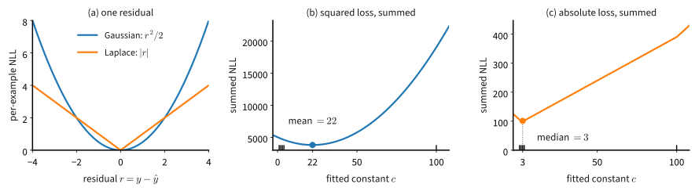
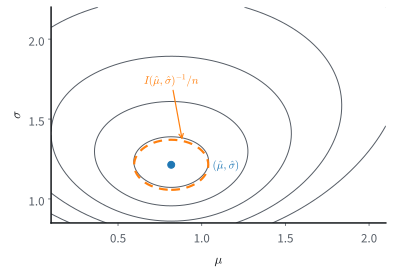

# Maximum Likelihood
:label:`sec_mdl-maximum_likelihood`

Suppose we flip a coin thirteen times and see nine heads and four tails.
Anyone would estimate the probability of heads as $9/13\approx 0.69$. Yet two
natural questions follow immediately: why that particular number, and how much
should we trust it? Could the coin still be fair?

One principle answers both questions: choose the parameters under which the
observed data are most probable. This is the principle of *maximum
likelihood*, and it underlies nearly every training loss in this book. For the
coin, it returns $9/13$. For a neural network, it turns an assumption about
noise in the targets into the loss we minimize: squared error and
cross-entropy, which earlier chapters adopted because they work well, both
arise in this way. Remarkably, the same loss also tells us how tightly the
data pin down the parameters. The more sharply the loss curves around its
minimum, the smaller the error bar, and for our coin that curvature will tell
us whether thirteen flips are enough to rule out a fair coin.

Earlier, :numref:`sec_mdl-statistics` measured the error of estimators given
in closed form, such as a sample mean or a sample proportion. Here the
estimator is defined by an optimization problem, and its error bar comes
directly out of the loss itself. We first show how the standard losses of
earlier chapters follow from maximum likelihood. We then turn to the heart of
the section: how accurate is the maximum-likelihood estimate? Its main result,
that the estimation error becomes Gaussian as the sample grows with a variance
set by the curvature of the loss, is the one to remember. Finally, seeing
three heads in a row shows what goes wrong when data are scarce, and how a
prior belief held before seeing the data turns into a regularizer. Models in
which part of every observation is hidden follow in
:numref:`sec_mdl-latent-em-elbo`.

```{.python .input #maximum-likelihood-imports}
#@tab mxnet
import math
import numpy as np
from mxnet import autograd, gluon, init, np as mnp, npx
from mxnet.gluon import nn
from d2l import mxnet as d2l
npx.set_np()
```

```{.python .input #maximum-likelihood-imports}
#@tab pytorch
import math
import numpy as np
import torch
from torch import nn
from torch.nn import functional as F
from d2l import torch as d2l
```

```{.python .input #maximum-likelihood-imports}
#@tab tensorflow
import math
import numpy as np
import tensorflow as tf
from d2l import tensorflow as d2l
```

```{.python .input #maximum-likelihood-imports}
#@tab jax
import math
import numpy as np
import jax
from jax import numpy as jnp
from flax import nnx
import optax
from d2l import jax as d2l
```

## The Maximum Likelihood Principle

A probabilistic model assigns a probability to every data set it could have
generated. Once the data are in hand, we turn this viewpoint around: hold the
observed data fixed and ask how probable they are under each candidate setting
of the parameters.

Let $\boldsymbol{\theta}$ denote the parameters of a model and $X$ the
observed data set. The **likelihood** is the probability of the observed data
(or, for continuous data, its density) viewed as a function of the parameters,
$P(X\mid\boldsymbol{\theta})$. The **maximum likelihood estimate** (MLE) is
the parameter setting that maximizes this function,

$$
\hat{\boldsymbol{\theta}}
 = \mathop{\mathrm{argmax}}_{\boldsymbol{\theta}}
   P(X \mid \boldsymbol{\theta}).
$$
:eqlabel:`eq_mdl-mle`

Among all candidate parameters, the MLE is the one under which what we
actually observed was most probable. Notice that this rule treats
$\boldsymbol{\theta}$ as an unknown constant rather than a random variable: it
assigns probabilities to data sets, never to parameter values. That
distinction will matter when we introduce priors in :numref:`subsec_mdl-map`.

### The Coin

A biased coin is the simplest model on which we can work the principle all the
way through. Its single parameter is the probability $\theta$ of heads. In
:numref:`sec_mdl-distributions` we called this number $p$; now that it is an
unknown to be estimated, we write $\theta$. Because the flips are independent,
their probabilities multiply, so a specific sequence with $n_H$ heads and
$n_T$ tails has probability

$$
P(X \mid \theta) = \theta^{n_H}(1-\theta)^{n_T}.
$$
:eqlabel:`eq_mdl-coin-like`

Viewed as a function of $\theta$, this expression is the likelihood. For our
thirteen-flip sequence HHHTHTTHHHHHT, with $n_H=9$ heads and $n_T=4$ tails, it
is $\theta^9(1-\theta)^4$. A fair coin assigns this sequence probability
$2^{-13}\approx 1.2\times10^{-4}$, whereas a coin with $\theta=9/13$ assigns
it $3.3\times10^{-4}$, about $2.7$ times as much.

To locate the maximum, we take the logarithm first. Because the logarithm is
strictly increasing, it leaves the location of the maximum unchanged while
turning the product into a sum that is effortless to differentiate. Setting
the derivative to zero gives

$$
\frac{d}{d\theta}\Big[9\log\theta + 4\log(1-\theta)\Big]
  = \frac{9}{\theta} - \frac{4}{1-\theta} = 0
  \quad\Longrightarrow\quad 9(1-\theta) = 4\theta
  \quad\Longrightarrow\quad \hat\theta = \frac{9}{13}.
$$

The endpoints $\theta=0$ and $\theta=1$ assign probability zero to any
sequence containing both heads and tails, so the maximum must lie in the
interior $(0,1)$, and this stationary point is indeed the global maximizer.
Repeating the same calculation for the general likelihood
:eqref:`eq_mdl-coin-like` yields

$$
\frac{n_H}{\theta} - \frac{n_T}{1-\theta} = 0
\quad\Longrightarrow\quad
\hat\theta = \frac{n_H}{n_H+n_T}.
$$

The MLE of a coin's bias is simply the observed frequency of heads, just as
intuition demands. Look closely at the derivative, however: encoding each flip
as $x\in\{0,1\}$ (with $x=1$ for heads and $x=0$ for tails), the derivative is
a sum of one term per flip, $x/\theta-(1-x)/(1-\theta)$. Each term is the
gradient of a single observation's log-probability, and it will take center
stage when we measure the accuracy of $\hat\theta$.

Now suppose the same frequency had come from ten times as many flips, $90$
heads in $130$. The point estimate cannot change, since it depends only on the
ratio. What changes is how sharply the data single it out. Below, we plot both
likelihoods, dividing each by its maximum so that the two curves share a
single vertical axis.

```{.python .input #maximum-likelihood-a-concrete-example}
theta = np.linspace(0.001, 0.999, 999)

def likelihood(theta, n_H, n_T):  # divided by its maximum
    lik = theta**n_H * (1 - theta)**n_T
    return lik / lik.max()

d2l.plot(theta, [likelihood(theta, 9, 4), likelihood(theta, 90, 40)], 'theta',
         'likelihood / max', legend=['9 of 13', '90 of 130'])
```

Both curves peak at $9/13\approx 0.69$, but the second is about three times
narrower. Later in this section we will turn the width of this peak into a
precise error bar.

### The Negative Log-Likelihood
:label:`subsec_mdl-nll`

The coin gave us a closed-form answer. A model with millions of parameters has
none, so we must optimize numerically, and in floating-point arithmetic the
raw likelihood is unusable. With $n$ independent data points, it is a product
of $n$ probabilities,

$$
P(X\mid\boldsymbol{\theta}) = \prod_{i=1}^n p(x_i\mid\boldsymbol{\theta}),
$$

each lying in $[0,1]$. A billion factors near $1/2$ multiply to roughly
$(1/2)^{10^9}$, which underflows to zero in every floating-point format long
before we can compute a gradient.

Taking the logarithm turns that product into a sum that stays comfortably in
range:

$$
\log\!\big((1/2)^{10^9}\big) = 10^9 \cdot \log(1/2) \approx -6.93\times10^{8}.
$$

Maximizing the likelihood is therefore equivalent to maximizing the
*log-likelihood* $\log P(X\mid\boldsymbol{\theta})$. Because optimization
routines are written to minimize losses rather than maximize objectives, we
flip the sign and define the **negative log-likelihood** (NLL):

$$
\ell(\boldsymbol{\theta}) = -\log P(X\mid\boldsymbol{\theta})
  = -\sum_{i=1}^n \log p(x_i\mid\boldsymbol{\theta}).
$$
:eqlabel:`eq_mdl-nll`

The NLL is a sum of one term per observation, measuring the surprise of the
model at each data point. For the coin it reads
$\ell(\theta) = -\big(n_H\log\theta + n_T\log(1-\theta)\big)$, and nothing
stops us from minimizing it by gradient descent as if no closed form existed.
Below, we run gradient descent on nearly nine million flips and compare the
result with $n_H/(n_H+n_T)$.

```{.python .input #maximum-likelihood-numerical-optimization-and-the-negative-log-likelihood}
#@tab mxnet
n_H = 8675309
n_T = 256245
theta = mnp.array(0.5)
theta.attach_grad()
lr = 1e-9
for _ in range(100):
    with autograd.record():
        loss = -(n_H * mnp.log(theta) + n_T * mnp.log(1 - theta))
    loss.backward()
    theta -= lr * theta.grad
theta, n_H / (n_H + n_T)
```

```{.python .input #maximum-likelihood-numerical-optimization-and-the-negative-log-likelihood}
#@tab pytorch
n_H = 8675309
n_T = 256245
theta = torch.tensor(0.5, requires_grad=True)
lr = 1e-9
for _ in range(100):
    loss = -(n_H * torch.log(theta) + n_T * torch.log(1 - theta))
    loss.backward()
    with torch.no_grad():
        theta -= lr * theta.grad
    theta.grad.zero_()
theta, n_H / (n_H + n_T)
```

```{.python .input #maximum-likelihood-numerical-optimization-and-the-negative-log-likelihood}
#@tab tensorflow
n_H = 8675309
n_T = 256245
theta = tf.Variable(0.5)
lr = 1e-9
for _ in range(100):
    with tf.GradientTape() as t:
        loss = -(n_H * tf.math.log(theta) + n_T * tf.math.log(1 - theta))
    theta.assign_sub(lr * t.gradient(loss, theta))
theta, n_H / (n_H + n_T)
```

```{.python .input #maximum-likelihood-numerical-optimization-and-the-negative-log-likelihood}
#@tab jax
n_H = 8675309
n_T = 256245
theta = jnp.float32(0.5)

def nll(theta):
    return -(n_H * jnp.log(theta) + n_T * jnp.log(1 - theta))

grad_nll = jax.grad(nll)
lr = 1e-9
for _ in range(100):
    theta = theta - lr * grad_nll(theta)
theta, n_H / (n_H + n_T)
```

Gradient descent lands on $0.9713$, matching the observed frequency to all
printed digits. The learning rate $10^{-9}$ looks tiny, and summing the loss
forces it on us: the gradient of a loss summed over nearly nine million flips
carries a factor of $n$, so the largest stable step size shrinks in proportion
(:numref:`subsec_mdl-quadratic-model`). This is why minibatch losses throughout
this book average over examples rather than summing them.

Taking the logarithm also gives the gradient a clean additive form,

$$
\nabla_{\boldsymbol{\theta}}\, \ell(\boldsymbol{\theta})
  = -\sum_{i=1}^n \frac{\nabla_{\boldsymbol{\theta}}\, p(x_i\mid\boldsymbol{\theta})}{p(x_i\mid\boldsymbol{\theta})},
$$

with one independent term per example, whereas applying the product rule
directly to the likelihood would produce $n$ products of $n-1$ factors. As a
result, a random minibatch of examples yields an unbiased estimate of
$\nabla\ell$, which is what makes stochastic gradient descent possible.

## Losses as Negative Log-Likelihoods

For the coin, we derived the NLL directly from a probabilistic model. In
earlier chapters, by contrast, we wrote down training losses such as squared
error and cross-entropy directly and used them because they worked. Most of
those standard losses turn out to be negative log-likelihoods in disguise,
which means that choosing a loss function amounts to choosing a probabilistic
model of the data.

### Cross-Entropy and the Entropy Floor
:label:`subsec_mdl-nll-crossentropy`

A classifier's training loss is an average NLL, and its training curve often
levels off at a positive value rather than reaching zero. To understand what
that value represents and how low it can possibly go, let us rewrite the
average NLL as a sum over distinct outcomes rather than over individual
examples. Let $\hat p_{\textrm{data}}$ be the *empirical distribution* of the
sample: an outcome $x$ that appears $n_x$ times among the $n$ observations
receives probability $\hat p_{\textrm{data}}(x) = n_x/n$, its observed
frequency. For our coin sequence, $\hat p_{\textrm{data}}(\textrm{H}) = 9/13$
and $\hat p_{\textrm{data}}(\textrm{T}) = 4/13$.

We now regroup the sum over data points into a sum over *distinct outcomes*,
pooling all observations with $x_i = x$. On the coin, the nine heads pool
into nine copies of $\log p_{\boldsymbol{\theta}}(\textrm{H})$, so heads
enters the average with weight $9/13$ and tails with weight $4/13$. In
general,

$$
\begin{aligned}
\frac{1}{n}\,\ell(\boldsymbol{\theta})
  &= -\frac{1}{n}\sum_{i=1}^n \log p_{\boldsymbol{\theta}}(x_i)
  = -\sum_{x} \frac{n_x}{n}\,\log p_{\boldsymbol{\theta}}(x) \\
  &= -\sum_{x} \hat p_{\textrm{data}}(x)\,\log p_{\boldsymbol{\theta}}(x)
  = \textrm{CE}\!\left(\hat p_{\textrm{data}},\, p_{\boldsymbol{\theta}}\right).
\end{aligned}
$$

The right-hand side is the *cross-entropy* from the empirical distribution to
the model, $\textrm{CE}(p,q)=-\sum_x p(x)\log q(x)$. Because scaling by the
positive constant $1/n$ does not move the minimizer, maximum likelihood for
discrete outcomes is equivalent to minimizing cross-entropy. One line of
regrouping explains why a classification loss carries that name.

How low can this cross-entropy go? It splits cleanly into a piece fixed by
the data and a piece controlled by the model. Recall from
:numref:`subsec_mdl-max-entropy-derivation` that the entropy of a distribution
$p$ on a finite set is $H(p) = -\sum_x p(x)\log p(x)$, its average surprise.
The Kullback--Leibler (KL) divergence
$D_{\textrm{KL}}(p\,\|\,q) = \sum_x p(x)\log\frac{p(x)}{q(x)}$ measures the
average extra surprise of using $q$ when $p$ holds
(:numref:`sec_mdl-information_theory` develops both in full). Throughout, we
use natural logarithms, so all three quantities are measured in *nats*. Adding
and subtracting $\sum_x p(x)\log p(x)$ gives

$$
\textrm{CE}(p, q) = -\sum_x p(x)\log q(x)
  = -\sum_x p(x)\log p(x) + \sum_x p(x)\log\frac{p(x)}{q(x)}
  = H(p) + D_{\textrm{KL}}(p\,\|\,q).
$$

Notice that the entropy depends on $p$ alone; only the KL divergence depends
on the model $q$. By Gibbs' inequality (:numref:`subsec_mdl-max-entropy-derivation`), the
KL divergence is never negative and vanishes only when $q=p$.

Setting $p=\hat p_{\textrm{data}}$ and $q=p_{\boldsymbol{\theta}}$, we see
that the training loss can never drop below the entropy of the observed
frequencies, and it touches that floor only if the model family can reproduce
those frequencies exactly. All that training can reduce is the KL divergence
from the empirical frequencies to the model. For our coin, the floor is
$H(9/13) = -\tfrac{9}{13}\log\tfrac{9}{13}-\tfrac{4}{13}\log\tfrac{4}{13} =
0.617$ nats. A fair-coin model has cross-entropy $\log 2 = 0.693$ nats,
leaving a KL gap of $0.076$ nats; a model with $\theta=0.9$ leaves a gap of
$0.164$ nats. :numref:`fig_mdl-mle-kl` plots the entire curve.


:label:`fig_mdl-mle-kl`

The same identity applies to a classifier. A classifier models
$p_{\boldsymbol{\theta}}(y\mid\mathbf x)$, and its average NLL averages
$-\log p_{\boldsymbol{\theta}}(y_i\mid\mathbf x_i)$ over the training set.
Grouping examples by their input recovers the cross-entropy decomposition at
each distinct input, with the empirical label frequencies at that input
playing the role of $\hat p_{\textrm{data}}$ (Exercise
:exref:`ex_mdl-maximum-likelihood-cross-entropy-floor`). For one-hot labels
and a softmax output, this average NLL is precisely the softmax cross-entropy
loss of :numref:`sec_softmax`. In a typical data set, every training input
appears only once, so the empirical label distribution at each input is
one-hot and the training-loss floor is zero regardless of how noisy the labels
are. The irreducible floor that practitioners encounter appears on held-out
data, where the expected loss cannot fall below the conditional entropy of the
labels given the inputs (:numref:`subsec_mdl-irreducible-loss`).

A language model is the same classifier with a very large set of labels: the
input is the text so far, the label is the next token, and training minimizes
the average NLL per token. It is usually reported through its exponential, the
*perplexity* (:numref:`subsec_perplexity`), which is the number of equally
likely tokens that would cause the same average surprise. Here the held-out
floor is far from zero. Most sentences can continue in many reasonable ways,
so the conditional entropy of the next token is large, and no model, however
big, can push its held-out loss below it.

### Densities
:label:`subsec_mdl-mle-densities`

For continuous data, defining the likelihood takes one extra step. The
probability of observing any single exact real number is zero, so taken
literally the likelihood would be $0$ for every $\boldsymbol{\theta}$ and
could not distinguish one parameter setting from another. Instead, we ask for
each observation to match only within a small tolerance $\epsilon$, and then
note that $\epsilon$ drops out of the optimization.

For i.i.d. observations $x_1,\ldots,x_n$ with density
$p(x\mid\boldsymbol{\theta})$, the probability that every $X_i$ falls in an
interval of width $\epsilon$ around $x_i$ is, to first order in $\epsilon$,

$$
P\big(X_i \in [x_i, x_i+\epsilon]\ \forall i \mid \boldsymbol{\theta}\big)
  \approx \epsilon^n \prod_{i=1}^n p(x_i\mid\boldsymbol{\theta}).
$$

Taking the negative logarithm gives

$$
-\log P\big(X_i \in [x_i, x_i+\epsilon]\ \forall i\mid\boldsymbol{\theta}\big)
  \approx -n\log\epsilon - \sum_{i} \log p(x_i\mid\boldsymbol{\theta}).
$$

The tolerance $\epsilon$ enters only through the additive constant
$-n\log\epsilon$, which does not depend on $\boldsymbol{\theta}$. Requiring
four digits of precision or four hundred shifts that constant without moving
the minimizer, so we drop it and minimize
$-\sum_i \log p(x_i\mid\boldsymbol{\theta})$, just as in the discrete case.
Keep in mind that a density value is not itself a probability: only the
product $\epsilon\, p(x_i\mid\boldsymbol{\theta})$ approximates a probability,
so $p$ carries the inverse units of $x$ and can exceed $1$.

The population form of the cross-entropy identity carries over directly to
continuous data. The average negative log-density on the sample remains our
objective, and its expectation under the true data-generating density
$p_\star$ is

$$
\begin{aligned}
\mathbb{E}_{x\sim p_\star}\big[-\log p(x\mid\boldsymbol{\theta})\big]
  &= h(p_\star) + D_{\textrm{KL}}(p_\star\,\|\,p_{\boldsymbol{\theta}}), \\
h(p_\star) &= -\int p_\star(x)\log p_\star(x)\,dx,
\end{aligned}
$$

by the same add-and-subtract argument with integrals replacing sums. Because
the *differential entropy* $h(p_\star)$ does not depend on
$\boldsymbol{\theta}$, maximum likelihood at the population level still
minimizes a KL divergence. The finite-sample identity of the discrete case has
no continuous counterpart, since the empirical distribution of $n$ distinct
real numbers is not a density.

### Gaussian Noise and Squared Error
:label:`subsec_mdl-gaussian-mse`

The standard regression loss emerges from the same principle as soon as we
specify a model for noise in the targets.
:numref:`subsec_normal_distribution_and_squared_loss` derived this connection
for linear regression, and nothing in that derivation relies on the model
being linear. Suppose each target equals the model's prediction plus Gaussian
noise of *fixed* variance, $y_i \sim \mathcal{N}(\hat y_i, \sigma^2)$ with
$\hat y_i = f_{\boldsymbol{\theta}}(\mathbf{x}_i)$. Summing the negative
logarithm of the Gaussian density
$(2\pi\sigma^2)^{-1/2}\exp\!\big(-(y-\hat y)^2/(2\sigma^2)\big)$ over $n$
independent examples gives

$$
-\log \prod_{i=1}^n \mathcal{N}(y_i;\,\hat y_i,\,\sigma^2)
  = \frac{1}{2\sigma^2}\sum_{i=1}^n (y_i-\hat y_i)^2 + \frac{n}{2}\log(2\pi\sigma^2).
$$
:eqlabel:`eq_mdl-gaussian-nll`

Because the variance $\sigma^2$ is fixed, the second term is constant in
$\boldsymbol{\theta}$ and the leading factor $1/(2\sigma^2)$ is a positive
constant. Minimizing this NLL is therefore equivalent to minimizing
$\sum_i (y_i-\hat y_i)^2$: squared-error regression is maximum likelihood
under the assumption of Gaussian residuals. The same recipe connects many
familiar losses, including the four listed below, to the NLL of a conditional
distribution $p(y\mid\mathbf x)$. Each row follows by taking the negative
logarithm of the distribution and dropping constants that do not depend on
$\boldsymbol{\theta}$.

| Noise model $p(y\mid\mathbf x)$ | Negative log-likelihood $-\log p(y\mid\mathbf x)$ | Deep-learning loss |
|----|----|----|
| Gaussian, fixed variance $\sigma^2$ | $\tfrac{1}{2\sigma^2}(y-\hat y)^2 + \textrm{const}$ | mean squared error (MSE) |
| Bernoulli | $-\,y\log\hat p - (1-y)\log(1-\hat p)$ | binary cross-entropy (BCE) |
| Categorical (one-hot $y$) | $-\sum_k y_k \log \hat p_k$ | softmax cross-entropy |
| Laplace, fixed scale $s$ | $\tfrac{1}{s}\lvert y-\hat y\rvert + \textrm{const}$ | mean absolute error (MAE) |

For all of these losses, choosing a loss function is choosing a noise model.
Not every useful loss arises this way, however: the hinge loss of support
vector machines has no normalizing constant independent of the model's output,
so it is not the NLL of any conditional distribution, even up to an additive
constant (Exercise :exref:`ex_mdl-maximum-likelihood-losses-not-likelihoods`).

The choice of noise model matters the moment an outlier enters the data.
Suppose we fit a single constant $c$ to five sensor readings
$\{1,2,3,4,100\}$, where the last reading comes from a faulty sensor. Under
Gaussian noise we minimize $\tfrac12\sum_i(y_i-c)^2$, whose derivative
$-\sum_i(y_i-c)$ vanishes at the sample mean, $c=22$. Under Laplace noise we
minimize $\sum_i\lvert y_i-c\rvert$, a sum of V-shaped curves whose slope at
$c$ equals the number of readings below $c$ minus the number above. That slope
is negative to the left of the median and positive to the right, so the
minimum sits at the median, $c=3$. Had the fifth reading been $5$, both noise
models would have returned $3$. As :numref:`fig_mdl-mle-gauss-laplace`
illustrates, the faulty reading drags the Gaussian fit all the way to $22$
while leaving the Laplace fit untouched.


:label:`fig_mdl-mle-gauss-laplace`

## Accuracy of the Maximum Likelihood Estimate
:label:`subsec_mdl-mle-estimator-theory`

We can now return to our opening question: how sure should we be about $9/13$?
For a sample proportion, :numref:`sec_mdl-statistics` gave the standard error
$\sqrt{\hat\theta(1-\hat\theta)/n}$, which estimates the standard deviation of
$\hat\theta$ across repeated samples. In a general model, however, the MLE is
not a simple sample average, so we need a general way to read an error bar
directly off the loss. Two ingredients do the job: the per-example gradient we
met for the coin, and the curvature of the NLL.

### The Score and Fisher Information

The **score** of a single observation is the gradient of its log-probability
with respect to the parameters,

$$
s(x;\boldsymbol{\theta}) = \nabla_{\boldsymbol{\theta}} \log p(x\mid\boldsymbol{\theta}).
$$

This generalizes the coin's per-flip gradient to any probabilistic model, and
the equation $\sum_i s(x_i;\hat{\boldsymbol{\theta}}) = \mathbf 0$ is the
first-order optimality condition that locates the MLE.

A remarkable property of the score is that, at the true parameter, its
expected value is zero. To see why, differentiate the normalization condition
$\int p(x\mid\boldsymbol{\theta})\,dx = 1$ under the integral sign:

$$
\begin{aligned}
\mathbf 0
  &= \nabla_{\boldsymbol{\theta}} \int p(x\mid\boldsymbol{\theta})\,dx
  = \int \nabla_{\boldsymbol{\theta}}\, p(x\mid\boldsymbol{\theta})\,dx \\
  &= \int s(x;\boldsymbol{\theta})\, p(x\mid\boldsymbol{\theta})\,dx
  = \mathbb{E}_{\boldsymbol{\theta}}\!\big[\,s(x;\boldsymbol{\theta})\,\big],
\end{aligned}
$$

where the third equality uses the log-derivative identity
$\nabla_{\boldsymbol{\theta}}\, p = p\,\nabla_{\boldsymbol{\theta}} \log p = p\,s$.
In words, averaged over data drawn from the model, the gradient of the
log-likelihood vanishes at the parameter that generated the data. Because the
score has mean zero, its covariance matrix equals its second moment. That
covariance is the **Fisher information** :cite:`Fisher.1925`,

$$
\begin{aligned}
I(\boldsymbol{\theta}) &= \textrm{Var}_{\boldsymbol{\theta}}\!\big[\,s(x;\boldsymbol{\theta})\,\big]
  = \mathbb{E}_{\boldsymbol{\theta}}\!\big[\,s(x;\boldsymbol{\theta})\,s(x;\boldsymbol{\theta})^\top\,\big] \\
  &= -\,\mathbb{E}_{\boldsymbol{\theta}}\!\big[\nabla^2_{\boldsymbol{\theta}} \log p(x\mid\boldsymbol{\theta})\big].
\end{aligned}
$$
:eqlabel:`eq_mdl-fisher`

The middle equality reflects the mean-zero property. The last equality is the
*information identity*: the variance of the score equals the expected
curvature of the NLL. It follows by differentiating
$\mathbb{E}_{\boldsymbol{\theta}}[s]=\mathbf 0$ once more, again moving the
derivative inside the integral. The product rule splits the derivative into
two terms,

$$
\begin{aligned}
\mathbf 0
  &= \nabla_{\boldsymbol{\theta}} \int s(x;\boldsymbol{\theta})\,p(x\mid\boldsymbol{\theta})\,dx \\
  &= \int \nabla^2_{\boldsymbol{\theta}} \log p(x\mid\boldsymbol{\theta})\; p(x\mid\boldsymbol{\theta})\,dx
  + \int s(x;\boldsymbol{\theta})\,\big(\nabla_{\boldsymbol{\theta}}\, p(x\mid\boldsymbol{\theta})\big)^\top dx.
\end{aligned}
$$

Substituting $\nabla_{\boldsymbol{\theta}}\, p = p\,s$ in the second integral
turns it into $\mathbb{E}_{\boldsymbol{\theta}}[\,s\,s^\top]$, leaving

$$
\mathbb{E}_{\boldsymbol{\theta}}\!\big[\nabla^2_{\boldsymbol{\theta}} \log p(x\mid\boldsymbol{\theta})\big]
  + \mathbb{E}_{\boldsymbol{\theta}}\!\big[\,s\,s^\top\,\big] = \mathbf 0,
$$

which rearranges directly to the last equality of :eqref:`eq_mdl-fisher`.
Intuitively, a sharply curved NLL pins the parameter down tightly, whereas a
flat one leaves it loosely determined. The Fisher information measures the
curvature of a single observation's NLL, averaged over data drawn from the
model.

Both derivations moved a derivative inside an integral without comment. The
results that follow rest on a short list of *regularity conditions*, which we
collect once here:

- the density is twice continuously differentiable in $\boldsymbol{\theta}$;
- its support, the set of $x$ with $p(x\mid\boldsymbol{\theta})>0$, does not
  depend on $\boldsymbol{\theta}$;
- differentiation and integration may be interchanged (the tool of
  :numref:`sec_mdl-expectation-gradients`), which justifies the second
  equality in each derivation above and is the step a moving support would
  break;
- the true parameter lies in the interior of the parameter space;
- the Fisher information is finite and nonsingular.

Exercises :exref:`ex_mdl-maximum-likelihood-relu-symmetries` and
:exref:`ex_mdl-maximum-likelihood-moving-support` show concretely what breaks
when the Fisher information is singular or when the support moves with the
parameter.

Let us compute $I(\theta)$ on three models of increasing richness. First, for
the coin, a single flip $x\in\{0,1\}$ has log-likelihood
$\log p(x\mid\theta) = x\log\theta + (1-x)\log(1-\theta)$, so its score and
second derivative are

$$
s(x;\theta) = \frac{x}{\theta} - \frac{1-x}{1-\theta},
\qquad
\frac{d}{d\theta}\, s(x;\theta) = -\frac{x}{\theta^2} - \frac{1-x}{(1-\theta)^2}.
$$

Taking $-\mathbb{E}[\,\cdot\,]$ with $\mathbb{E}[x]=\theta$ gives the per-flip
Fisher information and its inverse divided by $n$,

$$
I(\theta) = \frac{1}{\theta} + \frac{1}{1-\theta} = \frac{1}{\theta(1-\theta)},
\qquad
\frac{I(\theta)^{-1}}{n} = \frac{\theta(1-\theta)}{n}.
$$
:eqlabel:`eq_mdl-coin-fisher`

Notice that the per-flip information is smallest at $\theta = 1/2$: a fair
coin is the hardest to pin down, because each flip carries the least
information about the bias.

Next, a two-parameter model illustrates the matrix form. For a Gaussian with
mean $\mu$ and standard deviation $\sigma$, the NLL of one observation is
$\log\sigma + (x-\mu)^2/(2\sigma^2)$ up to a constant. Its second derivative
with respect to $\mu$ is $1/\sigma^2$, while its second derivative with
respect to $\sigma$ is $-1/\sigma^2+3(x-\mu)^2/\sigma^4$, which has
expectation $2/\sigma^2$. The mixed derivative $2(x-\mu)/\sigma^3$ has
expectation zero, so the off-diagonal entries vanish and
$I(\mu,\sigma)=\operatorname{diag}(1/\sigma^2,\,2/\sigma^2)$. The NLL curves
twice as sharply in $\sigma$ as in $\mu$, meaning the data pin down the scale
more tightly than the mean. :numref:`fig_mdl-prob-mle-fisher` shows this bowl
for $30$ draws.


:label:`fig_mdl-prob-mle-fisher`

For both the coin and the Gaussian, the MLE is a sample average, so we could
have worked out its spread without Fisher information. A model whose MLE is
not an average shows what the theory adds. The *Cauchy location
model* has density

$$
p(x\mid\theta) = \frac{1}{\pi\big(1+(x-\theta)^2\big)},
$$

a symmetric bell centered at $\theta$ whose tails are so heavy that, as
:numref:`sec_mdl-random_variables` showed, its mean does not exist. Writing
$u = x-\theta$, the score is $s = 2u/(1+u^2)$ and its derivative is
$\partial_\theta s = -2(1-u^2)/(1+u^2)^2$. We can find the Fisher information
at sight by a trigonometric substitution: let $u=\tan\varphi$. Since
$d\varphi = du/(1+u^2)$, the angle $\varphi$ of a standard Cauchy variable is
uniform on $(-\pi/2,\pi/2)$, and

$$
s = \frac{2\tan\varphi}{1+\tan^2\varphi} = \sin 2\varphi,
\qquad\textrm{so}\qquad
I = \mathbb{E}\big[\sin^2 2\varphi\big] = \frac12 .
$$

Each Cauchy observation therefore carries half a unit of information about its
center, the same as a Gaussian observation with $\sigma^2=2$. Notice also that
the score never exceeds $1$ in magnitude and decays to zero for far-away
points, which is why extreme outliers barely budge the MLE.

Even when no closed-form trick exists, automatic differentiation computes both
forms of $I$ directly. The cell below draws $10{,}000$ Cauchy observations at
$\theta^\star=0$ and prints the mean score, the variance of the score, and
minus the mean curvature. Using the uniform-angle representation, the Monte
Carlo standard errors of these three estimates are about $0.007$, $0.004$, and
$0.008$.

```{.python .input #maximum-likelihood-fisher-information}
#@tab mxnet
def score(theta, x):  # per-example score of the Cauchy location model
    theta = theta.copy()
    theta.attach_grad()
    with autograd.record():
        log_p = -mnp.log1p((x - theta)**2) - np.log(np.pi)
    log_p.backward()
    return theta.grad

x = mnp.array(np.random.default_rng().standard_cauchy(10_000))  # theta* = 0
theta, eps = mnp.zeros_like(x), 1e-3
s = score(theta, x)
h = (score(theta + eps, x) - score(theta - eps, x)) / (2 * eps)  # curvature
print(f'mean score {s.mean():.3f}, variance of score {s.var():.3f}, '
      f'-mean curvature {-h.mean():.3f}')
```

```{.python .input #maximum-likelihood-fisher-information}
#@tab pytorch
def log_p(theta, x):  # log density of the Cauchy location model
    return -torch.log1p((x - theta)**2) - np.log(np.pi)

x = torch.tensor(np.random.default_rng().standard_cauchy(10_000),
                 dtype=torch.float32)  # theta* = 0
score = torch.func.vmap(torch.func.grad(log_p), in_dims=(None, 0))
curv = torch.func.vmap(torch.func.grad(torch.func.grad(log_p)),
                       in_dims=(None, 0))
s, h = score(torch.tensor(0.0), x), curv(torch.tensor(0.0), x)
print(f'mean score {s.mean():.3f}, variance of score {s.var():.3f}, '
      f'-mean curvature {-h.mean():.3f}')
```

```{.python .input #maximum-likelihood-fisher-information}
#@tab tensorflow
x = tf.constant(np.random.default_rng().standard_cauchy(10_000),
                tf.float32)  # theta* = 0
theta = tf.Variable(tf.zeros_like(x))  # one copy of theta per example
with tf.GradientTape() as outer:
    with tf.GradientTape() as inner:
        log_p = -tf.math.log1p((x - theta)**2) - np.log(np.pi)
    s = inner.gradient(log_p, theta)  # per-example score
h = outer.gradient(s, theta)  # per-example curvature
print(f'mean score {tf.reduce_mean(s):.3f}, '
      f'variance of score {tf.math.reduce_variance(s):.3f}, '
      f'-mean curvature {-tf.reduce_mean(h):.3f}')
```

```{.python .input #maximum-likelihood-fisher-information}
#@tab jax
def log_p(theta, x):  # log density of the Cauchy location model
    return -jnp.log1p((x - theta)**2) - jnp.log(jnp.pi)

x = np.random.default_rng().standard_cauchy(10_000)  # theta* = 0
score = jax.vmap(jax.grad(log_p), in_axes=(None, 0))
curv = jax.vmap(jax.grad(jax.grad(log_p)), in_axes=(None, 0))
s, h = score(0.0, x), curv(0.0, x)
print(f'mean score {s.mean():.3f}, variance of score {s.var():.3f}, '
      f'-mean curvature {-h.mean():.3f}')
```

:begin_tab:`mxnet`
MXNet's autograd cannot differentiate this score a second time, so the cell
takes the curvature as a central difference of two automatically
differentiated scores, at $\theta\pm10^{-3}$.
:end_tab:

:begin_tab:`pytorch`
`torch.func.grad` differentiates the log-density of one observation, and
`vmap` maps it over all $10{,}000$ observations; applying `grad` twice gives
the curvature.
:end_tab:

:begin_tab:`tensorflow`
Each observation gets its own copy of $\theta$, so the gradient of the summed
log-density with respect to that vector is the vector of per-example scores;
a second tape differentiates the scores once more.
:end_tab:

:begin_tab:`jax`
`jax.grad` differentiates the log-density of one observation, and `vmap` maps
it over all $10{,}000$ observations; applying `grad` twice gives the
curvature.
:end_tab:

The three sample estimates land within two or three standard errors of their
theoretical values $0$, $0.5$, and $0.5$.

### The Error Bar of the Coin
:label:`subsec_mdl-coin-error-bar`

The Fisher information gives us the error bar for $9/13$ that we asked for at
the start of the section. In the next subsection we will show that, for large
$n$, the MLE has variance approximately $1/\big(nI(\theta)\big)$. Taking that
result on trust for a moment, we can apply it right away. For the coin,
$1/(nI)=\theta(1-\theta)/n$ by :eqref:`eq_mdl-coin-fisher`, and plugging in
$\hat\theta$ for the unknown $\theta$ yields the estimated standard error

$$
\widehat{\textrm{se}} = \sqrt{\frac{\hat\theta(1-\hat\theta)}{n}}
  = \sqrt{\frac{(9/13)(4/13)}{13}} = 0.128.
$$

Thus $\hat\theta = 0.69 \pm 0.13$. The approximate $95\%$ confidence interval
$\hat\theta\pm1.96\,\widehat{\textrm{se}}=[0.44,\,0.94]$ comfortably contains
$1/2$, so thirteen flips cannot distinguish this coin from a fair one. Pinning
$\theta$ down to $\pm0.05$ at $95\%$ confidence would require roughly
$1.96^2\,\hat\theta(1-\hat\theta)/0.05^2 = 1.96^2\cdot 0.213/0.05^2\approx 330$
flips.

Crucially, the exact same number comes straight out of the loss itself. The
second derivative of the coin's NLL evaluated at $\hat\theta$ is

$$
\ell''(\hat\theta) = \frac{n_H}{\hat\theta^2} + \frac{n_T}{(1-\hat\theta)^2}
  = \frac{9}{(9/13)^2} + \frac{4}{(4/13)^2} = 61.0,
$$

and $1/\sqrt{61.0} = 0.128$. For the coin, this agreement is exact: since
$n_H=n\hat\theta$ and $n_T=n(1-\hat\theta)$, the observed curvature equals
$n/\big(\hat\theta(1-\hat\theta)\big) = nI(\hat\theta)$. For any model that
satisfies our regularity conditions, the same relationship holds approximately
at large $n$. After fitting a model, we can compute the curvature of the NLL
at its minimum (its Hessian) and take one over its square root as the error bar.
For a vector of parameters, the individual error bars are the square roots of
the diagonal entries of the inverse Hessian. A deep neural network violates
these regularity conditions, and :numref:`subsec_mdl-mle-limits` explains what
survives of this recipe there. Curvature also explains the likelihood plot at
the opening of the section: ten times the data multiplies the curvature by ten
and narrows the peak by $\sqrt{10}\approx 3.2$.

### Consistency and Asymptotic Normality

Why is the variance of the MLE approximately $1/(nI)$? To answer that, we
first need assurance that the MLE heads toward the right value at all, and
then a description of how it fluctuates around that target. Three tools from
earlier sections do the work. From :numref:`sec_mdl-statistics` we use
consistency ($\hat{\boldsymbol{\theta}}\xrightarrow{P}\boldsymbol{\theta}^\star$)
and the weak law of large numbers. From
:numref:`sec_mdl-distributions` we use the central limit theorem, which states
that a sum of $n$ i.i.d. mean-zero terms with variance $v$, divided by
$\sqrt n$, converges in distribution ($\xrightarrow{d}$) to $\mathcal N(0,v)$.

The cross-entropy identity of :numref:`subsec_mdl-nll-crossentropy` explains
why the MLE approaches the true parameter. Suppose the data are drawn from the
model with true parameter $\boldsymbol{\theta}^\star$. Because the average NLL
is an average of i.i.d. terms, the law of large numbers implies that it
converges to the population NLL,

$$
\mathbb{E}_{\boldsymbol{\theta}^\star}\big[-\log p(x\mid\boldsymbol{\theta})\big]
  = H(p_{\boldsymbol{\theta}^\star})
  + D_{\textrm{KL}}\big(p_{\boldsymbol{\theta}^\star}\,\|\,p_{\boldsymbol{\theta}}\big),
$$

with differential entropy $h$ replacing $H$ for continuous densities
(:numref:`subsec_mdl-mle-densities`). By Gibbs' inequality
(:numref:`subsec_mdl-max-entropy-derivation`), this objective attains its minimum where the
KL divergence vanishes, namely at $\boldsymbol{\theta}=\boldsymbol{\theta}^\star$.
That minimizer is unique if the model is **identifiable**, meaning distinct
parameter vectors always define distinct distributions. Neural networks are
not identifiable: permuting the hidden units of a layer along with their
incoming and outgoing weights changes the parameter vector without changing
the function computed. For such models, consistency is a statement about the
fitted distribution, or about the equivalence class of parameters producing
it, rather than about a single parameter vector.

We state the consistency guarantee without proof :cite:`Wasserman.2013`. The
MLE is consistent when four conditions hold: the data are i.i.d. from
$p_{\boldsymbol{\theta}^\star}$; the model is identifiable; the population
optimum is well separated, so no $\boldsymbol{\theta}$ far from
$\boldsymbol{\theta}^\star$ comes arbitrarily close to the optimal value (on a
compact parameter set with a continuous objective, uniqueness suffices); and
the average NLL converges to the population NLL uniformly in
$\boldsymbol{\theta}$. Uniformity is the subtle requirement that is easy to
overlook: the law of large numbers guarantees convergence at each fixed
$\boldsymbol{\theta}$, and pointwise convergence alone does not force the
minimizers to converge. For the coin, of course, no theorem is needed:
$\hat\theta = n_H/n\to\theta^\star$ directly by the law of large numbers.

Consistency tells us where $\hat{\boldsymbol{\theta}}$ lands. To get an error
bar, we need the size and shape of its fluctuations around
$\boldsymbol{\theta}^\star$. For a scalar parameter $\theta$, the derivation
takes three short steps, and its one clever idea is to Taylor-expand the
first-order optimality condition rather than the NLL itself. Write
$S_n(\theta)=\sum_i s(x_i;\theta)$ for the total score.

**I.** By definition, the MLE solves $S_n(\hat\theta)=0$. Expanding
$S_n(\hat\theta)$ to first order around $\theta^\star$ gives

$$
0 = S_n(\hat\theta) \approx S_n(\theta^\star) + S_n'(\theta^\star)\,(\hat\theta-\theta^\star).
$$

**II.** Solving for the estimation error and multiplying by $\sqrt n$ writes
it as a ratio of two averages,

$$
\sqrt n\,(\hat\theta-\theta^\star) \approx
\frac{S_n(\theta^\star)/\sqrt n}{-S_n'(\theta^\star)/n}.
$$

**III.** The numerator is a sum of $n$ i.i.d. scores, each with mean zero and
variance $I(\theta^\star)$, divided by $\sqrt n$; by the central limit theorem
it converges in distribution to $\mathcal N\big(0, I(\theta^\star)\big)$. The
denominator is the average of $n$ i.i.d. terms
$-\partial_\theta s(x_i;\theta^\star)$ whose expectation is $I(\theta^\star)$
by the information identity; by the law of large numbers it converges to
$I(\theta^\star)$. Dividing a Gaussian of variance $I$ by the constant $I$
produces a Gaussian of variance $I/I^2=1/I$.

Notice how cleanly the two forms of Fisher information meet here: the
numerator uses the variance of the score, while the denominator uses the
expected curvature. The information identity makes both equal to the same
number $I$, which is why the final formula is so simple. The vector case
follows the exact same algebra with matrices, yielding the covariance
$I^{-1}II^{-1}=I^{-1}$. A rigorous proof also bounds the Taylor remainder,
which is the role of the integrable curvature bound in the proposition below.

**Proposition (asymptotic normality).** *Under the regularity conditions, the
conditions for consistency above, and a bound
$\lVert\nabla^2_{\boldsymbol{\theta}}\log p(x\mid\boldsymbol{\theta})\rVert\le M(x)$
with $\mathbb{E}_{\boldsymbol{\theta}^\star}[M(x)]<\infty$ for all
$\boldsymbol{\theta}$ near $\boldsymbol{\theta}^\star$,*

$$
\sqrt{n}\,\big(\hat{\boldsymbol{\theta}} - \boldsymbol{\theta}^\star\big)
  \;\xrightarrow{d}\; \mathcal{N}\!\big(\mathbf{0},\; I(\boldsymbol{\theta}^\star)^{-1}\big)
$$
:eqlabel:`eq_mdl-asymptotic-normality`

:cite:`Wasserman.2013`. We will not prove this beyond the three steps above,
but it is the central result of the section: the error bar, the efficiency of
the MLE, and the limits of the theory all rest on it. In plain terms, the
estimation error of the MLE is approximately Gaussian, shrinks at the rate
$1/\sqrt n$, and has covariance given by the inverse Fisher information. At
finite $n$ we use the approximation
$\textrm{Cov}(\hat{\boldsymbol{\theta}})\approx I(\boldsymbol{\theta}^\star)^{-1}/n$,
which is the error bar we applied to the coin. In particular, halving the
error bar requires four times as much data. When the model is misspecified,
the variance and curvature forms of $I$ no longer coincide, and the covariance
becomes the "sandwich" formula of :numref:`subsec_mdl-mle-limits`.

To test asymptotic normality in a nontrivial setting, we need a model whose
MLE is not a sample mean, and the Cauchy location model fits the bill. Its
likelihood equation $\sum_i 2u_i/(1+u_i^2)=0$ has no closed-form solution, so
we solve it numerically with **Fisher scoring**, which is Newton's method with
the expected curvature $nI=n/2$ substituted for the observed curvature:

$$
\theta \leftarrow \theta + \frac{S_n(\theta)}{nI} = \theta + \frac{2}{n}\,S_n(\theta).
$$

Replacing the observed curvature by $nI$ is more than a convenience: the
expected curvature is always positive, whereas the observed curvature of a
Cauchy NLL can turn negative away from the minimum, causing a plain Newton
step to head uphill. We initialize each run at the sample median, which is
already close to the solution, and fit $4{,}000$ data sets of $n=100$
observations at $\theta^\star=0$ using ten scoring steps each. If the
asymptotic approximation is already accurate at $n=100$, the histogram of
$\sqrt n\,\hat\theta$ should match $\mathcal N(0, 1/I)=\mathcal N(0,2)$.

```{.python .input #mdl-maximum-likelihood-estimator-theory-why-maximum-likelihood-works}
reps, n = 4000, 100
x = np.random.default_rng().standard_cauchy((reps, n))  # theta* = 0
theta = np.median(x, axis=1)
for _ in range(10):  # Fisher scoring: theta += S_n / (n I) with I = 1/2
    u = x - theta[:, None]
    theta += (2 / n) * (2 * u / (1 + u**2)).sum(axis=1)
z = np.sqrt(n) * theta  # sqrt(n) (theta_hat - theta*)
hist, edges = np.histogram(z, bins=40, range=(-5, 5), density=True)
grid = np.linspace(-5, 5, 201)
d2l.plot([(edges[:-1] + edges[1:]) / 2, grid],
         [hist, np.exp(-grid**2 / 4) / np.sqrt(4 * np.pi)],
         'sqrt(n) * theta_hat', 'density', legend=['4,000 data sets', 'N(0, 2)'])
print(f'standard deviation of sqrt(n) * theta_hat: {z.std():.2f}')
```

The histogram tracks the predicted curve in center, width, and height. Across
runs, the standard deviation of $\sqrt n\,\hat\theta$ lands between roughly
$1.40$ and $1.47$, close to the asymptotic limit $\sqrt2\approx 1.41$; at
$n=100$ the variance still sits a few percent above its limiting value.

### The Cramér--Rao Bound
:label:`subsec_mdl-cramer-rao`

Is a variance of $1/(nI)$ good, or could a cleverer estimator beat it? As it
turns out, the Fisher information also sets a hard floor that no estimator
which is right on average can break through. Recall from
:numref:`sec_mdl-statistics` that an estimator $\tilde\theta$ is *unbiased* if
$\mathbb{E}_\theta[\tilde\theta]=\theta$ for every $\theta$.

**Proposition (Cramér--Rao bound).** *Under the regularity conditions, any
unbiased estimator $\tilde\theta$ of a scalar parameter from $n$ i.i.d.
observations satisfies*

$$
\textrm{Var}\big(\tilde\theta\big) \;\ge\; \frac{1}{n\,I(\theta)}
$$
:eqlabel:`eq_mdl-cramer-rao`

:cite:`Cramer.1946,Radhakrishna-Rao.1945`. In other words, no unbiased
estimator can be more precise than the curvature of the likelihood permits.
The proof takes just three lines, and its single idea is to correlate the
estimator with the score.

**Proof.** Let $S_n=\partial_\theta\log P(X\mid\theta)$ be the score of the
entire data set, a sum of $n$ independent per-example scores; it has mean zero
and variance $nI(\theta)$. Unbiasedness states that
$\int\tilde\theta(X)\,P(X\mid\theta)\,dX=\theta$. Differentiating both sides
under the integral sign and substituting $\partial_\theta P = P\,S_n$ yields

$$
1 = \int \tilde\theta(X)\,S_n\,P(X\mid\theta)\,dX
  = \mathbb{E}\big[\tilde\theta\,S_n\big]
  = \textrm{Cov}\big(\tilde\theta,\,S_n\big),
$$

where the last equality uses $\mathbb{E}[S_n]=0$. Applying the
Cauchy--Schwarz inequality for covariances gives
$1\le\textrm{Var}(\tilde\theta)\textrm{Var}(S_n)=\textrm{Var}(\tilde\theta)\,nI(\theta)$.
$\blacksquare$

Unbiasedness enters through the "$1$" on the left-hand side, while fixed
support enters when we differentiate under the integral sign; Exercise
:exref:`ex_mdl-maximum-likelihood-moving-support` exhibits an unbiased
estimator that beats the bound when the support moves with $\theta$. For a
vector parameter, the bound generalizes to
$\textrm{Cov}(\tilde{\boldsymbol{\theta}}) \succeq I(\boldsymbol{\theta})^{-1}/n$
in the positive semidefinite order.

The MLE's limiting variance :eqref:`eq_mdl-asymptotic-normality` matches this
floor exactly, making the MLE *asymptotically efficient*: in the large-sample
limit, no unbiased estimator achieves smaller variance. For the coin, the
floor is attained at every finite $n$, not merely in the limit, because
$n_H/n$ is an unbiased sample mean with variance $\theta(1-\theta)/n = 1/(nI)$.
In general, however, the MLE reaches the floor only as $n\to\infty$. At finite
$n$ it can be biased, in which case the bound does not apply to it, as we will
see next for the Gaussian variance.

How much does asymptotic efficiency matter in practice? On the Cauchy location
model, the sample median is a natural competitor and the sample mean is the
naive one; by symmetry, both the MLE and the median are unbiased. The
Cramér--Rao floor for $n$ times the variance is $1/I=2$, whereas the
asymptotic theory of the median predicts $\pi^2/4\approx 2.47$. Before reading
the output below, pause to guess what the sample mean will do. The cell reuses
our $4{,}000$ data sets.

```{.python .input #mdl-maximum-likelihood-the-cram-r-rao-bound}
print(f'n Var(MLE) = {n * theta.var():.2f}, '
      f'n Var(median) = {n * np.median(x, axis=1).var():.2f}, '
      f'n Var(mean) = {n * x.mean(axis=1).var():.3g}')
```

The MLE lands between roughly $1.9$ and $2.2$, right near the floor of $2$,
while the median sits near $2.5$; the MLE achieves the same error bar with
about $20\%$ fewer observations. The sample mean, meanwhile, exhibits an
enormous variance that fluctuates wildly from run to run: the average of $n$
independent Cauchy variables is still Cauchy, so averaging never helps at all.

### Limits of the Theory
:label:`subsec_mdl-mle-limits`

The guarantees above hold under the stated regularity conditions and in the
limit $n\to\infty$. Each of the first four cases below breaks one of those
conditions and is worked out in the exercises. The fifth case, a misspecified
model, is the regime every deep-learning practitioner lives in, so we examine
it here.

- *Finite-sample bias.* The MLE of a Gaussian's variance divides the sum of
  squared residuals by $n$, underestimating $\sigma^2$ on average by the
  factor $(n-1)/n$ (:numref:`sec_mdl-statistics`). The MLE is optimal in the
  limit, not unbiased at every $n$.
- *The boundary.* When a true parameter sits near the edge of its range, such
  as a coin with bias $0.95$, the Gaussian approximation needs far more data
  to become accurate: what governs it is the expected count of the rare
  outcome, not $n$ alone. On the boundary itself, the MLE may not even exist
  (Exercise :exref:`ex_mdl-maximum-likelihood-small-samples-boundary`).
- *A support that moves with the parameter.* For the uniform distribution on
  $[0,\theta]$, the MLE is $\max_i x_i$. Its error shrinks at rate $1/n$
  rather than $1/\sqrt n$, and an unbiased rescaling beats the Cramér--Rao
  floor (Exercise :exref:`ex_mdl-maximum-likelihood-moving-support`).
- *Singular information.* The rescaling symmetry of a ReLU network gives the
  Fisher matrix $I$ a null vector, so $I^{-1}$ does not exist (Exercise
  :exref:`ex_mdl-maximum-likelihood-relu-symmetries`).

*Misspecification.* When no member $p_{\boldsymbol{\theta}}$ of the model
family matches the true data-generating distribution, the MLE converges to the
parameter that minimizes the KL divergence to the truth :cite:`White.1982`.
The expected score still vanishes at that limit, but the variance of the
score, $B$, and the expected curvature of the NLL, $A$, no longer agree.
Step III of our derivation then yields variance $B/A^2$ instead of $1/I$, or
in matrix form the *sandwich* covariance
$\mathbf A^{-1}\mathbf B\mathbf A^{-1}$ (Exercise
:exref:`ex_mdl-maximum-likelihood-sandwich`). Consider, for example, fitting a
Poisson model with rate $\lambda$ to overdispersed counts that have mean $m$
and variance $m+m^2/\alpha$. Because the Poisson MLE is the sample mean, it
still recovers $m$, with true variance $(m+m^2/\alpha)/n$. Yet the Poisson
model's Fisher information $I=1/\lambda$ predicts variance $m/n$, which is too
small by the factor $1+m/\alpha$, which is $3$ when $m=4$ and $\alpha=2$.

A deep neural network is both misspecified and non-identifiable, so we cannot
attach classical error bars to individual weights. What the theory still
supports are statements about the fitted predictive distribution, which
parameter symmetries leave unchanged. The Fisher matrix itself will reappear
twice later in this book: as the local curvature (Hessian) of the KL
divergence between neighboring distributions in a parametric family
(:numref:`sec_mdl-divergences-distances`), and as the preconditioner used by
natural-gradient optimization (:numref:`sec_mdl-adaptive-stochastic-methods`).

## MAP Estimation and Regularization
:label:`subsec_mdl-map`

Thirteen flips gave us a sensible estimate; three flips can break maximum
likelihood completely. Suppose three flips come up HHH. The MLE is
$\hat\theta=3/3=1$, which assigns probability zero to tails, so the very first
tail we observe later incurs an infinite NLL. Any count-based classifier that
encounters a feature-class combination it never saw during training faces the
exact same pathology. Nobody who has ever handled a coin believes that three
heads prove tails is impossible. We need a principled way to express, before
seeing any data, that coins are rarely completely one-sided.

A probability distribution over the parameters captures such prior knowledge.
Maximum likelihood had no room for it, because it placed probabilities only on
data sets. Introducing a **prior** $p(\boldsymbol{\theta})$, Bayes' rule
combines the prior with the likelihood to produce a distribution over the
parameters given the observed data:

$$
p(\boldsymbol{\theta}\mid X)
  = \frac{P(X\mid\boldsymbol{\theta})\,p(\boldsymbol{\theta})}{P(X)},
\qquad
P(X) = \int P(X\mid\boldsymbol{\theta})\,p(\boldsymbol{\theta})\,d\boldsymbol{\theta}.
$$
:eqlabel:`eq_mdl-bayes-theta`

The left-hand side is the **posterior**, representing our updated belief after
seeing the data. The denominator is the **evidence**, the marginal probability
of the data averaged over all parameter values; crucially, it does not depend
on $\boldsymbol{\theta}$. The **maximum a posteriori** (MAP) estimate is the
mode (peak) of the posterior. Because the evidence is constant in
$\boldsymbol{\theta}$, maximizing the posterior and taking negative logarithms
gives

$$
\begin{aligned}
\hat{\boldsymbol{\theta}}_{\textrm{MAP}}
  &= \mathop{\mathrm{argmax}}_{\boldsymbol{\theta}}\, P(X\mid\boldsymbol{\theta})\,p(\boldsymbol{\theta}) \\
  &= \mathop{\mathrm{argmin}}_{\boldsymbol{\theta}}\,
    \Big[\underbrace{-\textstyle\sum_i \log p(x_i\mid\boldsymbol{\theta})}_{\textrm{data fit (NLL)}}
       \;\underbrace{-\log p(\boldsymbol{\theta})}_{\textrm{penalty}}\Big].
\end{aligned}
$$
:eqlabel:`eq_mdl-map`

MAP estimation therefore minimizes the familiar NLL plus an additive penalty,
the negative log-prior. A prior that assigns low probability to extreme
parameter values penalizes them, playing the exact role of a regularizer. For
HHH, a prior equivalent to adding one imaginary head and one imaginary tail
(the $\mathrm{Beta}(2,2)$ prior below) yields
$\hat\theta_{\textrm{MAP}}=(3+1)/(3+2)=4/5$. A subsequent tail then costs
$-\log(1/5)=1.6$ nats, a finite surprise rather than an infinite one.

### Gaussian Prior and Weight Decay
:label:`subsec_mdl-gaussian-prior-weight-decay`

Weight decay, the standard regularizer in deep learning, is the MAP penalty of
a Gaussian prior. This holds for weight decay in its $L_2$-penalty form;
the decoupled variant used with Adam (:numref:`sec_adamw`) is no longer
exactly a MAP penalty. :numref:`sec_weight_decay` derived the correspondence
for linear regression; here we state it in the notation of this section for any model
with Gaussian target noise. Assume each parameter is a priori small and
independent, $\theta_j \sim \mathcal{N}(0,\tau^2)$, where $\tau$ reflects the
typical magnitude we expect. The prior density is proportional to
$\exp\!\big(-\lVert\boldsymbol{\theta}\rVert_2^2/(2\tau^2)\big)$, so its
negative logarithm equals $\lVert\boldsymbol{\theta}\rVert_2^2/(2\tau^2)$ up
to a constant. Combining this with the Gaussian NLL :eqref:`eq_mdl-gaussian-nll`,
the MAP objective :eqref:`eq_mdl-map` becomes

$$
\hat{\boldsymbol{\theta}}_{\textrm{MAP}}
  = \mathop{\mathrm{argmin}}_{\boldsymbol{\theta}}\;
    \frac{1}{2\sigma^2}\sum_{i}(y_i-\hat y_i)^2
      + \frac{1}{2\tau^2}\lVert\boldsymbol{\theta}\rVert_2^2 .
$$

Multiplying through by the positive constant $\sigma^2/n$ leaves the minimizer
unchanged and recovers the weight-decay objective of :numref:`sec_weight_decay`,

$$
\frac{1}{n}\sum_{i=1}^n \frac12\big(y_i-\hat y_i\big)^2 + \frac{\lambda}{2}\lVert\boldsymbol{\theta}\rVert_2^2,
\qquad \lambda = \frac{\sigma^2}{n\tau^2}.
$$

Leaving the bias $b$ unpenalized, as this book usually does, corresponds to a
flat prior on $b$. Notice that the penalty weight $\lambda$ in the averaged
loss shrinks as $1/n$: the prior matters most when data are scarce and fades
away as the sample grows. :numref:`subsec_mdl-weight-decay-duality` interprets
the same penalty equivalently as a constraint on the norm of the weights.

Replacing the Gaussian prior with a *Laplace* prior
$p(\boldsymbol{\theta})\propto e^{-\lVert\boldsymbol{\theta}\rVert_1/s}$ of
scale $s$ produces the $L_1$ penalty $\lVert\boldsymbol{\theta}\rVert_1/s$,
whose sharp kink at zero encourages exact zeros and thus sparse parameter
vectors. :numref:`fig_mdl-prob-map-prior` illustrates this tug-of-war in one
dimension: the NLL pulls toward the MLE, the negative log-prior pulls toward
the prior mean, and the MAP estimate settles in between.


:label:`fig_mdl-prob-map-prior`

The same diagram makes both limiting cases immediate. As the prior flattens
($\tau\to\infty$ or $s\to\infty$), the penalty disappears; and as the sample
size $n$ grows, the NLL deepens in proportion to $n$ while the prior stays
fixed. In either limit, MAP converges back to the MLE.

### Beta Prior and Pseudo-Counts
:label:`subsec_mdl-beta-map`

For the coin, the parameter $\theta$ lives on $[0,1]$, making the Beta family
the natural prior. A $\mathrm{Beta}(a,b)$ prior with $a,b>0$ has density
proportional to $\theta^{a-1}(1-\theta)^{b-1}$. Multiplying by the coin
likelihood :eqref:`eq_mdl-coin-like` simply adds the observed counts to the
exponents, so the posterior remains in the Beta family, the conjugate update
of :numref:`sec_mdl-exponential-family`:

$$
p(\theta\mid X) \;\propto\; \theta^{\,n_H + a - 1}\,(1-\theta)^{\,n_T + b - 1}.
$$

This posterior has the exact functional form of a coin likelihood with
$n_H+a-1$ heads and $n_T+b-1$ tails. Whenever both exponents are positive,
maximizing it is identical to finding the coin's MLE: "head exponent over total
exponent":

$$
\hat\theta_{\textrm{MAP}} \;=\; \frac{n_H + a - 1}{n + a + b - 2},
\qquad n = n_H + n_T.
$$
:eqlabel:`eq_mdl-beta-map`

For the posterior mode, then, the prior acts as $a-1$ imaginary heads and
$b-1$ imaginary tails appended to the sample before taking the empirical
frequency. This matches the convention in :numref:`sec_mdl-exponential-family`:
$a$ and $b$ are the *pseudo-counts* of the posterior mean, whereas $a-1$ and
$b-1$ are those of the posterior mode. A $\mathrm{Beta}(2,2)$ prior adds one
imaginary flip of each outcome to the mode, shifting our $9/13\approx 0.692$
to $(9+1)/(13+2) = 2/3$ and HHH to $4/5$. A strong $\mathrm{Beta}(30,30)$
prior anchors the MAP estimate near $1/2$ until the observed flips outweigh
its $58$ imaginary ones.

These two summaries meet in a classic formula. Under the flat prior
$\mathrm{Beta}(1,1)$, the posterior mean is Laplace's rule of succession,
$(n_H+1)/(n+2)$ :cite:`Laplace.1814`, widely known in count-based classifiers as
add-one smoothing. That same ratio is the MAP estimate under
$\mathrm{Beta}(2,2)$, whereas MAP under the flat $\mathrm{Beta}(1,1)$ prior
just returns the plain MLE. Add-one smoothing is therefore a posterior mean
under a flat prior, not a flat-prior MAP estimate.

### Posterior Mode and Posterior Distribution
:label:`subsec_mdl-map-vs-posterior`

The posterior mode has a subtle weakness: it depends on how we parameterize
the model. Under a nonlinear change of variables, a probability density is
multiplied by a Jacobian factor, which shifts its peak even though the
probabilities of all regions stay identical. A $\mathrm{Beta}(1,1)$ prior is
flat in $\theta$, yet the exact same belief expressed in terms of the log-odds
$\eta=\log\frac{\theta}{1-\theta}$ is not flat, and taking the MAP estimate in
$\eta$ produces $10/15$ rather than $9/13$ (Exercise
:exref:`ex_mdl-maximum-likelihood-map-log-odds`). The likelihood has no
Jacobian because its values are data probabilities attached directly to points
in parameter space. Consequently, the MLE is **equivariant**: if $\hat\theta$
is the MLE of $\theta$, then $g(\hat\theta)$ is the MLE of $g(\theta)$ for any
one-to-one transformation $g$ :cite:`Wasserman.2013`. For instance, the MLE of
the coin's log-odds is simply $\log\frac{9/13}{4/13}=\log\frac94$. This is why
maximum likelihood is defined without a prior, rather than as "MAP with a flat
prior", whose answer would shift whenever we rewrote the parameter.
Equivariance has a trade-off of its own: as the same exercise shows, no
estimator can be both equivariant and unbiased under every reparameterization.

An even deeper limitation is that MAP, just like the MLE, collapses our
knowledge into a single parameter vector. The full posterior
$p(\boldsymbol{\theta}\mid X)$ captures how uncertain the parameters remain
after seeing the data. Making predictions by averaging over that uncertainty,
$\int p(x\mid\boldsymbol{\theta})\,p(\boldsymbol{\theta}\mid X)\,d\boldsymbol{\theta}$,
accounts for parameter uncertainty, whereas plugging in the mode discards it.
Because such integrals rarely have closed forms, approximating them is the
focus of :numref:`sec_mdl-bayesian-computation`.

A more immediate obstacle comes first. Everything in this section assumed that
we can write down the probability of each observation directly as a function
of the parameters. When each data point comes from one of several hidden
sources and we do not observe which one, that probability becomes a sum over
the hidden possibilities, and the logarithm of a sum no longer splits cleanly
into simple terms. :numref:`sec_mdl-latent-em-elbo` shows what to optimize
instead.

## Summary

Maximum likelihood selects the parameters under which the observed data are
most probable; in practice, this means minimizing the negative log-likelihood,
a sum of per-example surprises. Most standard training losses arise this way
from a choice of noise model: squared error from Gaussian noise, absolute
error from Laplace noise, and cross-entropy from discrete outcomes, where the
average loss can never fall below the entropy of the empirical frequencies.
The curvature of the same loss quantifies precision: under regularity
conditions, the MLE's error is approximately Gaussian with variance $1/(nI)$,
where the Fisher information $I$ is both the variance of the score and the
expected curvature of the NLL, matching the Cramér--Rao lower bound for
unbiased estimators. These classical guarantees break down when a model is
misspecified or non-identifiable, and deep neural networks are both. Finally,
introducing a prior turns MAP estimation into NLL plus a regularizer: a
Gaussian prior yields weight decay and a Beta prior adds pseudo-counts, though
the MAP estimate still reduces the posterior to a single point.

## Exercises

1. **The cross-entropy floor.** For discrete outcomes the average NLL
   equals
   $H(\hat p_{\textrm{data}})+D_{\textrm{KL}}(\hat p_{\textrm{data}}\,\|\,p_{\boldsymbol{\theta}})$
   by :numref:`subsec_mdl-nll-crossentropy`, so it cannot fall below the
   empirical entropy.
    1. Evaluate this floor in nats for the coin sequence with $9$ heads and
       $4$ tails, and the KL gap of the fair-coin model $\theta=1/2$.
    1. A classifier models $p(y\mid\mathbf x)$ and can represent any
       distribution over labels separately for each distinct input. Show
       that its smallest achievable average NLL on a training set is the
       empirical conditional entropy
       $\sum_{\mathbf x}\hat p_{\textrm{data}}(\mathbf x)\,H\big(\hat p_{\textrm{data}}(\cdot\mid\mathbf x)\big)$.
       Evaluate it for a binary task in which each of $100$ distinct inputs
       occurs $10$ times and carries the wrong label in exactly one of its
       occurrences.
    1. Now every training input occurs once, as in a typical image data set.
       What is the floor of (b)? Why does a training loss near zero then say
       nothing about how noisy the labels are? Which quantity that we can
       measure has the population conditional entropy $H(Y\mid X)$ as its
       floor?
   :exlabel:`ex_mdl-maximum-likelihood-cross-entropy-floor`

1. **Learned noise variance.** The Gaussian NLL :eqref:`eq_mdl-gaussian-nll`
   holds the variance $\sigma^2$ fixed. Here the variance is learned as well.
    1. Let one shared $\sigma^2$ be a parameter alongside
       $\boldsymbol{\theta}$. Minimize the NLL over $\sigma^2$ for fixed
       $\boldsymbol{\theta}$ and show that the remaining objective is
       $\tfrac n2\log\big(\tfrac1n\sum_i(y_i-\hat y_i)^2\big)$ plus a
       constant. Is the minimizer over $\boldsymbol{\theta}$ still the
       least-squares fit?
    1. A network outputs a mean $\hat y(\mathbf x)$ and a variance
       $\hat\sigma^2(\mathbf x)>0$ for each input. Up to an additive
       constant, its NLL on the training set is

       $$\sum_{i=1}^n\Big[\frac{(y_i-\hat y(\mathbf x_i))^2}{2\hat\sigma^2(\mathbf x_i)}+\frac12\log\hat\sigma^2(\mathbf x_i)\Big].$$

       Show that this objective is unbounded below if the network can fit
       one training point exactly while shrinking its variance. Which
       property of the Gaussian mixture likelihood in
       :numref:`sec_mdl-latent-em-elbo` has the same cause?
    1. Compute the gradient of example $i$'s term with respect to
       $\hat y(\mathbf x_i)$. Suppose that the predicted variance tracks the
       squared residual, $\hat\sigma^2(\mathbf x_i)\approx r_i^2$ with
       $r_i=y_i-\hat y(\mathbf x_i)$. How does the size of the gradient then
       depend on $|r_i|$, and how does that compare with squared error? What
       does this weighting do to the fit of the mean in regions where the
       fit is currently poor :cite:`Seitzer.Tavakoli.Antic.ea.2022`?
   :exlabel:`ex_mdl-maximum-likelihood-learned-noise-variance`

1. **Losses that are not likelihoods.** Let $\phi(y,o)$ be a loss of a label
   $y$ and a model output $o$, and let $Z(o)=\sum_y e^{-\phi(y,o)}$. If
   $Z(o)$ does not depend on $o$, then $e^{-\phi(y,o)}/Z$ is a conditional
   distribution of $y$ given $o$ whose NLL is $\phi$ plus a constant, so
   minimizing $\phi$ is maximum likelihood.
    1. For labels $y\in\{-1,+1\}$, show that the logistic loss
       $\phi(y,o)=\log(1+e^{-yo})$ has $Z(o)=1$, and identify the
       probability that the model assigns to $y=+1$.
    1. Compute $Z(o)$ for the hinge loss $\phi(y,o)=\max(0,1-yo)$ of support
       vector machines, separately for $|o|\le1$ and for $|o|>1$. Conclude
       that the hinge loss is not the NLL, up to a constant, of any
       conditional distribution of $y$ given $o$. Which term must be added
       to the hinge loss to obtain the NLL of $e^{-\phi(y,o)}/Z(o)$, and how
       does that term behave as $|o|$ grows?
    1. For a real target $y$ and a prediction $\hat y$, take any loss of the
       residual, $\phi(y,\hat y)=\rho(y-\hat y)$ with
       $\int e^{-\rho(r)}\,dr<\infty$, such as the Huber loss. Show that
       $Z(\hat y)=\int e^{-\rho(y-\hat y)}\,dy$ does not depend on $\hat y$.
       Why is the condition of this problem automatic for such regression
       losses but restrictive for classification losses?
   :exlabel:`ex_mdl-maximum-likelihood-losses-not-likelihoods`

1. [code] **Boundaries: separable data and rare outcomes.** Maximum
   likelihood misbehaves when the best parameter sits on the edge of its
   range.
    1. Two labeled points, $x=-1$ with $y=0$ and $x=+1$ with $y=1$, are fit by
       logistic regression $P(y=1\mid x)=\operatorname{sigmoid}(wx)$ without
       a bias. Show that the NLL is $2\log(1+e^{-w})$, that it decreases for
       every $w$ and tends to $0$, and that no finite $w$ attains it. Which
       coin sequence of the text has the same problem, and what does
       $w\to\infty$ predict for a new point at $x=0.1$?
    1. Add the prior $w\sim\mathcal N(0,\tau^2)$. Show that the MAP estimate
       solves $2\operatorname{sigmoid}(-w)=w/\tau^2$, and solve it
       numerically for $\tau=1$. Generalize: for any linearly separable data
       set the logistic NLL has infimum $0$ and no minimizer, and a Gaussian
       prior restores a finite MAP estimate.
    1. For the coin, the skewness of $\hat\theta=n_H/n$ is
       $(1-2\theta)/\sqrt{n\theta(1-\theta)}$. Evaluate it for $\theta=0.7$
       and for $\theta=0.95$ at $n=400$, and find the $n$ at which
       $\theta=0.95$ reaches the skewness that $\theta=0.7$ has at $n=400$.
       For $\theta$ near $1$, express the skewness through the expected
       number of tails $n(1-\theta)$. Why is it that count, and not $n$,
       which decides whether the Gaussian limit is accurate?
    1. Simulate $20{,}000$ data sets of $n=400$ flips
       (`rng.binomial(n, theta, 20000) / n`), and histogram
       $\sqrt n(\hat\theta-\theta)$ for $\theta=0.7$ and $\theta=0.95$
       against $\mathcal N\big(0,\theta(1-\theta)\big)$. Describe how the
       $\theta=0.95$ histogram departs from the curve.
   :exlabel:`ex_mdl-maximum-likelihood-small-samples-boundary`

1. **MAP in log-odds.** Parameterize the coin by its log-odds
   $\eta=\log\frac{\theta}{1-\theta}$, so that
   $\theta=\operatorname{sigmoid}(\eta)$ and
   $\frac{d\theta}{d\eta}=\theta(1-\theta)$. Keep the uniform prior
   $\mathrm{Beta}(1,1)$ on $\theta$ and the sequence with $9$ heads and $4$
   tails.
    1. Use the change-of-variables formula for densities,
       $p_\eta(\eta)=p_\theta(\theta)\,\lvert d\theta/d\eta\rvert$ of
       :numref:`sec_mdl-joint-distributions` to find the prior density of $\eta$
       that this belief implies. Show that it is the logistic density
       $e^{-\eta}/(1+e^{-\eta})^2$, the distribution of $\log\frac{U}{1-U}$ for a
       uniform $U$, and explain the result with inverse-transform sampling,
       without a calculation.
    1. Find the MAP estimate of $\eta$ and map it back to $\theta$. Compare
       it with the MAP estimate in the $\theta$ parameterization, with the
       MLE $\log\frac94$ of :numref:`subsec_mdl-map-vs-posterior`, and with
       Laplace's rule of succession.
    1. Repeat (b) for a general prior $\mathrm{Beta}(a,b)$ and counts
       $n_H,n_T$. Which summary of the posterior over $\theta$ does the
       log-odds MAP estimate reproduce?
    1. The MLE is equivariant, so the MLE of $\theta^2$ is $\hat\theta^2$.
       Show that its bias is
       $\mathbb{E}[\hat\theta^2]-\theta^2=\textrm{Var}(\hat\theta)=\theta(1-\theta)/n$,
       and evaluate it at $\theta=9/13$, $n=13$. Conclude that no estimator
       can be both equivariant under all smooth one-to-one
       reparameterizations and unbiased for all of them.
   :exlabel:`ex_mdl-maximum-likelihood-map-log-odds`

1. **Symmetries of a ReLU network.** ● Consider the network
   $f_{\boldsymbol{\theta}}(x)=\sum_{j=1}^h a_j\,\mathrm{ReLU}(w_jx)$ with a
   scalar input $x$ and parameters
   $\boldsymbol{\theta}=(a_1,w_1,\ldots,a_h,w_h)$, and the regression model
   $y\sim\mathcal N(f_{\boldsymbol{\theta}}(x),\sigma^2)$ with fixed
   $\sigma^2$. Identifiability is defined
   in :numref:`subsec_mdl-mle-estimator-theory`.
    1. Show that replacing $(a_j,w_j)$ by $(c\,a_j,\,w_j/c)$ for any $c>0$
       leaves $f_{\boldsymbol{\theta}}$ unchanged. How many distinct
       parameter vectors with the same function does permuting the hidden
       units produce when no two units coincide?
    1. Show from :eqref:`eq_mdl-fisher` that the Fisher information of this
       model is
       $I(\boldsymbol{\theta})=\mathbb{E}_x\big[\nabla_{\boldsymbol{\theta}}f_{\boldsymbol{\theta}}(x)\,\nabla_{\boldsymbol{\theta}}f_{\boldsymbol{\theta}}(x)^\top\big]/\sigma^2$.
       Differentiate the rescaling of (a) with respect to $c$ at $c=1$ to
       find a nonzero vector $\mathbf v$ with
       $I(\boldsymbol{\theta})\mathbf v=\mathbf 0$. Which hypothesis behind
       :eqref:`eq_mdl-asymptotic-normality` fails?
    1. The Hessian entry of the mean squared error
       $\tfrac1n\sum_i(y_i-f_{\boldsymbol{\theta}}(x_i))^2$ with respect to
       $a_j$ is $\tfrac2n\sum_i\mathrm{ReLU}(w_jx_i)^2$. How does this entry
       change under the rescaling of (a)? Compute the entry for $w_j$, and
       explain why for a ReLU unit it contains no residual term (away from
       the kinks $w_jx_i=0$). How does it change under the rescaling? What
       does this imply for measures of the flatness of a minimum that are
       based on Hessian eigenvalues :cite:`Dinh.Pascanu.Bengio.ea.2017`?
   :exlabel:`ex_mdl-maximum-likelihood-relu-symmetries`

1. **A support that moves.** ● Let $x_1,\ldots,x_n$ be independent and
   uniform on $[0,\theta]$ with unknown $\theta>0$. This model violates one
   of the regularity conditions of :numref:`subsec_mdl-mle-estimator-theory`.
    1. Write the likelihood as a function of $\theta$ and show that the MLE
       is $\hat\theta=\max_i x_i$. Why does setting a derivative to zero not
       find it?
    1. Show that
       $P\big(n(\theta-\hat\theta)>t\big)=\big(1-\tfrac{t}{n\theta}\big)^n$
       for $0\le t\le n\theta$, and find the limit as $n\to\infty$. At which
       rate in $n$ does the error shrink, and is the limit Gaussian?
    1. On the support, the score is $s(x;\theta)=-1/\theta$. Compute
       $\mathbb{E}_\theta[s]$. Which step in the derivation of the mean-zero
       score fails (compare exercise
       :exref:`ex_mdl-integral-calculus-moving-support`
       of :numref:`sec_mdl-expectation-gradients`)?
    1. The unbiased estimator $\tfrac{n+1}{n}\hat\theta$ has variance
       $\theta^2/(n(n+2))$. Compare it with the value
       $1/(n\,\mathbb{E}_\theta[s^2])$ that :eqref:`eq_mdl-cramer-rao` would
       give as a floor. Which step of the proof of the bound fails here?
   :exlabel:`ex_mdl-maximum-likelihood-moving-support`

1. [extended] **Misspecification and the sandwich.** ●● This problem carries
   out the heuristic derivation of asymptotic normality when the two forms of
   the Fisher information differ. When no member of the model family is the
   data-generating law, the MLE converges to the pseudo-true parameter
   $\boldsymbol{\theta}^\dagger$ that minimizes the population KL divergence
   (:numref:`subsec_mdl-mle-limits`), and its spread is no longer $I^{-1}/n$
   :cite:`White.1982`. Write
   $\mathbf A=-\mathbb{E}\big[\nabla^2_{\boldsymbol{\theta}}\log p(x\mid\boldsymbol{\theta}^\dagger)\big]$
   and
   $\mathbf B=\mathbb{E}\big[s(x;\boldsymbol{\theta}^\dagger)\,s(x;\boldsymbol{\theta}^\dagger)^\top\big]$,
   with expectations under the data-generating law.
    1. Expand the first-order condition
       $\sum_i s(x_i;\hat{\boldsymbol{\theta}})=\mathbf 0$ to first order
       around $\boldsymbol{\theta}^\dagger$, and apply the central limit
       theorem to $\tfrac{1}{\sqrt n}\sum_i s(x_i;\boldsymbol{\theta}^\dagger)$
       to argue that

       $$\sqrt n\,\big(\hat{\boldsymbol{\theta}}-\boldsymbol{\theta}^\dagger\big)\xrightarrow{d}\mathcal N\big(\mathbf 0,\ \mathbf A^{-1}\mathbf B\mathbf A^{-1}\big).$$

       Why does $\mathbb{E}\big[s(x;\boldsymbol{\theta}^\dagger)\big]=\mathbf 0$
       hold although the model is wrong? Show that the covariance reduces to
       the one in :eqref:`eq_mdl-asymptotic-normality` when the model is
       correct.
    1. Fit a Poisson model with rate $\lambda$ to counts from a negative
       binomial distribution with mean $m$ and shape $\alpha$, whose variance
       is $m+m^2/\alpha$. Find $\hat\lambda$, $\lambda^\dagger$, $\mathbf A$,
       and $\mathbf B$. By which factor does the inverse Fisher information
       understate the variance of $\hat\lambda$?
    1. Fit the Poisson regression $\log\lambda(x)=w_0+w_1x$ with one feature
       by Newton's method, which for this model reads
       $\mathbf w\leftarrow\mathbf w+(\mathbf Z^\top\operatorname{diag}(\lambda_i)\mathbf Z)^{-1}\mathbf Z^\top(\mathbf y-\boldsymbol\lambda)$,
       with rows $(1, x_i)$ in $\mathbf Z$ and $\lambda_i=\lambda(x_i)$. An
       observation is now a pair $(x_i,y_i)$, and
       $\log p(y_i\mid x_i,\mathbf w)$ takes the place of
       $\log p(x\mid\boldsymbol{\theta})$ in $\mathbf A$ and $\mathbf B$;
       estimate both by sample averages at the fitted $\hat{\mathbf w}$.
       Generate $2{,}000$ data sets of $n=500$ pairs with
       $x\sim\mathcal N(0,1)$, $\mathbf w=(1,0.5)$,
       and negative-binomial counts with $\alpha=2$: draw a rate from the
       Gamma distribution with shape $\alpha$ and mean $\lambda(x)$, then a
       Poisson count with that rate. Compare three standard errors of
       $\hat w_1$: from the inverse Fisher information, from the sandwich,
       and from the spread of $\hat w_1$ across data sets. Which fraction of
       the nominal $95\%$ intervals of the first two covers $w_1=0.5$?
       Repeat with $\alpha=10^6$.
    1. Exercise :exref:`ex_mdl-distributions-poisson-regression`c of
       :numref:`sec_mdl-exponential-family` shows that the Poisson fit still
       recovers $\mathbf w$ when the counts are overdispersed. Which part
       of the model would have to be wrong for $\mathbf w^\dagger$ to
       differ from $\mathbf w$? Which parameter does the sandwich interval
       of (c) cover in that case?
   :exlabel:`ex_mdl-maximum-likelihood-sandwich`

:begin_tab:`mxnet`
[Discussions](https://d2l.discourse.group/t/416)
:end_tab:

:begin_tab:`pytorch`
[Discussions](https://d2l.discourse.group/t/1096)
:end_tab:

:begin_tab:`tensorflow`
[Discussions](https://d2l.discourse.group/t/1097)
:end_tab:

:begin_tab:`jax`
[Discussions](https://d2l.discourse.group/t/1097)
:end_tab:

<!-- slides -->

::: {.slide}
::: {.cover}
[Dive into Deep Learning · §36.6]{.kicker}

Maximum Likelihood, Fisher Information, and MAP Estimation<br>**likelihood & NLL · KL floor · noise models · score & Fisher information · Cramér–Rao bound · MAP & priors**
:::
:::

::: {.slide title="Nine Heads in Thirteen Flips: Why 9/13?"}
[Motivation & Core Problem]{.kicker}

::: {.cols .vc}
::: {.col}
- **What principle singles out $\hat{\theta} = 9/13 \approx 0.692$?** Why is empirical frequency the right estimator, and how does the same principle define losses for $10^9$-parameter networks?
- **How tightly do $13$ flips pin down $\theta$?** Curvature $1/\sqrt{nI(\hat{\theta})} \approx 0.128$ yields a $95\%$ interval $[0.44, 0.94]$ that still spans a fair coin ($\theta = 0.5$).
- **What if $3$ flips land $\mathrm{HHH}$?** Priors (MAP) regularize small samples so tails are never declared impossible ($\hat{\theta} = 1$).
:::

::: {.col .fig .big}
@fig:ch36-prob-coin-three-q
:::
:::
:::

::: {.slide title="The Maximum Likelihood Principle"}
[The Likelihood Function]{.kicker}

::: {.cols .vc}
::: {.col}
$$\hat{\boldsymbol{\theta}}_{\mathrm{MLE}} = \mathop{\mathrm{argmax}}_{\boldsymbol{\theta}} P(X \mid \boldsymbol{\theta})$$

- **Probability vs. likelihood:** Fixing $\boldsymbol{\theta}$ and varying $X$ gives a normalized distribution over datasets; fixing observed $X$ and varying $\boldsymbol{\theta}$ gives the **likelihood** (which does not integrate to $1$ over $\boldsymbol{\theta}$).
- **Frequentist view:** $\boldsymbol{\theta}$ is a fixed unknown constant; the MLE picks the parameter vector under which the observed dataset $X$ was most probable.
:::

::: {.col .fig}
@fig:ch36-prob-lik-vs-prob
:::
:::
:::

::: {.slide title="Worked Example: The Coin Likelihood"}
[Bernoulli Maximum Likelihood]{.kicker}

::: {.cols .vc}
::: {.col}
- **Independent flips multiply:** For $n_H$ heads and $n_T$ tails, the likelihood is $P(X \mid \theta) = \theta^{n_H}(1-\theta)^{n_T}$.
- **Logarithm preserves the peak:** Differentiating $\log P(X \mid \theta) = n_H \log \theta + n_T \log(1-\theta)$ gives:
  $$\frac{n_H}{\theta} - \frac{n_T}{1-\theta} = 0 \implies \hat{\theta} = \frac{n_H}{n_H + n_T}$$
- **Sample size sharpens curvature:** Scaling from $9/13$ to $90/130$ leaves the peak at $\hat{\theta} = 9/13 \approx 0.69$, but narrows the likelihood curve by $\sqrt{10} \approx 3.2\times$.
:::

::: {.col .fig}
@!maximum-likelihood-a-concrete-example
:::
:::
:::

::: {.slide title="Floating-Point Underflow and the NLL"}
[Numerical Stability]{.kicker}

::: {.cols .vc}
::: {.col}
$$\ell(\boldsymbol{\theta}) = -\log P(X \mid \boldsymbol{\theta}) = -\sum_{i=1}^n \log p(x_i \mid \boldsymbol{\theta})$$

- **Underflow of products:** Multiplying $10^9$ factors near $1/2$ gives $(1/2)^{10^9} = \texttt{0.0}$ in `float32` and `float64`, destroying all gradient signal.
- **Additive NLL & SGD:** Taking $-\log$ turns products into a well-conditioned sum whose gradient decouples into unbiased minibatch averages.
:::

::: {.col .fig}
@fig:ch36-prob-underflow-nll
:::
:::
:::

::: {.slide title="Minimizing the NLL by Gradient Descent"}
[Numerical Optimization]{.kicker}

Even when a closed-form solution exists, we can minimize the coin NLL $\ell(\theta) = -\bigl(n_H \log \theta + n_T \log(1-\theta)\bigr)$ numerically on $n_H = 8{,}675{,}309$ heads and $n_T = 256{,}245$ tails:

@!maximum-likelihood-numerical-optimization-and-the-negative-log-likelihood

::: {.d2l-note .warn}
**Systems Pitfall (Summed vs. Averaged Loss):** Because $\ell(\theta)$ is *summed* over $n \approx 8.9 \times 10^6$ flips, its gradient carries a factor of $n$, forcing a tiny learning rate `lr = 1e-9`. Dividing by $n$ to minimize the *average* NLL $\frac{1}{n}\ell(\boldsymbol{\theta})$ keeps the stable step size independent of batch or dataset size.
:::
:::

::: {.slide title="Cross-Entropy and the Empirical Entropy Floor"}
[Information-Theoretic View]{.kicker}

::: {.cols .vc}
::: {.col}
$$\frac{1}{n}\ell(\boldsymbol{\theta}) = \mathrm{CE}(\hat{p}_{\mathrm{data}}, p_{\boldsymbol{\theta}}) = H(\hat{p}_{\mathrm{data}}) + D_{\mathrm{KL}}\bigl(\hat{p}_{\mathrm{data}} \,\|\, p_{\boldsymbol{\theta}}\bigr)$$

- **Why training curves plateau above zero:** The empirical entropy $H(\hat{p}_{\mathrm{data}})$ is fixed by the data ($0.617$ nats for $9/13$ heads).
- **MLE as forward KL projection:** Minimizing average NLL is equivalent to driving $D_{\mathrm{KL}}(\hat{p}_{\mathrm{data}} \,\|\, p_{\boldsymbol{\theta}}) \ge 0$ as close to zero as the model family allows.
:::

::: {.col .fig}
@fig:ch36-prob-ce-kl-split
:::
:::
:::

::: {.slide title="MLE as Forward KL Divergence Minimization"}
[Geometry of Cross-Entropy]{.kicker}

::: {.cols .vc}
::: {.col}
- **Irreducible data floor:** For $9$ heads and $4$ tails, the empirical entropy floor is $H(9/13) = 0.617$ nats, touched only at $\hat{\theta} = 9/13$.
- **KL penalty of misspecified parameters:** A fair coin ($\theta = 0.5$) incurs $\log 2 = 0.693$ nats ($0.076$ nats of KL divergence); $\theta = 0.9$ incurs $0.164$ nats of KL gap.
- **Classification training vs. test floor:** When each training input $\mathbf{x}_i$ is unique, its empirical label distribution is one-hot ($H = 0$), so overparameterized networks can drive training NLL to $0$ while held-out test NLL stays bounded below by $H(Y \mid X)$.
:::

::: {.col .fig}
@fig:mdl-prob-mle-kl
:::
:::
:::

::: {.slide title="Continuous Data and Differential Entropy"}
[Continuous Likelihoods]{.kicker}

For continuous observations $x_1, \dots, x_n$ drawn from a density $p(x \mid \boldsymbol{\theta})$, the probability of hitting any exact real number is zero. We instead require each observation to match within a small tolerance $\epsilon > 0$:

$$-\log P\bigl(X_i \in [x_i, x_i + \epsilon]\ \forall i \mid \boldsymbol{\theta}\bigr) \approx -n\log\epsilon - \sum_{i=1}^n \log p(x_i \mid \boldsymbol{\theta})$$

- **Precision tolerance drops out:** The additive constant $-n\log\epsilon$ does not depend on $\boldsymbol{\theta}$, so minimizing the negative log-density $-\sum_i \log p(x_i \mid \boldsymbol{\theta})$ is independent of $\epsilon$.
- **Densities can exceed $1$ (and NLL can be negative):** Because only $\epsilon\,p(x \mid \boldsymbol{\theta})$ is a dimensionless probability, a narrow density with small variance $\sigma^2 \ll 1$ has $p(x \mid \boldsymbol{\theta}) > 1$ and $\log p > 0$.
- **Population KL objective:** At the population level under true density $p_\star$, $\mathbb{E}_{x \sim p_\star}[-\log p(x \mid \boldsymbol{\theta})] = h(p_\star) + D_{\mathrm{KL}}(p_\star \,\|\, p_{\boldsymbol{\theta}})$, where $h(p_\star) = -\int p_\star(x)\log p_\star(x)\,dx$ is the differential entropy.
:::

::: {.slide title="Noise Models Dictate Training Losses"}
[Probabilistic Loss Functions]{.kicker}

Assuming targets follow $y_i = f_{\boldsymbol{\theta}}(\mathbf{x}_i) + \varepsilon_i$ with Gaussian noise $\varepsilon_i \sim \mathcal{N}(0, \sigma^2)$ yields $-\log \prod_i \mathcal{N}(y_i; \hat{y}_i, \sigma^2) = \frac{1}{2\sigma^2}\sum_i (y_i - \hat{y}_i)^2 + \frac{n}{2}\log(2\pi\sigma^2)$. Every standard training loss corresponds to a conditional noise distribution $p(y \mid \mathbf{x})$:

| Noise Model $p(y \mid \mathbf{x})$ | Per-Example NLL $-\log p(y \mid \mathbf{x})$ | Deep Learning Loss |
| :--- | :--- | :--- |
| **Gaussian** (fixed $\sigma^2$) | $\tfrac{1}{2\sigma^2}(y - \hat{y})^2 + \tfrac{1}{2}\log(2\pi\sigma^2)$ | Mean squared error (MSE) |
| **Bernoulli** ($y \in \{0, 1\}$) | $-y\log \hat{p} - (1-y)\log(1-\hat{p})$ | Binary cross-entropy (BCE) |
| **Categorical** (one-hot $\mathbf{y}$) | $-\sum_{k=1}^K y_k \log \hat{p}_k$ | Softmax cross-entropy |
| **Laplace** (fixed scale $s$) | $\tfrac{1}{s}\lvert y - \hat{y}\rvert + \log(2s)$ | Mean absolute error (MAE / $L_1$) |

::: {.d2l-note}
Not every loss is a negative log-likelihood: the SVM hinge loss $\max(0, 1 - y\hat{y})$ lacks a finite normalizing constant $Z(\hat{y}) = \sum_{y \in \{\pm 1\}} e^{-\phi(y,\hat{y})}$ independent of the model output $\hat{y}$.
:::
:::

::: {.slide title="Gaussian vs. Laplace Noise Under Outliers"}
[Robustness & Tail Behavior]{.kicker}

::: {.cols .vc}
::: {.col}
- **Sensor readings $\{1, 2, 3, 4, 100\}$:** Suppose we fit a single constant $c$ when the fifth reading is a corrupted outlier.
- **Gaussian NLL (quadratic):** Minimizing $\frac{1}{2}\sum_i (y_i - c)^2$ sets $\sum_i (c - y_i) = 0$, pulling the estimate to the **sample mean** $c = 22$ because the gradient grows linearly with the residual.
- **Laplace NLL (piecewise linear):** Minimizing $\sum_i \lvert y_i - c\rvert$ gives every point unit slope $\pm 1$ regardless of distance, anchoring the estimate at the **sample median** $c = 3$.
:::

::: {.col .fig}
{.nostretch width=100%}
:::
:::
:::

::: {.slide title="The Score Function Has Zero Expectation"}
[First-Order Optimality]{.kicker}

::: {.cols .vc}
::: {.col}
$$s(x; \boldsymbol{\theta}) = \nabla_{\boldsymbol{\theta}} \log p(x \mid \boldsymbol{\theta}), \qquad \mathbb{E}_{\boldsymbol{\theta}}\bigl[s(x; \boldsymbol{\theta})\bigr] = \mathbf{0}$$

- **First-order optimality:** The MLE $\hat{\boldsymbol{\theta}}$ solves $\sum_{i=1}^n s(x_i; \hat{\boldsymbol{\theta}}) = \mathbf{0}$.
- **Why the mean score vanishes at $\boldsymbol{\theta}^\star$:** Using $\nabla_{\boldsymbol{\theta}} p = p\,\nabla_{\boldsymbol{\theta}} \log p$, differentiating $\int p(x \mid \boldsymbol{\theta})\,dx = 1$ under the integral sign gives $\mathbb{E}_{\boldsymbol{\theta}}[s(x; \boldsymbol{\theta})] = \nabla_{\boldsymbol{\theta}} 1 = \mathbf{0}$.
:::

::: {.col .fig}
@fig:ch36-prob-score-zero
:::
:::
:::

::: {.slide title="Fisher Information and the Curvature Identity"}
[Second-Order Geometry]{.kicker}

::: {.cols .vc}
::: {.col}
$$I(\boldsymbol{\theta}) = \operatorname{Var}_{\boldsymbol{\theta}}\bigl[s(x; \boldsymbol{\theta})\bigr] = -\mathbb{E}_{\boldsymbol{\theta}}\bigl[\nabla^2_{\boldsymbol{\theta}} \log p(x \mid \boldsymbol{\theta})\bigr]$$

- **The information identity:** Differentiating $\int s(x;\boldsymbol{\theta})p(x\mid\boldsymbol{\theta})\,dx = \mathbf{0}$ once more by the product rule proves $\mathbb{E}[\nabla^2 \log p] + \mathbb{E}[s\,s^\top] = \mathbf{0}$.
- **Duality:** Fisher information simultaneously equals the **variance of the per-example gradient** and the **expected curvature (Hessian) of the NLL**.
:::

::: {.col .fig}
@fig:ch36-prob-fisher-duality
:::
:::
:::

::: {.slide title="Fisher Information Across Three Models"}
[Concrete Fisher Matrices]{.kicker}

::: {.cols .vc}
::: {.col}
- **Bernoulli coin:** $s(x;\theta) = \frac{x}{\theta} - \frac{1-x}{1-\theta}$ and $-s'(x;\theta) = \frac{x}{\theta^2} + \frac{1-x}{(1-\theta)^2}$, so taking expectations with $\mathbb{E}[x] = \theta$ gives:
  $$I(\theta) = \frac{1}{\theta(1-\theta)}$$
- **Gaussian $\mathcal{N}(\mu, \sigma^2)$:** $I(\mu, \sigma) = \operatorname{diag}\bigl(\frac{1}{\sigma^2},\, \frac{2}{\sigma^2}\bigr)$, so the NLL curves twice as sharply along $\sigma$ as along $\mu$.
- **Cauchy location:** For $p(x\mid\theta) = \frac{1}{\pi(1+(x-\theta)^2)}$, setting $x-\theta = \tan\varphi$ gives $s = \sin 2\varphi$ and $I(\theta) = \mathbb{E}[\sin^2 2\varphi] = \frac{1}{2}$.
:::

::: {.col .fig}
{.nostretch width=100%}
:::
:::
:::

::: {.slide title="Verifying the Information Identity via Autodiff"}
[Automatic Differentiation]{.kicker}

When closed-form integration is tedious, per-example automatic differentiation of the score and its derivative evaluates both forms of the Fisher information directly on $10{,}000$ Cauchy draws at $\theta^\star = 0$:

@!maximum-likelihood-fisher-information

::: {.d2l-note}
Although the Cauchy distribution has tails so heavy that its mean and variance do not exist, its score $s(x;\theta) = \frac{2(x-\theta)}{1+(x-\theta)^2}$ is bounded in $[-1, 1]$, yielding finite Fisher information $I = 0.5$ and down-weighting extreme outliers automatically.
:::
:::

::: {.slide title="Reading Error Bars from NLL Curvature"}
[Practical Uncertainty]{.kicker}

::: {.cols .vc}
::: {.col}
$$\widehat{\mathrm{se}}(\hat{\theta}) = \frac{1}{\sqrt{\ell''(\hat{\theta})}} = \sqrt{\frac{\hat{\theta}(1-\hat{\theta})}{n}} = 0.128$$

- **Observed curvature rule:** At $\hat{\theta} = 9/13$, $\ell''(\hat{\theta}) = 61.0 \implies \widehat{\mathrm{se}} = 1/\sqrt{61.0} = 0.128$.
- **Fair coin is not ruled out:** The $95\%$ CI $[0.44, 0.94]$ includes $\theta = 0.5$; shrinking the half-width to $\pm 0.05$ requires $n \approx 330$ flips.
:::

::: {.col .fig}
@fig:ch36-prob-nll-se-readout
:::
:::
:::

::: {.slide title="Consistency of the Maximum Likelihood Estimator"}
[Large-Sample Convergence]{.kicker}

Before analyzing fluctuations around $\boldsymbol{\theta}^\star$, we must ensure that $\hat{\boldsymbol{\theta}}_n \xrightarrow{P} \boldsymbol{\theta}^\star$ as $n \to \infty$. By the Law of Large Numbers, the empirical average NLL converges to the population cross-entropy:

$$\frac{1}{n}\ell(\boldsymbol{\theta}) \xrightarrow{P} \mathbb{E}_{\boldsymbol{\theta}^\star}\bigl[-\log p(x \mid \boldsymbol{\theta})\bigr] = H(p_{\boldsymbol{\theta}^\star}) + D_{\mathrm{KL}}\bigl(p_{\boldsymbol{\theta}^\star} \,\|\, p_{\boldsymbol{\theta}}\bigr)$$

- **Four conditions for consistency:** (1) i.i.d. data from $p_{\boldsymbol{\theta}^\star}$, (2) **identifiability** ($p_{\boldsymbol{\theta}} = p_{\boldsymbol{\theta}^\star} \implies \boldsymbol{\theta} = \boldsymbol{\theta}^\star$), (3) a well-separated population minimum, and (4) **uniform convergence** of $\frac{1}{n}\ell(\boldsymbol{\theta})$ over $\boldsymbol{\theta}$.
- **Why pointwise convergence is not enough:** The LLN holds at each fixed $\boldsymbol{\theta}$, but guaranteeing that the *minimizer* of the random curve converges to the minimizer of the limit curve requires uniform convergence.
- **Non-identifiability in deep networks:** Permuting hidden units or rescaling ReLU layers changes $\boldsymbol{\theta}$ without changing the predictive distribution $p_{\boldsymbol{\theta}}(y \mid \mathbf{x})$.
:::

::: {.slide title="Asymptotic Normality of the MLE"}
[The Three-Step Derivation]{.kicker}

::: {.cols .vc}
::: {.col}
$$\sqrt{n}\bigl(\hat{\boldsymbol{\theta}} - \boldsymbol{\theta}^\star\bigr) \approx \frac{S_n(\boldsymbol{\theta}^\star)/\sqrt{n}}{-S_n'(\boldsymbol{\theta}^\star)/n} \xrightarrow{d} \mathcal{N}\bigl(\mathbf{0},\, I(\boldsymbol{\theta}^\star)^{-1}\bigr)$$

- **1. Linearize score at $\boldsymbol{\theta}^\star$:** $0 = S_n(\hat{\theta}) \approx S_n(\theta^\star) + S_n'(\theta^\star)(\hat{\theta} - \theta^\star)$.
- **2. CLT over LLN:** By the CLT, $S_n(\theta^\star)/\sqrt{n} \xrightarrow{d} \mathcal{N}(0, I(\theta^\star))$; by the LLN, $-S_n'(\theta^\star)/n \xrightarrow{P} I(\theta^\star)$, yielding variance $I / I^2 = 1/I$.
:::

::: {.col .fig}
@fig:ch36-prob-asymptotic-norm
:::
:::
:::

::: {.slide title="Fisher Scoring on the Cauchy Location Model"}
[Empirical Verification]{.kicker}

::: {.cols .vc}
::: {.col}
- **Why plain Newton fails on Cauchy:** Away from the minimum, the observed Cauchy second derivative $\frac{2(1-u^2)}{(1+u^2)^2}$ turns negative for $\lvert u\rvert > 1$, sending Newton steps uphill.
- **Fisher scoring:** Replacing observed curvature with expected curvature $nI = n/2 > 0$ gives the stable update $\theta \leftarrow \theta + \frac{2}{n}S_n(\theta)$.
- **Exact match at $n = 100$:** Across $4{,}000$ datasets, the histogram of $\sqrt{n}(\hat{\theta} - \theta^\star)$ tracks $\mathcal{N}(0, 1/I) = \mathcal{N}(0, 2)$ ($\mathrm{sd} \approx \sqrt{2} \approx 1.41$).
:::

::: {.col .fig}
@!mdl-maximum-likelihood-estimator-theory-why-maximum-likelihood-works
:::
:::
:::

::: {.slide title="The Cramér–Rao Lower Bound and Efficiency"}
[Optimality of the MLE]{.kicker}

Can any unbiased estimator ($\mathbb{E}_\theta[\tilde{\theta}] = \theta$ for all $\theta$) achieve a variance smaller than $\frac{1}{nI(\theta)}$? Differentiating $\int \tilde{\theta}(X)\,P(X \mid \theta)\,dX = \theta$ under the integral sign with $\partial_\theta P = P\,S_n$ yields:

$$1 = \mathbb{E}_\theta\bigl[\tilde{\theta}\,S_n\bigr] = \operatorname{Cov}_\theta\bigl(\tilde{\theta},\, S_n\bigr) \le \sqrt{\operatorname{Var}(\tilde{\theta})\,\operatorname{Var}(S_n)} = \sqrt{\operatorname{Var}(\tilde{\theta})\cdot nI(\theta)}$$

Squaring both sides establishes the **Cramér–Rao bound** $\operatorname{Var}(\tilde{\theta}) \ge \frac{1}{nI(\theta)}$, proving that the MLE is **asymptotically efficient**. Comparing three Cauchy location estimators across our $4{,}000$ datasets confirms the gap:

@!mdl-maximum-likelihood-the-cram-r-rao-bound
:::

::: {.slide title="When Classical MLE Theory Breaks Down"}
[Statistical Pitfalls & Misspecification]{.kicker}

Each regularity condition behind asymptotic normality and the Cramér–Rao bound can fail in real workflows:

- **Finite-sample bias & boundaries:** The Gaussian variance MLE divides by $n$ ($\mathbb{E}[\hat{\sigma}^2] = \frac{n-1}{n}\sigma^2$); on linearly separable logistic regression data or $\mathrm{HHH}$ coin flips, the NLL infimum sits at $\pm\infty$ or on the boundary.
- **Parameter-dependent support:** For $\mathrm{Uniform}(0, \theta)$, $\hat{\theta} = \max_i x_i$ converges at rate $1/n$ rather than $1/\sqrt{n}$, and $\frac{n+1}{n}\hat{\theta}$ achieves variance $O(1/n^2)$, beating the formal Cramér–Rao formula because differentiation under the integral sign fails at the moving boundary $x = \theta$.
- **Singular Fisher matrix in ReLU networks:** Rescaling $(a_j, w_j) \mapsto (c a_j, w_j/c)$ leaves $a_j \mathrm{ReLU}(w_j x)$ invariant, creating zero eigenvalues in $I(\boldsymbol{\theta})$ so $I(\boldsymbol{\theta})^{-1}$ does not exist.
- **Misspecification and the sandwich covariance:** When the true data law $p_\star \notin \{p_{\boldsymbol{\theta}}\}$, the MLE converges to the KL projection $\boldsymbol{\theta}^\dagger$, but score variance $\mathbf{B} = \mathbb{E}[s\,s^\top]$ no longer equals expected curvature $\mathbf{A} = -\mathbb{E}[\nabla^2 \log p]$, yielding the **Huber–White sandwich covariance** $\sqrt{n}(\hat{\boldsymbol{\theta}} - \boldsymbol{\theta}^\dagger) \xrightarrow{d} \mathcal{N}(\mathbf{0}, \mathbf{A}^{-1}\mathbf{B}\mathbf{A}^{-1})$.
:::

::: {.slide title="Small-Sample Pathology and MAP Estimation"}
[Priors as Regularizers]{.kicker}

::: {.cols .vc}
::: {.col}
$$\hat{\boldsymbol{\theta}}_{\mathrm{MAP}} = \mathop{\mathrm{argmin}}_{\boldsymbol{\theta}} \Bigl[-\sum_{i=1}^n \log p(x_i \mid \boldsymbol{\theta}) - \log p(\boldsymbol{\theta})\Bigr]$$

- **Zero-count collapse of MLE:** On $3$ heads ($\mathrm{HHH}$), $\hat{\theta}_{\mathrm{MLE}} = 3/3 = 1$, assigning infinite NLL ($-\log 0 = \infty$) to the first future tail.
- **MAP regularization:** A $\mathrm{Beta}(2,2)$ prior adds $1$ virtual head and $1$ virtual tail, pulling $\hat{\theta}_{\mathrm{MAP}}$ to $4/5 = 0.80$ ($1.61$ nats on a future tail).
:::

::: {.col .fig}
@fig:ch36-prob-map-hhh
:::
:::
:::

::: {.slide title="Gaussian and Laplace Priors Yield L2 and L1 Penalties"}
[Weight Decay & Sparsity]{.kicker}

::: {.cols .vc}
::: {.col}
- **Gaussian prior $\to$ $L_2$ weight decay:** An isotropic prior $\theta_j \sim \mathcal{N}(0, \tau^2)$ adds $-\log p(\boldsymbol{\theta}) = \frac{1}{2\tau^2}\|\boldsymbol{\theta}\|_2^2 + \mathrm{const}$. Combined with Gaussian target noise $\mathcal{N}(\hat{y}_i, \sigma^2)$ and scaled by $\sigma^2 / n$:
  $$\frac{1}{n}\sum_{i=1}^n \frac{1}{2}(y_i - \hat{y}_i)^2 + \frac{\lambda}{2}\|\boldsymbol{\theta}\|_2^2, \quad \lambda = \frac{\sigma^2}{n\tau^2}$$
- **Laplace prior $\to$ $L_1$ sparsity:** $p(\boldsymbol{\theta}) \propto e^{-\|\boldsymbol{\theta}\|_1 / s}$ adds $\frac{1}{s}\|\boldsymbol{\theta}\|_1$, whose kink at $0$ drives small weights to exact zeros.
- **Asymptotic fade-out:** As $n \to \infty$ or $\tau \to \infty$, $\lambda \to 0$ and MAP converges back to the MLE.
:::

::: {.col .fig}
@fig:mdl-prob-map-prior
:::
:::
:::

::: {.slide title="Beta Priors, Pseudo-Counts, and Reparameterization"}
[Conjugate Priors & Equivariance]{.kicker}

Multiplying the coin likelihood $\theta^{n_H}(1-\theta)^{n_T}$ by a conjugate $\mathrm{Beta}(a,b)$ prior $\propto \theta^{a-1}(1-\theta)^{b-1}$ yields the $\mathrm{Beta}(n_H + a,\, n_T + b)$ posterior $\propto \theta^{n_H+a-1}(1-\theta)^{n_T+b-1}$:

$$\hat{\theta}_{\mathrm{MAP}} = \frac{n_H + a - 1}{n + a + b - 2} \qquad \text{vs.} \qquad \mathbb{E}[\theta \mid X] = \frac{n_H + a}{n + a + b}$$

- **Add-one smoothing is a posterior mean:** Under the flat prior $\mathrm{Beta}(1,1)$, the posterior mean is Laplace's rule of succession $\frac{n_H+1}{n+2}$, whereas the flat-prior MAP estimate is just the raw MLE $\frac{n_H}{n}$ (which requires $\mathrm{Beta}(2,2)$ to reach $\frac{n_H+1}{n+2}$).
- **MAP is not invariant to reparameterization:** Under a change of variables $\eta = g(\theta)$, the posterior density picks up the Jacobian factor $\lvert d\theta / d\eta\rvert$. A flat $\mathrm{Beta}(1,1)$ prior in $\theta$ becomes the logistic density $e^{-\eta}/(1+e^{-\eta})^2$ in log-odds $\eta = \log\frac{\theta}{1-\theta}$, shifting the MAP estimate for $9/13$ to $10/15 = 2/3$.
- **MLE is equivariant:** Because the likelihood has no Jacobian factor, the MLE of $g(\theta)$ is always $g(\hat{\theta}_{\mathrm{MLE}})$.
:::

::: {.slide title="Concept Check: Maximum Likelihood, Fisher, and MAP"}
[Check Your Understanding]{.kicker}

1. **Sample size from Fisher curvature:** A coin shows $9$ heads in $13$ flips ($\hat{\theta} \approx 0.69$). How many flips are required to shrink the $95\%$ confidence interval $\hat{\theta} \pm 1.96/\sqrt{nI(\hat{\theta})}$ to a half-width of $\pm 0.05$?
2. **Three estimators after $\mathrm{HHH}$:** For $3$ heads in $3$ flips, what are the MLE, the MAP estimate under $\mathrm{Beta}(2,2)$, and the posterior mean under $\mathrm{Beta}(1,1)$?
3. **Misspecified Fisher information:** Suppose we fit a Poisson model ($\operatorname{Var}(X) = \lambda$) to overdispersed counts with true mean $m = 4$ and variance $m + m^2/\alpha = 12$ ($\alpha = 2$). By what factor does $(nI)^{-1}$ underestimate $\operatorname{Var}(\hat{\lambda}_{\mathrm{MLE}})$?

::: {.d2l-note .fragment .fade-up}
**Answers:**

1. Setting $1.96\sqrt{0.69(0.31)/n} = 0.05$ gives $n = \frac{1.96^2 \cdot 0.2139}{0.05^2} \approx 329$ flips—roughly $25\times$ more data to shrink the error bar by $2.5\times$.
2. $\hat{\theta}_{\mathrm{MLE}} = 1$; $\hat{\theta}_{\mathrm{MAP}} = \frac{3+2-1}{3+2+2-2} = \frac{4}{5}$; and $\mathbb{E}[\theta \mid X] = \frac{3+1}{3+1+1} = \frac{4}{5}$ (Laplace's rule of succession).
3. The Poisson MLE is $\bar{X}$, with true variance $12/n$, whereas Poisson Fisher information $I = 1/\lambda$ predicts $4/n$—underestimating the true variance by a factor of $1 + m/\alpha = 3$ (corrected by the sandwich variance $B/A^2$).
:::
:::

::: {.slide title="Summary: Maximum Likelihood, Fisher, and MAP"}
[Key Takeaways]{.kicker}

| Concept | Mathematical Form | Statistical & Deep Learning Role |
| :--- | :--- | :--- |
| **Negative Log-Likelihood** | $\ell(\boldsymbol{\theta}) = -\sum_{i=1}^n \log p(x_i \mid \boldsymbol{\theta})$ | Prevents underflow; turns products into additive minibatch losses |
| **Entropy–KL Decomposition** | $\frac{1}{n}\ell(\boldsymbol{\theta}) = H(\hat{p}_{\mathrm{data}}) + D_{\mathrm{KL}}(\hat{p}_{\mathrm{data}} \,\|\, p_{\boldsymbol{\theta}})$ | MLE minimizes forward KL divergence above the data entropy floor |
| **Noise $\to$ Training Loss** | $\mathcal{N}(\hat{y}, \sigma^2) \to \mathrm{MSE}$; $\mathrm{Laplace}(\hat{y}, s) \to \mathrm{MAE}$ | Choice of loss function encodes an assumption on target residual tails |
| **Score & Fisher Information** | $I(\boldsymbol{\theta}) = \operatorname{Var}[s] = -\mathbb{E}[\nabla^2 \log p(x \mid \boldsymbol{\theta})]$ | Links gradient fluctuations to the expected curvature of the loss bowl |
| **Asymptotic Normality & CRLB** | $\sqrt{n}(\hat{\boldsymbol{\theta}} - \boldsymbol{\theta}^\star) \xrightarrow{d} \mathcal{N}\bigl(\mathbf{0}, I(\boldsymbol{\theta}^\star)^{-1}\bigr)$ | MLE achieves the Cramér–Rao variance lower bound as $n \to \infty$ |
| **MAP Estimation** | $\operatorname{argmin}_{\boldsymbol{\theta}} [\ell(\boldsymbol{\theta}) - \log p(\boldsymbol{\theta})]$ | Gaussian prior yields $L_2$ weight decay ($\lambda = \frac{\sigma^2}{n\tau^2}$); Beta adds pseudo-counts |
:::

