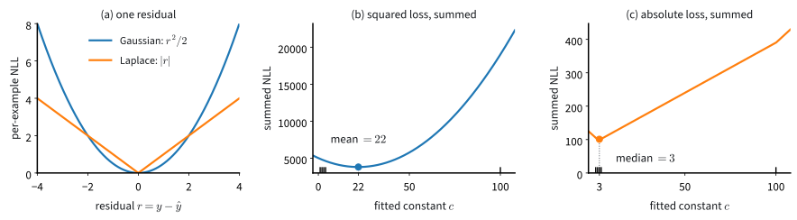

# Maximum Likelihood
:label:`sec_mdl-maximum_likelihood`

Suppose we flip a coin thirteen times and see nine heads and four tails.
Anyone would estimate the probability of heads as $9/13\approx 0.69$. But why
that number, and how far should we trust it? Could the coin still be fair?

One rule answers both questions: choose the parameters under which the
observed data are most probable. This is the principle of *maximum
likelihood*, and it stands behind nearly every training loss in the book. For
the coin it returns $9/13$. For a network it turns a model of the noise in
the targets into the loss we minimize: squared error and cross-entropy, which
the earlier chapters adopted because they work, both arise this way. The same
loss also says how precisely the data determine the parameters. The more
sharply it curves around its minimum, the smaller the error bar, and for the
coin the curvature will tell us whether thirteen flips can rule out a fair
one.

:numref:`sec_mdl-statistics` measured the error of estimators that were given
in closed form, such as a sample mean or a sample proportion. Here the
estimator is defined by an optimization, and its error bar comes out of the
loss itself. We first derive the losses of the earlier chapters from the
principle. We then ask how accurate the maximum-likelihood estimate is. That
part is the heart of the section, and its main result, asymptotic normality,
is the one to remember. Three heads in a row show why we sometimes need a
belief held before seeing any data, and we turn such a belief into a
regularizer. Finally, we fit models in which part of every observation is
hidden.

```{.python .input #maximum-likelihood-imports}
#@tab mxnet
import math
import numpy as np
from mxnet import autograd, gluon, init, np as mnp, npx
from mxnet.gluon import nn
from d2l import mxnet as d2l
npx.set_np()
```

```{.python .input #maximum-likelihood-imports}
#@tab pytorch
import math
import numpy as np
import torch
from torch import nn
from torch.nn import functional as F
from d2l import torch as d2l
```

```{.python .input #maximum-likelihood-imports}
#@tab tensorflow
import math
import numpy as np
import tensorflow as tf
from d2l import tensorflow as d2l
```

```{.python .input #maximum-likelihood-imports}
#@tab jax
import math
import numpy as np
import jax
from jax import numpy as jnp
from flax import nnx
import optax
from d2l import jax as d2l
```

## The Maximum Likelihood Principle

A probabilistic model assigns a probability to every data set it could have
produced. Once the data are in, we can turn this around: hold the data fixed
and ask how probable they are under each setting of the parameters.

Let $\boldsymbol{\theta}$ be the parameters of a model and $X$ the observed
data set. The **likelihood** is the probability of the observed data, or for
continuous data its density, viewed as a function of the parameters,
$P(X\mid\boldsymbol{\theta})$. The **maximum likelihood estimate** (MLE) is the
parameter that makes it largest,

$$
\hat{\boldsymbol{\theta}}
 = \mathop{\mathrm{argmax}}_{\boldsymbol{\theta}}
   P(X \mid \boldsymbol{\theta}).
$$
:eqlabel:`eq_mdl-mle`

Among all parameter settings, the MLE is the one under which what we observed
was most probable. The rule treats $\boldsymbol{\theta}$ as an unknown
constant: it assigns probabilities to data sets, never to parameter values, a
distinction that will matter when we add a prior (:numref:`subsec_mdl-map`).

### The Coin

The coin is the smallest model on which we can work the rule through to the
end. Its one parameter is the probability $\theta$ of heads.
:numref:`sec_mdl-distributions` called this number $p$; now it is the unknown
we estimate. The
flips are independent, so their probabilities multiply. A sequence with $n_H$
heads and $n_T$ tails has probability

$$
P(X \mid \theta) = \theta^{n_H}(1-\theta)^{n_T}.
$$
:eqlabel:`eq_mdl-coin-like`

Read as a function of $\theta$, this is the likelihood. For our sequence
HHHTHTTHHHHHT, with $n_H=9$ heads and $n_T=4$ tails, it is
$\theta^9(1-\theta)^4$. A fair coin gives the sequence probability
$2^{-13}\approx 1.2\times10^{-4}$, and a coin with $\theta=9/13$ gives it
$3.3\times10^{-4}$, about $2.7$ times as much.

To find the maximum we take the logarithm first. The logarithm is strictly
increasing, so it does not move the location of the maximum, and it turns the
product into a sum that is easy to differentiate. Setting the derivative to
zero,

$$
\frac{d}{d\theta}\Big[9\log\theta + 4\log(1-\theta)\Big]
  = \frac{9}{\theta} - \frac{4}{1-\theta} = 0
  \quad\Longrightarrow\quad 9(1-\theta) = 4\theta
  \quad\Longrightarrow\quad \hat\theta = \frac{9}{13}.
$$

The endpoints $\theta=0$ and $\theta=1$ give probability zero to a sequence
that contains both outcomes, so the maximum lies inside the interval and this
root is it. The
same steps on the general likelihood :eqref:`eq_mdl-coin-like` give

$$
\frac{n_H}{\theta} - \frac{n_T}{1-\theta} = 0
\quad\Longrightarrow\quad
\hat\theta = \frac{n_H}{n_H+n_T}.
$$

The MLE of a coin's bias is the observed frequency of heads, as anyone would
have guessed. The derivative is a sum of one term per flip,
$x/\theta-(1-x)/(1-\theta)$ for an outcome $x\in\{0,1\}$. Each term is the
gradient of one observation's log-probability, and it will reappear when we
measure the accuracy of $\hat\theta$.

Suppose the same frequency had come from ten times as many flips, $90$ heads
in $130$. The estimate cannot change, since only the ratio enters it. What
changes is how firmly the data single it out. We plot both likelihoods, each
divided by its maximum so that the two fit on one axis.

```{.python .input #maximum-likelihood-a-concrete-example}
theta = np.linspace(0.001, 0.999, 999)

def likelihood(theta, n_H, n_T):  # divided by its maximum
    lik = theta**n_H * (1 - theta)**n_T
    return lik / lik.max()

d2l.plot(theta, [likelihood(theta, 9, 4), likelihood(theta, 90, 40)], 'theta',
         'likelihood / max', legend=['9 of 13', '90 of 130'])
```

Both curves peak at $9/13\approx 0.69$, and the second is about three times
narrower. We will turn the width of this peak into an error bar.

### The Negative Log-Likelihood
:label:`subsec_mdl-nll`

The coin had a closed-form answer. A model with millions of parameters has
none, so we must optimize numerically, and in floating point the likelihood
itself is then unusable. With $n$ independent data points it is a product of
$n$ probabilities,

$$
P(X\mid\boldsymbol{\theta}) = \prod_{i=1}^n p(x_i\mid\boldsymbol{\theta}),
$$

each in $[0,1]$. A billion factors near $1/2$ produce roughly
$(1/2)^{10^9}$, which underflows to zero in any floating-point format long
before we can differentiate it.

The logarithm turns the product into a sum that stays in range:

$$
\log\!\big((1/2)^{10^9}\big) = 10^9 \cdot \log(1/2) \approx -6.93\times10^{8}.
$$

Maximizing the likelihood is the same as maximizing the *log-likelihood*
$\log P(X\mid\boldsymbol{\theta})$. We prefer to minimize losses, so we flip
the sign and define the **negative log-likelihood** (NLL):

$$
\ell(\boldsymbol{\theta}) = -\log P(X\mid\boldsymbol{\theta})
  = -\sum_{i=1}^n \log p(x_i\mid\boldsymbol{\theta}).
$$
:eqlabel:`eq_mdl-nll`

The NLL is a sum of one term per observation, the surprise of the model at
that observation. For the coin it reads
$\ell(\theta) = -\big(n_H\log\theta + n_T\log(1-\theta)\big)$, and nothing
stops us from minimizing it by gradient descent as if no closed form existed.
We do so for almost nine million flips and print the result next to
$n_H/(n_H+n_T)$.

```{.python .input #maximum-likelihood-numerical-optimization-and-the-negative-log-likelihood}
#@tab mxnet
n_H = 8675309
n_T = 256245
theta = mnp.array(0.5)
theta.attach_grad()
lr = 1e-9
for _ in range(100):
    with autograd.record():
        loss = -(n_H * mnp.log(theta) + n_T * mnp.log(1 - theta))
    loss.backward()
    theta -= lr * theta.grad
theta, n_H / (n_H + n_T)
```

```{.python .input #maximum-likelihood-numerical-optimization-and-the-negative-log-likelihood}
#@tab pytorch
n_H = 8675309
n_T = 256245
theta = torch.tensor(0.5, requires_grad=True)
lr = 1e-9
for _ in range(100):
    loss = -(n_H * torch.log(theta) + n_T * torch.log(1 - theta))
    loss.backward()
    with torch.no_grad():
        theta -= lr * theta.grad
    theta.grad.zero_()
theta, n_H / (n_H + n_T)
```

```{.python .input #maximum-likelihood-numerical-optimization-and-the-negative-log-likelihood}
#@tab tensorflow
n_H = 8675309
n_T = 256245
theta = tf.Variable(0.5)
lr = 1e-9
for _ in range(100):
    with tf.GradientTape() as t:
        loss = -(n_H * tf.math.log(theta) + n_T * tf.math.log(1 - theta))
    theta.assign_sub(lr * t.gradient(loss, theta))
theta, n_H / (n_H + n_T)
```

```{.python .input #maximum-likelihood-numerical-optimization-and-the-negative-log-likelihood}
#@tab jax
n_H = 8675309
n_T = 256245
theta = jnp.float32(0.5)

def nll(theta):
    return -(n_H * jnp.log(theta) + n_T * jnp.log(1 - theta))

grad_nll = jax.grad(nll)
lr = 1e-9
for _ in range(100):
    theta = theta - lr * grad_nll(theta)
theta, n_H / (n_H + n_T)
```

Gradient descent lands on $0.9713$, the observed frequency to the digits
printed. The learning rate $10^{-9}$ looks absurd, and the sum forces it on
us: the gradient of a loss summed over nearly nine million flips carries that
factor of $n$, and the largest stable step shrinks in proportion
(:numref:`subsec_mdl-quadratic-model`; Exercise
:exref:`ex_mdl-maximum-likelihood-learning-rate-loss-scale` finds the
threshold). This is why the minibatch losses of this book average over
examples instead of summing.

The logarithm also gives the gradient an additive form,

$$
\nabla_{\boldsymbol{\theta}}\, \ell(\boldsymbol{\theta})
  = -\sum_{i=1}^n \frac{\nabla_{\boldsymbol{\theta}}\, p(x_i\mid\boldsymbol{\theta})}{p(x_i\mid\boldsymbol{\theta})},
$$

one term per example, where the product rule on the likelihood itself would
give $n$ products of $n-1$ factors. A random subset of the data therefore
gives an unbiased estimate of $\nabla\ell$.

## Losses as Negative Log-Likelihoods

The coin's NLL is a loss we derived from a model. The losses of the earlier
chapters were written down directly. Most of the common ones are NLLs too, so
choosing a loss amounts to choosing a model of the data.

### Cross-Entropy and the Entropy Floor
:label:`subsec_mdl-nll-crossentropy`

A classifier's training loss is an average NLL, and its training curve often
levels off at some value above zero. To see what that value is and how low it
can go, we first rewrite the average NLL as a sum over outcomes rather than over
examples. Let $\hat p_{\textrm{data}}$ be the *empirical distribution* of the
sample: an outcome $x$ that occurs $n_x$ times among the $n$ observations gets
probability $\hat p_{\textrm{data}}(x) = n_x/n$, its observed frequency. For
the coin, $\hat p_{\textrm{data}}(\textrm{H}) = 9/13$ and
$\hat p_{\textrm{data}}(\textrm{T}) = 4/13$.

Now regroup the sum over data points into a sum over *distinct outcomes*,
pooling the observations with $x_i = x$. On the coin, the nine head-flips
pool into nine copies of $\log p_{\boldsymbol{\theta}}(\textrm{H})$, so heads
enters the average with weight $9/13$ and tails with weight $4/13$. In
general,

$$
\begin{aligned}
\frac{1}{n}\,\ell(\boldsymbol{\theta})
  &= -\frac{1}{n}\sum_{i=1}^n \log p_{\boldsymbol{\theta}}(x_i)
  = -\sum_{x} \frac{n_x}{n}\,\log p_{\boldsymbol{\theta}}(x) \\
  &= -\sum_{x} \hat p_{\textrm{data}}(x)\,\log p_{\boldsymbol{\theta}}(x)
  = \textrm{CE}\!\left(\hat p_{\textrm{data}},\, p_{\boldsymbol{\theta}}\right).
\end{aligned}
$$

The right side is the *cross-entropy* from the empirical distribution to the
model, $\textrm{CE}(p,q)=-\sum_x p(x)\log q(x)$. Scaling by the positive
constant $1/n$ does not move the minimizer, so for discrete outcomes maximum
likelihood is minimum cross-entropy. The identity is one line of regrouping,
and it is the reason a classification loss carries that name.

How low can the cross-entropy go? It splits into a part fixed by the data and
a part that depends on the model. Recall from
:numref:`subsec_mdl-max-entropy-derivation` the entropy
$H(p) = -\sum_x p(x)\log p(x)$ of a distribution on a finite set, its average
surprise, and the Kullback--Leibler (KL) divergence
$D_{\textrm{KL}}(p\,\|\,q) = \sum_x p(x)\log\frac{p(x)}{q(x)}$, the average
extra surprise of using $q$ where $p$ holds;
:numref:`sec_mdl-information_theory` develops both in full. We use natural
logarithms, so all three quantities are in *nats*. Adding and subtracting
$\sum_x p(x)\log p(x)$,

$$
\textrm{CE}(p, q) = -\sum_x p(x)\log q(x)
  = -\sum_x p(x)\log p(x) + \sum_x p(x)\log\frac{p(x)}{q(x)}
  = H(p) + D_{\textrm{KL}}(p\,\|\,q).
$$

The entropy depends on $p$ alone; only the KL term depends on the model. By
Gibbs' inequality :eqref:`eq_mdl-exp_family_gibbs` that term is never
negative, and it vanishes only when $q=p$.

With $p=\hat p_{\textrm{data}}$ and $q=p_{\boldsymbol{\theta}}$, the training
loss can therefore never fall below the entropy of the observed frequencies,
and it reaches that floor only if the model family can represent those
frequencies. All that training can reduce is the KL divergence from the data
frequencies to the model. For the coin, the floor is
$H(9/13) = -\tfrac{9}{13}\log\tfrac{9}{13}-\tfrac{4}{13}\log\tfrac{4}{13} =
0.617$ nats. A fair-coin model has cross-entropy $\log 2 = 0.693$ nats, so its
KL gap is $0.076$ nats; a model with $\theta=0.9$ has a gap of $0.164$ nats.
:numref:`fig_mdl-mle-kl` draws the whole curve.


:label:`fig_mdl-mle-kl`

The same identity holds for a classifier. It models $p_{\boldsymbol{\theta}}(y\mid\mathbf x)$,
and its average NLL is the average of $-\log p_{\boldsymbol{\theta}}(y_i\mid\mathbf x_i)$.
Grouping the examples by their input gives the identity at each distinct
input, with the empirical label frequencies at that input in the place of
$\hat p_{\textrm{data}}$ (Exercise :exref:`ex_mdl-maximum-likelihood-cross-entropy-floor`).
For one-hot labels and a softmax output, this average NLL is the softmax
cross-entropy loss of :numref:`sec_softmax`. In a typical data set every training input occurs once,
the label frequencies at each input are one-hot, and the floor of the
training loss is zero however noisy the labels are. The floor a practitioner
meets is on held-out data, where the expected loss cannot fall below the
conditional entropy of the labels given the inputs
(:numref:`subsec_mdl-irreducible-loss`).

### Densities
:label:`subsec_mdl-mle-densities`

For continuous data the likelihood needs one more step. The probability of
observing any exact real value is zero, so taken literally the likelihood is
$0$ for every $\boldsymbol{\theta}$ and cannot choose between them. We
therefore ask for a match only to within a small tolerance $\epsilon$ and show
that $\epsilon$ drops out of the minimizer.

For i.i.d. observations $x_1,\ldots,x_n$ with density
$p(x\mid\boldsymbol{\theta})$, the probability that each lands in a window of
width $\epsilon$ is, to first order in $\epsilon$,

$$
P\big(X_i \in [x_i, x_i+\epsilon]\ \forall i \mid \boldsymbol{\theta}\big)
  \approx \epsilon^n \prod_{i=1}^n p(x_i\mid\boldsymbol{\theta}).
$$

Taking the negative logarithm,

$$
-\log P\big(X_i \in [x_i, x_i+\epsilon]\ \forall i\mid\boldsymbol{\theta}\big)
  \approx -n\log\epsilon - \sum_{i} \log p(x_i\mid\boldsymbol{\theta}).
$$

The tolerance enters only through the additive constant $-n\log\epsilon$, which
does not depend on $\boldsymbol{\theta}$. Demanding four digits of precision
or four hundred changes that constant but never the minimizer, so we drop it
and minimize $-\sum_i \log p(x_i\mid\boldsymbol{\theta})$, as in the discrete
case. A density value is not itself a probability: only
$\epsilon\, p(x_i\mid\boldsymbol{\theta})$ approximates one, so $p$ carries
the inverse units of $x$ and can exceed $1$.

The population form of the cross-entropy identity carries over to continuous
data. The average negative log-density at the sample is still the objective,
and its expectation under the data-generating density $p_\star$ is

$$
\mathbb{E}_{x\sim p_\star}\big[-\log p(x\mid\boldsymbol{\theta})\big]
  = h(p_\star) + D_{\textrm{KL}}(p_\star\,\|\,p_{\boldsymbol{\theta}}),
\qquad h(p_\star) = -\int p_\star(x)\log p_\star(x)\,dx,
$$

by the same add-and-subtract step with integrals in place of sums. The
*differential entropy* $h(p_\star)$ does not depend on
$\boldsymbol{\theta}$. So for the population, maximum likelihood still
minimizes a KL divergence. The finite-sample identity of the discrete case has
no continuous counterpart, because the empirical distribution of $n$ distinct
real numbers is not a density.

### Gaussian Noise and Squared Error
:label:`subsec_mdl-gaussian-mse`

The most-used regression loss comes out of the same principle once we choose
a model for the noise in the targets.
:numref:`subsec_normal_distribution_and_squared_loss` derived it for linear
regression, and nothing in the derivation depends on the model being linear.
Suppose each target is the model's prediction plus Gaussian noise of *fixed*
variance, $y_i \sim \mathcal{N}(\hat y_i, \sigma^2)$ with
$\hat y_i = f_{\boldsymbol{\theta}}(\mathbf{x}_i)$. The negative logarithm of
the Gaussian density
$(2\pi\sigma^2)^{-1/2}\exp\!\big(-(y-\hat y)^2/(2\sigma^2)\big)$, summed over
the $n$ independent examples, is

$$
-\log \prod_{i=1}^n \mathcal{N}(y_i;\,\hat y_i,\,\sigma^2)
  = \frac{1}{2\sigma^2}\sum_{i=1}^n (y_i-\hat y_i)^2 + \frac{n}{2}\log(2\pi\sigma^2).
$$
:eqlabel:`eq_mdl-gaussian-nll`

The second term is the same for every $\boldsymbol{\theta}$ because the
variance is fixed, and the factor $1/(2\sigma^2)$ is a positive constant, so
the minimizer of this NLL is the minimizer of $\sum_i (y_i-\hat y_i)^2$.
Squared-error regression is maximum likelihood under the assumption that the
residuals are Gaussian. The same
recipe turns many common losses, including the four in the table below, into
the NLL of a chosen conditional distribution $p(y\mid\mathbf x)$. Each row
follows by taking the negative logarithm of the distribution and dropping
terms that do not depend on $\boldsymbol{\theta}$.

| Noise model $p(y\mid\mathbf x)$ | Negative log-likelihood $-\log p(y\mid\mathbf x)$ | Deep-learning loss |
|----|----|----|
| Gaussian, fixed variance $\sigma^2$ | $\tfrac{1}{2\sigma^2}(y-\hat y)^2 + \textrm{const}$ | mean squared error (MSE) |
| Bernoulli | $-\,y\log\hat p - (1-y)\log(1-\hat p)$ | binary cross-entropy (BCE) |
| Categorical (one-hot $y$) | $-\sum_k y_k \log \hat p_k$ | softmax cross-entropy |
| Laplace, fixed scale $s$ | $\tfrac{1}{s}\lvert y-\hat y\rvert + \textrm{const}$ | mean absolute error (MAE) |

For these losses, choosing the loss is choosing a noise model. Not every loss
arises this way: the hinge loss of support vector machines has no normalizing
constant independent of the model's output, so it is not the NLL of any
conditional distribution, even up to an additive constant (Exercise
:exref:`ex_mdl-maximum-likelihood-losses-not-likelihoods`).

The choice of noise model matters as soon as the data contain an outlier.
Suppose we fit a single constant $c$ to the five readings $\{1,2,3,4,100\}$,
the last from a faulty sensor. Under Gaussian noise we minimize
$\tfrac12\sum_i(y_i-c)^2$. Its derivative $-\sum_i(y_i-c)$ vanishes at the
mean, $c=22$. Under Laplace noise we minimize $\sum_i\lvert y_i-c\rvert$, a sum
of V-shapes whose slope at $c$ is the number of readings below $c$ minus the
number above. That slope is negative below the median and positive above it,
so the minimum is the median, $c=3$. Had the last reading been $5$, both fits
would give $3$. The faulty reading drags the mean to $22$ and leaves the
median where it was, as :numref:`fig_mdl-mle-gauss-laplace` shows.


:label:`fig_mdl-mle-gauss-laplace`

## Accuracy of the Maximum Likelihood Estimate
:label:`subsec_mdl-mle-estimator-theory`

We now return to the question of the opening: how sure are we about $9/13$?
For a sample proportion, :numref:`sec_mdl-statistics` answered it with the
standard error $\sqrt{\hat\theta(1-\hat\theta)/n}$, the estimated standard
deviation of $\hat\theta$ across repeated samples. The MLE of a general model
is not a sample mean, so we need a formula that reads the error bar off the
loss. The ingredients are the per-example gradient we met for the coin and
the curvature of the NLL.

### The Score and Fisher Information

The **score** of one observation is the gradient of its log-probability with
respect to the parameters,

$$
s(x;\boldsymbol{\theta}) = \nabla_{\boldsymbol{\theta}} \log p(x\mid\boldsymbol{\theta}).
$$

It extends the coin's per-flip gradient to any model, and
$\sum_i s(x_i;\hat{\boldsymbol{\theta}}) = \mathbf 0$ is the first-order
condition that locates the MLE.

At the true parameter the score has mean zero. Differentiating the
normalization $\int p(x\mid\boldsymbol{\theta})\,dx = 1$ under the integral
sign gives

$$
\mathbf 0
  = \nabla_{\boldsymbol{\theta}} \int p(x\mid\boldsymbol{\theta})\,dx
  = \int \nabla_{\boldsymbol{\theta}}\, p(x\mid\boldsymbol{\theta})\,dx
  = \int s(x;\boldsymbol{\theta})\, p(x\mid\boldsymbol{\theta})\,dx
  = \mathbb{E}_{\boldsymbol{\theta}}\!\big[\,s(x;\boldsymbol{\theta})\,\big],
$$

where the third equality uses
$\nabla_{\boldsymbol{\theta}}\, p = p\,\nabla_{\boldsymbol{\theta}} \log p = p\,s$.
On average over data drawn from the model, the gradient of the
log-likelihood is zero at the parameter that generated the data. Because the
score has mean zero, its variance equals its second moment. That variance is
the **Fisher information** :cite:`Fisher.1928`,

$$
I(\boldsymbol{\theta}) = \textrm{Var}_{\boldsymbol{\theta}}\!\big[\,s(x;\boldsymbol{\theta})\,\big]
  = \mathbb{E}_{\boldsymbol{\theta}}\!\big[\,s(x;\boldsymbol{\theta})\,s(x;\boldsymbol{\theta})^\top\,\big]
  = -\,\mathbb{E}_{\boldsymbol{\theta}}\!\big[\nabla^2_{\boldsymbol{\theta}} \log p(x\mid\boldsymbol{\theta})\big].
$$
:eqlabel:`eq_mdl-fisher`

The middle equality is the mean-zero property. The last equality is the
*information identity*: the variance of the score is the expected curvature of
the NLL. It follows by differentiating $\mathbb{E}_{\boldsymbol{\theta}}[s]=\mathbf 0$
once more, with the same interchange granted. The product rule splits the
derivative into two terms,

$$
\mathbf 0
  = \nabla_{\boldsymbol{\theta}} \int s(x;\boldsymbol{\theta})\,p(x\mid\boldsymbol{\theta})\,dx
  = \int \nabla^2_{\boldsymbol{\theta}} \log p(x\mid\boldsymbol{\theta})\; p(x\mid\boldsymbol{\theta})\,dx
  + \int s(x;\boldsymbol{\theta})\,\big(\nabla_{\boldsymbol{\theta}}\, p(x\mid\boldsymbol{\theta})\big)^\top dx,
$$

and substituting $\nabla_{\boldsymbol{\theta}}\, p = p\,s$ in the second term
turns it into $\mathbb{E}_{\boldsymbol{\theta}}[\,s\,s^\top]$, so

$$
\mathbb{E}_{\boldsymbol{\theta}}\!\big[\nabla^2_{\boldsymbol{\theta}} \log p(x\mid\boldsymbol{\theta})\big]
  + \mathbb{E}_{\boldsymbol{\theta}}\!\big[\,s\,s^\top\,\big] = \mathbf 0,
$$

which is the last equality of :eqref:`eq_mdl-fisher` rearranged. A sharply
curved NLL pins the parameter down, and a flat one leaves it loose. The Fisher
information is the curvature of one observation's NLL, averaged over data
drawn from the model.

Both derivations moved a derivative inside an integral without comment. The
results of this part rest on a few such *regularity conditions*, which we
state once:

- the density is twice continuously differentiable in $\boldsymbol{\theta}$;
- its support, the set of $x$ with $p(x\mid\boldsymbol{\theta})>0$, does not
  depend on $\boldsymbol{\theta}$;
- derivative and integral may be interchanged (the tool of
  :numref:`sec_mdl-integral_calculus`); this is the second equality of each
  derivation above, and the step that a moving support would break;
- the true parameter lies in the interior of the parameter set;
- the Fisher information is finite and nonsingular.

Exercises :exref:`ex_mdl-maximum-likelihood-relu-symmetries` and
:exref:`ex_mdl-maximum-likelihood-moving-support` show what breaks when the
information is singular and when the support moves with the parameter.

For the coin, a single flip $x\in\{0,1\}$ has log-likelihood
$\log p(x\mid\theta) = x\log\theta + (1-x)\log(1-\theta)$, so the score and its
derivative are

$$
s(x;\theta) = \frac{x}{\theta} - \frac{1-x}{1-\theta},
\qquad
\frac{d}{d\theta}\, s(x;\theta) = -\frac{x}{\theta^2} - \frac{1-x}{(1-\theta)^2}.
$$

Taking $-\mathbb{E}[\,\cdot\,]$ with $\mathbb{E}[x]=\theta$ gives the per-flip
Fisher information and its inverse divided by $n$,

$$
I(\theta) = \frac{1}{\theta} + \frac{1}{1-\theta} = \frac{1}{\theta(1-\theta)},
\qquad
\frac{I(\theta)^{-1}}{n} = \frac{\theta(1-\theta)}{n}.
$$
:eqlabel:`eq_mdl-coin-fisher`

The per-flip information is smallest at $\theta = 1/2$: a fair coin is the
hardest to pin down, because each flip carries the least information about the
bias.

A model with two parameters shows the matrix form. For a Gaussian with mean
$\mu$ and standard deviation $\sigma$, the NLL of one observation is
$\log\sigma + (x-\mu)^2/(2\sigma^2)$ plus a constant. Its second derivative in
$\mu$ is $1/\sigma^2$; in $\sigma$ it is $-1/\sigma^2+3(x-\mu)^2/\sigma^4$,
whose expectation is $2/\sigma^2$; and the mixed derivative
$2(x-\mu)/\sigma^3$ has expectation zero. So
$I(\mu,\sigma)=\operatorname{diag}(1/\sigma^2,\,2/\sigma^2)$: the NLL is twice
as curved in $\sigma$ as in $\mu$, and the data pin down the scale more
tightly than the mean. :numref:`fig_mdl-prob-mle-fisher` shows this bowl for
$30$ draws.


:label:`fig_mdl-prob-mle-fisher`

For the coin and the Gaussian, the MLE is a sample average and we could find
its spread without any of this machinery. A model whose MLE is not an average
shows what the theory adds. The *Cauchy location model* has density

$$
p(x\mid\theta) = \frac{1}{\pi\big(1+(x-\theta)^2\big)},
$$

a bell shape centered at $\theta$ with tails so heavy that, as
:numref:`sec_mdl-random_variables` showed, its mean does not exist. With
$u = x-\theta$, the score is $s = 2u/(1+u^2)$ and its derivative is
$\partial_\theta s = -2(1-u^2)/(1+u^2)^2$. The Fisher information is the
second moment of the score, and a change of variable gives it at sight. Write
$u=\tan\varphi$. Since $d\varphi = du/(1+u^2)$, the angle $\varphi$ of a
standard Cauchy variable is uniform on $(-\pi/2,\pi/2)$, and

$$
s = \frac{2\tan\varphi}{1+\tan^2\varphi} = \sin 2\varphi,
\qquad\textrm{so}\qquad
I = \mathbb{E}\big[\sin^2 2\varphi\big] = \frac12 .
$$

Each Cauchy observation carries half a unit of information about its center,
the same as a Gaussian observation with $\sigma^2=2$. The score never exceeds
$1$ in size and tends to zero for a far-away point, which is why outliers
barely move the MLE.

A model without such a trick still yields both forms of $I$ to automatic
differentiation. The cell draws $10{,}000$ Cauchy observations at
$\theta^\star=0$ and prints the mean of the score, its variance, and minus
the mean curvature. By the uniform angle, their Monte Carlo standard errors
are about $0.007$, $0.004$ and $0.008$.

```{.python .input #maximum-likelihood-fisher-information}
#@tab mxnet
def score(theta, x):  # per-example score of the Cauchy location model
    theta = theta.copy()
    theta.attach_grad()
    with autograd.record():
        log_p = -mnp.log1p((x - theta)**2) - np.log(np.pi)
    log_p.backward()
    return theta.grad

x = mnp.array(np.random.default_rng().standard_cauchy(10_000))  # theta* = 0
theta, eps = mnp.zeros_like(x), 1e-3
s = score(theta, x)
h = (score(theta + eps, x) - score(theta - eps, x)) / (2 * eps)  # curvature
print(f'mean score {s.mean():.3f}, variance of score {s.var():.3f}, '
      f'-mean curvature {-h.mean():.3f}')
```

```{.python .input #maximum-likelihood-fisher-information}
#@tab pytorch
def log_p(theta, x):  # log density of the Cauchy location model
    return -torch.log1p((x - theta)**2) - np.log(np.pi)

x = torch.tensor(np.random.default_rng().standard_cauchy(10_000),
                 dtype=torch.float32)  # theta* = 0
score = torch.func.vmap(torch.func.grad(log_p), in_dims=(None, 0))
curv = torch.func.vmap(torch.func.grad(torch.func.grad(log_p)),
                       in_dims=(None, 0))
s, h = score(torch.tensor(0.0), x), curv(torch.tensor(0.0), x)
print(f'mean score {s.mean():.3f}, variance of score {s.var():.3f}, '
      f'-mean curvature {-h.mean():.3f}')
```

```{.python .input #maximum-likelihood-fisher-information}
#@tab tensorflow
x = tf.constant(np.random.default_rng().standard_cauchy(10_000),
                tf.float32)  # theta* = 0
theta = tf.Variable(tf.zeros_like(x))  # one copy of theta per example
with tf.GradientTape() as outer:
    with tf.GradientTape() as inner:
        log_p = -tf.math.log1p((x - theta)**2) - np.log(np.pi)
    s = inner.gradient(log_p, theta)  # per-example score
h = outer.gradient(s, theta)  # per-example curvature
print(f'mean score {tf.reduce_mean(s):.3f}, '
      f'variance of score {tf.math.reduce_variance(s):.3f}, '
      f'-mean curvature {-tf.reduce_mean(h):.3f}')
```

```{.python .input #maximum-likelihood-fisher-information}
#@tab jax
def log_p(theta, x):  # log density of the Cauchy location model
    return -jnp.log1p((x - theta)**2) - jnp.log(jnp.pi)

x = np.random.default_rng().standard_cauchy(10_000)  # theta* = 0
score = jax.vmap(jax.grad(log_p), in_axes=(None, 0))
curv = jax.vmap(jax.grad(jax.grad(log_p)), in_axes=(None, 0))
s, h = score(0.0, x), curv(0.0, x)
print(f'mean score {s.mean():.3f}, variance of score {s.var():.3f}, '
      f'-mean curvature {-h.mean():.3f}')
```

:begin_tab:`mxnet`
MXNet's autograd cannot differentiate this score a second time, so the cell
takes the curvature as a central difference of two automatically
differentiated scores, at $\theta\pm10^{-3}$.
:end_tab:

:begin_tab:`pytorch`
`torch.func.grad` differentiates the log-density of one observation, and
`vmap` maps it over all $10{,}000$ observations; applying `grad` twice gives
the curvature.
:end_tab:

:begin_tab:`tensorflow`
Each observation gets its own copy of $\theta$, so the gradient of the summed
log-density with respect to that vector is the vector of per-example scores;
a second tape differentiates the scores once more.
:end_tab:

:begin_tab:`jax`
`jax.grad` differentiates the log-density of one observation, and `vmap` maps
it over all $10{,}000$ observations; applying `grad` twice gives the
curvature.
:end_tab:

The three numbers land within two or three of these standard errors of $0$,
$0.5$ and $0.5$.

### The Error Bar of the Coin
:label:`subsec_mdl-coin-error-bar`

The Fisher information gives the error bar for $9/13$ that the opening asked
for. The next subsection shows that for large $n$ the MLE has
approximately the variance $1/\big(nI(\theta)\big)$. We take that on trust for
a moment and apply it. For the coin, $1/(nI)=\theta(1-\theta)/n$ by
:eqref:`eq_mdl-coin-fisher`, and plugging in $\hat\theta$ for the unknown
$\theta$ gives the estimated standard error

$$
\widehat{\textrm{se}} = \sqrt{\frac{\hat\theta(1-\hat\theta)}{n}}
  = \sqrt{\frac{(9/13)(4/13)}{13}} = 0.128.
$$

So $\hat\theta = 0.69 \pm 0.13$. The approximate $95\%$ band
$\hat\theta\pm1.96\,\widehat{\textrm{se}}=[0.44,\,0.94]$ contains $1/2$:
thirteen flips cannot tell this coin from a fair one. Pinning $\theta$ down to
$\pm0.05$ at $95\%$ would take about
$1.96^2\,\hat\theta(1-\hat\theta)/0.05^2 = 1.96^2\cdot 0.213/0.05^2\approx 330$
flips.

The same number comes straight out of the loss. The second derivative of the
coin's NLL at $\hat\theta$ is

$$
\ell''(\hat\theta) = \frac{n_H}{\hat\theta^2} + \frac{n_T}{(1-\hat\theta)^2}
  = \frac{9}{(9/13)^2} + \frac{4}{(4/13)^2} = 61.0,
$$

and $1/\sqrt{61.0} = 0.128$. For the coin this agreement is no coincidence.
With $n_H=n\hat\theta$ and $n_T=n(1-\hat\theta)$, the curvature is
$n/\big(\hat\theta(1-\hat\theta)\big) = nI(\hat\theta)$. For a model that
satisfies the conditions above, the same holds approximately at large $n$: a
training run can compute the curvature of the NLL at its minimum, the
Hessian, and one over its square root is the error bar. For several
parameters, the error bars are the square roots of the diagonal of the
inverse Hessian. A deep network does not satisfy the conditions, and
:numref:`subsec_mdl-mle-limits` says what is left of the recipe there. The
curvature also explains the likelihood plot at the start of the section: ten
times the data multiplies the curvature by ten and narrows the peak by
$\sqrt{10}\approx 3.2$.

### Consistency and Asymptotic Normality

Why is the variance of the MLE about $1/(nI)$? We first need the MLE to head
for the right value at all, and then a description of how it fluctuates
around that value. Three tools from earlier sections do the work:
consistency,
$\hat{\boldsymbol{\theta}}\xrightarrow{P}\boldsymbol{\theta}^\star$, and the
weak law of large numbers :eqref:`eq_mdl-lln`, both from
:numref:`sec_mdl-statistics`, and the central limit theorem of
:numref:`sec_mdl-distributions`, by which a sum of $n$ i.i.d. mean-zero terms
with variance $v$, divided by $\sqrt n$, converges in distribution
($\xrightarrow{d}$) to $\mathcal N(0,v)$.

The cross-entropy identity of :numref:`subsec_mdl-nll-crossentropy` explains
why the MLE approaches the true parameter. Suppose the data come from the
model with parameter
$\boldsymbol{\theta}^\star$. The average NLL is an average of i.i.d. terms, so
by the law of large numbers it converges to the population NLL

$$
\mathbb{E}_{\boldsymbol{\theta}^\star}\big[-\log p(x\mid\boldsymbol{\theta})\big]
  = H(p_{\boldsymbol{\theta}^\star})
  + D_{\textrm{KL}}\big(p_{\boldsymbol{\theta}^\star}\,\|\,p_{\boldsymbol{\theta}}\big),
$$

with $h$ in place of $H$ for densities (:numref:`subsec_mdl-mle-densities`).
By Gibbs' inequality :eqref:`eq_mdl-exp_family_gibbs` this is smallest
where the KL term vanishes, at $\boldsymbol{\theta}=\boldsymbol{\theta}^\star$.
The minimizer is unique if the model is **identifiable**: distinct parameters
give distinct distributions. Neural networks are not. Permuting the hidden
units of a layer, together with their weights, changes the parameter vector
but not the function it computes. For such models, consistency is a statement
about the fitted distribution, or about the class of parameters that give it,
never about one parameter vector.

Under the following conditions the MLE is consistent
:cite:`Wasserman.2013`, a result we state without proof: the data are i.i.d.
from $p_{\boldsymbol{\theta}^\star}$, the model is identifiable, the
population optimum is well separated (no $\boldsymbol{\theta}$ far from
$\boldsymbol{\theta}^\star$ comes arbitrarily close to the optimal value; on a
compact parameter set with a continuous objective, uniqueness suffices), and
the average NLL converges to the population NLL uniformly in
$\boldsymbol{\theta}$. The uniformity is the hypothesis that is easy to
overlook. The law of large numbers holds at each fixed $\boldsymbol{\theta}$,
and convergence at each point does not force the minimizers to converge. For
the coin no theorem is needed: $\hat\theta = n_H/n\to\theta^\star$ directly
by the law of large numbers.

Consistency says where $\hat{\boldsymbol{\theta}}$ lands. The error bar needs
the size and shape of its fluctuation. The derivation is short for a scalar
$\theta$, and its one non-routine step is to Taylor-expand the first-order
condition rather than the NLL. Write $S_n(\theta)=\sum_i s(x_i;\theta)$ for
the total score.

**I.** The MLE solves $S_n(\hat\theta)=0$. Expanding around $\theta^\star$ to
first order,

$$
0 = S_n(\hat\theta) \approx S_n(\theta^\star) + S_n'(\theta^\star)\,(\hat\theta-\theta^\star).
$$

**II.** Solving for the error and multiplying by $\sqrt n$ splits it into a
ratio of two averages,

$$
\sqrt n\,(\hat\theta-\theta^\star) \approx
\frac{S_n(\theta^\star)/\sqrt n}{-S_n'(\theta^\star)/n}.
$$

**III.** The numerator is a sum of $n$ i.i.d. scores, each with mean zero and
variance $I(\theta^\star)$, divided by $\sqrt n$; by the central limit theorem
it converges in distribution to $\mathcal N\big(0, I(\theta^\star)\big)$. The
denominator is an average of $n$ i.i.d. terms $-\partial_\theta s(x_i;\theta^\star)$
whose mean is $I(\theta^\star)$ by the information identity; by the law of
large numbers it converges to $I(\theta^\star)$. A Gaussian with variance $I$
divided by the constant $I$ has variance $I/I^2=1/I$.

The numerator used the variance form of $I$ and the denominator its curvature
form. The information identity makes the two the same number, which is why
the result is so simple. The vector case runs the same way with matrices,
giving the covariance $I^{-1}II^{-1}=I^{-1}$. A full proof also controls the
Taylor remainder, and the integrable bound on the curvature in the proposition
below does this.

**Proposition (asymptotic normality).** *Under the regularity conditions, the
conditions for consistency above, and a bound
$\lVert\nabla^2_{\boldsymbol{\theta}}\log p(x\mid\boldsymbol{\theta})\rVert\le M(x)$
with $\mathbb{E}_{\boldsymbol{\theta}^\star}[M(x)]<\infty$ for all
$\boldsymbol{\theta}$ near $\boldsymbol{\theta}^\star$,*

$$
\sqrt{n}\,\big(\hat{\boldsymbol{\theta}} - \boldsymbol{\theta}^\star\big)
  \;\xrightarrow{d}\; \mathcal{N}\!\big(\mathbf{0},\; I(\boldsymbol{\theta}^\star)^{-1}\big)
$$
:eqlabel:`eq_mdl-asymptotic-normality`

:cite:`Wasserman.2013`. We do not prove it beyond the three steps above. It
is the central result of the section: the error bar, the efficiency of the
MLE and the limits of the theory all hang on it. The error of the MLE is
approximately Gaussian, shrinks at the rate $1/\sqrt n$, and has the inverse
Fisher information as its covariance. For a finite $n$ we read it as the
approximation
$\textrm{Cov}(\hat{\boldsymbol{\theta}})\approx I(\boldsymbol{\theta}^\star)^{-1}/n$,
which is the error bar of the previous subsection. Halving the error bar
requires four times the data. When the model is wrong, the variance and
curvature forms of $I$ differ, and the covariance becomes the "sandwich" of
:numref:`subsec_mdl-mle-limits`.

To test the proposition we need a model whose MLE is not a sample
mean, and the Cauchy location model is one. Its likelihood equation
$\sum_i 2u_i/(1+u_i^2)=0$ has no closed form, so we solve it by **Fisher
scoring**: Newton's method with the expected curvature $nI=n/2$ in place of
the observed one,

$$
\theta \leftarrow \theta + \frac{S_n(\theta)}{nI} = \theta + \frac{2}{n}\,S_n(\theta).
$$

The expected curvature is always positive, while the observed curvature of a
Cauchy NLL can be negative away from the minimum, where a Newton step would
head uphill. We start each run at the sample median, which is already close.
We fit $4{,}000$ data sets of $n=100$ observations at $\theta^\star=0$ with
ten scoring steps each. If the asymptotic theory is already accurate at
$n=100$, the histogram of $\sqrt n\,\hat\theta$ follows
$\mathcal N(0, 1/I)=\mathcal N(0,2)$.

```{.python .input #mdl-maximum-likelihood-estimator-theory-why-maximum-likelihood-works}
reps, n = 4000, 100
x = np.random.default_rng().standard_cauchy((reps, n))  # theta* = 0
theta = np.median(x, axis=1)
for _ in range(10):  # Fisher scoring: theta += S_n / (n I) with I = 1/2
    u = x - theta[:, None]
    theta += (2 / n) * (2 * u / (1 + u**2)).sum(axis=1)
z = np.sqrt(n) * theta  # sqrt(n) (theta_hat - theta*)
hist, edges = np.histogram(z, bins=40, range=(-5, 5), density=True)
grid = np.linspace(-5, 5, 201)
d2l.plot([(edges[:-1] + edges[1:]) / 2, grid],
         [hist, np.exp(-grid**2 / 4) / np.sqrt(4 * np.pi)],
         'sqrt(n) * theta_hat', 'density', legend=['4,000 data sets', 'N(0, 2)'])
print(f'standard deviation of sqrt(n) * theta_hat: {z.std():.2f}')
```

The histogram sits on the predicted curve in center, width, and height. The
standard deviation of $\sqrt n\,\hat\theta$ comes out between about $1.40$
and $1.47$ from run to run, against the limit $\sqrt2=1.41$; at $n=100$ the
variance is still a few percent above its limiting value.

### The Cramér--Rao Bound
:label:`subsec_mdl-cramer-rao`

Is the MLE's variance good, or could a cleverer estimator do better? The
Fisher information also sets a floor that no estimator which is right on
average can beat. As in :numref:`sec_mdl-statistics`, an estimator
$\tilde\theta$ is *unbiased* if $\mathbb{E}_\theta[\tilde\theta]=\theta$ for
every $\theta$.

**Proposition (Cramér--Rao bound).** *Under the regularity conditions, any
unbiased estimator $\tilde\theta$ of a scalar parameter from $n$ i.i.d.
observations satisfies*

$$
\textrm{Var}\big(\tilde\theta\big) \;\ge\; \frac{1}{n\,I(\theta)}
$$
:eqlabel:`eq_mdl-cramer-rao`

:cite:`Cramer.1946,Radhakrishna-Rao.1945`. No estimator that is right on
average can be more precise than the curvature of the likelihood allows. The
proof takes three lines, and its one idea is to correlate the estimator with
the score.

**Proof.** Let $S_n=\partial_\theta\log P(X\mid\theta)$ be the score of the
whole data set, a sum of $n$ independent per-example scores; it has mean zero
and variance $nI(\theta)$. Unbiasedness says
$\int\tilde\theta(X)\,P(X\mid\theta)\,dX=\theta$. Differentiating both sides
under the integral, with $\partial_\theta P = P\,S_n$,

$$
1 = \int \tilde\theta(X)\,S_n\,P(X\mid\theta)\,dX
  = \mathbb{E}\big[\tilde\theta\,S_n\big]
  = \textrm{Cov}\big(\tilde\theta,\,S_n\big),
$$

where the last step uses $\mathbb{E}[S_n]=0$. The Cauchy--Schwarz inequality
for covariances gives
$1\le\textrm{Var}(\tilde\theta)\textrm{Var}(S_n)=\textrm{Var}(\tilde\theta)\,nI(\theta)$.
$\blacksquare$

Unbiasedness enters through the "1" on the left. The fixed support enters when
we differentiate under the integral; Exercise :exref:`ex_mdl-maximum-likelihood-moving-support`
shows an unbiased estimator that beats the bound when the support moves with
$\theta$. For a vector parameter the bound reads
$\textrm{Cov}(\tilde{\boldsymbol{\theta}}) \succeq I(\boldsymbol{\theta})^{-1}/n$
in the positive semidefinite order.

The MLE's limiting variance :eqref:`eq_mdl-asymptotic-normality` equals this
floor, the smallest variance any unbiased estimator can have; in this sense
the MLE is *asymptotically efficient*. For the coin the floor is reached at
every $n$, not only in the limit, because $n_H/n$ is an unbiased sample mean
with variance $\theta(1-\theta)/n = 1/(nI)$. In general the MLE meets the
floor only as $n\to\infty$. At finite $n$ it can be biased, and then the bound
does not apply to it; the Gaussian variance below is an example.

How much is efficiency worth? For the Cauchy location model the sample median
is the natural competitor, and the sample mean the naive one; by symmetry the
MLE and the median are both unbiased. The floor for $n$ times the variance is
$1/I=2$, and the asymptotic theory of the median predicts
$\pi^2/4\approx 2.47$. For the mean, guess before reading the output. The
cell reuses the $4{,}000$ data sets.

```{.python .input #mdl-maximum-likelihood-the-cram-r-rao-bound}
print(f'n Var(MLE) = {n * theta.var():.2f}, '
      f'n Var(median) = {n * np.median(x, axis=1).var():.2f}, '
      f'n Var(mean) = {n * x.mean(axis=1).var():.3g}')
```

The MLE comes out between about $1.9$ and $2.2$, close to the floor of $2$,
and the median near $2.5$, so the MLE needs about $20\%$ fewer observations
for the same error bar. The sample mean has an enormous variance that changes
wildly from run to run: the mean of $n$ Cauchy observations is again Cauchy,
so averaging never helps.

### Limits of the Theory
:label:`subsec_mdl-mle-limits`

The guarantees of this part hold under the stated conditions and as
$n\to\infty$. Four of the five cases below break one condition each, and the
exercises work them out. The fifth, a wrong model, is the case every deep
learning reader lives in, so we work it here.

- *Finite-sample bias.* The MLE of a Gaussian's variance divides the sum of
  squares by $n$, so on average it underestimates $\sigma^2$ by the factor
  $(n-1)/n$ (:numref:`sec_mdl-statistics`). The MLE is optimal in the limit,
  not unbiased at every $n$.
- *The boundary.* A parameter near the edge of its range, such as a coin with
  bias $0.95$, needs far more data before the Gaussian limit is accurate; what
  matters is the expected number of rare outcomes, not $n$. On the edge itself
  the MLE can fail to exist (Exercise :exref:`ex_mdl-maximum-likelihood-small-samples-boundary`).
- *A support that moves with the parameter.* The uniform distribution on
  $[0,\theta]$ has the MLE $\max_i x_i$, an error of order $1/n$ rather than
  $1/\sqrt n$, and an unbiased estimator that beats the Cramér--Rao floor
  (Exercise :exref:`ex_mdl-maximum-likelihood-moving-support`).
- *Singular information.* The rescaling symmetry of a ReLU network gives $I$ a
  null vector, so its inverse does not exist (Exercise :exref:`ex_mdl-maximum-likelihood-relu-symmetries`).

*Misspecification.* When no $p_{\boldsymbol{\theta}}$ is the distribution of
the data, the MLE converges to the parameter of smallest KL divergence to the
truth :cite:`White.1982`. The score still has mean zero there, but the
variance of the score, $B$, and the expected curvature, $A$, now differ, and
step III gives the variance $B/A^2$ in place of $1/I$, in matrix form the
*sandwich* $\mathbf A^{-1}\mathbf B\mathbf A^{-1}$ (Exercise
:exref:`ex_mdl-maximum-likelihood-sandwich`). Fit, for example, a Poisson
model with rate $\lambda$ to counts with mean $m$ and variance
$m+m^2/\alpha$. The MLE is the sample mean, so it still recovers $m$, with
variance $(m+m^2/\alpha)/n$. The Poisson model's Fisher information
$I=1/\lambda$ reports $m/n$, too small by the factor $1+m/\alpha$, which is
$3$ for $m=4$ and $\alpha=2$.

A network is both misspecified and non-identifiable, so no error bar attaches
to a single weight. What the theory still supports are statements about the
fitted distribution and its predictions, which the symmetries leave
unchanged. The Fisher matrix itself returns twice in the book: as the Hessian
of the KL divergence between neighbouring members of a family
(:numref:`sec_mdl-divergences-distances`), and as the curvature with which
natural-gradient methods precondition a step
(:numref:`sec_mdl-adaptive-stochastic-methods`).

## MAP Estimation and Regularization
:label:`subsec_mdl-map`

Thirteen flips gave a usable estimate. Three flips may not. Suppose they come
up HHH. The MLE is then $\hat\theta=3/3=1$: it assigns probability zero to
tails, so the first tail we see afterwards has infinite NLL. A classifier
built from counts that has never seen a feature together with a class is in
the same position. Nobody who has handled coins believes this one can never
land tails. What we need is a way to say, before seeing any data, that coins
are rarely perfectly biased.

A probability distribution over the parameters expresses such a belief.
Maximum likelihood had no place for one, since it assigned probabilities to
data sets only. With a **prior** $p(\boldsymbol{\theta})$, Bayes' rule turns
the likelihood into a distribution over the parameters given the data,

$$
p(\boldsymbol{\theta}\mid X)
  = \frac{P(X\mid\boldsymbol{\theta})\,p(\boldsymbol{\theta})}{P(X)},
\qquad
P(X) = \int P(X\mid\boldsymbol{\theta})\,p(\boldsymbol{\theta})\,d\boldsymbol{\theta}.
$$
:eqlabel:`eq_mdl-bayes-theta`

The left side is the **posterior**, what we believe after seeing the data.
The denominator, the
**evidence**, is the probability of the data with the parameters averaged out;
it does not depend on $\boldsymbol{\theta}$. The **maximum a posteriori**
(MAP) estimate is the peak of the posterior. The evidence does not move the
peak, so maximizing the posterior and taking negative logarithms gives

$$
\hat{\boldsymbol{\theta}}_{\textrm{MAP}}
  = \mathop{\mathrm{argmax}}_{\boldsymbol{\theta}}\, P(X\mid\boldsymbol{\theta})\,p(\boldsymbol{\theta})
  = \mathop{\mathrm{argmin}}_{\boldsymbol{\theta}}\,
    \Big[\underbrace{-\textstyle\sum_i \log p(x_i\mid\boldsymbol{\theta})}_{\textrm{data fit (NLL)}}
       \;\underbrace{-\log p(\boldsymbol{\theta})}_{\textrm{penalty}}\Big].
$$
:eqlabel:`eq_mdl-map`

MAP estimation minimizes the familiar NLL plus a penalty, the negative
log-prior. A prior that puts little mass on extreme parameters penalizes them,
which is what a regularizer does. For HHH, a prior that adds one imaginary
head and one imaginary tail (the $\mathrm{Beta}(2,2)$ prior below) gives
$\hat\theta_{\textrm{MAP}}=(3+1)/(3+2)=4/5$. A later tail then costs
$-\log(1/5)=1.6$ nats, a finite surprise.

### Gaussian Prior and Weight Decay
:label:`subsec_mdl-gaussian-prior-weight-decay`

Weight decay, the most common regularizer in deep learning, is the MAP
penalty of a Gaussian prior. :numref:`sec_weight_decay` derives this for
linear regression; here it is in the notation of this section, for any model
with Gaussian noise. Take every parameter to be a priori small,
$\theta_j \sim \mathcal{N}(0,\tau^2)$ independently, with $\tau$ the typical
size we expect. The prior density is proportional to
$\exp\!\big(-\lVert\boldsymbol{\theta}\rVert_2^2/(2\tau^2)\big)$, so its
negative logarithm is $\lVert\boldsymbol{\theta}\rVert_2^2/(2\tau^2)$ plus a
constant. With the Gaussian NLL :eqref:`eq_mdl-gaussian-nll`, the MAP
objective :eqref:`eq_mdl-map` becomes

$$
\hat{\boldsymbol{\theta}}_{\textrm{MAP}}
  = \mathop{\mathrm{argmin}}_{\boldsymbol{\theta}}\;
    \frac{1}{2\sigma^2}\sum_{i}(y_i-\hat y_i)^2
      + \frac{1}{2\tau^2}\lVert\boldsymbol{\theta}\rVert_2^2 .
$$

Multiplying by the positive constant $\sigma^2/n$, which does not move the
minimizer, gives the weight-decay objective :eqref:`eq_wd-objective`,

$$
\frac{1}{n}\sum_{i=1}^n \frac12\big(y_i-\hat y_i\big)^2 + \frac{\lambda}{2}\lVert\boldsymbol{\theta}\rVert_2^2,
\qquad \lambda = \frac{\sigma^2}{n\tau^2}.
$$

The book's version leaves the bias $b$ unpenalized, which amounts to a flat
prior on $b$. The prior's weight in the averaged loss falls as $1/n$:
regularization matters most when data are scarce.
:numref:`subsec_mdl-weight-decay-duality` reads the same penalty as a
constraint on the norm of the weights.

A *Laplace* prior $p(\boldsymbol{\theta})\propto e^{-\lVert\boldsymbol{\theta}\rVert_1/s}$
with scale $s$ gives the $L_1$ penalty $\lVert\boldsymbol{\theta}\rVert_1/s$,
whose kink at the origin produces exact zeros, that is, sparse parameter
vectors. :numref:`fig_mdl-prob-map-prior` shows the compromise in one
dimension: the NLL favors the MLE, the negative log-prior favors the prior
mean, and the MAP estimate lies between them.


:label:`fig_mdl-prob-map-prior`

The same picture explains the two limits. As the prior flattens
($\tau\to\infty$, or $s\to\infty$) the penalty vanishes, and as the data grow
the NLL deepens in proportion to $n$ while the prior stays fixed. Either way
MAP approaches the MLE.

### Beta Prior and Pseudo-Counts
:label:`subsec_mdl-beta-map`

For the coin the prior must live on $[0,1]$, and the Beta family is the
convenient choice. A $\mathrm{Beta}(a,b)$ prior with $a,b>0$ has density
proportional to $\theta^{a-1}(1-\theta)^{b-1}$. Multiplying by the likelihood
:eqref:`eq_mdl-coin-like` adds the observed counts to the exponents, so the
posterior is again a Beta distribution, the conjugate update
:eqref:`eq_mdl-beta_posterior` of :numref:`sec_mdl-exponential-family`:

$$
p(\theta\mid X) \;\propto\; \theta^{\,n_H + a - 1}\,(1-\theta)^{\,n_T + b - 1}.
$$

The posterior has the shape of a coin likelihood with $n_H+a-1$ heads
and $n_T+b-1$ tails. When both exponents are positive, its peak follows from
the same one-variable maximization as the coin's MLE, "head exponent over
total exponent":

$$
\hat\theta_{\textrm{MAP}} \;=\; \frac{n_H + a - 1}{n + a + b - 2},
\qquad n = n_H + n_T.
$$
:eqlabel:`eq_mdl-beta-map`

For the mode, then, the prior counts as $a-1$ imaginary heads and $b-1$
imaginary tails, appended to the data before taking the frequency. This
agrees with the convention fixed in :numref:`sec_mdl-exponential-family`: $a$
and $b$ are the *pseudo-counts* of the posterior mean, $a-1$ and $b-1$ those
of the posterior mode. A $\mathrm{Beta}(2,2)$ prior adds one imaginary flip
of each kind to the mode: it turns our $9/13\approx 0.692$ into
$(9+1)/(13+2) = 2/3$ and HHH into $4/5$. A $\mathrm{Beta}(30,30)$ prior holds
the MAP estimate near $1/2$ until the data outweigh its $58$ imaginary flips.

The two readings meet in a familiar formula. The posterior mean under the
flat prior $\mathrm{Beta}(1,1)$ is Laplace's rule of succession
$(n_H+1)/(n+2)$ :cite:`Laplace.1814`, known in classifiers built from counts
as add-one smoothing. The same number is the MAP estimate under
$\mathrm{Beta}(2,2)$, while MAP under the flat $\mathrm{Beta}(1,1)$ is the
plain MLE. So add-one smoothing is a posterior mean under a flat prior, not a
flat-prior MAP estimate.

### Posterior Mode and Posterior Distribution
:label:`subsec_mdl-map-vs-posterior`

The mode is a fragile summary, because it depends on how the parameter is
written. A nonlinear change of variables multiplies a density by a Jacobian,
which moves its peak while leaving probabilities of regions unchanged.
$\mathrm{Beta}(1,1)$ is flat in $\theta$, but the same belief written for the
log-odds $\eta=\log\frac{\theta}{1-\theta}$ is not flat, and MAP in $\eta$
gives $10/15$ instead of $9/13$ (Exercise
:exref:`ex_mdl-maximum-likelihood-map-log-odds`). The likelihood has no
Jacobian, because its values are probabilities of the data attached to points
of the parameter space. The MLE is therefore **equivariant**: if $\hat\theta$
is the MLE of $\theta$, then $g(\hat\theta)$ is the MLE of $g(\theta)$ for
any one-to-one $g$ :cite:`Wasserman.2013`. The MLE of the coin's log-odds is
$\log\frac{9/13}{4/13}=\log\frac94$. This is why maximum likelihood is
defined without any prior, rather than as MAP with a flat one, whose answer
would depend on how the parameter is written down. Equivariance has a cost of
its own: the same exercise shows that no estimator can be both equivariant
and unbiased for every parameterization.

The deeper limit is that MAP, like the MLE, reports a single parameter
vector. The posterior $p(\boldsymbol{\theta}\mid X)$ itself says how
uncertain the parameters remain. A prediction that uses it averages over that
uncertainty,
$\int p(x\mid\boldsymbol{\theta})\,p(\boldsymbol{\theta}\mid X)\,d\boldsymbol{\theta}$,
while a prediction that plugs in the mode discards it. Such averages are
rarely available in closed form, and computing them is the subject of
:numref:`sec_mdl-bayesian-computation`.

<!-- split: new section "Latent Variables, EM, and the ELBO" starts here -->

## Latent Variables, EM, and the ELBO
:label:`sec_mdl-latent-em-elbo`

Maximum likelihood is easy when the logarithm reaches each density directly:
the NLLs of :numref:`sec_mdl-maximum_likelihood` were sums of terms that we
could differentiate one by one. Many generative models are not so convenient.
They posit a **latent variable** $z$, such as an unobserved cluster identity,
a topic, or the random input that a generator turns into an image, and define
the joint distribution

$$
p(x, z\mid\boldsymbol{\theta}) = p(z\mid\boldsymbol{\theta})\, p(x \mid z, \boldsymbol{\theta}),
$$

of which we observe only $x$. The likelihood of an observation is then a
*marginal*, obtained by summing the latent out (for a continuous latent, by
integrating):

$$
p(x\mid\boldsymbol{\theta}) = \sum_{z} p(z\mid\boldsymbol{\theta})\, p(x\mid z, \boldsymbol{\theta}).
$$
:eqlabel:`eq_mdl-marginal-lik`

The model's probability of $x$ adds up all the ways of producing $x$, one
for each value of the hidden variable. The sum sits inside the logarithm and
blocks the direct route. The way around it is a lower bound on the
log-likelihood, and it is the result to remember: expectation--maximization
climbs it exactly, variational inference and variational autoencoders
approximately.

### Mixture Models

The standard example is the **Gaussian mixture model** (GMM). The latent
$z \in \{1,\ldots,K\}$ picks a component with probability $\pi_k$, and the
observation is then drawn from that component,
$x \mid z{=}k \sim \mathcal{N}(\mu_k, \sigma_k^2)$. The NLL of the data is

$$
\ell(\boldsymbol{\theta})
  = -\sum_{i=1}^n \log\Big(\sum_{k=1}^K \pi_k\, \mathcal{N}(x_i;\, \mu_k, \sigma_k^2)\Big),
\qquad \boldsymbol{\theta} = (\pi_k, \mu_k, \sigma_k)_{k=1}^K.
$$

The difficulty is the sum *inside* the logarithm. Until now every logarithm
reached an individual density, and the NLL split into simple pieces. Here the
logarithm stops at the mixture, every parameter appears in every term, and the
first-order conditions have no closed-form solution. Contrast the
*complete-data* problem: if an oracle revealed each $z_i$, the likelihood
would factor by component, and maximum likelihood would collapse to estimators
we already have. The weight $\pi_k$ would be the fraction of points in
component $k$, the coin's counting estimator, and $\mu_k$, $\sigma_k^2$ would
be the sample mean and variance of those points. The problem is easy if the
labels are known and hard only because they are missing. This suggests a plan:
guess the missing labels probabilistically, then solve the easy problem.

The guess for one point is its posterior over components. Take a single
observation $x=0.5$ and two equally weighted components $\mathcal N(-1,1)$ and
$\mathcal N(1,1)$. The densities are proportional to $e^{-(1.5)^2/2}=e^{-1.125}$
and $e^{-(0.5)^2/2}=e^{-0.125}$, so Bayes' rule gives the left component the
posterior probability

$$
\frac{e^{-1.125}}{e^{-1.125}+e^{-0.125}} = \frac{1}{1+e} = 0.27.
$$

The point is split $27\%$ to $73\%$ between the two components, rather than
assigned to one of them.

### The Evidence Lower Bound

To turn this plan into an algorithm with a guarantee, we bound the
log-likelihood from below by a quantity in which the logarithm reaches the
joint density again. Let $q(z)$ be any distribution over the latent, our
probabilistic guess. Insert it into the marginal and apply
Jensen's inequality: the logarithm is concave, so
$\log \mathbb{E}[\cdot] \ge \mathbb{E}[\log(\cdot)]$ (:numref:`subsec_mdl-jensen`).
Then

$$
\log p(x\mid\boldsymbol{\theta})
  = \log \sum_z q(z)\, \frac{p(x,z\mid\boldsymbol{\theta})}{q(z)}
  \;\ge\; \sum_z q(z) \log \frac{p(x,z\mid\boldsymbol{\theta})}{q(z)}
  \;=:\; \mathcal{L}(q, \boldsymbol{\theta}).
$$
:eqlabel:`eq_mdl-elbo`

The sums run over the $z$ with $q(z)>0$. If $q$ vanishes at some $z$ to which
the joint distribution gives positive probability, the first equality becomes
$\ge$, and the bound still holds. The marginal $p(x\mid\boldsymbol{\theta})$
plays for the hidden $z$ the role that the evidence $P(X)$ in
:eqref:`eq_mdl-bayes-theta` plays for the parameters: it is the probability
of what we actually observed, with the unobserved quantity summed out. It is
also called the *evidence*, and the right-hand side is the **evidence lower
bound** (**ELBO**). Expanding the fraction splits the bound into two parts,

$$
\mathcal{L}(q,\boldsymbol{\theta})
  = \mathbb{E}_{q}\big[\log p(x,z\mid\boldsymbol{\theta})\big] + H(q).
$$

The ELBO is the expected *complete-data* log-likelihood, the easy objective
averaged over the guess, plus the entropy of the guess, which does not
involve $\boldsymbol{\theta}$. How far does the bound fall short of the
log-likelihood? By a KL divergence, and both EM and variational inference are
built on this identity.

**Proposition (the ELBO gap is a KL divergence).** *For every
$\boldsymbol{\theta}$ and every $q$ that puts no mass outside the support of
the posterior $p(z\mid x,\boldsymbol{\theta})$,*

$$
\log p(x\mid\boldsymbol{\theta})
  = \mathcal{L}(q,\boldsymbol{\theta})
  + D_{\textrm{KL}}\big(q(z)\,\|\,p(z\mid x,\boldsymbol{\theta})\big).
$$
:eqlabel:`eq_mdl-elbo-gap`

*Hence $\mathcal{L}(q,\boldsymbol{\theta}) \le \log p(x\mid\boldsymbol{\theta})$,
with equality if and only if $q$ is the posterior
$p(z\mid x,\boldsymbol{\theta})$.*

**Proof.** Expand the KL term using Bayes' rule,
$p(z\mid x,\boldsymbol{\theta}) = p(x,z\mid\boldsymbol{\theta})/p(x\mid\boldsymbol{\theta})$:

$$
D_{\textrm{KL}}\big(q \,\|\, p(z\mid x,\boldsymbol{\theta})\big)
  = \mathbb{E}_q\!\left[\log \frac{q(z)\, p(x\mid\boldsymbol{\theta})}{p(x,z\mid\boldsymbol{\theta})}\right]
  = \log p(x\mid\boldsymbol{\theta}) - \mathcal{L}(q,\boldsymbol{\theta}),
$$

where $\log p(x\mid\boldsymbol{\theta})$ leaves the expectation because it does
not involve $z$. Rearranging gives :eqref:`eq_mdl-elbo-gap`. Gibbs' inequality
:eqref:`eq_mdl-exp_family_gibbs` makes the KL term nonnegative and zero only
when its two arguments agree. $\blacksquare$

:numref:`fig_mdl-prob-elbo` draws the resulting geometry.

![The evidence and its lower bound. For a fixed guess $q$, the ELBO $\mathcal{L}(q,\theta)$ runs below the evidence $\log p(x\mid\theta)$ at every $\theta$, and the gap between the curves is the KL divergence from $q$ to the posterior $p(z\mid x,\theta)$. The E-step of EM picks $q$ to be the posterior at the current iterate $\theta^{(t)}$, closing the gap so the bound touches the evidence there; the M-step climbs the bound to its peak $\theta^{(t+1)}$. Because the bound touches the evidence at $\theta^{(t)}$ and never exceeds it anywhere, the evidence at $\theta^{(t+1)}$ is at least what it was at $\theta^{(t)}$.](../img/mdl-prob-elbo.svg)
:label:`fig_mdl-prob-elbo`

### Expectation--Maximization

The proposition turns the hard problem into **coordinate ascent** on
$\mathcal{L}(q, \boldsymbol{\theta})$: maximize over one of the two arguments
while holding the other fixed, then swap, and repeat. For a data set
$X = \{x_1,\ldots,x_n\}$ of independent observations the bound applies
example by example and sums, with one guess $q_i$ per data point. The
**expectation--maximization** (EM) algorithm alternates the two coordinates
:cite:`Dempster.Laird.Rubin.1977`:

* **E-step.** Hold $\boldsymbol{\theta}^{(t)}$ fixed and maximize over the
  guesses. By the equality condition of :eqref:`eq_mdl-elbo-gap`, the best
  $q_i$ is the posterior, $q_i^{(t)}(z) = p(z \mid x_i, \boldsymbol{\theta}^{(t)})$.
  This closes every gap and makes the bound *tight*:
  $\sum_i \mathcal{L}(q_i^{(t)}, \boldsymbol{\theta}^{(t)}) = \log P(X\mid\boldsymbol{\theta}^{(t)})$.
* **M-step.** Hold the guesses fixed and maximize over the parameters:

  $$
  \boldsymbol{\theta}^{(t+1)} = \mathop{\mathrm{argmax}}_{\boldsymbol{\theta}} \sum_i \mathbb{E}_{q_i^{(t)}}\big[\log p(x_i, z\mid\boldsymbol{\theta})\big],
  $$

  since the entropy terms do not involve $\boldsymbol{\theta}$. This is the
  easy complete-data objective, with soft assignments standing in for the
  oracle's labels.

**Proposition (EM never decreases the likelihood).** *Each EM iteration
satisfies $\log P(X\mid\boldsymbol{\theta}^{(t+1)}) \ge \log P(X\mid\boldsymbol{\theta}^{(t)})$.*

**Proof.** Chain three facts:

$$
\log P(X\mid\boldsymbol{\theta}^{(t+1)})
  \;\ge\; \sum_i \mathcal{L}\big(q_i^{(t)}, \boldsymbol{\theta}^{(t+1)}\big)
  \;\ge\; \sum_i \mathcal{L}\big(q_i^{(t)}, \boldsymbol{\theta}^{(t)}\big)
  \;=\; \log P(X\mid\boldsymbol{\theta}^{(t)}).
$$

The first inequality is the ELBO bound :eqref:`eq_mdl-elbo` at the new
parameters; the second is the definition of the M-step; the equality is the
tightness that the E-step achieved. $\blacksquare$

For the Gaussian mixture both steps have closed forms. The E-step computes the
**responsibilities**, the posterior probability that point $i$ came from
component $k$, as in the hand computation above,

$$
r_{ik} = \frac{\pi_k\, \mathcal{N}(x_i;\, \mu_k, \sigma_k^2)}
              {\sum_{j} \pi_j\, \mathcal{N}(x_i;\, \mu_j, \sigma_j^2)}.
$$

The M-step refits each component by responsibility-weighted counting and
averaging. With effective counts $n_k = \sum_i r_{ik}$,

$$
\pi_k = \frac{n_k}{n}, \qquad
\mu_k = \frac{1}{n_k}\sum_{i} r_{ik}\, x_i, \qquad
\sigma_k^2 = \frac{1}{n_k}\sum_{i} r_{ik}\,(x_i - \mu_k)^2.
$$
:eqlabel:`eq_mdl-gmm-mstep`

These are the coin's counting estimator and the Gaussian's mean and variance,
softened: instead of voting for one component, each point spreads its single
vote across the components in proportion to its responsibilities. If all
components share one fixed variance $\sigma^2$ and we let $\sigma^2\to0$,
the responsibilities become hard assignments to the nearest mean, and EM
becomes the K-means algorithm.

The two steps fit in a dozen lines. We draw $300$ points from
$\mathcal N(-2, 0.8^2)$ and $200$ from $\mathcal N(1.5, 0.6^2)$, and
implement EM for a mixture of $K$ Gaussians in one dimension; `em` returns
the log-likelihood at every step together with the final parameters.

```{.python .input #maximum-likelihood-em-gmm}
rng = np.random.default_rng()
x = np.concatenate([rng.normal(-2.0, 0.8, 300), rng.normal(1.5, 0.6, 200)])

def gauss(x, mu, sigma):
    return np.exp(-0.5 * ((x - mu) / sigma)**2) / (sigma * np.sqrt(2 * np.pi))

def em(x, pi, mu, sigma, steps):
    """EM for a 1-D Gaussian mixture: log-likelihood trace and final fit."""
    pi, mu, sigma = (np.array(v, dtype=float) for v in (pi, mu, sigma))
    lls = []
    for _ in range(steps):
        joint = pi * gauss(x[:, None], mu, sigma)  # (n, K)
        lls.append(np.log(joint.sum(axis=1)).sum())
        r = joint / joint.sum(axis=1, keepdims=True)  # E-step
        n_k = r.sum(axis=0)  # M-step
        pi, mu = n_k / len(x), (r * x[:, None]).sum(axis=0) / n_k
        sigma = np.sqrt((r * (x[:, None] - mu)**2).sum(axis=0) / n_k)
    return np.array(lls), pi, mu, sigma
```

The proposition says that the trace cannot go down. It says nothing about
speed. We start from a poor guess, two heavily overlapping components at
$\pm0.5$ with unit scale, run $30$ steps, and print the first six values and
the last.

```{.python .input #mdl-maximum-likelihood-expectation-maximization-1}
lls, pi, mu, sigma = em(x, [0.5, 0.5], [-0.5, 0.5], [1, 1], 30)
assert np.all(np.diff(lls) >= -1e-9)  # monotone, as the proposition says
print('steps 0-5:', lls[:6].round(1), ' step 29:', lls[-1].round(1))
print(f'pi = {pi.round(2)}, mu = {mu.round(2)}, sigma = {sigma.round(2)}')
```

The log-likelihood climbs by several hundred nats, from about $-1{,}300$ to
about $-850$ (the exact values depend on the draw). After six steps it is
typically within one nat of its final value, and always within a few nats.
The recovered weights, means, and scales lie within about $0.2$ of the
generating values $(0.6, 0.4)$, $(-2, 1.5)$, and $(0.8, 0.6)$.

EM has four limits. The first is harmless.
Relabeling the $K$ components gives $K!$ equally good copies of every maximum.
This *label switching* is the same non-identifiability as permuting the
hidden units of a network, and it makes no maximum worse than another.

The second limit is that EM stops at the first stationary point it reaches. A
symmetric start makes the point. Before running the cell, predict what EM
does when both components begin with the same mean and scale.

```{.python .input #mdl-maximum-likelihood-expectation-maximization-2}
lls2, pi2, mu2, sigma2 = em(x, [0.5, 0.5], [0, 0], [1, 1], 30)
print(f'log-likelihood {lls2[0]:.1f} -> {lls2[-1]:.1f}, '
      f'{lls[-1] - lls2[-1]:.1f} below the previous fit')
print(f'pi = {pi2.round(2)}, mu = {mu2.round(2)}, sigma = {sigma2.round(2)}')
print(f'mean of x = {x.mean():.2f}, standard deviation of x = {x.std():.2f}')
```

The two components never separate. Their responsibilities are equal for
every point, so the M-step keeps them identical, and EM settles on the
single-Gaussian fit, the overall mean and standard deviation of the data, more
than $100$ nats below the two-cluster solution. Every fixed point of EM is a
stationary point of the likelihood, not necessarily a maximum, so in practice
EM is restarted from several random initializations. Random initialization
breaks the same symmetry among the hidden units of a layer
(:numref:`sec_numerical_stability`): units that start equal receive equal
gradients and stay equal.

The third limit is that the mixture likelihood is unbounded. Put the second
component on the first data point, $\mu_2=x_1$, with weight $\pi_2=1/n$ and
scale $\epsilon$. Its density at $x_1$ is $\tfrac1n(2\pi)^{-1/2}\epsilon^{-1}$,
while the first component still explains the other points, so

$$
\ell(\boldsymbol{\theta}) \le \log\big(n\sqrt{2\pi}\big) + \log\epsilon + \textrm{const},
$$

where the constant collects the other $n-1$ points. As $\epsilon\to0$ the NLL
goes to $-\infty$: the maximum likelihood "solution" is a spike on one data
point. A floor on the variances, or a prior on them, removes the spike. With
the set of parameters at least as good as the starting point then compact,
every limit point of EM is a stationary point of the floored problem
:cite:`Wu.1983`.

The fourth limit is that the monotonicity proof needs the exact posterior in
the E-step, and approximate E-steps lose the guarantee. A *variational
autoencoder* :cite:`Kingma.Welling.2014` keeps the ELBO but replaces the
per-point posterior by a neural network $q_{\boldsymbol{\phi}}(z\mid x)$,
trained jointly with the generator, because for a deep decoder the posterior
has no closed form. It climbs the bound by stochastic gradients rather than by
exact EM steps. The same bound, with the parameters in the role of the latent
variable, is the objective of variational inference in
:numref:`sec_mdl-bayesian-computation`.

## Summary

Maximum likelihood chooses the parameters under which the observed data are
most probable, which in practice means minimizing the negative
log-likelihood, a sum of one surprise per example. Choosing a loss is
choosing a noise model: squared error for Gaussian noise, absolute error for
Laplace noise, and for discrete data the cross-entropy from the observed
frequencies to the model, which cannot fall below their entropy. The
curvature of the same loss measures precision: under regularity conditions
the MLE's error is approximately Gaussian with variance $1/(nI)$, where the
Fisher information $I$ is both the variance of the score and the expected
curvature of the NLL, and no unbiased estimator does better. These guarantees
fail for a misspecified or non-identifiable model, and a deep network is
both. A prior adds its negative logarithm as a penalty: a Gaussian prior is
weight decay, a Beta prior adds pseudo-counts, and the MAP estimate is still
a single point.

With hidden variables, the likelihood has a sum inside its logarithm. The
ELBO lies below the log-evidence by the KL divergence from the guess $q$ to
the posterior of the latent variable. EM alternates between closing that gap
and climbing the bound: it never decreases the likelihood, but it stops at
the first stationary point it reaches.

## Exercises

1. [code] **Learning rate and loss scale.** The cell of
   :numref:`subsec_mdl-nll` minimizes the summed coin NLL by gradient
   descent with `lr` $=10^{-9}$ for the counts `n_H` $=8675309$ and
   `n_T` $=256245$. Near its minimizer $\hat\theta$ the NLL is approximately
   quadratic with curvature $c=n\,I(\hat\theta)$, where $n=n_H+n_T$ and $I$
   is the per-flip Fisher information :eqref:`eq_mdl-coin-fisher`. On such a
   quadratic, each step multiplies the distance to $\hat\theta$ by
   $1-\texttt{lr}\cdot c$, so gradient descent converges if and only if
   $\texttt{lr}<2/c$.
    1. Predict the learning rate above which the cell stops converging. Rerun
       it with `lr` $\in\{5\times10^{-9},\,6.5\times10^{-9},\,10^{-8}\}$ and
       print the last four iterates of $\theta$. What do the iterates do just
       above the threshold?
    1. Multiply `n_H` and `n_T` by $10^{-3}$, keeping `lr` $=10^{-9}$.
       Predict $\theta$ after the $100$ steps once from the gradient at the
       starting point $\theta=0.5$ and once from the contraction factor
       $1-\texttt{lr}\cdot c$ of the quadratic model. Which prediction
       matches the run, and why?
    1. Multiply the original counts by $10$ instead, keeping
       `lr` $=10^{-9}$. Show that, in exact arithmetic, scaling both counts
       by $k$ at a fixed `lr` produces the iterates of the original counts
       with learning rate $k\cdot\texttt{lr}$. Which run of (a) does the
       factor $10$ reproduce? Do its iterates leave $(0,1)$ within the $100$
       steps?
    1. Divide the loss by $n$ before differentiating. What is the threshold
       now, and why does it no longer depend on $n$?
   :exlabel:`ex_mdl-maximum-likelihood-learning-rate-loss-scale`

1. **The cross-entropy floor.** For discrete outcomes the average NLL
   equals
   $H(\hat p_{\textrm{data}})+D_{\textrm{KL}}(\hat p_{\textrm{data}}\,\|\,p_{\boldsymbol{\theta}})$
   by :numref:`subsec_mdl-nll-crossentropy`, so it cannot fall below the
   empirical entropy.
    1. Evaluate this floor in nats for the coin sequence with $9$ heads and
       $4$ tails, and the KL gap of the fair-coin model $\theta=1/2$.
    1. A classifier models $p(y\mid\mathbf x)$ and can represent any
       distribution over labels separately for each distinct input. Show
       that its smallest achievable average NLL on a training set is the
       empirical conditional entropy
       $\sum_{\mathbf x}\hat p_{\textrm{data}}(\mathbf x)\,H\big(\hat p_{\textrm{data}}(\cdot\mid\mathbf x)\big)$.
       Evaluate it for a binary task in which each of $100$ distinct inputs
       occurs $10$ times and carries the wrong label in exactly one of its
       occurrences.
    1. Now every training input occurs once, as in a typical image data set.
       What is the floor of (b)? Why does a training loss near zero then say
       nothing about how noisy the labels are? Which quantity that we can
       measure has the population conditional entropy $H(Y\mid X)$ as its
       floor?
   :exlabel:`ex_mdl-maximum-likelihood-cross-entropy-floor`

1. **Learned noise variance.** The Gaussian NLL :eqref:`eq_mdl-gaussian-nll`
   holds the variance $\sigma^2$ fixed. Here the variance is learned as well.
    1. Let one shared $\sigma^2$ be a parameter alongside
       $\boldsymbol{\theta}$. Minimize the NLL over $\sigma^2$ for fixed
       $\boldsymbol{\theta}$ and show that the remaining objective is
       $\tfrac n2\log\big(\tfrac1n\sum_i(y_i-\hat y_i)^2\big)$ plus a
       constant. Is the minimizer over $\boldsymbol{\theta}$ still the
       least-squares fit?
    1. A network outputs a mean $\hat y(\mathbf x)$ and a variance
       $\hat\sigma^2(\mathbf x)>0$ for each input. Up to an additive
       constant, its NLL on the training set is

       $$\sum_{i=1}^n\Big[\frac{(y_i-\hat y(\mathbf x_i))^2}{2\hat\sigma^2(\mathbf x_i)}+\frac12\log\hat\sigma^2(\mathbf x_i)\Big].$$

       Show that this objective is unbounded below if the network can fit
       one training point exactly while shrinking its variance. Which
       property of the Gaussian mixture likelihood in
       :numref:`sec_mdl-latent-em-elbo` has the same cause?
    1. Compute the gradient of example $i$'s term with respect to
       $\hat y(\mathbf x_i)$. Suppose that the predicted variance tracks the
       squared residual, $\hat\sigma^2(\mathbf x_i)\approx r_i^2$ with
       $r_i=y_i-\hat y(\mathbf x_i)$. How does the size of the gradient then
       depend on $|r_i|$, and how does that compare with squared error? What
       does this weighting do to the fit of the mean in regions where the
       fit is currently poor :cite:`Seitzer.Tavakoli.Antic.ea.2022`?
   :exlabel:`ex_mdl-maximum-likelihood-learned-noise-variance`

1. **Losses that are not likelihoods.** Let $\phi(y,o)$ be a loss of a label
   $y$ and a model output $o$, and let $Z(o)=\sum_y e^{-\phi(y,o)}$. If
   $Z(o)$ does not depend on $o$, then $e^{-\phi(y,o)}/Z$ is a conditional
   distribution of $y$ given $o$ whose NLL is $\phi$ plus a constant, so
   minimizing $\phi$ is maximum likelihood.
    1. For labels $y\in\{-1,+1\}$, show that the logistic loss
       $\phi(y,o)=\log(1+e^{-yo})$ has $Z(o)=1$, and identify the
       probability that the model assigns to $y=+1$.
    1. Compute $Z(o)$ for the hinge loss $\phi(y,o)=\max(0,1-yo)$ of support
       vector machines, separately for $|o|\le1$ and for $|o|>1$. Conclude
       that the hinge loss is not the NLL, up to a constant, of any
       conditional distribution of $y$ given $o$. Which term must be added
       to the hinge loss to obtain the NLL of $e^{-\phi(y,o)}/Z(o)$, and how
       does that term behave as $|o|$ grows?
    1. For a real target $y$ and a prediction $\hat y$, take any loss of the
       residual, $\phi(y,\hat y)=\rho(y-\hat y)$ with
       $\int e^{-\rho(r)}\,dr<\infty$, such as the Huber loss. Show that
       $Z(\hat y)=\int e^{-\rho(y-\hat y)}\,dy$ does not depend on $\hat y$.
       Why is the condition of this problem automatic for such regression
       losses but restrictive for classification losses?
   :exlabel:`ex_mdl-maximum-likelihood-losses-not-likelihoods`

1. [code] **Boundaries: separable data and rare outcomes.** Maximum
   likelihood misbehaves when the best parameter sits on the edge of its
   range.
    1. Two labeled points, $x=-1$ with $y=0$ and $x=+1$ with $y=1$, are fit by
       logistic regression $P(y=1\mid x)=\operatorname{sigmoid}(wx)$ without
       a bias. Show that the NLL is $2\log(1+e^{-w})$, that it decreases for
       every $w$ and tends to $0$, and that no finite $w$ attains it. Which
       coin sequence of the text has the same problem, and what does
       $w\to\infty$ predict for a new point at $x=0.1$?
    1. Add the prior $w\sim\mathcal N(0,\tau^2)$. Show that the MAP estimate
       solves $2\operatorname{sigmoid}(-w)=w/\tau^2$, and solve it
       numerically for $\tau=1$. Generalize: for any linearly separable data
       set the logistic NLL has infimum $0$ and no minimizer, and a Gaussian
       prior restores a finite MAP estimate.
    1. For the coin, the skewness of $\hat\theta=n_H/n$ is
       $(1-2\theta)/\sqrt{n\theta(1-\theta)}$. Evaluate it for $\theta=0.7$
       and for $\theta=0.95$ at $n=400$, and find the $n$ at which
       $\theta=0.95$ reaches the skewness that $\theta=0.7$ has at $n=400$.
       For $\theta$ near $1$, express the skewness through the expected
       number of tails $n(1-\theta)$. Why is it that count, and not $n$,
       which decides whether the Gaussian limit is accurate?
    1. Simulate $20{,}000$ data sets of $n=400$ flips
       (`rng.binomial(n, theta, 20000) / n`), and histogram
       $\sqrt n(\hat\theta-\theta)$ for $\theta=0.7$ and $\theta=0.95$
       against $\mathcal N\big(0,\theta(1-\theta)\big)$. Describe how the
       $\theta=0.95$ histogram departs from the curve.
   :exlabel:`ex_mdl-maximum-likelihood-small-samples-boundary`

1. **Gaussian versus Laplace shrinkage.** Observe one value
   $z\sim\mathcal N(\theta,1)$ of an unknown scalar $\theta$.
    1. With the prior $\theta\sim\mathcal N(0,\tau^2)$, show that the MAP
       estimate is $\tau^2 z/(1+\tau^2)$. The pair $(\theta, z)$ is then
       jointly Gaussian, so the posterior of $\theta$ given $z$ is Gaussian.
       Why does the MAP estimate therefore equal the posterior mean? For
       which $z$ is it exactly zero?
    1. With the Laplace prior $p(\theta)\propto e^{-|\theta|/s}$ of
       :numref:`subsec_mdl-gaussian-prior-weight-decay`, write the MAP
       objective. Solve it with the soft-thresholding formula: the minimizer
       of $\tfrac12(z-\theta)^2+\lambda|\theta|$ is
       $\operatorname{sign}(z)\max(|z|-\lambda,0)$. For which $z$ is the
       estimate exactly zero?
    1. Keep the Laplace prior and let $z>0$. Compare the posterior density at
       $\theta$ and at $-\theta$ for $\theta>0$, and conclude that the
       posterior mean is strictly positive. What is the posterior probability
       that $\theta=0$? What does this imply for reading the exact zeros of
       an $L_1$-regularized fit as evidence that a coefficient is zero?
   :exlabel:`ex_mdl-maximum-likelihood-gaussian-laplace-shrinkage`

1. **MAP in log-odds.** Parameterize the coin by its log-odds
   $\eta=\log\frac{\theta}{1-\theta}$, so that
   $\theta=\operatorname{sigmoid}(\eta)$ and
   $\frac{d\theta}{d\eta}=\theta(1-\theta)$. Keep the uniform prior
   $\mathrm{Beta}(1,1)$ on $\theta$ and the sequence with $9$ heads and $4$
   tails.
    1. Use the change-of-variables formula for densities,
       $p_\eta(\eta)=p_\theta(\theta)\,\lvert d\theta/d\eta\rvert$ of
       :numref:`sec_mdl-random_variables` to find the prior density of $\eta$
       that this belief implies. Show that it is the logistic density
       $e^{-\eta}/(1+e^{-\eta})^2$, the law of $\log\frac{U}{1-U}$ for a
       uniform $U$, and explain the result with inverse-transform sampling,
       without a calculation.
    1. Find the MAP estimate of $\eta$ and map it back to $\theta$. Compare
       it with the MAP estimate in the $\theta$ parameterization, with the
       MLE $\log\frac94$ of :numref:`subsec_mdl-map-vs-posterior`, and with
       Laplace's rule of succession.
    1. Repeat (b) for a general prior $\mathrm{Beta}(a,b)$ and counts
       $n_H,n_T$. Which summary of the posterior over $\theta$ does the
       log-odds MAP estimate reproduce?
    1. The MLE is equivariant, so the MLE of $\theta^2$ is $\hat\theta^2$.
       Show that its bias is
       $\mathbb{E}[\hat\theta^2]-\theta^2=\textrm{Var}(\hat\theta)=\theta(1-\theta)/n$,
       and evaluate it at $\theta=9/13$, $n=13$. Conclude that no estimator
       can be both equivariant under all smooth one-to-one
       reparameterizations and unbiased for all of them.
   :exlabel:`ex_mdl-maximum-likelihood-map-log-odds`

1. **Densities carry units.** ● A density value is not a probability: if $x$
   is measured in metres, $p(x)$ has units of inverse
   metres (:numref:`subsec_mdl-mle-densities`).
    1. A Gaussian is fit by maximum likelihood to $n$ lengths measured in
       metres and then refit to the same lengths in millimetres. How do
       $\hat\mu$, $\hat\sigma$, and the minimal NLL change?
    1. Model A is a density for positive data $x$. Model B is a Gaussian
       density for $\log x$. Use the change-of-variables formula of
       :numref:`sec_mdl-random_variables` to write model B's NLL for the data
       $x_1,\ldots,x_n$. Which term must be added to B's NLL on the values
       $\log x_i$ before the two models can be compared?
    1. Images have integer pixel values $\mathbf x\in\{0,\ldots,255\}^D$. A
       density fit to such values can place a narrow spike on every grid
       point and so make its average NLL arbitrarily low, by the mechanism of
       problem :exref:`ex_mdl-maximum-likelihood-learned-noise-variance`b.
       :citet:`Theis.Oord.Bethge.2016` instead fit a density $q$ on
       $[0,256)^D$ to the dequantized values $\mathbf x+\mathbf u$, with
       $\mathbf u$ uniform on $[0,1)^D$. Show that
       $Q(\mathbf x)=\int_{[0,1)^D}q(\mathbf x+\mathbf u)\,d\mathbf u$ is a
       probability distribution on the pixel grid. Use Jensen's inequality,
       as in :eqref:`eq_mdl-elbo`, to show that
       $-\log Q(\mathbf x)\le-\mathbb{E}_{\mathbf u}\big[\log q(\mathbf x+\mathbf u)\big]$.
       What does this bound guarantee about an NLL reported on dequantized
       data?
   :exlabel:`ex_mdl-maximum-likelihood-densities-units`

1. **Symmetries of a ReLU network.** ● Consider the network
   $f_{\boldsymbol{\theta}}(x)=\sum_{j=1}^h a_j\,\mathrm{ReLU}(w_jx)$ with a
   scalar input $x$ and parameters
   $\boldsymbol{\theta}=(a_1,w_1,\ldots,a_h,w_h)$, and the regression model
   $y\sim\mathcal N(f_{\boldsymbol{\theta}}(x),\sigma^2)$ with fixed
   $\sigma^2$. Identifiability is defined
   in :numref:`subsec_mdl-mle-estimator-theory`.
    1. Show that replacing $(a_j,w_j)$ by $(c\,a_j,\,w_j/c)$ for any $c>0$
       leaves $f_{\boldsymbol{\theta}}$ unchanged. How many distinct
       parameter vectors with the same function does permuting the hidden
       units produce when no two units coincide?
    1. Show from :eqref:`eq_mdl-fisher` that the Fisher information of this
       model is
       $I(\boldsymbol{\theta})=\mathbb{E}_x\big[\nabla_{\boldsymbol{\theta}}f_{\boldsymbol{\theta}}(x)\,\nabla_{\boldsymbol{\theta}}f_{\boldsymbol{\theta}}(x)^\top\big]/\sigma^2$.
       Differentiate the rescaling of (a) with respect to $c$ at $c=1$ to
       find a nonzero vector $\mathbf v$ with
       $I(\boldsymbol{\theta})\mathbf v=\mathbf 0$. Which hypothesis behind
       :eqref:`eq_mdl-asymptotic-normality` fails?
    1. The Hessian entry of the mean squared error
       $\tfrac1n\sum_i(y_i-f_{\boldsymbol{\theta}}(x_i))^2$ with respect to
       $a_j$ is $\tfrac2n\sum_i\mathrm{ReLU}(w_jx_i)^2$. How does this entry
       change under the rescaling of (a)? Compute the entry for $w_j$, and
       explain why for a ReLU unit it contains no residual term (away from
       the kinks $w_jx_i=0$). How does it change under the rescaling? What
       does this imply for measures of the flatness of a minimum that are
       based on Hessian eigenvalues :cite:`Dinh.Pascanu.Bengio.ea.2017`?
   :exlabel:`ex_mdl-maximum-likelihood-relu-symmetries`

1. **A support that moves.** ● Let $x_1,\ldots,x_n$ be independent and
   uniform on $[0,\theta]$ with unknown $\theta>0$. This model violates one
   of the regularity conditions of :numref:`subsec_mdl-mle-estimator-theory`.
    1. Write the likelihood as a function of $\theta$ and show that the MLE
       is $\hat\theta=\max_i x_i$. Why does setting a derivative to zero not
       find it?
    1. Show that
       $P\big(n(\theta-\hat\theta)>t\big)=\big(1-\tfrac{t}{n\theta}\big)^n$
       for $0\le t\le n\theta$, and find the limit as $n\to\infty$. At which
       rate in $n$ does the error shrink, and is the limit Gaussian?
    1. On the support, the score is $s(x;\theta)=-1/\theta$. Compute
       $\mathbb{E}_\theta[s]$. Which step in the derivation of the mean-zero
       score fails (compare exercise
       :exref:`ex_mdl-integral-calculus-moving-support`
       of :numref:`sec_mdl-integral_calculus`)?
    1. The unbiased estimator $\tfrac{n+1}{n}\hat\theta$ has variance
       $\theta^2/(n(n+2))$. Compare it with the value
       $1/(n\,\mathbb{E}_\theta[s^2])$ that :eqref:`eq_mdl-cramer-rao` would
       give as a floor. Which step of the proof of the bound fails here?
   :exlabel:`ex_mdl-maximum-likelihood-moving-support`

1. [code] **EM speed and missing information.** ● Consider the mixture
   $p(x\mid\pi)=\pi f_0(x)+(1-\pi)f_1(x)$ with known components
   $f_0=\mathcal N(\cdot\,;0,1)$ and $f_1=\mathcal N(\cdot\,;\Delta,1)$, in
   which only the weight $\pi$ is unknown.
    1. Show that EM updates the weight by $\pi^{(t+1)}=M(\pi^{(t)})$ with
       $M(\pi)=\tfrac1n\sum_i r_i(\pi)$ and responsibilities
       $r_i(\pi)=\pi f_0(x_i)/p(x_i\mid\pi)$.
    1. Near a fixed point $\hat\pi=M(\hat\pi)$, each iteration multiplies the
       error by about $M'(\hat\pi)$. Define the observed information
       $I_{\textrm{obs}}=-\frac{d^2}{d\pi^2}\sum_i\log p(x_i\mid\pi)$ at
       $\hat\pi$, and the complete-data information
       $I_{\textrm{com}}=n/(\hat\pi(1-\hat\pi))$ that the labels would carry
       if they were observed (compare :eqref:`eq_mdl-coin-fisher`). Show
       that

       $$M'(\hat\pi)=1-\frac{I_{\textrm{obs}}}{I_{\textrm{com}}}.$$

       Express both sides through the responsibilities and use
       $\sum_i r_i(\hat\pi)=n\hat\pi$. :citet:`Dempster.Laird.Rubin.1977`
       prove the general form of this result: the rate of EM is set by the
       fraction of the information that the latent variables hide.
    1. Draw $n=10{,}000$ points with $\pi=0.3$ for each
       $\Delta\in\{0.5,1,2,4\}$, run EM from $\pi^{(0)}=0.5$, and compare the
       measured ratio of successive errors with the prediction of (b). With
       $\hat\pi$ taken from a long run, how many iterations does each
       $\Delta$ need to bring the error below $10^{-6}$?
    1. What does the ratio $I_{\textrm{obs}}/I_{\textrm{com}}$ say about the
       standard error of $\hat\pi$, compared with a data set of the same size
       whose labels were observed?
   :exlabel:`ex_mdl-maximum-likelihood-em-missing-information`

1. [extended] **Misspecification and the sandwich.** ●● This problem carries
   out the heuristic derivation of asymptotic normality when the two forms of
   the Fisher information differ. When no member of the model family is the
   data-generating law, the MLE converges to the pseudo-true parameter
   $\boldsymbol{\theta}^\dagger$ that minimizes the population KL divergence
   (:numref:`subsec_mdl-mle-limits`), and its spread is no longer $I^{-1}/n$
   :cite:`White.1982`. Write
   $\mathbf A=-\mathbb{E}\big[\nabla^2_{\boldsymbol{\theta}}\log p(x\mid\boldsymbol{\theta}^\dagger)\big]$
   and
   $\mathbf B=\mathbb{E}\big[s(x;\boldsymbol{\theta}^\dagger)\,s(x;\boldsymbol{\theta}^\dagger)^\top\big]$,
   with expectations under the data-generating law.
    1. Expand the first-order condition
       $\sum_i s(x_i;\hat{\boldsymbol{\theta}})=\mathbf 0$ to first order
       around $\boldsymbol{\theta}^\dagger$, and apply the central limit
       theorem to $\tfrac{1}{\sqrt n}\sum_i s(x_i;\boldsymbol{\theta}^\dagger)$
       to argue that

       $$\sqrt n\,\big(\hat{\boldsymbol{\theta}}-\boldsymbol{\theta}^\dagger\big)\xrightarrow{d}\mathcal N\big(\mathbf 0,\ \mathbf A^{-1}\mathbf B\mathbf A^{-1}\big).$$

       Why does $\mathbb{E}\big[s(x;\boldsymbol{\theta}^\dagger)\big]=\mathbf 0$
       hold although the model is wrong? Show that the covariance reduces to
       the one in :eqref:`eq_mdl-asymptotic-normality` when the model is
       correct.
    1. Fit a Poisson model with rate $\lambda$ to counts from a negative
       binomial distribution with mean $m$ and shape $\alpha$, whose variance
       is $m+m^2/\alpha$. Find $\hat\lambda$, $\lambda^\dagger$, $\mathbf A$,
       and $\mathbf B$. By which factor does the inverse Fisher information
       understate the variance of $\hat\lambda$?
    1. Fit the Poisson regression $\log\lambda(x)=w_0+w_1x$ with one feature
       by Newton's method, which for this model reads
       $\mathbf w\leftarrow\mathbf w+(\mathbf Z^\top\operatorname{diag}(\lambda_i)\mathbf Z)^{-1}\mathbf Z^\top(\mathbf y-\boldsymbol\lambda)$,
       with rows $(1, x_i)$ in $\mathbf Z$ and $\lambda_i=\lambda(x_i)$. An
       observation is now a pair $(x_i,y_i)$, and
       $\log p(y_i\mid x_i,\mathbf w)$ takes the place of
       $\log p(x\mid\boldsymbol{\theta})$ in $\mathbf A$ and $\mathbf B$;
       estimate both by sample averages at the fitted $\hat{\mathbf w}$.
       Generate $2{,}000$ data sets of $n=500$ pairs with
       $x\sim\mathcal N(0,1)$, $\mathbf w=(1,0.5)$,
       and negative-binomial counts with $\alpha=2$: draw a rate from the
       Gamma distribution with shape $\alpha$ and mean $\lambda(x)$, then a
       Poisson count with that rate. Compare three standard errors of
       $\hat w_1$: from the inverse Fisher information, from the sandwich,
       and from the spread of $\hat w_1$ across data sets. Which fraction of
       the nominal $95\%$ intervals of the first two covers $w_1=0.5$?
       Repeat with $\alpha=10^6$.
    1. Exercise :exref:`ex_mdl-distributions-poisson-regression`c of
       :numref:`sec_mdl-exponential-family` shows that the Poisson fit still
       recovers $\mathbf w$ when the counts are overdispersed. Which part
       of the model would have to be wrong for $\mathbf w^\dagger$ to
       differ from $\mathbf w$? Which parameter does the sandwich interval
       of (c) cover in that case?
   :exlabel:`ex_mdl-maximum-likelihood-sandwich`


:begin_tab:`mxnet`
[Discussions](https://d2l.discourse.group/t/416)
:end_tab:

:begin_tab:`pytorch`
[Discussions](https://d2l.discourse.group/t/1096)
:end_tab:

:begin_tab:`tensorflow`
[Discussions](https://d2l.discourse.group/t/1097)
:end_tab:

:begin_tab:`jax`
[Discussions](https://d2l.discourse.group/t/1097)
:end_tab:

<!-- slides -->

::: {.slide}
::: {.cover}
[Dive into Deep Learning · §25.3]{.kicker}

The principle that turns a probabilistic model into a trainable loss<br>**maximum likelihood**.
:::
:::

::: {.slide title="HHHTHTTHHHHHT: Is the Coin Biased?"}
[The problem]{.kicker}

- Thirteen flips, nine heads, four tails.
- The obvious estimate of the bias is $9/13\approx 0.69$.
- Why that number? And how sure are we: could the coin still be fair?
- A network with $10^9$ parameters asks the same questions, with no
  obvious answer.

::: {.d2l-note .warn}
Which parameters explain the data, and how precisely do the data pin them down?
:::
:::

::: {.slide title="By the End of This Deck You Can"}
[Goals]{.kicker}

- turn a noise model into a loss (Gaussian $\to$ squared error);
- put an error bar on a fitted parameter from the curvature of its loss;
- read a regularizer as a prior (weight decay, pseudo-counts);
- fit a mixture with EM and say where it gets stuck.

**Running example:** the coin, $9$ heads in $13$ flips.
**Idea:** choose the parameters under which the data are most probable.
:::

::: {.slide title="Estimators First, Then Fits, Then Posteriors"}
[Where this fits]{.kicker}

::: {.cols .vc}
::: {.col}
| section | adds |
|---|---|
| Random Variables | densities, moments, covariance |
| Distributions | the named laws and their losses |
| The Exponential Family | one form, convex fits, conjugacy |
| Statistics | error bars, tests, intervals |
| **Maximum Likelihood** | **losses, Fisher information, MAP, EM** |
| Bayesian Computation | averaging over a posterior |
| Concentration Inequalities | exponential tails of averages |
| Uniform Convergence | guarantees after selection |
| Naive Bayes | one classifier, end to end |
:::

::: {.col .narrow}
- **Uses:** the LLN, the CLT, the standard error.
- **Skips:** averaging over the whole posterior.
:::
:::
:::

::: {.slide title="The Likelihood Peaks at the Observed Frequency"}
[The principle]{.kicker}

::: {.cols .vc}
::: {.col}
$P(X\mid\theta)=\theta^{9}(1-\theta)^{4}$. Take the log, set the
derivative to zero:

$$\frac{9}{\theta}-\frac{4}{1-\theta}=0
\;\Rightarrow\; \hat\theta=\frac{9}{13}.$$

Ten times the data: same peak, about $3\times$ narrower.
:::

::: {.col .fig}
@!maximum-likelihood-a-concrete-example
:::
:::
:::

::: {.slide title="The Log Turns an Underflowing Product into a Sum"}
[The principle]{.kicker}

$(1/2)^{10^9}$ underflows; its log is $-6.9\times10^{8}$. Minimize the
negative log-likelihood (NLL):

$$\ell(\boldsymbol\theta) = -\sum_{i=1}^n \log p(x_i\mid\boldsymbol\theta).$$

Gradient descent, $n_H=8{,}675{,}309$, $n_T=256{,}245$, versus $n_H/n$:

@!maximum-likelihood-numerical-optimization-and-the-negative-log-likelihood

::: {.d2l-note}
A summed loss needs `lr` $=10^{-9}$: learning rates are tuned to a loss scale.
:::
:::

::: {.slide title="Average NLL = Entropy Floor + KL Divergence"}
[Losses]{.kicker}

::: {.cols .vc}
::: {.col}
$\tfrac1n\ell = \mathrm{CE}(\hat p, p_\theta) = H(\hat p) + D_{\textrm{KL}}(\hat p\,\|\,p_\theta)$,
and $D_{\textrm{KL}}\ge0$ since $\log u\le u-1$.

- Floor: $H(9/13)=0.617$ nats.
- Fair coin: $\log 2=0.693$, gap $0.076$.
- $\theta=0.9$: gap $0.164$.
:::

::: {.col .fig}
@fig:mdl-prob-mle-kl
:::
:::
:::

::: {.slide title="Gaussian Noise Gives Squared Error, Laplace Noise Absolute Error"}
[Losses]{.kicker}

| noise $p(y\mid\mathbf x)$ | $-\log p$ | loss |
|---|---|---|
| Gaussian, $\sigma^2$ fixed | $\tfrac{1}{2\sigma^2}(y-\hat y)^2$ | MSE |
| Bernoulli | $-y\log\hat p-(1-y)\log(1-\hat p)$ | BCE |
| Categorical | $-\sum_k y_k\log\hat p_k$ | softmax CE |
| Laplace, scale $s$ | $\tfrac1s\lvert y-\hat y\rvert$ | MAE |

Each row: negative log of the noise model, terms free of $\boldsymbol\theta$ dropped.

::: {.d2l-note}
Not every loss is an NLL: the hinge loss has no normalizer independent of the output.
:::
:::

::: {.slide title="Check: Fit One Constant to 1, 2, 3, 4, 100"}
[Check]{.kicker}

Which constant $c$ does maximum likelihood return under Gaussian noise?
Under Laplace noise?

::: {.fragment .fade-up}
{width=88%}

**Answer.** Gaussian: the mean, $c=22$. Laplace: the median, $c=3$; the
slope of $\sum_i\lvert y_i-c\rvert$ is (number below $c$) $-$ (number above).
:::
:::

::: {.slide title="Fisher Information Is the Variance of the Score and the Expected Curvature"}
[Accuracy]{.kicker}

Score $s=\nabla_{\boldsymbol\theta}\log p(x\mid\boldsymbol\theta)$, with
$\mathbb{E}[s]=\mathbf 0$ at the truth:

$$I(\boldsymbol\theta)=\textrm{Var}[s]=-\mathbb{E}\big[\nabla^2\log p(x\mid\boldsymbol\theta)\big].$$

- Coin: $I(\theta)=1/(\theta(1-\theta))$.
- Cauchy location, $p=1/(\pi(1+(x-\theta)^2))$: $I=1/2$. By autodiff on
  $10{,}000$ draws:

@!maximum-likelihood-fisher-information
:::

::: {.slide title="Thirteen Flips Pin the Bias Only to ±0.13"}
[Accuracy]{.kicker}

$\textrm{Var}(\hat\theta)\approx 1/(nI)$, so

$$\widehat{\textrm{se}}=\sqrt{\frac{(9/13)(4/13)}{13}}=0.128.$$

- $95\%$ band $[0.44,\,0.94]$ contains $1/2$: not distinguishable from fair.
- NLL curvature at $\hat\theta$: $\frac{9}{(9/13)^2}+\frac{4}{(4/13)^2}=61$,
  and $1/\sqrt{61}=0.128$.

::: {.d2l-note .rule}
Error bar $=1/\sqrt{\text{curvature of the NLL}}$.
:::
:::

::: {.slide title="A Taylor Step and the CLT Give the Error Bar $1/\sqrt{nI}$"}
[Accuracy]{.kicker}

Total score $S_n(\theta)=\sum_i s(x_i;\theta)$; the MLE solves $S_n(\hat\theta)=0$.

- **I.** Taylor: $0\approx S_n(\theta^\star)+S_n'(\theta^\star)(\hat\theta-\theta^\star)$.
- **II.** $\sqrt n(\hat\theta-\theta^\star)\approx\dfrac{S_n(\theta^\star)/\sqrt n}{-S_n'(\theta^\star)/n}$.
- **III.** Top $\to\mathcal N(0,I)$ (CLT); bottom $\to I$ (LLN).

::: {.d2l-note .rule}
$\sqrt n(\hat\theta-\theta^\star)\to\mathcal N(0,\,1/I)$
:::

Assumes: smooth density, fixed support, interior $\theta^\star$, $0<I<\infty$.
:::

::: {.slide title="The Cauchy MLE Lands on N(0, 2) and Beats the Median"}
[Accuracy]{.kicker}

::: {.cols .vc}
::: {.col}
$4{,}000$ data sets, $n=100$, ten Fisher-scoring steps
$\theta\leftarrow\theta+\tfrac2n S_n(\theta)$.

@!mdl-maximum-likelihood-estimator-theory-why-maximum-likelihood-works
:::

::: {.col}
$n\textrm{Var}$ over the same data sets:

@!mdl-maximum-likelihood-the-cram-r-rao-bound

MLE near the floor $2=1/I$, median near $\pi^2/4\approx2.5$, mean unstable.
:::
:::
:::

::: {.slide title="No Unbiased Estimator Beats $1/(nI)$"}
[Accuracy]{.kicker}

Let $\mathbb{E}_\theta[\tilde\theta]=\theta$ and $S_n=\partial_\theta\log P(X\mid\theta)$,
with $\mathbb{E}[S_n]=0$, $\textrm{Var}(S_n)=nI$.

- **I.** Differentiate under the integral: $1=\mathbb{E}[\tilde\theta S_n]=\textrm{Cov}(\tilde\theta,S_n)$.
- **II.** Cauchy--Schwarz: $1\le\textrm{Var}(\tilde\theta)\,nI$.

::: {.d2l-note .rule}
$\textrm{Var}(\tilde\theta)\ge 1/(nI)$; the MLE attains it as $n\to\infty$.
:::

The coin attains it at every $n$: $\textrm{Var}(n_H/n)=\theta(1-\theta)/n$.
:::

::: {.slide title="Check: How Many Flips Pin θ to ±0.05 at 95%?"}
[Check]{.kicker}

The coin's bias is near $0.69$. How many flips make the $95\%$ band
$\hat\theta\pm1.96\,\widehat{\textrm{se}}$ only $\pm0.05$ wide?

::: {.fragment .fade-up}
::: {.d2l-note}
**Answer.** $1.96^2\cdot(0.69\cdot0.31)/0.05^2\approx 330$ flips, about
$25$ times the thirteen we have.
:::
:::
:::

::: {.slide title="After HHH the MLE Says Tails Is Impossible"}
[Priors]{.kicker}

$\hat\theta=3/3=1$: one later tail has infinite NLL. Add a prior
$p(\boldsymbol\theta)$ and use Bayes' rule:

$$p(\boldsymbol\theta\mid X)=\frac{P(X\mid\boldsymbol\theta)\,p(\boldsymbol\theta)}{P(X)}.$$

- posterior $=$ likelihood $\times$ prior $/$ evidence.
- MAP $=\operatorname{argmin}\,[\,\text{NLL}-\log p(\boldsymbol\theta)\,]$: fit plus penalty.
- One imaginary head and tail: HHH $\to 4/5$; a tail now costs $1.6$ nats.
:::

::: {.slide title="A Gaussian Prior Is Weight Decay, a Beta Prior Is Pseudo-Counts"}
[Priors]{.kicker}

::: {.cols .vc}
::: {.col}
- $\theta_j\sim\mathcal N(0,\tau^2)$: penalty $\|\boldsymbol\theta\|^2/(2\tau^2)$;
  weight decay $\lambda=\sigma^2/(n\tau^2)$ for the averaged loss.
- $\mathrm{Beta}(a,b)$:
  $\hat\theta_{\text{MAP}}=\dfrac{n_H+a-1}{n+a+b-2}$.
- $\mathrm{Beta}(2,2)$: $9/13\to 2/3$.
:::

::: {.col .fig}
@fig:mdl-prob-map-prior
:::
:::
:::

::: {.slide title="The Mode Is a Point, the Posterior Is a Distribution"}
[Priors]{.kicker}

- Posterior mean $\dfrac{n_H+a}{n+a+b}$; under the flat $\mathrm{Beta}(1,1)$
  it is Laplace's rule $\dfrac{n_H+1}{n+2}$ (add-one smoothing).
- MAP under $\mathrm{Beta}(1,1)$ is the MLE; in log-odds the same prior
  gives $10/15$.
- The MLE is equivariant: the MLE of the log-odds is $\log\tfrac94$.

::: {.d2l-note}
Whether a prior is flat depends on the parameterization, so MLE is not
"MAP with a flat prior".
:::
:::

::: {.slide title="A Sum Inside the Log Couples Every Parameter"}
[Hidden variables]{.kicker}

Mixture: $z\in\{1,\dots,K\}$ with $P(z=k)=\pi_k$, then $x\sim\mathcal N(\mu_k,\sigma_k^2)$.

$$\ell=-\sum_i\log\sum_k\pi_k\,\mathcal N(x_i;\mu_k,\sigma_k^2).$$

- Labels known: the coin's counts plus Gaussian means and variances.
- Labels unknown: guess them. $x=0.5$, components $\mathcal N(\mp1,1)$:
  $P(\text{left}\mid x)=\dfrac{1}{1+e}=0.27$.
:::

::: {.slide title="The ELBO Lies Below the Evidence by a KL Divergence"}
[Hidden variables]{.kicker}

::: {.cols .vc}
::: {.col}
For any guess $q(z)$,

$$\log p(x\mid\boldsymbol\theta)=\underbrace{\mathbb{E}_q[\log p(x,z\mid\boldsymbol\theta)]+H(q)}_{\text{ELBO }\mathcal L(q,\boldsymbol\theta)}+D_{\textrm{KL}}\big(q\,\|\,p(z\mid x,\boldsymbol\theta)\big).$$

Tight if and only if $q$ is the posterior.
:::

::: {.col .fig}
@fig:mdl-prob-elbo
:::
:::
:::

::: {.slide title="EM Never Decreases the Likelihood"}
[Hidden variables]{.kicker}

**E-step:** $q_i=p(z\mid x_i,\boldsymbol\theta^{(t)})$ closes the gap.
**M-step:** maximize $\sum_i\mathbb{E}_{q_i}[\log p(x_i,z\mid\boldsymbol\theta)]$.

$$\begin{aligned}\log P(X\mid\boldsymbol\theta^{(t+1)})&\ge\textstyle\sum_i\mathcal L(q_i,\boldsymbol\theta^{(t+1)})\\&\ge\textstyle\sum_i\mathcal L(q_i,\boldsymbol\theta^{(t)})=\log P(X\mid\boldsymbol\theta^{(t)}).\end{aligned}$$

Two clusters, $300$ and $200$ points, from a poor start:

@!mdl-maximum-likelihood-expectation-maximization-1
:::

::: {.slide title="A Symmetric Start Never Separates"}
[Hidden variables]{.kicker}

Both components start at $\mu=0$, $\sigma=1$:

@!mdl-maximum-likelihood-expectation-maximization-2

- Equal responsibilities keep the components equal: a stationary point,
  not a maximum. Restart from random initializations.
- The likelihood is unbounded: a component with $\sigma\to0$ on one
  point. Floor the variances.
:::

::: {.slide title="Check: HHH Under Three Rules"}
[Check]{.kicker}

Three flips come up HHH. What are the MLE, the MAP estimate under
$\mathrm{Beta}(2,2)$, and the posterior mean under $\mathrm{Beta}(1,1)$?

::: {.fragment .fade-up}
::: {.d2l-note}
**Answer.** $1$, then $(3+1)/(3+2)=4/5$, then $(3+1)/(3+2)=4/5$: the same
number, from two different summaries.
:::
:::
:::

::: {.slide title="Recap"}
[Wrap-up]{.kicker}

- MLE: maximize $P(X\mid\boldsymbol\theta)$, i.e. minimize the NLL; coin $9/13$.
- Average NLL $=$ entropy floor $0.617$ $+$ KL; Gaussian noise $\to$ MSE.
- $\textrm{Var}(\hat\theta)\approx1/(nI)$: coin $0.69\pm0.13$, curvature $61$.
- Cramér--Rao: no unbiased estimator beats $1/(nI)$.
- Gaussian prior $=$ weight decay, $\lambda=\sigma^2/(n\tau^2)$; Beta(2,2): $9/13\to2/3$.
- ELBO gap $=$ KL; EM climbs but stops at stationary points.

**Next:** average over the posterior instead of picking its mode.
:::
