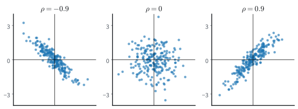

# Random Variables
:label:`sec_mdl-random_variables`

The probability of :numref:`sec_prob` was built by counting. A die has six faces, a label is
one of ten classes, and the probability of an event is the sum of the
probabilities of the outcomes in it. Most of the numbers a network works with
are not like that. A pixel intensity, a weight drawn at initialization, the
Gaussian noise that a diffusion model adds to an image: each can take any
value in an interval, and there are too many values to list one by one. What
is the probability of a single one of them?

Think of a dart thrown at a round board so carelessly that it is equally
likely to land anywhere on the board, and suppose it comes to rest at half the
radius from the center. Asked how likely that was, we would round the
distance, say to between 0.45 and 0.55 radii, which happens about one time in
ten. Asking for one more digit makes the answer ten times smaller, and another
digit makes it ten times smaller again. With all the digits the probability is
zero, and yet the dart landed somewhere.

The way out is to stop asking for the probability of a point and to ask how
fast probability accumulates near it. Each time we narrow the interval tenfold,
its probability falls tenfold, so the ratio of probability to width stays
fixed. This probability per unit length is the *density*. With it, every tool
of discrete probability carries over to quantities that vary continuously,
with sums replaced by integrals.

Part of what follows is :numref:`sec_prob` again, now with proofs and with
densities: the mean, the variance, covariance and correlation were motivated
there, and we do not motivate them a second time. New for one variable are
the density itself, a sampler built from the cumulative distribution
function, the inequalities of Markov and Chebyshev, and a density whose tails
are so heavy that both fail. The two results to remember are that the density
is the derivative of the cumulative distribution function
:eqref:`eq_mdl-cdf_deriv` and Markov's inequality :eqref:`eq_mdl-markov`,
from which the other tail bounds of this chapter descend. The second half of
the section treats several variables and transformations. We follow the dart
throughout.

```{.python .input #random-variables-imports}
#@tab mxnet
import math
import numpy as np
from mxnet import autograd, gluon, init, np as mnp, npx
from mxnet.gluon import nn
from d2l import mxnet as d2l
npx.set_np()
```

```{.python .input #random-variables-imports}
#@tab pytorch
import math
import numpy as np
import torch
from torch import nn
from torch.nn import functional as F
from d2l import torch as d2l
```

```{.python .input #random-variables-imports}
#@tab tensorflow
import math
import numpy as np
import tensorflow as tf
from d2l import tensorflow as d2l
```

```{.python .input #random-variables-imports}
#@tab jax
import math
import numpy as np
import jax
from jax import numpy as jnp
from flax import nnx
import optax
from d2l import jax as d2l
```

## Densities

### From Bins to a Density

To make "probability per unit length" precise, we first need the probability
that the dart lands within a given range of distances. Let $R$ be the dart's
distance from the center of a board of radius $1$. The dart lands within
distance $r$ of the center when it lands in the disk of radius $r$. Since every
part of the board is equally likely, the probability is that disk's share of
the board's area:

$$
P(R\le r)=\frac{\pi r^2}{\pi}=r^2,\qquad 0\le r\le 1.
$$

Half the radius holds only a quarter of the probability, because it holds only
a quarter of the area. A bin of width $\epsilon$ centered at $0.5$ has
probability $(0.5+\epsilon/2)^2-(0.5-\epsilon/2)^2=\epsilon$, which gives the
numbers of the opening:

| bin | width $\epsilon$ | probability | probability $/\ \epsilon$ |
|:--|--:|--:|--:|
| $[0.45, 0.55]$ | $0.1$ | $0.1$ | $1$ |
| $[0.495, 0.505]$ | $0.01$ | $0.01$ | $1$ |
| $[0.4995, 0.5005]$ | $0.001$ | $0.001$ | $1$ |

Each tenfold narrowing divides the probability by ten, and the ratio does not
move. The value at which the ratio settles is the quantity we name. The
*probability density* of a random variable $X$ at $x$ is the probability per
unit length near $x$,

$$
p(x)=\lim_{\epsilon\downarrow0}\frac{P(x\le X<x+\epsilon)}{\epsilon},
$$

wherever this limit exists. Equivalently, the probability of a short interval
is its length times the density,

$$P(x\leq X<x+\epsilon)\approx\epsilon\, p(x),$$
:eqlabel:`eq_mdl-pdf_def`

with an error that shrinks faster than $\epsilon$. This describes the density
one point at a time, which is all we need for the moment. The definition
proper speaks of intervals and follows in the next subsection. For the dart
at a distance $r$ in $(0,1)$, the interval $[r,r+\epsilon)$ has probability
$(r+\epsilon)^2-r^2=2r\epsilon+\epsilon^2$. The ratio to the width is
$2r+\epsilon$, and letting $\epsilon\to0$,

$$p(r)=2r,\qquad 0\le r\le 1.$$

The density of the distance grows linearly from the center to the rim, as the
circumference of the circle at radius $r$ does. At $r=0.5$ the density is $1$,
the ratio of the table.

A density is not a probability. The dart's density at $r=0.9$ is $1.8$, and a
variable that is equally likely to land anywhere in $[0,0.1]$ has density $10$
there, since it puts probability $1$ on an interval of length $0.1$. A density
can take any non-negative value, but it can exceed $10$ only on a set of total
length less than $1/10$, or the probability of that set would exceed one. A
density is a rate, like a speed. A speed tells how fast distance accumulates,
not how far the car has gone. In the same way, the dart's density of $1.8$ at
$r=0.9$ tells how fast probability accumulates as $r$ grows past $0.9$, not
how much probability sits at $0.9$.

A point has no length, so it has no probability. For every $\epsilon>0$ the
point $x$ lies in $[x,x+\epsilon)$, so $P(X=x)$ is at most about
$\epsilon\,p(x)$, which goes to zero with $\epsilon$. So, for a variable with
a density,

$$P(X=x)=0\qquad\textrm{for every } x.$$

This resolves the dart's puzzle: the dart lands at distance $0.5$ with
probability zero, as it does at every other given distance, and yet it lands
somewhere. Probability zero does not mean impossible.

A point that carries positive probability is called an *atom*. A variable with a density has no
atoms, a discrete variable such as a die roll has only atoms, and some
variables have both. The output of a ReLU unit whose input is standard normal
is $0$ with probability $\tfrac12$, an atom, and spreads the other half over
$(0,\infty)$ with a density (Exercise :exref:`ex_mdl-random-variables-rectified-gaussian`
works it out).

The table came from the area formula. A simulation needs no formula. A
computer throws darts uniformly at the board by throwing them uniformly at the
square $[-1,1]^2$ around it and keeping those that land on the board, which
leaves every part of the board equally likely. We count the fraction of darts
in each of the three bins of the table and divide by the bin's width.

```{.python .input #random-variables-density-to-probability}
rng = np.random.default_rng()
xy = rng.uniform(-1, 1, size=(4 * 10**6, 2))           # darts on the square
on_board = (xy**2).sum(axis=1) <= 1                    # keep those on the board
r_dart = np.linalg.norm(xy[on_board], axis=1)          # distances R
for width in [0.1, 0.01, 0.001]:
    prob = np.mean(np.abs(r_dart - 0.5) <= width / 2)  # fraction in the bin
    print(f'width {width:<5}  probability {prob:.5f}  ratio {prob / width:.3f}')
```

The fraction falls tenfold with each tenfold narrowing, and the ratio stays
near $1=p(0.5)$. What the table could not show is how noisy a narrow bin is.
About $3.1$ million of the four million darts land on the board, and only
about $3{,}000$ of those fall in a bin of width $0.001$, so the last ratio
wobbles by a few percent from run to run.

### Probability as Area

The density was read off from the probabilities of short intervals. We now go
back the other way: given a density, what is the probability of a long
interval? Cut the real line into pieces $[\epsilon i,\epsilon(i+1))$ of width
$\epsilon$. By :eqref:`eq_mdl-pdf_def`, each piece has probability about
$\epsilon\,p(\epsilon i)$, and the probabilities of disjoint pieces add. A sum
of widths times heights is a Riemann sum, and as the width shrinks it tends to
the area under the curve, the integral (:numref:`sec_mdl-integral_calculus`).
Since $X$ takes some value, all pieces together have probability one:

$$
1=P(X\in\mathbb{R})\approx\sum_i \epsilon\, p(\epsilon i)
\;\xrightarrow[\epsilon\to0]{}\; \int_{-\infty}^{\infty} p(x)\,dx .
$$

Summing only the pieces between $a$ and $b$ suggests that the probability of
an interval is the area under the density above it. The argument is a
motivation and not a proof: there are about $1/\epsilon$ pieces, and their
errors, each small compared with $\epsilon$, add up to something small only if
they are small uniformly in $x$. We therefore turn the conclusion into the
definition.

**Definition.** A random variable $X$ *has the density* $p$ when $p\ge0$ and,
for all $a<b$,

$$P(X\in(a, b]) = \int_{a}^{b} p(x)\,dx.$$
:eqlabel:`eq_mdl-pdf_int_int`

Letting $a\to-\infty$ and $b\to\infty$ shows that the total area under a
density is one. These two properties, $p\ge0$ and total area $1$, are all
that a function needs in order to be a density.
:numref:`fig_mdl-prob-pdf-area` shows the definition for a density with two
bumps. The dart passes the test: for $0\le a<b\le1$ the integral
$\int_a^b 2r\,dr=b^2-a^2$ is the probability $P(a<R\le b)$ that the areas
gave, so $2r$ is its density in this sense too. The probability of landing in
the outer half of the radius is $\int_{0.5}^1 2r\,dr=1-0.25=0.75$. Three
quarters of the board lies more than half the radius from the center.


:label:`fig_mdl-prob-pdf-area`

### The Cumulative Distribution Function

Often we want a function whose values are probabilities, and one that also
describes variables without a density, such as a die roll. The *cumulative
distribution function* (c.d.f.) of $X$ is the probability that $X$ lands at or below $x$; when $X$ has a
density, it is the area under the density to the left of $x$:

$$
F(x) = P(X \le x) = \int_{-\infty}^{x} p(t)\,dt.
$$
:eqlabel:`eq_mdl-cdf_def`

So $F$ accumulates probability from left to right. It rises from $0$ as
$x\to-\infty$ to $1$ as $x\to\infty$. It never decreases, because the
non-negative $p$ only adds area, and when $X$ has a density it is continuous.
For the dart we have already computed it: $F(r)=0$ for $r<0$, $F(r)=r^2$ for
$0\le r\le1$, and $F(r)=1$ for $r>1$. It is the function we started from, and
the density $2r$ came from it.

The c.d.f. is defined for every random variable. A fair coin that reports $0$
or $1$ has

$$
F(x) = \begin{cases}
0 & x < 0, \\
\tfrac12 & 0 \le x < 1, \\
1 & x \ge 1,
\end{cases}
$$

a *staircase* that jumps by the probability of each atom. Since $F(x)=P(X\le
x)$ includes the atom at $x$ itself, $F$ takes the upper value at each jump.
In general every c.d.f. is *right-continuous*, $\lim_{y\downarrow x}F(y)=F(x)$.
A variable with both kinds of probability has both features: the ReLU output
above has a c.d.f. that is $0$ for $x<0$, jumps to $\tfrac12$ at $0$, and then
rises smoothly to $1$. One function describes all three kinds of variable.

When a density exists, the c.d.f. and the density carry the same information.
Going from $p$ to $F$ is integration; going back is differentiation. This is
where the limit of the bins returns, now as a theorem.

**Proposition (density is the derivative of the c.d.f.).** *If $X$ has a
density $p$ that is continuous at $x$, then $F$ is differentiable at $x$ and*

$$
F'(x) = p(x).
$$
:eqlabel:`eq_mdl-cdf_deriv`

*In particular, the probability per unit length
$P(x\le X<x+\epsilon)/\epsilon$ tends to $p(x)$ as $\epsilon\downarrow0$.*

**Proof.** By :eqref:`eq_mdl-cdf_def`, $F$ is the area-so-far function of $p$.
The fundamental theorem of calculus says that the derivative of an area-so-far
function is the integrand, at every point where the integrand is continuous
(:numref:`sec_mdl-integral_calculus`). For the second statement, the point $x$
has probability at most $\int_{x-\delta}^{x}p(t)\,dt$ for every $\delta>0$,
and these integrals tend to zero with $\delta$. Including or excluding an
endpoint therefore changes nothing,
$P(x\le X<x+\epsilon)=F(x+\epsilon)-F(x)$, and the ratio is a difference
quotient of $F$. $\blacksquare$

For the dart, $F'(r)=2r$ on $(0,1)$ is the density we found from the bins.
:numref:`fig_mdl-prob-pdf-cdf` puts the two functions side by side: the shaded
area $\int_a^b p$ on the left equals the rise $F(b)-F(a)$ on the right.


:label:`fig_mdl-prob-pdf-cdf`

### Quantiles and Inverse-Transform Sampling

A computer has a source of random numbers that are equally likely to fall
anywhere between $0$ and $1$. To simulate the dart, or any other density, we
need to turn these numbers into samples with the right distribution.

The source is the simplest density of all. A variable $U$ is *uniform on
$[0,1]$* when its density is $1$ on $[0,1]$ and $0$ elsewhere. Every
subinterval of $[0,1]$ then has probability equal to its length, and the c.d.f.
is $F_U(u)=u$ for $0\le u\le1$.

The c.d.f. maps a value to a probability. Going back, from a probability level
$u$ to the value below which that fraction of the probability lies, gives the
*quantile function*. When $F$ is continuous, and strictly increasing on the
interval $I$ where $0<F<1$, it maps $I$ one-to-one onto $(0,1)$, and its
inverse $F^{-1}:(0,1)\to I$ is the quantile function. Its values at
$u=0.25,0.5,0.75$ are the *quartiles*, and the middle one is the *median*. For
the dart, $F(r)=r^2$ gives $F^{-1}(u)=\sqrt u$, with quartiles $0.5$, $0.707$
and $0.866$. The median dart lands at $0.707$, farther out than half the
radius, because three quarters of the board lies beyond $0.5$.

The quantile function is also a sampler.

**Proposition (inverse-transform sampling).** *Let $F$ be a continuous c.d.f.
that is strictly increasing on the interval $I$ where $0<F<1$, and let
$U$ be uniform on $[0,1]$. Then $X=F^{-1}(U)$ has c.d.f. $F$.*

**Proof.** With probability one, $U$ lies in $(0,1)$, so $X$ is defined and
lies in $I$. For $x$ in $I$, the events $F^{-1}(U)\le x$ and $U\le F(x)$
coincide, because $F$ is increasing on $I$. The uniform gives the second event
probability $F(x)$, the length of $[0,F(x)]$:

$$
P\bigl(F^{-1}(U)\le x\bigr) = P\bigl(U\le F(x)\bigr) = F(x).
$$

For $x$ to the left of $I$, $F(x)=0$ and $X>x$ always; for $x$ to the right of
$I$, $F(x)=1$ and $X\le x$ always. $\blacksquare$

The hypothesis allows a c.d.f. that is flat outside an interval, as the
dart's is ($F=0$ for $r<0$ and $F=1$ for $r>1$). The *generalized inverse*
$F^{-}(u)=\min\{x:F(x)\ge u\}$ needs no hypothesis at all and samples
staircases too (Exercise :exref:`ex_mdl-random-variables-staircase-sampling`).

For the dart, $R=\sqrt U$. The tempting shortcut $R=U$ is wrong, and we can
say by how much before running anything: it puts half of the darts within
$r<0.5$, where only a quarter belong.
:numref:`fig_mdl-prob-inverse-transform` shows the construction for the
two-bump density. Where the density is high, the c.d.f. is steep, so an even
spread of levels lands in a narrow range of values.


:label:`fig_mdl-prob-inverse-transform`

We now have two ways to produce the dart's distance, the darts thrown at the
board above and the samples $\sqrt U$. The cell compares them, with the
shortcut alongside.

```{.python .input #mdl-random-variables-quantiles-and-inverse-transform-sampling}
u = rng.uniform(size=10**6)
r = np.sqrt(u)                                         # R = F^{-1}(U)
print(f'P(R < 0.5): darts {np.mean(r_dart < 0.5):.3f}, sqrt(U) '
      f'{np.mean(r < 0.5):.3f}, naive U {np.mean(u < 0.5):.3f}')
print(f'mean distance: darts {r_dart.mean():.3f}, sqrt(U) {r.mean():.3f}')
```

The two agree. Both put a quarter of their distances below $0.5$, and both
have a mean distance close to $0.667$, a value the next subsection derives.
The shortcut puts half of its distances there: it spreads distances evenly,
whereas the board has more area far from the center.

## Mean and Variance

A density describes the whole distribution, but two numbers often say enough:
where the distribution is centered, and how far it spreads.
:numref:`sec_prob` introduced both for discrete variables and said why we
want them. Here we extend them to densities and prove their algebra.

### The Mean

The mean is the average of the values of $X$, each weighted by its
probability. For a variable with a density, slice the line into bins of width $\epsilon$ as before: the bin at $\epsilon
i$ contributes its value $\epsilon i$ times its probability, about $\epsilon\,
p(\epsilon i)$, and the sum tends to an integral. The *mean*, or *expectation*,
of $X$ is

$$
\mu_X=\mathbb{E}[X]=\sum_i x_i\,p_i\quad\textrm{(discrete)},\qquad
\mu_X=\mathbb{E}[X]=\int_{-\infty}^{\infty} x\,p(x)\,dx\quad\textrm{(density)}.
$$
:eqlabel:`eq_mdl-exp_def`

As in the discrete case, the mean is a balance point: a rod with mass density
$p$ along its length balances at $\mu_X$. The definition requires $\sum_i|x_i|\,p_i<\infty$ in the discrete case and
$\int|x|\,p(x)\,dx<\infty$ for a density. Otherwise the mean does not exist,
and below we meet a density for which it fails. The same weighting averages
any function of $X$,

$$
\mathbb{E}[g(X)]=\sum_i g(x_i)\,p_i,\qquad
\mathbb{E}[g(X)]=\int_{-\infty}^{\infty} g(x)\,p(x)\,dx,
$$

again provided the sum or integral of $|g|$ is finite. We weight the values of
$g$ by the probabilities of $X$, without first working out the distribution of
the new variable $g(X)$. The rule is called the *law of the unconscious
statistician*, because it is easy to use without noticing that it is a
theorem rather than the definition of $\mathbb{E}[g(X)]$. In general
$\mathbb{E}[g(X)]$ differs from $g(\mathbb{E}[X])$; for convex $g$, Jensen's
inequality (:numref:`subsec_mdl-jensen`) says which of the two is larger.

For the dart,

$$
\mathbb{E}[R]=\int_0^1 r\cdot 2r\,dr=\tfrac23 .
$$

The mean distance is $0.667$, not $0.5$: the board has more area far from the
center than near it. The mean lies a little below the median $0.707$, because
the few darts near the center pull the average down more than they move the
median.

The rule we use most often is that the mean is linear. :numref:`sec_prob` used
it; here we prove it.

**Proposition (linearity of expectation).** *For random variables $X,Y$ whose
means exist and constants $c,d$,*

$$
\mathbb{E}[cX+d]=c\,\mathbb{E}[X]+d,
\qquad
\mathbb{E}[X+Y]=\mathbb{E}[X]+\mathbb{E}[Y].
$$
:eqlabel:`eq_mdl-exp_linear`

**Proof.** Both follow from the linearity of the sum (or integral) that defines
the mean. For the first,
$\mathbb{E}[cX+d]=\sum_i(cx_i+d)p_i = c\sum_i x_i p_i + d\sum_i p_i =
c\,\mathbb{E}[X]+d$, using $\sum_i p_i=1$. For the second, let $p_{ij}$ be
the probability that $(X,Y)=(x_i,y_j)$, the joint distribution of the pair as
in :numref:`sec_prob`. Split the sum and recognize the marginals
$\sum_j p_{ij}=P(X=x_i)$ and $\sum_i p_{ij}=P(Y=y_j)$:

$$
\mathbb{E}[X+Y]=\sum_{i,j}(x_i+y_j)\,p_{ij}
=\sum_{i,j} x_i\,p_{ij} + \sum_{i,j} y_j\,p_{ij} = \mathbb{E}[X]+\mathbb{E}[Y].
$$

For densities the same computation runs with integrals over a joint density,
the continuous counterpart of $p_{ij}$, which we define when we come to
several variables. $\blacksquare$

The second identity needs no independence: the mean of a sum is the sum of the
means however strongly $X$ and $Y$ depend on each other. The average loss over
a dataset is a sum of this kind.

### Variance and Standard Deviation

The mean says nothing about spread. As in :numref:`sec_prob`, we measure
spread by the average squared distance from the mean, the *variance*

$$\sigma_X^2 = \textrm{Var}(X) = \mathbb{E}\bigl[(X-\mu_X)^2\bigr],$$
:eqlabel:`eq_mdl-var_def`

which is defined when $\mathbb{E}[X^2]<\infty$. Expanding the square and
applying linearity :eqref:`eq_mdl-exp_linear`, with $\mu_X$ treated as the
constant it is, gives the form that is usually easier to compute, the mean
square minus the square of the mean:

$$
\textrm{Var}(X)
 = \mathbb{E}\bigl[X^2 - 2\mu_X X + \mu_X^2\bigr]
 = \mathbb{E}[X^2] - 2\mu_X\,\mathbb{E}[X] + \mu_X^2
 = \mathbb{E}[X^2] - \mu_X^2.
$$
:eqlabel:`eq_mdl-var_comp`

For a variable with a density, the mean and the variance are therefore the two
integrals

$$
\mu_X = \int_{-\infty}^\infty x\,p(x)\,dx,
\qquad
\sigma^2_X = \int_{-\infty}^\infty x^2 p(x)\,dx - \mu_X^2 .
$$
:eqlabel:`eq_mdl-cont_mean_var`

For the dart, $\mathbb{E}[R^2]=\int_0^1 r^2\cdot2r\,dr=\tfrac12$, so
$\textrm{Var}(R)=\tfrac12-\tfrac49=\tfrac1{18}\approx0.056$. For the uniform
$U$ on $[0,1]$, $\mu_U=\int_0^1 u\,du=\tfrac12$ and
$\textrm{Var}(U)=\tfrac13-\tfrac14=\tfrac1{12}$.

Rescaling units and centering data are affine maps. Under them the shift drops
out of the variance and the scale comes out squared. By linearity the mean
maps as $\mu_{cX+d}=c\mu_X+d$, so the deviation is
$(cX+d)-\mu_{cX+d}=c(X-\mu_X)$, and squaring and taking the mean gives

$$
\textrm{Var}(cX+d) = c^2\,\textrm{Var}(X).
$$
:eqlabel:`eq_mdl-var_affine`

Two further facts complete the list. A variance is never negative, and it is
zero if and only if $X$ is constant with probability one: the mean of the
non-negative variable $(X-\mu_X)^2$ is zero only if that variable is zero with
probability one. And variances of independent variables add
(:numref:`sec_prob`); :numref:`subsec_mdl-covariance` proves this together
with the term that replaces independence.

The variance carries the square of the units of $X$, dollars squared for a
profit in dollars. Its square root, the *standard deviation*

$$
\sigma_X = \sqrt{\textrm{Var}(X)},
$$
:eqlabel:`eq_mdl-std_def`

has the units of $X$ again, and $\sigma_{cX+d}=|c|\,\sigma_X$. For the dart,
$\sigma_R=\sqrt{1/18}\approx0.236$ in units of the board's radius.

### Markov's and Chebyshev's Inequalities

The standard deviation suggests a scale for typical deviations from the mean.
How much probability can lie far out, if all we know is the mean, or the
mean and the variance? Two inequalities answer this for every distribution at
once. The first uses only the mean, and applies to variables that are never
negative. Its proof is one line, and nearly every tail bound in this chapter
is obtained by applying it to a well-chosen function of the variable.

**Proposition (Markov's inequality).** *If $X\ge 0$ has a mean and $t>0$,
then*

$$
P(X \ge t) \le \frac{\mathbb{E}[X]}{t}.
$$
:eqlabel:`eq_mdl-markov`

**Proof.** Let $\mathbf{1}_{X\ge t}$ be the indicator variable that is $1$ when
$X\ge t$ and $0$ otherwise. Then $X \ge t\,\mathbf{1}_{X\ge t}$ for every
outcome: when $X\ge t$ the right-hand side is $t\le X$, and otherwise it is
$0\le X$. Taking means of both sides and using
$\mathbb{E}[\mathbf{1}_{X\ge t}]=P(X\ge t)$ gives
$\mathbb{E}[X]\ge t\,P(X\ge t)$. $\blacksquare$

Geometrically, on $[0,\infty)$ the step function that is $0$ below $t$ and $t$
from $t$ on lies under the line $y=x$, so its mean, $t\,P(X\ge t)$, lies under
the mean of $X$. With $t$ ten times the mean, at most a tenth of any
non-negative population exceeds ten times its average, whether it is incomes,
file sizes or gradient norms.

Markov's inequality uses only the mean, so it is crude. Applied to the squared
deviation $(X-\mu_X)^2$, whose mean is the variance, it bounds both tails at
once. The result is due to Bienaymé and to Chebyshev :cite:`Chebyshev.1867`.

**Proposition (Chebyshev's inequality).** *For any $X$ with finite, nonzero
variance and any $\alpha>0$,*

$$P\bigl(|X - \mu_X| \ge \alpha\sigma_X\bigr) \le \frac{1}{\alpha^2}.$$
:eqlabel:`eq_mdl-chebyshev`

**Proof.** The variable $Z=(X-\mu_X)^2$ is non-negative with mean
$\textrm{Var}(X)=\sigma_X^2$, and the event $|X-\mu_X|\ge\alpha\sigma_X$ is the
event $Z\ge\alpha^2\sigma_X^2$. Since $\sigma_X>0$, the threshold
$t=\alpha^2\sigma_X^2$ is positive, and Markov's inequality
:eqref:`eq_mdl-markov` gives
$P(|X-\mu_X|\ge\alpha\sigma_X) \le \sigma_X^2/(\alpha^2\sigma_X^2) = 1/\alpha^2$.
$\blacksquare$

So at most $1\%$ of any distribution lies ten or more standard deviations
from its mean. The same argument with a threshold $\epsilon>0$ in place of
$\alpha\sigma_X$ gives a form that needs only a finite variance and also
covers $\sigma_X=0$:

$$
P\bigl(|X-\mu_X| \ge \epsilon\bigr) \le \frac{\textrm{Var}(X)}{\epsilon^2}.
$$

For the dart, $\mu_R=0.667$ and $\sigma_R=0.236$. Two standard deviations below
the mean is $0.195$, and two above is beyond the board, so
$P(|R-\mu_R|\ge2\sigma_R)=P(R\le0.195)=0.195^2\approx0.038$, far below the bound
$\tfrac14$.

Can a bound that holds for every distribution be improved? Not without
further assumptions, and a distribution on three points shows it. Let $X$ take
the values $a-2$ and $a+2$ with probability $q$ each, and $a$ with probability
$1-2q$, where $0<q\le\tfrac12$. We call it the *three-atom example*. By
symmetry its mean is $a$, and
$\textrm{Var}(X)=\mathbb{E}[(X-a)^2]=4q+4q=8q$, so $\sigma_X=2\sqrt{2q}$. Take
$\alpha=2$. The threshold $2\sigma_X=4\sqrt{2q}$ shrinks as $q$ does, while
the outer atoms stay at distance $2$.
:numref:`fig_mdl-prob-chebyshev` shows the three regimes. For $q>\tfrac18$ the
threshold exceeds $2$, no atom lies that far out, and the probability of the
event is $0$. At $q=\tfrac18$ the threshold equals $2$, so $\sigma_X=1$ and
$a\pm2$ lie two standard deviations from the mean. Both outer atoms count, the
probability is $2q=\tfrac14$, and the bound holds with equality. For
$q<\tfrac18$ both atoms lie beyond the threshold, and their total mass $2q$ is
below $\tfrac14$.


:label:`fig_mdl-prob-chebyshev`

The same example settles every $\alpha\ge1$. Choose $q=1/(2\alpha^2)$, which is
at most $\tfrac12$. Then $\sigma_X=2\sqrt{2q}=2/\alpha$, the threshold
$\alpha\sigma_X=2$ lands on the outer atoms, and
$P(|X-a|\ge\alpha\sigma_X)=2q=1/\alpha^2$. Equality holds, so no constant
smaller than $1/\alpha^2$ works for every distribution. For $\alpha<1$ the
bound exceeds $1$ and says nothing.

Chebyshev's bound is the worst case over all distributions with a given
variance. For the distributions we usually meet it is loose. A Gaussian with
mean $\mu$ and standard deviation $\sigma$, the bell curve with density
$e^{-(x-\mu)^2/(2\sigma^2)}/(\sigma\sqrt{2\pi})$ that
:numref:`subsec_mdl-gaussian-clt` treats in full, puts much less probability
beyond two and three standard deviations than the bound allows:

| distance from the mean | Chebyshev's bound | Gaussian |
|:--|--:|--:|
| $2\sigma$ or more | $25\%$ | $4.6\%$ |
| $3\sigma$ or more | $11\%$ | $0.27\%$ |

The worst case puts all of its tail probability at a single distance, as the
three-atom example does. Typical distributions spread their tails out and thin
them quickly.

### Heavy Tails

Chebyshev's inequality needs a finite variance, and the mean needs
$\int|x|\,p(x)\,dx<\infty$. Both can fail for a density that looks harmless.
The *Cauchy distribution* has the bell-shaped density

$$
p(x)=\frac{1}{\pi(1+x^2)} .
$$

It is a density, since $\int_{-\infty}^\infty\frac{dx}{1+x^2}=[\arctan
x]_{-\infty}^{\infty}=\pi$. Unlike a Gaussian, whose tails fall off like
$e^{-x^2/2}$, its tails fall off only like $1/(\pi x^2)$. The second moment
fails first. Over the range $[-L,L]$,

$$
\int_{-L}^{L} x^2 p(x)\,dx=\frac{2}{\pi}\bigl(L-\arctan L\bigr),
$$

which is $5.43$, $62.7$ and $636$ at $L=10$, $100$ and $1000$ and grows
without bound, because the integrand $x^2/(\pi(1+x^2))$ tends to $1/\pi$. So
$\mathbb{E}[X^2]=\infty$, and the Cauchy distribution has no finite variance.

The mean fails in a subtler way. The integrand $x\,p(x)$ is odd, which tempts
us to declare the mean $0$ by symmetry, and indeed $\int_{-L}^{L}x\,p(x)\,dx=0$
for every $L$. But the definition requires absolute convergence, and

$$
\int_{-L}^{L}|x|\,p(x)\,dx=\frac1\pi\log(1+L^2)
$$

grows without bound. So the mean does not exist. Without absolute convergence
the answer depends on how the limits are taken: over the lopsided range
$[-L,2L]$,

$$
\int_{-L}^{2L}x\,p(x)\,dx=\frac{1}{2\pi}\log\frac{1+4L^2}{1+L^2}
\;\xrightarrow[L\to\infty]{}\;\frac{\log 2}{\pi}\approx0.221 .
$$

With no mean to converge to, what does an average of Cauchy draws do? One
might still hope that an average of $1000$ draws lies closer to $0$ than a
single draw, which lies farther than $1$ from $0$ with probability
$P(|X|>1)=1-\tfrac2\pi\arctan1=\tfrac12$. The cell plots the running mean of
$10^5$ Cauchy draws next to that of $10^5$ standard Gaussian draws, and then
counts how many of $1000$ such averages lie farther than $1$ from $0$.

```{.python .input #random-variables-cauchy-diverges}
n = 10**5
idx = np.unique(np.logspace(0, 5, 500).astype(int)) - 1  # log-spaced n
running_mean = lambda x: (np.cumsum(x) / np.arange(1, n + 1))[idx]
d2l.plot(idx + 1, [running_mean(rng.standard_normal(n)),
                   running_mean(rng.standard_cauchy(n))],
         'n', 'running mean', legend=['Gaussian', 'Cauchy'],
         xscale='log', ylim=[-4, 4], figsize=(5, 3))
averages = rng.standard_cauchy((1000, 1000)).mean(axis=1)
print(f'averages of 1000 Cauchy draws with |average| > 1: '
      f'{np.mean(np.abs(averages) > 1):.2f}')
```

The Gaussian running mean settles near $0$. The Cauchy running mean does not
settle: it moves in jumps, each caused by a single huge draw, and a jump of
order one can come at any $n$. Averaging did not help at all. About half of
the averages of $1000$ draws lie farther than $1$ from $0$, the same fraction
as for single draws. In fact the average of $n$ independent Cauchy draws is
again a standard Cauchy variable, a fact we state without proof.

A distribution is called *heavy-tailed* when its tails decay more slowly than
every exponential $e^{-\lambda t}$ with $\lambda>0$. Power-law tails, with
$P(|X|>t)$ decaying like $t^{-\alpha}$, are the standard example: they make
every moment $\mathbb{E}[|X|^k]$ with $k\ge\alpha$ infinite, and the Cauchy
has $\alpha=1$. A heavy tail does not require infinite moments, though. The
log-normal distribution of :numref:`subsec_mdl-change-of-variables` is
heavy-tailed, yet all of its moments are finite. Heavy tails matter in deep
learning because averages over them converge slowly or not at all. The noise in minibatch gradients, for
example, has been argued to be heavy-tailed
:cite:`Simsekli.Sagun.Gurbuzbalaban.2019`, a claim that
Exercise :exref:`ex_mdl-random-variables-heavy-tail-averages` tests.

<!-- split: new section "Joint Distributions and Transformations" starts here -->

## Several Variables

Take a dart that is equally likely to land anywhere on a round board of radius
$1$, so that its distance $R$ from the center has the density $2r$. Its
position has two coordinates, a horizontal $X$ and a vertical $Y$, and an
image has thousands of pixels whose values depend on each other. We need
densities for several variables at once: marginals, conditionals, a measure
of how strongly two variables move together, and the rule for how a density
changes when the variables are transformed. Three results carry most of the
weight later in the book: the law of total variance :eqref:`eq_mdl-tower`,
the conditional mean as the best squared-error predictor
:eqref:`eq_mdl-best_predictor`, and the change of variables
:eqref:`eq_mdl-cov_density`. The covariance matrix and the remark that a
correlation is a cosine can be skipped on a first reading.

### Joint and Marginal Densities

The density extends to two variables with small squares in place of short
intervals. The *joint density* $p_{X,Y}$ of a pair $(X,Y)$ is probability per
unit area: a small square of side $\epsilon$ at $(x,y)$ has probability about
its area times the density,

$$
P\bigl(X\in[x,x+\epsilon],\ Y\in[y,y+\epsilon]\bigr)\approx\epsilon^2\,p_{X,Y}(x,y).
$$

As for one variable, slicing a region into such squares leads to the property
that we take as the definition: $p_{X,Y}\ge0$, and
$P((X,Y)\in\mathcal{D})=\iint_{\mathcal{D}} p_{X,Y}(x,y)\,dx\,dy$ for a
region $\mathcal D$ of the plane, so that the total volume under the joint
density is one. For $n$ variables the same holds with $n$-dimensional boxes.

The dart's position has the joint density $p_{X,Y}(x,y)=1/\pi$ on the unit
disk and $0$ outside, since every part of the board is equally likely and the
board has area $\pi$. Although it is constant on the disk, it is not a function
of $x$ times a function of $y$: the edge of the board ties the two coordinates
together.

Often we hold a joint density but want the distribution of one coordinate
alone, its *marginal distribution*. A thin vertical strip $X\in[x,x+\epsilon]$
has probability about $\epsilon\,p_X(x)$. Slicing the strip into squares in
$y$ and adding their probabilities,

$$
\epsilon\,p_X(x) \approx \sum_i P\bigl(X\in[x,x{+}\epsilon],\ Y\in[\epsilon i,\epsilon(i{+}1)]\bigr)
                 \approx \sum_i \epsilon^{2}\,p_{X,Y}(x,\epsilon i).
$$

Cancelling one $\epsilon$ and recognizing the remaining sum as a Riemann sum
in $y$,

$$
p_X(x) = \int_{-\infty}^\infty p_{X, Y}(x, y)\,dy.
$$
:eqlabel:`eq_mdl-marginal`

The marginal density at $x$ is the joint density integrated up the vertical
strip at $x$, as in :numref:`fig_mdl-prob-marginal`. We *integrate out* the
variable we do not care about. For the dart, the strip at $x$ crosses the board
from $-\sqrt{1-x^2}$ to $\sqrt{1-x^2}$, so

$$
p_X(x)=\int_{-\sqrt{1-x^2}}^{\sqrt{1-x^2}}\frac1\pi\,dy=\frac2\pi\sqrt{1-x^2},
\qquad -1\le x\le 1,
$$

a semicircle. As a check, $\int_{-1}^1\sqrt{1-x^2}\,dx$ is the area of half
the unit disk, $\pi/2$, so the marginal integrates to $1$. The joint density is
flat, but the marginal is not: a strip through the middle of the board is
longer than one near the edge.


:label:`fig_mdl-prob-marginal`

### Conditional Densities and Independence

Once we learn that $Y=y$, how should the density of $X$ change? For discrete
variables the answer is $P(X=x\mid Y=y)=P(X=x,Y=y)/P(Y=y)$. With densities
this formula divides zero by zero, because $P(Y=y)=0$. The way out is the one
that defined the density. We condition on a thin horizontal strip
$Y\in[y,y+\epsilon]$, which has positive probability, and let the strip shrink.
By the square approximation and the one-variable rule,

$$
P\bigl(X\in[x,x+\epsilon]\bigm| Y\in[y,y+\epsilon]\bigr)
\approx\frac{\epsilon^2\,p_{X,Y}(x,y)}{\epsilon\,p_Y(y)}
=\epsilon\,\frac{p_{X,Y}(x,y)}{p_Y(y)}.
$$

Inside the strip, the probability of a short $x$-interval is its length times
$p_{X,Y}(x,y)/p_Y(y)$. This ratio is the probability per unit length of $X$
given $Y=y$, and we define the *conditional density*

$$
p_{X\mid Y}(x\mid y) = \frac{p_{X,Y}(x,y)}{p_Y(y)}, \qquad p_Y(y) > 0.
$$
:eqlabel:`eq_mdl-cond_density`

For each $y$ it is a density in $x$: it is non-negative, and by the marginal
rule :eqref:`eq_mdl-marginal` it integrates to $p_Y(y)/p_Y(y)=1$.
Geometrically, we cut the joint density along the line $Y=y$ and rescale the
profile to unit area. For the dart, the line $Y=y$ crosses the board on
$[-\sqrt{1-y^2},\sqrt{1-y^2}]$, and

$$
p_{X\mid Y}(x\mid y)=\frac{1/\pi}{(2/\pi)\sqrt{1-y^2}}=\frac{1}{2\sqrt{1-y^2}}
\qquad\textrm{for } |x|\le\sqrt{1-y^2}.
$$

Given $Y=y$, the horizontal position is uniform on the chord at height $y$. The
chord shrinks as $|y|$ grows, so learning $Y$ changes the distribution of $X$.

Rearranging :eqref:`eq_mdl-cond_density` gives the *chain rule*
$p_{X,Y}(x,y)=p_{X\mid Y}(x\mid y)\,p_Y(y)$. Writing it both ways,
$p_{X\mid Y}\,p_Y=p_{Y\mid X}\,p_X$, and solving for $p_{X\mid Y}$ gives
*Bayes' rule for densities*,

$$
p_{X\mid Y}(x\mid y) = \frac{p_{Y\mid X}(y\mid x)\,p_X(x)}{p_Y(y)}.
$$
:eqlabel:`eq_mdl-bayes_density`

It turns a model of how $Y$ arises from $X$ into a statement about $X$ after
seeing $Y$, as Bayes' theorem did for discrete variables in
:numref:`sec_prob`.

In the special case where learning $Y$ tells us nothing about $X$, that is,
$p_{X\mid Y}(x\mid y)=p_X(x)$ whenever $p_Y(y)>0$, the two variables are
called *independent*, written $X\perp Y$. By the chain rule this is the same
as saying that the joint density factorizes,
$p_{X,Y}(x,y)=p_X(x)\,p_Y(y)$ (up to sets of probability zero): multiply by
$p_Y(y)$ to go one way and divide by it to go the other.

Independence means that the conditional density of $X$ is the same function of
$x$, with the same location and the same shape, at every $y$. Take the joint
density $p_{X,Y}(x,y)=4xy$ on the unit square $[0,1]^2$. Its marginal is
$p_Y(y)=\int_0^1 4xy\,dx=2y$, so $p_{X\mid Y}(x\mid y)=4xy/(2y)=2x$, the same
for every $y$, and $X\perp Y$. The dart is the opposite case: its conditional
density is uniform at every $y$, but on a chord whose length depends on $y$.

:numref:`fig_mdl-prob-conditional-slice` shows that a common shape is not
enough. For a correlated pair, the conditional densities at three heights have
the same shape but different centers, so the pair is dependent; only when the
joint factorizes do the three coincide.


:label:`fig_mdl-prob-conditional-slice`

Independence also gives the density of a sum. The pair $(X,X+Y)$ has the joint
density $p_X(x)\,p_Y(s-x)$ at $(x,s)$, and integrating out $x$ as in
:eqref:`eq_mdl-marginal` leaves the *convolution*
$p_{X+Y}(s)=\int p_X(x)\,p_Y(s-x)\,dx$.

### Conditional Expectation
:label:`subsec_mdl-conditional-expectation`

A regression model predicts a target from an input. We keep the letters of the
previous subsection, so here the target is $X$ and the input, the variable we
observe, is $Y$; the main text writes the pair the other way round. Training
with the squared loss looks for the function $h$ that makes
$\mathbb{E}[(X-h(Y))^2]$ small. Which function is best? Within a thin strip $Y\approx y$ the model must
predict one number for a whole spread of targets. The number $c$ closest on
average, in squared distance, to a variable $X$ is its mean, since expanding
the square around $\mu_X$ gives
$\mathbb{E}[(X-c)^2]=\textrm{Var}(X)+(\mu_X-c)^2$. This suggests predicting
the average of $X$ within the strip. The *conditional expectation* of $X$
given $Y=y$ is the mean of the conditional density,

$$
\mathbb{E}[X\mid Y{=}y] = \int x\,p_{X\mid Y}(x\mid y)\,dx.
$$
:eqlabel:`eq_mdl-cond_exp`

It is the average of $X$ among the outcomes with $Y=y$. As $y$ varies it traces
a function of $y$; evaluated at the random $Y$, it becomes a random variable
$\mathbb{E}[X\mid Y]$ that depends on $Y$ alone. The same strip average defines
$\mathbb{E}[g(X,Y)\mid Y{=}y]=\int g(x,y)\,p_{X\mid Y}(x\mid y)\,dx$ for any
function $g$. A factor $h(Y)$ is constant within each strip, so it comes out of
the average:

$$
\mathbb{E}[h(Y)\,g(X,Y)\mid Y]=h(Y)\,\mathbb{E}[g(X,Y)\mid Y].
$$

The spread within a strip is the *conditional variance*
$\textrm{Var}(X\mid Y)=\mathbb{E}[X^2\mid Y]-(\mathbb{E}[X\mid Y])^2$, the
computational form :eqref:`eq_mdl-var_comp` applied within each strip.

Averaging the strip averages should give back the overall average, and the
overall spread should split into a spread within strips and a spread between
them. Both are true, and the second is the more useful.

**Proposition (laws of total expectation and variance).** *Let $X,Y$ have a
joint density, and let $X$ have finite variance (for discrete pairs, the same
identities hold with integrals replaced by sums). Then*

$$
\mathbb{E}[X] = \mathbb{E}\bigl[\mathbb{E}[X\mid Y]\bigr],
\qquad
\textrm{Var}(X) = \mathbb{E}\bigl[\textrm{Var}(X\mid Y)\bigr] + \textrm{Var}\bigl(\mathbb{E}[X\mid Y]\bigr).
$$
:eqlabel:`eq_mdl-tower`

**Proof.** For the first identity, the *tower property*, write out the inner
mean and use the chain rule $p_{X\mid Y}(x\mid y)\,p_Y(y)=p_{X,Y}(x,y)$ to
put the strips back together into the joint density:

$$
\mathbb{E}\bigl[\mathbb{E}[X\mid Y]\bigr]
 = \int\!\Bigl(\int x\,p_{X\mid Y}(x\mid y)\,dx\Bigr)p_Y(y)\,dy
 = \iint x\,p_{X,Y}(x,y)\,dx\,dy
 = \mathbb{E}[X].
$$

The values of $y$ with $p_Y(y)=0$, where the conditional density is undefined,
contribute to neither side: $Y$ lands there with probability zero. The same
computation with $g(x,y)$ in place of $x$ gives
$\mathbb{E}\bigl[\mathbb{E}[g(X,Y)\mid Y]\bigr]=\mathbb{E}[g(X,Y)]$. For the
second identity, expand both terms on the right. By the tower property applied
to $X^2$,

$$
\mathbb{E}\bigl[\textrm{Var}(X\mid Y)\bigr]
=\mathbb{E}\bigl[\mathbb{E}[X^2\mid Y]\bigr]-\mathbb{E}\bigl[(\mathbb{E}[X\mid Y])^2\bigr]
=\mathbb{E}[X^2]-\mathbb{E}\bigl[(\mathbb{E}[X\mid Y])^2\bigr].
$$

By the computational form :eqref:`eq_mdl-var_comp` applied to the variable
$\mathbb{E}[X\mid Y]$, whose mean is $\mathbb{E}[X]$ by the tower property,

$$
\textrm{Var}\bigl(\mathbb{E}[X\mid Y]\bigr)
=\mathbb{E}\bigl[(\mathbb{E}[X\mid Y])^2\bigr]-\mathbb{E}[X]^2 .
$$

Adding the two lines, the term $\mathbb{E}[(\mathbb{E}[X\mid Y])^2]$ cancels and
leaves $\mathbb{E}[X^2]-\mathbb{E}[X]^2=\textrm{Var}(X)$. $\blacksquare$

The second identity is sometimes called *Eve's law*, after the pattern E, V,
V, E of its right side. It splits the spread of $X$ into the average spread
within each strip, the part that knowing $Y$ cannot remove, and the spread of
the strip averages, the part that $Y$ explains. Statisticians use this split to
attribute the variation in data to groups, under the name analysis of variance.
The split also answers the regression question.

**Proposition (the conditional mean is the best squared-error predictor).**
*Let $X$ have finite variance, and let $h$ be any function with
$\mathbb{E}[h(Y)^2]<\infty$. Then*

$$
\mathbb{E}\bigl[(X-h(Y))^2\bigr]
=\mathbb{E}\bigl[\textrm{Var}(X\mid Y)\bigr]
+\mathbb{E}\bigl[(\mathbb{E}[X\mid Y]-h(Y))^2\bigr].
$$
:eqlabel:`eq_mdl-best_predictor`

**Proof.** Write $m(Y)=\mathbb{E}[X\mid Y]$ and split the error into two parts,
$X-h(Y)=(X-m(Y))+(m(Y)-h(Y))$. Squaring gives two squares and a cross term,
and the cross term is the only step that needs thought.
The mean of the first square is $\mathbb{E}[\textrm{Var}(X\mid Y)]$ by the tower
property. The cross term $2(X-m(Y))(m(Y)-h(Y))$ has conditional mean zero,
because the factor $m(Y)-h(Y)$ depends on $Y$ alone and comes out of the strip
average, leaving $\mathbb{E}[X-m(Y)\mid Y]=m(Y)-m(Y)=0$. By the tower property
its mean is zero too. $\blacksquare$

The first term does not depend on $h$, and the second is never negative and
vanishes for $h(Y)=\mathbb{E}[X\mid Y]$. So the conditional mean is the best
predictor in squared error, and no predictor can do better than the average
spread within the strips. A network trained with the squared loss is
estimating $\mathbb{E}[\textrm{target}\mid\textrm{input}]$, which is how
:numref:`sec_linear_regression` reads its model, there written
$\mathbb{E}[y\mid\mathbf x]$.

Two examples show the split with numbers. For the dart, predict $X$ from $Y$.
Given $Y=y$, $X$ is uniform on a chord symmetric about $0$, so
$\mathbb{E}[X\mid Y=y]=0$. A variable uniform on an interval of half-width $w$
has variance $w^2/3$, so $\textrm{Var}(X\mid Y=y)=(1-y^2)/3$. By symmetry
$\mathbb{E}[X^2]=\mathbb{E}[Y^2]=\tfrac12\mathbb{E}[R^2]=\tfrac14$, and Eve's
law gives

$$
\textrm{Var}(X)=\mathbb{E}\Bigl[\frac{1-Y^2}{3}\Bigr]+\textrm{Var}(0)
=\frac{1-1/4}{3}+0=\frac14 .
$$

All of the variance is unexplained. Knowing $Y$ narrows the range of $X$ but
never shifts its center, so the best predictor of $X$ from $Y$ is the constant
$0$, although $X$ and $Y$ are dependent.

For the second example, draw a label $Z$ that is $1$ with probability $0.2$
and $0$ with probability $0.8$. Given $Z=1$, draw $X$ from the normal
distribution $\mathcal N(3,1)$ with mean $3$ and variance $1$, and given $Z=0$
from $\mathcal N(-1,1)$. This mixture has the two-bump density of
:numref:`fig_mdl-prob-pdf-area`. Its mean is $0.2\cdot3+0.8\cdot(-1)=-0.2$.
Within each component the variance is $1$, so
$\mathbb{E}[\textrm{Var}(X\mid Z)]=1$. Between the components, $\mathbb{E}[X\mid
Z]$ takes the values $3$ and $-1$, whose variance is
$0.2\cdot0.8\cdot(3-(-1))^2=2.56$. The total variance is $3.56$, and the label
explains $2.56/3.56=72\%$ of it. In a sample of a million draws the two parts
will come out near $1$ and $2.56$. Should their sum match the variance of the
sample only as roughly as the parts match their targets, or exactly?

```{.python .input #mdl-random-variables-conditional-expectation}
n = 10**6
z = rng.uniform(size=n) < 0.2                          # component label Z
x = np.where(z, rng.normal(3, 1, n), rng.normal(-1, 1, n))
w = np.array([np.mean(~z), np.mean(z)])                # P(Z=0), P(Z=1)
cond_mean = np.array([x[~z].mean(), x[z].mean()])      # E[X | Z]
within = w @ np.array([x[~z].var(), x[z].var()])       # E[Var(X | Z)]
between = w @ (cond_mean - x.mean())**2                # Var(E[X | Z])
print(f'Var(X) {x.var():.3f} = within {within:.3f} + between {between:.3f}')
```

Exactly. The within and between parts are close to $1$ and $2.56$, with
sampling noise in the third decimal, but their sum equals the variance of the
sample in every run, up to rounding in the last printed digit. Eve's law
holds for the sample itself, with the group fractions and group variances in
place of the probabilities and conditional variances.

### Covariance
:label:`subsec_mdl-covariance`

The conditional mean describes how the average of $X$ moves with $Y$, which is
a whole function. Often a single number is enough: do $X$ and $Y$ tend to be
large together, or does one tend to be large when the other is small?
:numref:`sec_prob` answered with the *covariance*, the average product of the
two deviations. For discrete $X,Y$ taking $(x_i,y_j)$ with probability
$p_{ij}$ it is

$$\sigma_{XY} = \textrm{Cov}(X, Y) = \sum_{i, j} (x_i - \mu_X)(y_j-\mu_Y)\,p_{ij} = \mathbb{E}[XY] - \mathbb{E}[X]\,\mathbb{E}[Y],$$
:eqlabel:`eq_mdl-cov_def`

where the second form follows by expanding the product, as for the
computational form of the variance. In particular
$\textrm{Cov}(X,X)=\textrm{Var}(X)$. We assume
throughout that both variances are finite; since $|xy|\le(x^2+y^2)/2$, the mean
of $XY$ then exists.

As an example, let $X\in\{1,3\}$ and $Y\in\{-1,3\}$ with

$$
\begin{aligned}
P(X{=}1, Y{=}{-}1) &= \tfrac{\theta}{2}, &\quad P(X{=}1, Y{=}3) &= \tfrac{1-\theta}{2}, \\
P(X{=}3, Y{=}{-}1) &= \tfrac{1-\theta}{2}, &\quad P(X{=}3, Y{=}3) &= \tfrac{\theta}{2},
\end{aligned}
$$

for a parameter $\theta\in[0,1]$. We call this the *four-cell example*. Each
variable takes its two values with probability $\tfrac12$, so $\mu_X=2$ and
$\mu_Y=1$. The mean of the product is

$$
\mathbb{E}[XY]=\tfrac12\bigl(-\theta+3(1-\theta)-3(1-\theta)+9\theta\bigr)=4\theta,
$$

so $\textrm{Cov}(X,Y)=4\theta-2$: it is $+2$ at $\theta=1$, $-2$ at
$\theta=0$, and $0$ at $\theta=\tfrac12$.

For variables with a joint density, the sum becomes an integral,

$$
\sigma_{XY} = \iint (x-\mu_X)(y-\mu_Y)\,p_{X,Y}(x, y)\,dx\,dy ,
$$
:eqlabel:`eq_mdl-cov_cont`

the deviation product averaged over the joint density. For the dart, both
coordinates have mean $0$, and
$\textrm{Cov}(X,Y)=\mathbb{E}[XY]=\frac1\pi\iint_{\textrm{disk}}xy\,dx\,dy=0$,
because the integrand is odd in $x$ and the disk is symmetric. Yet $X$ and $Y$
are dependent, as the shrinking chords showed. Covariance detects a linear
trend. The dart's dependence is symmetric and has none, so zero covariance
does not mean independence (:numref:`sec_prob` has a discrete example,
$Y=X^2$).

Covariance carries the units of both variables. In
:numref:`fig_mdl-prob-covariance` the bottom row repeats the draws of the top
row with $Y$ in cents instead of dollars. Every sample covariance grows by a
factor of $100$, while no cloud changes shape. Only the sign of a covariance
means something without the units; the correlation coefficient below removes
them.


:label:`fig_mdl-prob-covariance`

Covariance is linear in each argument. Shifts drop out of the deviations and
scales pull through, so $\textrm{Cov}(cX+d,Y)=c\,\textrm{Cov}(X,Y)$. The
deviation of a sum is the sum of the deviations, so
$\textrm{Cov}(X+Z,Y)=\textrm{Cov}(X,Y)+\textrm{Cov}(Z,Y)$ by linearity of the
mean. The same holds in the second slot. Independent variables have zero
covariance: when the joint density factorizes, the double integral for
$\mathbb{E}[XY]$ splits into $\mathbb{E}[X]\,\mathbb{E}[Y]$.

Covariance also completes the rule for the variance of a sum. Write
$\tilde X=X-\mu_X$ and $\tilde Y=Y-\mu_Y$. By linearity $X+Y$ has mean
$\mu_X+\mu_Y$, so its deviation is $\tilde X+\tilde Y$. Expanding
$\mathbb{E}[(\tilde X+\tilde Y)^2]=\mathbb{E}[\tilde X^2]+2\,\mathbb{E}[\tilde X\tilde Y]+\mathbb{E}[\tilde Y^2]$
gives

$$
\textrm{Var}(X+Y) = \textrm{Var}(X) + \textrm{Var}(Y) + 2\,\textrm{Cov}(X, Y).
$$
:eqlabel:`eq_mdl-var_sum`

For independent $X$ and $Y$ the covariance vanishes and the variances add.

The most important use of this rule is the average of many draws. Expanding
the square of a sum of $n$ deviations in the same way gives
$\textrm{Var}(\sum_i X_i)=\sum_i\sum_j\textrm{Cov}(X_i,X_j)$. Let
$X_1,\ldots,X_n$ be independent with common variance $\sigma^2$. Every cross
term vanishes, so the sum has variance $n\sigma^2$, and the affine rule with
$c=1/n$ divides it by $n^2$. The average $\bar X_n=\frac1n\sum_{i=1}^n X_i$
therefore has

$$
\textrm{Var}(\bar X_n)=\frac{1}{n^2}\cdot n\sigma^2=\frac{\sigma^2}{n}.
$$
:eqlabel:`eq_mdl-var_mean`

Averaging $n$ independent draws divides the variance by $n$ and the standard
deviation by $\sqrt n$. This is the rule behind every *Monte Carlo* estimate:
to compute $\mathbb{E}[g(X)]$, draw $x_1,\ldots,x_n$ and average the
$g(x_i)$. The error of the average has standard deviation
$\sigma_{g(X)}/\sqrt n$, so four times as many samples halve it. For the dart,
the average distance of $n$ darts has variance $1/(18n)$, and $556$ darts bring
its standard deviation down to $0.01$. The $\sigma/\sqrt n$ rule needs a
finite variance. The *law of large numbers* itself, that $\bar X_n$ converges
to the mean, needs only a finite mean (:numref:`sec_mdl-statistics`). The
Cauchy distribution has neither, and averages of its draws do not settle
however large $n$ is.

### Correlation

Whether the covariance $4\theta-2$ of the four-cell example is large depends
on the units of $X$ and $Y$. To remove the units, divide by the two standard
deviations, which carry the same units. The *correlation coefficient* is

$$\rho(X, Y) = \frac{\textrm{Cov}(X, Y)}{\sigma_{X}\sigma_{Y}}.$$
:eqlabel:`eq_mdl-cor_def`

:numref:`sec_prob` stated that $\rho$ lies between $-1$ and $1$. Here is the
proof, and with it the cases of equality.

**Proposition (correlation bound).** *For any $X,Y$ with finite, nonzero
variances, $-1\le\rho(X,Y)\le 1$. Equality holds if and only if $Y=cX+d$ with
probability one for constants $c\ne0$ and $d$, with $\rho=1$ when $c>0$ and
$\rho=-1$ when $c<0$.*

**Proof.** A variance is never negative, so $\textrm{Var}(tX+Y)\ge 0$ for every
real $t$. By the variance-of-a-sum rule and the affine rule this is a quadratic
in $t$,

$$
\textrm{Var}(tX+Y) = \textrm{Var}(X)\,t^2 + 2\,\textrm{Cov}(X,Y)\,t + \textrm{Var}(Y) \;\ge\; 0
\quad\textrm{for every } t.
$$

A quadratic with positive leading coefficient that is never negative has at
most one real root, so its discriminant is not positive:

$$
\bigl(2\,\textrm{Cov}(X,Y)\bigr)^2 - 4\,\textrm{Var}(X)\,\textrm{Var}(Y)\le 0,
\qquad\textrm{that is}\qquad
\textrm{Cov}(X,Y)^2 \le \textrm{Var}(X)\,\textrm{Var}(Y).
$$

Dividing by $\sigma_X^2\sigma_Y^2$ gives $\rho^2\le 1$. If $\rho^2=1$, the
discriminant vanishes and the quadratic has a double root $t^\star$ with
$\textrm{Var}(t^\star X+Y)=0$. A variable of zero variance is constant with
probability one, so $Y=-t^\star X+d$ with probability one, and $t^\star\ne0$
because $\textrm{Var}(Y)>0$. Conversely, if $Y=cX+d$ with $c\ne0$, then
$\textrm{Cov}(X,Y)=c\,\textrm{Var}(X)$ and $\sigma_Y=|c|\sigma_X$, so
$\rho=c/|c|=\pm1$. $\blacksquare$

The correlation measures how tightly $X$ and $Y$ follow a straight line, and
the sign of the line's slope, but not the slope itself: $Y=0.5X$ and $Y=2X$
both have $\rho=1$. For the four-cell example $\sigma_X=1$ and $\sigma_Y=2$, so
$\rho=(4\theta-2)/2=2\theta-1$, running from $-1$ to $1$ as $\theta$ runs from
$0$ to $1$. :numref:`fig_mdl-prob-correlation` shows two blind spots of $\rho$: two
clouds with the same correlation and different slopes, and a cloud on a
parabola whose correlation is zero.


:label:`fig_mdl-prob-correlation`

The proof is the standard proof of the Cauchy--Schwarz inequality
$|\mathbf u^\top\mathbf v|\le\|\mathbf u\|\,\|\mathbf v\|$, and the
correlation is a cosine. On random variables with mean zero and finite
variance, the mean of a product is an inner product (counting two variables as
the same when they agree with probability one). For the centered variables
$\tilde X$ and $\tilde Y$ the inner product is
$\langle \tilde X,\tilde Y\rangle=\mathbb{E}[\tilde X\tilde Y]=\textrm{Cov}(X,Y)$,
the length it defines is the standard deviation,
$\|\tilde X\|=\sqrt{\mathbb{E}[\tilde X^2]}=\sigma_X$, and the correlation
is the cosine $\langle \tilde X,\tilde Y\rangle/(\|\tilde X\|\,\|\tilde Y\|)$.
Uncorrelated variables are orthogonal, and $\rho=\pm1$ means parallel.

### The Covariance Matrix

With $n$ variables there is a covariance for every pair, and the natural way to
keep them is a matrix. For a random vector $\mathbf X=(X_1,\ldots,X_n)^\top$
with mean $\boldsymbol\mu$, the *covariance matrix* is the mean of the outer
product of the deviation with itself,

$$
\boldsymbol\Sigma=\mathbb{E}\bigl[(\mathbf X-\boldsymbol\mu)(\mathbf X-\boldsymbol\mu)^\top\bigr],
\qquad \Sigma_{ij}=\textrm{Cov}(X_i,X_j).
$$
:eqlabel:`eq_mdl-cov_matrix`

The diagonal holds the variances and the off-diagonal entries the covariances.
The matrix is symmetric, because covariance is. It is also positive
semidefinite. For any fixed vector $\mathbf a$, the variable $\mathbf
a^\top\mathbf X=\sum_i a_iX_i$ has deviation $\mathbf
a^\top(\mathbf X-\boldsymbol\mu)$, so

$$
\textrm{Var}(\mathbf a^\top\mathbf X)
 = \mathbb{E}\bigl[\mathbf a^\top(\mathbf X-\boldsymbol\mu)(\mathbf X-\boldsymbol\mu)^\top\mathbf a\bigr]
 = \mathbf a^\top \boldsymbol\Sigma\,\mathbf a \;\ge\; 0 .
$$

The quadratic form of $\boldsymbol\Sigma$ in the direction $\mathbf a$ is the
variance of the data projected onto $\mathbf a$, and a variance is never
negative. For the dart, $\boldsymbol\Sigma=\operatorname{diag}(\tfrac14,\tfrac14)$:
the coordinates are uncorrelated and spread equally.

The eigenvectors of $\boldsymbol\Sigma$ are the directions of principal
component analysis (:numref:`sec_mdl-svd-low-rank`) and the axes of the
multivariate Gaussian's elliptical contours (:numref:`sec_mdl-distributions`).

## Transformations of Random Variables

Machine learning creates new random variables from old ones all the time: an
activation function applied to a pre-activation, a sampler applied to uniform
noise, a normalizing flow applied to a Gaussian. If $X$ has a known density and
$Y=g(X)$, what is the density of $Y$?

### The One-Dimensional Rule
:label:`subsec_mdl-change-of-variables`

The obvious guess, $p_Y(y)=p_X(g^{-1}(y))$, is wrong, and the dart already
shows why. Its distance is sampled as $R=\sqrt U$ with $U$ uniform on $[0,1]$,
and this map turns the flat density of $U$ into the density $2r$, which is not
flat. The probability in a short interval must survive the
map. An interval of width $\Delta x$ at $x$ carries probability about
$p_X(x)\,\Delta x$, and $g$ sends it to an interval of width about
$\Delta y=|g'(x)|\,\Delta x$ at $y=g(x)$, which must carry the same probability:

$$
p_Y(y)\,|g'(x)|\,\Delta x\approx p_X(x)\,\Delta x .
$$

Where $g$ stretches the line, the density must thin by the stretch factor
$|g'(x)|$; where $g$ compresses, the density must rise.
:numref:`fig_mdl-prob-change-of-variables` shows the two equal areas for
$Y=e^X$.


:label:`fig_mdl-prob-change-of-variables`

**Proposition (change of variables in one dimension).** *Let $X$ have a
density $p_X$ that is continuous on an open interval $I$ with $P(X\in I)=1$,
and let $g:I\to\mathbb{R}$ be continuously differentiable with $g'\ne0$ on
$I$, so that $g$ is strictly monotone and one-to-one. Then $Y=g(X)$ has the
density*

$$
p_Y(y) = p_X\!\big(g^{-1}(y)\big)\,\left|\frac{d g^{-1}}{dy}(y)\right|
$$
:eqlabel:`eq_mdl-cov_density_1d`

*on the interval $g(I)$, and $0$ outside it.*

**Proof.** Let $g$ be increasing. Then $g(X)\le y$ exactly when $X\le
g^{-1}(y)$, so the c.d.f.s satisfy $F_Y(y)=F_X(g^{-1}(y))$ for $y$ in $g(I)$.
Differentiating with the chain rule and :eqref:`eq_mdl-cdf_deriv` gives
$p_Y(y)=p_X(g^{-1}(y))\,\frac{dg^{-1}}{dy}(y)$. If $g$ is decreasing, then
$g(X)\le y$ exactly when $X\ge g^{-1}(y)$, so $F_Y(y)=1-F_X(g^{-1}(y))$. Its
derivative carries a minus sign, which cancels the negative sign of
$dg^{-1}/dy$; the absolute value covers both cases. In either case $F_Y$ is
continuously differentiable on $g(I)$, which carries all the probability, so
by the fundamental theorem of calculus its derivative is a density of $Y$.
$\blacksquare$

The new density is the old one, read at the point that maps to $y$, times the
local compression of the inverse map. Since $dg^{-1}/dy=1/g'(x)$ at
$x=g^{-1}(y)$, this is the factor $1/|g'(x)|$ of the stretching argument.

Inverse-transform sampling is a change of variables, and the rule recovers
the dart's density from its sampler. Take $X=U$, uniform on $I=(0,1)$, and
$g(u)=\sqrt u$, so $g^{-1}(r)=r^2$ and $|dg^{-1}/dr|=2r$. The rule gives
$p_R(r)=1\cdot 2r$, the density of the dart's distance.

When $g$ is not one-to-one, several points map to the same $y$, and their
contributions add:

$$
p_Y(y)=\sum_{x:\,g(x)=y}\frac{p_X(x)}{|g'(x)|},
$$

for values $y$ with finitely many preimages, each with $g'(x)\ne0$. For
$Y=X^2$ and $y>0$, the two preimages $\pm\sqrt y$ have $|g'|=2\sqrt y$, so
$p_Y(y)=[p_X(\sqrt y)+p_X(-\sqrt y)]/(2\sqrt y)$. The hypothesis $g'\ne0$
matters. The ReLU has $g'=0$ on the whole half-line $(-\infty,0)$, which it
collapses to the single point $0$, and the result is an atom rather than a
density (Exercise :exref:`ex_mdl-random-variables-rectified-gaussian`).

As a worked example, let $X\sim\mathcal N(0,1)$ have the standard normal
density $p_X(x)=e^{-x^2/2}/\sqrt{2\pi}$, and let $Y=e^X$. Then
$g^{-1}(y)=\log y$ and $|dg^{-1}/dy| = 1/y$ for $y>0$, and the rule gives the
*log-normal* density

$$
p_Y(y) = \frac{1}{y\sqrt{2\pi}}\,\exp\!\Big(-\tfrac12(\log y)^2\Big), \qquad y>0.
$$

The factor $1/y$ is the change-of-variables correction. Setting the derivative
of $\log p_Y(y)=-\log y-\tfrac12(\log y)^2+\textrm{const}$ to zero gives
$\log y=-1$, so the density peaks at $y=e^{-1}\approx0.368$. The naive guess
$p_X(\log y)$ peaks at $y=1$, and it is not even a density. Substituting
$y=e^x$, its total area is $\int p_X(x)\,e^x\,dx=\mathbb{E}[e^X]=e^{1/2}\approx1.65$
(complete the square, $x-x^2/2=\tfrac12-\tfrac12(x-1)^2$).

The same computation gives the moments $\mathbb{E}[Y^k]=\mathbb{E}[e^{kX}]=e^{k^2/2}$,
all finite. Yet the tail $P(Y>t)=P(X>\log t)$ decays more slowly than any
exponential in $t$. The log-normal is therefore heavy-tailed, although, unlike
the Cauchy distribution, it has every moment.

The cell draws a histogram of $10^5$ samples of $e^X$ over both candidates.
The naive curve must enclose $0.65$ too much area; it is worth guessing where
the excess sits before looking.

```{.python .input #random-variables-change-of-variables}
y = np.exp(rng.standard_normal(10**5))                 # Y = e^X
edges = np.linspace(0, 5, 101)
mids = (edges[:-1] + edges[1:]) / 2
hist = np.histogram(y, edges)[0] / (len(y) * (edges[1] - edges[0]))
p_X = lambda x: np.exp(-x**2 / 2) / np.sqrt(2 * np.pi)
d2l.plot(mids, [hist, p_X(np.log(mids)) / mids, p_X(np.log(mids))],
         'y', 'p(y)', figsize=(5, 3),
         legend=['histogram of exp(X)', 'log-normal', 'naive p_X(log y)'])
```

The histogram follows the log-normal curve up to sampling noise, with its peak
well left of $y=1$, near $e^{-1}$. The naive curve peaks in the wrong place. It
is the true density times $y$, so it lies below the data for $y<1$ and above
it for $y>1$, by a factor that grows into the tail.

### The Multivariate Rule

In several dimensions, a map stretches areas and volumes rather than lengths,
and the stretch factor becomes a determinant. The smallest case is a linear
map. Let $\mathbf Y=\mathbf A\mathbf X$ with $\mathbf A=\operatorname{diag}(2,3)$.
A unit square becomes a $2\times3$ rectangle, which must carry the same
probability as the square, spread over area $6=\det\mathbf A$. So the density
of $\mathbf Y$ is one sixth of the density of $\mathbf X$ at the
corresponding point, $p_{\mathbf Y}(\mathbf y)=p_{\mathbf X}(\mathbf A^{-1}\mathbf y)/6$.

For a nonlinear map, the stretch varies from point to point, and the change of
variables theorem for integrals accounts for it
(:numref:`sec_mdl-integral_calculus`). Let $g$ be a continuously
differentiable bijection between two regions of $\mathbb{R}^n$, with
continuously differentiable inverse, and write $J_{g^{-1}}$ for the Jacobian
matrix of partial derivatives of the inverse. Locally, $g^{-1}$ scales volume
by $|\det J_{g^{-1}}|$, and substituting $\mathbf x=g^{-1}(\mathbf y)$ in an
integral over the preimage of a region $\mathcal D$ gives

$$
\int_{g^{-1}(\mathcal D)} f(\mathbf x)\,d\mathbf x=\int_{\mathcal D} f\bigl(g^{-1}(\mathbf y)\bigr)\,\bigl|\det J_{g^{-1}}(\mathbf y)\bigr|\,d\mathbf y .
$$

Now let $\mathbf Y=g(\mathbf X)$. The event $\mathbf Y\in\mathcal D$ is the
event $\mathbf X\in g^{-1}(\mathcal D)$, so the theorem with
$f=p_{\mathbf X}$ reads

$$
P(\mathbf Y\in \mathcal D)=\int_{g^{-1}(\mathcal D)}p_{\mathbf X}(\mathbf x)\,d\mathbf x
=\int_{\mathcal D} p_{\mathbf X}\bigl(g^{-1}(\mathbf y)\bigr)\,\bigl|\det J_{g^{-1}}(\mathbf y)\bigr|\,d\mathbf y .
$$

The integrand on the right is therefore the density of $\mathbf Y$:

$$
\begin{aligned}
p_{\mathbf Y}(\mathbf y) &= p_{\mathbf X}\!\big(g^{-1}(\mathbf y)\big)\,\big|\det J_{g^{-1}}(\mathbf y)\big|, \\
\textrm{equivalently}\qquad
\log p_{\mathbf Y}(\mathbf y) &= \log p_{\mathbf X}(\mathbf x) - \log\big|\det J_{g}(\mathbf x)\big|
\quad\textrm{at }\mathbf x = g^{-1}(\mathbf y).
\end{aligned}
$$
:eqlabel:`eq_mdl-cov_density`

The second form uses $J_{g^{-1}}(\mathbf y)=J_g(\mathbf x)^{-1}$. Passing a
sample through $g$ subtracts the log of the local volume stretch from its
log-density. Because $\log|\det(J_2 J_1)| = \log|\det J_1| + \log|\det J_2|$,
a composition of maps subtracts the sum of their log-determinants. This is how
*normalizing flows* compute exact likelihoods: they stack invertible layers
whose log-determinants are cheap :cite:`rezende2015variational`, and
:numref:`sec_mdl-continuous-normalizing-flows` builds one whose layers are
the steps of a differential equation.
Exercise :exref:`ex_mdl-random-variables-affine-coupling` builds a coupling layer.

The dart gives a last example. Describe its position in polar coordinates, the
distance $R$ and the angle $\Theta$, with $(x,y)=(r\cos\theta,r\sin\theta)$.
The Jacobian determinant of this map from $(r,\theta)$ to $(x,y)$ is
$\cos\theta\cdot r\cos\theta-(-r\sin\theta)\sin\theta=r$, so the rule gives

$$
p_{R,\Theta}(r,\theta)=\frac1\pi\cdot r=2r\cdot\frac{1}{2\pi},
\qquad 0\le r\le1,\ 0\le\theta<2\pi .
$$

The joint density factorizes. The angle is uniform on $[0,2\pi)$, the distance
has the density $2r$ once more, now from a Jacobian, and the two are
independent. In Cartesian coordinates the dart's $X$ and $Y$ were dependent;
in the right coordinates the same dart is described by two independent
variables.

One question stays open. Chebyshev's inequality :eqref:`eq_mdl-chebyshev`
allows $25\%$ of the probability beyond two standard deviations, while a
Gaussian puts $4.6\%$ there. Applied to an average of $n$ independent draws,
it bounds the chance of an error of size $\epsilon$ by
$\sigma^2/(n\epsilon^2)$, yet for bounded or Gaussian draws that chance falls
exponentially fast in $n$. Where the Gaussian value comes from is the subject
of :numref:`subsec_mdl-gaussian-clt`; why the chance of a large error falls
exponentially in $n$ is that of
:numref:`sec_mdl-concentration-generalization`.

## Summary

One variable. A variable that varies continuously gives every single value
probability zero, so its distribution is described by a density, the
probability per unit length. The probability of an interval is the area under
the density, and the c.d.f. accumulates that area. Markov's and Chebyshev's
inequalities bound the tails of any distribution from its mean or variance;
Chebyshev's bound is attained in the worst case but loose for typical
distributions. The Cauchy distribution has neither a mean nor a variance, and
averaging its draws does nothing.

Several variables. Marginals come from integrating out, and conditionals from
slicing the joint density along a thin strip. The conditional mean is the best
squared-error predictor, and the law of total variance splits a variance into
the part that the conditioning variable explains and the part it cannot.
Covariance and correlation measure a linear trend, not dependence in general,
and the average of $n$ independent draws with finite variance has variance
$\sigma^2/n$. A smooth invertible map changes a density by the factor of its
local stretch, the absolute Jacobian determinant.

## Exercises

1. **Power-law tail.** Let $X$ have the density $p(x) = 1/x^2$ for
   $x \ge 1$ and $p(x) = 0$ otherwise.
    1. Verify that $p$ is a density, and compute $P(X > 2)$ and the c.d.f.
       $F(x)$ for every real $x$.
    1. Find the quantile function $F^{-1}(u)$ for $u \in (0, 1)$, the
       median, and the other two quartiles. Write down the
       inverse-transform sampler $X = F^{-1}(U)$ of
       :numref:`fig_mdl-prob-inverse-transform` for this distribution.
    1. Show that $\mathbb{E}[X] = \infty$. Clipping $X$ at a level $c > 1$, as
       gradient clipping does for a gradient norm, gives $\min(X, c)$.
       Compute $\mathbb{E}[\min(X, c)]$, and describe how it grows with $c$.
    1. For the Cauchy density $p_C(x) = 1/\bigl(\pi(1+x^2)\bigr)$, derive
       the values of $\int_{-L}^{L} x\,p_C(x)\,dx$ and
       $\int_{-L}^{2L} x\,p_C(x)\,dx$ quoted in the text, and their limits
       as $L \to \infty$. What do the two limits say about the mean of the
       Cauchy distribution? Why can no such ambiguity arise for
       the mean of the non-negative variable $X$ of part (a)?
   :exlabel:`ex_mdl-random-variables-power-law-tail`

1. **Rectified Gaussian.** Let $X \sim \mathcal{N}(0, 1)$ have the c.d.f.
   $\Phi$, and let $Y = \max(0, X)$. This is the output of a ReLU unit
   with a standard normal pre-activation, a common model of a unit at
   initialization.
    1. Express the c.d.f. $F_Y$ through $\Phi$ and sketch it. Where does
       $Y$ have an atom, and what is its mass? Is $Y$ discrete, does it
       have a density, or is it mixed?
    1. Explain why $Y$ has no density. Which hypothesis of the
       change-of-variables proposition :eqref:`eq_mdl-cov_density_1d` fails
       for the ReLU?
    1. Clipping to $[-c, c]$ for a threshold $c > 0$, as the hard-tanh
       activation does for $c = 1$, gives $C = \min(\max(X, -c), c)$. Write
       down the c.d.f. of $C$, and find the threshold $c$ at which the atoms
       of $C$ together hold $10\%$ of the probability. The equation has no
       closed-form solution; use tabulated values of $\Phi$, or `math.erf`
       with $\Phi(z) = \tfrac12\bigl(1 + \operatorname{erf}(z/\sqrt{2})\bigr)$.
    1. Show that $\mathbb{E}[Y^2] = \tfrac12$ and
       $\mathbb{E}[Y] = 1/\sqrt{2\pi}$. Hint: write
       $X^2 = Y^2 + \min(0, X)^2$ and use the symmetry of $X$. The
       He initialization of :numref:`subsec_he_init` multiplies the weight
       variance by $2$; which of these two moments does the factor
       compensate for?
   :exlabel:`ex_mdl-random-variables-rectified-gaussian`

1. [code] **Logistic distribution and calibration.** The logistic
   distribution has the c.d.f.
   $F(x) = \operatorname{sigmoid}(x) = 1/(1 + e^{-x})$.
    1. Find its density with :eqref:`eq_mdl-cdf_deriv` and its quantile
       function. What are its quartiles?
    1. Let $X$ have a continuous, strictly increasing c.d.f. $F$. Show that
       $F(X)$ is uniform on $[0, 1]$. This is the converse of
       inverse-transform sampling.
    1. A probabilistic regression model predicts for each input $i$ a
       logistic distribution for the target $y_i$, centered at the correct
       location $\mu_i$ but with a scale $s$, that is, the c.d.f.
       $\operatorname{sigmoid}\bigl((y - \mu_i)/s\bigr)$. The actual errors
       $y_i - \mu_i$ follow the standard logistic distribution. Draw $10^4$
       errors with the quantile function from (a), compute
       $u_i = \operatorname{sigmoid}\bigl((y_i - \mu_i)/s\bigr)$ for
       $s \in \{0.5, 1, 2\}$, and plot the three histograms of the $u_i$.
       Which shape reveals predicted distributions that are too narrow, and
       which reveals distributions that are too wide? Such histograms are a
       standard check of the calibration of probabilistic forecasts
       :cite:`Gneiting.Balabdaoui.Raftery.2007`.
   :exlabel:`ex_mdl-random-variables-logistic-calibration`

1. [code] **Classes missing from a minibatch.** A minibatch holds $B$
   labels drawn independently and uniformly from $K$ classes. Let $M$ be
   the number of classes that do not appear in it, and write
   $M = \sum_{k=1}^K I_k$, where $I_k = 1$ if class $k$ is missing and
   $I_k = 0$ otherwise.
    1. Compute $\mathbb{E}[M]$ with linearity :eqref:`eq_mdl-exp_linear`, and
       evaluate it for $K = 1000$ and $B = 256$.
    1. Compute $\textrm{Cov}(I_j, I_k)$ for $j \neq k$. Are the indicators
       independent?
    1. Extend the variance-of-a-sum rule :eqref:`eq_mdl-var_sum` to $K$
       terms, and compute the standard deviation of $M$ for $K = 1000$ and
       $B = 256$. Compare it with the value that independent indicators
       would give, and check both against $10^4$ simulated minibatches. How
       can covariances as small as those in (b) change the answer this much?
   :exlabel:`ex_mdl-random-variables-missing-classes`

1. **Uncorrelated but dependent.** Whitening, for example with the
   principal components of :numref:`sec_mdl-svd-low-rank`, makes
   coordinates uncorrelated. The following pair has Gaussian coordinates
   and zero covariance. Let $X \sim \mathcal{N}(0, 1)$, let $S$ be a random
   sign independent of $X$ with $P(S = 1) = P(S = -1) = \tfrac12$, and let
   $Y = SX$.
    1. Show that $Y \sim \mathcal{N}(0, 1)$ by computing its c.d.f., and
       that $\textrm{Cov}(X, Y) = 0$.
    1. Compare $P(|X| \le 1, |Y| \le 1)$ with
       $P(|X| \le 1)\,P(|Y| \le 1)$. Are $X$ and $Y$ independent?
    1. Show that $X + Y$ has an atom at $0$, so that $X + Y$ is not
       Gaussian. With probability one the point $(X, Y)$ lies on one of the
       two lines $y = \pm x$, and a double integral over a line is zero,
       because a line has no area. Conclude that the pair $(X, Y)$ has no
       joint density, although each coordinate has one.
   :exlabel:`ex_mdl-random-variables-uncorrelated-dependent`

1. **Averaging correlated estimates.** The text derives
   $\textrm{Var}(\bar X_n) = \sigma^2/n$ for independent draws. Averages of
   dependent estimates behave differently.
    1. Let $Y_1, \ldots, Y_n$ each have variance $\sigma^2$, with
       correlation $\rho$ between every pair, as the predictions of $n$
       ensemble members trained on the same data might. Show that

       $$\textrm{Var}\Bigl(\frac1n\sum_{i=1}^n Y_i\Bigr) = \sigma^2\Bigl(\rho + \frac{1-\rho}{n}\Bigr).$$

       What does averaging achieve as $n \to \infty$?
    1. Use $\mathbf{a}^\top \boldsymbol\Sigma\, \mathbf{a} \ge 0$ for the
       covariance matrix $\boldsymbol\Sigma$ of $Y_1, \ldots, Y_n$ to show
       that $\rho \ge -1/(n-1)$. Give variables that attain this bound.
   :exlabel:`ex_mdl-random-variables-using-textrmvar-x-y`

1. [code] **Sigmoid of a Gaussian.** Let $X \sim \mathcal{N}(0, s^2)$ be
   the pre-activation of a sigmoid unit, and let
   $Y = \operatorname{sigmoid}(X)$, whose inverse is
   $\operatorname{logit}(y) = \log\bigl(y/(1-y)\bigr)$.
    1. Use :eqref:`eq_mdl-cov_density_1d` to find the density $p_Y$ on
       $(0, 1)$.
    1. For which $s$ is $y = \tfrac12$ a local minimum of $p_Y$? Writing
       $\log p_Y$ as a function of $z = \operatorname{logit}(y)$ simplifies
       the computation.
    1. Modify the `#random-variables-change-of-variables` cell to compare a
       histogram of $Y$ with $p_Y$ for $s \in \{1, \sqrt{2}, 3\}$. What does
       the histogram at $s = 3$ imply for the derivative
       $\operatorname{sigmoid}'(X) = Y(1 - Y)$, through which
       backpropagation passes the gradient of these units?
   :exlabel:`ex_mdl-random-variables-sigmoid-gaussian`

1. [code] **Sampling from a staircase.** ● The inverse-transform sampler of
   :numref:`fig_mdl-prob-inverse-transform` assumes a c.d.f. that is
   continuous and strictly increasing where it lies strictly between $0$
   and $1$. A categorical distribution, such as the softmax over the
   vocabulary from which a language model samples its next token, has a
   staircase c.d.f. instead. For any c.d.f. $F$, define the generalized
   inverse $F^{-}(u) = \min\{x : F(x) \ge u\}$ for $u \in (0, 1)$. The set
   is nonempty and bounded below, because $0 < u < 1$ and $F$ tends to $0$
   and $1$ at $-\infty$ and $\infty$. Its infimum belongs to it, because
   every c.d.f. is right-continuous, so the minimum exists.
    1. Show that $F^{-}(u) \le x$ holds exactly when $u \le F(x)$. Conclude
       that $F^{-}(U)$ has the c.d.f. $F$ when $U$ is uniform on $[0, 1]$.
    1. Let $X$ take the value $k \in \{1, \ldots, K\}$ with probability
       $p_k$, and let $c_k = p_1 + \cdots + p_k$. Show that $F^{-}(u)$ is the
       smallest $k$ with $c_k \ge u$. Implement the sampler with NumPy's
       `cumsum` and `searchsorted`, and check the frequencies of $10^5$ draws
       for $\mathbf{p} = (0.1, 0.2, 0.3, 0.25, 0.15)$. What does it cost
       to draw $m$ samples from one distribution over $K$ classes? What does
       each draw cost when the distribution changes at every draw, as in
       autoregressive decoding?
    1. Apply the softmax to $50{,}000$ logits, each $3$ times a standard
       normal draw, store the probabilities in float32, and compute
       $c_K - 1$ from a float32 `cumsum`. How often does a uniform draw
       exceed $c_K$, and what does `searchsorted` return then? Give two ways
       to make the sampler safe.
   :exlabel:`ex_mdl-random-variables-staircase-sampling`

1. **One-sided Chebyshev.** ● Chebyshev's inequality
   :eqref:`eq_mdl-chebyshev` bounds both tails at once. Cantelli's
   inequality bounds one tail: for $X$ with mean $\mu$ and variance
   $\sigma^2$, and for every $t > 0$,

   $$P(X - \mu \ge t) \le \frac{\sigma^2}{\sigma^2 + t^2}.$$

    1. For every $u \ge 0$, apply Markov's inequality :eqref:`eq_mdl-markov`
       to $(X - \mu + u)^2$ to show that
       $P(X - \mu \ge t) \le (\sigma^2 + u^2)/(t + u)^2$. Choose $u$ to prove
       Cantelli's inequality.
    1. Write the bound for $t = \alpha\sigma$, and compare it with
       :eqref:`eq_mdl-chebyshev` at $\alpha = 1$ and $\alpha = 2$.
    1. For given $\mu$, $\sigma$ and $t$, find a distribution on two points
       with mean $\mu$ and variance $\sigma^2$ that attains the bound.
   :exlabel:`ex_mdl-random-variables-one-sided-chebyshev`

1. **Explained variance.** ● A regression model $h$ predicts a target $X$
   from an input $Y$. The fraction of the variance that it explains is
   $R^2 = 1 - \mathbb{E}\bigl[(X - h(Y))^2\bigr]/\textrm{Var}(X)$.
    1. Use :eqref:`eq_mdl-best_predictor` and the law of total variance
       :eqref:`eq_mdl-tower` to show that every predictor has
       $R^2 \le \textrm{Var}\bigl(\mathbb{E}[X \mid Y]\bigr)/\textrm{Var}(X)$.
       Evaluate this ceiling for the two-component mixture of the text,
       predicting $X$ from the label $Z$, and for the dart, predicting $X$
       from $Y$.
    1. Given the input, the target is $-1$ or $+1$ with probability
       $\tfrac12$ each. Which prediction minimizes the expected squared
       error, and how often does the target take that value? Which
       predictions minimize the expected absolute error
       $\mathbb{E}\bigl[|X - h(Y)|\bigr]$?
   :exlabel:`ex_mdl-random-variables-best-predictor`

1. [code] **Affine coupling layer and Box--Muller.** ● Normalizing flows
   stack invertible maps whose log-determinants in
   :eqref:`eq_mdl-cov_density` are cheap to compute. The affine coupling
   layer of RealNVP :cite:`dinh2017density` maps $\mathbf{x} \in
   \mathbb{R}^2$ to

   $$y_1 = x_1, \qquad y_2 = x_2\, e^{s(x_1)} + t(x_1),$$

   where $s$ and $t$ are arbitrary functions, for example small neural
   networks.
    1. Write down the inverse map and the Jacobian $J_g(\mathbf{x})$. Show
       that $\log|\det J_g(\mathbf{x})| = s(x_1)$, however complicated $s$
       and $t$ are.
    1. Let $X_1$ and $X_2$ be independent standard normal variables, and
       take $s(x_1) = \tanh(x_1)$ and $t(x_1) = x_1^2/2$. Use
       :eqref:`eq_mdl-cov_density` to write $\log p_{\mathbf{Y}}(\mathbf{y})$
       in closed form. With NumPy, evaluate $p_{\mathbf{Y}}$ on a grid over
       $[-6, 6] \times [-12, 24]$ with spacing $0.02$ and check that its
       Riemann sum is close to $1$. Check the log-determinant against the
       determinant of a finite-difference Jacobian at a few random points.
    1. The first coordinate passes through the layer unchanged. What is the
       distribution of $Y_1$, whatever $s$ and $t$ are? How must a second
       coupling layer be arranged so that the composition can change both
       marginals, and what is the log-determinant of the composition?
    1. Flows can also run from uniform noise to Gaussians. Let $U_1, U_2$
       be independent and uniform on $(0, 1)$, and set
       $R = \sqrt{-2\log U_1}$, $\Theta = 2\pi U_2$, and
       $(Z_1, Z_2) = (R\cos\Theta, R\sin\Theta)$. Find the density of $R$
       with the one-dimensional rule, then the joint density of
       $(R, \Theta)$, and change to Cartesian coordinates with the polar
       Jacobian of the text to show that $Z_1$ and $Z_2$ are independent
       standard normal variables. This is the Box--Muller method. Check
       with $10^5$ samples that the sample covariance matrix of
       $(Z_1, Z_2)$ is close to the identity.
   :exlabel:`ex_mdl-random-variables-affine-coupling`

1. [extended] **Averages of heavy tails.** ●●
   :citet:`Simsekli.Sagun.Gurbuzbalaban.2019` argued that the gradient
   noise of SGD in deep networks is heavy-tailed and better described by an
   $\alpha$-stable distribution, whose variance is infinite for
   $\alpha < 2$, than by a Gaussian. This project measures how a Monte Carlo
   average behaves in that regime and then tests the premise on a small
   model. The Pareto density $p(x) = \alpha x^{-\alpha-1}$ on $x \ge 1$, with
   $\alpha > 0$, contains the density of problem
   :exref:`ex_mdl-random-variables-power-law-tail` as the case $\alpha = 1$.
    1. Generalize problem :exref:`ex_mdl-random-variables-power-law-tail`b
       and c to this family: show that $\mathbb{E}[X^k] < \infty$ exactly
       when $k < \alpha$, compute the mean $\mu$ for $\alpha > 1$, and write
       down an inverse-transform sampler.
    1. Let $1 < \alpha < 2$, so that the mean is finite but the variance is
       not. Show that the largest of $n$ independent draws exceeds $t$ with
       probability close to $n t^{-\alpha}$ when $n t^{-\alpha}$ is small,
       and find the scale $t_n$ that the largest draw typically reaches.
       Argue heuristically that the error $|\bar X_n - \mu|$ of the sample
       mean is of order $n^{1/\alpha - 1}$ rather than $n^{-1/2}$. The
       generalized central limit theorem that Simsekli et al. invoke makes
       this argument precise.
    1. For $\alpha \in \{1.5, 2.5, 3\}$ and $n \in \{10, 10^2, \ldots, 10^5\}$,
       estimate the median of $|\bar X_n - \mu|$ over $400$ repetitions, and
       fit the slope of the logarithm of the median error against $\log n$.
       Compare the slope at $\alpha = 1.5$ with the rate $n^{1/\alpha - 1}$
       from (b). Compare the slopes at $\alpha = 2.5$ and $\alpha = 3$ with
       the rate $n^{-1/2}$ that holds when the variance is finite.
    1. In each repetition, form the interval
       $\bar X_n \pm 1.96\,\hat\sigma_n/\sqrt{n}$, where $\hat\sigma_n$ is
       the sample standard deviation; for Gaussian averages it covers $\mu$
       with probability about $95\%$. Record how often it covers $\mu$.
       Explain the coverage at $\alpha = 1.5$ and $n = 10^5$, given that
       $\hat\sigma_n$ is finite in every run. What does this imply for error
       bars computed from heavy-tailed samples, such as minibatch gradients?
    1. The Hill estimator :cite:`Hill.1975` estimates the tail index from
       the $k$ largest of $m$ positive draws
       $X_{(1)} \ge X_{(2)} \ge \cdots \ge X_{(m)}$ as

       $$\hat\alpha_k = \Bigl(\frac1k \sum_{i=1}^k \log\frac{X_{(i)}}{X_{(k+1)}}\Bigr)^{-1}.$$

       Check it on $10^5$ Pareto draws for $\alpha \in \{1.5, 3\}$ and
       $k \in \{10^2, 10^3, 10^4\}$. Then train the softmax regression
       of :numref:`sec_softmax_concise`. At the trained parameters, collect
       the coordinates of the difference between the minibatch gradient and
       the full-batch gradient over $1000$ minibatches, for batch sizes $32$
       and $256$. Plot $\hat\alpha_k$ of their absolute values against $k$
       for both batch sizes. Is the estimate below $2$? How much does the
       conclusion depend on $k$?
   :exlabel:`ex_mdl-random-variables-heavy-tail-averages`

:begin_tab:`mxnet`
[Discussions](https://d2l.discourse.group/t/415)
:end_tab:

:begin_tab:`pytorch`
[Discussions](https://d2l.discourse.group/t/1094)
:end_tab:


:begin_tab:`tensorflow`
[Discussions](https://d2l.discourse.group/t/1095)
:end_tab:

:begin_tab:`jax`
[Discussions](https://d2l.discourse.group/t/1095)
:end_tab:

<!-- slides -->

::: {.slide}
::: {.cover}
[Dive into Deep Learning · §25.1]{.kicker}

A dart, a density, and the tools that follow<br>**random variables**
:::
:::

::: {.slide title="A Dart Lands 0.5 From the Center: What Was the Probability?"}
[The problem]{.kicker}

A dart lands anywhere on a round board of radius 1, all places equally likely.
It stops at distance $0.5$ from the center.

| distance rounded to | probability | probability / width |
|:--|--:|--:|
| $[0.45, 0.55]$ | $0.1$ | $1$ |
| $[0.495, 0.505]$ | $0.01$ | $1$ |
| $[0.4995, 0.5005]$ | $0.001$ | $1$ |
| exactly $0.5$ | $0$ | |

::: {.d2l-note .warn}
Every exact value has probability $0$, yet the dart lands somewhere.
:::
:::

::: {.slide title="By the End of This Deck You Can"}
[Goals]{.kicker}

- compute $P(a < X \le b)$ from a density, and sample it from uniform noise;
- compute a mean and a variance, and bound a tail from them alone;
- find marginal and conditional densities, and the best predictor;
- find the density of $g(X)$.

**Running example:** the dart, with distance $R$: $P(R\le r)=r^2$.
**Idea:** probability per unit length; sums become integrals.
:::

::: {.slide title="First in the Chapter: the Language of Densities"}
[Where this fits]{.kicker}

::: {.cols .vc}
::: {.col}
| section | adds |
|---|---|
| **Random Variables** | **densities, moments, covariance** |
| Distributions | the named laws and their losses |
| The Exponential Family | one form, convex fits, conjugacy |
| Statistics | error bars, tests, intervals |
| Maximum Likelihood | losses, Fisher information, MAP, EM |
| Bayesian Computation | averaging over a posterior |
| Concentration Inequalities | exponential tails of averages |
| Uniform Convergence | guarantees after selection |
| Naive Bayes | one classifier, end to end |
:::

::: {.col .narrow}
- **Uses:** discrete probability, integrals.
- **Skips:** named distributions, estimation.
:::
:::
:::

::: {.slide title="Probability per Unit Length Is the Density"}
[Densities]{.kicker}

$$p(x)=\lim_{\epsilon\downarrow 0}\frac{P(x\le X<x+\epsilon)}{\epsilon}$$

- Dart: $P(r\le R<r+\epsilon)=2r\epsilon+\epsilon^2$, so $p(r)=2r$ on $[0,1]$.
- At $r=0.5$: $p=1$, the ratio in the table.
- $P(X=x)\le P(x\le X<x+\epsilon)\approx\epsilon\,p(x)\to0$: no single value has probability.

::: {.d2l-note}
A density is a rate, not a probability: $p(0.9)=1.8$, and the uniform on
$[0,0.1]$ has density $10$.
:::
:::

::: {.slide title="Probability Is Area, and Simulated Darts Agree"}
[Densities]{.kicker}

$$p\ge0,\qquad \int_{-\infty}^{\infty}p(x)\,dx=1,\qquad P(a<X\le b)=\int_a^b p(x)\,dx.$$

Throw $4\cdot10^6$ darts at the square, keep those on the board, count a bin:

@!random-variables-density-to-probability

::: {.d2l-note}
Dart: $\int_{0.5}^1 2r\,dr=0.75$ of the board lies beyond half the radius.
:::
:::

::: {.slide title="The c.d.f. Accumulates Probability; Its Slope Is the Density"}
[Densities]{.kicker}

::: {.cols .vc}
::: {.col}
$F(x)=P(X\le x)=\int_{-\infty}^x p$, and $F'=p$ where $p$ is continuous
(fundamental theorem of calculus).

Dart: $F(r)=r^2$, $F'(r)=2r$. A coin has a staircase $F$.
:::

::: {.col .fig}
@fig:mdl-prob-pdf-cdf
:::
:::
:::

::: {.slide title="The Quantile Function Turns Uniform Noise Into Samples"}
[Sampling]{.kicker}

::: {.cols .vc}
::: {.col}
If $F$ is continuous and strictly increasing where $0<F<1$, and $U$ is
uniform on $[0,1]$, then $F^{-1}(U)$ has c.d.f. $F$:
$P(F^{-1}(U)\le x)=P(U\le F(x))=F(x)$.

Dart: $R=\sqrt U$. Naive $R=U$ puts $50\%$ inside $r<0.5$, not $25\%$.
:::

::: {.col .fig}
@fig:mdl-prob-inverse-transform
:::
:::
:::

::: {.slide title="Check: Can a Density Equal 5? Where Is the Dart's Median?"}
[Check]{.kicker}

Can a density take the value $5$? At which distance does the dart's median
lie?

::: {.fragment .fade-up}
::: {.d2l-note}
**Answer.** Yes: the uniform density on $[0,0.2]$ equals $5$. The median
solves $r^2=\tfrac12$, so it is $\sqrt{1/2}\approx0.707$, not $0.5$.
:::
:::
:::

::: {.slide title="The Mean Is Linear, With No Independence Needed"}
[Mean]{.kicker}

$$\mathbb{E}[X]=\sum_i x_i p_i\quad\textrm{or}\quad\int x\,p(x)\,dx,
\qquad\textrm{if }\textstyle\sum|x_i|p_i\textrm{ or }\int|x|\,p<\infty.$$

- Dart: $\mathbb{E}[R]=\int_0^1 r\cdot2r\,dr=\tfrac23$: more area lies far out.
- $\mathbb{E}[cX+d]=c\,\mathbb{E}[X]+d$.
- $\mathbb{E}[X+Y]=\mathbb{E}[X]+\mathbb{E}[Y]$ for any dependence.
:::

::: {.slide title="Variance Is the Mean Square Minus the Squared Mean"}
[Variance]{.kicker}

$\textrm{Var}(X)=\mathbb{E}[(X-\mu)^2]=\mathbb{E}[X^2]-\mu^2$ and
$\textrm{Var}(cX+d)=c^2\,\textrm{Var}(X)$.

- Dart: $\mathbb{E}[R^2]=\tfrac12$, $\textrm{Var}(R)=\tfrac12-\tfrac49=\tfrac1{18}$,
  $\sigma_R\approx0.236$.
- Three atoms: $a-2$, $a$, $a+2$ with probabilities $q$, $1-2q$, $q$
  ($0\le q\le\tfrac12$): mean $a$, $\mathbb{E}[X^2]=a^2+8q$,
  $\textrm{Var}=8q$.
:::

::: {.slide title="The Mean Alone Bounds the Tail of a Non-Negative Variable"}
[Markov]{.kicker}

For $X\ge0$ and $t>0$:

$$P(X\ge t)\le\frac{\mathbb{E}[X]}{t}.$$

*Proof.* $X\ge t\,\mathbf 1_{X\ge t}$ for every outcome; take means. $\blacksquare$

::: {.d2l-note}
At most a tenth of any non-negative population exceeds ten times its mean.
:::
:::

::: {.slide title="Chebyshev: at Most $1/\alpha^2$ Lies $\alpha\sigma$ Away, and This Is Sharp"}
[Chebyshev]{.kicker}

::: {.cols .vc}
::: {.col}
For finite, nonzero variance: $P(|X-\mu|\ge\alpha\sigma)\le1/\alpha^2$.
*Proof:* Markov on $(X-\mu)^2$ with $t=\alpha^2\sigma^2$.

Three atoms with $q=1/(2\alpha^2)$: $\sigma=2/\alpha$, and the outer atoms
give equality.
:::

::: {.col .fig}
@fig:mdl-prob-chebyshev
:::
:::
:::

::: {.slide title="Chebyshev Allows 25% Beyond 2σ; a Gaussian Puts 4.6% There"}
[Chebyshev]{.kicker}

| distance from the mean | Chebyshev | Gaussian | dart |
|:--|--:|--:|--:|
| $2\sigma$ or more | $25\%$ | $4.6\%$ | $3.8\%$ |
| $3\sigma$ or more | $11\%$ | $0.27\%$ | $0\%$ |

::: {.d2l-note}
Tight for the worst case, which puts all its tail at one distance; loose for
the distributions we usually meet.
:::
:::

::: {.slide title="The Cauchy Density Has No Mean, and Averaging Does Not Help"}
[Heavy tails]{.kicker}

$p(x)=1/(\pi(1+x^2))$: $\int_{-L}^{L}|x|\,p=\tfrac1\pi\log(1+L^2)\to\infty$,
and $\int_{-L}^{2L}x\,p\to\log 2/\pi$.

@!random-variables-cauchy-diverges
:::

::: {.slide title="Check: Var(3X + 7)? The Chance of 3σ or More?"}
[Check]{.kicker}

If $\textrm{Var}(X)=2$, what is $\textrm{Var}(3X+7)$? For any $X$ with
$\sigma>0$, how large can $P(|X-\mu|\ge3\sigma)$ be?

::: {.fragment .fade-up}
::: {.d2l-note}
**Answer.** $9\cdot2=18$: the shift drops out, the scale squares. At most
$1/9\approx11\%$, by Chebyshev.
:::
:::
:::

::: {.slide title="A Marginal Integrates the Joint Density Along a Strip"}
[Several variables]{.kicker}

::: {.cols .vc}
::: {.col}
$p_X(x)=\int p_{X,Y}(x,y)\,dy$.

Dart: $p_{X,Y}=1/\pi$ on the disk, so
$p_X(x)=\tfrac2\pi\sqrt{1-x^2}$, a semicircle. A flat joint has a curved
marginal.
:::

::: {.col .fig}
@fig:mdl-prob-marginal
:::
:::
:::

::: {.slide title="Conditioning on Y = y Means Conditioning on a Thin Strip"}
[Several variables]{.kicker}

::: {.cols .vc}
::: {.col}
$P(Y=y)=0$, so use a strip:
$\dfrac{\epsilon^2p_{X,Y}(x,y)}{\epsilon\,p_Y(y)}$ gives
$p_{X\mid Y}=p_{X,Y}/p_Y$.

Dart: $X\mid Y=y$ is uniform on $|x|\le\sqrt{1-y^2}$: dependent.
Independence: the same conditional at every $y$.
:::

::: {.col .fig}
@fig:mdl-prob-conditional-slice
:::
:::
:::

::: {.slide title="$\mathbb{E}[X\mid Y]$ Is the Best Squared-Error Predictor; Variance Splits"}
[Conditional expectation]{.kicker}

For any predictor $h$ of $X$ from $Y$:
$\mathbb{E}[(X-h(Y))^2]=\mathbb{E}[\textrm{Var}(X\mid Y)]+\mathbb{E}[(\mathbb{E}[X\mid Y]-h(Y))^2]$

$\textrm{Var}(X)=\mathbb{E}[\textrm{Var}(X\mid Y)]+\textrm{Var}(\mathbb{E}[X\mid Y])$

Mixture: label $Z=1$ with probability $0.2$, then
$\mathcal N(3,1)$; else $\mathcal N(-1,1)$. Total $3.56=1+2.56$:

@!mdl-random-variables-conditional-expectation
:::

::: {.slide title="Covariance Adds a Cross Term; an Average of n Has Variance σ²/n"}
[Covariance]{.kicker}

::: {.cols .vc}
::: {.col}
$\textrm{Var}(X+Y)=\textrm{Var}(X)+\textrm{Var}(Y)+2\,\textrm{Cov}(X,Y)$.

The average $\bar X_n$ of $n$ independent draws: $\textrm{Var}(\bar X_n)=\sigma^2/n$.
Dart: $\textrm{Cov}(X,Y)=0$, yet $X$ and $Y$ are dependent.
:::

::: {.col .fig}
@fig:mdl-prob-covariance
:::
:::
:::

::: {.slide title="Correlation Measures Tightness and Sign, Not Slope"}
[Correlation]{.kicker}

::: {.cols .vc}
::: {.col}
$\rho=\dfrac{\textrm{Cov}(X,Y)}{\sigma_X\sigma_Y}\in[-1,1]$, since
$\textrm{Var}(tX+Y)\ge0$ for all $t$.

With $\tilde X=X-\mu_X$ and $\tilde Y=Y-\mu_Y$, $\rho$ is the cosine for the
inner product $\langle \tilde X,\tilde Y\rangle=\mathbb{E}[\tilde X\tilde Y]$.
:::

::: {.col .fig}
@fig:mdl-prob-correlation
:::
:::
:::

::: {.slide title="The Jacobian Keeps the Total Probability at One"}
[Transformations]{.kicker}

::: {.cols .vc}
::: {.col}
$p_Y(y)\,|dy|=p_X(x)\,|dx|$, so
$p_Y(y)=p_X(g^{-1}(y))\,|dg^{-1}/dy|$.

Dart: $R=\sqrt U$, $g^{-1}(r)=r^2$, $p_R=2r$. In $n$ dimensions the factor is
$|\det J|$, $J$ the Jacobian; log-determinants add (flows).
:::

::: {.col .fig}
@fig:mdl-prob-change-of-variables
:::
:::
:::

::: {.slide title="The Log-Normal Peaks at 1/e, Not Where the Naive Guess Puts It"}
[Transformations]{.kicker}

$Y=e^X$, $X\sim\mathcal N(0,1)$: $p_Y(y)=\dfrac{1}{y\sqrt{2\pi}}e^{-(\log y)^2/2}$,
peak at $e^{-1}$. The naive $p_X(\log y)$ peaks at $1$ and has area
$e^{1/2}\approx1.65$.

@!random-variables-change-of-variables
:::

::: {.slide title="Check: Cov(X, X²) for a Symmetric X? Independent?"}
[Check]{.kicker}

Let $X$ be symmetric about $0$ with finite $\mathbb{E}[X^4]$. What is
$\textrm{Cov}(X,X^2)$? Are $X$ and $X^2$ independent?

::: {.fragment .fade-up}
::: {.d2l-note}
**Answer.** $\mathbb{E}[X^3]-\mathbb{E}[X]\,\mathbb{E}[X^2]=0$. Not
independent (unless $X^2$ is constant): $X^2$ is a function of $X$.
Uncorrelated is not independent.
:::
:::
:::

::: {.slide title="One Dart Carried Every Tool of the Section"}
[Wrap-up]{.kicker}

- $P(R\le r)=r^2$, density $2r$, median $0.707$, sampler $R=\sqrt U$.
- $\mathbb{E}[R]=\tfrac23$, $\textrm{Var}(R)=\tfrac1{18}$; Chebyshev's $1/\alpha^2$ is sharp but loose.
- Marginal: a semicircle. $X\mid Y$: uniform on a chord, so dependent, yet
  $\textrm{Cov}=0$.
- Polar: $p(r,\theta)=2r\cdot\tfrac1{2\pi}$, so $R$ and $\Theta$ are independent.
- Averages: variance $\sigma^2/n$, but not for the Cauchy.

::: {.d2l-note}
Next: the named distributions, built with these tools.
:::
:::
