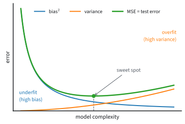
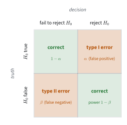
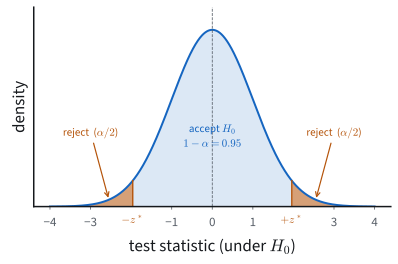

# Statistics
:label:`sec_mdl-statistics`

A model is fitted to a finite random sample, so its accuracy, learned weights,
and other estimates would change if the data were sampled again. Statistics
quantifies this variation. This section defines estimators and their bias and
variance, then derives the bias--variance decomposition used to analyze
underfitting and overfitting in :numref:`sec_generalization_basics`. Hypothesis
tests compare an observed difference with sampling variation, while confidence
intervals report a range of parameter values compatible with an estimate. We
write the unknown parameter $\theta$ as a scalar; the vector case replaces
squares by squared norms.

We use the following imports throughout the section, plus plain NumPy as `onp` for the label-shuffling in the permutation test and the resampling in the bootstrap.

```{.python .input #statistics-imports}
#@tab mxnet
%matplotlib inline
from d2l import mxnet as d2l
from mxnet import np, npx
npx.set_np()
import numpy as onp  # plain NumPy for the permutation test and bootstrap below
```

```{.python .input #statistics-imports}
#@tab pytorch
%matplotlib inline
from d2l import torch as d2l
import torch
import numpy as onp  # plain NumPy for the permutation test and bootstrap below
```

```{.python .input #statistics-imports}
#@tab tensorflow
%matplotlib inline
from d2l import tensorflow as d2l
import tensorflow as tf
import numpy as onp  # plain NumPy for the permutation test and bootstrap below
```

```{.python .input #statistics-imports}
#@tab jax
%matplotlib inline
from d2l import jax as d2l
import jax
from jax import numpy as jnp
import numpy as onp  # plain NumPy for the permutation test and bootstrap below
```

## Estimators and Their Quality

### Estimators

An *estimator* is a rule that turns data into a value intended to estimate an
unknown parameter. Given observations $x_1,\ldots,x_n$, write

$$
\hat\theta_n = \hat f(x_1,\ldots,x_n)
$$

The Bernoulli sample proportion and the Gaussian sample mean are examples from
:numref:`sec_mdl-maximum_likelihood`. Because the sample is random,
$\hat\theta_n$ is a random variable. Its distribution over repeated samples is
the **sampling distribution**.

The main quality criteria answer different questions:

| Criterion | Question |
|---|---|
| Bias | Where is the sampling distribution centered relative to $\theta$? |
| Variance / standard error | How widely does the estimate vary across samples? |
| Mean squared error | How large is the squared error, combining bias and variance? |
| Consistency | Does the estimate approach $\theta$ as $n$ grows? |
| Efficiency | Within a specified estimator class, how small is its variance? |

### Bias and Variance

The first feature is the *center*. The **bias** of $\hat\theta_n$ measures the systematic gap between where the estimator centers and the truth,

$$
\operatorname{Bias}(\hat\theta_n) = \mathbb{E}[\hat\theta_n] - \theta ,
$$
:eqlabel:`eq_mdl-bias`

the expectation taken over the random sample. When
$\operatorname{Bias}(\hat\theta_n)=0$ for every $\theta$, the estimator is
*unbiased*. Bias describes systematic error at a fixed sample size; it may
persist or vanish as $n$ grows.

The second feature is the *spread*. The **variance** measures how much the estimator fluctuates around its own center, with the **standard error** its square root,

$$
\operatorname{Var}(\hat\theta_n) = \mathbb{E}\!\left[(\hat\theta_n - \mathbb{E}[\hat\theta_n])^2\right],
\qquad
\operatorname{se}(\hat\theta_n) = \sqrt{\operatorname{Var}(\hat\theta_n)} .
$$
:eqlabel:`eq_mdl-var_est`

Note carefully that variance is measured against $\mathbb{E}[\hat\theta_n]$, *not* against the true $\theta$: it captures the noise in the estimator, not its accuracy. :numref:`fig_mdl-sampling-distribution` makes the two features visible by drawing the sampling distribution for two estimators of the same $\theta$. Bias is the offset of the distribution's center from $\theta$; variance is its width.


:label:`fig_mdl-sampling-distribution`

### Consistency and Efficiency

Bias and variance describe an estimator at a *fixed* sample size. Two further notions describe how it behaves as data accumulates. An estimator is *asymptotically unbiased* if its bias vanishes in the limit, $\lim_{n\to\infty}\operatorname{Bias}(\hat\theta_n)=0$; many estimators used in practice are biased at finite $n$ but asymptotically unbiased, which is usually good enough. A stronger and more useful guarantee is *consistency*: $\hat\theta_n$ is consistent if it *converges in probability* to $\theta$,

$$
\hat\theta_n \xrightarrow{P} \theta,
\qquad\textrm{i.e.}\qquad
P\bigl(|\hat\theta_n-\theta|>\varepsilon\bigr)\to 0 \quad\textrm{for every } \varepsilon>0 .
$$

The *weak law of large numbers* gives the prototype: the sample mean is a
consistent estimator of the population mean. A sufficient condition for
consistency is that both bias and variance tend to zero. The conditions are
separate: asymptotic unbiasedness does not imply consistency if variance
persists, and vanishing variance does not repair persistent bias.

Finally, **efficiency** compares variance within a specified estimator class.
For regular scalar models, the Cramér--Rao bound in
:numref:`sec_mdl-maximum_likelihood` gives the floor $1/(nI(\theta))$ for
unbiased estimators under its assumptions. The MLE attains this floor
asymptotically in regular models. Efficiency alone does not rank biased
estimators; mean squared error does.

## The Bias-Variance Decomposition

We now have two distinct ways an estimator can be wrong, a systematic offset (bias) and random fluctuation (variance), and a single number that ought to combine them: the *mean squared error*. The MSE is *exactly* the sum of these two contributions, with no cross term.

### Mean Squared Error and the Decomposition

The simplest summary of how far an estimator lands from the truth is the **mean squared error**,

$$
\operatorname{MSE}(\hat\theta_n) = \mathbb{E}\!\left[(\hat\theta_n-\theta)^2\right] .
$$
:eqlabel:`eq_mdl-mse_est`

It is always non-negative, and the smaller it is the closer $\hat\theta_n$ sits to $\theta$ on average. If you have read :numref:`sec_linear_regression` you will recognize it as the squared-error loss, now applied to an estimator rather than a prediction.

**Proposition (bias-variance decomposition).** *For any estimator $\hat\theta_n$ of a fixed parameter $\theta$,*

$$
\operatorname{MSE}(\hat\theta_n) = \operatorname{Bias}(\hat\theta_n)^2 + \operatorname{Var}(\hat\theta_n) .
$$
:eqlabel:`eq_mdl-bias-variance`

**Proof.** Abbreviate $\mu = \mathbb{E}[\hat\theta_n]$, the center of the estimator, and add and subtract it inside the square:

$$
\operatorname{MSE}(\hat\theta_n)
 = \mathbb{E}\!\left[(\hat\theta_n - \theta)^2\right]
 = \mathbb{E}\!\left[\bigl((\hat\theta_n - \mu) + (\mu - \theta)\bigr)^2\right].
$$

Expanding the square gives three terms. The first is $\mathbb{E}[(\hat\theta_n-\mu)^2]=\operatorname{Var}(\hat\theta_n)$; the last is $(\mu-\theta)^2=\operatorname{Bias}(\hat\theta_n)^2$, a constant. The middle, cross term *vanishes*, because $\mu-\theta$ is a constant and $\hat\theta_n-\mu$ has mean zero by the definition of $\mu$:

$$
2\,(\mu-\theta)\,\mathbb{E}[\hat\theta_n - \mu]
 = 2\,(\mu-\theta)\,(\mu - \mu) = 0 .
$$

What remains is $\operatorname{Var}(\hat\theta_n)+\operatorname{Bias}(\hat\theta_n)^2$. $\blacksquare$

Because the centered fluctuation has mean zero, its cross term with the bias
vanishes, giving the decomposition in
:numref:`fig_mdl-sampling-distribution`. This identity also supplies a
consistency criterion. If both
$\operatorname{Bias}(\hat\theta_n)\to0$ and
$\operatorname{Var}(\hat\theta_n)\to0$, then
:eqref:`eq_mdl-bias-variance` implies
$\operatorname{MSE}(\hat\theta_n)\to0$. Markov's inequality applied to
$(\hat\theta_n-\theta)^2$ then gives
$$
P(|\hat\theta_n-\theta|>\varepsilon)
\le \frac{\operatorname{MSE}(\hat\theta_n)}{\varepsilon^2}\to0,
$$
so $\hat\theta_n\xrightarrow{P}\theta$. For an unbiased estimator this reduces
to Chebyshev's inequality. The concentration results in
:numref:`sec_mdl-concentration-generalization` provide sharper rates for
bounded or sub-Gaussian observations.

### The Law of Large Numbers

Assembling the pieces just derived yields the guarantee promised above, the same one that :numref:`sec_mdl-integral_calculus` invoked to justify Monte Carlo integration.

**Proposition (weak law of large numbers).** *If $x_1,\ldots,x_n$ are i.i.d. with mean $\mu$ and finite variance $\sigma^2$, the sample mean $\bar x_n = \frac1n\sum_{i=1}^n x_i$ converges in probability to $\mu$:*

$$
\bar x_n \xrightarrow{P} \mu ,
\qquad\textrm{indeed}\qquad
P\bigl(|\bar x_n - \mu| > \varepsilon\bigr) \le \frac{\sigma^2}{n\,\varepsilon^2}
\quad\textrm{for every } \varepsilon > 0 .
$$
:eqlabel:`eq_mdl-lln`

**Proof.** The sample mean is unbiased, $\mathbb{E}[\bar x_n]=\mu$, by linearity of expectation, and its variance is $\operatorname{Var}(\bar x_n)=\sigma^2/n$ by the variance of a sum of independent variables (:numref:`sec_mdl-random_variables`). By :eqref:`eq_mdl-bias-variance` its MSE is therefore $0 + \sigma^2/n$, and the Markov step above turns that into the displayed bound, which vanishes as $n\to\infty$. $\blacksquare$

Finite variance is more than the theorem needs: a finite mean $\mathbb{E}|x_1|<\infty$ already suffices, at the cost of a longer argument :cite:`Wasserman.2013`. In whichever form, this is the law that makes averaging work: it is why a Monte Carlo estimate of an integral converges, why a test-set accuracy estimates the true error rate, and why the empirical loss a model is trained on tracks the expected loss it is meant to minimize.

### The Trade-off and Generalization

For squared-error prediction, the same decomposition separates error due to
the fitted predictor's bias, its sampling variance, and irreducible label noise
:cite:`Geman.Bienenstock.Doursat.1992`. In many classical model sequences,
greater flexibility lowers bias and raises variance, producing the U-shaped
curve in :numref:`fig_mdl-bias-variance-u-curve`. Regularization can improve
risk by accepting more bias in exchange for less variance. This U-shape is a
common pattern, not a theorem about every model sequence; interpolating models
can exhibit double descent (:numref:`sec_mdl-concentration-generalization`).


:label:`fig_mdl-bias-variance-u-curve`

### The Decomposition in Code

The decomposition is an exact algebraic identity, so it should hold to numerical precision on a concrete example. We first define bias and MSE as the formulas :eqref:`eq_mdl-bias` and :eqref:`eq_mdl-mse_est` say: averages over a collection of estimates, against the true parameter.

```{.python .input #statistics-estimator-metrics}
import numpy as onp
def stat_bias(true_theta, est_theta):  # E[theta_hat] - theta
    return onp.mean(est_theta) - true_theta

def mse(est_theta, true_theta):        # E[(theta_hat - theta)^2]
    return onp.mean(onp.square(est_theta - true_theta))
```

To exercise these we need the *sampling distribution* itself, not a single dataset: we draw many independent datasets from $\mathcal{N}(\theta,\sigma^2)$, compute the sample mean on each, and collect the resulting estimates. Their spread is the variance and their center the bias.

```{.python .input #statistics-sampling-distribution}
import numpy as onp
theta_true, sigma = 1.0, 4.0
num_datasets, n = 10000, 30  # 10k datasets, each of n=30 points
samples = onp.random.normal(theta_true, sigma, (num_datasets, n))
theta_hats = samples.mean(axis=1)  # one sample-mean estimate per dataset
```

Now we read the decomposition off the empirical sampling distribution: the MSE of the estimates around the true $\theta$ should match the squared bias plus the variance of the estimates around their own mean, the two sides of :eqref:`eq_mdl-bias-variance`. One detail matters for exactness. The identity is a statement about expectations under a *single* distribution, here the empirical distribution of our $10{,}000$ estimates, whose expectations are plain averages. That forces the *plug-in* variance, which divides by the number of estimates (`ddof=0`, the default in most libraries), rather than the unbiased $n-1$ variant we meet in the next subsection. With the plug-in choice the proof's algebra goes through verbatim for the empirical averages.

```{.python .input #statistics-verify-decomposition}
import numpy as onp
bias = stat_bias(theta_true, theta_hats)
# Default ddof=0: the plug-in variance of the estimates, which makes the
# identity exact for empirical averages (the n-1 variant is the next subsection)
var = onp.var(theta_hats)
mse(theta_hats, theta_true), var + onp.square(bias)
```

The two numbers agree to floating-point round-off (the identity is exact), and both are close to the theoretical value. For the sample mean of $\mathcal{N}(\theta,\sigma^2)$ the bias is exactly zero (the average of unbiased draws is unbiased) and the variance is $\sigma^2/n$ (the variance-of-a-sum result from :numref:`sec_mdl-random_variables`), so $\operatorname{MSE}=\sigma^2/n = 16/30 \approx 0.53$. Because *both* the bias ($0$) and the variance ($\sigma^2/n\to0$) vanish as $n\to\infty$, the sample mean is consistent, exactly as the weak law of large numbers :eqref:`eq_mdl-lln` asserts: the simulation is that proposition run in the small.

### Why the Unbiased Variance Divides by $n-1$

The sample mean was unbiased for free. The sample *variance* is more delicate, and it exposes a subtlety that the library's `std` function encodes in a `ddof` flag. Given samples $x_1,\ldots,x_n$ with sample mean $\bar x=\frac1n\sum_i x_i$, the natural estimator of the population variance $\sigma^2$ would average the squared deviations,

$$
s_0^2 = \frac1n\sum_{i=1}^n (x_i-\bar x)^2 .
$$

This estimator is biased downward because its deviations are measured from the
sample mean $\bar x$, which minimizes the sum of squared deviations for the
observed sample, rather than from the unknown population mean $\mu$. The
estimator $s_0^2$ is also the Gaussian maximum-likelihood estimate of variance,
so this calculation exhibits the finite-sample bias discussed in
:numref:`sec_mdl-maximum_likelihood`. Dividing by $n-1$ instead of $n$ removes
the bias.

**Proposition (unbiased sample variance).** *For i.i.d. samples with variance $\sigma^2$,*

$$
s^2 = \frac{1}{n-1}\sum_{i=1}^n (x_i-\bar x)^2
\qquad\textrm{satisfies}\qquad
\mathbb{E}[s^2] = \sigma^2 .
$$
:eqlabel:`eq_mdl-unbiased-var`

**Proof.** Center the data at the true mean $\mu$ by writing $x_i-\bar x = (x_i-\mu)-(\bar x-\mu)$, and expand the sum of squared deviations:

$$
\sum_{i=1}^n (x_i-\bar x)^2
 = \sum_{i=1}^n (x_i-\mu)^2 - n\,(\bar x-\mu)^2 ,
$$

where the cross term collapsed because $\sum_i (x_i-\mu) = n(\bar x-\mu)$. Now take expectations. Each $\mathbb{E}[(x_i-\mu)^2]=\sigma^2$, so the first sum has expectation $n\sigma^2$. The second uses the variance of the sample mean, $\mathbb{E}[(\bar x-\mu)^2]=\operatorname{Var}(\bar x)=\sigma^2/n$, so that term has expectation $n\cdot\sigma^2/n=\sigma^2$. Hence

$$
\mathbb{E}\!\left[\sum_{i=1}^n (x_i-\bar x)^2\right] = n\sigma^2 - \sigma^2 = (n-1)\,\sigma^2 .
$$

Dividing by $n-1$ gives $\mathbb{E}[s^2]=\sigma^2$. $\blacksquare$

The intuition is *degrees of freedom*: estimating $\bar x$ from the same data consumes one degree of freedom, so only $n-1$ of the deviations are free to vary, and dividing by $n-1$ rather than $n$ corrects for it exactly. (As $n\to\infty$ the two estimators agree, so $s_0^2$ is biased but asymptotically unbiased and consistent.) We can watch the bias appear and the correction remove it by estimating both variances over many datasets and averaging.

```{.python .input #statistics-unbiased-variance}
import numpy as onp
n = 3  # small n makes the 1/n bias glaring; the gap shrinks like 1/n
data = onp.random.normal(0, 2, (100000, n))  # sigma^2 = 4
dev2 = onp.square(data - data.mean(axis=1, keepdims=True)).sum(axis=1)
print('true variance    = 4')
print(f'E[divide by n]   = {float((dev2 / n).mean()):.3f}  (biased)')
print(f'E[divide by n-1] = {float((dev2 / (n - 1)).mean()):.3f}  (unbiased)')
```

With $n=3$ the biased estimator averages near $\tfrac{n-1}{n}\sigma^2 = \tfrac23\cdot 4 \approx 2.67$, while dividing by $n-1$ recovers $4$, confirming :eqref:`eq_mdl-unbiased-var`. The `ddof` argument ("delta degrees of freedom") selects the denominator: `ddof=1` divides by $n-1$, `ddof=0` by $n$.

## Hypothesis Testing

Bias and variance characterize the error of an estimator. Hypothesis testing
addresses a different question: whether an observed difference between two
groups or models is compatible with sampling variation under a specified null
hypothesis. This framework underlies A/B tests and benchmark comparisons.

### Null and Alternative Hypotheses

A *hypothesis test* weighs evidence against a default claim. The **null hypothesis** $H_0$ is that default, typically "there is no effect" (e.g. the new model is no better than the baseline), and the **alternative** $H_A$ is the effect we hope to detect: sometimes the null's outright negation, but often one-sided or otherwise composite, e.g. "the new model is *better*." The asymmetry is deliberate: we never *prove* $H_0$; we either gather enough evidence to *reject* it in favor of $H_A$, or we fail to, much as a court returns "guilty" or "not guilty" rather than "innocent."

Because the data are random, the decision can go wrong in two ways. A **type I error** (false positive) is rejecting $H_0$ when it is in fact true: declaring an effect that is not there. A **type II error** (false negative) is failing to reject $H_0$ when it is in fact false: missing a real effect. Their rates have standard names, the significance level $\alpha$ and $\beta$,

$$
\alpha = P(\textrm{reject } H_0 \mid H_0 \textrm{ true}),
\qquad
\beta = P(\textrm{fail to reject } H_0 \mid H_0 \textrm{ false}),
$$

and the four possible outcomes arrange into the $2\times2$ decision matrix of :numref:`fig_mdl-type-i-ii-matrix`: rows are whether $H_0$ is true or false, columns are our decision. The diagonal cells are correct; the off-diagonal cells are the two errors. One caveat on the notation: when $H_A$ is composite, "$H_0$ false" does not pin down a single distribution, so $\beta$ (and the power below) is a *function* of the true parameter, evaluated at a given alternative; that is exactly how :numref:`fig_mdl-power` will draw it.


:label:`fig_mdl-type-i-ii-matrix`

### Significance and Power

We *choose* the type I error rate up front: the **significance level** $\alpha$ is the risk of a false positive we are willing to tolerate, conventionally $\alpha=0.05$. The complement $1-\alpha$ is the *confidence level*, the name that returns with the confidence intervals below. The bottom-right cell of the matrix is the quantity we want to be large: the **statistical power**

$$
1 - \beta = P(\textrm{reject } H_0 \mid H_0 \textrm{ false})
$$

is the probability the test *detects* a real effect, again evaluated at a given alternative. A test with $\alpha=0.05$ but power $0.2$ rejects a true null only $5\%$ of the time yet still misses $80\%$ of genuine effects of that size: underpowered, and useless for confirming improvements. A common target is $1-\beta=0.8$.

Power is what determines how much data we need, and the simplest test of all makes the accounting explicit. In the one-sample two-sided **$z$-test** the data are Gaussian with *known* variance $\sigma^2$, the null is $H_0\!:\mu=0$, the statistic is $T=\sqrt n\,\bar x/\sigma$, which under $H_0$ is exactly standard normal, and we reject when $|T|\ge z_{1-\alpha/2}$, where $z_q$ denotes the standard-normal quantile ($z_{0.975}\approx1.960$ at $\alpha=0.05$). Now suppose the true mean is some $\mu\neq0$ and write $\delta=|\mu|/\sigma$ for the **standardized effect**, the size of the effect measured in units of the noise. Then $T$ is Gaussian with mean $\pm\delta\sqrt n$ and unit variance, so the test detects the effect with probability $\Phi(\delta\sqrt n - z_{1-\alpha/2})$, where $\Phi$ is the standard-normal c.d.f. (the far tail on the opposite side adds $\Phi(-\delta\sqrt n - z_{1-\alpha/2})$, which is negligible unless $\delta\sqrt n$ is small). Setting this power equal to $1-\beta$, so that $\delta\sqrt n - z_{1-\alpha/2} = z_{1-\beta}$, and solving for $n$ gives the sample size needed to detect a standardized effect $\delta$ at level $\alpha$ with power $1-\beta$:

$$
n \;=\; \frac{\bigl(z_{1-\alpha/2} + z_{1-\beta}\bigr)^{2}}{\delta^{2}} .
$$
:eqlabel:`eq_mdl-power-sample-size`

For $\alpha=0.05$ and power $0.8$,
$z_{0.975}\approx1.960$ and $z_{0.8}\approx0.842$, giving
$n\approx7.85/\delta^2$. Thus an effect of one standard deviation requires
about eight samples, whereas an effect of $0.01$ standard deviations requires
about 78,489. :numref:`fig_mdl-power` plots the corresponding power curves.
For each nonzero effect, power approaches one as $n$ increases and reaches
$0.8$ at a sample size proportional to $1/\delta^2$. At $\delta=0$, rejection
occurs with probability $\alpha$, the test's false-positive rate.


:label:`fig_mdl-power`

### Test Statistics, $p$-values, and Significance

To run a test we compress the data into a single **test statistic** $T(x)$, a scalar chosen so that extreme values are unlikely under $H_0$; the mean difference between two groups is a natural choice. Under $H_0$ the statistic has a known (often approximately Gaussian) *null distribution*, which is what lets us judge whether an observed value is surprising.

The verdict is delivered by the **$p$-value**: the probability, *computed under $H_0$*, of seeing a statistic at least as extreme as the one we observed. For a two-sided test (the common case, where a deviation in either direction counts as evidence),

$$
p\textrm{-value} = P_{H_0}\bigl(|T(X)| \ge |T(x)|\bigr),
$$

valid when the null distribution is symmetric about $0$; in general the two-sided $p$-value is $2\,\min\{P_{H_0}(T\ge t),\, P_{H_0}(T\le t)\}$, which doubles the smaller tail. The one-sided version uses a single tail. We reject $H_0$ when $p \le \alpha$. Geometrically, the rejection region is the set of statistic values whose $p$-value falls below $\alpha$; :numref:`fig_mdl-statistical_significance` shows it for a Gaussian null at $\alpha=0.05$ as the two tails beyond the critical values $\pm 1.96$ (the $z$-test's rejection region $|T|\ge1.96$ from above), together holding $5\%$ of the probability. A statistic landing in those tails would be very unlikely if $H_0$ held, so we reject.


:label:`fig_mdl-statistical_significance`

A persistent warning is in order, because the $p$-value is among the most misread numbers in science :cite:`Wasserstein.Lazar.2016`. It is $P(\textrm{data this extreme}\mid H_0)$, a statement about the data *given* the null; it is *not* $P(H_0\mid\textrm{data})$, the probability the null is true, which would require a prior and Bayes' rule. A large $p$-value does *not* confirm $H_0$; it means only that we failed to detect an effect, possibly because the test was underpowered.

A subtler trap is *multiple testing*. The $\alpha=0.05$ guarantee holds for a *single* pre-specified test; run $m$ of them under a true null (sweeping hyperparameters, comparing across benchmarks, retrying until something "works") and the chance of at least one spurious win is $1-(1-\alpha)^m$ for independent tests, which already exceeds $0.4$ at $m=10$. Reporting only the test that cleared $p\le\alpha$ is *$p$-hacking*, and it is how noise gets published as a result. The simplest guard is the *Bonferroni correction* :cite:`Bonferroni.1936`: to hold the family-wide false-positive rate at $\alpha$, test each of the $m$ hypotheses at the stricter level $\alpha/m$. When $m$ runs into the hundreds or thousands, as in a hyperparameter sweep or a screen of model variants, Bonferroni grows hopelessly conservative, and large-scale practice instead controls the *false discovery rate*, the expected fraction of rejections that are false, via the Benjamini--Hochberg procedure :cite:`Benjamini.Hochberg.1995`, which sorts the $m$ $p$-values in increasing order and rejects the $k$ smallest, with $k$ the largest index satisfying $p_{(k)}\le k\alpha/m$.

To summarize, a hypothesis test proceeds in five steps:

1. State $H_0$ and $H_A$.
2. Fix the significance level $\alpha$ and a target power $1-\beta$ (which, with the expected effect size, sets the sample size).
3. Collect the data.
4. Compute the test statistic and its $p$-value under $H_0$.
5. Reject $H_0$ if $p \le \alpha$; otherwise fail to reject.

### Comparing Two Models

Let us walk through the five steps once, on the comparison practitioners face most often: is model B really better than model A, or did it just draw lucky seeds? We simulate per-seed test accuracies for the two models: twenty training runs each, with a true gap of $0.8$ percentage points buried in seed-to-seed noise of comparable size. Step 1: $H_0$ is that the two models are equally good, i.e. the two accuracy samples come from the same distribution, and $H_A$ is that they differ; step 2: $\alpha=0.05$. The test statistic is the gap between the mean accuracies. Rather than assume a Gaussian null distribution, we use a **permutation test** :cite:`Fisher.1935`, which manufactures the null distribution from the data itself: if $H_0$ holds, the labels "A" and "B" carry no information (the $40$ numbers are *exchangeable*), so shuffling the labels and recomputing the gap, many times over, shows exactly how large a gap arises by pure chance. The two-sided $p$-value is the fraction of shuffles producing a gap at least as extreme as the observed one (counting the observed labeling itself among them, which keeps the estimate valid and never exactly zero).

```{.python .input #statistics-permutation-test}
rng = onp.random.default_rng(1)
num_seeds = 20                               # 20 training runs per model
acc_a = rng.normal(0.850, 0.010, num_seeds)  # per-seed accuracy, model A
acc_b = rng.normal(0.858, 0.010, num_seeds)  # model B: a real +0.008 gap
observed = acc_b.mean() - acc_a.mean()       # test statistic: gap in means

pooled = onp.concatenate([acc_a, acc_b])     # under H_0 the labels are arbitrary
B = 10000
gaps = onp.empty(B)
for b in range(B):
    perm = rng.permutation(pooled)           # shuffle the model labels
    gaps[b] = perm[num_seeds:].mean() - perm[:num_seeds].mean()
p_value = (1 + (onp.abs(gaps) >= abs(observed)).sum()) / (B + 1)  # two-sided
print(f'observed gap        = {observed:.4f}')
print(f'permutation p-value = {p_value:.4f}')

d2l.set_figsize()
d2l.plt.hist(gaps, bins=50, color='#1f77b4', alpha=0.8)
d2l.plt.axvline(observed, color='#ff7f0e', lw=2)      # the observed gap
d2l.plt.axvline(-observed, color='#ff7f0e', lw=2, ls='--')
d2l.plt.xlabel('gap under label shuffling')
d2l.plt.ylabel('count');
```

The observed difference is $0.0073$: model B is better by about 0.73
percentage points. Only about 2% of label permutations produce a difference at
least this large in magnitude, so $p\approx0.02\le\alpha=0.05$ and the test
rejects $H_0$.

The permutation distribution is approximately bell-shaped around zero. This
shape is not assumed by the test; it follows here from a finite-population
central limit effect for means formed from the pooled 40 observations, related
to the iid CLT in :numref:`sec_mdl-distributions`. The observed statistic lies
in its tail. The result is nevertheless close to the threshold: an improvement
of about 0.8 percentage points is detected with 20 seeds but would often be
missed with five. A permutation test requires exchangeability under the null,
not Gaussian observations, and can be applied to other group-comparison
statistics.

One refinement matters in practice. When the comparison is *paired*, with models A and B trained and evaluated on the *same* seeds, the exchangeable objects are not the $40$ pooled numbers but the per-seed *differences*, and the right test flips the sign of each difference at random and recomputes their mean: the paired, or sign-flip, permutation test. It respects the pairing and typically gains power.

## Confidence Intervals

A point estimate $\hat\theta$ does not describe its sampling uncertainty.
A **confidence interval** is constructed by a procedure designed to cover the
fixed parameter $\theta$ at a specified long-run rate
:cite:`Neyman.1937`.

### Definition and Interpretation

A confidence interval for $\theta$ is an interval $C_n$ computed from the data such that

$$
P_\theta(C_n \ni \theta) \ge 1 - \alpha \quad \textrm{for all } \theta,
$$
:eqlabel:`eq_mdl-confidence`

where $1-\alpha$ is the *confidence level* or *coverage*. We write $C_n \ni \theta$ rather than $\theta \in C_n$ to stress where the randomness lives: $\theta$ is a *fixed* unknown, and it is the *interval* $C_n$ that is random, redrawn with every dataset.

A 95% confidence interval does not assign probability 0.95 to the fixed
parameter lying in the realized interval. Instead, under repeated sampling,
95% of intervals constructed by the procedure contain $\theta$.
:numref:`fig_mdl-prob-coverage` illustrates this interpretation with 100
independent datasets: most intervals contain the fixed parameter and some do
not.

A Bayesian **credible interval** has a different interpretation because
$\theta$ is assigned a posterior distribution conditional on a prior and the
observed data. For the Beta posterior in
:numref:`sec_mdl-distributions`, a 95% credible interval for a Bernoulli
parameter is given by the 2.5% and 97.5% posterior quantiles of
$\mathrm{Beta}(\alpha+x,\beta+n-x)$. Its probability statement is conditional
on the chosen model and prior.


:label:`fig_mdl-prob-coverage`

### A Gaussian Example

The classic case is the mean of a Gaussian $\mathcal{N}(\mu,\sigma^2)$ with both parameters unknown. From $n$ samples we form the usual estimators $\hat\mu_n=\frac1n\sum_i x_i$ and the unbiased $\hat\sigma_n^2=\frac1{n-1}\sum_i (x_i-\hat\mu_n)^2$ from :eqref:`eq_mdl-unbiased-var`. The *studentized* statistic, centered and scaled by the *estimated* standard error $\hat\sigma_n/\sqrt n$ in place of the unknown true one,

$$
T = \frac{\hat\mu_n - \mu}{\hat\sigma_n/\sqrt n} ,
$$

follows *Student's $t$-distribution* on $n-1$ degrees of freedom :cite:`Student.1908`, a fact we take on faith here; the distribution itself is constructed in :numref:`sec_mdl-distributions`. As $n\to\infty$ the $t$-distribution approaches a standard Gaussian, and the attribution of that limit matters. For Gaussian data the numerator $\hat\mu_n-\mu$ is *exactly* Gaussian at every $n$; the limit comes from the denominator, since $\hat\sigma_n$ is consistent for $\sigma$ (the law of large numbers :eqref:`eq_mdl-lln` again, applied to squared deviations) and replacing a factor that converges in probability to a constant leaves a limiting distribution unchanged (*Slutsky's theorem*, also taken on faith :cite:`Wasserman.2013`). The *central limit theorem* of :numref:`sec_mdl-distributions` enters for *non-Gaussian* data: it makes the sampling distribution of the mean asymptotically Gaussian anyway, so the interval below remains asymptotically valid for the mean of any finite-variance distribution, which is why it gets used so freely in practice. For large $n$, then, $T$ lands in $[-1.96, 1.96]$ with probability $\approx95\%$ (the Gaussian's central $95\%$): exactly $95\%$ in the Gaussian limit, and slightly *less* at finite $n$, where the exact $t$-distribution has heavier tails and one should use the wider $t$-quantile in its place. Rearranging $-1.96 \le T \le 1.96$ for $\mu$ yields the interval

$$
\left[\hat\mu_n - 1.96\,\frac{\hat\sigma_n}{\sqrt n},\; \hat\mu_n + 1.96\,\frac{\hat\sigma_n}{\sqrt n}\right].
$$
:eqlabel:`eq_mdl-gauss_confidence`

This is one of the most-used formulas in statistics. The half-width $1.96\,\hat\sigma_n/\sqrt n$ shrinks like $1/\sqrt n$: to halve the interval we need *four times* the data. Let us construct one for a standard-normal sample, taking the asymptotic $t_\star=1.96$.

```{.python .input #statistics-confidence-interval}
import numpy as onp
N = 1000
samples = onp.random.normal(loc=0, scale=1, size=(N,))
t_star = 1.96  # asymptotic value; small N would look this up in a t-table
mu_hat = onp.mean(samples)
se = samples.std(ddof=1) / onp.sqrt(N)  # ddof=1: unbiased sigma_hat
(mu_hat - t_star * se, mu_hat + t_star * se)
```

The interval is narrow and brackets the true mean $0$, as it should roughly $95\%$ of the time. The same $1/\sqrt n$ scaling shows up everywhere uncertainty is reported (error bars on a learning curve, the spread of accuracies across random seeds), and :eqref:`eq_mdl-gauss_confidence` is the formula behind them.

"Roughly $95\%$ of the time" is the Neyman guarantee :eqref:`eq_mdl-confidence`, and we can audit it. The cell below repeats the whole procedure one thousand times: draw a fresh dataset, build the interval :eqref:`eq_mdl-gauss_confidence`, and check whether it traps the true mean. The hit count should land near $950$.

```{.python .input #mdl-statistics-a-gaussian-example-1}
rng = onp.random.default_rng(0)
mu, n, trials = 0.0, 100, 1000
data = rng.normal(mu, 1.0, (trials, n))           # one row = one fresh dataset
mu_hat = data.mean(axis=1)
se = data.std(axis=1, ddof=1) / onp.sqrt(n)
hits = (onp.abs(mu_hat - mu) <= 1.96 * se)        # interval traps the truth?
print(f'{hits.sum()} of {trials} intervals contain the true mean '
      f'(expected about {0.95 * trials:.0f})')
```

This simulation obtains 937 covered intervals. For $n=100$, using $1.96$ in
place of the exact $t$ quantile gives true coverage of about 94.7%, or 947
intervals in expectation. The binomial standard deviation of the coverage count
is about seven, so 937 is 1.4 standard deviations below its expectation and is
consistent with sampling variation. This count is the repeated-sampling
interpretation shown in :numref:`fig_mdl-prob-coverage`.

**Propagating error bars: the delta method.** Often the number we report is not $\hat\theta$ itself but a smooth function of it: the log-odds of an accuracy, the ratio of two losses, a percentage change. A first-order Taylor expansion, $g(\hat\theta)\approx g(\theta)+g'(\theta)\,(\hat\theta-\theta)$, says the fluctuation of $g(\hat\theta)$ is the fluctuation of $\hat\theta$ scaled by the local slope, so standard errors propagate as

$$
\operatorname{se}\bigl(g(\hat\theta)\bigr) \;\approx\; \bigl|g'(\hat\theta)\bigr|\,\operatorname{se}(\hat\theta),
$$
:eqlabel:`eq_mdl-delta-method`

the *delta method* :cite:`Wasserman.2013`. For instance, an accuracy of $\hat p=0.90$ measured on $n=1{,}000$ test examples has $\operatorname{se}(\hat p)=\sqrt{\hat p(1-\hat p)/n}\approx 0.0095$; reporting the log-odds $g(\hat p)=\log\frac{\hat p}{1-\hat p}$ instead, the slope $g'(\hat p)=1/(\hat p(1-\hat p))\approx 11.1$ stretches the error bar to $\approx 0.105$ on the log-odds scale. The same rule with a gradient in place of $g'$ handles vector parameters, and when no derivative is convenient the bootstrap below sidesteps the calculus entirely.

### The Bootstrap

The Gaussian interval :eqref:`eq_mdl-gauss_confidence` uses a closed-form
standard error for the mean, $\hat\sigma_n/\sqrt n$. For a median, correlation,
test accuracy, AUC, or BLEU score, analytic sampling calculations may be
unavailable or inconvenient. The bootstrap estimates them by simulation.

The **bootstrap**, introduced by Bradley Efron :cite:`Efron.1979`, escapes this with a single substitution. We never had access to the true distribution $F$ that generated our $n$ data points; if we did, we could simulate the sampling distribution of a chosen statistic
by drawing fresh datasets from $F$ and recomputing it. The bootstrap's move, the **plug-in principle**, is to substitute the *empirical* distribution $\hat F_n$, which puts mass $1/n$ on each observed point, for the unknown $F$. Drawing $n$ points from $\hat F_n$ is exactly *resampling our own data $n$ times with replacement*. Concretely:

1. From the original sample of size $n$, draw $n$ points **with replacement** to form a *bootstrap resample*; some points appear several times, others not at all.
2. Compute the statistic $\hat\theta^*$ on the resample.
3. Repeat $B$ times to obtain $\hat\theta^*_1,\ldots,\hat\theta^*_B$.

**Standard error.** The standard deviation of the $B$ replicates estimates the
standard error of $\hat\theta$. A few hundred replicates can be adequate for a
rough standard error; more are useful when Monte Carlo error matters.

**Percentile interval.** The empirical $\alpha/2$ and $1-\alpha/2$ quantiles of
$\{\hat\theta_b^*\}$ define the percentile interval. Tail quantiles require
more replicates, commonly at least $1{,}000$--$2{,}000$; the example uses
$B=10{,}000$. The percentile method is simple and transformation-equivariant,
but it does not automatically correct bias or poor coverage caused by strong
skewness. Basic, studentized, or bias-corrected and accelerated (BCa) intervals
may be preferable when those effects matter.

**Validity.** The resampling distribution is centered near $\hat\theta$, not
the unknown $\theta$, and estimates shape and width from one sample. The
ordinary iid bootstrap is valid for many regular, sufficiently smooth
statistics under iid sampling. It can fail for extrema, boundary parameters,
very small samples, and nonsmooth or non-identifiable problems. Dependent or
clustered observations require a block, cluster, or other
structure-preserving bootstrap. Exercise :exref:`ex_mdl-statistics-let-x-1-ldots` gives the classic failure for a
sample maximum.


:label:`fig_mdl-bootstrap`

We now bootstrap the **median** of a skewed sample without using an analytic
standard-error formula. A matrix of random indices draws all $B$ resamples at
once.

```{.python .input #statistics-bootstrap}
rng = onp.random.default_rng(0)
data = rng.exponential(scale=1.0, size=200)  # skewed: median != mean, no SE formula
n = len(data)
theta_hat = onp.median(data)                 # statistic of interest

B = 10000                                     # number of bootstrap resamples
idx = rng.integers(0, n, size=(B, n))         # n positions per resample, WITH replacement
boot = onp.median(data[idx], axis=1)          # one median per resample

se_boot = boot.std(ddof=1)                    # bootstrap standard error of the median
ci_pct = onp.percentile(boot, [2.5, 97.5])    # percentile 95% CI -- no formula needed
print(f'sample median        = {theta_hat:.3f}')
print(f'bootstrap SE         = {se_boot:.3f}')
print(f'percentile 95% CI    = ({ci_pct[0]:.3f}, {ci_pct[1]:.3f})')
```

The calculation gives a bootstrap standard error and percentile interval for
the median without a closed-form derivation. Its validity still rests on the
regularity and iid-sampling conditions just stated. For contrast, the Gaussian
formula :eqref:`eq_mdl-gauss_confidence` targets the *mean*, a different
quantity, which on this skewed sample lies above the median.

```{.python .input #statistics-bootstrap-contrast}
mu_hat = data.mean()
se_mean = data.std(ddof=1) / n**0.5           # closed-form SE, but only for the mean
ci_gauss = (mu_hat - 1.96 * se_mean, mu_hat + 1.96 * se_mean)
print(f'Gaussian 95% CI (mean) = ({ci_gauss[0]:.3f}, {ci_gauss[1]:.3f})')
```

The two intervals answer different questions. The percentile interval for the
median is slightly asymmetric about $\hat\theta$ because it inherits the shape
of the resampling distribution rather than imposing a symmetric Gaussian
form. In machine-learning evaluations, a suitably designed bootstrap can
estimate uncertainty for quantities such as held-out accuracy, AUC, or BLEU
:cite:`Efron.Hastie.2016`; the sampling unit and dependence structure must
match the resampling scheme. :numref:`sec_mdl-naive_bayes` applies the iid
version to test accuracy.

## Summary

* An *estimator* $\hat\theta_n$ is a function of the data; being random, it has a *sampling distribution* whose center and spread are summarized by *bias* $\mathbb{E}[\hat\theta_n]-\theta$ and *variance*. *Consistency* ($\hat\theta_n\xrightarrow{P}\theta$) follows when both shrink with $n$; the *weak law of large numbers* :eqref:`eq_mdl-lln` is the sample-mean case; *efficiency* ranks unbiased estimators by their variance.
* The *bias-variance decomposition* $\operatorname{MSE}(\hat\theta_n)=\operatorname{Bias}(\hat\theta_n)^2+\operatorname{Var}(\hat\theta_n)$ splits the error exactly because, after centering at $\mathbb{E}[\hat\theta_n]$, the cross term vanishes. In models where increasing flexibility lowers bias and raises variance, it yields the familiar U-shaped risk curve; that shape is not universal.
* The unbiased sample variance divides by $n-1$, not $n$: estimating the mean from the same data costs one degree of freedom, and the $1/(n-1)$ factor corrects the resulting bias exactly.
* *Hypothesis testing* weighs evidence against a null $H_0$ via a test statistic and its $p$-value $P_{H_0}(\textrm{data this extreme})$; we control the type I error rate $\alpha$ and want high power $1-\beta$. A $p$-value is not $P(H_0\mid\textrm{data})$. A *permutation test* builds the null distribution by shuffling group labels, with no Gaussian assumptions; under many tests, control the family-wise error rate (Bonferroni) or the false discovery rate (Benjamini--Hochberg).
* A *confidence interval* contains $\theta$ with probability $\ge 1-\alpha$ over repeated datasets; the Gaussian interval $\hat\mu_n \pm 1.96\,\hat\sigma_n/\sqrt n$, exact for Gaussian data in the large-$n$ limit and extended to other data by the *central limit theorem*, has half-width shrinking like $1/\sqrt n$.
* The ordinary iid *bootstrap* estimates the sampling distribution of many
  regular statistics with no convenient closed-form standard error (a median,
  an accuracy, an AUC) by resampling observations with replacement. It can fail
  for extrema, boundaries, and nonregular statistics, and dependent data need a
  resampling scheme that preserves their structure.

## Exercises

1. **Estimating a uniform endpoint.** Let $x_1,\ldots,x_n$ be iid
   $U(0,\theta)$, and compare the estimators
   $\hat\theta=\max_i x_i$ and $\tilde\theta=\frac2n\sum_i x_i$. The maximum
   has the c.d.f. $P(\hat\theta\le t)=(t/\theta)^n$ for $0\le t\le\theta$.
    1. Compute the bias, the variance, and the MSE of both estimators. For
       which $n$ does $\hat\theta$ have the smaller MSE?
    1. Is $\hat\theta$ consistent? Is $\tilde\theta$?
    1. The multiple $\frac{n+1}{n}\hat\theta$ is unbiased (exercise
       :exref:`ex_mdl-maximum-likelihood-moving-support`d of
       :numref:`sec_mdl-maximum_likelihood`). Find the constant $c$ that
       minimizes the MSE of $c\hat\theta$, and compare its MSE with that of
       the unbiased multiple. Show that both decay like $1/n^2$, whereas the
       MSE of $\tilde\theta$ decays like $1/n$. The same exercise explains
       why the Cramér--Rao bound :eqref:`eq_mdl-cramer-rao` does not rule
       out this rate.

   *Adapted from Larry Wasserman,
   [All of Statistics](https://link.springer.com/book/10.1007/978-0-387-21736-9),
   Chapter 6, Exercises 2 and 3.*

1. **Consistency counterexamples.** Let $x_1,\ldots,x_n$ be iid with mean
   $\mu$ and variance $\sigma^2>0$. The argument after
   :eqref:`eq_mdl-bias-variance` shows that vanishing bias and vanishing
   variance together imply consistency.
    1. Show that the last observation, $\hat\mu_n=x_n$, is an unbiased
       estimator of $\mu$ for every $n$ but is not consistent. Which of the
       two conditions fails?
    1. A training pipeline returns $\bar x_n$ with probability $1-1/n$. With
       probability $1/n$, independently of the data, it fails and returns the
       value $n$. Compute the bias and the MSE of this estimator as
       $n\to\infty$, and show that it is nevertheless consistent. What does
       this say about the converse of the argument after
       :eqref:`eq_mdl-bias-variance`?

1. [code] **Shrinking the sample mean.** Scaling the sample mean toward zero,
   $\hat\theta_c=c\,\bar x$ with $0\le c\le1$, trades variance for bias. Let
   $x_1,\ldots,x_n$ be iid $\mathcal N(\theta,\sigma^2)$.
    1. Use :eqref:`eq_mdl-bias-variance` to write
       $\operatorname{MSE}(\hat\theta_c)$ as a function of $c$. Find the
       minimizing factor $c^\star$ and show that the minimal MSE is smaller
       than $\sigma^2/n$ for every $\theta$. Why can $c^\star\bar x$ not be
       used as an estimator?
    1. Extend the `#statistics-sampling-distribution` and
       `#statistics-verify-decomposition` cells to a grid of $c\in[0,1]$ at
       $\theta=1$, $\sigma=4$, and $n=30$. Plot the squared bias, the
       variance, and the MSE against $c$, and compare the empirical minimizer
       with $c^\star$. Which axis of :numref:`fig_mdl-bias-variance-u-curve`
       does $c$ play the role of?
    1. Keep $c=0.65$ and set $\theta=10$. How does the MSE compare with that
       of $\bar x$? What does the comparison say about the choice of $0$ as
       the point toward which the estimator shrinks?
   :exlabel:`ex_mdl-statistics-shrinking-mean`

1. **Reading a $p$-value.** A $p$-value is computed under $H_0$, so by
   itself it does not give the probability that $H_0$ is true.
    1. A two-sided $z$-test of $H_0\!:\mu=0$ on $n=20$ observations reports
       $p=0.5$. Compute the power of this test at $\alpha=0.05$ against the
       standardized effect $\delta=0.1$. Why is $p=0.5$ then no evidence that
       $H_0$ is true?
    1. In a research program, $90\%$ of the tested ideas have no effect. Each
       idea is tested once at $\alpha=0.05$, with power $0.8$ against its
       true effect. What fraction of the significant results are false
       positives? Recompute the fraction for power $0.2$. This calculation
       is the core of the argument of :citet:`Ioannidis.2005`. Which of its
       ingredients does a $p$-value not contain?

1. [code] **Multiple comparisons.** A hyperparameter sweep compares many
   configurations with one baseline, so it runs many tests at once.
    1. Twenty models, none of them better than the baseline, are each
       compared with it by an independent test at $\alpha=0.05$. Compute the
       probability that at least one comparison is significant, and the same
       probability at the Bonferroni threshold $\alpha/20$. Show that the
       Bonferroni correction holds the probability of at least one false
       positive at or below $\alpha$ even when the tests are dependent.
    1. Simulate a sweep of $m=200$ configurations, of which $m_0=180$ have
       no effect. Draw the $z$-statistics from $\mathcal N(0,1)$ for these
       and from $\mathcal N(3,1)$ for the other $20$, and compute the
       two-sided $p$-values $\operatorname{erfc}(|z|/\sqrt2)$ with
       `math.erfc` from the Python standard library. Implement the
       Benjamini--Hochberg procedure :cite:`Benjamini.Hochberg.1995`. Over
       $1{,}000$ repetitions, report
       the average numbers of true and false discoveries and the average
       false-discovery proportion (the fraction of rejections that are
       false, or $0$ without rejections) for the uncorrected threshold
       $0.05$, for Bonferroni, and for Benjamini--Hochberg. For independent
       tests, Benjamini--Hochberg guarantees an expected false-discovery
       proportion of at most $\alpha m_0/m$. Does the simulation agree?

1. [code] **Coverage at small $n$.** The interval
   :eqref:`eq_mdl-gauss_confidence` uses the Gaussian quantile $1.96$ in
   place of the $t$-quantile, and it assumes approximately Gaussian sample
   means.
    1. Run the `#mdl-statistics-a-gaussian-example-1` cell with
       $n\in\{2,5,10,30,100\}$ and $100{,}000$ trials, and record the
       coverage of the interval. Then replace $1.96$ by the $97.5\%$
       quantile of the $t$-distribution with $n-1$ degrees of freedom, which
       is $12.71$, $2.776$, $2.262$, $2.045$, and $1.984$ for these $n$, and
       record the coverage again.
    1. Set $n=2$ and replace $1.96$ by $1.0$, the $75\%$ quantile of the
       $t$-distribution with one degree of freedom, so that the interval has
       $50\%$ coverage. Compute the coverage separately for the intervals
       shorter and longer than the median width. Does the difference
       contradict :eqref:`eq_mdl-confidence`? Would you read a short interval
       as a sign of a precise estimate?
    1. Draw the data from the exponential distribution with mean $1$ at
       $n=10$, keeping the $t$-quantile $2.262$. Measure the coverage, and
       count separately the intervals that lie entirely below and entirely
       above the true mean. Explain the asymmetry from the shape of the
       distribution.

1. [code] **Delta method near a boundary.** By :eqref:`eq_mdl-delta-method`,
   an accuracy $\hat p=0.90$ measured on $n=1{,}000$ test examples has a
   log-odds $\log\frac{\hat p}{1-\hat p}$ with standard error about $0.105$.
    1. Simulate $100{,}000$ test sets by drawing the number of correct
       predictions from the binomial distribution with $n=1{,}000$ and
       $p=0.9$. Compare the standard deviation of the log-odds with the
       delta-method value.
    1. Repeat with $p=0.999$. Estimate the fraction of test sets with
       $\hat p=1$, compare it with its exact value, and state the log-odds of
       such a test set.
    1. Which assumption behind the first-order expansion fails at
       $p=0.999$? Exercise
       :exref:`ex_mdl-maximum-likelihood-small-samples-boundary` of
       :numref:`sec_mdl-maximum_likelihood` measures the distance of a
       Bernoulli parameter from the boundary by an expected count. Evaluate
       the analogous count for both values of $p$, and explain why it, rather
       than $n$ alone, decides whether the delta method can be trusted.

1. [code] **Bootstrap of the mean.** The bootstrap substitutes the empirical
   distribution $\hat F_n$ for the unknown $F$, and this substitution can be
   carried out exactly for the mean.
    1. Condition on the observed sample $x_1,\ldots,x_n$. Show that the mean
       $\bar x^*$ of a bootstrap resample has conditional expectation $\bar x$
       and conditional variance $s_0^2/n$, where $s_0^2$ is the
       divide-by-$n$ variance. Conclude that as $B\to\infty$ the bootstrap
       standard error equals $\sqrt{(n-1)/n}$ times the closed-form standard
       error $\hat\sigma_n/\sqrt n$.
    1. Change the statistic in the `#statistics-bootstrap` cell from the
       median to the mean, and compare the bootstrap standard error with the
       closed-form one of the `#statistics-bootstrap-contrast` cell. Can
       $B=10{,}000$ resamples resolve the factor $\sqrt{(n-1)/n}$ at
       $n=200$? Repeat with the first $5$ observations and $B=100{,}000$.

   *Adapted from Larry Wasserman,
   [All of Statistics](https://link.springer.com/book/10.1007/978-0-387-21736-9),
   Chapter 8, Exercise 5.*

1. [code] **Bootstrap of the maximum.** Let $x_1,\ldots,x_n$ be iid
   $U(0,\theta)$, let $\hat\theta=\max_i x_i$, and let
   $\hat\theta^*$ be the maximum of a bootstrap resample.
    1. Show that $P(\hat\theta^*=\hat\theta)=1-(1-1/n)^n$ and find its limit
       as $n\to\infty$. Compare with the sampling distribution of
       $\hat\theta$, which has a density.
    1. Show that the percentile interval never contains $\theta$.
    1. The basic bootstrap interval reflects the percentile quantiles
       $q_{\alpha/2}$ and $q_{1-\alpha/2}$ of the replicates about the
       estimate, $[2\hat\theta-q_{1-\alpha/2},\,2\hat\theta-q_{\alpha/2}]$.
       Adapt the `#statistics-bootstrap` cell to $n=100$ and $\theta=1$, and
       estimate the coverage of the basic $95\%$ interval over $1{,}000$
       datasets with $B=2{,}000$ resamples each. For one dataset, plot the
       histogram of $n(\hat\theta-\hat\theta^*)$ next to the histogram of
       $n(\theta-\hat\theta)$ over fresh datasets.

   *Adapted from Larry Wasserman,
   [All of Statistics](https://link.springer.com/book/10.1007/978-0-387-21736-9),
   Chapter 8, Exercise 7.*
   :exlabel:`ex_mdl-statistics-let-x-1-ldots`

1. [code] **Choosing the variance denominator.** ● Let
   $S=\sum_i(x_i-\bar x)^2$ and consider the estimators $S/c$ of $\sigma^2$.
   The divide-by-$n$ estimator $s_0^2$ and the unbiased estimator $s^2$ of
   :eqref:`eq_mdl-unbiased-var` are the cases $c=n$ and $c=n-1$. For
   Gaussian data, $S/\sigma^2$ has the $\chi^2$ distribution with $n-1$
   degrees of freedom, so $\operatorname{Var}(S)=2(n-1)\sigma^4$.
    1. Show that for Gaussian data the MSE of $S/c$ is minimized at $c=n+1$.
       Rank $c=n-1$, $n$, and $n+1$ by their MSE at $n=3$ and $\sigma^2=4$.
    1. Extend the `#statistics-unbiased-variance` cell to estimate the three
       MSEs, and compare them with your answer to (a).
    1. For non-Gaussian iid data with excess kurtosis
       $\kappa=\mathbb E[(x-\mu)^4]/\sigma^4-3$, the variance of $S$ is
       $$\operatorname{Var}(S)=(n-1)^2\sigma^4\left(\frac{\kappa}{n}+\frac{2}{n-1}\right).$$
       Find the MSE-optimal $c$ as a function of $n$ and $\kappa$. Evaluate
       it for Laplace data, which have $\kappa=3$, at $n=3$ and $n=10$, and
       check the case $n=3$ by simulation.
    1. In exercise :exref:`ex_mdl-statistics-shrinking-mean` the optimal
       factor depends on the unknown $\theta$, whereas for Gaussian data the
       optimal denominator depends on $n$ alone. Why? What does (c)
       imply for the use of an MSE-optimal denominator when the
       distribution of the data is unknown?

1. [code] **Power of the permutation test.** ● The discussion after the
   `#statistics-permutation-test` cell states that a gap of $0.8$
   percentage points, detected with $20$ seeds, would often be missed with
   five.
    1. Turn the cell into a function that returns the $p$-value for two
       arrays of accuracies. Use $B=999$ and draw all permutations of one
       experiment at once with
       `onp.argsort(rng.random((B, 2 * num_seeds)), axis=1)`. Over $1{,}000$
       simulated experiments without a true gap, estimate the rejection rate
       at $\alpha=0.05$ for $k\in\{5,10,20,40\}$ seeds per model
       (`num_seeds`).
    1. Repeat with the true gap $\Delta=0.008$ and plot the power against
       $k$. Compare it with the $z$-test approximation
       $$1-\beta\approx\Phi\left(\frac{\Delta}{\sigma\sqrt{2/k}}-z_{0.975}\right),$$
       where $\sigma=0.01$ is the seed-to-seed standard deviation. On which
       side of the approximation does the simulated power fall, and why?
    1. Adapt :eqref:`eq_mdl-power-sample-size` to this two-sample comparison.
       How many seeds per model give power $0.8$?

1. [code] **Paired comparisons.** ● Two models evaluated on the same test
   examples or the same seeds share part of their noise, and a paired test
   removes it.
    1. Two classifiers are evaluated on the same test set. Model A is
       correct on $90\%$ of the examples and model B on $91\%$, and exactly
       one of the two is correct on $4\%$ of the examples. Let
       $d_i\in\{-1,0,1\}$ be the correctness indicator of model B minus that
       of model A on example $i$. Compute the mean and the variance of $d_i$,
       and use :eqref:`eq_mdl-power-sample-size` to find the test-set size
       at which a test on the $d_i$ detects the gap with power $0.8$ at
       $\alpha=0.05$. How large must each of two independent test sets, one
       per model, be for the unpaired comparison of the two accuracies?
    1. Model the per-seed accuracies with a seed effect that both models
       share: for seed $s$, the accuracies are $0.850+u_s+e_{A,s}$ and
       $0.858+u_s+e_{B,s}$, where $u_s\sim\mathcal N(0,0.01^2)$ and
       $e_{A,s},e_{B,s}\sim\mathcal N(0,0.003^2)$ are independent. Implement
       the sign-flip permutation test described after the
       `#statistics-permutation-test` cell as an exact test: with $k$ seeds,
       enumerate all $2^k$ sign patterns of the per-seed differences instead
       of drawing random ones. Over $1{,}000$ experiments with $10$ seeds,
       compare its power with that of the unpaired permutation test.
    1. Repeat with $5$ seeds. What is the smallest two-sided $p$-value that
       the exact sign-flip test can return, and what does it imply at
       $\alpha=0.05$? A Monte Carlo version that draws $999$ random sign
       patterns, as the `#statistics-permutation-test` cell draws random
       shuffles, rejects in a few percent of these experiments. Why?
   :exlabel:`ex_mdl-statistics-paired-comparisons`

1. **Standard error of the median.** ● Let $x_1,\ldots,x_n$ be iid with
   c.d.f. $F$, median $m$, and density $f(m)>0$ at the median. The sample
   median $\hat m$ is at most $m+t$ exactly when at least half of the
   observations are at most $m+t$.
    1. The empirical c.d.f. $\hat F_n(m+t)$ has mean $F(m+t)$ and variance
       $F(m+t)\bigl(1-F(m+t)\bigr)/n$. Use the central limit theorem to show
       that $P(\hat m\le m+t)\approx\Phi\bigl(2\sqrt n\,f(m)\,t\bigr)$ for
       small $t$, and conclude that
       $\operatorname{se}(\hat m)\approx 1/\bigl(2f(m)\sqrt n\bigr)$. Relate
       the factor $1/f(m)$ to the slope $g'$ in :eqref:`eq_mdl-delta-method`.
    1. Evaluate the approximation for the exponential distribution with
       mean $1$ at $n=200$, and compare it with the bootstrap standard error
       $0.072$ printed by the `#statistics-bootstrap` cell.
    1. Compute the ratio
       $\operatorname{Var}(\hat m)/\operatorname{Var}(\bar x)$ for large $n$
       for Gaussian data and for Laplace data. Which estimator
       of the location would you choose for heavy-tailed data?

1. [code] **Clustered test sets.** ● Evaluation sets often consist of
   clusters of related items, such as several questions about one passage,
   and the iid bootstrap then understates the standard error
   :cite:`Miller.2024`. A test set has $G$ clusters of $m$ items each, its
   expected accuracy is $p$, the correctness indicators of two items in the
   same cluster have correlation $\rho$, and items in different clusters are
   independent.
    1. Use the variance of an average of equicorrelated variables from
       exercise :exref:`ex_mdl-random-variables-using-textrmvar-x-y`b of
       :numref:`sec_mdl-random_variables` to show that the accuracy $\hat p$
       on the test set has variance
       $$\operatorname{Var}(\hat p)=\frac{p(1-p)}{Gm}\bigl(1+(m-1)\rho\bigr).$$
    1. Simulate $G=100$ and $m=20$, drawing a cluster accuracy
       $p_g\sim\mathrm{Beta}(6.3,2.7)$ for each cluster and conditionally
       independent items given $p_g$. These choices give $p=0.7$ and
       $\rho=1/(6.3+2.7+1)=0.1$. Over $300$ test sets, compare the standard
       deviation of $\hat p$ with the average iid bootstrap standard error,
       which resamples items as in the `#statistics-bootstrap` cell, and with
       the average cluster bootstrap standard error, which resamples whole
       clusters, using $B=1{,}000$ resamples for each. By which factor does
       the iid bootstrap understate the standard error? Compare the factor
       with the prediction of (a).

1. [code] **Stein's paradox.** ●● Observe $\mathbf x\sim\mathcal
   N(\boldsymbol\theta,\mathbf I_d)$ and measure an estimator by its risk
   $\mathbb E\|\hat{\boldsymbol\theta}-\boldsymbol\theta\|^2$, the MSE with
   squares replaced by squared norms. The estimator $\mathbf x$ has risk $d$
   for every $\boldsymbol\theta$. :citet:`James.Stein.1961` showed that for
   $d\ge3$ the estimator
   $$\hat{\boldsymbol\theta}_{\textrm{JS}}=\left(1-\frac{d-2}{\|\mathbf x\|^2}\right)\mathbf x$$
   has smaller risk for every $\boldsymbol\theta$.
    1. Prove Stein's lemma :cite:`Stein.1981`: if $z\sim\mathcal N(\theta,1)$
       and $h$ is differentiable with $\mathbb E|h'(z)|<\infty$, then
       $\mathbb E[(z-\theta)h(z)]=\mathbb E[h'(z)]$. Integrate by parts.
    1. For an estimator $\mathbf x+\mathbf g(\mathbf x)$ with a
       differentiable $\mathbf g$, show that its risk is
       $$d+\mathbb E\|\mathbf g(\mathbf x)\|^2+2\sum_{i=1}^d\mathbb E\left[\frac{\partial g_i}{\partial x_i}(\mathbf x)\right].$$
       Use this identity to show that
       $\hat{\boldsymbol\theta}_{\textrm{JS}}$ has risk
       $d-(d-2)^2\,\mathbb E\bigl[1/\|\mathbf x\|^2\bigr]$. Where does the
       argument need $d\ge3$?
    1. Simulate the risks of $\mathbf x$, of
       $\hat{\boldsymbol\theta}_{\textrm{JS}}$, and of the positive-part
       estimator $\max\bigl(0,1-(d-2)/\|\mathbf x\|^2\bigr)\mathbf x$ for
       $d=10$ and $\|\boldsymbol\theta\|\in\{0,1,2,5,10,20\}$, and plot them
       against $\|\boldsymbol\theta\|$.
    1. In exercise :exref:`ex_mdl-statistics-shrinking-mean` the optimal
       shrinkage factor depends on the unknown $\theta$. Write the analogous
       factor $c^\star$ for $c\,\mathbf x$ in $d$ dimensions. Which function
       of the data replaces the unknown quantity in
       $\hat{\boldsymbol\theta}_{\textrm{JS}}$, and why does this substitute
       become accurate as $d$ grows?

1. [extended] **Peeking at a running test.** ●● An A/B test, or an
   evaluation during training, is often watched while the data arrive and
   stopped as soon as the result looks significant
   :cite:`Johari.Koomen.Pekelis.ea.2017`. Let $x_1,x_2,\ldots$ be iid
   $\mathcal N(\mu,1)$, let $H_0\!:\mu=0$, and let $S_n=\sum_{i\le n}x_i$.
   The $z$-test at time $n$ rejects when $|S_n|/\sqrt n\ge1.96$.
    1. Simulate $4{,}000$ runs of length $N=10{,}000$ under $H_0$. Estimate
       the probability that at least one of $K$ equally spaced looks rejects,
       for $K\in\{1,2,5,10,100,1000,10000\}$. The law of the iterated
       logarithm implies that this probability tends to one as monitoring
       continues indefinitely. How fast does it grow in your table?
    1. Put the prior $\mathcal N(0,\tau^2)$ on $\mu$ and define the mixture
       likelihood ratio
       $$\Lambda_n=\int\prod_{i=1}^n\frac{p(x_i\mid\mu)}{p(x_i\mid0)}\,\mathcal N(\mu;0,\tau^2)\,d\mu.$$
       Show that
       $\Lambda_n=(1+n\tau^2)^{-1/2}\exp\bigl(\tau^2S_n^2/(2(1+n\tau^2))\bigr)$,
       and that under $H_0$ it is a martingale:
       $\mathbb E[\Lambda_{n+1}\mid x_1,\ldots,x_n]=\Lambda_n$.
    1. Ville's inequality, which we take on faith, states that a nonnegative
       martingale with $\Lambda_0=1$ satisfies
       $P(\sup_n\Lambda_n\ge1/\alpha)\le\alpha$. Conclude that rejecting at
       the first $n$ with $\Lambda_n\ge1/\alpha$ has type I error at most
       $\alpha$, however often the data are inspected. Derive the rejection
       boundary for $|S_n|$, and compare its growth in $n$ with that of the
       fixed boundary $1.96\sqrt n$.
    1. Check the type I error of the sequential test by simulation for
       $\tau^2\in\{0.01,0.1,1\}$. Then set $\mu=0.2$, and take the
       fixed-sample $z$-test whose $n$ follows from
       :eqref:`eq_mdl-power-sample-size` for power $0.8$ as the reference.
       For each of the three values of $\tau^2$, report the power of the
       sequential test by that $n$, its median stopping time, and its power
       by $N$. How does the choice of $\tau^2$ affect these numbers? What
       does a test that is valid at every look cost, and what does it buy?

:begin_tab:`mxnet`
[Discussions](https://d2l.discourse.group/t/419)
:end_tab:

:begin_tab:`pytorch`
[Discussions](https://d2l.discourse.group/t/1102)
:end_tab:

:begin_tab:`tensorflow`
[Discussions](https://d2l.discourse.group/t/1103)
:end_tab:

:begin_tab:`jax`
[Discussions](https://d2l.discourse.group/t/1103)
:end_tab:

<!-- slides -->

::: {.slide}
::: {.cover}
[Dive into Deep Learning · §25.4]{.kicker}

Estimators, hypothesis tests, and confidence intervals<br>**statistics for practitioners**.
:::
:::

::: {.slide title="Why statistics?"}
[Motivation]{.kicker}

::: {.cols .vc}
::: {.col}
A trained model is estimated from a random sample. Statistics quantifies the
estimation error, assesses evidence for an improvement, and reports the
uncertainty in numerical results.

- Bias–variance = the under/overfit U-curve.
- p-values behind every A/B test and benchmark claim.
- Confidence intervals behind the error bars on a loss curve.
:::

::: {.col .fig}
@fig:mdl-prob-sampling-distribution
:::
:::
:::

::: {.slide}
::: {.divider}
[01]{.dnum}

[Estimators and their quality]{.dtitle}

[bias, variance, MSE, consistency, efficiency]{.dsub}
:::
:::

::: {.slide title="An estimator is a random variable"}
[Estimators]{.kicker}

$\hat\theta_n = \hat f(x_1,\dots,x_n)$ is computed from a random sample, so
it has a **sampling distribution**: it would land somewhere else on a
fresh dataset.

::: {.d2l-note}
The sampling distribution answers two questions: how much would the estimate
move on a new sample, and where is it centered relative to the target?
:::
:::

::: {.slide title="Bias and variance"}
[Estimators]{.kicker}

::: {.cols .vc}
::: {.col}
$$\operatorname{Bias}(\hat\theta_n) = \mathbb E[\hat\theta_n] - \theta,
\quad
\operatorname{Var}(\hat\theta_n) = \mathbb E\bigl[(\hat\theta_n - \mathbb E[\hat\theta_n])^2\bigr].$$

Bias is a systematic offset at a fixed sample size; it may persist or vanish as
$n$ grows. Variance is measured against the estimator's own center, not the
truth.
:::

::: {.col .fig}
@fig:mdl-prob-sampling-distribution
:::
:::
:::

::: {.slide title="Consistency and efficiency"}
[Estimators]{.kicker}

**Consistent**: $\hat\theta_n\xrightarrow{P}\theta$, guaranteed if both
bias and variance vanish (the weak law of large numbers is the prototype).

. . .

**Efficient**: smallest variance within a specified unbiased estimator class.
In regular identifiable models, the MLE reaches the Cramér--Rao floor
asymptotically.
:::

::: {.slide title="Mean squared error combines bias and variance"}
[Estimators]{.kicker}

$\operatorname{MSE}(\hat\theta_n) = \mathbb E[(\hat\theta_n-\theta)^2]$
combines squared bias and variance.

::: {.d2l-note .rule}
**Proposition.**
$\operatorname{MSE}(\hat\theta_n) =
\operatorname{Bias}(\hat\theta_n)^2 + \operatorname{Var}(\hat\theta_n).$
:::
:::

::: {.slide title="Proof: the cross term vanishes"}
[Estimators]{.kicker}

Let $\mu=\mathbb E[\hat\theta_n]$ and split
$\hat\theta_n-\theta = (\hat\theta_n-\mu) + (\mu-\theta)$.

. . .

Squaring and taking expectations, the cross term is
$2(\mu-\theta)\,\mathbb E[\hat\theta_n-\mu] = 0$, leaving
$\operatorname{Var} + \operatorname{Bias}^2$. $\blacksquare$

::: {.d2l-note}
Markov then gives $P(|\hat\theta_n-\theta|>\varepsilon)\le
\operatorname{MSE}/\varepsilon^2$: small MSE forces consistency, and
for the sample mean this proves the weak law of large numbers.
:::
:::

::: {.slide title="Verify it in code"}
[Estimators]{.kicker}

Ten thousand sample means of $n=30$ Gaussian draws; the two sides of the
decomposition agree to floating point:

@statistics-sampling-distribution

. . .

@statistics-verify-decomposition
:::

::: {.slide title="A classical U-shaped pattern"}
[Estimators]{.kicker}

::: {.cols .vc}
::: {.col}
In many classical model sequences, greater flexibility lowers bias and raises
variance. For squared-error prediction, expected test error decomposes as

$$\text{err} = \operatorname{Bias}^2 + \operatorname{Var} + \sigma^2.$$

Regularization can reduce total error by trading added bias for lower variance.
The U-shape is not universal; interpolating regimes may behave differently.
:::

::: {.col .fig}
@fig:mdl-prob-bias-variance-u-curve
:::
:::
:::

::: {.slide title="Why divide by n − 1?"}
[Estimators]{.kicker}

Deviations from $\bar x$ are too small (it minimizes them), so dividing by
$n$ is biased low.

::: {.d2l-note .rule}
**Proposition.** $s^2 = \tfrac{1}{n-1}\sum_i (x_i-\bar x)^2$ has
$\mathbb E[s^2]=\sigma^2$; one degree of freedom is spent estimating
$\bar x$.
:::

@statistics-unbiased-variance
:::

::: {.slide}
::: {.divider}
[02]{.dnum}

[Hypothesis testing]{.dtitle}

[null & alternative, test statistic, p-value, power]{.dsub}
:::
:::

::: {.slide title="Two kinds of error"}
[Testing]{.kicker}

::: {.cols .vc}
::: {.col}
We never prove $H_0$, only reject it or fail to:

$$\alpha = P(\text{reject}\mid H_0), \qquad
\beta = P(\text{fail}\mid H_A).$$

$\alpha$ = significance (false positive); $1-\beta$ = power. For a
composite $H_A$, $\beta$ and the power are evaluated at a given
alternative.
:::

::: {.col .fig}
@fig:mdl-prob-type-i-ii-matrix
:::
:::
:::

::: {.slide title="Significance and power"}
[Testing]{.kicker}

::: {.cols .vc}
::: {.col}
Fix $\alpha$ (often $0.05$) and target power (often $0.8$). The sample
size for the $z$-test to detect a standardized effect $\delta$ (effect
in units of noise) scales as $n\propto 1/\delta^2$.

::: {.d2l-note}
A $0.01$ improvement needs tens of thousands of test examples to
confirm: why marginal benchmark gains are fragile.
:::
:::

::: {.col .fig}
@fig:mdl-prob-power
:::
:::
:::

::: {.slide title="A test in five steps"}
[Testing]{.kicker}

1. State $H_0$ and $H_A$.
2. Fix $\alpha$ and a target power → required $n$.
3. Collect data.
4. Compute the statistic $T(x)$ and its p-value.
5. Reject $H_0$ iff $p\le\alpha$.

::: {.d2l-note .rule}
A p-value is $P(\text{data this extreme}\mid H_0)$, **not**
$P(H_0\mid\text{data})$.
:::
:::

::: {.slide title="The rejection region"}
[Testing]{.kicker}

::: {.cols .vc}
::: {.col}
$p = P_{H_0}\bigl(|T| \ge |t_{\text{obs}}|\bigr)$; land in the tails of
total mass $\alpha$ and reject.

::: {.d2l-note}
Run $m$ tests and $P(\ge 1\text{ false win}) = 1-(1-\alpha)^m$.
Bonferroni tests at $\alpha/m$; at ML scale, control the
false-discovery rate.
:::
:::

::: {.col .fig}
@fig:mdl-prob-significance
:::
:::
:::

::: {.slide title="A worked test: two models" layout="tight"}
[Testing]{.kicker}

Is model B better, or is the gap noise? Under $H_0$ the labels are
exchangeable: **shuffle** them, recompute the gap, repeat $10{,}000$
times; the histogram *is* the null distribution, no Gaussian assumed:

@!statistics-permutation-test

The observed gap of $0.73\%$ has $p\approx0.02$ under the permutation null.
With $20$ seeds, the evidence is significant at the $5\%$ level but not the $1\%$ level.
:::

::: {.slide}
::: {.divider}
[03]{.dnum}

[Quantifying uncertainty]{.dtitle}

[confidence intervals and the bootstrap]{.dsub}
:::
:::

::: {.slide title="What a confidence interval is"}
[Intervals]{.kicker}

::: {.cols .vc}
::: {.col}
A random interval $C_n$ with $P_\theta(C_n \ni \theta)\ge 1-\alpha$ for
all $\theta$. The **interval** is random; $\theta$ is fixed.

Correct reading: across many repetitions, $95\%$ of the constructed
intervals trap $\theta$, *not* that this one does with probability
$0.95$ (that is a Bayesian credible interval, which needs a prior).
Nothing about a single interval announces whether it trapped the truth.
:::

::: {.col .fig}
@fig:mdl-prob-coverage
:::
:::
:::

::: {.slide title="The Gaussian interval"}
[Intervals]{.kicker}

For Gaussian data $T=(\hat\mu_n-\mu)/(\hat\sigma_n/\sqrt n)$ is
Student-$t$, near standard normal for large $n$ ($\hat\sigma_n\to\sigma$
plus Slutsky); the CLT extends the interval to non-Gaussian data:

$$\Bigl[\hat\mu_n - 1.96\,\tfrac{\hat\sigma_n}{\sqrt n},\;
\hat\mu_n + 1.96\,\tfrac{\hat\sigma_n}{\sqrt n}\Bigr].$$

@statistics-confidence-interval

::: {.d2l-note}
Half-width shrinks like $1/\sqrt n$: four times the data to halve the
error bar.
:::
:::

::: {.slide title="Auditing the 95%"}
[Intervals]{.kicker}

"Roughly $95\%$ of the time" is the Neyman guarantee, and it is checkable:
one thousand fresh datasets, one interval each, count the hits:

@!mdl-statistics-a-gaussian-example-1

. . .

This run counts $937$; the true target is $\approx 947$, not $950$: at
$n=100$ the exact $t$-quantile is a touch wider than $1.96$. The count
is the coverage picture rendered as a number, the *only* sense in which
any interval is ever "$95\%$ sure."
:::

::: {.slide title="Error bars propagate through functions"}
[Intervals]{.kicker}

Reporting $g(\hat\theta)$ instead of $\hat\theta$? First-order Taylor
says the fluctuation scales by the local slope, the **delta method**:

$$\operatorname{se}\bigl(g(\hat\theta)\bigr) \;\approx\;
\bigl|g'(\hat\theta)\bigr|\;\operatorname{se}(\hat\theta).$$

. . .

Accuracy $\hat p = 0.90$ on $n=1000$ examples has
$\operatorname{se} \approx 0.0095$; reported as log-odds, the slope
$1/(\hat p(1-\hat p)) \approx 11.1$ stretches the error bar to
$\approx 0.105$.

::: {.d2l-note}
A gradient replaces $g'$ for vector parameters; when no derivative
is convenient, the bootstrap (next) sidesteps the calculus entirely.
:::
:::

::: {.slide title="The bootstrap: many statistics, no formula"}
[Intervals]{.kicker}

::: {.cols .vc}
::: {.col}
Substitute the empirical distribution for the unknown one: resample $n$
points **with replacement**, recompute the statistic, repeat.

::: {.d2l-note .rule}
Useful for many regular statistics when analytic standard errors are
inconvenient. Extrema, boundaries, dependence, and nonregular estimators need
care or a different resampling scheme.
:::
:::

::: {.col .fig}
@fig:mdl-prob-bootstrap
:::
:::
:::

::: {.slide title="Bootstrap in code"}
[Intervals]{.kicker}

For a skewed sample's median, replicate spread estimates the standard error and
replicate quantiles define a percentile interval:

@!statistics-bootstrap

. . .

The mean's Gaussian interval targets a different quantity:

@!statistics-bootstrap-contrast
:::

::: {.slide title="Recap"}
[Wrap-up]{.kicker}

::: {.cols}
::: {.col}
- Estimators are random; quality = bias, variance, and their sum, MSE = $\operatorname{Bias}^2+\operatorname{Var}$.
- Consistency follows when both vanish; the U-shaped curve describes underfitting and overfitting; $n-1$ corrects for one estimated degree of freedom.
:::

::: {.col}
- Testing: control $\alpha$, want power $\ge 0.8$; the p-value is data-given-null, not null-given-data; correct for multiplicity.
- Intervals often shrink like $1/\sqrt n$. The ordinary iid bootstrap estimates
  uncertainty for many regular statistics; validity and the resampling scheme
  must match the data and statistic.
:::
:::

::: {.d2l-note}
The MSE split, the U-curve, and the CLT recur throughout the book.
:::
:::
