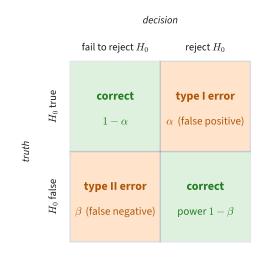
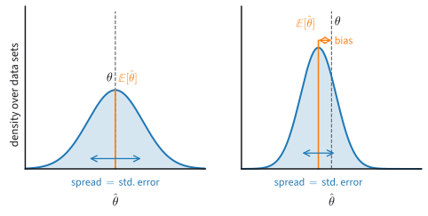
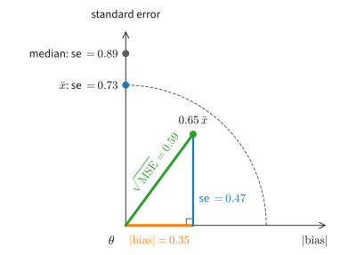
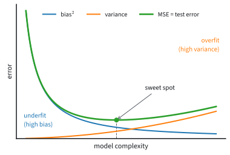
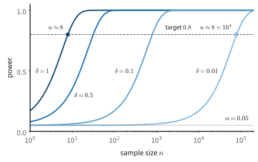

# Statistics
:label:`sec_mdl-statistics`

Every model in this book has been judged by a number computed on held-out
data: a test accuracy, a validation loss, a score on a benchmark. We read
such a number as a property of the model. It is also a property of the
particular examples that happened to land in the test set. Suppose a
classifier answers 912 of 1,000 test questions correctly. On another 1,000
questions from the same source it would score a little higher or a little
lower, so its accuracy of 91.2% is one draw of a random number. A second
model answers 921 of the same questions. Is it the better model, or did
these questions happen to suit it?

Statistics answers such questions by asking how an estimate would vary over
the samples we did not draw. That variation has a distribution, the
*sampling distribution* of the estimate, and every tool in this section
describes it or reasons with it. Its center and its width say whether an
estimate is systematically off and how much it scatters. A hypothesis test
asks whether an observed difference fits inside the scatter that chance
alone produces. A confidence interval reports the parameter values that the
data cannot rule out. When no formula describes the sampling distribution,
the bootstrap simulates it from the data themselves.

These tools matter because most decisions in deep learning are made by
comparing such numbers: which model ships, which hyperparameter wins,
whether an idea helped. A decision based on a gap smaller than its own noise
is a decision made by chance. The previous sections described how data vary
when the distribution is known; this one turns data into estimates with
error bars. A test accuracy is a coin with one flip per question, so the
coin of the earlier sections, 9 heads in 13 flips, returns along the way as
a check. Throughout, we assume that the estimator or the test is chosen
before the data are seen.

The code in this section is plain NumPy, the same in every framework tab,
with SciPy's normal distribution for tail probabilities.

```{.python .input #statistics-imports}
#@tab mxnet
%matplotlib inline
from d2l import mxnet as d2l
import numpy as np
from scipy.stats import norm

rng = np.random.default_rng()
```

```{.python .input #statistics-imports}
#@tab pytorch
%matplotlib inline
from d2l import torch as d2l
import numpy as np
from scipy.stats import norm

rng = np.random.default_rng()
```

```{.python .input #statistics-imports}
#@tab tensorflow
%matplotlib inline
from d2l import tensorflow as d2l
import numpy as np
from scipy.stats import norm

rng = np.random.default_rng()
```

```{.python .input #statistics-imports}
#@tab jax
%matplotlib inline
from d2l import jax as d2l
import numpy as np
from scipy.stats import norm

rng = np.random.default_rng()
```

## Estimators and Their Sampling Distribution

Before we can ask whether 91.2% is trustworthy, we need a name for the rule
that produced it and a model of how the test questions arrived. With these
two in hand, the scatter of the accuracy becomes a calculation.

### Estimators and the Sample Proportion

An *estimator* is a rule that turns data $x_1,\ldots,x_n$ into a number
$\hat\theta_n$ meant to approximate an unknown quantity $\theta$. The sample
mean, the sample median and the fraction of correct answers are estimators.
Because the data are random, so is $\hat\theta_n$. Its distribution over
repeated samples of size $n$ is its **sampling distribution**.

For the test accuracy, let $x_i=1$ if the classifier answers question $i$
correctly and $x_i=0$ otherwise. If the questions are drawn independently
from a large pool on which the classifier's accuracy is $\theta$, the $x_i$
are independent Bernoulli variables with mean $\theta$. Earlier sections
wrote $p$ for the known bias of a coin; here the accuracy is unknown, so we
write $\theta$ for it and $\hat\theta=k/n$ for its estimate from $k$ correct
answers out of $n$. Two facts give the center and the width of the sampling
distribution:

$$
\mathbb{E}[\hat\theta] = \frac1n\sum_{i=1}^n \mathbb{E}[x_i] = \theta,
\qquad
\textrm{Var}(\hat\theta) = \frac1{n^2}\sum_{i=1}^n \textrm{Var}(x_i) = \frac{\theta(1-\theta)}{n}.
$$

The first is linearity of expectation. The second uses that the variance of
a sum of independent variables is the sum of their variances, together with
$\textrm{Var}(x_i)=\mathbb{E}[x_i^2]-\theta^2=\theta-\theta^2$. So the
estimate is centered on the true accuracy, and its scatter shrinks like
$1/\sqrt n$. At $\theta=0.912$ and $n=1{,}000$ the standard deviation is
$\sqrt{0.912\cdot0.088/1000}\approx0.0090$, or 0.9 percentage points. By the
central limit theorem the sampling distribution is close to Gaussian, so
about 95% of test sets give an accuracy within $\pm1.8$ points of $\theta$.

We can watch the sampling distribution directly: draw 10,000 test sets of
1,000 questions for a classifier whose accuracy is $0.912$, and compute the
accuracy on each.

```{.python .input #statistics-estimator-metrics}
theta, n = 0.912, 1000
acc = rng.binomial(n, theta, 10000) / n      # accuracy on 10,000 test sets
print(f'mean {acc.mean():.4f}, std {acc.std():.4f}, '
      f'formula {np.sqrt(theta * (1 - theta) / n):.4f}')
```

The 10,000 accuracies center on $0.912$ with a standard deviation of
$0.0090$, as the formula says. This distribution over the test sets we did
not draw is the object that every later tool in this section reasons about.

Now the second model. If its 921 correct answers had come from an
independent test set, the gap of $0.009$ between the two accuracies would
have a standard deviation of $\sqrt{0.0090^2+0.0085^2}\approx0.012$, larger
than the gap itself. A single comparison of this kind cannot tell the models
apart. Both models in fact answered the same questions, and
:numref:`subsec_mdl-paired-comparisons` shows how much sharper the
comparison becomes when we use this fact.

### Bias and Variance

An estimator can go wrong in two ways: it can be off on average, or it can
scatter widely around its own average. The **bias** of $\hat\theta_n$ is the
offset of its center from the truth,

$$
\textrm{Bias}(\hat\theta_n) = \mathbb{E}[\hat\theta_n] - \theta ,
$$
:eqlabel:`eq_mdl-bias`

where the expectation runs over the random sample. An estimator whose bias
is zero for every value of $\theta$ is *unbiased*. The **variance** measures
the scatter around the estimator's own center, and its square root is the
**standard error**,

$$
\textrm{Var}(\hat\theta_n) = \mathbb{E}\bigl[(\hat\theta_n - \mathbb{E}[\hat\theta_n])^2\bigr],
\qquad
\textrm{se}(\hat\theta_n) = \sqrt{\textrm{Var}(\hat\theta_n)} .
$$
:eqlabel:`eq_mdl-var_est`

Thus the bias says where the estimates land on average, and the standard
error says how far a single estimate typically lands from there. The sample
proportion has bias $0$ and standard error $0.009$ in the example above.
Variance is measured from the estimator's center, not from $\theta$: the
rule that ignores the data and always answers $0.5$ has variance zero, and
all of its error is bias.

To see the two kinds of error side by side we need an estimator with some
bias. Take $n=30$ measurements $x_i\sim\mathcal N(\theta,\sigma^2)$ with
$\theta=1$ and $\sigma=4$, a small sample with a lot of noise. The sample
mean $\bar x$ is unbiased with variance $\sigma^2/n=16/30\approx0.533$, by
the same two facts as above. The *shrunk mean* $c\,\bar x$, with a factor
$0<c<1$, pulls the sample mean toward $0$. Its bias is
$c\theta-\theta=(c-1)\theta$ and its variance is $c^2\sigma^2/n$. At
$c=0.65$ the bias is $-0.35$, and the standard error drops from $0.73$ to
$0.47$. :numref:`fig_mdl-sampling-distribution` draws both sampling
distributions.


:label:`fig_mdl-sampling-distribution`

Which of the two is better? The shrunk mean is wrong on average, yet a
single estimate from it often lands closer to $\theta$. Settling the
question needs one number that counts both kinds of error. Before we
define it, we meet one more estimator whose bias matters.

### The Sample Variance

The standard errors above used the known $\sigma$. In practice $\sigma^2$
must be estimated from the same data. The natural estimate is the *plug-in
variance*, the average squared deviation from the sample mean,

$$
s_0^2 = \frac1n\sum_{i=1}^n (x_i-\bar x)^2 .
$$

It is biased low. The deviations are measured from $\bar x$, the point that
makes the sum of squared deviations smallest for this sample, while the true
mean $\mu$ is a different point at which the same sum is larger.

The smallest case shows by how much. For $n=2$ the sample mean is the
midpoint, so both deviations are $\pm(x_1-x_2)/2$, and

$$
\sum_{i=1}^2 (x_i-\bar x)^2 = \frac{(x_1-x_2)^2}{2} .
$$

The difference $x_1-x_2$ has mean $0$ and variance $2\sigma^2$, so the right
side has expectation $\sigma^2$. Dividing by $n=2$ gives an estimator whose
average is $\sigma^2/2$, half the truth; dividing by $n-1=1$ gives $\sigma^2$
on average. The same correction works for every $n$.

**Proposition (unbiased sample variance).** *Let $x_1,\ldots,x_n$ be i.i.d.
with mean $\mu$ and finite variance $\sigma^2$, and let $n\ge2$. Then*

$$
s^2 = \frac{1}{n-1}\sum_{i=1}^n (x_i-\bar x)^2
\qquad\textrm{satisfies}\qquad
\mathbb{E}[s^2] = \sigma^2 .
$$
:eqlabel:`eq_mdl-unbiased-var`

**Proof.** We compare the deviations from $\bar x$ with those from $\mu$.
Write $x_i-\bar x=(x_i-\mu)-(\bar x-\mu)$, expand the square, and use
$\sum_i(x_i-\mu)=n(\bar x-\mu)$ in the cross term:

$$
\sum_{i=1}^n (x_i-\bar x)^2
 = \sum_{i=1}^n (x_i-\mu)^2 - 2(\bar x-\mu)\cdot n(\bar x-\mu) + n(\bar x-\mu)^2
 = \sum_{i=1}^n (x_i-\mu)^2 - n(\bar x-\mu)^2 .
$$

The cross term is twice the last term with the opposite sign, so measuring
from $\bar x$ removes $n(\bar x-\mu)^2$ from the sum. Now take expectations.
Each $\mathbb{E}[(x_i-\mu)^2]$ equals $\sigma^2$, so the first sum has
expectation $n\sigma^2$. The sample mean has variance $\sigma^2/n$, so
$\mathbb{E}[n(\bar x-\mu)^2]=\sigma^2$. Hence the sum of squared deviations
has expectation $(n-1)\sigma^2$, and dividing by $n-1$ gives
$\mathbb{E}[s^2]=\sigma^2$. $\blacksquare$

The usual intuition counts *degrees of freedom*. The $n$ deviations
$x_i-\bar x$ sum to zero, so only $n-1$ of them can vary freely: estimating
$\bar x$ from the data used up one. The plug-in variance has bias
$\frac{n-1}{n}\sigma^2-\sigma^2=-\sigma^2/n$, which vanishes as $n$ grows.

Unbiasedness does not survive a nonlinear map. For a concave function $f$,
Jensen's inequality states $\mathbb{E}[f(X)]\le f(\mathbb{E}[X])$. With the
square root it gives $\mathbb{E}[s]\le\sqrt{\mathbb{E}[s^2]}=\sigma$, with
strict inequality unless $s$ is constant. For Gaussian data at $n=2$, the
sample standard deviation is $s=|x_1-x_2|/\sqrt2$, and
$\mathbb{E}[s]=\sigma\sqrt{2/\pi}\approx0.80\,\sigma$: the square root of an
unbiased variance underestimates the standard deviation by 20% on average.

A simulation with $n=3$ and $\sigma^2=4$ shows the bias of the plug-in
variance and its correction.

```{.python .input #statistics-unbiased-variance}
n, sigma2 = 3, 4.0
data = rng.normal(0, np.sqrt(sigma2), (100000, n))    # 100,000 samples of size 3
dev2 = ((data - data.mean(axis=1, keepdims=True)) ** 2).sum(axis=1)
print(f'true variance          {sigma2:.3f}')
print(f'average of sum / n     {(dev2 / n).mean():.3f}')
print(f'average of sum / (n-1) {(dev2 / (n - 1)).mean():.3f}')
```

Dividing by $n$ averages near $\tfrac{n-1}{n}\sigma^2=\tfrac23\cdot4\approx2.67$;
dividing by $n-1$ recovers $4$. Numerical libraries select the denominator
with a "delta degrees of freedom" argument: `np.var(x, ddof=0)` divides by
$n$, and `ddof=1` divides by $n-1$.

### The Bias–Variance Decomposition

Bias and variance describe two different failures, and the shrunk mean
trades one for the other. The **mean squared error** combines them. It is
the average squared distance of the estimator from the truth,

$$
\textrm{MSE}(\hat\theta_n) = \mathbb{E}\bigl[(\hat\theta_n-\theta)^2\bigr] .
$$
:eqlabel:`eq_mdl-mse_est`

It is the squared-error loss of regression, applied to an estimator rather
than to a prediction. It splits into the two errors we already have.

**Proposition (bias–variance decomposition).** *If $\hat\theta_n$ has finite
variance, then*

$$
\textrm{MSE}(\hat\theta_n) = \textrm{Bias}(\hat\theta_n)^2 + \textrm{Var}(\hat\theta_n) .
$$
:eqlabel:`eq_mdl-bias-variance`

**Proof.** Let $m=\mathbb{E}[\hat\theta_n]$ be the center of the estimator,
and add and subtract it inside the square:

$$
(\hat\theta_n-\theta)^2 = (\hat\theta_n-m)^2 + 2(\hat\theta_n-m)(m-\theta) + (m-\theta)^2 .
$$

Take expectations term by term. The first term gives
$\textrm{Var}(\hat\theta_n)$, and the last is the constant
$\textrm{Bias}(\hat\theta_n)^2$. The middle term vanishes, because $m-\theta$
is a constant and $\mathbb{E}[\hat\theta_n-m]=0$ by the definition of $m$.
$\blacksquare$

The decomposition is an instance of Pythagoras' theorem. Treat random variables as vectors
with the inner product $\langle U,V\rangle=\mathbb{E}[UV]$. The fluctuation
$\hat\theta_n-m$ has mean zero, which says that it is orthogonal to every
constant $a$: $\langle\hat\theta_n-m,\,a\rangle=a\,\mathbb{E}[\hat\theta_n-m]=0$.
The error $\hat\theta_n-\theta$ is the sum of this fluctuation and the
constant $m-\theta$, so its squared length, the MSE, is the sum of the
squared lengths of two orthogonal legs, $\textrm{se}^2$ and $\textrm{Bias}^2$.
In the same geometry, $\mathbb{E}[X]$ is the orthogonal projection of $X$
onto the constants, the projection of
:numref:`sec_mdl-geometry-linear-algebraic-ops` with an inner product built
from expectations. :numref:`fig_mdl-stat-mse-triangle` draws the triangle.

![The bias–variance decomposition as Pythagoras' theorem, for estimators of $\theta=1$ from 30 draws of $\mathcal N(1,16)$. Each estimator is a point at horizontal distance $|\textrm{bias}|$ and height $\textrm{se}$, and its distance from the origin is $\sqrt{\textrm{MSE}}$. Shrinking $\bar x$ to $0.65\,\bar x$ adds a horizontal leg of 0.35 but shortens the vertical one from 0.73 to 0.47, so the hypotenuse falls to 0.59 and the point lies inside the dashed circle of estimators as good as $\bar x$. The sample median is unbiased but lies outside it.](../img/mdl-prob-stat-mse-triangle.svg)
:label:`fig_mdl-stat-mse-triangle`

The decomposition lets us rank estimators. We compute the squared bias, the
variance and the MSE of three estimators of $\theta=1$ over 10,000 data sets
of 30 draws each: the sample mean, the shrunk mean $0.65\,\bar x$ and the
sample median.

```{.python .input #statistics-sampling-distribution}
theta, sigma, n = 1.0, 4.0, 30
data = rng.normal(theta, sigma, (10000, n))   # 10,000 data sets of size 30
estimates = {'mean': data.mean(axis=1),
             '0.65 * mean': 0.65 * data.mean(axis=1),
             'median': np.median(data, axis=1)}
```

```{.python .input #statistics-verify-decomposition}
print(f'{"estimator":>12} {"bias^2":>7} {"var":>6} {"sum":>6} {"MSE":>6}')
for name, est in estimates.items():
    bias2 = (est.mean() - theta) ** 2
    var = est.var()                           # a plain average: divides by the count
    mse = ((est - theta) ** 2).mean()
    print(f'{name:>12} {bias2:7.3f} {var:6.3f} {bias2 + var:6.3f} {mse:6.3f}')
```

Every run gives an MSE of about $0.53$ for the sample mean, all of it
variance. The shrunk mean has about $0.12+0.23=0.35$. The median has about
$0.80$: it is unbiased, but its variance is half again that of $\bar x$.
A biased estimator wins, and an unbiased estimator can still be a poor one.
In each row the sum matches the MSE to round-off. The decomposition holds
exactly for the empirical distribution of the 10,000 estimates as well,
provided the variance is a plain average that divides by the count.

### The Shrunk Mean and the Trade-off

The table raises a question: how much bias should we accept in exchange for
less variance? For the shrunk mean the answer is a short calculation. By
:eqref:`eq_mdl-bias-variance`, with the bias and variance found above,

$$
\textrm{MSE}(c) = (1-c)^2\theta^2 + c^2\frac{\sigma^2}{n} .
$$

The first term grows as we shrink harder, and the second falls. Setting the
derivative $-2(1-c)\theta^2+2c\,\sigma^2/n$ to zero gives the best factor and
its error,

$$
c^\star = \frac{\theta^2}{\theta^2+\sigma^2/n},
\qquad
\textrm{MSE}(c^\star) = \frac{\theta^2\,\sigma^2/n}{\theta^2+\sigma^2/n} < \frac{\sigma^2}{n} .
$$

Thus the best shrinkage always beats the sample mean, and it helps most when
the noise $\sigma^2/n$ is large compared with the signal $\theta^2$. At
$\theta=1$, $\sigma=4$ and $n=30$ we get $c^\star=1/1.533\approx0.65$, the
factor used above, and the MSE falls from $0.533$ to $0.348$.
:numref:`fig_mdl-bias-variance-u-curve` plots the two terms and their sum
against $c$. Here the U shape is exact: it is the sum of a falling
parabola and a rising one.


:label:`fig_mdl-bias-variance-u-curve`

The optimal factor $c^\star$ contains the unknown $\theta$, so it is not
an estimator we can compute. A factor fixed without knowing $\theta$ can do
harm. At $\theta=10$ the same $c=0.65$ has bias $-3.5$ and MSE
$12.25+0.23\approx12.5$, more than twenty times the $0.533$ of $\bar x$.
Shrinking toward $0$ helps only when the truth is near $0$. Exercise
:exref:`ex_mdl-statistics-shrinking-mean` replaces $\theta$ in $c^\star$ by
its estimate, and exercise :exref:`ex_mdl-statistics-stein` shows that in
three or more dimensions a similar substitution beats the sample mean for
every $\theta$.

The same trade-off governs prediction. Suppose labels are generated as
$y=f^*(x)+\varepsilon$, where the noise $\varepsilon$ has mean zero and
variance $\sigma^2$ and is independent of the training set, and let $\hat f$
be a model fitted to a random training set. At a fixed input $x$, the
prediction $\hat f(x)$ is an estimator of the unknown number $f^*(x)$, and
the expected squared error on a fresh label splits into three terms,

$$
\mathbb{E}\bigl[(y-\hat f(x))^2\bigr]
= \bigl(\mathbb{E}[\hat f(x)]-f^*(x)\bigr)^2 + \textrm{Var}\bigl(\hat f(x)\bigr) + \sigma^2 ,
$$

as derived in :numref:`sec_generalization_basics`. The first two terms are
the MSE of the estimator $\hat f(x)$; the third is the noise in the label,
which no model can remove. In many families of models, more flexibility
lowers the bias and raises the variance, and regularization plays the role
of the factor $c$ :cite:`Geman.Bienenstock.Doursat.1992`. Unlike the MSE of
the shrunk mean, the error along such a family need not trace a U: very
flexible models that fit their training data exactly can still predict
well.

### Consistency and Efficiency

Bias and variance describe an estimator at one sample size. A different
question is whether it gets things right eventually: with enough data, does
the estimate settle on the truth? An estimator is **consistent** if it
*converges in probability* to $\theta$,

$$
P\bigl(|\hat\theta_n-\theta|>\varepsilon\bigr)\to 0
\quad\textrm{as } n\to\infty,\ \textrm{for every } \varepsilon>0 ,
$$

written $\hat\theta_n\xrightarrow{P}\theta$. In words, the chance of missing
$\theta$ by more than any fixed margin vanishes as the sample grows.

The decomposition gives a simple sufficient condition. Markov's inequality
states that a nonnegative random variable $Z$ satisfies
$P(Z\ge a)\le\mathbb{E}[Z]/a$ for every $a>0$. Applied to
$Z=(\hat\theta_n-\theta)^2$ with $a=\varepsilon^2$, it bounds the chance of
a large miss by the MSE,

$$
P\bigl(|\hat\theta_n-\theta|>\varepsilon\bigr)
\le \frac{\textrm{MSE}(\hat\theta_n)}{\varepsilon^2}
= \frac{\textrm{Bias}(\hat\theta_n)^2+\textrm{Var}(\hat\theta_n)}{\varepsilon^2} .
$$

So if both the bias and the variance tend to zero, the estimator is
consistent. Neither condition suffices alone. The first observation by
itself, $\hat\theta_n=x_1$, is unbiased at every $n$, but its variance stays
$\sigma^2$ and it never settles. The estimator $\bar x+1$ has variance
$\sigma^2/n\to0$, but it settles on the wrong value. The plug-in variance
$s_0^2$ shows the remaining case: it is biased at every $n$, but its bias
$-\sigma^2/n$ and, for data with a finite fourth moment, its variance both
vanish, so it is consistent.

For the sample mean, the condition gives the law that makes averaging work.

**Proposition (weak law of large numbers).** *If $x_1,\ldots,x_n$ are i.i.d.
with mean $\mu$ and finite variance $\sigma^2$, then the sample mean
$\bar x_n=\frac1n\sum_{i=1}^n x_i$ satisfies*

$$
P\bigl(|\bar x_n - \mu| > \varepsilon\bigr) \le \frac{\sigma^2}{n\,\varepsilon^2}
\quad\textrm{for every } \varepsilon > 0,
\qquad\textrm{so}\qquad
\bar x_n \xrightarrow{P} \mu .
$$
:eqlabel:`eq_mdl-lln`

**Proof.** By linearity $\mathbb{E}[\bar x_n]=\mu$, so the bias is zero. The
variance of a sum of independent variables is the sum of their variances, so
$\textrm{Var}(\bar x_n)=n\sigma^2/n^2=\sigma^2/n$. The bound above with
$\textrm{MSE}=\sigma^2/n$ is the displayed inequality, and its right side
tends to zero. $\blacksquare$

Finite variance is more than the law needs: a finite mean
$\mathbb{E}|x_1|<\infty$ suffices, with a longer proof
:cite:`Wasserman.2013`. The law is why a Monte Carlo estimate of an integral
converges, why the accuracy on a large test set estimates the true accuracy,
and why the average training loss tracks the expected loss it stands in for.
The bound is crude. For the opening's classifier it says that an accuracy
measured on 1,000 questions misses by more than 3 points with probability
at most $0.0803/(1000\cdot0.03^2)\approx0.09$, while the Gaussian
approximation puts the probability near $0.001$. Its strength is that it
needs nothing beyond a finite variance.

Consistency does not rank two estimators that are both consistent. Among
unbiased estimators, the one with the smaller variance is called more
**efficient**: it reaches the same precision with less data. For Gaussian
data the sample median is unbiased for the mean, like $\bar x$, but for
large $n$ its variance is about $\frac{\pi}{2}\,\sigma^2/n$ (exercise
:exref:`ex_mdl-statistics-median-se`). The median therefore needs about
$\pi/2\approx1.57$ times as many observations for the same standard error,
an efficiency of $2/\pi\approx64\%$; at $n=30$ the table above shows $0.80$
against $0.53$. The sample proportion, by contrast, has the smallest
variance that any unbiased estimator of a Bernoulli parameter can have, a
floor known as the Cramér–Rao bound.

## Hypothesis Testing

An error bar describes one estimate. Most practical questions compare two:
is a new model better than the old one? This part builds a test for that
question by simulation, then derives the same test in closed form, and asks
how often it catches a real improvement.

### Comparison of Two Models

Training is random: the initialization, the order of the data and the
dropout masks all depend on a seed, so two runs of the same model reach
different accuracies. Suppose we train model A and model B with 20 seeds
each and record their test accuracies. Seed noise moves a single run by
about one percentage point, and model B is in truth better by 0.8 points.
Looking only at the 40 numbers, can we tell? The natural summary is the gap
between the two mean accuracies, which serves as the **test statistic** of
the comparison.

A test starts from the claim that it tries to refute. The **null hypothesis**
$H_0$ states that the two lists of accuracies come from the same
distribution, so that in particular the two models are equally good on
average. The **alternative** $H_A$ states that the distributions differ. We
ask whether the observed gap would be surprising if $H_0$ were true. If it
would, we *reject* $H_0$; if not, we *fail to reject* it. Failing to reject
is weaker than accepting, much as a court finds a defendant "not guilty"
rather than "innocent."

### The Permutation Test

To judge whether a gap is surprising under $H_0$ we need its distribution
under $H_0$, the *null distribution*. A **permutation test** builds it from
the data :cite:`Fisher.1935`. If the two lists come from the same
distribution, the labels "A" and "B" carry no information: every assignment
of the 40 numbers to two groups of 20 was equally likely to produce what we
saw. So we shuffle the labels, recompute the gap, and repeat $B$ times. The
shuffled gaps show how large a gap chance alone produces. The function below
does this for all $B$ shuffles at once and counts how many shuffled gaps are
at least as large in magnitude as the observed one.

```{.python .input #mdl-statistics-the-permutation-test-1}
def perm_p(acc_a, acc_b, rng, B=2000):
    """Two-sided permutation p-value and the B shuffled gaps."""
    k = len(acc_a)
    observed = acc_b.mean() - acc_a.mean()
    pooled = np.tile(np.concatenate([acc_a, acc_b]), (B, 1))
    shuffled = rng.permuted(pooled, axis=1)    # B relabelings
    gaps = shuffled[:, k:].mean(1) - shuffled[:, :k].mean(1)
    p = (1 + (np.abs(gaps) >= abs(observed)).sum()) / (B + 1)
    return p, gaps
```

Counting the observed labeling as one of the shuffles gives the
**$p$-value**,

$$
p = \frac{1+\#\{b:\ |\textrm{gap}_b|\ge|\textrm{gap}_{\textrm{obs}}|\}}{B+1} ,
$$

the probability, computed under $H_0$, of a gap at least as extreme as the
observed one. Thus a small $p$ says that the observed gap would be rare if
the labels did not matter. This $p$-value is *two-sided*: a gap in either
direction counts. A one-sided test that asks only whether B is better counts
only the shuffled gaps at least as large as the observed one.

Before seeing the data we fix a **significance level** $\alpha$,
conventionally $\alpha=0.05$, and we reject $H_0$ when $p\le\alpha$. The
cell below runs one simulated experiment.

```{.python .input #statistics-permutation-test}
k = 20                                       # training seeds per model
acc_a = rng.normal(0.850, 0.010, k)          # per-seed accuracy, model A
acc_b = rng.normal(0.858, 0.010, k)          # model B: a true gap of 0.008
p, gaps = perm_p(acc_a, acc_b, rng, B=10000)
observed = acc_b.mean() - acc_a.mean()
print(f'observed gap {observed:.4f}, permutation p-value {p:.3f}')
```

The printed gap scatters around the true $0.008$ from run to run, and in
most runs $p$ falls below $0.05$, so the test rejects $H_0$. Rerun the cell
and you will sometimes see it fail to reject: with this much seed noise, 20
seeds are not always enough. The subsections below measure how often this
happens, and show that it is a property of the experiment's design rather
than a flaw of the test.

A histogram of the shuffled gaps shows the null distribution, with the
observed gap and its mirror image.

```{.python .input #mdl-statistics-the-permutation-test-2}
counts, edges = np.histogram(gaps, bins=50)
centers = (edges[:-1] + edges[1:]) / 2
top = counts.max()
d2l.plot([centers, [observed] * 2, [-observed] * 2],
         [counts, [0, top], [0, top]], 'gap under label shuffling', 'count',
         legend=['shuffled gaps', '±observed gap'],
         fmts=('-', 'm--', 'm--'))
```

The shuffled gaps form a bell around zero, although the test assumed no
shape for the data, and the observed gap usually lies in a tail. The same
recipe works for any statistic that compares two groups: a difference of
medians, of error rates or of losses. It is one instance of the steps every
hypothesis test follows:

1. State $H_0$ and $H_A$.
2. Fix the significance level $\alpha$, and choose a sample size large
   enough to detect the effect that matters (below).
3. Collect the data.
4. Compute the test statistic and its $p$-value under $H_0$.
5. Reject $H_0$ if $p\le\alpha$; otherwise fail to reject it.

### The $z$-Test

Shuffling builds the null distribution by simulation. When the data are
Gaussian with known variance, the null distribution has a closed form, and so
do the $p$-value and the power. Let $x_1,\ldots,x_n$ be i.i.d.
$\mathcal N(\mu,\sigma^2)$ with $\sigma$ known, and test $H_0\!:\mu=0$ with
the standardized sample mean

$$
T = \frac{\sqrt n\,\bar x}{\sigma} .
$$

Under $H_0$, $\bar x\sim\mathcal N(0,\sigma^2/n)$, so $T$ is exactly standard
normal. Let $\Phi$ be the standard normal c.d.f. and $z_q$ its quantile,
$\Phi(z_q)=q$, so that $z_{0.975}\approx1.96$. The two-sided $p$-value is
$2(1-\Phi(|T|))$, and $p\le\alpha$ holds exactly when
$|T|\ge z_{1-\alpha/2}$. At $\alpha=0.05$ the test rejects when the sample
mean lies more than 1.96 standard errors from $0$.
:numref:`fig_mdl-statistical_significance` shows the two rejection tails.

For a general statistic $T$ with observed value $t$, the two-sided $p$-value
doubles the smaller tail,
$\min\{1,\,2\min\{P_{H_0}(T\ge t),\,P_{H_0}(T\le t)\}\}$. The cap at 1
matters only for discrete statistics, where the two tails can overlap.


:label:`fig_mdl-statistical_significance`

The model comparison has a two-sample version of this test. With $k$ seeds
per model and per-seed standard deviation $\sigma$, the gap
$\bar x_B-\bar x_A$ has variance $2\sigma^2/k$, and
$T=(\bar x_B-\bar x_A)/(\sigma\sqrt{2/k})$ is standard normal under $H_0$. With
$\sigma=0.01$ and $k=20$ the gap has standard error $0.0032$, so a gap of
$0.008$ lies 2.5 standard errors from zero: beyond 1.96, but not by much.

### Two Kinds of Error and Power

A test can go wrong in two ways, and a good design controls both. A **type I
error**, or false positive, rejects a true $H_0$: we declare an improvement
that is not there. A **type II error**, or false negative, fails to reject a
false $H_0$: we miss a real improvement. Their rates are

$$
\alpha = P(\textrm{reject } H_0 \mid H_0 \textrm{ true}),
\qquad
\beta = P(\textrm{fail to reject } H_0 \mid H_0 \textrm{ false}),
$$

where $\beta$ is evaluated at a given alternative, such as a true gap of 0.8
points. The **power** $1-\beta$ is the probability of detecting that effect.
:numref:`fig_mdl-type-i-ii-matrix` arranges the four outcomes.


:label:`fig_mdl-type-i-ii-matrix`

The rule "reject when $p\le\alpha$" has a type I error rate of $\alpha$
because under $H_0$ the $p$-value is uniformly distributed.

**Proposition ($p$-values are uniform under the null).** *Let the test
statistic $T$ have a continuous c.d.f. $F$ under $H_0$, and let $p=1-F(T)$
(one-sided) or $p=2\min\{F(T),1-F(T)\}$ (two-sided). Then
$P_{H_0}(p\le\alpha)=\alpha$ for every $\alpha\in[0,1]$.*

**Proof.** First, $U=F(T)$ is uniform on $[0,1]$. For $u\in(0,1)$, let $t_u$
be the largest $t$ with $F(t)=u$; it exists because $F$ is continuous and
tends to $0$ and $1$. Since $F$ is nondecreasing, $F(T)\le u$ holds exactly
when $T\le t_u$, so $P(U\le u)=F(t_u)=u$. For the one-sided $p$-value,
$P(1-U\le\alpha)=P(U\ge1-\alpha)=\alpha$. For the two-sided one,
$2\min\{U,1-U\}\le\alpha$ means $U\le\alpha/2$ or $U\ge1-\alpha/2$, and these
two disjoint events have probability $\alpha/2$ each. $\blacksquare$

For the permutation $p$-value the argument is a counting one. Under $H_0$ the
observed labeling and the $B$ shuffles are exchangeable, so the observed gap
is equally likely to hold any of the $B+1$ ranks among the $B+1$ gaps. The
$p$-value is at most $\alpha$ only when the observed gap is among the
$\lfloor\alpha(B+1)\rfloor$ largest, so $P_{H_0}(p\le\alpha)\le\alpha$ (ties
only make $p$ larger). The $+1$ in the numerator secures this guarantee.
Uniformity is what a significance level means: a test at level $\alpha$
rejects a true null in a fraction $\alpha$ of experiments. The corrections
for running many tests, below, are statements about uniform $p$-values.

A simulation shows the uniform distribution, and what replaces it when
there is an effect. We draw 2,000 data sets of 20 observations with
$\sigma=1$, apply the $z$-test to each, and histogram the $p$-values into ten
bins, once under $H_0$ and once with a true mean of $0.8$.

```{.python .input #mdl-statistics-two-kinds-of-error-and-power-1}
for mu in (0.0, 0.8):
    z = rng.normal(mu, 1.0, (2000, 20)).mean(axis=1) * np.sqrt(20)
    p = 2 * norm.sf(np.abs(z))                # two-sided z-test p-values
    hist = np.histogram(p, bins=10, range=(0, 1))[0] / 2000
    print(f'mu = {mu}:', ' '.join(f'{h:.2f}' for h in hist))
```

Under $H_0$ each of the ten bins holds about a tenth of the $p$-values.
Under the effect, about 97% of them fall below $0.1$; this pile-up near zero
is the power of the test.

The $p$-value is easy to misread :cite:`Wasserstein.Lazar.2016`. It is the
probability of data at least this extreme, computed under $H_0$. It is not
the probability that $H_0$ is true, which would require a prior and Bayes'
rule. A large $p$-value does not confirm $H_0$ either; it means only that
this experiment did not detect an effect, possibly because it could not.

How often does the model comparison detect its true gap? For the $z$-test
the power has a closed form. If the true mean is $\mu\ne0$, then $T$ is
normal with mean $\sqrt n\,\mu/\sigma$ and variance 1. Write
$\delta=|\mu|/\sigma$ for the **standardized effect**, the effect measured in
units of the noise. The test rejects when $|T|\ge z_{1-\alpha/2}$, which
happens with probability

$$
1-\beta \approx \Phi\bigl(\delta\sqrt n - z_{1-\alpha/2}\bigr) ,
$$

where we have dropped the far tail on the wrong side, of probability
$\Phi(-\delta\sqrt n-z_{1-\alpha/2})$. Thus the power grows with the effect
and with $\sqrt n$. For $\delta=1$ and $n=8$ it is
$\Phi(2.83-1.96)\approx0.81$.

In the two-sample comparison the statistic has
mean $\delta\sqrt{k/2}$ with $\delta=0.008/0.010=0.8$, so the power with $k$
seeds per model is $\Phi(0.8\sqrt{k/2}-1.96)$: $0.72$ with 20 seeds and
$0.24$ with 5. The cell below runs the permutation test on 400 fresh
experiments for each design.

```{.python .input #mdl-statistics-two-kinds-of-error-and-power-2}
def power(k, gap, rng, num_experiments=400):
    """Fraction of fresh experiments in which the permutation test rejects."""
    rejections = 0
    for _ in range(num_experiments):
        acc_a = rng.normal(0.850, 0.010, k)
        acc_b = rng.normal(0.850 + gap, 0.010, k)
        rejections += perm_p(acc_a, acc_b, rng)[0] <= 0.05
    return rejections / num_experiments

for k in (20, 5):
    print(f'{k:2d} seeds: rejects in {power(k, 0.008, rng):.2f} of runs, '
          f'formula {norm.cdf(0.8 * np.sqrt(k / 2) - 1.96):.2f}')
```

The permutation test rejects in about 70% of the experiments with 20 seeds
and about 20% with 5; with 400 experiments, each printed rate scatters by
about two points from run to run. Both rates are a little below the formula
on average, which assumes that $\sigma$ is known, while the permutation test
in effect estimates the noise from the data. So the design we ran misses a
real 0.8-point improvement about three times in ten, and with five seeds about four times in five. When a
test with power $0.2$ fails to reject, we have learned almost nothing. A
common target is power $0.8$.

### Sample Size

Power can be planned before any data are collected. Setting the power equal
to $1-\beta$ gives $\delta\sqrt n-z_{1-\alpha/2}=z_{1-\beta}$, and solving
for $n$ gives the sample size needed to detect a standardized effect $\delta$
at level $\alpha$ with power $1-\beta$:

$$
n = \frac{\bigl(z_{1-\alpha/2} + z_{1-\beta}\bigr)^{2}}{\delta^{2}} .
$$
:eqlabel:`eq_mdl-power-sample-size`

The sample size grows like $1/\delta^2$: halving the effect we want to detect
takes four times the data. At $\alpha=0.05$ and power $0.8$, the quantiles
are $z_{0.975}\approx1.960$ and $z_{0.8}\approx0.842$, so
$n\approx7.85/\delta^2$. An effect of one standard deviation needs about 8
observations, and an effect of $0.01$ standard deviations needs about
78,500. :numref:`fig_mdl-power` plots the power curves behind these numbers.


:label:`fig_mdl-power`

Comparing two groups of $k$ observations each, with common standard
deviation $\sigma$, doubles the variance of the statistic,
$\textrm{Var}(\bar x_B-\bar x_A)=2\sigma^2/k$, and so doubles the sample size
needed per group:

$$
k = \frac{2\bigl(z_{1-\alpha/2} + z_{1-\beta}\bigr)^{2}}{\delta^{2}},
\qquad \delta = \frac{|\mu_B-\mu_A|}{\sigma} .
$$
:eqlabel:`eq_mdl-two-sample-size`

For the model comparison, $\delta=0.8$ gives $k=2\cdot7.85/0.64\approx25$
seeds per model for power $0.8$. Twenty seeds fall a little short, which is
why the test above misses about three times in ten.

### Paired Comparisons
:label:`subsec_mdl-paired-comparisons`

Return to the opening. The two classifiers answered the *same* 1,000
questions, and some questions are hard for both. Treating the two accuracies
as independent samples leaves this shared difficulty in the noise. A
**paired** comparison works with the differences per question instead. Let
$d_i\in\{-1,0,1\}$ be model B's correctness minus model A's on question $i$.
On most questions the models agree, and $d_i=0$. Suppose they disagree on 41
questions: B alone is right on 25 and A alone on 16, a net of $+9$, which is
the gap of 0.9 points. Under the null hypothesis that the two models are
interchangeable, each disagreement is equally likely to go either way, so the
right shuffle flips the sign of each $d_i$ at random. This is the
**sign-flip permutation test**.

```{.python .input #mdl-statistics-paired-comparisons}
d = np.r_[np.ones(25), -np.ones(16), np.zeros(959)]   # B only, A only, agree
nonzero = d[d != 0]                                    # agreements never change
signs = rng.choice([-1, 1], size=(100000, len(nonzero)))
flipped = (signs * nonzero).sum(axis=1) / len(d)       # gaps under H_0
p = (1 + (np.abs(flipped) >= abs(d.mean())).sum()) / (len(flipped) + 1)
print(f'gap {d.mean():.3f}, sign-flip p-value {p:.2f}')
```

Every run gives $p\approx0.21$, so the gap is still not significant. The
959 questions on which the models agree contribute nothing to the test. The
evidence is the split of 25 against 16 among the 41 disagreements.

Pairing matters most when an evaluation is planned. Consider two models with
accuracies of 90% and 91% that disagree on 4% of the questions, with B alone
right on 2.5% and A alone on 1.5%. Then $d_i$ has mean $0.01$ and variance
$\mathbb{E}[d_i^2]-0.01^2=0.04-0.0001=0.0399$, a standardized effect of
$\delta=0.01/\sqrt{0.0399}\approx0.050$. By
:eqref:`eq_mdl-power-sample-size`, a paired test detects the gap with power
$0.8$ on about $7.85\cdot0.0399/0.01^2\approx3{,}100$ questions. Two
independent test sets, one per model, need about
$7.85\cdot0.1719/0.01^2\approx13{,}500$ questions each, because the unpaired
gap has variance $0.9\cdot0.1+0.91\cdot0.09=0.1719$ per pair of questions.

Pairing saves a factor of about four here, and more when the models agree
more often. Benchmark comparisons should therefore use one test set and be
analyzed per question. The same holds for seeds: when both models are
trained with the same seeds, the per-seed differences are the units whose
signs we flip (exercise :exref:`ex_mdl-statistics-paired-comparisons`).

### Multiple Testing

The guarantee $P(\textrm{reject}\mid H_0)=\alpha$ holds for one test fixed in
advance, and a hyperparameter sweep runs many. Compare 20 configurations with
a baseline, none of them actually better, each at $\alpha=0.05$. If the tests
are independent, the chance that at least one of them "wins" is
$1-0.95^{20}\approx0.64$. Reporting only the comparisons that cleared
$p\le\alpha$ is called *$p$-hacking*, and it turns noise into apparent
findings. The simplest remedy is the **Bonferroni correction**
:cite:`Bonferroni.1936`: test each of the $m$ hypotheses at level
$\alpha/m$. If $A_j$ is the event that test $j$ rejects its true null, the
union bound gives

$$
P\Bigl(\bigcup_{j=1}^m A_j\Bigr) \le \sum_{j=1}^m P(A_j) = m\cdot\frac{\alpha}{m} = \alpha ,
$$

so the chance of any false positive stays at most $\alpha$, with no
assumption about how the tests depend on each other. For 20 independent
tests at $0.05/20$, the chance is $1-(1-0.0025)^{20}\approx0.049$.

When $m$ runs into the hundreds, the Bonferroni threshold is so strict that
real effects are missed. Large-scale screening then controls the **false
discovery rate** instead, the expected fraction of false positives among the
rejected hypotheses. The procedure of Benjamini and Hochberg
:cite:`Benjamini.Hochberg.1995` controls it at level $\alpha$ when the
$p$-values are independent or positively dependent; exercise
:exref:`ex_mdl-statistics-multiple-comparisons` states the rule and tests it.

## Confidence Intervals

A $p$-value answers a yes-or-no question about one value of the parameter.
Often we want the complementary view: the whole range of values that the
data allow, reported as an error bar around the estimate.

### Definition and Interpretation

A **confidence interval** is built by a procedure that captures the fixed
unknown parameter in a stated fraction of repeated experiments
:cite:`Neyman.1937`. Formally, a $1-\alpha$ confidence interval is an
interval $C_n$ computed from the data such that

$$
P_\theta(C_n \ni \theta) \ge 1 - \alpha \quad \textrm{for every } \theta .
$$
:eqlabel:`eq_mdl-confidence`

We write $C_n\ni\theta$ to stress where the randomness lives: $\theta$ is
fixed, and the interval changes from data set to data set. The guarantee
describes the procedure. Over many data sets, at least 95% of the 95%
intervals contain $\theta$; a given interval either contains it or does not,
and nothing in the interval tells which. :numref:`fig_mdl-prob-coverage`
shows 100 intervals from 100 independent data sets. Many intervals used in
practice meet the guarantee only in the limit: an *asymptotic* $1-\alpha$
interval satisfies $\liminf_{n\to\infty}P_\theta(C_n\ni\theta)\ge1-\alpha$
for every $\theta$.


:label:`fig_mdl-prob-coverage`

A Bayesian *credible interval* answers a different question. It treats
$\theta$ as random with a prior distribution, and it reports an interval
that holds posterior probability $1-\alpha$ given the observed data. For the
chapter's coin, 9 heads in 13 flips, a $\mathrm{Beta}(a,b)$ prior gives the
posterior $\mathrm{Beta}(a+9,\,b+4)$ (:numref:`sec_mdl-exponential-family`),
and the uniform prior $a=b=1$ gives $\mathrm{Beta}(10,5)$. Its central 95%
credible interval, between the 2.5% and 97.5% posterior quantiles, is
$(0.42,0.87)$. The confidence interval for the same data, computed below, is
$(0.44,0.94)$.

The two intervals are similar here, but they make different statements. The
credible interval says that, given the prior, $\theta$ lies in it with
probability 0.95. A 95% confidence interval says that the procedure that
produced it contains the true $\theta$ in at least 95% of experiments,
whatever $\theta$ is. The Wald interval used here meets that guarantee only
approximately, for large $n$: at 13 flips its coverage is about 91% at
$\theta=\frac12$ and below 50% at $\theta=0.05$.

### The Gaussian Interval

We first build an interval in the simplest case, where every step is
exact. Take $x_1,\ldots,x_n$ i.i.d. $\mathcal N(\mu,\sigma^2)$ with
$\sigma$ known. Then $\bar x\sim\mathcal N(\mu,\sigma^2/n)$, so with
$c=z_{1-\alpha/2}\,\sigma/\sqrt n$ the estimate lands within $c$ of $\mu$
with probability exactly $1-\alpha$. A statement about the estimate becomes
a statement about $\mu$ through an equivalence of events,

$$
|\bar x-\mu|\le c
\quad\Longleftrightarrow\quad
\mu\in[\bar x-c,\ \bar x+c] ,
$$

so $P_\mu(\mu\in[\bar x-c,\bar x+c])=1-\alpha$ for every $\mu$. Thus the
event "the interval contains $\mu$" is the same event as "the estimate lands
within $c$ of $\mu$." At $\alpha=0.05$ the interval is
$\bar x\pm1.96\,\sigma/\sqrt n$.

When $\sigma$ is unknown, we replace it by the sample standard deviation
$s$ of :eqref:`eq_mdl-unbiased-var`. The studentized statistic
$T=(\bar x-\mu)/(s/\sqrt n)$ is then no longer normal. For Gaussian data it
has Student's $t$ distribution with $n-1$ degrees of freedom
:cite:`Student.1908`, whose tails are heavier because $s$ fluctuates too. We
take this fact on faith. It rests on two properties of Gaussian samples:
$\bar x$ and $s^2$ are independent, and $(n-1)s^2/\sigma^2$ has the $\chi^2$
distribution with $n-1$ degrees of freedom (exercise
:exref:`ex_mdl-statistics-variance-denominator` uses the second). Inverting
as before, with the quantile $t_{n-1,1-\alpha/2}$ of the $t$ distribution in
place of $z_{1-\alpha/2}$, gives the interval

$$
\left[\bar x - t_{n-1,1-\alpha/2}\,\frac{s}{\sqrt n},\; \bar x + t_{n-1,1-\alpha/2}\,\frac{s}{\sqrt n}\right] ,
$$
:eqlabel:`eq_mdl-t-interval`

whose coverage is exactly $1-\alpha$ for Gaussian data at every $n\ge2$. The
quantile matters at small $n$: $t_{n-1,0.975}$ is $12.71$ at $n=2$, $2.776$
at $n=5$ and $1.984$ at $n=100$, and it approaches $1.96$ as $n$ grows. The
interval used in practice replaces the quantile by its limit,

$$
\left[\bar x - 1.96\,\frac{s}{\sqrt n},\; \bar x + 1.96\,\frac{s}{\sqrt n}\right] ,
$$
:eqlabel:`eq_mdl-gauss_confidence`

an asymptotic 95% interval that is too short at every finite $n$: for
Gaussian data its coverage is $P(|t_{n-1}|\le1.96)$, which is $0.947$ at
$n=100$ but only $0.878$ at $n=5$.

For data that are not Gaussian, the central limit theorem
(:numref:`subsec_mdl-gaussian-clt`) states that $\sqrt n(\bar x-\mu)/\sigma$
approaches a standard normal distribution whenever the variance is finite,
and $s$ approaches $\sigma$ by the law of large numbers. So
:eqref:`eq_mdl-gauss_confidence` is an asymptotic 95% interval for the mean
of any distribution with finite variance. How large $n$ must be depends on
the distribution. Skewed data need more observations (exercise
:exref:`ex_mdl-statistics-coverage-small-n`), and an accuracy near 100% needs
far more, because then many test sets report a perfect score (exercise
:exref:`ex_mdl-statistics-delta-boundary`). In every case the half-width
shrinks like $1/\sqrt n$, so halving an error bar takes four times the data.

An accuracy is the mean of 0/1 indicators with $s^2\approx\hat\theta(1-\hat\theta)$,
so the same interval applies to it as
$\hat\theta\pm1.96\sqrt{\hat\theta(1-\hat\theta)/n}$, often called the *Wald
interval*. We compute it for the opening's classifier and for the coin.

```{.python .input #statistics-confidence-interval}
for k, n in ((912, 1000), (9, 13)):
    theta_hat = k / n
    half = 1.96 * np.sqrt(theta_hat * (1 - theta_hat) / n)
    print(f'{k:3d} of {n:4d}: ({theta_hat - half:.3f}, {theta_hat + half:.3f})')
```

The classifier's accuracy is $91.2\%\pm1.8$ points. The coin's interval
$(0.44,0.94)$ contains $\tfrac12$, so 13 flips cannot show that the coin is
biased. Narrowing its interval to $\pm0.05$ would take about
$1.96^2\cdot0.69\cdot0.31/0.05^2\approx330$ flips.

The guarantee :eqref:`eq_mdl-confidence` is a statement about many data
sets, so we can check it by simulation. The cell below draws 1,000 data sets
of $n=100$ standard normal observations, builds the interval
:eqref:`eq_mdl-gauss_confidence` from each, and counts how many contain the
true mean $0$.

```{.python .input #mdl-statistics-a-gaussian-example-1}
mu, n, trials = 0.0, 100, 1000
data = rng.normal(mu, 1.0, (trials, n))           # one row = one data set
mu_hat = data.mean(axis=1)
se = data.std(axis=1, ddof=1) / np.sqrt(n)
hits = np.abs(mu_hat - mu) <= 1.96 * se           # does the interval contain mu?
print(f'first interval ({mu_hat[0] - 1.96 * se[0]:.3f}, '
      f'{mu_hat[0] + 1.96 * se[0]:.3f}) contains 0: {hits[0]}')
print(f'{hits.sum()} of {trials} intervals contain the true mean '
      f'(nominal 950, exact 947)')
```

The first interval contains $0$ in about 95% of runs. The count lands near
947, typically within $\pm14$, rather than near the nominal 950. The
shortfall is systematic. At $n=100$ the exact quantile $t_{99,0.975}=1.984$ is
slightly larger than $1.96$, and the coverage of the 1.96 interval is
$P(|t_{99}|\le1.96)=0.947$. The spread of $\pm14$ is two binomial standard
deviations of the count, $2\sqrt{1000\cdot0.947\cdot0.053}\approx14$. The
same construction gives the error bar on a mean accuracy over $k$ training
seeds: the seed-to-seed standard deviation divided by $\sqrt k$, times the
appropriate quantile.

### Tests and Intervals

The number 1.96 has now appeared twice, as the rejection threshold of the
$z$-test and as the multiplier of the interval's half-width. The two uses
are one fact seen from two sides.

**Proposition (duality of tests and intervals).** *For Gaussian data with
known $\sigma$, let $C=[\bar x-c,\,\bar x+c]$ with
$c=z_{1-\alpha/2}\,\sigma/\sqrt n$. The $z$-test of $H_0\!:\mu=\mu_0$ that
rejects when $|T|>z_{1-\alpha/2}$, with $T=\sqrt n(\bar x-\mu_0)/\sigma$,
keeps $H_0$ exactly when $\mu_0\in C$.*

**Proof.** The test keeps $H_0$ when $|T|\le z_{1-\alpha/2}$, that is, when
$|\bar x-\mu_0|\le c$, which says that $\mu_0$ lies in $C$. $\blacksquare$

In words, *a 95% confidence interval is the set of null values that a 5%
test keeps*. Coverage follows from the level of the test: for every $\mu$,
$P_\mu(\mu\in C)=1-P_\mu(\textrm{the test of }H_0\!:\mu\textrm{ rejects})=1-\alpha$.

The same construction works for any family of tests. Suppose that for each
$\theta_0$ we have a level-$\alpha$ test of $H_0\!:\theta=\theta_0$. The
set of values $\theta_0$ that it does not reject contains the true $\theta$
with probability at least $1-\alpha$, by the same one-line argument, so it
is a $1-\alpha$ confidence set. This is how intervals are built when no
formula inverts the test. For 29 correct answers out of 30, the Wald interval
reaches past an accuracy of 1, while inverting an exact binomial test gives
an interval inside $[0,1]$ (exercise :exref:`ex_mdl-statistics-delta-boundary`).

### The Delta Method

We often report not $\hat\theta$ itself but a function of it: the log-odds of
an accuracy, the ratio of two losses, a relative improvement. Its error bar
follows from the error bar of $\hat\theta$. If $g$ is differentiable at
$\theta$, the first-order Taylor expansion

$$
g(\hat\theta)\approx g(\theta)+g'(\theta)\,(\hat\theta-\theta)
$$

says that near $\theta$ the map $g$ stretches deviations by the factor
$|g'(\theta)|$. The standard error therefore propagates as

$$
\textrm{se}\bigl(g(\hat\theta)\bigr) \approx \bigl|g'(\hat\theta)\bigr|\,\textrm{se}(\hat\theta) ,
$$
:eqlabel:`eq_mdl-delta-method`

where the unknown $\theta$ in $g'$ has been replaced by its estimate. This
rule is the *delta method* :cite:`Wasserman.2013`. For an accuracy
$\hat\theta=0.90$ on $n=1{,}000$ questions,
$\textrm{se}(\hat\theta)=\sqrt{0.9\cdot0.1/1000}\approx0.0095$. Its log-odds
$g(\hat\theta)=\log\frac{\hat\theta}{1-\hat\theta}\approx2.20$ has slope
$g'(\hat\theta)=1/(\hat\theta(1-\hat\theta))\approx11.1$, so the log-odds has
a standard error of about $11.1\cdot0.0095\approx0.105$.

For a vector of estimates $\hat{\boldsymbol\theta}$ with covariance matrix
$\boldsymbol\Sigma$, the same expansion with the gradient gives
$\textrm{Var}(g(\hat{\boldsymbol\theta}))\approx\nabla g^\top\boldsymbol\Sigma\,\nabla g$.
The off-diagonal entries matter: the ratio of two losses measured on the
same test set has a correlated numerator and denominator, and ignoring the
correlation misstates its error bar.

The rule needs $g'(\theta)\ne0$. Where
the slope vanishes, as for $g(\theta)=(\theta-\frac12)^2$ at
$\theta=\frac12$, the first-order term disappears and $g(\hat\theta)$
fluctuates on the scale $1/n$ rather than $1/\sqrt n$. The rule also needs
$\hat\theta$ to stay where the linear approximation holds, which fails for
an accuracy near 100% (exercise :exref:`ex_mdl-statistics-delta-boundary`).
When no derivative is convenient at all, we can resample instead.

## The Bootstrap

Every standard error so far came from a formula. A median, an AUC or a BLEU
score varies from test set to test set just as an accuracy does, but it has
no convenient formula. This part simulates the sampling distribution
instead, first checks the simulation where the answer is known, and then
shows where it breaks.

### The Plug-in Principle

If we knew the distribution $F$ that generated the data, we could simulate
the sampling distribution of any statistic: draw many fresh data sets from
$F$ and recompute the statistic on each. The **bootstrap**
:cite:`Efron.1979` makes one substitution. It replaces the unknown $F$ by the
*empirical distribution* $\hat F_n$, which puts mass $1/n$ on each observed
point. Drawing $n$ points from $\hat F_n$ is the same as resampling the data
$n$ times with replacement. The procedure has three steps:

1. Draw $n$ points from the data with replacement to form a *bootstrap
   resample*; some points appear several times, others not at all.
2. Compute the statistic $\hat\theta^*$ on the resample.
3. Repeat $B$ times to obtain $\hat\theta^*_1,\ldots,\hat\theta^*_B$.

The standard deviation of the replicates estimates the standard error of
$\hat\theta$, and their $\alpha/2$ and $1-\alpha/2$ quantiles form the
*percentile interval*. :numref:`fig_mdl-bootstrap` shows the procedure. The
bootstrap assumes that the observations are i.i.d. and that the statistic
changes smoothly when the data change a little.

![The ordinary bootstrap. From one observed sample (top left), draw many resamples of the same size with replacement (bottom left; a tick's height counts how many copies of that observation were drawn) and recompute the statistic, here the median. The replicate histogram (right) estimates the sampling distribution around the observed estimate $\hat\theta$ (dashed line); its standard deviation estimates the standard error, and its central quantiles give a percentile interval. The histogram is jagged because a resample's median can take only a few of the observed values; this mild non-smoothness becomes a failure for the maximum.](../img/mdl-prob-bootstrap.svg)
:label:`fig_mdl-bootstrap`

### Bootstrap Standard Errors

Before trusting the bootstrap where no formula exists, we check it where one
does. The opening's test set has 912 correct and 88 incorrect answers.
Resampling its 1,000 indicators and recomputing the accuracy should
reproduce the standard error $0.0090$.

```{.python .input #statistics-bootstrap-contrast}
correct = np.r_[np.ones(912), np.zeros(88)]          # the opening's test set
idx = rng.integers(0, len(correct), (5000, len(correct)))  # 5,000 resamples
boot = correct[idx].mean(axis=1)                     # accuracy of each resample
print(f'bootstrap se {boot.std(ddof=1):.4f}, '
      f'formula {np.sqrt(0.912 * 0.088 / 1000):.4f}')
```

The two agree to within a few percent. Now a statistic without a
convenient formula: the median of 200 draws from the exponential
distribution with mean 1, a skewed distribution whose median
$\log2\approx0.69$ lies below its mean.

```{.python .input #statistics-bootstrap}
data = rng.exponential(1.0, 200)    # its median's se formula needs the unknown density
theta_hat = np.median(data)
idx = rng.integers(0, len(data), (10000, len(data)))  # resample with replacement
boot = np.median(data[idx], axis=1)                   # one median per resample
lo, hi = np.percentile(boot, [2.5, 97.5])
print(f'median {theta_hat:.3f}, bootstrap se {boot.std(ddof=1):.3f}, '
      f'95% percentile interval ({lo:.3f}, {hi:.3f})')
```

The printed median scatters around $\log2\approx0.69$ from run to run,
usually by less than $0.15$, and the bootstrap standard error is near
$0.07$. A formula for the median's standard error does exist,
$1/(2f(m)\sqrt n)$ with $f(m)$ the density at the median $m$ (exercise
:exref:`ex_mdl-statistics-median-se`). Here it gives
$1/\sqrt{200}\approx0.071$, but it needs the unknown density, which the
bootstrap never asks for.

The bootstrap standard error moves between about $0.05$ and $0.10$ from one
data set to the next. A resample's median can only be one of the few
observed values near the sample median, so the bootstrap distribution is
lumpy and depends on the random spacing of those values. The median is
still regular enough for the bootstrap, because the density at the median
is positive.

### Failures of the Bootstrap

The bootstrap fails when the statistic does not change smoothly with the
data. The sample maximum is the standard example. Let $x_1,\ldots,x_n$ be
i.i.d. uniform on $[0,\theta]$ and $\hat\theta=\max_i x_i$. A resample has the
same maximum as the data unless it misses the largest point in all $n$
draws, so

$$
P(\hat\theta^*=\hat\theta)=1-\Bigl(1-\frac1n\Bigr)^n \;\to\; 1-\frac1e\approx0.63 .
$$

The bootstrap distribution therefore puts 63% of its mass on a single value,
while the true sampling distribution of $\hat\theta$ is continuous. Since no
resample's maximum exceeds $\hat\theta<\theta$, the percentile interval never
contains $\theta$ (exercise :exref:`ex_mdl-statistics-let-x-1-ldots`).

The bootstrap also fails when the observations are not independent, and
evaluation sets often are not. A reading-comprehension benchmark may hold
$G$ passages with $m$ questions each, and a model that misreads a passage
tends to miss several of its questions. If the correctness indicators of two
questions on the same passage have correlation $\rho$, and different passages
are independent, the accuracy has variance

$$
\textrm{Var}(\hat\theta)=\frac{\theta(1-\theta)}{Gm}\bigl(1+(m-1)\rho\bigr) ,
$$

larger by the factor $1+(m-1)\rho$ than for $Gm$ independent questions. A
bootstrap that resamples individual questions assumes independence, so it
understates the standard error by the factor $\sqrt{1+(m-1)\rho}$, which is
$\sqrt{2.9}\approx1.7$ at $m=20$ and a modest $\rho=0.1$
:cite:`Miller.2024`. Resampling whole passages restores the right answer
(exercise :exref:`ex_mdl-statistics-clustered`).

We can now attach an error bar to an estimate and decide whether a
difference between two models exceeds its noise. We can pair a comparison to
shrink that noise, size an experiment so that it detects the difference that
matters, and bootstrap an error bar for a statistic without a formula. Two
questions remain open. First, nothing here said which estimator to use, or
how precisely the data can pin down a parameter at all;
:numref:`sec_mdl-maximum_likelihood` answers both with the likelihood and its
curvature. Second, every guarantee here holds for one estimator or one test
fixed before the data were seen. A model chosen because it scored best on a
validation set is not fixed in advance, since choosing the best of many
configurations is multiple testing in another form.
:numref:`sec_mdl-generalization-bounds` asks how large a sample must be for a
guarantee to hold for every model in a class at once.

## Summary

An estimate computed from random data is itself random, and its sampling
distribution over the data sets we did not draw decides how far it can be
trusted. The offset of its center from the truth is the bias, its width is
the standard error, and the mean squared error is the sum of their squares.
A biased estimator such as the shrunk mean can therefore beat the unbiased
sample mean. A test compares an observed difference with the differences that chance
produces under a null hypothesis; because a $p$-value is uniform under the
null, rejecting at $p\le\alpha$ errs at rate $\alpha$. The sample size
needed to detect a standardized effect $\delta$ grows like $1/\delta^2$.
Pairing two models on the same questions reduces it; for a one-point gain
between models that disagree on 4% of the questions, the factor is about
four. A confidence interval is the set of parameter values that a test
keeps, and $\bar x\pm1.96\,s/\sqrt n$ is asymptotically
valid for any mean with finite variance. The bootstrap simulates the
sampling distribution by resampling the data; it works for smooth
statistics of independent observations and fails for the maximum and for
clustered test sets.

## Exercises

1. [code] **Shrinking the sample mean.** The text found that the shrunk mean
   $c\,\bar x$ of $x_1,\ldots,x_n$ i.i.d. $\mathcal N(\theta,\sigma^2)$ has
   the smallest MSE at $c^\star=\theta^2/(\theta^2+\sigma^2/n)$.
    1. Extend the `#statistics-sampling-distribution` and
       `#statistics-verify-decomposition` cells to a grid of $c\in[0,1]$ at
       $\theta=1$, $\sigma=4$ and $n=30$. Plot the squared bias, the
       variance and the MSE against $c$ with `d2l.plot`, and compare the
       empirical minimizer with $c^\star$.
    1. Shrink toward a point $a$ instead of $0$, with the estimator
       $a+c(\bar x-a)$. Compute its MSE and its optimal factor. Which $a$
       would you choose, and what does the answer say about the choice of
       $0$ in the text?
    1. $c^\star$ is not an estimator, because it contains $\theta$. Plug in
       $\bar x$ for $\theta$ and $s^2$ for $\sigma^2$, giving
       $\hat c=\bar x^2/(\bar x^2+s^2/n)$, and measure the MSE of
       $\hat c\,\bar x$ by simulation at $\theta\in\{0,1,3,10\}$. Where does
       it beat $\bar x$, and where does it lose? Exercise
       :exref:`ex_mdl-statistics-stein` shows that in three or more
       dimensions a similar substitution wins for every $\theta$.

   *Hint for (c):* at $\theta=0$ the plug-in factor is itself noisy; look at
   its distribution.
   :exlabel:`ex_mdl-statistics-shrinking-mean`

1. **Reading a $p$-value.** A $p$-value is computed under $H_0$, so by
   itself it does not give the probability that $H_0$ is true.
    1. A two-sided $z$-test of $H_0\!:\mu=0$ on $n=20$ observations reports
       $p=0.5$. Compute the power of this test at $\alpha=0.05$ against the
       standardized effect $\delta=0.1$. Why is $p=0.5$ then no evidence that
       $H_0$ is true?
    1. In a research program, $90\%$ of the tested ideas have no effect. Each
       idea is tested once at $\alpha=0.05$, with power $0.8$ against its
       true effect. What fraction of the significant results are false
       positives? Recompute the fraction for power $0.2$. This calculation
       is the core of the argument of :citet:`Ioannidis.2005`. Which of its
       ingredients does a $p$-value not contain?
   :exlabel:`ex_mdl-statistics-reading-p-value`

1. [code] **Multiple comparisons.** A hyperparameter sweep compares many
   configurations with one baseline, so it runs many tests at once.
    1. Twenty models, none of them better than the baseline, are each
       compared with it by an independent test at $\alpha=0.05$. Compute the
       probability that at least one comparison is significant, and the same
       probability at the Bonferroni threshold $\alpha/20$. Show that the
       Bonferroni correction holds the probability of at least one false
       positive at or below $\alpha$ even when the tests are dependent.
    1. The Benjamini–Hochberg procedure :cite:`Benjamini.Hochberg.1995`
       sorts the $m$ $p$-values, $p_{(1)}\le\cdots\le p_{(m)}$, finds the
       largest $k$ with $p_{(k)}\le k\alpha/m$, and rejects the $k$
       hypotheses with the smallest $p$-values. Simulate a sweep of $m=200$
       configurations, of which $m_0=180$ have no effect. Draw the
       $z$-statistics from $\mathcal N(0,1)$ for these and from
       $\mathcal N(3,1)$ for the other $20$, and compute the two-sided
       $p$-values `2 * norm.sf(np.abs(z))`. Over $1{,}000$ repetitions,
       report the average numbers of true and false discoveries and the
       average false-discovery proportion (the fraction of rejections that
       are false, or $0$ without rejections) for the uncorrected threshold
       $0.05$, for Bonferroni and for Benjamini–Hochberg. For independent
       tests, Benjamini–Hochberg guarantees an expected false-discovery
       proportion of at most $\alpha m_0/m$. Does the simulation agree?
   :exlabel:`ex_mdl-statistics-multiple-comparisons`

1. [code] **Coverage at small $n$.** The interval
   :eqref:`eq_mdl-gauss_confidence` uses the Gaussian quantile $1.96$ in
   place of the $t$-quantile, and it assumes approximately Gaussian sample
   means.
    1. Run the `#mdl-statistics-a-gaussian-example-1` cell with
       $n\in\{2,5,10,30,100\}$ and $100{,}000$ trials, and record the
       coverage of the interval. Then replace $1.96$ by the $97.5\%$
       quantile of the $t$-distribution with $n-1$ degrees of freedom, which
       is $12.71$, $2.776$, $2.262$, $2.045$ and $1.984$ for these $n$, and
       record the coverage again.
    1. Set $n=2$ and replace $1.96$ by $1.0$, the $75\%$ quantile of the
       $t$-distribution with one degree of freedom, so that the interval has
       $50\%$ coverage. Compute the coverage separately for the intervals
       shorter and longer than the median width. Does the difference
       contradict :eqref:`eq_mdl-confidence`? Would you read a short interval
       as a sign of a precise estimate?
    1. Draw the data from the exponential distribution with mean $1$ at
       $n=10$, keeping the $t$-quantile $2.262$. Measure the coverage, and
       count separately the intervals that lie entirely below and entirely
       above the true mean. Explain the asymmetry from the shape of the
       distribution.
   :exlabel:`ex_mdl-statistics-coverage-small-n`

1. [code] **Delta method near a boundary.** By :eqref:`eq_mdl-delta-method`,
   an accuracy $\hat\theta=0.90$ measured on $n=1{,}000$ test examples has a
   log-odds $\log\frac{\hat\theta}{1-\hat\theta}$ with standard error about
   $0.105$.
    1. Simulate $100{,}000$ test sets by drawing the number of correct
       predictions from the binomial distribution with $n=1{,}000$ and
       $\theta=0.9$. Compare the standard deviation of the log-odds with the
       delta-method value.
    1. Repeat with $\theta=0.999$. Estimate the fraction of test sets with
       $\hat\theta=1$, compare it with its exact value, and state the
       log-odds of such a test set.
    1. Which assumption behind the first-order expansion fails at
       $\theta=0.999$? Compute the expected number of incorrect answers,
       $n(1-\theta)$, for both values of $\theta$, and explain why this
       count, rather than $n$ alone, decides whether the delta method and
       the Wald interval can be trusted.
    1. A benchmark has 30 questions, and a model answers 29 of them
       correctly. Compute the Wald interval
       $\hat\theta\pm1.96\sqrt{\hat\theta(1-\hat\theta)/30}$ and note where
       it ends. Then invert a test: for each $\theta_0$ on a fine grid of
       $[0.5,1]$, compute the exact two-sided $p$-value of $H_0\!:\theta=\theta_0$,
       $\min\{1,\,2\min\{P_{\theta_0}(K\le29),\,P_{\theta_0}(K\ge29)\}\}$ with
       $K\sim\mathrm{Binomial}(30,\theta_0)$, and collect the $\theta_0$ that
       it keeps at $\alpha=0.05$. Compare the two intervals, and their
       coverage at $\theta=0.95$ over $100{,}000$ simulated benchmarks.
   :exlabel:`ex_mdl-statistics-delta-boundary`

1. [code] **Bootstrap of the maximum.** Let $x_1,\ldots,x_n$ be i.i.d.
   $U(0,\theta)$, let $\hat\theta=\max_i x_i$, and let $\hat\theta^*$ be the
   maximum of a bootstrap resample. The text showed that
   $P(\hat\theta^*=\hat\theta)\to1-1/e$.
    1. Show that $n(\theta-\hat\theta)/\theta$ converges in distribution to
       the exponential distribution with mean 1, whereas
       $n(\hat\theta-\hat\theta^*)/\hat\theta$, conditionally on the data,
       has an atom of probability about $0.63$ at $0$. Which part of the
       true sampling distribution does the bootstrap fail to reproduce?
    1. The basic bootstrap interval reflects the percentile quantiles
       $q_{\alpha/2}$ and $q_{1-\alpha/2}$ of the replicates about the
       estimate, $[2\hat\theta-q_{1-\alpha/2},\,2\hat\theta-q_{\alpha/2}]$.
       Adapt the `#statistics-bootstrap` cell to $n=100$ and $\theta=1$, and
       estimate the coverage of the basic $95\%$ interval over $1{,}000$
       data sets with $B=2{,}000$ resamples each.
    1. For one data set, plot the histogram of $n(\hat\theta-\hat\theta^*)$
       next to the histogram of $n(\theta-\hat\theta)$ over fresh data sets,
       and use the two pictures to explain the coverage you measured.

   *Adapted from Larry Wasserman,
   [All of Statistics](https://link.springer.com/book/10.1007/978-0-387-21736-9),
   Chapter 8, Exercise 7.*
   :exlabel:`ex_mdl-statistics-let-x-1-ldots`

1. [code] **Choosing the variance denominator.** ● Let
   $S=\sum_i(x_i-\bar x)^2$ and consider the estimators $S/c$ of $\sigma^2$.
   The plug-in variance $s_0^2$ and the unbiased estimator $s^2$ of
   :eqref:`eq_mdl-unbiased-var` are the cases $c=n$ and $c=n-1$. For
   Gaussian data, $S/\sigma^2$ has the $\chi^2$ distribution with $n-1$
   degrees of freedom, so $\textrm{Var}(S)=2(n-1)\sigma^4$.
    1. Show that for Gaussian data the MSE of $S/c$ is minimized at $c=n+1$.
       Rank $c=n-1$, $n$ and $n+1$ by their MSE at $n=3$ and $\sigma^2=4$.
    1. Extend the `#statistics-unbiased-variance` cell to estimate the three
       MSEs, and compare them with your answer to (a).
    1. For non-Gaussian i.i.d. data with excess kurtosis
       $\kappa=\mathbb{E}[(x-\mu)^4]/\sigma^4-3$, the variance of $S$ is
       $$\textrm{Var}(S)=(n-1)^2\sigma^4\left(\frac{\kappa}{n}+\frac{2}{n-1}\right).$$
       Find the MSE-optimal $c$ as a function of $n$ and $\kappa$. Evaluate
       it for Laplace data, which have $\kappa=3$, at $n=3$ and $n=10$, and
       check the case $n=3$ by simulation.
    1. The optimal shrinkage factor $c^\star$ of the text depends on the
       unknown $\theta$, whereas for Gaussian data the optimal denominator
       depends on $n$ alone. Why? What does (c) imply for the use of an
       MSE-optimal denominator when the distribution of the data is
       unknown?
   :exlabel:`ex_mdl-statistics-variance-denominator`

1. [code] **Paired comparisons.** ● Two models evaluated on the same test
   examples or the same seeds share part of their noise, and a paired test
   removes it.
    1. In the text the two models disagree on 41 questions, 25 to 16. Under
       $H_0$ the number of questions that only B gets right is
       $\mathrm{Binomial}(41,\tfrac12)$. Compute the exact two-sided
       $p$-value and compare it with the Monte Carlo value of the
       sign-flip cell in :numref:`subsec_mdl-paired-comparisons`. Then fix
       the net gap at 9 and vary the number of disagreements: compute $p$
       for 9 to 0, 17 to 8, 25 to 16 and 55 to 46. What decides the
       verdict, the gap or the number of disagreements?
    1. Model the per-seed accuracies with a seed effect that both models
       share: for seed $s$, the accuracies are $0.850+u_s+e_{A,s}$ and
       $0.858+u_s+e_{B,s}$, where $u_s\sim\mathcal N(0,0.01^2)$ and
       $e_{A,s},e_{B,s}\sim\mathcal N(0,0.003^2)$ are independent. Implement
       the sign-flip test on the per-seed differences as an exact test:
       with $k$ seeds, enumerate all $2^k$ sign patterns instead of drawing
       random ones. Over $1{,}000$ experiments with $10$ seeds, compare its
       power with that of the unpaired permutation test `perm_p`.
    1. Repeat with $5$ seeds. What is the smallest two-sided $p$-value that
       the exact sign-flip test can return, and what does it imply at
       $\alpha=0.05$? A Monte Carlo version that draws $999$ random sign
       patterns, as `perm_p` draws random shuffles, rejects in a few
       percent of these experiments. Why?
   :exlabel:`ex_mdl-statistics-paired-comparisons`

1. **Standard error of the median.** ● Let $x_1,\ldots,x_n$ be i.i.d. with
   c.d.f. $F$, median $m$, and density $f(m)>0$ at the median. The sample
   median $\hat m$ is at most $m+t$ exactly when at least half of the
   observations are at most $m+t$.
    1. The empirical c.d.f. $\hat F_n(m+t)$ has mean $F(m+t)$ and variance
       $F(m+t)\bigl(1-F(m+t)\bigr)/n$. Use the central limit theorem to show
       that $P(\hat m\le m+t)\approx\Phi\bigl(2\sqrt n\,f(m)\,t\bigr)$ for
       small $t$, and conclude that
       $\textrm{se}(\hat m)\approx 1/\bigl(2f(m)\sqrt n\bigr)$. Relate
       the factor $1/f(m)$ to the slope $g'$ in :eqref:`eq_mdl-delta-method`.
    1. Evaluate the approximation for the exponential distribution with
       mean $1$ at $n=200$, and compare it with the bootstrap standard error
       that your run of the `#statistics-bootstrap` cell prints. Rerun the
       cell several times: the printed value moves between about $0.05$ and
       $0.10$. Why does the bootstrap estimate of a median's standard error
       vary this much from data set to data set, when the bootstrap estimate
       of a mean's standard error does not?
    1. Compute the ratio $\textrm{Var}(\hat m)/\textrm{Var}(\bar x)$ for
       large $n$ for Gaussian data and for Laplace data. Which estimator of
       the location would you choose for heavy-tailed data?

   *Hint for (b):* a resample's median is one of a few observed values near
   $\hat m$, and the spacing of those values is random.
   :exlabel:`ex_mdl-statistics-median-se`

1. [code] **Clustered test sets.** ● Evaluation sets often consist of
   clusters of related items, such as several questions about one passage,
   and the i.i.d. bootstrap then understates the standard error
   :cite:`Miller.2024`. A test set has $G$ clusters of $m$ items each, its
   expected accuracy is $\theta$, the correctness indicators of two items in
   the same cluster have correlation $\rho$, and items in different clusters
   are independent.
    1. Show that the average of $m$ variables with common variance $v$ and
       pairwise correlation $\rho$ has variance $v\bigl(1+(m-1)\rho\bigr)/m$,
       and conclude that the accuracy $\hat\theta$ on the test set has
       variance
       $$\textrm{Var}(\hat\theta)=\frac{\theta(1-\theta)}{Gm}\bigl(1+(m-1)\rho\bigr).$$
    1. Simulate $G=100$ and $m=20$, drawing a cluster accuracy
       $\theta_g\sim\mathrm{Beta}(6.3,2.7)$ for each cluster and
       conditionally independent items given $\theta_g$. These choices give
       $\theta=0.7$ and $\rho=1/(6.3+2.7+1)=0.1$. Over $300$ test sets,
       compare the standard deviation of $\hat\theta$ with the average
       i.i.d. bootstrap standard error, which resamples items as in the
       `#statistics-bootstrap-contrast` cell, and with the average cluster
       bootstrap standard error, which resamples whole clusters, using
       $B=1{,}000$ resamples for each. By which factor does the i.i.d.
       bootstrap understate the standard error? Compare the factor with
       the prediction of (a).
   :exlabel:`ex_mdl-statistics-clustered`

1. [code] **Stein's paradox.** ●● Observe $\mathbf x\sim\mathcal
   N(\boldsymbol\theta,\mathbf I_d)$ and measure an estimator by its risk
   $\mathbb{E}\|\hat{\boldsymbol\theta}-\boldsymbol\theta\|^2$, the MSE with
   squares replaced by squared norms. The estimator $\mathbf x$ has risk $d$
   for every $\boldsymbol\theta$. :citet:`James.Stein.1961` showed that for
   $d\ge3$ the estimator
   $$\hat{\boldsymbol\theta}_{\textrm{JS}}=\left(1-\frac{d-2}{\|\mathbf x\|^2}\right)\mathbf x$$
   has smaller risk for every $\boldsymbol\theta$.
    1. Prove Stein's lemma :cite:`Stein.1981`: if $z\sim\mathcal N(\theta,1)$
       and $h$ is differentiable with $\mathbb{E}|h'(z)|<\infty$, then
       $\mathbb{E}[(z-\theta)h(z)]=\mathbb{E}[h'(z)]$. Integrate by parts.
    1. For an estimator $\mathbf x+\mathbf g(\mathbf x)$ with $\mathbf g$
       weakly differentiable (here: differentiable away from the origin,
       with $\mathbb{E}\|\mathbf g(\mathbf x)\|^2<\infty$), show that its
       risk is
       $$d+\mathbb{E}\|\mathbf g(\mathbf x)\|^2+2\sum_{i=1}^d\mathbb{E}\left[\frac{\partial g_i}{\partial x_i}(\mathbf x)\right].$$
       Use this identity to show that
       $\hat{\boldsymbol\theta}_{\textrm{JS}}$ has risk
       $d-(d-2)^2\,\mathbb{E}\bigl[1/\|\mathbf x\|^2\bigr]$. Where does the
       argument need $d\ge3$?
    1. Simulate the risks of $\mathbf x$, of
       $\hat{\boldsymbol\theta}_{\textrm{JS}}$, and of the positive-part
       estimator $\max\bigl(0,1-(d-2)/\|\mathbf x\|^2\bigr)\mathbf x$ for
       $d=10$ and $\|\boldsymbol\theta\|\in\{0,1,2,5,10,20\}$, and plot them
       against $\|\boldsymbol\theta\|$.
    1. Write the optimal factor $c^\star$ for $c\,\mathbf x$ in $d$
       dimensions, the analogue of the text's $c^\star$. Which function of
       the data replaces the unknown quantity in
       $\hat{\boldsymbol\theta}_{\textrm{JS}}$, and why does this substitute
       become accurate as $d$ grows? Compare with exercise
       :exref:`ex_mdl-statistics-shrinking-mean`c.
   :exlabel:`ex_mdl-statistics-stein`

1. [extended] **Peeking at a running test.** ●● An A/B test, or an
   evaluation during training, is often watched while the data arrive and
   stopped as soon as the result looks significant
   :cite:`Johari.Koomen.Pekelis.ea.2017`. Let $x_1,x_2,\ldots$ be i.i.d.
   $\mathcal N(\mu,1)$, let $H_0\!:\mu=0$, and let $S_n=\sum_{i\le n}x_i$.
   The $z$-test at time $n$ rejects when $|S_n|/\sqrt n\ge1.96$.
    1. Simulate $4{,}000$ runs of length $N=10{,}000$ under $H_0$. Estimate
       the probability that at least one of $K$ equally spaced looks rejects,
       for $K\in\{1,2,5,10,100,1000,10000\}$. The law of the iterated
       logarithm implies that this probability tends to one as monitoring
       continues indefinitely. How fast does it grow in your table?
    1. Put the prior $\mathcal N(0,\tau^2)$ on $\mu$ and define the mixture
       likelihood ratio
       $$\Lambda_n=\int\prod_{i=1}^n\frac{p(x_i\mid\mu)}{p(x_i\mid0)}\,\mathcal N(\mu;0,\tau^2)\,d\mu.$$
       Show that
       $\Lambda_n=(1+n\tau^2)^{-1/2}\exp\bigl(\tau^2S_n^2/(2(1+n\tau^2))\bigr)$,
       and that under $H_0$ it is a martingale:
       $\mathbb{E}[\Lambda_{n+1}\mid x_1,\ldots,x_n]=\Lambda_n$.
    1. Ville's inequality, which we take on faith, states that a nonnegative
       martingale with $\Lambda_0=1$ satisfies
       $P(\sup_n\Lambda_n\ge1/\alpha)\le\alpha$. Conclude that rejecting at
       the first $n$ with $\Lambda_n\ge1/\alpha$ has type I error at most
       $\alpha$, however often the data are inspected. Derive the rejection
       boundary for $|S_n|$, and compare its growth in $n$ with that of the
       fixed boundary $1.96\sqrt n$.
    1. Check the type I error of the sequential test by simulation for
       $\tau^2\in\{0.01,0.1,1\}$. Then set $\mu=0.2$, and take the
       fixed-sample $z$-test whose $n$ follows from
       :eqref:`eq_mdl-power-sample-size` for power $0.8$ as the reference.
       For each of the three values of $\tau^2$, report the power of the
       sequential test by that $n$, its median stopping time, and its power
       by $N$. How does the choice of $\tau^2$ affect these numbers? What
       does a test that is valid at every look cost, and what does it buy?
   :exlabel:`ex_mdl-statistics-peeking`

:begin_tab:`mxnet`
[Discussions](https://d2l.discourse.group/t/419)
:end_tab:

:begin_tab:`pytorch`
[Discussions](https://d2l.discourse.group/t/1102)
:end_tab:

:begin_tab:`tensorflow`
[Discussions](https://d2l.discourse.group/t/1103)
:end_tab:

:begin_tab:`jax`
[Discussions](https://d2l.discourse.group/t/1103)
:end_tab:

<!-- slides -->

::: {.slide}
::: {.cover}
[Dive into Deep Learning · §27.4]{.kicker}

How far can a number computed from data be trusted?<br>**bias · variance · tests · power · intervals · the bootstrap**
:::
:::

::: {.slide title="Is 921 of 1,000 Better than 912? The Gap Is Inside the Noise"}
[The problem]{.kicker}

- Classifier A answers 912 of 1,000 test questions: accuracy 91.2%.
- Classifier B answers 921 of the same questions: 92.1%.
- Another test set would give other numbers: an accuracy is random.
- Its standard error is $\sqrt{0.912\cdot0.088/1000}\approx0.009$, about $\pm1.8$ points at 95%.
- Read as independent, the gap of $0.009$ has standard error $0.012$.

::: {.d2l-note}
A decision based on a gap smaller than its noise is a decision made by chance.
:::
:::

::: {.slide title="By the End of This Deck You Can"}
[Goals]{.kicker}

- compute the bias, variance and standard error of an estimate;
- decide whether a gap between two models is noise, by shuffling or pairing;
- size an experiment so that it can detect the gap that matters;
- build a confidence interval and say what its 95% means;
- bootstrap an error bar where no formula exists.

**Running example:** a test accuracy, a coin with one flip per question.
The chapter's coin, 9 heads in 13 flips, returns as a check.
:::

::: {.slide title="From Known Distributions to Estimates with Error Bars"}
[Where this fits]{.kicker}

::: {.cols .vc}
::: {.col}
| section | adds |
|---|---|
| Random Variables | densities, moments, covariance |
| Distributions | the named laws and their losses |
| The Exponential Family | one form, convex fits, conjugacy |
| **Statistics** | **error bars, tests, intervals** |
| Maximum Likelihood | losses, Fisher information, MAP, EM |
| Bayesian Computation | averaging over a posterior |
| Concentration Inequalities | exponential tails of averages |
| Uniform Convergence | guarantees after selection |
| Naive Bayes | one classifier, end to end |
:::

::: {.col .narrow}
- **Uses:** mean, variance, the CLT.
- **Skips:** posteriors; guarantees for a model chosen from many.
:::
:::
:::

::: {.slide title="An Accuracy of 91.2% on 1,000 Questions Moves by ±0.9 Points"}
[Sampling distribution]{.kicker}

- $x_i=1$ if question $i$ is answered correctly; i.i.d. Bernoulli with mean $\theta$.
- $\hat\theta=k/n$ has $\mathbb{E}[\hat\theta]=\theta$ and $\textrm{Var}(\hat\theta)=\theta(1-\theta)/n$.
- 10,000 simulated test sets at $\theta=0.912$, $n=1000$:

@!statistics-estimator-metrics

::: {.d2l-note}
The distribution of $\hat\theta$ over the test sets we did not draw is its **sampling distribution**.
:::
:::

::: {.slide title="Bias Is the Offset of the Center; the Standard Error Is the Width"}
[Bias and variance]{.kicker}

{width=78%}

- $\textrm{Bias}=\mathbb{E}[\hat\theta]-\theta$; $\textrm{se}=\sqrt{\textrm{Var}(\hat\theta)}$, measured from the center.
- 30 draws of $\mathcal N(1,16)$: $\bar x$ has bias 0, se 0.73; the shrunk mean $0.65\,\bar x$ has bias $-0.35$, se 0.47.
:::

::: {.slide title="Dividing by n Underestimates σ² by the Factor (n − 1)/n"}
[The sample variance]{.kicker}

- $n=2$: $\sum_i(x_i-\bar x)^2=(x_1-x_2)^2/2$, with expectation $\sigma^2$.
- Divide by $n=2$: $\sigma^2/2$ on average. Divide by $n-1=1$: $\sigma^2$.
- In general $\sum_i(x_i-\bar x)^2=\sum_i(x_i-\mu)^2-n(\bar x-\mu)^2$, expectation $(n-1)\sigma^2$.

Simulation at $n=3$, $\sigma^2=4$:

@!statistics-unbiased-variance
:::

::: {.slide title="MSE = Bias² + Variance: Pythagoras with $\langle U,V\rangle=\mathbb{E}[UV]$"}
[The decomposition]{.kicker}

::: {.cols .vc}
::: {.col}
- $m=\mathbb{E}[\hat\theta]$: $\ \hat\theta-\theta=(\hat\theta-m)+(m-\theta)$.
- Cross term: $2(m-\theta)\,\mathbb{E}[\hat\theta-m]=0$.
- So $\textrm{MSE}=\textrm{Var}+\textrm{Bias}^2$: two orthogonal legs.
- $0.65\,\bar x$: $\sqrt{0.35^2+0.47^2}=0.59<0.73$.
:::

::: {.col .fig}
{width=96%}
:::
:::
:::

::: {.slide title="A Biased Estimator Wins: MSE 0.35, Against 0.53 for x̄ and 0.80 for the Median"}
[Ranking estimators]{.kicker}

Three estimators of $\theta=1$, over 10,000 data sets of 30 draws from $\mathcal N(1,16)$:

@!statistics-verify-decomposition

- The median is unbiased, but its variance is about $\tfrac{\pi}{2}\sigma^2/n$: 64% efficiency.

::: {.d2l-note}
Unbiased is not the same as accurate.
:::
:::

::: {.slide title="The Best Shrinkage c* = θ²/(θ² + σ²/n) Always Beats x̄, If We Knew θ"}
[The trade-off]{.kicker}

::: {.cols .vc}
::: {.col}
- $\textrm{MSE}(c)=(1-c)^2\theta^2+c^2\sigma^2/n$.
- $c^\star\approx0.65$: the MSE falls from $0.533$ to $0.348$.
- At $\theta=10$, $c=0.65$ gives MSE $12.5$: shrinking toward the wrong point hurts.
- Prediction at $x$: error $=\textrm{bias}^2+\textrm{Var}+\sigma^2_{\text{noise}}$.
:::

::: {.col .fig}
{width=98%}
:::
:::
:::

::: {.slide title="Check: Which of These Estimators Are Consistent?"}
[Check]{.kicker}

$x_1$ alone; $\ \bar x+1/n$; $\ 0.65\,\bar x$ for $\theta=1$; $\ s_0^2=\tfrac1n\sum_i(x_i-\bar x)^2$ for $\sigma^2$.

Tool: $P(|\hat\theta_n-\theta|>\varepsilon)\le\textrm{MSE}/\varepsilon^2$ (Markov).

::: {.fragment .fade-up}
::: {.d2l-note}
**Answer.** $x_1$: no, its variance stays $\sigma^2$. $\ \bar x+1/n$: yes, bias and variance
both vanish. $\ 0.65\,\bar x$: no, the bias $-0.35$ stays. $\ s_0^2$: yes, bias $-\sigma^2/n$
and (finite fourth moment) variance vanish.
:::
:::
:::

::: {.slide title="Shuffling the Labels Builds the Null Distribution from the Data"}
[The permutation test]{.kicker}

Models A, B: 20 seeds each, seed noise 1 point, true gap 0.8 points.
$H_0$: both lists of accuracies come from one distribution.

@mdl-statistics-the-permutation-test-1

@!statistics-permutation-test

$p$ counts the observed labeling as a shuffle; reject when $p\le0.05$.
:::

::: {.slide title="Under H₀ the p-Value Is Uniform, So 'Reject If p ≤ α' Errs α of the Time"}
[Uniform p-values]{.kicker}

- $U=F(T)$ with $F$ the continuous null c.d.f.: $P(U\le u)=u$.
- Two-sided: $P(U\le\alpha/2)+P(U\ge1-\alpha/2)=\alpha$.
- Permutation: the observed gap's rank is uniform on $\{1,\dots,B+1\}$ (ties only raise $p$), so $P(p\le\alpha)\le\alpha$.

Ten deciles of $p$ for $z$-tests on 2,000 data sets of 20 points:

@!mdl-statistics-two-kinds-of-error-and-power-1
:::

::: {.slide title="Twenty Seeds Catch a 0.8-Point Gain About 70% of the Time, Five About 20%"}
[Power]{.kicker}

- Type I error $\alpha$: a false win. Type II error $\beta$: a missed gain. Power $1-\beta$.
- Standardized gap $\delta=0.008/0.010=0.8$; the gap's standard error is $\sigma\sqrt{2/k}$.
- Power $\approx\Phi(\delta\sqrt{k/2}-1.96)$: $0.72$ at $k=20$, $0.24$ at $k=5$.

The permutation test on 400 fresh experiments per design:

@!mdl-statistics-two-kinds-of-error-and-power-2
:::

::: {.slide title="Detecting a 1σ Effect Takes 8 Samples, a 0.01σ Effect 78,500"}
[Sample size]{.kicker}

::: {.cols .vc}
::: {.col}
- $n=(z_{1-\alpha/2}+z_{1-\beta})^2/\delta^2\approx7.85/\delta^2$ at $\alpha=0.05$, power $0.8$.
- Two groups: $k=2\cdot7.85/\delta^2$ each; $\delta=0.8$ needs 25 seeds.
- Halving the effect costs four times the data.
:::

::: {.col .fig}
{width=98%}
:::
:::
:::

::: {.slide title="Pairing on the Same Questions: 3,100 Questions Instead of 13,500 per Model"}
[Paired comparisons]{.kicker}

- $d_i$ = B's correctness minus A's; 41 disagreements: 25 for B, 16 for A.
- $H_0$: each disagreement is a fair coin, so flip the signs at random:

@!mdl-statistics-paired-comparisons

- 90% vs 91%, disagreeing on 4%: $\textrm{Var}(d_i)=0.04-0.01^2=0.0399$.
- Paired: $7.85\cdot0.0399/0.01^2\approx3{,}100$. Unpaired: $7.85\cdot0.1719/0.01^2\approx13{,}500$ each.
:::

::: {.slide title="Check: Twenty Configurations, None Better, Each Tested at 5%"}
[Check]{.kicker}

A sweep compares 20 configurations with a baseline. None is better, and
the tests are independent. What is the chance that at least one "wins"?
How would you hold the chance of any false win at 5%?

::: {.fragment .fade-up}
::: {.d2l-note}
**Answer.** $1-0.95^{20}\approx0.64$. Bonferroni: test each at $0.05/20$;
the union bound $P(\cup_jA_j)\le\sum_jP(A_j)=\alpha$ holds under any
dependence. For hundreds of tests, control the false discovery rate instead.
:::
:::
:::

::: {.slide title="Inverting |x̄ − μ| ≤ c Gives the Interval; t Replaces 1.96 at Small n"}
[The Gaussian interval]{.kicker}

- Known $\sigma$: $|\bar x-\mu|\le c\iff\mu\in[\bar x-c,\bar x+c]$ with $c=1.96\,\sigma/\sqrt n$.
- Unknown $\sigma$: use $s$ and the $t$-quantile on $n-1$ degrees of freedom: 12.71 at $n=2$, 2.776 at $n=5$, 1.984 at $n=100$.
- Large $n$, any finite variance (CLT): $\bar x\pm1.96\,s/\sqrt n$ is asymptotically 95%.
- For an accuracy: $\hat\theta\pm1.96\sqrt{\hat\theta(1-\hat\theta)/n}$.

@!statistics-confidence-interval
:::

::: {.slide title="A 95% Interval Contains θ in 95% of Data Sets, Not This One with Probability 0.95"}
[What 95% means]{.kicker}

One thousand data sets of 100 standard normal points, one interval each:

@!mdl-statistics-a-gaussian-example-1

- About 947 hits, within $\pm14$: $P(|t_{99}|\le1.96)=0.947$.
- A credible interval makes the other statement: for the coin, $\mathrm{Beta}(10,5)$ gives $(0.42,0.87)$, given a uniform prior.
:::

::: {.slide title="A 95% Interval Is the Set of Nulls a 5% Test Keeps"}
[Tests and intervals]{.kicker}

- The $z$-test of $H_0\!:\mu=\mu_0$ keeps $H_0$ iff $|\bar x-\mu_0|\le1.96\,\sigma/\sqrt n$ iff $\mu_0\in C$.
- So $P_\mu(\mu\in C)=1-P_\mu(\text{the test of }\mu\text{ rejects})=0.95$.
- Any family of level-$\alpha$ tests gives a $1-\alpha$ set: the nulls it keeps.
- 29 of 30 right: the Wald interval $(0.90,1.03)$ passes 1; the exact binomial test keeps $(0.83,0.999)$.
:::

::: {.slide title="Error Bars Propagate by the Slope: se(log-odds) ≈ 11.1 × 0.0095 ≈ 0.105"}
[The delta method]{.kicker}

- $g(\hat\theta)\approx g(\theta)+g'(\theta)(\hat\theta-\theta)$, so $\textrm{se}(g(\hat\theta))\approx|g'(\hat\theta)|\,\textrm{se}(\hat\theta)$.
- Accuracy $0.90$ on 1,000 questions: se $0.0095$; the log-odds has slope $1/(0.9\cdot0.1)=11.1$.
- Vectors: $\textrm{Var}(g(\hat{\boldsymbol\theta}))\approx\nabla g^\top\boldsymbol\Sigma\,\nabla g$; correlations count.
- Needs $g'(\theta)\ne0$, and $\hat\theta$ away from a boundary such as accuracy 1.
:::

::: {.slide title="Resampling Reproduces the Accuracy's se of 0.009 and Needs No Formula for a Median"}
[The bootstrap]{.kicker}

- Replace the unknown $F$ by the data's empirical distribution: resample $n$ points with replacement, recompute, repeat.
- The opening's test set (912 ones, 88 zeros), then the median of 200 exponential draws:

@!statistics-bootstrap-contrast

@!statistics-bootstrap

- The median's se is near 0.07 and varies between about 0.05 and 0.10 across data sets.
:::

::: {.slide title="The Bootstrap Fails at the Maximum and Undercounts Clustered Questions by 1.7×"}
[Failures of the bootstrap]{.kicker}

- Maximum of $U(0,\theta)$: a resample keeps $\hat\theta$ unless it misses it in all $n$ draws.
- $P(\hat\theta^*=\hat\theta)=1-(1-1/n)^n\to1-1/e\approx0.63$; every $\hat\theta^*\le\hat\theta<\theta$.
- $G$ passages of $m$ questions, correlation $\rho$ within a passage: $\textrm{Var}(\hat\theta)=\frac{\theta(1-\theta)}{Gm}\bigl(1+(m-1)\rho\bigr)$.
- Resampling questions understates the se by $\sqrt{1+(m-1)\rho}=\sqrt{2.9}\approx1.7$ at $m=20$, $\rho=0.1$: resample passages.
:::

::: {.slide title="Check: A Coin Lands Heads 9 Times in 13. Is It Biased?"}
[Check]{.kicker}

Compute the exact two-sided $p$-value and the Wald interval. How many flips
would pin the bias down to $\pm0.05$?

::: {.fragment .fade-up}
::: {.d2l-note}
**Answer.** $P(X\ge9)=(715+286+78+13+1)/8192=0.133$, so $p\approx0.27$. The
interval $(0.44,0.94)$ contains $\tfrac12$: no evidence of bias. For $\pm0.05$
we need $1.96^2\cdot0.69\cdot0.31/0.05^2\approx330$ flips.
:::
:::
:::

::: {.slide title="Every Number Computed from Data Has an Error Bar"}
[Wrap-up]{.kicker}

- 91.2% on 1,000 questions: standard error 0.009.
- MSE = bias² + variance: $0.65\,\bar x$ at 0.35 beats $\bar x$ at 0.53.
- 20 seeds catch a 0.8-point gain about 70% of the time, 5 seeds about 20%.
- $n\approx7.85/\delta^2$: 8 for $\delta=1$, 78,500 for $\delta=0.01$; pairing: 3,100 vs 13,500.
- 20 null tests at 5%: a 64% chance of a false win.
- 1,000 intervals: about 947 hits; the log-odds se is 0.105 by the delta method.
- Bootstrap: 0.009 for the accuracy; fails at the maximum ($1-1/e$) and for clusters (1.7×).

**Next:** which estimator to use, and how precisely data pin down a parameter: maximum likelihood.
:::
