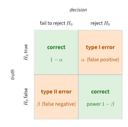
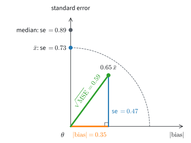

# Statistics
:label:`sec_mdl-statistics`

Every model in this book is eventually judged by a number computed on held-out
data: a test accuracy, a validation loss, or a benchmark score. We tend to
treat that number as an intrinsic property of the model, yet it also reflects
the particular examples that happened to land in the test set. Suppose a
classifier answers 912 of 1,000 test questions correctly, giving an accuracy of
91.2%. On a different set of 1,000 questions from the same source, it would
score slightly higher or slightly lower, so 91.2% is really one realization of
a random variable. Now suppose a second model answers 921 of those same
questions correctly. Is it actually better, or did this particular batch of
questions happen to favor it?

Statistics answers questions like this by asking how an estimate would fluctuate
across all the alternative samples we never drew. Those fluctuations follow a
distribution, the *sampling distribution* of the estimate, and every tool in
this section is built to describe it or reason with it. Its center and spread
tell us whether an estimate is systematically off target and how widely it
scatters. A hypothesis test checks whether an observed difference fits
comfortably inside the scatter that chance alone would produce. A confidence
interval collects all parameter values that the data cannot rule out. And when
no closed-form formula describes the sampling distribution, the bootstrap
simulates it directly from the data in hand.

In deep learning, these tools matter because almost every engineering decision
rests on comparing noisy numbers: which model to deploy, which hyperparameter
wins, or whether a new idea helped. Acting on a gap smaller than its own noise
is no better than flipping a coin. Whereas the earlier sections of this chapter
described how data behave when the underlying distribution is known, this
section works in the opposite direction, turning observed data into estimates
with honest error bars. The data need not even come from the outside world.
When we approximate an expectation by averaging samples generated on a computer
(a Monte Carlo estimate), the result is just another sample mean, so the same
theory gives its error bar (:numref:`subsec_mdl-monte-carlo`). Likewise, test
accuracy behaves like a coin tossed once per question, so the coin from earlier
sections (9 heads in 13 flips) will reappear along the way as a sanity check.

If you remember only three ideas from this section, make them these: mean
squared error splits cleanly into squared bias plus variance; a $p$-value is
uniformly distributed when the null hypothesis is true; and a confidence
interval is simply the set of parameter values that a hypothesis test fails to
reject. On a first reading, you can safely skim the discussions of consistency
and the delta method. Keep one caveat in mind throughout: every guarantee below
assumes that the estimator or test was chosen *before* looking at the data. At
the end of the section, we will see how easily those guarantees break down when
they are not.

```{.python .input #statistics-imports}
#@tab mxnet
import math
import numpy as np
from mxnet import autograd, gluon, init, np as mnp, npx
from mxnet.gluon import nn
from d2l import mxnet as d2l
npx.set_np()
```

```{.python .input #statistics-imports}
#@tab pytorch
import math
import numpy as np
import torch
from torch import nn
from torch.nn import functional as F
from d2l import torch as d2l
```

```{.python .input #statistics-imports}
#@tab tensorflow
import math
import numpy as np
import tensorflow as tf
from d2l import tensorflow as d2l
```

```{.python .input #statistics-imports}
#@tab jax
import math
import numpy as np
import jax
from jax import numpy as jnp
from flax import nnx
import optax
from d2l import jax as d2l
```

```{.python .input #mdl-statistics-statistics-1}
from scipy.stats import norm
```

```{.python .input #mdl-statistics-statistics-2}
rng = np.random.default_rng()
```

## Estimators and Their Sampling Distribution

Before we can decide how much to trust that 91.2% accuracy, we need a precise
name for the rule that produced it and a simple probability model for how the
test questions arrived.

### Estimators and the Sample Proportion

An *estimator* is any rule that turns a sample $x_1,\ldots,x_n$ into a number
$\hat\theta_n$ intended to approximate an unknown parameter $\theta$. The
sample mean, the sample median, and the fraction of correct answers on a test
set are all estimators. Because the data are random, $\hat\theta_n$ is random
too, and its distribution across repeated samples of size $n$ is its
*sampling distribution*.

To model our classifier's test accuracy, let $x_i=1$ if the model answers
question $i$ correctly and $x_i=0$ otherwise. Assuming the test questions are
drawn independently from a large pool on which the classifier's true accuracy
is $\theta$, the indicators $x_i$ are i.i.d. Bernoulli random variables with
mean $\theta$. Our estimate is the sample proportion $\hat\theta$ of correct
answers among the $n$ questions. By linearity of expectation,
$\mathbb{E}[\hat\theta]=\theta$, and as in :numref:`sec_prob`, its variance
is $\textrm{Var}(\hat\theta)=\theta(1-\theta)/n$. In other words, the sample
proportion is centered right on the true accuracy, and its typical error
shrinks at the rate $1/\sqrt n$. Plugging in $\theta=0.912$ and $n=1{,}000$
gives a standard deviation of
$\sqrt{0.912\cdot0.088/1000}\approx0.0090$, or about 0.9 percentage points. By
the central limit theorem, the sampling distribution is closely approximated by
a Gaussian, so roughly 95% of test sets yield an accuracy within $\pm1.8$
percentage points of $\theta$.

Rather than relying on formulas alone, we can observe this sampling
distribution directly. Let us simulate 10,000 independent test sets of 1,000
questions for a classifier whose true accuracy is $0.912$, and check the mean
and spread of the resulting accuracies.

```{.python .input #statistics-estimator-metrics}
theta, n = 0.912, 1000
acc = rng.binomial(n, theta, 10000) / n      # accuracy on 10,000 test sets
print(f'mean {acc.mean():.4f}, std {acc.std():.4f}, '
      f'formula {np.sqrt(theta * (1 - theta) / n):.4f}')
```

Just as the formula predicted, the simulated accuracies cluster around $0.912$
with a standard deviation of $0.0090$. That cloud of 10,000 numbers, representing
accuracies on hypothetical test sets we never drew, is the object that every
tool in this section reasons about.

Now return to our second model, which answered 921 questions correctly. If its
score had been measured on a separate, independent test set of 1,000 questions,
the observed gap of $0.009$ between the two accuracies would have a standard
deviation of $\sqrt{0.0090^2+0.0085^2}\approx0.012$, where $0.0085$ comes from
evaluating the same formula at $0.921$. A gap of $0.009$ is only about 0.7 of
its own standard error, nowhere near enough to separate the two models. Here,
however, both models were evaluated on the *same* 1,000 questions. In
:numref:`subsec_mdl-paired-comparisons`, we will see how much sharper the
comparison becomes once we take advantage of that shared test set.

### Bias and Variance

An estimator can miss the truth in two distinct ways: it can aim off center on
average, or it can scatter widely around its own average. The *bias* of
$\hat\theta_n$ measures the first kind of error, the systematic offset between
the estimator's average value and the true parameter,

$$
\textrm{Bias}(\hat\theta_n) = \mathbb{E}[\hat\theta_n] - \theta ,
$$
:eqlabel:`eq_mdl-bias`

where the expectation is taken over the random draw of the sample. When the
bias is zero for every possible value of $\theta$, we call the estimator
*unbiased*. The *variance* measures the second kind of error, how widely
$\hat\theta_n$ fluctuates around its own center, and its square root is the
*standard error*,

$$
\textrm{Var}(\hat\theta_n) = \mathbb{E}\bigl[(\hat\theta_n - \mathbb{E}[\hat\theta_n])^2\bigr],
\qquad
\textrm{se}(\hat\theta_n) = \sqrt{\textrm{Var}(\hat\theta_n)} .
$$
:eqlabel:`eq_mdl-var_est`

Put simply, bias tells us where the estimates land on average, while standard
error tells us how far a typical draw lands from that average. In our accuracy
example, the sample proportion has bias $0$ and standard error $0.009$. Notice
that variance is measured around the estimator's own mean, not around $\theta$:
a stubborn rule that ignores the data completely and always outputs $0.5$ has
zero variance, so all of its error comes from bias.

### The Sample Variance

The sample proportion is unbiased, which might make unbiasedness seem
automatic. Yet a biased estimator shows up immediately as soon as we try to
compute a standard error from data. The standard error of a sample mean depends
on the population variance $\sigma^2$, which is almost never known and must be
estimated from the same sample. The most natural choice is the *plug-in
variance*, the average squared deviation from the sample mean $\bar x$,

$$
s_0^2 = \frac1n\sum_{i=1}^n (x_i-\bar x)^2 .
$$

Surprisingly, $s_0^2$ is systematically too small. Why? Because $\bar x$ is the
unique point that minimizes the sum of squared deviations for *this* particular
sample. Measuring deviations from the true mean $\mu$, a different point, always
yields a larger sum, so replacing $\mu$ by $\bar x$ shrinks the numerator.

The smallest nontrivial sample, $n=2$, makes the size of this shrinkage
obvious. Here the sample mean is simply the midpoint of $x_1$ and $x_2$, so
both deviations equal $\pm(x_1-x_2)/2$, giving

$$
\sum_{i=1}^2 (x_i-\bar x)^2 = \frac{(x_1-x_2)^2}{2} .
$$

Because $x_1$ and $x_2$ are independent with mean $\mu$ and variance
$\sigma^2$, their difference $x_1-x_2$ has mean $0$ and variance $2\sigma^2$.
The right-hand side therefore has expectation $\sigma^2$. If we divide by
$n=2$, we get $\sigma^2/2$ on average, only half the true variance. Dividing by
$n-1=1$ instead recovers $\sigma^2$ on average. Remarkably, the exact same
$n-1$ correction removes the bias for every sample size $n$.

**Proposition (unbiased sample variance).** *Let $x_1,\ldots,x_n$ be i.i.d.
with mean $\mu$ and finite variance $\sigma^2$, and let $n\ge2$. Then*

$$
s^2 = \frac{1}{n-1}\sum_{i=1}^n (x_i-\bar x)^2
\qquad\textrm{satisfies}\qquad
\mathbb{E}[s^2] = \sigma^2 .
$$
:eqlabel:`eq_mdl-unbiased-var`

**Proof.** To compare the deviations around $\bar x$ with those around $\mu$,
write $x_i-\bar x=(x_i-\mu)-(\bar x-\mu)$ and expand the square. Using
$\sum_i(x_i-\mu)=n(\bar x-\mu)$ to simplify the cross term gives

$$
\begin{aligned}
\sum_{i=1}^n (x_i-\bar x)^2
 &= \sum_{i=1}^n (x_i-\mu)^2 - 2(\bar x-\mu)\cdot n(\bar x-\mu) + n(\bar x-\mu)^2 \\
 &= \sum_{i=1}^n (x_i-\mu)^2 - n(\bar x-\mu)^2 .
\end{aligned}
$$

The cross term is twice the final term with the opposite sign, so centering at
$\bar x$ instead of $\mu$ subtracts $n(\bar x-\mu)^2$ from the sum of squares.
Now take expectations of both sides. Each term $\mathbb{E}[(x_i-\mu)^2]$ equals
$\sigma^2$, so the first sum has expectation $n\sigma^2$. Meanwhile, the sample
mean has variance $\sigma^2/n$, so $\mathbb{E}[n(\bar x-\mu)^2]=\sigma^2$. The
sum of squared deviations therefore has expectation $(n-1)\sigma^2$, and
dividing by $n-1$ yields $\mathbb{E}[s^2]=\sigma^2$. $\blacksquare$

A helpful way to remember this factor is through *degrees of freedom*. The $n$
deviations $x_i-\bar x$ are constrained to sum to zero, so only $n-1$ of them
can vary freely: estimating $\bar x$ from the data uses up one degree of
freedom. The plug-in variance $s_0^2$ has bias
$\frac{n-1}{n}\sigma^2-\sigma^2=-\sigma^2/n$, which matters at small $n$ and
vanishes as the sample grows.

One caveat is worth noting: unbiasedness does not survive nonlinear
transformations. By Jensen's inequality applied to the concave square-root
function, $\mathbb{E}[s]\le\sqrt{\mathbb{E}[s^2]}=\sigma$, with strict
inequality whenever $s$ is not constant. For Gaussian data at $n=2$, the sample
standard deviation is $s=|x_1-x_2|/\sqrt2$, whose expectation is
$\mathbb{E}[s]=\sigma\sqrt{2/\pi}\approx0.80\,\sigma$. Thus, taking the square
root of an unbiased variance estimate still underestimates the standard
deviation by 20% on average.

In numerical libraries, you choose between these two denominators with a
"delta degrees of freedom" flag: `np.var(x, ddof=0)` divides by $n$, while
`np.var(x, ddof=1)` divides by $n-1$.

### The Bias–Variance Decomposition
:label:`subsec_mdl-bias-variance-decomposition`

To see bias and variance interact, let us construct an estimator that
deliberately trades one for the other. Suppose we observe $n=30$ noisy
measurements $x_i\sim\mathcal N(\theta,\sigma^2)$ with $\theta=1$ and
$\sigma=4$. The ordinary sample mean $\bar x$ is unbiased, with variance
$\sigma^2/n=16/30\approx0.533$ (standard error $0.73$). Now consider the
*shrunk mean* $c\,\bar x$ for a factor $0<c<1$, which pulls the sample mean
toward $0$. Pulling toward zero introduces a bias of
$c\theta-\theta=(c-1)\theta$, but it also compresses the variance to
$c^2\sigma^2/n$. At $c=0.65$, the bias is $-0.35$, while the standard error
drops sharply from $0.73$ to $0.47$. :numref:`fig_mdl-sampling-distribution`
shows both sampling distributions side by side.


:label:`fig_mdl-sampling-distribution`

Which estimator is actually better? The shrunk mean is systematically off
target, yet because it scatters much less, any single draw from it often lands
closer to $\theta$ than $\bar x$ does. To settle the comparison, we need a
single score that accounts for both errors at once. The *mean squared error*
(MSE) is the average squared distance from the estimator to the true parameter,

$$
\textrm{MSE}(\hat\theta_n) = \mathbb{E}\bigl[(\hat\theta_n-\theta)^2\bigr] .
$$
:eqlabel:`eq_mdl-mse_est`

Conveniently, the MSE decomposes cleanly into the two quantities we just
defined.

**Proposition (bias–variance decomposition).** *If $\hat\theta_n$ has finite
variance, then*

$$
\textrm{MSE}(\hat\theta_n) = \textrm{Bias}(\hat\theta_n)^2 + \textrm{Var}(\hat\theta_n) .
$$
:eqlabel:`eq_mdl-bias-variance`

**Proof.** Let $m=\mathbb{E}[\hat\theta_n]$ be the center of the estimator,
and add and subtract $m$ inside the square:

$$
(\hat\theta_n-\theta)^2 = (\hat\theta_n-m)^2 + 2(\hat\theta_n-m)(m-\theta) + (m-\theta)^2 .
$$

Now take expectations term by term. The first term gives
$\textrm{Var}(\hat\theta_n)$, and the third is the constant
$\textrm{Bias}(\hat\theta_n)^2$. The cross term vanishes because $m-\theta$ is
a constant and $\mathbb{E}[\hat\theta_n-m]=0$ by definition of $m$.
$\blacksquare$

There is a nice geometric way to picture this identity: it is Pythagoras'
theorem in disguise. If we treat random variables as vectors equipped with the
inner product $\langle U,V\rangle=\mathbb{E}[UV]$, then the zero-mean
fluctuation $\hat\theta_n-m$ is orthogonal to every constant $a$, since
$\langle\hat\theta_n-m,\,a\rangle=a\,\mathbb{E}[\hat\theta_n-m]=0$. Writing the
total error $\hat\theta_n-\theta$ as the sum of this fluctuation and the
constant bias $m-\theta$ therefore breaks it into two perpendicular legs of
lengths $\textrm{se}$ and $|\textrm{Bias}|$, whose squared lengths sum to the
squared hypotenuse $\textrm{MSE}$. From this viewpoint, $\mathbb{E}[X]$ is the
orthogonal projection of $X$ onto the subspace of constants, the same
projection we met in :numref:`sec_mdl-geometry-linear-algebraic-ops` with
expectation playing the role of the dot product.
:numref:`fig_mdl-stat-mse-triangle` illustrates this right triangle.

![The bias–variance decomposition as Pythagoras' theorem for estimators of $\theta=1$ from 30 draws of $\mathcal N(1,16)$. Each estimator sits at horizontal coordinate $|\textrm{bias}|$ and vertical coordinate $\textrm{se}$, so its distance from the origin is $\sqrt{\textrm{MSE}}$. Shrinking $\bar x$ to $0.65\,\bar x$ adds a horizontal leg of 0.35 but cuts the vertical leg from 0.73 to 0.47, reducing the hypotenuse to 0.59 and placing it inside the dashed circle of estimators as accurate as $\bar x$. The sample median is unbiased but lies outside the circle.](../img/mdl-prob-stat-mse-triangle.svg)
:label:`fig_mdl-stat-mse-triangle`

With the decomposition in hand, we can rank estimators quantitatively. For our
30-observation problem, the formula predicts an MSE of $0.533$ for the sample
mean (all variance) and $0.123+0.225=0.348$ for the shrunk mean $0.65\,\bar x$.
What about the sample median? By symmetry of the Gaussian it is unbiased,
though we do not yet have a formula for its variance. Let us simulate 10,000
data sets of size 30 and compare all three estimators empirically.

```{.python .input #statistics-sampling-distribution}
theta, sigma, n = 1.0, 4.0, 30
data = rng.normal(theta, sigma, (10000, n))   # 10,000 data sets of size 30
estimates = {'mean': data.mean(axis=1),
             '0.65 * mean': 0.65 * data.mean(axis=1),
             'median': np.median(data, axis=1)}
```

For each estimator in `estimates`, we now compute its empirical squared bias,
variance, and total MSE across the 10,000 simulated datasets and compare the
sum $\textrm{Bias}^2 + \textrm{Var}$ against our analytical predictions:

```{.python .input #statistics-verify-decomposition}
predicted = {'mean': sigma**2 / n,            # bias^2 + variance, by formula
             '0.65 * mean': (0.35 * theta)**2 + 0.65**2 * sigma**2 / n,
             'median': None}                  # no formula yet
print(f'{"estimator":>12} {"bias^2":>7} {"var":>6} {"MSE":>6} {"predicted":>9}')
for name, est in estimates.items():
    bias2 = (est.mean() - theta) ** 2
    var = est.var()                           # a plain average: divides by the count
    mse = ((est - theta) ** 2).mean()
    pred = '-' if predicted[name] is None else f'{predicted[name]:.3f}'
    print(f'{name:>12} {bias2:7.3f} {var:6.3f} {mse:6.3f} {pred:>9}')
```

The simulation confirms the formulas: the sample mean has an MSE near $0.53$,
while the shrunk mean lands at $0.12+0.23=0.35$. The sample median trails at
about $0.80$; even though it is unbiased, its variance is roughly half again as
large as that of $\bar x$. Notice the takeaway: a biased estimator can clearly
outperform an unbiased one, and being unbiased is no guarantee of accuracy.

### The Shrunk Mean and the Trade-off

This comparison immediately raises a practical question: how much bias should
we accept in exchange for lower variance? For the shrunk mean $c\,\bar x$, we
can solve this trade-off in closed form. Substituting its bias and variance
into :eqref:`eq_mdl-bias-variance` gives

$$
\textrm{MSE}(c) = (1-c)^2\theta^2 + c^2\frac{\sigma^2}{n} .
$$

As we shrink $c$ toward zero, the squared bias grows while the variance falls.
Differentiating with respect to $c$ and setting
$-2(1-c)\theta^2+2c\,\sigma^2/n=0$ yields the optimal shrinkage factor and its
minimum error,

$$
c^\star = \frac{\theta^2}{\theta^2+\sigma^2/n},
\qquad
\textrm{MSE}(c^\star) = \frac{\theta^2\,\sigma^2/n}{\theta^2+\sigma^2/n} < \frac{\sigma^2}{n} .
$$

Notice that the optimal shrinkage always beats the unshrunk sample mean, and it
helps most when the noise $\sigma^2/n$ is large relative to the signal
$\theta^2$. For our running numbers ($\theta=1$, $\sigma=4$, $n=30$), the
formula gives $c^\star=1/1.533\approx0.65$, the factor we chose earlier, and
cuts the MSE from $0.533$ down to $0.348$.
:numref:`fig_mdl-bias-variance-u-curve` plots both error components and their
sum against $c$. Here the classic U-shaped curve is exact, since it is simply
the sum of a decreasing parabola and an increasing one.


:label:`fig_mdl-bias-variance-u-curve`

Of course, there is a catch: $c^\star$ depends on the unknown parameter
$\theta$, so we cannot compute it directly from data. Worse, picking a fixed
shrinkage factor without knowing $\theta$ can backfire badly. If the true mean
were $\theta=10$, using the same $c=0.65$ would incur a bias of $-3.5$ and an
MSE of $12.25+0.23\approx12.5$, more than twenty times worse than the $0.533$
of $\bar x$. Shrinking toward $0$ helps only when the truth actually lies near
$0$. Exercise :exref:`ex_mdl-statistics-shrinking-mean` explores what happens
when we plug an estimate of $\theta$ into $c^\star$, and exercise
:exref:`ex_mdl-statistics-stein` reveals a famous surprise: in three or more
dimensions, a similar data-driven shrinkage beats the sample mean for *every*
value of $\theta$.

This same bias–variance trade-off governs supervised prediction. At any fixed
input $x$, the prediction $\hat f(x)$ of a model trained on a random data set
is an estimator of the true regression function $f^*(x)$. Its expected squared
error on a fresh label equals the MSE of that estimator plus the irreducible
variance of the label noise (:numref:`sec_generalization_basics`). Across many model families, adding
flexibility reduces bias while increasing variance, and regularization acts
much like the shrinkage factor $c$ :cite:`Geman.Bienenstock.Doursat.1992`. Keep
in mind, though, that test error in modern overparameterized models does not
always trace a simple U-shape: beyond the interpolation threshold where a
model fits its training data exactly, test error can descend a second time
(:numref:`subsec_mdl-double-descent-example`).

### Consistency and Efficiency

Bias and variance evaluate an estimator at a fixed sample size $n$. A separate
question is what happens as we gather more and more data: does the estimate
eventually lock onto the truth? We say that an estimator $\hat\theta_n$ is
*consistent* if it *converges in probability* to $\theta$, meaning

$$
P\bigl(|\hat\theta_n-\theta|>\varepsilon\bigr)\to 0
\quad\textrm{as } n\to\infty,\ \textrm{for every } \varepsilon>0 ,
$$

written $\hat\theta_n\xrightarrow{P}\theta$. Intuitively, for any tolerance
$\varepsilon>0$, the probability of missing $\theta$ by more than $\varepsilon$
shrinks to zero as the sample grows.

The bias–variance decomposition gives us a quick way to check consistency.
Applying Markov's inequality (:numref:`sec_mdl-random_variables`) to the nonnegative random
variable $(\hat\theta_n-\theta)^2$ with threshold $\varepsilon^2$ bounds the
probability of a large error directly by the MSE:

$$
P\bigl(|\hat\theta_n-\theta|>\varepsilon\bigr)
\le \frac{\textrm{MSE}(\hat\theta_n)}{\varepsilon^2}
= \frac{\textrm{Bias}(\hat\theta_n)^2+\textrm{Var}(\hat\theta_n)}{\varepsilon^2} .
$$

Consequently, if both the bias and the variance vanish as $n\to\infty$, the
estimator is guaranteed to be consistent. Neither condition is enough on its
own. Keeping only the first observation, $\hat\theta_n=x_1$, is unbiased for
every $n$, yet its variance stays stuck at $\sigma^2$ so it never converges.
Conversely, $\bar x+1$ has variance $\sigma^2/n\to0$, yet it converges to the
wrong value. The plug-in variance $s_0^2$ illustrates the happy middle ground:
even though it is biased at every finite $n$, its bias $-\sigma^2/n$ and
variance (assuming a finite fourth moment) both vanish as $n$ grows, so it is
consistent.

Applying this bound to the sample mean yields the foundational result that
makes averaging work.

**Proposition (weak law of large numbers).** *If $x_1,\ldots,x_n$ are i.i.d.
with mean $\mu$ and finite variance $\sigma^2$, then the sample mean
$\bar x_n=\frac1n\sum_{i=1}^n x_i$ satisfies*

$$
P\bigl(|\bar x_n - \mu| > \varepsilon\bigr) \le \frac{\sigma^2}{n\,\varepsilon^2}
\quad\textrm{for every } \varepsilon > 0,
\qquad\textrm{so}\qquad
\bar x_n \xrightarrow{P} \mu .
$$
:eqlabel:`eq_mdl-lln`

**Proof.** By linearity of expectation, $\mathbb{E}[\bar x_n]=\mu$, so the bias
is zero. Because the variables are independent, the variance of their sum is
the sum of their variances, giving $\textrm{Var}(\bar x_n)=n\sigma^2/n^2=\sigma^2/n$.
Substituting $\textrm{MSE}=\sigma^2/n$ into the Markov bound above produces the
inequality, whose right-hand side tends to zero as $n\to\infty$. $\blacksquare$

In fact, the law holds under the weaker assumption of a finite mean
$\mathbb{E}|x_1|<\infty$, though the proof is longer :cite:`Wasserman.2013`.
This simple theorem underpins much of machine learning: it explains why a Monte
Carlo estimate of an integral converges, why accuracy on a large test set
reflects true accuracy, and why average training loss tracks expected loss.
That said, the bound itself is quite loose. For our 91.2%-accurate classifier
on 1,000 questions, it only guarantees that the test accuracy misses $\theta$
by more than 3 percentage points with probability at most
$0.0803/(1000\cdot0.03^2)\approx0.09$, whereas the Gaussian approximation puts
that probability near $0.001$. Its real strength is generality: it assumes
nothing beyond finite variance. In :numref:`sec_mdl-concentration-generalization`,
we will derive far tighter bounds when stronger tail assumptions hold.

Consistency is only a baseline; it does not distinguish between two consistent
estimators. Among unbiased estimators, the one with smaller variance is more
*efficient*, meaning it achieves the same precision with fewer samples. For
Gaussian data, both the sample mean and the sample median are unbiased for
$\mu$, but for large $n$ the median's variance is roughly
$\frac{\pi}{2}\,\sigma^2/n$ (exercise :exref:`ex_mdl-statistics-median-se`).
The median therefore requires about $\pi/2\approx1.57$ times as much data to
match the mean's standard error, giving it an efficiency of
$2/\pi\approx64\%$. Our $n=30$ simulation already hinted at this ratio: $0.80$
against $0.53$. By contrast, the sample proportion achieves the smallest
possible variance of any unbiased estimator of a Bernoulli parameter, a
fundamental lower limit known as the Cramér–Rao bound
(:numref:`subsec_mdl-cramer-rao`).

### Monte Carlo Estimation
:label:`subsec_mdl-monte-carlo`

Up to now, our samples came from external data: test questions, noisy
measurements, or training runs. Yet the law of large numbers does not care
where the samples come from, which turns the sample mean into a powerful
computational tool. Most expectations we encounter in deep learning (an expected
loss, a normalizing constant, or the gradient of either) are integrals with no
closed form, often spanning thousands of dimensions where numerical grids are
hopelessly expensive. Even when we cannot build a grid, we can usually draw
samples. The idea goes back to the earliest electronic computers
:cite:`Metropolis.Ulam.1949`: to approximate $\mathbb{E}[g(X)]$ for a random
variable $X$ with density $p$, draw independent samples $x_1,\dots,x_n$ from
$p$ and average the function values,

$$
\mathbb{E}[g(X)] \approx \frac{1}{n}\sum_{i=1}^n g(x_i).
$$
:eqlabel:`eq_mdl-monte-carlo`

You can think of a **Monte Carlo** estimate as a Riemann sum whose evaluation
points are chosen at random with equal weight $1/n$, automatically placing more
points where the density $p$ is high. By the law of large numbers
:eqref:`eq_mdl-lln`, this average is unbiased and converges to
$\mathbb{E}[g(X)]$ as $n\to\infty$. Its convergence rate is governed by its
variance: if $X_1,\dots,X_n$ are i.i.d. with density $p$ and
$\sigma^2=\textrm{Var}(g(X))$ is finite, then

$$
\textrm{Var}\Bigl(\frac1n\sum_{i=1}^ng(X_i)\Bigr)=\frac{\sigma^2}{n}.
$$
:eqlabel:`eq_mdl-mc-variance`

There is nothing mathematically new here: this is just the $\sigma^2/n$
variance of a sample mean from the law of large numbers, with $g(X_i)$ playing
the role of $x_i$ (:numref:`sec_mdl-joint-distributions`). What is remarkable is the consequence.
The root-mean-square error shrinks as $\sigma/\sqrt n$. On the face of it, that
is slow: gaining one extra decimal digit of accuracy requires 100 times as many
samples. Yet the dimension of $x$ never appears in the exponent, and that
dimension-independence is the entire reason sampling works in high dimensions.
The one essential requirement is finite variance; as we saw in
:numref:`sec_mdl-random_variables`, heavy tails can derail an average (see
exercise :exref:`ex_mdl-random-variables-heavy-tail-averages`).

Compare this with a deterministic grid. Reaching grid spacing $\epsilon$ in $d$
dimensions requires $N=\epsilon^{-d}$ evaluation points. The left-endpoint rule
of :numref:`sec_mdl-integral_calculus` has error proportional to
$\epsilon=N^{-1/d}$, and a second-order rule such as the *midpoint rule*
(evaluating each cell at its center) improves this to $\epsilon^2=N^{-2/d}$.
Monte Carlo, meanwhile, keeps its $N^{-1/2}$ rate in every dimension. In one
dimension, the midpoint grid wins easily; at $d=4$, the exponents tie; by
$d=10$, the grid slows to $N^{-1/5}$ while Monte Carlo still converges at
$N^{-1/2}$. Although the numerator $\sigma$ can still grow with $d$, the
exponent never degrades (exercise
:exref:`ex_mdl-integral-calculus-grids-monte-carlo`).

Let us see this $1/\sqrt n$ rate in action on a concrete integral:
$\int_0^1e^{-x^2}dx=\mathbb{E}[e^{-U^2}]$ for $U$ uniform on $[0,1]$. Its exact
value is $\tfrac{\sqrt\pi}2\operatorname{erf}(1)=0.746824$. Below, we track the
running average across powers of ten, comparing the actual error against the
predicted scale $\sigma/\sqrt n$, where $\sigma=\mathrm{sd}(e^{-U^2})\approx0.2$
is estimated from the samples.

```{.python .input #integral-monte-carlo}
exact = math.sqrt(math.pi) / 2 * math.erf(1)
g = np.exp(-rng.uniform(size=10**5)**2)             # g(U), U uniform on [0, 1]
running = np.cumsum(g) / np.arange(1, 10**5 + 1)    # average of the first n
sigma = g.std()
for n in [10, 100, 1000, 10000, 100000]:
    print(f'n={n:<6}  estimate={running[n - 1]:.5f}  '
          f'error={abs(running[n - 1] - exact):.1e}  sigma/sqrt(n)={sigma / n**0.5:.1e}')
print(f'exact (sqrt(pi)/2) erf(1) = {exact:.6f}')
```

The observed errors track the predicted $\sigma/\sqrt n$ scale closely, though
each row is still just one random realization: a single error rarely exceeds
$\sigma/\sqrt n$ by more than a factor of two or three, and occasionally drops
well below it. To see how the error behaves continuously across sample sizes,
let us plot one running average at 200 log-spaced values of $n$ alongside the
root-mean-square error over 200 independent runs, which is the exact quantity
predicted by :eqref:`eq_mdl-mc-variance`.

```{.python .input #mdl-integral-calculus-monte-carlo-estimation-1}
n = np.unique(np.logspace(1, 5, 200).astype(int))
sq = np.zeros(len(n))
for _ in range(200):                                # 200 independent runs
    g_run = np.exp(-rng.uniform(size=10**5)**2)
    sq += (np.cumsum(g_run)[n - 1] / n - exact)**2
rms = np.sqrt(sq / 200)                             # root-mean-square error
ratio = rms * np.sqrt(n) / sigma
print(f'RMS error / (sigma/sqrt(n)) over all n: {ratio.min():.2f} to {ratio.max():.2f}')
d2l.plot(n, [np.abs(running[n - 1] - exact), rms, sigma / np.sqrt(n)],
         'samples n', 'error', xscale='log', yscale='log',
         legend=['one run', 'RMS over 200 runs', 'sigma / sqrt(n)'])
```

Notice the difference between the two curves. A single running average wanders
above and below the theoretical line because its values at nearby $n$ share
almost all the same samples, and it plunges sharply whenever the error crosses
zero. By contrast, the root-mean-square error averaged over 200 independent runs
stays within about 20% of $\sigma/\sqrt n$ at every $n$, falling steadily with
slope $-\tfrac12$ across all four orders of magnitude.

## Hypothesis Testing

An error bar tells us how uncertain a single estimate is, but most decisions
in machine learning compare two of them: did a new architecture, optimizer, or
regularization trick actually beat the baseline? In this subsection, we first
build a comparison test from scratch by simulation, then derive its closed-form
counterpart, and finally ask how much data an experiment needs to reliably
detect a real gain.

### Comparison of Two Models

Training a neural network is inherently random: weight initialization, data
shuffling, and dropout masks all vary with the random seed, so running the exact
same training script twice produces slightly different test accuracies. Suppose
we train model A and model B across 20 seeds each and record their test
accuracies. Imagine that seed-to-seed noise shifts a single run by roughly one
percentage point, while model B is truly better by 0.8 percentage points.
Given only those 40 numbers, can we tell that B is better? The natural summary
is the difference between the two mean accuracies, which will serve as our
*test statistic*.

Every hypothesis test begins by formulating the skeptical claim it tries to
overturn. Here, the *null hypothesis* $H_0$ asserts that both lists of
accuracies come from the same distribution, so the two models perform equally
well on average. The *alternative hypothesis* $H_A$ asserts that their
distributions differ. We then ask: if $H_0$ were true, how surprising would it
be to see a gap at least as large as ours? If the gap would be very unlikely
under chance alone, we *reject* $H_0$; otherwise, we *fail to reject* it. That
asymmetric phrasing is deliberate: failing to reject $H_0$ does not prove the
models are equal, just as a verdict of "not guilty" in court does not prove
innocence.

### The Permutation Test
:label:`subsec_mdl-permutation-test`

To judge whether an observed gap is surprising under $H_0$, we need to know its
distribution when $H_0$ holds, called the *null distribution*. Remarkably, we
can construct this distribution directly from the data without assuming
Gaussianity or any other parametric form, using a *permutation test*
:cite:`Fisher.1935`. The logic is simple: if both lists truly came from the
same distribution, then the labels "A" and "B" carry no information at all. Any
reassignment of the 40 numbers into two groups of 20 would have been just as
likely as the split we observed. By shuffling the labels, recomputing the mean
gap, and repeating this $R$ times, we map out the range of gaps that pure chance
produces. The helper below vectorizes all $R$ shuffles at once and counts how
often a shuffled gap is at least as large in magnitude as the observed one.

```{.python .input #mdl-statistics-the-permutation-test-1}
def perm_p(acc_a, acc_b, rng, R=2000):
    """Two-sided permutation p-value and the R shuffled gaps."""
    k = len(acc_a)
    observed = acc_b.mean() - acc_a.mean()
    pooled = np.tile(np.concatenate([acc_a, acc_b]), (R, 1))
    shuffled = rng.permuted(pooled, axis=1)    # R relabelings
    gaps = shuffled[:, k:].mean(1) - shuffled[:, :k].mean(1)
    p = (1 + (np.abs(gaps) >= abs(observed)).sum()) / (R + 1)
    return p, gaps
```

Including the observed labeling as one of the $R+1$ shuffles yields the
*$p$-value*,

$$
p = \frac{1+\#\{r:\ |\textrm{gap}_r|\ge|\textrm{gap}_{\textrm{obs}}|\}}{R+1} ,
$$

which estimates the probability, under $H_0$, of observing a gap at least as
extreme as the one we actually saw. A tiny $p$-value means that such a large
gap would rarely occur if the labels were meaningless. Notice that this
$p$-value is *two-sided*: large gaps in either direction count against $H_0$.
(If we asked only whether B beats A, a one-sided test would count only shuffled
gaps at least as large as the observed positive gap.)

Before looking at the data, we commit to a *significance level* $\alpha$,
conventionally $\alpha=0.05$, and agree to reject $H_0$ whenever $p\le\alpha$.
Let us run one simulated experiment with the numbers above to see the test in
action.

```{.python .input #statistics-permutation-test}
k = 20                                       # training seeds per model
acc_a = rng.normal(0.850, 0.010, k)          # per-seed accuracy, model A
acc_b = rng.normal(0.858, 0.010, k)          # model B: a true gap of 0.008
p, gaps = perm_p(acc_a, acc_b, rng, R=10000)
observed = acc_b.mean() - acc_a.mean()
print(f'observed gap {observed:.4f}, permutation p-value {p:.3f}')
```

Because each experiment draws fresh seeds, the observed gap fluctuates around
the true $0.008$ from run to run. In most runs, $p$ drops below $0.05$ and the
test rejects $H_0$, yet in a noticeable minority of runs it fails to reject, as
may happen here. With a full percentage point of seed noise, 20 seeds per model
are not always enough to catch a 0.8-point gain. Shortly, we will measure
precisely how often this happens and see that it reflects the experiment's
sample size rather than a defect in the test.

Plotting a histogram of the shuffled gaps alongside the observed gap (and its
negative mirror image) lets us see the null distribution visually.

```{.python .input #mdl-statistics-the-permutation-test-2}
counts, edges = np.histogram(gaps, bins=50)
centers = (edges[:-1] + edges[1:]) / 2
top = counts.max()
d2l.plot([centers, [observed] * 2, [-observed] * 2],
         [counts, [0, top], [0, top]], 'gap under label shuffling', 'count',
         legend=['shuffled gaps', '±observed gap'],
         fmts=('-', 'm--', 'm--'))
```

Even though the permutation test assumed nothing about the shape of the data,
the shuffled gaps settle into a neat bell curve centered at zero, with the
observed gap typically landing out in one tail. Best of all, this exact same
recipe works for *any* two-group summary statistic: a difference of medians,
error rates, or validation losses. (When comparing means in closed form, its
classical counterpart is Welch's $t$-test.) Every hypothesis test follows the
same discipline: state $H_0$ and $H_A$, fix $\alpha$ and choose a sample size
large enough to detect a meaningful effect, and only then collect the data,
compute the $p$-value, and reject $H_0$ if $p\le\alpha$.

### The $z$-Test

While shuffling builds the null distribution empirically, assuming Gaussian
data with a known variance gives us closed-form formulas for both the $p$-value
and the detection rate. Suppose $x_1,\ldots,x_n$ are i.i.d.
$\mathcal N(\mu,\sigma^2)$ with $\sigma$ known, and we wish to test
$H_0\!:\mu=0$. We standardize the sample mean by its standard error to form the
test statistic

$$
T = \frac{\sqrt n\,\bar x}{\sigma} .
$$

Under $H_0$, $\bar x\sim\mathcal N(0,\sigma^2/n)$, so $T$ follows a standard
normal distribution. Write $\Phi$ for the standard normal c.d.f. and $z_q$ for
its $q$-quantile, defined by $\Phi(z_q)=q$ (for instance,
$z_{0.975}\approx1.96$). The two-sided $p$-value is $2(1-\Phi(|T|))$, so the
condition $p\le\alpha$ is equivalent to $|T|\ge z_{1-\alpha/2}$. At
$\alpha=0.05$, we reject $H_0$ whenever the sample mean lands more than $1.96$
standard errors away from $0$. :numref:`fig_mdl-statistical_significance`
highlights these two rejection tails.


:label:`fig_mdl-statistical_significance`

Our two-model comparison has a direct two-sample version of this test. With $k$
independent seeds per model and per-seed standard deviation $\sigma$, the mean
gap $\bar x_B-\bar x_A$ has variance $2\sigma^2/k$, so
$T=(\bar x_B-\bar x_A)/(\sigma\sqrt{2/k})$ is standard normal under $H_0$.
Plugging in $\sigma=0.01$ and $k=20$ yields a standard error of $0.0032$ for the
gap. A true improvement of $0.008$ therefore sits $2.5$ standard errors above
zero, past the $1.96$ threshold, though not by a comfortable margin.

### Two Kinds of Error and Power
:label:`subsec_mdl-power`

Any hypothesis test can misfire in two ways, and good experimental design keeps
both under control. A *type I error* (or false positive) occurs when we reject
a true $H_0$, claiming an improvement that does not exist. A *type II error*
(or false negative) occurs when we fail to reject a false $H_0$, missing a
genuine improvement. Their probabilities are

$$
\alpha = P(\textrm{reject } H_0 \mid H_0 \textrm{ true}),
\qquad
\beta = P(\textrm{fail to reject } H_0 \mid H_0 \textrm{ false}),
$$

where $\beta$ is evaluated at a specific alternative, such as a true gap of 0.8
percentage points. The complement $1-\beta$ is called the *power* of the test:
the probability that the experiment actually detects that real effect.
:numref:`fig_mdl-type-i-ii-matrix` summarizes the four possible outcomes.


:label:`fig_mdl-type-i-ii-matrix`

Why does the simple rule "reject when $p\le\alpha$" guarantee a type I error
rate of exactly $\alpha$? Because under $H_0$, the $p$-value is uniformly
distributed on $[0,1]$. This fact is worth proving: not only does it explain
what a significance level means, it is also the key to understanding multiple
testing later on.

**Proposition ($p$-values are uniform under the null).** *Let the test
statistic $T$ have a continuous c.d.f. $F$ under $H_0$, and let $p=1-F(T)$
(one-sided) or $p=2\min\{F(T),1-F(T)\}$ (two-sided). Then
$P_{H_0}(p\le\alpha)=\alpha$ for every $\alpha\in[0,1]$.*

**Proof.** We first show that $U=F(T)$ is uniform on $[0,1]$. For any
$u\in(0,1)$, let $t_u$ be the largest value of $t$ satisfying $F(t)=u$; such a
value exists because $F$ is continuous and runs from $0$ to $1$. Since $F$ is
nondecreasing, $F(T)\le u$ holds if and only if $T\le t_u$, which gives
$P(U\le u)=F(t_u)=u$. For the one-sided $p$-value, it follows immediately that
$P(1-U\le\alpha)=P(U\ge1-\alpha)=\alpha$. For the two-sided $p$-value, the
event $2\min\{U,1-U\}\le\alpha$ means either $U\le\alpha/2$ or
$U\ge1-\alpha/2$; these two disjoint events each have probability $\alpha/2$,
so their union has probability $\alpha$. $\blacksquare$

For the permutation $p$-value, an even simpler counting argument gives the same
guarantee. Under $H_0$, the observed labeling and the $R$ random shuffles are
completely exchangeable, so the observed gap is equally likely to fall at any
of the $R+1$ ranks. Consequently, $p\le\alpha$ happens only when the observed
gap ranks among the $\lfloor\alpha(R+1)\rfloor$ largest in magnitude, yielding
$P_{H_0}(p\le\alpha)\le\alpha$ (ties can only increase $p$). That is why the
$+1$ in the numerator and denominator matters: it ensures that a level-$\alpha$
test rejects a true null at most a fraction $\alpha$ of the time.

What happens to the distribution of $p$-values when $H_0$ is false? To see the
contrast, let us simulate 2,000 two-sample $z$-tests with 20 seeds per model,
first with no true gap and then with our true gap of $0.008$, and histogram the
resulting $p$-values into ten equal bins.

```{.python .input #mdl-statistics-two-kinds-of-error-and-power-1}
se = 0.010 * np.sqrt(2 / k)                  # se of the gap, k seeds per model
for gap in (0.0, 0.008):
    acc_a = rng.normal(0.850, 0.010, (2000, k))
    acc_b = rng.normal(0.850 + gap, 0.010, (2000, k))
    T = (acc_b.mean(axis=1) - acc_a.mean(axis=1)) / se
    p = 2 * norm.sf(np.abs(T))                # two-sided z-test p-values
    hist = np.histogram(p, bins=10, range=(0, 1))[0] / 2000
    print(f'gap {gap:.3f}:', ' '.join(f'{h:.2f}' for h in hist),
          f'  p <= 0.05: {np.mean(p <= 0.05):.2f}')
```

When $H_0$ holds (gap $0.000$), the histogram is flat: roughly one-tenth of
the $p$-values fall in each bin, and about 5% land at or below $0.05$. When
there is a real gap of $0.008$, the $p$-values pile up sharply near zero:
about 80% fall below $0.1$, and 70% to 74% fall at or below $0.05$. That
rejection fraction is the power of the test, which our closed-form formula
below predicts to be $0.72$.

Before deriving that formula, it is worth guarding against two classic
misreadings of a $p$-value :cite:`Wasserstein.Lazar.2016`. First, a $p$-value
is the probability of seeing data at least this extreme *assuming $H_0$ is
true*; it is *not* the probability that $H_0$ is true (which would require a
prior and Bayes' rule). Second, a large $p$-value does not prove that $H_0$
holds; it only tells us that the experiment failed to detect an effect,
perhaps because it lacked the power to do so.

Let us compute that power explicitly for the one-sample $z$-test. When the true
mean is $\mu\ne0$, the statistic $T$ is normal with mean $\sqrt n\,\mu/\sigma$
and variance 1. Defining the *standardized effect* $\delta=|\mu|/\sigma$ (the
effect size measured in units of the noise), the test rejects whenever
$|T|\ge z_{1-\alpha/2}$, which happens with probability

$$
1-\beta \approx \Phi\bigl(\delta\sqrt n - z_{1-\alpha/2}\bigr) ,
$$

after dropping the negligible opposite tail $\Phi(-\delta\sqrt n-z_{1-\alpha/2})$.
Thus power rises with the effect size $\delta$ and with $\sqrt n$. For a large
effect $\delta=1$, even $n=8$ observations give power
$\Phi(2.83-1.96)\approx0.81$.

In our two-sample model comparison, the statistic has mean $\delta\sqrt{k/2}$
with $\delta=0.008/0.010=0.8$, so the $z$-test power with $k$ seeds per model
is $\Phi(0.8\sqrt{k/2}-1.96)$: about $0.72$ with 20 seeds, and only $0.24$ with
5 seeds. Because that formula assumes we know $\sigma$ in advance, let us check
how the permutation test, which estimates nothing ahead of time, performs
across 400 fresh simulated experiments for each seed budget.

```{.python .input #mdl-statistics-two-kinds-of-error-and-power-2}
def power(k, gap, rng, num_experiments=400):
    """Fraction of fresh experiments in which the permutation test rejects."""
    rejections = 0
    for _ in range(num_experiments):
        acc_a = rng.normal(0.850, 0.010, k)
        acc_b = rng.normal(0.850 + gap, 0.010, k)
        rejections += perm_p(acc_a, acc_b, rng)[0] <= 0.05
    return rejections / num_experiments

for k in (20, 5):
    print(f'{k:2d} seeds: rejects in {power(k, 0.008, rng):.2f} of runs, '
          f'formula {norm.cdf(0.8 * np.sqrt(k / 2) - 1.96):.2f}')
```

Across 400 runs, the permutation test rejects in about 70% of experiments with
20 seeds and only about 20% with 5 seeds (each rate fluctuates by roughly two
percentage points from run to run). Both numbers sit slightly below the
$z$-test formula because the permutation test effectively estimates the noise
from the data, which costs a small amount of power. Even with 20 seeds, then,
our experiment misses a genuine 0.8-point gain roughly three times in ten; with
only 5 seeds, it misses four times in five. Failing to reject with a power of
$0.2$ tells us almost nothing. In practice, experimenters typically aim for a
power of at least $0.8$.

### Sample Size

Rather than discovering after the fact that an experiment was underpowered, we
can plan the sample size up front. Setting the power formula equal to
$1-\beta$ gives $\delta\sqrt n-z_{1-\alpha/2}=z_{1-\beta}$, and solving for
$n$ yields the sample size needed to detect a standardized effect $\delta$ at
significance level $\alpha$ with power $1-\beta$:

$$
n = \frac{\bigl(z_{1-\alpha/2} + z_{1-\beta}\bigr)^{2}}{\delta^{2}} .
$$
:eqlabel:`eq_mdl-power-sample-size`

Notice the steep $1/\delta^2$ scaling: cutting the target effect size in half
requires four times as much data. For the standard benchmark of $\alpha=0.05$
and power $0.8$, we have $z_{0.975}\approx1.960$ and $z_{0.8}\approx0.842$,
which simplifies to the handy rule of thumb $n\approx7.85/\delta^2$.
:numref:`fig_mdl-power` plots the resulting power curves across effect sizes.


:label:`fig_mdl-power`

When comparing two independent groups of $k$ observations each with common
standard deviation $\sigma$, the variance of the difference doubles to
$\textrm{Var}(\bar x_B-\bar x_A)=2\sigma^2/k$. Accordingly, the required
sample size per group doubles as well:

$$
k = \frac{2\bigl(z_{1-\alpha/2} + z_{1-\beta}\bigr)^{2}}{\delta^{2}},
\qquad \delta = \frac{|\mu_B-\mu_A|}{\sigma} .
$$
:eqlabel:`eq_mdl-two-sample-size`

For our model comparison with $\delta=0.8$, reaching 80% power requires
$k=2\cdot7.85/0.64\approx25$ seeds per model, which explains why 20 seeds fell
just shy of the mark.

### Paired Comparisons
:label:`subsec_mdl-paired-comparisons`

Let us now return to our opening puzzle: two classifiers that scored 912 and
921 out of 1,000. Earlier we noted that treating their scores as independent
left the gap buried in noise. Crucially, though, both models answered the
*same* 1,000 questions. Some questions are easy for both models and others are
hard for both, and an unpaired analysis lumps all of that shared question
difficulty into the noise.

A *paired* comparison strips out that shared variation by working directly with
the per-question differences $d_i\in\{-1,0,1\}$, defined as model B's
correctness minus model A's on question $i$. Whenever both models agree,
$d_i=0$. Suppose they disagree on 41 questions: model B alone is right on 25,
and model A alone is right on 16, giving the net lead of $+9$ (0.9 percentage
points). Under the null hypothesis that the two models are interchangeable,
each disagreement is like a fair coin flip, equally likely to favor A or B. The
appropriate null simulation therefore flips the sign of each nonzero $d_i$ at
random, a procedure known as the *sign-flip permutation test*. Let us run it
on these 41 disagreements.

```{.python .input #mdl-statistics-paired-comparisons}
d = np.r_[np.ones(25), -np.ones(16), np.zeros(959)]   # B only, A only, agree
nonzero = d[d != 0]                                    # agreements never change
signs = rng.choice([-1, 1], size=(100000, len(nonzero)))
flipped = (signs * nonzero).sum(axis=1) / len(d)       # gaps under H_0
p = (1 + (np.abs(flipped) >= abs(d.mean())).sum()) / (len(flipped) + 1)
print(f'gap {d.mean():.3f}, sign-flip p-value {p:.2f}')
```

The sign-flip test returns $p\approx0.21$ (replacing random sign flips with the
exact binomial probability gives McNemar's test). Compare this with an unpaired
analysis of the exact same counts, which yields a gap of only $0.7$ standard
errors and $p\approx0.47$. Pairing cuts the standard error of the gap in half,
from $0.012$ down to $\sqrt{41}/1000\approx0.006$, because the 959 questions on
which the models agree no longer inject noise. Even so, a 25-to-16 split among
41 disagreements is still too small to be convincing: a nine-question margin on
a 1,000-question test does not establish that model B is better.

Pairing matters most when you design an evaluation from scratch.
Suppose two models have true accuracies of 90% and 91% and disagree on 4% of
questions (B alone right on 2.5%, A alone on 1.5%). Then $d_i$ has mean $0.01$
and variance $\mathbb{E}[d_i^2]-0.01^2=0.04-0.0001=0.0399$, giving a
standardized effect of $\delta=0.01/\sqrt{0.0399}\approx0.050$. By
:eqref:`eq_mdl-power-sample-size`, a paired test reaches 80% power with about
$7.85\cdot0.0399/0.01^2\approx3{,}100$ questions. By contrast, evaluating the
two models on separate, independent test sets leaves an unpaired variance of
$0.9\cdot0.1+0.91\cdot0.09=0.1719$ per pair of questions, requiring roughly
$7.85\cdot0.1719/0.01^2\approx13{,}500$ questions *per model*.

In this example, pairing shrinks each test set by more than a factor of four
and reduces total labeling effort by nearly a factor of nine, and the savings
grow even larger when the two models agree more frequently. The practical rule
is clear: always evaluate competing models on the same test set and analyze
the per-question differences. The same principle applies to random seeds: when
two models share the same training seeds, flip the signs of the per-seed
differences (exercise :exref:`ex_mdl-statistics-paired-comparisons`).

### Multiple Testing

Every significance guarantee so far, $P(\textrm{reject}\mid H_0)=\alpha$,
assumes we run a *single* test chosen in advance. In machine learning, however,
hyperparameter sweeps routinely run dozens of comparisons at once. Suppose you
compare 20 new configurations against a baseline when none of them is actually
better, testing each at $\alpha=0.05$. If the tests are independent, the
probability that at least one configuration falsely looks significant is
$1-0.95^{20}\approx0.64$. Cherry-picking only the winners, or repeatedly
tweaking an analysis until $p\le\alpha$ (*$p$-hacking*), reliably turns pure
noise into publishable-looking gains.

The simplest safeguard is the *Bonferroni correction* :cite:`Bonferroni.1936`:
when running $m$ tests, lower each individual threshold to $\alpha/m$. Writing
$A_j$ for the event that test $j$ falsely rejects a true null, the union bound
gives

$$
P\Bigl(\bigcup_{j=1}^m A_j\Bigr) \le \sum_{j=1}^m P(A_j) = m\cdot\frac{\alpha}{m} = \alpha .
$$

Notice how remarkably general this bound is: it caps the probability of making
*any* false discovery at $\alpha$ without assuming anything about how the $m$
tests are correlated. For 20 independent tests run at $0.05/20$, the chance of
at least one false positive drops from $0.64$ to
$1-(1-0.0025)^{20}\approx0.049$.

Unfortunately, when $m$ reaches the hundreds or thousands, dividing by $m$
makes the Bonferroni threshold so strict that genuine discoveries get buried.
In large-scale screening, statisticians instead control the *false discovery
rate*, the expected fraction of false positives among the hypotheses we reject.
The Benjamini–Hochberg procedure :cite:`Benjamini.Hochberg.1995` keeps this
rate at or below $\alpha$ whenever the $p$-values are independent or positively
dependent; exercise :exref:`ex_mdl-statistics-multiple-comparisons` introduces
the rule and tests it in simulation.

## Confidence Intervals
:label:`subsec_mdl-confidence-intervals`

A $p$-value answers a binary question about a single candidate parameter value.
In practice, we usually want more: the entire range of parameter values
consistent with the data, reported directly as an error bar around our
estimate.

### Definition and Interpretation

A *confidence interval* is produced by a rule guaranteed to capture the fixed,
unknown parameter in a specified fraction of repeated experiments
:cite:`Neyman.1937`. Formally, a $1-\alpha$ confidence interval is a random
interval $C_n$, computed from the data, satisfying

$$
P_\theta(C_n \ni \theta) \ge 1 - \alpha \quad \textrm{for every } \theta .
$$
:eqlabel:`eq_mdl-confidence`

We deliberately write $C_n\ni\theta$ rather than $\theta\in C_n$ to emphasize
where the randomness sits: $\theta$ is a fixed number, while the interval
$C_n$ shifts from one data set to the next. The probability $1-\alpha$ is a
property of the *procedure*. Across many independent experiments, at least 95%
of the resulting 95% confidence intervals will cover $\theta$. Any single
interval you compute either contains $\theta$ or misses it, and the interval
itself carries no hint of which happened. :numref:`fig_mdl-prob-coverage`
illustrates this with 100 intervals drawn from 100 independent samples. Many
intervals used in practice satisfy this guarantee only in the large-sample
limit: an *asymptotic* $1-\alpha$ interval satisfies
$\liminf_{n\to\infty}P_\theta(C_n\ni\theta)\ge1-\alpha$ for every $\theta$.


:label:`fig_mdl-prob-coverage`

### The Gaussian Interval

Let us start with the cleanest case, where every step is exact. Suppose
$x_1,\ldots,x_n$ are i.i.d. $\mathcal N(\mu,\sigma^2)$ with $\sigma$ known.
Because $\bar x\sim\mathcal N(\mu,\sigma^2/n)$, setting the half-width to
$h=z_{1-\alpha/2}\,\sigma/\sqrt n$ ensures that $\bar x$ lands within $h$ of
$\mu$ with probability $1-\alpha$. Now flip that inequality around so it reads
as a statement about $\mu$:

$$
|\bar x-\mu|\le h
\quad\Longleftrightarrow\quad
\mu\in[\bar x-h,\ \bar x+h] .
$$

Hence $P_\mu(\mu\in[\bar x-h,\bar x+h])=1-\alpha$ for every $\mu$. That
simple algebraic reversal is the entire idea behind a confidence interval. At
$\alpha=0.05$, the interval is $\bar x\pm1.96\,\sigma/\sqrt n$.

In real problems $\sigma$ is rarely known, so we substitute the sample standard
deviation $s$ from :eqref:`eq_mdl-unbiased-var`. Once $s$ is estimated from
the data, the studentized statistic $T=(\bar x-\mu)/(s/\sqrt n)$ is no longer
normal. For Gaussian data, it follows Student's $t$ distribution with $n-1$
degrees of freedom :cite:`Student.1908`, which has heavier tails than the
normal distribution to account for the extra randomness in $s$. (We take this
distribution on faith here; exercise :exref:`ex_mdl-distributions-student-t`
derives it as a Gaussian with random precision.) Replacing $z_{1-\alpha/2}$ by
the $t$-quantile $t_{n-1,1-\alpha/2}$ yields

$$
\left[\bar x - t_{n-1,1-\alpha/2}\,\frac{s}{\sqrt n},\; \bar x + t_{n-1,1-\alpha/2}\,\frac{s}{\sqrt n}\right] ,
$$
:eqlabel:`eq_mdl-t-interval`

which achieves coverage $1-\alpha$ for Gaussian data at every $n\ge2$. At small
sample sizes, this distinction matters enormously: $t_{n-1,0.975}$ is $12.71$
for $n=2$, $2.776$ for $n=5$, and $1.984$ for $n=100$, converging toward $1.96$
as $n$ grows. The workhorse interval used throughout applied work simply plugs
in the large-sample limit,

$$
\left[\bar x - 1.96\,\frac{s}{\sqrt n},\; \bar x + 1.96\,\frac{s}{\sqrt n}\right] ,
$$
:eqlabel:`eq_mdl-gauss_confidence`

an asymptotic 95% interval that is slightly too narrow at every finite $n$. For
Gaussian data, its actual coverage is $P(|t_{n-1}|\le1.96)$, which is close to
nominal at $n=100$ ($0.947$) but drops to $0.878$ at $n=5$.

What if the data are not Gaussian? By the central limit theorem
(:numref:`subsec_mdl-gaussian-clt`), $\sqrt n(\bar x-\mu)/\sigma$ converges to
a standard normal whenever the variance is finite, and $s$ converges to
$\sigma$ by the law of large numbers. Consequently,
:eqref:`eq_mdl-gauss_confidence` remains an asymptotic 95% interval for the
mean of *any* distribution with finite variance. How large $n$ needs to be
depends on the shape of the data: skewed distributions need more samples
(exercise :exref:`ex_mdl-statistics-coverage-small-n`), and accuracies close to
100% need far more, since many test sets produce a perfect score with zero
sample variance (exercise :exref:`ex_mdl-statistics-delta-boundary`). In all
cases, the half-width scales as $1/\sqrt n$, so cutting an error bar in half
takes four times the data.

Because a test accuracy is the mean of 0/1 indicators with
$s^2\approx\hat\theta(1-\hat\theta)$, the same formula gives
$\hat\theta\pm1.96\sqrt{\hat\theta(1-\hat\theta)/n}$, known as the *Wald
interval*. Let us evaluate it for our 1,000-question classifier and for our
running coin example (9 heads in 13 flips).

```{.python .input #statistics-confidence-interval}
for n_correct, n in ((912, 1000), (9, 13)):
    theta_hat = n_correct / n
    half = 1.96 * np.sqrt(theta_hat * (1 - theta_hat) / n)
    print(f'{n_correct:3d} of {n:4d}: '
          f'({theta_hat - half:.3f}, {theta_hat + half:.3f})')
```

For the classifier, we obtain $91.2\%\pm1.8$ percentage points. For the coin,
the interval $(0.44,0.94)$ comfortably includes $\tfrac12$, confirming that 13
flips are far too few to conclude the coin is biased. Pinning its bias down to
$\pm0.05$ would take roughly $1.96^2\cdot0.69\cdot0.31/0.05^2\approx330$ flips.

It is illuminating to contrast this with a Bayesian *credible interval* for the
same coin. A Bayesian analysis treats $\theta$ itself as random, puts a prior
on it, and reports an interval containing posterior probability $1-\alpha$
given the observed flips. With a uniform prior, the posterior is
$\mathrm{Beta}(10,5)$ (:numref:`sec_mdl-exponential-family`), whose central
95% credible interval (between the 2.5% and 97.5% posterior quantiles) is
$(0.42,0.87)$. Although the numbers look similar here, the two intervals make
fundamentally different claims. The credible interval says that, under the
chosen prior, $\theta$ lies in $(0.42,0.87)$ with probability $0.95$. The
confidence interval says that its construction procedure traps the fixed true
$\theta$ in at least 95% of repeated experiments, regardless of what $\theta$
is. Keep in mind, too, that the Wald interval meets its guarantee only
asymptotically: with 13 flips, its actual coverage is around 91% at
$\theta=\frac12$ and drops below 50% at $\theta=0.05$.

Because coverage is a frequency across repeated experiments, we can test it
directly by simulation. Let us draw 1,000 independent data sets of $n=100$
standard normal observations, compute the asymptotic interval
:eqref:`eq_mdl-gauss_confidence` on each, and count how many cover the true
mean $0$.

```{.python .input #mdl-statistics-a-gaussian-example-1}
mu, n, trials = 0.0, 100, 1000
data = rng.normal(mu, 1.0, (trials, n))           # one row = one data set
mu_hat = data.mean(axis=1)
se = data.std(axis=1, ddof=1) / np.sqrt(n)
hits = np.abs(mu_hat - mu) <= 1.96 * se           # does the interval contain mu?
print(f'first interval ({mu_hat[0] - 1.96 * se[0]:.3f}, '
      f'{mu_hat[0] + 1.96 * se[0]:.3f}) contains 0: {hits[0]}')
print(f'{hits.sum()} of {trials} intervals contain the true mean '
      f'(nominal 950, exact 947)')
```

The first interval covers $0$ in about 95% of runs, and the total hit count
centers around 947 (typically within $\pm14$) rather than 950. That three-hit
shortfall is not random noise. At $n=100$, the exact $t$-quantile is
$t_{99,0.975}=1.984$ instead of $1.96$, so the true coverage of the 1.96
interval is $P(|t_{99}|\le1.96)=0.947$. The $\pm14$ scatter around 947 is
simply two binomial standard deviations,
$2\sqrt{1000\cdot0.947\cdot0.053}\approx14$. This same recipe gives the error
bar on a mean accuracy across $k$ training seeds: take the seed-to-seed
standard deviation divided by $\sqrt k$, and multiply by the appropriate
quantile.

### Tests and Intervals

You may have noticed that the number $1.96$ just appeared twice: once as the
rejection threshold of the $z$-test, and again as the multiplier in the
Gaussian confidence interval. That is no coincidence; tests and confidence
intervals are two sides of the exact same coin.

Consider Gaussian data with known $\sigma$. A two-sided $z$-test of
$H_0\!:\mu=\mu_0$ fails to reject $H_0$ precisely when
$|T|\le z_{1-\alpha/2}$, where $T=\sqrt n(\bar x-\mu_0)/\sigma$. Rearranging
that inequality gives $|\bar x-\mu_0|\le h$ with
$h=z_{1-\alpha/2}\,\sigma/\sqrt n$, which simply states that
$\mu_0\in[\bar x-h,\,\bar x+h]$. In short, *a 95% confidence interval is the
set of null values that a 5% hypothesis test keeps*. Its coverage guarantee
follows immediately from the test's type I error rate: for every $\mu$,
$P_\mu(\mu\in[\bar x-h,\bar x+h])=1-P_\mu(\textrm{the test of }H_0\!:\mu\textrm{ rejects})=1-\alpha$.

What makes this duality so useful is that it works for *any* family of
hypothesis tests. If for every candidate $\theta_0$ we have a level-$\alpha$
test of $H_0\!:\theta=\theta_0$, then collecting all values $\theta_0$ that the
test does not reject automatically forms a $1-\alpha$ confidence set by the
same one-line argument. Whenever an explicit formula fails or misbehaves, we
can invert a test instead. For example, if a model answers 29 of 30 questions
correctly, the Wald interval absurdly extends past an accuracy of $1$, whereas
inverting an exact binomial test produces a valid interval inside $[0,1]$
(exercise :exref:`ex_mdl-statistics-delta-boundary`).

This duality also suggests a better habit when comparing two models: report a
confidence interval for the difference, such as
$\bar x_B-\bar x_A\pm1.96\,\sigma\sqrt{2/k}$ across $k$ seeds. It excludes $0$
if and only if the hypothesis test rejects, while also showing you how large
the improvement might actually be.

### The Delta Method
:label:`subsec_mdl-delta-method`

Often we care not about $\hat\theta$ itself, but about a smooth function
$g(\hat\theta)$ of it: the log-odds of an accuracy, the ratio of two losses,
or a relative error reduction. How do we propagate our error bar through $g$?
When $g$ is differentiable at $\theta$, a first-order Taylor expansion gives

$$
g(\hat\theta)\approx g(\theta)+g'(\theta)\,(\hat\theta-\theta) .
$$

Locally around $\theta$, the function $g$ simply rescales small deviations by
its slope $|g'(\theta)|$. Taking standard deviations and plugging in
$\hat\theta$ for the unknown $\theta$ in $g'$ yields the *delta method*
:cite:`Wasserman.2013`:

$$
\textrm{se}\bigl(g(\hat\theta)\bigr) \approx \bigl|g'(\hat\theta)\bigr|\,\textrm{se}(\hat\theta) .
$$
:eqlabel:`eq_mdl-delta-method`

Let us try it on a concrete number. An accuracy of $\hat\theta=0.90$ on
$n=1{,}000$ questions has standard error
$\textrm{se}(\hat\theta)=\sqrt{0.9\cdot0.1/1000}\approx0.0095$. Its log-odds
$g(\hat\theta)=\log\frac{\hat\theta}{1-\hat\theta}\approx2.20$ has derivative
$g'(\hat\theta)=1/(\hat\theta(1-\hat\theta))\approx11.1$, so the standard error
of the log-odds is roughly $11.1\cdot0.0095\approx0.105$.

The same linearization extends directly to a vector of estimates
$\hat{\boldsymbol\theta}$ with covariance matrix $\boldsymbol\Sigma$, giving
$\textrm{Var}(g(\hat{\boldsymbol\theta}))\approx\nabla g^\top\boldsymbol\Sigma\,\nabla g$.
Notice that the off-diagonal covariances in $\boldsymbol\Sigma$ matter: if you
take the ratio of two losses measured on the same test set, the numerator and
denominator fluctuate together.

Like any linear approximation, the delta method has clear limits. First, it
requires $g'(\theta)\ne0$: at a stationary point such as
$g(\theta)=(\theta-\frac12)^2$ evaluated at $\theta=\frac12$, the linear term
vanishes and $g(\hat\theta)$ fluctuates at the faster rate $1/n$ rather than
$1/\sqrt n$. Second, $\hat\theta$ must stay inside a region where $g$ is nearly
linear, which breaks down for an accuracy very close to 100% (exercise
:exref:`ex_mdl-statistics-delta-boundary`). And when a statistic has no handy
derivative at all, we need a completely different approach: resampling.

## The Bootstrap
:label:`subsec_mdl-bootstrap`

Every standard error we have computed so far came from an analytic formula.
Yet many quantities we care about in practice, such as a sample median, an AUC,
or a BLEU score, fluctuate from test set to test set just like accuracy does,
without offering a tidy formula for their variance. The bootstrap solves this
by simulating the sampling distribution directly from the data. Below, we first
verify the method on a case whose answer we know, then apply it where no simple
formula is available, and finally examine two instructive ways it can fail.

### The Plug-in Principle

If we knew the true data-generating distribution $F$, finding the sampling
distribution of *any* statistic would be effortless: just draw thousands of
fresh data sets from $F$ and recompute the statistic on each. Of course, we do
not know $F$. The *bootstrap* :cite:`Efron.1979` makes one bold substitution:
it replaces the unknown $F$ with the *empirical distribution* $\hat F_n$, which
places probability $1/n$ on each of the $n$ observed data points. Drawing a
new sample of size $n$ from $\hat F_n$ is simply sampling $n$ points from our
data *with replacement*. The entire algorithm takes three steps:

1. Draw $n$ points from the observed sample with replacement to create a
   *bootstrap resample* (some original points appear multiple times, others not
   at all).
2. Recompute the statistic $\hat\theta^*$ on that resample.
3. Repeat $R$ times to collect replicates $\hat\theta^*_1,\ldots,\hat\theta^*_R$.

The standard deviation of those $R$ replicates estimates
$\textrm{se}(\hat\theta)$, and their $\alpha/2$ and $1-\alpha/2$ quantiles form
the *percentile confidence interval*. :numref:`fig_mdl-bootstrap` illustrates
the workflow. Behind its simplicity lie two key assumptions: the observations
are i.i.d., and the statistic varies smoothly under small perturbations of the
data.

![The ordinary bootstrap. Starting from one observed sample (top left), we draw many resamples of the same size with replacement (bottom left, where tick heights count how many times each observation was selected) and recompute the statistic, here the median. The histogram of replicates (right) approximates the sampling distribution around $\hat\theta$ (dashed line): its standard deviation estimates the standard error, and its central quantiles form a percentile interval. The histogram looks jagged because any resample's median must equal one of a few observed values; this mild lumpiness turns into outright failure for the maximum.](../img/mdl-prob-bootstrap.svg)
:label:`fig_mdl-bootstrap`

### Bootstrap Standard Errors

Before trusting the bootstrap on a hard statistic, let us check it against a
formula we already know. Our opening test set had 912 correct and 88 incorrect
answers, with theoretical standard error $0.0090$. Let us resample those 1,000
binary indicators 5,000 times and see if the bootstrap recovers the same
number.

```{.python .input #statistics-bootstrap-contrast}
correct = np.r_[np.ones(912), np.zeros(88)]          # the opening's test set
idx = rng.integers(0, len(correct), (5000, len(correct)))  # 5,000 resamples
boot = correct[idx].mean(axis=1)                     # accuracy of each resample
print(f'bootstrap se {boot.std(ddof=1):.4f}, '
      f'formula {np.sqrt(0.912 * 0.088 / 1000):.4f}')
```

The two estimates match to within a few percent. Now let us turn to a statistic
without a practical closed-form standard error: the median of 200 draws from
the exponential distribution with mean 1, a right-skewed distribution whose
true median $\log2\approx0.69$ sits below its mean. An asymptotic formula for
the median's standard error does exist, namely $1/(2f(m)\sqrt n)$, where $f(m)$
is the density evaluated at the median $m$ (exercise
:exref:`ex_mdl-statistics-median-se`), but in real life we do not know $f(m)$.
In our synthetic experiment we *do* know it, $f(m)=e^{-\log2}=\frac12$, giving
a theoretical benchmark of $1/\sqrt{200}\approx0.071$ against which we can
judge the bootstrap.

```{.python .input #statistics-bootstrap}
data = rng.exponential(1.0, 200)    # its median's se formula needs the unknown density
theta_hat = np.median(data)
idx = rng.integers(0, len(data), (10000, len(data)))  # resample with replacement
boot = np.median(data[idx], axis=1)                   # one median per resample
lo, hi = np.percentile(boot, [2.5, 97.5])
print(f'median {theta_hat:.3f}, bootstrap se {boot.std(ddof=1):.3f}, '
      f'95% percentile interval ({lo:.3f}, {hi:.3f})')
```

Without ever being told the density, the bootstrap typically lands near $0.07$.
Across different data sets, the sample median fluctuates around $\log2$ (usually
within $0.15$), and the bootstrap standard error itself varies between roughly
$0.05$ and $0.11$. Why so much variation? Because the median of any resample
must equal one of the few original data points sitting near the middle of the
sample, making the bootstrap distribution lumpy and sensitive to the random
gaps between those points. Consequently, the percentile interval is somewhat
coarse and occasionally barely covers $\log2$. Even so, the median is smooth
enough for the bootstrap to remain valid, since the underlying density at the
median is strictly positive.

### Failures of the Bootstrap

It is just as important to know when the bootstrap breaks. Both of its core
assumptions, smoothness and independence, can fail in practice.

First, the bootstrap fails when a statistic depends too sharply on extreme data
points. The classic counterexample is the sample maximum. Let
$x_1,\ldots,x_n$ be i.i.d. uniform on $[0,\theta]$, with estimator
$\hat\theta=\max_i x_i$. Any bootstrap resample achieves the exact same maximum
$\hat\theta$ unless all $n$ draws happen to miss the single largest
observation, which gives

$$
P(\hat\theta^*=\hat\theta)=1-\Bigl(1-\frac1n\Bigr)^n \;\to\; 1-\frac1e\approx0.63 .
$$

Thus, the bootstrap distribution piles 63% of its probability mass onto a single
point, even though the true sampling distribution of $\hat\theta$ is continuous.
Worse still, no resample can ever exceed $\hat\theta$, which is strictly below
$\theta$, so the percentile interval has zero chance of containing $\theta$.

Second, the bootstrap fails when you resample units that are not independent, a
common trap in modern NLP and vision benchmarks. Consider a
reading-comprehension benchmark containing $G$ passages with $m$ questions per
passage. If a model misunderstands a passage, it tends to miss several of its
questions at once. Suppose correctness indicators for two questions on the same
passage have correlation $\rho$, while different passages are independent. Then
the overall accuracy has variance

$$
\textrm{Var}(\hat\theta)=\frac{\theta(1-\theta)}{Gm}\bigl(1+(m-1)\rho\bigr) ,
$$

which is inflated by a factor of $1+(m-1)\rho$ compared with $Gm$ independent
questions. A naive bootstrap that resamples individual questions ignores this
within-passage correlation and understates the standard error by
$\sqrt{1+(m-1)\rho}$. Even at $m=20$ and a modest correlation of $\rho=0.1$,
that understates the error bar by a factor of $\sqrt{2.9}\approx1.7$
:cite:`Miller.2024`. The fix is straightforward: resample whole passages
instead of individual questions (exercise :exref:`ex_mdl-statistics-clustered`).

We end this section with two important questions left open. First, we have
studied how to evaluate and put error bars on a given estimator, but we have
not yet asked how to *construct* a good estimator in the first place, or how
tightly any estimator can pin down a parameter;
:numref:`sec_mdl-maximum_likelihood` answers both questions through the
likelihood function and its curvature. Second, every guarantee in this section
assumed a single estimator or hypothesis test fixed *before* seeing the data.
A model chosen because it achieved the highest score on a validation set does
not satisfy that assumption: picking the winner from many candidates is multiple
testing in disguise. In :numref:`sec_mdl-generalization-bounds`, we will ask
how large a sample we need for our guarantees to hold simultaneously across an
entire family of models.

## Summary

Any number computed from random data is itself a random variable, and its
sampling distribution across hypothetical alternative data sets determines how
far we can trust it. Because mean squared error splits into squared bias plus
variance, a biased estimator such as the shrunk mean can outperform the
unbiased sample mean. Viewing an integral as an expectation turns the sample
mean into Monte Carlo estimation, whose $\sigma/\sqrt n$ error rate never
degrades with dimension, unlike deterministic grids. A hypothesis test rejects
the null hypothesis when an observed difference would be rare by chance; since
a $p$-value is uniform under the null, rejecting when $p\le\alpha$ controls the
false-positive rate at $\alpha$, while statistical power grows with the
standardized effect times $\sqrt n$ and increases dramatically when competing
models are paired on the same questions. A confidence interval is simply the
set of parameter values that a hypothesis test fails to reject. Finally, when
no analytic standard error exists, the bootstrap simulates the sampling
distribution by resampling the data, working well for smooth statistics of
independent observations while breaking down for extremes like the maximum and
for clustered test sets.

## Exercises

1. [code] **Shrinking the sample mean.** The text found that the shrunk mean
   $c\,\bar x$ of $x_1,\ldots,x_n$ i.i.d. $\mathcal N(\theta,\sigma^2)$ has
   the smallest MSE at $c^\star=\theta^2/(\theta^2+\sigma^2/n)$.
    1. Extend the text's simulation of the sample mean, the shrunk mean
       and the median to a grid of factors $c\in[0,1]$ at
       $\theta=1$, $\sigma=4$ and $n=30$. Plot the squared bias, the
       variance and the MSE against $c$ with `d2l.plot`, and compare the
       empirical minimizer with $c^\star$.
    1. Shrink toward a point $a$ instead of $0$, with the estimator
       $a+c(\bar x-a)$. Compute its MSE and its optimal factor. Which $a$
       would you choose, and what does the answer say about the choice of
       $0$ in the text?
    1. $c^\star$ is not an estimator, because it contains $\theta$. Plug in
       $\bar x$ for $\theta$ and $s^2$ for $\sigma^2$, giving
       $\hat c=\bar x^2/(\bar x^2+s^2/n)$, and measure the MSE of
       $\hat c\,\bar x$ by simulation at $\theta\in\{0,1,3,10\}$. Where does
       it beat $\bar x$, and where does it lose? Exercise
       :exref:`ex_mdl-statistics-stein` shows that in three or more
       dimensions a similar substitution wins for every $\theta$.

   *Hint for (c):* at $\theta=0$ the plug-in factor is itself noisy; look at
   its distribution.
   :exlabel:`ex_mdl-statistics-shrinking-mean`

1. [code] **Multiple comparisons.** A hyperparameter sweep compares many
   configurations with one baseline, so it runs many tests at once.
    1. Twenty models, none of them better than the baseline, are each
       compared with it by an independent test at $\alpha=0.05$. Compute the
       probability that at least one comparison is significant, and the same
       probability at the Bonferroni threshold $\alpha/20$. Show that the
       Bonferroni correction holds the probability of at least one false
       positive at or below $\alpha$ even when the tests are dependent.
    1. The Benjamini–Hochberg procedure :cite:`Benjamini.Hochberg.1995`
       sorts the $m$ $p$-values, $p_{(1)}\le\cdots\le p_{(m)}$, finds the
       largest $k$ with $p_{(k)}\le k\alpha/m$, and rejects the $k$
       hypotheses with the smallest $p$-values. Simulate a sweep of $m=200$
       configurations, of which $m_0=180$ have no effect. Draw the
       $z$-statistics from $\mathcal N(0,1)$ for these and from
       $\mathcal N(3,1)$ for the other $20$, and compute the two-sided
       $p$-values `2 * norm.sf(np.abs(z))`. Over $1{,}000$ repetitions,
       report the average numbers of true and false discoveries and the
       average false-discovery proportion (the fraction of rejections that
       are false, or $0$ without rejections) for the uncorrected threshold
       $0.05$, for Bonferroni and for Benjamini–Hochberg. For independent
       tests, Benjamini–Hochberg guarantees an expected false-discovery
       proportion of at most $\alpha m_0/m$. Does the simulation agree?
   :exlabel:`ex_mdl-statistics-multiple-comparisons`

1. [code] **Coverage at small $n$.** The interval
   :eqref:`eq_mdl-gauss_confidence` uses the Gaussian quantile $1.96$ in
   place of the $t$-quantile, and it assumes approximately Gaussian sample
   means.
    1. Run the coverage simulation of the text (1,000 intervals from
       standard normal data sets) with
       $n\in\{2,5,10,30,100\}$ and $100{,}000$ trials, and record the
       coverage of the interval. Then replace $1.96$ by the $97.5\%$
       quantile of the $t$-distribution with $n-1$ degrees of freedom, which
       is $12.71$, $2.776$, $2.262$, $2.045$ and $1.984$ for these $n$, and
       record the coverage again.
    1. Set $n=2$ and replace $1.96$ by $1.0$, the $75\%$ quantile of the
       $t$-distribution with one degree of freedom, so that the interval has
       $50\%$ coverage. Compute the coverage separately for the intervals
       shorter and longer than the median width. Does the difference
       contradict :eqref:`eq_mdl-confidence`? Would you read a short interval
       as a sign of a precise estimate?
    1. Draw the data from the exponential distribution with mean $1$ at
       $n=10$, keeping the $t$-quantile $2.262$. Measure the coverage, and
       count separately the intervals that lie entirely below and entirely
       above the true mean. Explain the asymmetry from the shape of the
       distribution.
   :exlabel:`ex_mdl-statistics-coverage-small-n`

1. [code] **Delta method near a boundary.** By :eqref:`eq_mdl-delta-method`,
   an accuracy $\hat\theta=0.90$ measured on $n=1{,}000$ test examples has a
   log-odds $\log\frac{\hat\theta}{1-\hat\theta}$ with standard error about
   $0.105$.
    1. Simulate $100{,}000$ test sets by drawing the number of correct
       predictions from the binomial distribution with $n=1{,}000$ and
       $\theta=0.9$. Compare the standard deviation of the log-odds with the
       delta-method value.
    1. Repeat with $\theta=0.999$. Estimate the fraction of test sets with
       $\hat\theta=1$, compare it with its exact value, and state the
       log-odds of such a test set.
    1. Which assumption behind the first-order expansion fails at
       $\theta=0.999$? Compute the expected number of incorrect answers,
       $n(1-\theta)$, for both values of $\theta$, and explain why this
       count, rather than $n$ alone, decides whether the delta method and
       the Wald interval can be trusted.
    1. A benchmark has 30 questions, and a model answers 29 of them
       correctly. Compute the Wald interval
       $\hat\theta\pm1.96\sqrt{\hat\theta(1-\hat\theta)/30}$ and note where
       it ends. Then invert a test: for each $\theta_0$ on a fine grid of
       $[0.5,1]$, compute the exact two-sided $p$-value of $H_0\!:\theta=\theta_0$,
       $\min\{1,\,2\min\{P_{\theta_0}(K\le29),\,P_{\theta_0}(K\ge29)\}\}$ with
       $K\sim\mathrm{Binomial}(30,\theta_0)$, and collect the $\theta_0$ that
       it keeps at $\alpha=0.05$. Compare the two intervals, and their
       coverage at $\theta=0.95$ over $100{,}000$ simulated benchmarks.
   :exlabel:`ex_mdl-statistics-delta-boundary`

1. [code] **Paired comparisons.** ● Two models evaluated on the same test
   examples or the same seeds share part of their noise, and a paired test
   removes it.
    1. In the text the two models disagree on 41 questions, 25 to 16. Under
       $H_0$ the number of questions that only B gets right is
       $\mathrm{Binomial}(41,\tfrac12)$. Compute the exact two-sided
       $p$-value and compare it with the Monte Carlo value of the
       sign-flip cell in :numref:`subsec_mdl-paired-comparisons`. Then fix
       the net gap at 9 and vary the number of disagreements: compute $p$
       for 9 to 0, 17 to 8, 25 to 16 and 55 to 46. What decides the
       verdict, the gap or the number of disagreements?
    1. Model the per-seed accuracies with a seed effect that both models
       share: for seed $s$, the accuracies are $0.850+u_s+e_{A,s}$ and
       $0.858+u_s+e_{B,s}$, where $u_s\sim\mathcal N(0,0.01^2)$ and
       $e_{A,s},e_{B,s}\sim\mathcal N(0,0.003^2)$ are independent. Implement
       the sign-flip test on the per-seed differences as an exact test:
       with $k$ seeds, enumerate all $2^k$ sign patterns instead of drawing
       random ones. Over $1{,}000$ experiments with $10$ seeds, compare its
       power with that of the unpaired permutation test `perm_p`.
    1. Repeat with $5$ seeds. What is the smallest two-sided $p$-value that
       the exact sign-flip test can return, and what does it imply at
       $\alpha=0.05$? A Monte Carlo version that draws $999$ random sign
       patterns, as `perm_p` draws random shuffles, rejects in a few
       percent of these experiments. Why?
   :exlabel:`ex_mdl-statistics-paired-comparisons`

1. **Standard error of the median.** ● Let $x_1,\ldots,x_n$ be i.i.d. with
   c.d.f. $F$, median $m$, and density $f(m)>0$ at the median. The sample
   median $\hat m$ is at most $m+t$ exactly when at least half of the
   observations are at most $m+t$.
    1. The empirical c.d.f. $\hat F_n(m+t)$ has mean $F(m+t)$ and variance
       $F(m+t)\bigl(1-F(m+t)\bigr)/n$. Use the central limit theorem to show
       that $P(\hat m\le m+t)\approx\Phi\bigl(2\sqrt n\,f(m)\,t\bigr)$ for
       small $t$, and conclude that
       $\textrm{se}(\hat m)\approx 1/\bigl(2f(m)\sqrt n\bigr)$. Relate
       the factor $1/f(m)$ to the slope $g'$ in :eqref:`eq_mdl-delta-method`.
    1. Evaluate the approximation for the exponential distribution with
       mean $1$ at $n=200$, and compare it with the bootstrap standard error
       that your run of the text's bootstrap of the median prints. Rerun
       the cell several times: the printed value moves between about $0.05$
       and $0.11$. Why does the bootstrap estimate of a median's standard error
       vary this much from data set to data set, when the bootstrap estimate
       of a mean's standard error does not?
    1. Compute the ratio $\textrm{Var}(\hat m)/\textrm{Var}(\bar x)$ for
       large $n$ for Gaussian data and for Laplace data. Which estimator of
       the location would you choose for heavy-tailed data?

   *Hint for (b):* a resample's median is one of a few observed values near
   $\hat m$, and the spacing of those values is random.
   :exlabel:`ex_mdl-statistics-median-se`

1. [code] **Grids against Monte Carlo.** ●
   :numref:`subsec_mdl-monte-carlo` compares exponents: with
   $N$ evaluations in $d$ dimensions, a second-order grid has error of order
   $N^{-2/d}$ and Monte Carlo of order $N^{-1/2}$. Test this comparison on
   $f(\mathbf x)=\exp(-\|\mathbf x\|^2)$ over $[0,1]^d$, whose integral is
   $\bigl(\tfrac{\sqrt\pi}{2}\operatorname{erf}(1)\bigr)^d$ by Fubini's product
   rule (:numref:`sec_mdl-integral_calculus`).
    1. Implement the midpoint rule on the full grid of $m^d$ cubes and the
       Monte Carlo average :eqref:`eq_mdl-monte-carlo` over $N=m^d$ uniform
       samples. For $d\in\{1,2,4,5,6\}$ and $N$ up to about $10^6$, plot the
       relative error against $N$ on log-log axes, using for Monte Carlo the
       root mean squared error over $20$ repetitions. Do the slopes match
       the predicted exponents?
    1. At $d=4$ the exponents tie. Which method is more accurate there?
       What sets the constant in front of each rate, and how does each
       constant change with $d$?
    1. Both errors can be predicted. The midpoint sum of $f$ is a product of
       one-dimensional midpoint sums. The root mean squared error of Monte
       Carlo is $\mathrm{sd}\bigl(f(\mathbf U)\bigr)/\sqrt N$ by
       :eqref:`eq_mdl-mc-variance`, for $\mathbf U$ uniform on $[0,1]^d$, and
       the product rule factors $\mathbb{E}\bigl[f(\mathbf U)^2\bigr]$ into
       one-dimensional integrals. Compute both predicted relative errors for
       $d\in\{4,5,6\}$ at $N\approx 10^5$ and compare them with your
       measurements. At which $d$ do the two methods break even? How reliably
       do $20$ repetitions decide the comparison at that $d$?
   :exlabel:`ex_mdl-integral-calculus-grids-monte-carlo`

1. [code] **Clustered test sets.** ● Evaluation sets often consist of
   clusters of related items, such as several questions about one passage,
   and the i.i.d. bootstrap then understates the standard error
   :cite:`Miller.2024`. A test set has $G$ clusters of $m$ items each, its
   expected accuracy is $\theta$, the correctness indicators of two items in
   the same cluster have correlation $\rho$, and items in different clusters
   are independent.
    1. Show that the average of $m$ variables with common variance $v$ and
       pairwise correlation $\rho$ has variance $v\bigl(1+(m-1)\rho\bigr)/m$,
       and conclude that the accuracy $\hat\theta$ on the test set has
       variance
       $$\textrm{Var}(\hat\theta)=\frac{\theta(1-\theta)}{Gm}\bigl(1+(m-1)\rho\bigr).$$
    1. Simulate $G=100$ and $m=20$, drawing a cluster accuracy
       $\theta_g\sim\mathrm{Beta}(6.3,2.7)$ for each cluster and
       conditionally independent items given $\theta_g$. These choices give
       $\theta=0.7$ and $\rho=1/(6.3+2.7+1)=0.1$. Over $300$ test sets,
       compare the standard deviation of $\hat\theta$ with the average
       i.i.d. bootstrap standard error, which resamples items as in the
       text's bootstrap of the accuracy, and with the average cluster
       bootstrap standard error, which resamples whole clusters, using
       $R=1{,}000$ resamples for each. By which factor does the i.i.d.
       bootstrap understate the standard error? Compare the factor with
       the prediction of (a).
   :exlabel:`ex_mdl-statistics-clustered`

1. [code] **Stein's paradox.** ●● Observe $\mathbf x\sim\mathcal
   N(\boldsymbol\theta,\mathbf I_d)$ and measure an estimator by its risk
   $\mathbb{E}\|\hat{\boldsymbol\theta}-\boldsymbol\theta\|^2$, the MSE with
   squares replaced by squared norms. The estimator $\mathbf x$ has risk $d$
   for every $\boldsymbol\theta$. :citet:`James.Stein.1961` showed that for
   $d\ge3$ the estimator
   $$\hat{\boldsymbol\theta}_{\textrm{JS}}=\left(1-\frac{d-2}{\|\mathbf x\|^2}\right)\mathbf x$$
   has smaller risk for every $\boldsymbol\theta$.
    1. Prove Stein's lemma :cite:`Stein.1981`: if $z\sim\mathcal N(\theta,1)$
       and $h$ is differentiable with $\mathbb{E}|h'(z)|<\infty$, then
       $\mathbb{E}[(z-\theta)h(z)]=\mathbb{E}[h'(z)]$. Integrate by parts.
    1. For an estimator $\mathbf x+\mathbf g(\mathbf x)$ with $\mathbf g$
       weakly differentiable (here: differentiable away from the origin,
       with $\mathbb{E}\|\mathbf g(\mathbf x)\|^2<\infty$), show that its
       risk is
       $$d+\mathbb{E}\|\mathbf g(\mathbf x)\|^2+2\sum_{i=1}^d\mathbb{E}\left[\frac{\partial g_i}{\partial x_i}(\mathbf x)\right].$$
       Use this identity to show that
       $\hat{\boldsymbol\theta}_{\textrm{JS}}$ has risk
       $d-(d-2)^2\,\mathbb{E}\bigl[1/\|\mathbf x\|^2\bigr]$. Where does the
       argument need $d\ge3$?
    1. Simulate the risks of $\mathbf x$, of
       $\hat{\boldsymbol\theta}_{\textrm{JS}}$, and of the positive-part
       estimator $\max\bigl(0,1-(d-2)/\|\mathbf x\|^2\bigr)\mathbf x$ for
       $d=10$ and $\|\boldsymbol\theta\|\in\{0,1,2,5,10,20\}$, and plot them
       against $\|\boldsymbol\theta\|$.
    1. Write the optimal factor $c^\star$ for $c\,\mathbf x$ in $d$
       dimensions, the analogue of the text's $c^\star$. Which function of
       the data replaces the unknown quantity in
       $\hat{\boldsymbol\theta}_{\textrm{JS}}$, and why does this substitute
       become accurate as $d$ grows? Compare with exercise
       :exref:`ex_mdl-statistics-shrinking-mean`c.
   :exlabel:`ex_mdl-statistics-stein`

1. [extended] **Peeking at a running test.** ●● An A/B test, or an
   evaluation during training, is often watched while the data arrive and
   stopped as soon as the result looks significant
   :cite:`Johari.Koomen.Pekelis.ea.2017`. Let $x_1,x_2,\ldots$ be i.i.d.
   $\mathcal N(\mu,1)$, let $H_0\!:\mu=0$, and let $S_n=\sum_{i\le n}x_i$.
   The $z$-test at time $n$ rejects when $|S_n|/\sqrt n\ge1.96$.
    1. Simulate $4{,}000$ runs of length $N=10{,}000$ under $H_0$. Estimate
       the probability that at least one of $K$ equally spaced looks rejects,
       for $K\in\{1,2,5,10,100,1000,10000\}$. The law of the iterated
       logarithm implies that this probability tends to one as monitoring
       continues indefinitely. How fast does it grow in your table?
    1. Put the prior $\mathcal N(0,\tau^2)$ on $\mu$ and define the mixture
       likelihood ratio
       $$\Lambda_n=\int\prod_{i=1}^n\frac{p(x_i\mid\mu)}{p(x_i\mid0)}\,\mathcal N(\mu;0,\tau^2)\,d\mu.$$
       Show that
       $\Lambda_n=(1+n\tau^2)^{-1/2}\exp\bigl(\tau^2S_n^2/(2(1+n\tau^2))\bigr)$,
       and that under $H_0$ it is a martingale:
       $\mathbb{E}[\Lambda_{n+1}\mid x_1,\ldots,x_n]=\Lambda_n$.
    1. Ville's inequality, which we take on faith, states that a nonnegative
       martingale with $\Lambda_0=1$ satisfies
       $P(\sup_n\Lambda_n\ge1/\alpha)\le\alpha$. Conclude that rejecting at
       the first $n$ with $\Lambda_n\ge1/\alpha$ has type I error at most
       $\alpha$, however often the data are inspected. Derive the rejection
       boundary for $|S_n|$, and compare its growth in $n$ with that of the
       fixed boundary $1.96\sqrt n$.
    1. Check the type I error of the sequential test by simulation for
       $\tau^2\in\{0.01,0.1,1\}$. Then set $\mu=0.2$, and take the
       fixed-sample $z$-test whose $n$ follows from
       :eqref:`eq_mdl-power-sample-size` for power $0.8$ as the reference.
       For each of the three values of $\tau^2$, report the power of the
       sequential test by that $n$, its median stopping time, and its power
       by $N$. How does the choice of $\tau^2$ affect these numbers? What
       does a test that is valid at every look give up, and what does it gain?
   :exlabel:`ex_mdl-statistics-peeking`

:begin_tab:`mxnet`
[Discussions](https://d2l.discourse.group/t/419)
:end_tab:

:begin_tab:`pytorch`
[Discussions](https://d2l.discourse.group/t/1102)
:end_tab:

:begin_tab:`tensorflow`
[Discussions](https://d2l.discourse.group/t/1103)
:end_tab:

:begin_tab:`jax`
[Discussions](https://d2l.discourse.group/t/1103)
:end_tab:

<!-- slides -->

::: {.slide}
::: {.cover}
[Dive into Deep Learning · §36.5]{.kicker}

Point Estimation, Hypothesis Testing, Confidence Intervals, and the Bootstrap<br>**sampling distributions · bias–variance triangle · Monte Carlo · permutation & $z$-tests · statistical power · confidence intervals · bootstrap**
:::
:::

::: {.slide title="Is 921/1,000 Truly Better Than 912/1,000?"}
[Motivation]{.kicker}

::: {.cols .vc}
::: {.col}
- **The 1,000-question test set:** Classifier A scores $912/1000$ ($91.2\%$) and Classifier B scores $921/1000$ ($92.1\%$), with single-model standard error $\mathrm{se} \approx 0.90\%$.
- **Unpaired vs. paired comparison:** Treated as two independent test sets, the $+0.9\%$ gap is buried inside $\mathrm{se} = 1.24\%$; pairing on the *same* $1{,}000$ questions cancels shared item difficulty and cuts required labels $9\times$.
:::

::: {.col .fig .big}
@fig:ch36-prob-paired-vs-unpaired
:::
:::
:::

::: {.slide title="Estimators and Their Sampling Distribution"}
[Fluctuations Across Hypothetical Datasets]{.kicker}

An **estimator** $\hat{\theta}_n = T(x_1, \dots, x_n)$ is any rule that maps a random sample of size $n$ to a parameter estimate. Its distribution across repeated draws of the entire dataset is its **sampling distribution**:

- **Test accuracy as a sample proportion:** Let $x_i \in \{0, 1\}$ indicate whether question $i$ is answered correctly ($x_i \stackrel{\text{i.i.d.}}{\sim} \mathrm{Bernoulli}(\theta)$). The sample accuracy $\hat{\theta}_n = \frac{1}{n}\sum_{i=1}^n x_i$ has exact moments:
  $$\mathbb{E}[\hat{\theta}_n] = \theta, \qquad \mathrm{Var}(\hat{\theta}_n) = \frac{\theta(1 - \theta)}{n}, \qquad \mathrm{se}(\hat{\theta}_n) = \sqrt{\frac{\theta(1 - \theta)}{n}}$$
- Simulating $10{,}000$ independent test sets of size $n = 1{,}000$ at true accuracy $\theta = 0.912$:

@!statistics-estimator-metrics

::: {.d2l-note}
**The fundamental mental model of frequentist statistics:** We actually observe only *one* test set, but we evaluate the trustworthiness of our rule by analyzing how it scatters across the $10{,}000$ hypothetical test sets we did not draw.
:::
:::

::: {.slide title="Bias and Standard Error: Offset vs. Scatter"}
[Two Distinct Modes of Estimation Error]{.kicker}

::: {.cols .vc}
::: {.col}
- **Bias (systematic offset of the center from $\theta$):**
  $$\mathrm{Bias}(\hat{\theta}_n) = \mathbb{E}[\hat{\theta}_n] - \theta \quad (\text{unbiased if } \mathrm{Bias} = 0\ \forall\theta)$$
- **Variance & Standard Error (width around $\mathbb{E}[\hat{\theta}_n]$):**
  $$\mathrm{Var}(\hat{\theta}_n) = \mathbb{E}\Bigl[\bigl(\hat{\theta}_n - \mathbb{E}[\hat{\theta}_n]\bigr)^2\Bigr], \quad \mathrm{se}(\hat{\theta}_n) = \sqrt{\mathrm{Var}(\hat{\theta}_n)}$$
- **Benchmark ($n = 30$ draws from $\mathcal{N}(1, 16)$):**
  - Sample mean $\bar{x}$: $\mathrm{Bias} = 0$, $\mathrm{se} = 4/\sqrt{30} \approx 0.73$.
  - Shrunk mean $0.65\,\bar{x}$: $\mathrm{Bias} = -0.35$, $\mathrm{se} = 0.65(0.73) \approx 0.47$.
:::

::: {.col .fig}
@fig:mdl-prob-sampling-distribution
:::
:::
:::

::: {.slide title="Why Dividing by n Underestimates Variance"}
[Bessel's n − 1 Correction & Degrees of Freedom]{.kicker}

::: {.cols .vc}
::: {.col}
$$\mathbb{E}\!\left[\sum_{i=1}^n (x_i - \bar{x})^2\right] = n\sigma^2 - n\,\mathrm{Var}(\bar{x}) = (n - 1)\sigma^2$$

- **Why $\bar{x}$ shrinks residuals:** The sample mean $\bar{x}$ minimizes $\sum_i (x_i - c)^2$ for the sample in hand, making $\sum_i (x_i - \bar{x})^2$ smaller than $\sum_i (x_i - \mu)^2$ by exactly $n(\bar{x} - \mu)^2$.
- **Bessel's correction (`ddof=1`):** Dividing by $n - 1$ degrees of freedom makes $s^2 = \frac{1}{n-1}\sum_{i=1}^n (x_i - \bar{x})^2$ unbiased ($\mathbb{E}[s^2] = \sigma^2$).
:::

::: {.col .fig}
@fig:ch36-prob-bessel-dof
:::
:::
:::

::: {.slide title="The Bias–Variance Decomposition as Pythagoras"}
[Orthogonal Error Decomposition]{.kicker}

::: {.cols .vc}
::: {.col}
- **Mean Squared Error (MSE)** measures total squared distance to the truth $\theta$:
  $$\mathrm{MSE}(\hat{\theta}_n) = \mathbb{E}\bigl[(\hat{\theta}_n - \theta)^2\bigr] = \mathrm{Bias}(\hat{\theta}_n)^2 + \mathrm{Var}(\hat{\theta}_n)$$
- **Proof & geometry:** Set $m = \mathbb{E}[\hat{\theta}_n]$ and split $\hat{\theta}_n - \theta = (\hat{\theta}_n - m) + (m - \theta)$. Under the inner product $\langle U, V \rangle = \mathbb{E}[UV]$, the zero-mean fluctuation $\hat{\theta}_n - m$ is orthogonal to the constant bias $m - \theta$:
  $$\mathbb{E}\bigl[(\hat{\theta}_n - m)(m - \theta)\bigr] = (m - \theta)\,\underbrace{\mathbb{E}[\hat{\theta}_n - m]}_{0} = 0$$
- **Pythagorean hypotenuse:** $\sqrt{\mathrm{MSE}} = \sqrt{\mathrm{Bias}^2 + \mathrm{se}^2}$ ($0.65\bar{x}$ has hypotenuse $0.59 < 0.73$).
:::

::: {.col .fig}
{.nostretch width=100%}
:::
:::
:::

::: {.slide title="Empirical Ranking: Biased Shrinkage Beats Unbiased"}
[Unbiased Does Not Mean Accurate]{.kicker}

Comparing the sample mean $\bar{x}$, the shrunk mean $0.65\,\bar{x}$, and the sample median across $10{,}000$ datasets of $n = 30$ draws from $\mathcal{N}(1, 16)$:

@!statistics-verify-decomposition

::: {.d2l-note .rule}
**Relative efficiency of the median vs. the mean:** For Gaussian data, the sample median is unbiased by symmetry, but its asymptotic variance is $\frac{\pi}{2}\frac{\sigma^2}{n} \approx 1.57\frac{\sigma^2}{n}$ ($0.80$ vs. $0.53$ at $n=30$), giving it an efficiency of $2/\pi \approx 64\%$.
:::
:::

::: {.slide title="Optimal Shrinkage and the Bias–Variance Trade-Off"}
[Regularization in Miniature]{.kicker}

::: {.cols .vc}
::: {.col}
- For the shrunk estimator $c\,\bar{x}$ ($0 < c < 1$), MSE is a sum of two parabolas in $c$:
  $$\mathrm{MSE}(c) = (1 - c)^2\theta^2 + c^2\frac{\sigma^2}{n}$$
- Setting $\frac{d}{dc}\mathrm{MSE}(c) = 0$ yields the optimal shrinkage:
  $$c^\star = \frac{\theta^2}{\theta^2 + \sigma^2/n} < 1, \quad \mathrm{MSE}(c^\star) = \frac{\theta^2\,\sigma^2/n}{\theta^2 + \sigma^2/n} < \frac{\sigma^2}{n}$$
- **The catch:** $c^\star$ depends on unknown $\theta$ (at $\theta=1$, $c^\star \approx 0.65$ gives $\mathrm{MSE} = 0.35$; if $\theta=10$, $c=0.65$ gives $\mathrm{MSE} = 12.5 \gg 0.53$). In $d \ge 3$ dimensions, data-driven **James–Stein shrinkage** $\left(1 - \frac{d-2}{\|\mathbf{x}\|^2}\right)\mathbf{x}$ beats $\mathbf{x}$ for *every* $\boldsymbol{\theta}$.
:::

::: {.col .fig}
@fig:mdl-prob-bias-variance-u-curve
:::
:::
:::

::: {.slide title="Consistency and the Weak Law of Large Numbers"}
[Asymptotic Convergence as n → ∞]{.kicker}

An estimator $\hat{\theta}_n$ is **consistent** ($\hat{\theta}_n \xrightarrow{P} \theta$) if $P(|\hat{\theta}_n - \theta| > \varepsilon) \to 0$ as $n \to \infty$ for every tolerance $\varepsilon > 0$. Applying Markov's inequality to $(\hat{\theta}_n - \theta)^2 > \varepsilon^2$ links consistency directly to MSE:

$$P\bigl(|\hat{\theta}_n - \theta| > \varepsilon\bigr) \le \frac{\mathrm{MSE}(\hat{\theta}_n)}{\varepsilon^2} = \frac{\mathrm{Bias}(\hat{\theta}_n)^2 + \mathrm{Var}(\hat{\theta}_n)}{\varepsilon^2}$$

- **Sufficient condition for consistency:** If $\mathrm{Bias}(\hat{\theta}_n) \to 0$ and $\mathrm{Var}(\hat{\theta}_n) \to 0$ as $n \to \infty$, then $\hat{\theta}_n \xrightarrow{P} \theta$.
  - *Consistent despite finite-$n$ bias:* Plug-in variance $s_0^2 = \frac{n-1}{n}s^2$ has bias $-\sigma^2/n \to 0$ and variance $O(1/n) \to 0$.
  - *Inconsistent despite zero bias:* First observation $\hat{\theta}_n = x_1$ has $\mathrm{Bias} = 0$ but $\mathrm{Var} = \sigma^2 \not\to 0$.
- **Proposition (Weak Law of Large Numbers):** For i.i.d. $x_1, \dots, x_n$ with mean $\mu$ and variance $\sigma^2 < \infty$, $\bar{x}_n$ has $\mathrm{Bias} = 0$ and $\mathrm{Var}(\bar{x}_n) = \sigma^2/n$, so
  $$P\bigl(|\bar{x}_n - \mu| > \varepsilon\bigr) \le \frac{\sigma^2}{n\,\varepsilon^2} \xrightarrow{n \to \infty} 0 \implies \bar{x}_n \xrightarrow{P} \mu$$
:::

::: {.slide title="Monte Carlo Estimation vs. Deterministic Grids"}
[Beating the Curse of Dimensionality]{.kicker}

::: {.cols .vc}
::: {.col}
$$\hat{I}_N = \frac{1}{N}\sum_{i=1}^N g(\mathbf{x}_i), \qquad \mathrm{RMSE}(\hat{I}_N) = \frac{\sigma}{\sqrt{N}} = O\bigl(N^{-1/2}\bigr)$$

- **Curse of dimensionality on grids:** A second-order midpoint grid of $N = \epsilon^{-d}$ points has error $O(\epsilon^2) = O(N^{-2/d})$, collapsing in high dimensions.
- **Dimension-free Monte Carlo:** Averaging $N$ i.i.d. draws converges at $\sigma N^{-1/2}$ in *every* dimension $d$, tying midpoint grids at $d = 4$ and winning for all $d > 4$.
:::

::: {.col .fig}
@fig:ch36-prob-mc-vs-grid
:::
:::
:::

::: {.slide title="Monte Carlo Convergence: Single Run vs. RMS Error"}
[Empirical Verification of σ / √n]{.kicker}

::: {.cols .vc}
::: {.col}
- Estimating $\int_0^1 e^{-x^2}\,dx = \mathbb{E}[e^{-U^2}] = \frac{\sqrt{\pi}}{2}\mathrm{erf}(1) \approx 0.746824$ with $U \sim \mathrm{Unif}(0, 1)$ ($\sigma = \mathrm{sd}(e^{-U^2}) \approx 0.201$):
  - $n = 10^2$: $\sigma/\sqrt{n} \approx 2.0 \times 10^{-2}$
  - $n = 10^4$: $\sigma/\sqrt{n} \approx 2.0 \times 10^{-3}$
- **Single run vs. ensemble RMS:** A single running average wanders and dips sharply whenever its error crosses zero, whereas the root-mean-square error over $200$ independent runs locks onto the theoretical $\sigma/\sqrt{n}$ line of slope $-1/2$ across four orders of magnitude.
:::

::: {.col .fig}
@!mdl-integral-calculus-monte-carlo-estimation-1
:::
:::
:::

::: {.slide title="Hypothesis Testing: Null Distribution & p-Values"}
[Comparing Models Across Random Seeds]{.kicker}

Suppose we train Model A and Model B across $k = 20$ random seeds each (seed standard deviation $\sigma = 1.0\%$, true improvement $\mu_B - \mu_A = +0.8\%$). Can we tell from the $40$ numbers that Model B is better?

::: {.cols .vc}
::: {.col}
- **Null hypothesis ($H_0$):** Both sets of accuracies come from the same distribution ($\mu_A = \mu_B$).
- **Alternative hypothesis ($H_A$):** The distributions differ ($\mu_A \ne \mu_B$).
- **Permutation test (Fisher, 1935):** Under $H_0$, the group labels `"A"` and `"B"` are meaningless. Pool all $40$ scores, shuffle them into two groups of $20$ across $R$ permutations, and compute the two-sided **$p$-value**:
  $$p = \frac{1 + \#\bigl\{r : |\text{gap}_r| \ge |\text{gap}_{\text{obs}}|\bigr\}}{R + 1}$$
:::

::: {.col .fig}
@!mdl-statistics-the-permutation-test-2
:::
:::
:::

::: {.slide title="Vectorized Permutation Testing in Code"}
[Distribution-Free Model Comparison]{.kicker}

Vectorizing $R$ random relabelings of the pooled accuracies and testing $k = 20$ seeds per model:

@mdl-statistics-the-permutation-test-1

@!statistics-permutation-test

::: {.d2l-note}
**Why $+1$ in the numerator and denominator matters:** Treating the observed labeling as one of $R + 1$ exchangeable orderings under $H_0$ ensures the observed gap's rank is uniform on $\{1, \dots, R+1\}$, guaranteeing $P_{H_0}(p \le \alpha) \le \alpha$.
:::
:::

::: {.slide title="The Parametric z-Test and Rejection Regions"}
[Closed-Form Hypothesis Testing]{.kicker}

::: {.cols .vc}
::: {.col}
- For $x_1, \dots, x_n \stackrel{\text{i.i.d.}}{\sim} \mathcal{N}(\mu, \sigma^2)$ with known $\sigma$, testing $H_0 : \mu = 0$ uses the standardized statistic:
  $$T = \frac{\bar{x}}{\sigma / \sqrt{n}} = \frac{\sqrt{n}\,\bar{x}}{\sigma} \;\underset{H_0}{\sim}\; \mathcal{N}(0, 1)$$
- **Two-sided $p$-value and critical threshold:**
  $$p = 2\bigl(1 - \Phi(|T|)\bigr) \le \alpha \iff |T| \ge z_{1 - \alpha/2}$$
  At $\alpha = 0.05$, $z_{0.975} \approx 1.96$: we reject $H_0$ whenever $\bar{x}$ falls more than $1.96$ standard errors from $0$.
- **Two-sample seed comparison:** $T = \frac{\bar{x}_B - \bar{x}_A}{\sigma\sqrt{2/k}}$ has $\mathrm{se} = 0.01\sqrt{2/20} \approx 0.00316$ ($+0.008$ is $2.53\,\mathrm{se}$).
:::

::: {.col .fig}
@fig:mdl-prob-significance
:::
:::
:::

::: {.slide title="Type I Error, Type II Error, and Statistical Power"}
[The 2×2 Decision Matrix of an Experiment]{.kicker}

::: {.cols .vc}
::: {.col}
- **Type I error (false positive, rate $\alpha$):** Rejecting $H_0$ when $H_0$ is true (claiming a bogus improvement).
- **Type II error (false negative, rate $\beta$):** Failing to reject $H_0$ when $H_A$ is true (missing a real gain).
- **Statistical power ($1 - \beta$):** Probability of detecting a true effect of size $\delta$:
  $$1 - \beta = P(\text{reject } H_0 \mid H_A \text{ true})$$
- **Two classic $p$-value fallacies to avoid:**
  1. $p$ is $P(\text{data this extreme} \mid H_0)$, **not** $P(H_0 \mid \text{data})$.
  2. $p > 0.05$ does **not** prove $H_0$ is true: an underpowered test ($k = 5$ seeds) routinely misses real gains.
:::

::: {.col .fig}
@fig:mdl-prob-type-i-ii-matrix
:::
:::
:::

::: {.slide title="Why p-Values Are Uniform Under the Null"}
[Exact Calibration of the False-Positive Rate]{.kicker}

**Proposition:** If $T$ has a continuous CDF $F$ under $H_0$, then the one-sided $p$-value $p = 1 - F(T)$ and two-sided $p$-value $p = 2\min\{F(T), 1 - F(T)\}$ both follow $\mathrm{Unif}(0, 1)$ under $H_0$, so $P_{H_0}(p \le \alpha) = \alpha$.

- **Proof:** By the converse of inverse-transform sampling, $U = F(T)$ satisfies $P(U \le u) = P(T \le F^{-1}(u)) = F(F^{-1}(u)) = u$, so $U \sim \mathrm{Unif}(0, 1)$. Thus $P(2\min\{U, 1-U\} \le \alpha) = P(U \le \alpha/2) + P(U \ge 1 - \alpha/2) = \alpha/2 + \alpha/2 = \alpha$. $\blacksquare$

@!mdl-statistics-two-kinds-of-error-and-power-1
:::

::: {.slide title="Power Analysis and Sample-Size Planning"}
[Why 5 Seeds Miss Real Gains & the 1/δ² Scaling Law]{.kicker}

::: {.cols .vc}
::: {.col}
- Under $H_A$ with standardized effect $\delta = |\mu|/\sigma$, $T \sim \mathcal{N}(\delta\sqrt{n}, 1)$ rejects when $T \ge z_{1-\alpha/2}$, giving power:
  $$1 - \beta \approx \Phi\bigl(\delta\sqrt{n} - z_{1-\alpha/2}\bigr)$$
- **Sample size for target power $1 - \beta$ ($\alpha = 0.05$, power $0.80$ $\implies$ $z_{0.975} + z_{0.80} = 1.96 + 0.842 = 2.802$):**
  $$n = \frac{(z_{1-\alpha/2} + z_{1-\beta})^2}{\delta^2} \approx \frac{7.85}{\delta^2}$$
  (Doubled to $k \approx \frac{15.7}{\delta^2}$ per group for a two-sample test).
- At $\delta = 0.8$, $80\%$ power needs $k = 25$ seeds per model ($k = 20$ gives $72\%$ power; $k = 5$ gives only $24\%$).
:::

::: {.col .fig}
@fig:mdl-prob-power
:::
:::
:::

::: {.slide title="Paired Comparisons: Stripping Out Shared Noise"}
[Why Competing Models Must Share the Same Test Set]{.kicker}

Evaluating Classifier A ($912/1000$) and Classifier B ($921/1000$) on the *same* $1{,}000$ questions lets us analyze the per-question difference $d_i = x_{B,i} - x_{A,i} \in \{-1, 0, +1\}$. When $959$ agreements have $d_i = 0$ and only $41$ questions disagree ($25$ for B, $16$ for A), the **sign-flip permutation test** flips signs on the $41$ disagreements:

@!mdl-statistics-paired-comparisons

- **Massive sample-size savings ($9\times$ fewer labels):** Because $\mathrm{Var}(X_B - X_A) = \mathrm{Var}(X_B) + \mathrm{Var}(X_A) - 2\,\mathrm{Cov}(X_B, X_A)$, positive correlation across shared questions slashes the noise. Detecting $91\%$ vs. $90\%$ accuracy when models disagree on $4\%$ of questions ($\mathrm{Var}(d_i) \approx 0.0399$) requires **$n \approx 3{,}100$ paired questions** vs. **$13{,}500$ unpaired questions per model** ($27{,}000$ total).
:::

::: {.slide title="Multiple Testing, p-Hacking, and Bonferroni"}
[Controlling False Discoveries in Hyperparameter Sweeps]{.kicker}

::: {.cols .vc}
::: {.col}
- **False-positive inflation:** Testing $m = 20$ null models at $\alpha = 0.05$ produces at least one false discovery with probability $1 - 0.95^{20} \approx \mathbf{64.2\%}$.
- **Bonferroni correction ($\alpha/m$):** Rejecting only when $p_j \le \alpha/m$ guarantees $\mathrm{FWER} \le m(\alpha/m) = \alpha$ via the union bound, even for correlated tests.
- **Benjamini–Hochberg (FDR $\le \alpha$):** Sorting $p_{(1)} \le \dots \le p_{(m)}$ and finding the largest $k$ with $p_{(k)} \le \frac{k}{m}\alpha$ preserves power across large sweeps ($m \gg 100$).
:::

::: {.col .fig .big}
@fig:ch36-prob-bonferroni-fdr
:::
:::
:::

::: {.slide title="Confidence Intervals: Procedure Hit Rate vs. Truth"}
[Frequentist Coverage Guarantee]{.kicker}

::: {.cols .vc}
::: {.col}
- A **$1 - \alpha$ confidence interval** is a random interval $C_n = [L(x_{1:n}), U(x_{1:n})]$ whose construction procedure traps the fixed parameter $\theta$ with probability at least $1 - \alpha$:
  $$P_\theta(C_n \ni \theta) \ge 1 - \alpha \quad \text{for every } \theta$$
- **Where the randomness lives:** $\theta$ is fixed; the interval $C_n$ shifts from sample to sample. Out of $100$ independent experiments, $\sim 95$ intervals cover $\theta$ and $\sim 5$ miss.
- **Confidence vs. Credible ($9/13$ coin):**
  - *Frequentist $95\%$ Wald CI $(0.44, 0.94)$:* Procedure covers true fixed $\theta$ in $\approx 95\%$ of repeated experiments.
  - *Bayesian $95\%$ credible interval $(0.42, 0.87)$:* Under $\mathrm{Beta}(1,1)$ prior, $P(\theta \in (0.42, 0.87) \mid x=9) = 0.95$.
:::

::: {.col .fig}
@fig:mdl-prob-coverage
:::
:::
:::

::: {.slide title="Gaussian, Student-t, and Wald Confidence Intervals"}
[Inverting the Sampling Distribution]{.kicker}

Flipping the probability statement $|\bar{x} - \mu| \le h \iff \mu \in [\bar{x} - h, \bar{x} + h]$ yields the confidence interval:

- **Known $\sigma$ vs. estimated $s$:** With known $\sigma$, $h = z_{1-\alpha/2}\frac{\sigma}{\sqrt{n}}$ ($1.96\frac{\sigma}{\sqrt{n}}$ at $95\%$). Replacing $\sigma$ by sample standard deviation $s$ introduces extra denominator noise, so $(\bar{x} - \mu)/(s/\sqrt{n}) \sim t_{n-1}$ requires the heavier-tailed **Student-$t$ quantile** $t_{n-1, 0.975}$ ($12.71$ at $n=2$; $2.776$ at $n=5$; $1.984$ at $n=100 \to 1.96$).
- **Wald interval for accuracy ($\hat{\theta} \pm 1.96\sqrt{\hat{\theta}(1-\hat{\theta})/n}$)** and empirical coverage across $1{,}000$ trials at $n = 100$:

@!statistics-confidence-interval

@!mdl-statistics-a-gaussian-example-1
:::

::: {.slide title="Test–Interval Duality and the Delta Method"}
[Inverting Tests & Propagating Error Bars Through Functions]{.kicker}

::: {.cols}
::: {.col}
**1. Duality of Tests and Confidence Sets**

- A two-sided level-$\alpha$ test of $H_0 : \mu = \mu_0$ fails to reject $H_0$ iff $|\bar{x} - \mu_0| \le 1.96\frac{\sigma}{\sqrt{n}} \iff \mu_0 \in [\bar{x} - h, \bar{x} + h]$.
- **Universal inversion theorem:** For *any* level-$\alpha$ test of $H_0 : \theta = \theta_0$, collecting all non-rejected parameter values
  $$C_n = \bigl\{\theta_0 : \text{test of } H_0:\theta=\theta_0 \text{ does not reject}\bigr\}$$
  automatically forms an exact $1 - \alpha$ confidence set.
- **Fixing boundary overflow ($29/30$ correct):** The Wald interval $(0.90, 1.03)$ spills past $1.0$, whereas inverting the exact binomial test keeps $(0.83, 0.999) \subset [0, 1]$.
:::

::: {.col}
**2. The Delta Method for Smooth Functions $g(\hat{\theta})$**

- How does uncertainty in $\hat{\theta}$ propagate to $g(\hat{\theta})$ (e.g., log-odds)? Linearizing $g(\hat{\theta}) \approx g(\theta) + g'(\theta)(\hat{\theta} - \theta)$ rescales the standard error by the local slope:
  $$\mathrm{se}\bigl(g(\hat{\theta})\bigr) \approx \bigl|g'(\hat{\theta})\bigr|\,\mathrm{se}(\hat{\theta})$$
  (or $\mathrm{Var}(g(\hat{\boldsymbol{\theta}})) \approx \nabla g^\top \boldsymbol{\Sigma}\nabla g$ for vectors).
- **Log-odds of $\hat{\theta} = 0.90$ ($n = 1{,}000$, $\mathrm{se} = 0.0095$):**
  Since $g(\theta) = \log\frac{\theta}{1-\theta}$ has derivative $g'(0.9) = \frac{1}{0.9 \times 0.1} \approx 11.11$, $\mathrm{se}(\text{log-odds}) \approx 11.11 \times 0.0095 \approx \mathbf{0.105}$.
:::
:::
:::

::: {.slide title="The Non-Parametric Bootstrap: Plug-In Resampling"}
[Error Bars Where No Closed-Form Formula Exists]{.kicker}

::: {.cols .vc}
::: {.col}
- **Efron's plug-in principle (1979):** Replace the unknown true distribution $F$ by the empirical distribution $\hat{F}_n$ (mass $1/n$ on each observed point $x_i$).
- **Three-step algorithm:**
  1. Draw $n$ points from $\{x_1, \dots, x_n\}$ **with replacement**.
  2. Recompute the statistic $\hat{\theta}^*_r$ on resample $r$.
  3. Repeat $R$ times; use $\mathrm{sd}(\hat{\theta}^*_{1:R})$ as $\mathrm{se}(\hat{\theta})$ and the $2.5\%$ and $97.5\%$ quantiles as the $95\%$ percentile CI.
- Works automatically for complex metrics (median, AUC, F1, BLEU) when observations are i.i.d. and the functional is smooth.
:::

::: {.col .fig}
@fig:mdl-prob-bootstrap
:::
:::
:::

::: {.slide title="Bootstrap Verification and Two Classic Failures"}
[When Resampling Succeeds and When It Breaks]{.kicker}

::: {.cols .vc}
::: {.col}
- **Success on smooth statistics:** Recovers the exact $0.0090$ accuracy SE and estimates the $\mathrm{Exp}(1)$ median SE ($\approx 0.071$) without knowing the density $f(m)$:

@!statistics-bootstrap-contrast

@!statistics-bootstrap
:::

::: {.col}
- **Failure 1: Non-smooth extremes ($\hat{\theta} = \max_i x_i$ on $U(0, \theta)$):** Every resample has $\hat{\theta}^* \le \hat{\theta} < \theta$ ($0\%$ CI coverage) and piles mass at the sample maximum:
  $$P(\hat{\theta}^* = \hat{\theta}) = 1 - \left(1 - \frac{1}{n}\right)^n \xrightarrow{n \to \infty} 1 - \frac{1}{e} \approx 0.632$$
- **Failure 2: Clustered benchmarks ($G$ passages $\times$ $m$ questions, within-passage correlation $\rho$):**
  $$\mathrm{Var}(\hat{\theta}) = \frac{\theta(1 - \theta)}{Gm}\bigl(1 + (m - 1)\rho\bigr)$$
  At $m = 20, \rho = 0.1$, resampling individual questions understates $\mathrm{se}$ by $\sqrt{2.9} \approx \mathbf{1.7\times}$. **Fix:** Cluster-bootstrap whole passages.
:::
:::
:::

::: {.slide title="Concept Check: Bessel's Correction, Power & Bootstrap"}
[Check Your Understanding]{.kicker}

Test your understanding on three practical statistical design problems:

1. **Sample size for a target effect:** Using $n \approx 7.85/\delta^2$ ($\alpha = 0.05$, $80\%$ power), how many independent observations are needed to detect a standardized effect of $\delta = 0.5$? How many if $\delta$ shrinks fivefold to $\delta = 0.1$?
2. **Clustered benchmark error bars:** A vision benchmark has $G = 200$ videos with $m = 16$ frames per video. Frame predictions within the same video have correlation $\rho = 0.2$. By what factor does a naive frame-level bootstrap understate the true standard error?
3. **Why a single sample maximum repeats in $63.2\%$ of resamples:** In a sample of $n$ distinct points, what is the probability that a particular observation $x_i$ is *never* selected in a bootstrap resample of size $n$ as $n \to \infty$?

::: {.d2l-note .fragment .fade-up}
**Answers:**

1. At $\delta = 0.5$, $n \approx 7.85 / 0.25 \approx \mathbf{32}$ observations. Shrinking $\delta$ by $5\times$ to $0.1$ requires $5^2 = 25\times$ more data: $n \approx 7.85 / 0.01 = \mathbf{785}$ observations.
2. The variance inflation factor is $1 + (m - 1)\rho = 1 + 15(0.2) = 4.0$, so the naive frame-level bootstrap understates the true standard error by **$\sqrt{4.0} = 2.0\times$**.
3. Each of the $n$ draws misses $x_i$ with probability $1 - 1/n$, so all $n$ draws miss $x_i$ with probability **$(1 - 1/n)^n \to e^{-1} \approx 36.8\%$** (meaning each resample includes $\approx 63.2\%$ of the unique original points).
:::
:::

::: {.slide title="Summary: Statistical Estimation and Testing"}
[Key Takeaways]{.kicker}

| Statistical Tool | Mathematical Formula / Rule | Benchmark Value in §{sec_mdl-statistics} | Deep Learning Engineering Role |
| :--- | :--- | :--- | :--- |
| **Sample Proportion $\hat{\theta}_n$** | $\mathbb{E}[\hat{\theta}_n] = \theta$, $\mathrm{se}(\hat{\theta}_n) = \sqrt{\theta(1-\theta)/n}$ | $912/1000 \implies 91.2\% \pm 0.90\%$ ($\mathrm{se}$) | Error bars on classification test accuracy |
| **Unbiased Variance $s^2$** | $s^2 = \frac{1}{n-1}\sum_{i=1}^n (x_i - \bar{x})^2$ (`ddof=1`) | Dividing by $n$ has bias $-\sigma^2/n$ | Estimating seed-to-seed variance at small $k$ |
| **Bias–Variance Triangle** | $\mathrm{MSE}(\hat{\theta}_n) = \mathrm{Bias}(\hat{\theta}_n)^2 + \mathrm{Var}(\hat{\theta}_n)$ | Shrunk mean $0.65\bar{x}$ ($0.35$) beats $\bar{x}$ ($0.53$) | Regularization, shrinkage & model complexity |
| **Monte Carlo Integration** | $\mathrm{RMSE}(\frac{1}{N}\sum_{i=1}^N g(\mathbf{x}_i)) = \sigma / \sqrt{N}$ | Beats $2$nd-order grids ($N^{-2/d}$) for $d > 4$ | High-$d$ loss, ELBO & gradient estimation |
| **Permutation & Paired Tests** | $p = \frac{1 + \#\{\|\text{gap}_r\| \ge \|\text{gap}_{\text{obs}}\|\}}{R+1}$; $P_{H_0}(p \le \alpha) \le \alpha$ | Pairing cuts $90\%\text{ vs. }91\%$ budget $9\times$ | Comparing models across shared test sets/seeds |
| **Power & Sample Size** | $1 - \beta \approx \Phi(\delta\sqrt{n} - z_{1-\alpha/2})$; $n \approx 7.85/\delta^2$ | $\delta = 0.8$: $k=25$ seeds ($80\%$), $k=5$ ($24\%$) | Sizing ablation budgets & Bonferroni ($\alpha/m$) |
| **Confidence Intervals & Bootstrap** | $P_\theta(C_n \ni \theta) \ge 1-\alpha$; resample $n$ with replacement | $\bar{x} \pm t_{n-1, 0.975}s/\sqrt{n}$; cluster-resample groups | Valid uncertainty for accuracy, log-odds & F1/BLEU |
:::

