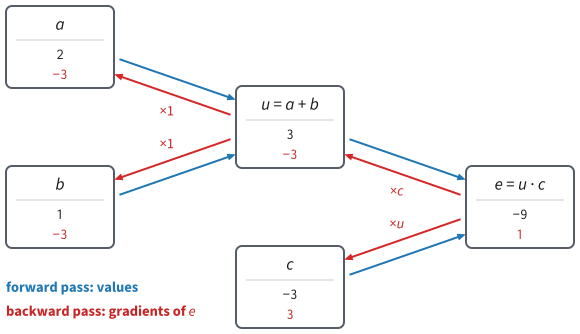

```{.python .input}
%load_ext d2lbook.tab
tab.interact_select('mxnet', 'pytorch', 'tensorflow', 'jax')
```

# Backpropagation
:label:`sec_backprop`

In :numref:`sec_mlp-implementation`, we trained all $203{,}530$ parameters of our Fashion-MNIST MLP without writing a single derivative by hand: automatic differentiation computed every gradient for us. In :numref:`sec_autograd`, we saw the general principle—reverse-mode automatic differentiation records the forward pass as a computational graph and walks the chain rule backward from the scalar loss.

In this section, we open that black box for multilayer perceptrons. An entire MLP requires just **three local matrix-calculus rules**: matrix multiplication, broadcasted bias addition, and elementwise activation. Walking through them answers three essential engineering questions:

1. How does a single backward pass compute hundreds of thousands of partial derivatives for no more than about $2\times$ the arithmetic cost of one forward pass?
2. Why does training consume so much more GPU memory than inference—and why does that memory scale linearly with minibatch size $n$ and depth $K$?
3. How do dead ReLU units and vanishing/exploding gradients arise mechanically from the backward recurrence?

```{.python .input #backprop-forward-propagation-backward-propagation-and-computational-graphs}
%%tab mxnet
import math
import numpy as np
from mxnet import autograd, gluon, init, np as mnp, npx
from mxnet.gluon import nn
from d2l import mxnet as d2l
npx.set_np()
```

```{.python .input #backprop-forward-propagation-backward-propagation-and-computational-graphs}
%%tab pytorch
import math
import numpy as np
import torch
from torch import nn
from torch.nn import functional as F
from d2l import torch as d2l
```

```{.python .input #backprop-forward-propagation-backward-propagation-and-computational-graphs}
%%tab tensorflow
import math
import numpy as np
import tensorflow as tf
from d2l import tensorflow as d2l
```

```{.python .input #backprop-forward-propagation-backward-propagation-and-computational-graphs}
%%tab jax
import math
import numpy as np
import jax
from jax import numpy as jnp
from flax import nnx
import optax
from d2l import jax as d2l
```


## Computational Graphs

### A Small Graph

To review reverse-mode differentiation in its barest form, consider the three-scalar expression $e = (a + b)\,c$ at $a = 2, b = 1, c = -3$ (:numref:`fig_mdl-mlp-backprop-small`). The *forward pass* (left to right) computes $u = a + b = 3$ and $e = u\,c = -9$. The *backward pass* (right to left) seeds $\partial e / \partial e = 1$ and applies one local derivative per node:

- At the multiplication node $e = u\,c$: $\partial e / \partial u = c = -3$ and $\partial e / \partial c = u = 3$.
- At the addition node $u = a + b$: $\partial u / \partial a = \partial u / \partial b = 1$, so $\partial e / \partial a = \partial e / \partial b = -3$.


:label:`fig_mdl-mlp-backprop-small`

Notice two universal rules already visible here: (i) an addition node copies its incoming gradient unchanged to each summand, whereas a multiplication node multiplies the incoming gradient by the *other* factor (requiring the forward pass to cache $u$ and $c$); and (ii) the backward pass traverses the graph in *reverse topological order*.

### The Graph of an MLP

Now consider our one-hidden-layer MLP (:numref:`fig_forward`) on a minibatch $\mathbf{X} \in \mathbb{R}^{n \times d}$ with parameters $\mathbf{W}^{(1)} \in \mathbb{R}^{d \times h}$, $\mathbf{b}^{(1)} \in \mathbb{R}^h$, $\mathbf{W}^{(2)} \in \mathbb{R}^{h \times q}$, $\mathbf{b}^{(2)} \in \mathbb{R}^q$, and $\ell_2$ weight-decay penalty $s = \frac{\lambda}{2}(\|\mathbf{W}^{(1)}\|_{\textrm{F}}^2 + \|\mathbf{W}^{(2)}\|_{\textrm{F}}^2)$:

$$
\begin{aligned}
\mathbf{Z} &= \mathbf{X}\mathbf{W}^{(1)} + \mathbf{b}^{(1)}, \\
\mathbf{H} &= \phi(\mathbf{Z}), \\
\mathbf{O} &= \mathbf{H}\mathbf{W}^{(2)} + \mathbf{b}^{(2)}, \\
J &= L(\mathbf{O}, \mathbf{Y}) + s,
\end{aligned}
$$
:eqlabel:`eq_backprop-forward`

where $L$ is the mean cross-entropy loss over the minibatch and $\|\mathbf{W}\|_{\textrm{F}}^2 = \sum_{r,j} w_{rj}^2$ is the squared Frobenius norm.


:label:`fig_forward`

## Backpropagation through an MLP

### Local Rules for Matrices

For any matrix $\mathbf{A}$, we write $\partial J / \partial \mathbf{A}$ for the matrix of partial derivatives $(\partial J / \partial a_{ij})$ of the *exact same shape* as $\mathbf{A}$. Three local vector--Jacobian rules (:numref:`subsec_mdl-layer-vjp`) handle every layer of an MLP:

1. **Matrix multiplication ($\mathbf{A} = \mathbf{X}\mathbf{W}$ with $\mathbf{X} \in \mathbb{R}^{n \times d}, \mathbf{W} \in \mathbb{R}^{d \times h}$):** Given upstream gradient $\mathbf{G} = \partial J / \partial \mathbf{A} \in \mathbb{R}^{n \times h}$, since $a_{ij} = \sum_r x_{ir} w_{rj}$, the chain rule yields $\partial J / \partial w_{rj} = \sum_i x_{ir} g_{ij}$ and $\partial J / \partial x_{ir} = \sum_j g_{ij} w_{rj}$, or in matrix form:
   $$
   \frac{\partial J}{\partial \mathbf{W}} = \mathbf{X}^\top \mathbf{G}, \qquad
   \frac{\partial J}{\partial \mathbf{X}} = \mathbf{G}\,\mathbf{W}^\top.
   $$
   :eqlabel:`eq_backprop-matmul`
   Notice how the shapes lock into place: $\mathbf{X}^\top\mathbf{G}$ is $(d \times n)(n \times h) = d \times h$ (matching $\mathbf{W}$), and $\mathbf{G}\mathbf{W}^\top$ is $(n \times h)(h \times d) = n \times d$ (matching $\mathbf{X}$). Just like scalar multiplication, computing $\partial J / \partial \mathbf{W}$ requires the cached input $\mathbf{X}$, while computing $\partial J / \partial \mathbf{X}$ propagates the error signal backward through $\mathbf{W}^\top$.
2. **Broadcasted bias addition ($\mathbf{Z} = \mathbf{A} + \mathbf{b}$ with $\mathbf{b} \in \mathbb{R}^h$):** Since $b_j$ is added to every row $i$ of column $j$, $\partial J / \partial \mathbf{A} = \mathbf{G}$ passes straight through unchanged, while $\partial J / \partial \mathbf{b} = \mathbf{G}^\top\mathbf{1}_n$ sums $\mathbf{G}$ across the $n$ examples (rows).
3. **Elementwise activation ($\mathbf{H} = \phi(\mathbf{Z})$):** Since $h_{ij} = \phi(z_{ij})$ depends only on entry $(i, j)$, the upstream gradient is gated entrywise (Hadamard product $\odot$) by the local activation slope:
   $$\frac{\partial J}{\partial \mathbf{Z}} = \frac{\partial J}{\partial \mathbf{H}} \odot \phi'(\mathbf{Z}).$$

### The Backward Pass

Starting from $\partial J / \partial \mathbf{O} = \frac{1}{n}(\hat{\mathbf{Y}} - \mathbf{Y})$ (:numref:`subsec_softmax_and_derivatives`, where $\hat{\mathbf{Y}} = \mathrm{softmax}(\mathbf{O})$ and $\mathbf{Y} \in \{0, 1\}^{n \times q}$ is the one-hot label matrix) and $\partial s / \partial \mathbf{W}^{(k)} = \lambda \mathbf{W}^{(k)}$, applying our three rules in reverse topological order from output to input gives the complete MLP backward pass:

$$
\begin{aligned}
\frac{\partial J}{\partial \mathbf{O}} &= \frac{1}{n}\bigl(\hat{\mathbf{Y}} - \mathbf{Y}\bigr), \\
\frac{\partial J}{\partial \mathbf{W}^{(2)}} &= \mathbf{H}^\top \frac{\partial J}{\partial \mathbf{O}} + \lambda \mathbf{W}^{(2)}, \qquad
\frac{\partial J}{\partial \mathbf{b}^{(2)}} = \Bigl(\frac{\partial J}{\partial \mathbf{O}}\Bigr)^\top \mathbf{1}, \\
\frac{\partial J}{\partial \mathbf{H}} &= \frac{\partial J}{\partial \mathbf{O}}\, \mathbf{W}^{(2)\top}, \\
\frac{\partial J}{\partial \mathbf{Z}} &= \frac{\partial J}{\partial \mathbf{H}} \odot \phi'(\mathbf{Z}), \\
\frac{\partial J}{\partial \mathbf{W}^{(1)}} &= \mathbf{X}^\top \frac{\partial J}{\partial \mathbf{Z}} + \lambda \mathbf{W}^{(1)}, \qquad
\frac{\partial J}{\partial \mathbf{b}^{(1)}} = \Bigl(\frac{\partial J}{\partial \mathbf{Z}}\Bigr)^\top \mathbf{1}.
\end{aligned}
$$
:eqlabel:`eq_backprop-mlp`

For a general $K$-layer MLP ($\mathbf{Z}^{(k)} = \mathbf{H}^{(k-1)}\mathbf{W}^{(k)} + \mathbf{b}^{(k)}, \mathbf{H}^{(k)} = \phi(\mathbf{Z}^{(k)})$), each layer $k = K-1, \ldots, 1$ executes the exact same two-step module:

$$
\begin{aligned}
\frac{\partial J}{\partial \mathbf{Z}^{(k)}} &= \Bigl(\frac{\partial J}{\partial \mathbf{Z}^{(k+1)}}\, \mathbf{W}^{(k+1)\top}\Bigr) \odot \phi'\bigl(\mathbf{Z}^{(k)}\bigr), \\
\frac{\partial J}{\partial \mathbf{W}^{(k)}} &= \mathbf{H}^{(k-1)\top} \frac{\partial J}{\partial \mathbf{Z}^{(k)}} + \lambda \mathbf{W}^{(k)}.
\end{aligned}
$$

### A Worked Example

Let us trace :eqref:`eq_backprop-mlp` by hand on a tiny network ($n = 1, d = h = 2, q = 1$, ReLU activation, zero biases, $\lambda = 0$, and squared loss $L = \frac{1}{2}(o - y)^2$):

$$
\mathbf{X} = \begin{bmatrix} 1 & 2 \end{bmatrix},\quad
\mathbf{W}^{(1)} = \begin{bmatrix} \phantom{-}1 & 0 \\ -1 & 1 \end{bmatrix},\quad
\mathbf{W}^{(2)} = \begin{bmatrix} \phantom{-}2 \\ -1 \end{bmatrix},\quad
y = 0.
$$
:eqlabel:`eq_backprop-example`

In the forward pass (:numref:`fig_mdl-mlp-backprop-graph`), $\mathbf{Z} = \mathbf{X}\mathbf{W}^{(1)} = \begin{bmatrix} -1 & 2 \end{bmatrix}$, $\mathbf{H} = \mathrm{ReLU}(\mathbf{Z}) = \begin{bmatrix} 0 & 2 \end{bmatrix}$ (unit 1 is inactive!), $o = \mathbf{H}\mathbf{W}^{(2)} = -2$, and $L = \frac{1}{2}(-2)^2 = 2$. In the backward pass, $\partial L / \partial o = o - y = -2$, and

$$
\begin{aligned}
\frac{\partial L}{\partial \mathbf{W}^{(2)}} &= \mathbf{H}^\top \frac{\partial L}{\partial o} = \begin{bmatrix} 0 \\ 2 \end{bmatrix}(-2) = \begin{bmatrix} \phantom{-}0 \\ -4 \end{bmatrix}, \\
\frac{\partial L}{\partial \mathbf{H}} &= \frac{\partial L}{\partial o}\,\mathbf{W}^{(2)\top} = \begin{bmatrix} -4 & 2 \end{bmatrix}, \\
\frac{\partial L}{\partial \mathbf{Z}} &= \begin{bmatrix} -4 & 2 \end{bmatrix} \odot \begin{bmatrix} 0 & 1 \end{bmatrix} = \begin{bmatrix} 0 & 2 \end{bmatrix}, \\
\frac{\partial L}{\partial \mathbf{W}^{(1)}} &= \mathbf{X}^\top \frac{\partial L}{\partial \mathbf{Z}} = \begin{bmatrix} 1 \\ 2 \end{bmatrix}\begin{bmatrix} 0 & 2 \end{bmatrix} = \begin{bmatrix} 0 & 2 \\ 0 & 4 \end{bmatrix}.
\end{aligned}
$$

Notice that the entire first column of $\partial L / \partial \mathbf{W}^{(1)}$ is zero: because $z_1 = -1 < 0$, $\phi'(z_1) = 0$ blocks the upstream gradient $\partial L / \partial h_1 = -4$ from reaching any weight feeding unit 1.


:label:`fig_mdl-mlp-backprop-graph`

### Checking the Backward Pass on a Minibatch

Let us implement :eqref:`eq_backprop-mlp` in `mlp_backward` and verify it in 64-bit floating point against each framework's automatic differentiation on a random $256 \times 784$ minibatch ($h = 256, q = 10, \lambda = 10^{-3}$):

```{.python .input #backprop-checking-the-backward-pass-on-a-minibatch-1}
%%tab mxnet
def mlp_backward(X, Y, W1, b1, W2, b2, lambd):
    """Gradients of J = cross-entropy + weight decay, by backprop."""
    Z = X @ W1 + b1  # forward pass, keeping X, Z, H, and Y_hat
    H = npx.relu(Z)
    Y_hat = npx.softmax(H @ W2 + b2, axis=1)
    G_O = (Y_hat - Y) / X.shape[0]  # dJ/dO
    dW2, db2 = H.T @ G_O + lambd * W2, G_O.sum(axis=0)
    G_Z = (G_O @ W2.T) * (Z > 0)  # dJ/dH, then dJ/dZ
    dW1, db1 = X.T @ G_Z + lambd * W1, G_Z.sum(axis=0)
    return dW1, db1, dW2, db2
```

```{.python .input #backprop-checking-the-backward-pass-on-a-minibatch-1}
%%tab pytorch
def mlp_backward(X, Y, W1, b1, W2, b2, lambd):
    """Gradients of J = cross-entropy + weight decay, by backprop."""
    Z = X @ W1 + b1  # forward pass, keeping X, Z, H, and Y_hat
    H = torch.relu(Z)
    Y_hat = torch.softmax(H @ W2 + b2, dim=1)
    G_O = (Y_hat - Y) / X.shape[0]  # dJ/dO
    dW2, db2 = H.T @ G_O + lambd * W2, G_O.sum(dim=0)
    G_Z = (G_O @ W2.T) * (Z > 0)  # dJ/dH, then dJ/dZ
    dW1, db1 = X.T @ G_Z + lambd * W1, G_Z.sum(dim=0)
    return dW1, db1, dW2, db2
```

```{.python .input #backprop-checking-the-backward-pass-on-a-minibatch-1}
%%tab tensorflow
def mlp_backward(X, Y, W1, b1, W2, b2, lambd):
    """Gradients of J = cross-entropy + weight decay, by backprop."""
    Z = X @ W1 + b1  # forward pass, keeping X, Z, H, and Y_hat
    H = tf.nn.relu(Z)
    Y_hat = tf.nn.softmax(H @ W2 + b2, axis=1)
    G_O = (Y_hat - Y) / X.shape[0]  # dJ/dO
    dW2 = tf.matmul(H, G_O, transpose_a=True) + lambd * W2
    G_Z = tf.matmul(G_O, W2, transpose_b=True) * tf.cast(Z > 0, Z.dtype)
    dW1 = tf.matmul(X, G_Z, transpose_a=True) + lambd * W1
    return dW1, tf.reduce_sum(G_Z, 0), dW2, tf.reduce_sum(G_O, 0)
```

```{.python .input #backprop-checking-the-backward-pass-on-a-minibatch-1}
%%tab jax
def mlp_backward(X, Y, W1, b1, W2, b2, lambd):
    """Gradients of J = cross-entropy + weight decay, by backprop."""
    Z = X @ W1 + b1  # forward pass, keeping X, Z, H, and Y_hat
    H = jax.nn.relu(Z)
    Y_hat = jax.nn.softmax(H @ W2 + b2, axis=1)
    G_O = (Y_hat - Y) / X.shape[0]  # dJ/dO
    dW2, db2 = H.T @ G_O + lambd * W2, G_O.sum(axis=0)
    G_Z = (G_O @ W2.T) * (Z > 0)  # dJ/dH, then dJ/dZ
    dW1, db1 = X.T @ G_Z + lambd * W1, G_Z.sum(axis=0)
    return dW1, db1, dW2, db2
```

Let us generate a random 256-example minibatch with the exact dimensions
and initialization of :numref:`sec_mlp-implementation` plus
$\lambda = 10^{-3}$, and compare `mlp_backward` against each framework's
built-in automatic differentiation. Following best practice for gradient checks, we run in
64-bit floating point (whose ~$10^{-16}$ rounding floor catches even tiny
algebraic bugs cleanly) and report the maximum relative discrepancy per
parameter tensor.

```{.python .input #backprop-checking-the-backward-pass-on-a-minibatch-2}
%%tab mxnet
n, d, h, q, lambd = 256, 784, 256, 10, 1e-3
f64 = 'float64'  # 64-bit floating point throughout the check
X = mnp.random.normal(size=(n, d), dtype=f64)
y = mnp.random.randint(0, q, (n,))
params = [mnp.random.normal(0, 0.01, (d, h), dtype=f64), mnp.zeros(h, f64),
          mnp.random.normal(0, 0.01, (h, q), dtype=f64), mnp.zeros(q, f64)]
for p in params:
    p.attach_grad()
W1, b1, W2, b2 = params
with autograd.record():
    O = npx.relu(X @ W1 + b1) @ W2 + b2
    J = (-npx.pick(npx.log_softmax(O), y).mean()
         + lambd / 2 * ((W1 ** 2).sum() + (W2 ** 2).sum()))
J.backward()  # automatic differentiation
grads = mlp_backward(X, npx.one_hot(y, q, dtype=f64), *params, lambd)
for name, p, g in zip(['W1', 'b1', 'W2', 'b2'], params, grads):
    rel = mnp.abs(p.grad - g).max() / mnp.abs(p.grad).max()
    print(f'{name}: relative difference {float(rel):.1e}')
```

```{.python .input #backprop-checking-the-backward-pass-on-a-minibatch-2}
%%tab pytorch
n, d, h, q, lambd = 256, 784, 256, 10, 1e-3
f64 = torch.float64  # 64-bit floating point throughout the check
X, y = torch.randn(n, d, dtype=f64), torch.randint(0, q, (n,))
params = [torch.randn(d, h, dtype=f64) * 0.01, torch.zeros(h, dtype=f64),
          torch.randn(h, q, dtype=f64) * 0.01, torch.zeros(q, dtype=f64)]
for p in params:
    p.requires_grad_(True)
W1, b1, W2, b2 = params
J = (F.cross_entropy(torch.relu(X @ W1 + b1) @ W2 + b2, y)
     + lambd / 2 * ((W1 ** 2).sum() + (W2 ** 2).sum()))
J.backward()  # automatic differentiation
with torch.no_grad():
    grads = mlp_backward(X, F.one_hot(y, q).to(f64), *params, lambd)
for name, p, g in zip(['W1', 'b1', 'W2', 'b2'], params, grads):
    rel = (p.grad - g).abs().max() / p.grad.abs().max()
    print(f'{name}: relative difference {float(rel):.1e}')
```

```{.python .input #backprop-checking-the-backward-pass-on-a-minibatch-2}
%%tab tensorflow
n, d, h, q, lambd = 256, 784, 256, 10, 1e-3
f64 = tf.float64  # 64-bit floating point throughout the check
X = tf.random.normal((n, d), dtype=f64)
y = tf.random.uniform((n,), 0, q, dtype=tf.int32)
params = [tf.Variable(tf.random.normal((d, h), stddev=0.01, dtype=f64)),
          tf.Variable(tf.zeros(h, f64)),
          tf.Variable(tf.random.normal((h, q), stddev=0.01, dtype=f64)),
          tf.Variable(tf.zeros(q, f64))]
W1, b1, W2, b2 = params
with tf.GradientTape() as tape:
    O = tf.nn.relu(X @ W1 + b1) @ W2 + b2
    J = (tf.reduce_mean(tf.nn.sparse_softmax_cross_entropy_with_logits(y, O))
         + lambd / 2 * (tf.reduce_sum(W1 ** 2) + tf.reduce_sum(W2 ** 2)))
auto = tape.gradient(J, params)  # automatic differentiation
grads = mlp_backward(X, tf.one_hot(y, q, dtype=f64), *params, lambd)
for name, a, g in zip(['W1', 'b1', 'W2', 'b2'], auto, grads):
    rel = tf.reduce_max(tf.abs(a - g)) / tf.reduce_max(tf.abs(a))
    print(f'{name}: relative difference {float(rel):.1e}')
```

```{.python .input #backprop-checking-the-backward-pass-on-a-minibatch-2}
%%tab jax
jax.config.update('jax_enable_x64', True)  # 64-bit is off by default
n, d, h, q, lambd = 256, 784, 256, 10, 1e-3
f64 = jnp.float64  # 64-bit floating point throughout the check
keys = jax.random.split(d2l.get_key(), 4)
X = jax.random.normal(keys[0], (n, d), f64)
y = jax.random.randint(keys[1], (n,), 0, q)
params = [jax.random.normal(keys[2], (d, h), f64) * 0.01, jnp.zeros(h, f64),
          jax.random.normal(keys[3], (h, q), f64) * 0.01, jnp.zeros(q, f64)]

def objective(params):
    W1, b1, W2, b2 = params
    O = jax.nn.relu(X @ W1 + b1) @ W2 + b2
    return (optax.softmax_cross_entropy_with_integer_labels(O, y).mean()
            + lambd / 2 * ((W1 ** 2).sum() + (W2 ** 2).sum()))

auto = jax.grad(objective)(params)  # automatic differentiation
grads = mlp_backward(X, jax.nn.one_hot(y, q, dtype=f64), *params, lambd)
for name, a, g in zip(['W1', 'b1', 'W2', 'b2'], auto, grads):
    rel = jnp.abs(a - g).max() / jnp.abs(a).max()
    print(f'{name}: relative difference {float(rel):.1e}')
```


Every parameter gradient matches automatic differentiation to within $10^{-14}$ relative error (double-precision machine epsilon).

## Memory and Computation

### Stored Activations vs. Parameter Memory

Looking at :eqref:`eq_backprop-mlp`, computing $\partial J / \partial \mathbf{W}^{(2)}$ and $\partial J / \partial \mathbf{W}^{(1)}$ during the backward pass requires the forward pass to retain $\mathbf{X}$, $\mathbf{H}$ (which for ReLU also encodes the mask $\mathbf{Z} > 0$), and $\hat{\mathbf{Y}}$. On our Fashion-MNIST MLP ($d = 784, h = 256, q = 10$) with minibatch size $n = 256$, these cached tensors hold

$$256 \times 784 + 256 \times 256 + 256 \times 10 = 268{,}800\textrm{ floats} \approx 1.1\textrm{ MB},$$

already exceeding the $203{,}530$ parameters ($\approx 0.8\textrm{ MB}$)! In a $K$-layer network, activation memory grows linearly with *both* batch size $n$ and depth $K$, whereas inference can discard each layer's activations immediately after computing the next layer.

### Arithmetic Cost

In the forward pass, each example performs $d h + h q = 784 \times 256 + 256 \times 10 = 203{,}264$ multiply-adds. In the backward pass, each interior matrix multiply $\mathbf{H}^{(k-1)}\mathbf{W}^{(k)}$ spawns *two* backward matrix multiplies of the same size ($\mathbf{H}^{(k-1)\top}\mathbf{G}$ for the weights and $\mathbf{G}\mathbf{W}^{(k)\top}$ for the activations below), while the first layer needs only $\mathbf{X}^\top\mathbf{G}_Z$ (since $\partial J / \partial \mathbf{X}$ is not needed). For our two-layer MLP the backward pass therefore takes $d h + 2 h q = 205{,}824$ multiply-adds, about the same as the forward pass: the first layer holds almost all of the work, and it needs a single backward product. In a deep network nearly every layer is interior, so the backward pass costs $\sim 2\times$ the forward pass and a full training step roughly $3\times$ forward inference. Either way, all $203{,}530$ derivatives cost one or two extra forward passes, whereas a one-sided finite difference spends one extra forward pass on a *single* scalar parameter!

## Summary

- **Three local matrix rules:** Backpropagation through any MLP reduces to (i) $\partial J / \partial \mathbf{W} = \mathbf{X}^\top\mathbf{G}$ and $\partial J / \partial \mathbf{X} = \mathbf{G}\mathbf{W}^\top$ for $\mathbf{A} = \mathbf{X}\mathbf{W}$, (ii) row summation $\mathbf{G}^\top\mathbf{1}$ for bias vectors, and (iii) elementwise gating $\mathbf{G} \odot \phi'(\mathbf{Z})$ for activations (plus summing gradients wherever a tensor branches into both data loss and weight decay).
- **Memory and compute scaling:** Because $\mathbf{X}^\top\mathbf{G}$ reads forward activations, training must cache intermediate layer outputs across the forward pass (scaling as $O(n K h)$ in memory) while the backward sweep costs at most about $2\times$ the FLOPs of the forward pass (and about $1\times$ for our two-layer MLP, whose first layer dominates).

## Exercises

1. **Jacobian of a layer.** The gradient of the scalar $J$ with respect to
   $\mathbf{W}^{(2)} \in \mathbb{R}^{h \times q}$ has the shape of
   $\mathbf{W}^{(2)}$. The derivative of the matrix
   $\mathbf{O} = \mathbf{H}\mathbf{W}^{(2)} \in \mathbb{R}^{n \times q}$
   with respect to $\mathbf{W}^{(2)}$ is a larger object, with one entry
   $\partial o_{ij} / \partial w_{rt}$ for every combination of the four
   indices.
    1. How many entries does $\partial \mathbf{O} / \partial \mathbf{W}^{(2)}$
       have, and how many of them can be nonzero?
    1. Evaluate the chain rule
       $\partial J / \partial w_{rt} = \sum_{i, j} (\partial J / \partial o_{ij})(\partial o_{ij} / \partial w_{rt})$
       to recover $\mathbf{H}^\top \partial J / \partial \mathbf{O}$.
    1. How much memory would $\partial \mathbf{O} / \partial \mathbf{W}^{(2)}$
       take in 32-bit floating point for the MLP of
       :numref:`sec_mlp-implementation` with $n = 256$? Explain why
       backpropagation never forms it.

1. **Memory of a deeper network.** Consider an MLP with $d$ inputs, $q$
   outputs, and $K$ layers, of which the $K - 1$ hidden ones are ReLU layers
   of width $h$, trained on minibatches of $n$ examples.
    1. Using the step for $K$ layers in the text, list the values that the
       backward pass reads, and count them. Count the parameters.
    1. Prediction can discard each value as soon as the next layer has used
       it. Count the largest number of values that prediction holds at any
       moment.
    1. For $d = 784$, $h = 256$, and $q = 10$, find the smallest minibatch
       size at which the stored values outnumber the parameters, for
       $K = 2$ and for $K = 11$.
1. [code] **Gradient checking.** Before automatic differentiation, a
   hand-written backward pass was checked against finite differences.
    1. Pick one entry $w$ of $\mathbf{W}^{(1)}$ and compare its gradient from
       `mlp_backward` with the central difference
       $\bigl(J(w + \epsilon) - J(w - \epsilon)\bigr) / (2\epsilon)$ for
       $\epsilon = 10^{-1}, 10^{-2}, \ldots, 10^{-7}$, once in 32-bit and once
       in 64-bit floating point. Plot the relative error against $\epsilon$
       on logarithmic axes.
    1. Explain the shape of the curves. Which error decreases with
       $\epsilon$, which increases, and where do they balance in each
       precision?
    1. The check can fail at a correct gradient when a pre-activation lies
       within $\epsilon$ of zero. Explain why, and how to avoid it.
1. **Forward mode.** Backpropagation seeds $\partial J / \partial J = 1$ at
   the output and sweeps the graph backward. Forward-mode differentiation
   instead seeds $\partial w / \partial w = 1$ at one chosen scalar parameter
   $w$ and sweeps forward: each node computes the derivative of its value
   with respect to $w$ from the derivatives of its inputs.
    1. Use forward mode to recompute $\partial L / \partial \mathbf{W}^{(1)}$
       for the network in :eqref:`eq_backprop-example`, one sweep per entry
       of $\mathbf{W}^{(1)}$.
    1. How many sweeps does each mode need to obtain all six weight
       gradients of this network? Which products does forward mode compute
       again in every sweep that reverse mode computes only once?

    *Adapted from Simon Prince,
    [Understanding Deep Learning](https://udlbook.github.io/udlbook/),
    Problems 7.12 and 7.13.*

1. [extended] **Autograd engine.** ● Build a miniature automatic
   differentiation engine and use it to recompute the gradients of the
   network in :eqref:`eq_backprop-example`.
    1. Write a scalar `Value` class that records, for each result, its
       inputs and the operation that produced it (the computational graph),
       supporting `+`, `*`, and `relu`. (*Hint:* implement `__add__` and
       `__mul__` so that each returns a new `Value` holding references to
       its parents and a small function that propagates the gradient one
       step.)
    1. Implement `backward()`: sort the graph topologically, seed the
       output's gradient with $1$, and visit the nodes in reverse order,
       letting each node pass its gradient to its parents. Make sure that
       gradients *accumulate* (`+=`, not `=`) when a value is used more than
       once.
    1. Recompute the graph of :numref:`fig_mdl-mlp-backprop-small` and the
       worked example :eqref:`eq_backprop-example` with your engine (unroll
       the matrix products into scalars), and compare the gradients with
       those derived in this section.
    1. Consider the chain in which a scalar input $x$ produces
       $v_i = f_i(x)$ for $i = 1, 2, 3$, the intermediate value
       $m = v_1 + v_2 + v_3$, the values $p_j = g_j(m)$ for $j = 1, 2, 3$,
       and the loss $L = p_1 + p_2 + p_3$. Write $\alpha_i = f_i'(x)$ and
       $\beta_j = g_j'(m)$. The chain rule as a sum over paths enumerates
       $3 \times 3 = 9$ paths from $x$ to $L$, each contributing the product
       $\alpha_i \beta_j$. Show that your engine instead computes
       $(\alpha_1 + \alpha_2 + \alpha_3)(\beta_1 + \beta_2 + \beta_3)$ by
       accumulating the gradient at $m$ once, and explain why this sharing
       keeps backpropagation affordable in deep networks.

    *Adapted from Andrej Karpathy,
    [micrograd](https://github.com/karpathy/micrograd),
    `micrograd/engine.py`.*
   :exlabel:`ex_backprop-autograd-engine`

[Discussions](https://d2l.discourse.group/t/102)

<!-- slides -->

::: {.slide}
::: {.cover}
[Dive into Deep Learning · §4.3]{.kicker}

Backpropagation & Computational Graphs in MLPs<br>**reverse-mode DAGs · local matrix rules · 5-line MLP backward pass · activation memory & FLOP cost**
:::
:::

::: {.slide title="Why One Backward Pass Computes All 203,530 Gradients"}
[Opening the Black Box]{.kicker}

::: {.cols .vc}
::: {.col}
- **Finite differences vs. reverse mode:** Perturbing each scalar weight $w \pm \epsilon$ would require $203{,}530$ forward passes per step; reverse-mode differentiation computes *all* parameter gradients in **at most $\sim 2\times$ the FLOPs of one forward pass**.
- **Shared intermediate layer errors:** Backpropagation computes each layer's upstream sensitivity $\partial J / \partial \mathbf{Z}^{(k)}$ *once* from top to bottom and reads off $\partial J / \partial \mathbf{W}^{(k)}$ with a single matrix product.
- **The memory price of training:** Forming $\mathbf{H}^{(k-1)\top}\mathbf{G}_{\mathbf{Z}^{(k)}}$ requires caching every hidden layer's forward activation in $O(nKh)$ GPU RAM.
:::

::: {.col .fig .big}
@fig:ch04-mlp-backprop-efficiency
:::
:::
:::

::: {.slide title="A Three-Node Computational Graph: Forward & Reverse"}
[Computational Graphs · Scalar Anatomy]{.kicker}

To see reverse-mode differentiation in its barest form, trace $e = (a + b)\,c$ at $a = 2, b = 1, c = -3$:

::: {.cols .vc}
::: {.col}
- **Forward pass (left to right):** Evaluates and caches intermediate values: $u = a + b = 3$, then $e = u\,c = -9$.
- **Backward pass (right to left):** Seeds $\partial e / \partial e = 1$ and applies one local derivative per node in reverse topological order:
  - **Multiply node ($e = u\,c$):** Swaps and scales by the *other* cached input: $\partial e / \partial u = c = -3$ and $\partial e / \partial c = u = 3$.
  - **Add node ($u = a + b$):** Routes its incoming gradient unchanged to both branches: $\partial e / \partial a = \partial e / \partial b = -3$.
:::

::: {.col .fig}
{.nostretch width=100%}
:::
:::
:::

::: {.slide title="Computational Graph of a Regularized MLP"}
[Computational Graphs · Matrix DAG]{.kicker}

For a minibatch $\mathbf{X} \in \mathbb{R}^{n \times d}$, our one-hidden-layer MLP with $\ell_2$ weight decay $s = \frac{\lambda}{2}(\|\mathbf{W}^{(1)}\|_{\textrm{F}}^2 + \|\mathbf{W}^{(2)}\|_{\textrm{F}}^2)$ forms a directed acyclic graph:

::: {.cols .vc}
::: {.col}
- **Forward pass chain:** $\mathbf{Z} = \mathbf{X}\mathbf{W}^{(1)} + \mathbf{b}^{(1)}$ $\to$ $\mathbf{H} = \phi(\mathbf{Z})$ $\to$ $\mathbf{O} = \mathbf{H}\mathbf{W}^{(2)} + \mathbf{b}^{(2)}$:
  $$J = L(\mathbf{O}, \mathbf{Y}) + s$$
- **Branching parameter nodes (shaded):** Each weight matrix $\mathbf{W}^{(k)}$ feeds *two* children—its affine layer and the Frobenius penalty $s$.
- **Multivariate chain rule at branches:** Whenever a node feeds multiple downstream paths, its backward gradient is the **sum** (`+=`) of the gradients returning along all outgoing edges.
:::

::: {.col .fig}
{.nostretch width=100%}
:::
:::
:::

::: {.slide title="Local Rule 1: Matrix Multiplication A = XW"}
[Local Matrix Calculus]{.kicker}

::: {.cols .vc}
::: {.col}
$$\frac{\partial J}{\partial \mathbf{W}} = \mathbf{X}^\top\mathbf{G} \in \mathbb{R}^{d \times h}, \qquad \frac{\partial J}{\partial \mathbf{X}} = \mathbf{G}\mathbf{W}^\top \in \mathbb{R}^{n \times d}$$

- **Coordinate expansion:** Entry $w_{rj}$ influences every example $i$ in column $j$ ($\sum_i x_{ir} g_{ij}$), while entry $x_{ir}$ influences every output unit $j$ in row $i$ ($\sum_j g_{ij} w_{rj}$).
- **Shape-lock check:** $\mathbf{X}^\top\mathbf{G}$ is the *only* way to multiply $(n \times d)$ and $(n \times h)$ into $(d \times h)$—requiring the cached forward input $\mathbf{X}$.
:::

::: {.col .fig}
@fig:ch04-mlp-local-matmul-rule
:::
:::
:::

::: {.slide title="Local Rules 2 & 3: Broadcasted Biases and Activations"}
[Local Matrix Calculus]{.kicker}

::: {.cols .vc}
::: {.col}
$$\frac{\partial J}{\partial \mathbf{b}} = \mathbf{G}^\top\mathbf{1}_n, \qquad \frac{\partial J}{\partial \mathbf{Z}} = \frac{\partial J}{\partial \mathbf{H}} \odot \phi'(\mathbf{Z})$$

- **Broadcasted bias ($\mathbf{Z} = \mathbf{A} + \mathbf{b}$):** Copies $\mathbf{G}$ unchanged to $\mathbf{A}$ and sums across the batch axis (`G.sum(axis=0)`).
- **Elementwise activation ($\mathbf{H} = \phi(\mathbf{Z})$):** Gates the upstream gradient entry-by-entry (Hadamard product $\odot$) by the local slope $\phi'(z_{ij})$.
:::

::: {.col .fig}
@fig:ch04-mlp-local-bias-act-rules
:::
:::
:::

::: {.slide title="The Complete Five-Line Backward Pass of an MLP"}
[Assembling the Backward Sweep]{.kicker}

::: {.cols .vc}
::: {.col}
- **Top-down credit assignment:** Seeds $\mathbf{G}_{\mathbf{O}} = \frac{1}{n}(\hat{\mathbf{Y}} - \mathbf{Y})$ at the softmax logits and reads off $\nabla\mathbf{W}^{(2)} = \mathbf{H}^\top\mathbf{G}_{\mathbf{O}} + \lambda\mathbf{W}^{(2)}$.
- **Hidden error routing:** Projects $\mathbf{G}_{\mathbf{O}}\mathbf{W}^{(2)\top}$ back to hidden units, gates by $\odot\,\phi'(\mathbf{Z})$, and forms $\nabla\mathbf{W}^{(1)} = \mathbf{X}^\top\mathbf{G}_{\mathbf{Z}} + \lambda\mathbf{W}^{(1)}$.
:::

::: {.col .fig .big}
@fig:ch04-mlp-five-line-sweep
:::
:::
:::

::: {.slide title="Generalizing to K Layers: The Backward Recurrence"}
[Deep MLP Recurrence]{.kicker}

::: {.cols .vc}
::: {.col}
$$\frac{\partial J}{\partial \mathbf{Z}^{(k)}} = \Bigl(\frac{\partial J}{\partial \mathbf{Z}^{(k+1)}}\, \mathbf{W}^{(k+1)\top}\Bigr) \odot \phi'\bigl(\mathbf{Z}^{(k)}\bigr)$$

- **Two-step layer module:** Every hidden layer $k = K - 1, \ldots, 1$ projects upstream errors through $\mathbf{W}^{(k+1)\top}$, gates by $\odot\,\phi'(\mathbf{Z}^{(k)})$, and reads off $\mathbf{H}^{(k-1)\top}\mathbf{G}_{\mathbf{Z}^{(k)}}$.
- **Product chain across depth:** Repeatedly multiplying by $\mathbf{W}^{(k)\top}$ and $\phi'(\mathbf{Z}^{(k)})$ explains why gradients vanish or explode in deep networks.
:::

::: {.col .fig}
@fig:ch04-mlp-k-layer-recurrence
:::
:::
:::

::: {.slide title="Worked Numerical Example: Forward & Backward by Hand"}
[Worked Example · Numbers]{.kicker}

::: {.cols .vc}
::: {.col}
- **Setup ($2 \to 2 \to 1$ ReLU):** $\mathbf{X} = [1, 2]$, $\mathbf{W}^{(1)} = \begin{bmatrix} 1 & 0 \\ -1 & 1 \end{bmatrix}$, $\mathbf{W}^{(2)} = [2, -1]^\top$, $y = 0$, $L = \frac{1}{2}(o - y)^2$.
- **Forward:** $\mathbf{Z} = [-1, 2] \to \mathbf{H} = [0, 2] \to o = -2 \to L = 2$.
- **Backward:** $\partial L/\partial o = -2 \implies \nabla\mathbf{H} = [-4, 2] \implies \nabla\mathbf{Z} = [-4, 2] \odot [0, 1] = [0, 2]$, zeroing out column 1 of $\nabla\mathbf{W}^{(1)}$.
:::

::: {.col .fig .big}
@fig:ch04-mlp-worked-numbers
:::
:::
:::

::: {.slide title="Visualizing the Dead ReLU Gate in the Backward Graph"}
[Worked Example · Graph]{.kicker}

Inspecting the forward values (black) and reverse-mode derivatives (red) on the computational graph explains mechanically how a **dead ReLU unit** freezes learning:

::: {.cols .vc}
::: {.col}
- **Zeroed incoming column:** Even though unit 1 has a large upstream sensitivity $\partial L / \partial h_1 = -4$, its negative pre-activation $z_1 = -1 < 0$ sets the ReLU slope to $\phi'(z_1) = 0$.
- **Permanent stall if inactive across dataset:** Gating $\partial L / \partial z_1 = 0$ zeroes out the entire first column of $\partial L / \partial \mathbf{W}^{(1)}$ ($\begin{bmatrix} 0 & 0 \end{bmatrix}^\top$), so column 1 of $\mathbf{W}^{(1)}$ never updates.
:::

::: {.col .fig .big}
{.nostretch width=100%}
:::
:::
:::

::: {.slide title="Implementing the Five-Line Backward Pass in Code"}
[Verifying Backprop Against Autograd]{.kicker}

We translate our five matrix equations directly into `mlp_backward(X, Y, W1, b1, W2, b2, lambd)`:

@-backprop-checking-the-backward-pass-on-a-minibatch-1

::: {.d2l-note}
Notice that for ReLU, storing $\mathbf{H}$ (or $\mathbf{Z}$) suffices to evaluate the binary mask `(Z > 0)` in line `G_Z = (G_O @ W2.T) * (Z > 0)`.
:::
:::

::: {.slide title="Float64 Gradient Check: Matching Autograd to 10⁻¹⁴"}
[Verifying Backprop Against Autograd]{.kicker}

Running both `mlp_backward` and framework `autograd` in 64-bit floating point (`float64`, machine epsilon $\approx 10^{-16}$) on a random $256 \times 784$ minibatch verifies our derivation to $14$ significant digits:

@!backprop-checking-the-backward-pass-on-a-minibatch-2
:::

::: {.slide title="Why Training Uses More Memory Than Inference"}
[Systems Cost · Activation Memory]{.kicker}

::: {.cols .vc}
::: {.col}
- **Inference ($O(nh)$ RAM):** Overwrites each layer's activation buffer as soon as the next layer finishes.
- **Training ($O(nKh)$ RAM):** Must cache $\mathbf{X}$ ($0.80\textrm{ MB}$), $\mathbf{H}$ ($0.26\textrm{ MB}$), and $\hat{\mathbf{Y}}$ ($0.01\textrm{ MB}$) until the backward pass forms $\mathbf{H}^{(k-1)\top}\mathbf{G}_{\mathbf{Z}^{(k)}}$.
- **Batch scaling:** Even for a 1-hidden-layer MLP at $n = 256$, cached activations ($1.08\textrm{ MB}$) exceed model parameters ($0.81\textrm{ MB}$).
:::

::: {.col .fig .big}
@fig:ch04-mlp-activation-memory
:::
:::
:::

::: {.slide title="Arithmetic Cost: Why Backward Costs ~2× Forward"}
[Systems Cost · FLOPs]{.kicker}

::: {.cols .vc}
::: {.col}
- **Forward pass ($203{,}264$ MACs / image):** Computes one matrix product per layer ($\mathbf{X}\mathbf{W}^{(1)}$ and $\mathbf{H}\mathbf{W}^{(2)}$).
- **Backward pass ($205{,}824$ MACs / image):** Every interior forward matmul $\mathbf{H}^{(k-1)}\mathbf{W}^{(k)}$ spawns **two** backward matmuls of identical FLOP count ($\mathbf{H}^{(k-1)\top}\mathbf{G}$ and $\mathbf{G}\mathbf{W}^{(k)\top}$).
- **3× rule of thumb:** Backward costs $\approx 2\times$ forward FLOPs, so a full training step costs $\approx 3\times$ inference FLOPs.
:::

::: {.col .fig .big}
@fig:ch04-mlp-flop-ratio
:::
:::
:::

::: {.slide title="Reverse Mode vs. Forward Mode & Finite Differences"}
[Systems Cost · Algorithmic Comparison]{.kicker}

Why does deep learning rely on reverse-mode backpropagation rather than forward-mode differentiation or numerical finite differences for a scalar loss $J: \mathbb{R}^P \to \mathbb{R}$ ($P = 203{,}530$)?

| Differentiation Method | What One Sweep Computes | Sweeps Needed for $\nabla J \in \mathbb{R}^P$ | Activation Memory | Total FLOPs / Step ($P = 203{,}530$) |
|:--|:--|--:|:--|--:|
| **Finite Differences** $\frac{J(w+\epsilon)-J(w-\epsilon)}{2\epsilon}$ | $1$ scalar directional derivative | $P$ (or $2P$ central) | $O(nh)$ (no cache) | $\sim 203{,}530 \times$ forward ($\sim 4 \times 10^{10}$) |
| **Forward Mode** (seed $\dot{w}_i = 1$) | Tangents $\partial (\cdot) / \partial w_i$ for 1 weight | $P$ forward sweeps | $O(nh)$ (no cache) | $\sim 203{,}530 \times$ forward |
| **Reverse Mode (Backprop)** (seed $\bar{J} = 1$) | Adjoints $\partial J / \partial (\cdot)$ for **all** weights | **$1$ backward sweep** | **$O(nKh)$ cached** | **$\sim 3 \times$ forward ($\sim 6 \times 10^5$)** |

::: {.d2l-note}
Reverse mode is $O(1)$ sweeps for scalar outputs with many inputs ($P \gg 1$), whereas forward mode is preferable only when outputs outnumber inputs ($q \gg P$).
:::
:::

::: {.slide title="Concept Check: Shapes, Memory Scaling, and Jacobians"}
[Check]{.kicker}

Test your grasp of backpropagation mechanics and systems scaling:

1. **Outer-product sum:** In our Fashion-MNIST MLP with batch size $n = 256$, $\mathbf{X}^\top\mathbf{G}_{\mathbf{Z}}$ has shape $(784, 256) \times (256, 256) = (784, 256)$. Written as a sum over examples $i = 1, \ldots, 256$, what rank-1 matrix does each example contribute?
2. **10-layer activation memory:** If we deepen our MLP to $10$ hidden layers of width $256$ ($n = 256$), how many megabytes of `float32` activations must training cache per minibatch vs. parameter memory?
3. **Why not form the full Jacobian?** How much `float32` memory would the full 4D tensor $\partial \mathbf{O} / \partial \mathbf{W}^{(2)}$ of shape $(n, q, h, q) = (256, 10, 256, 10)$ occupy if materialized explicitly?

::: {.d2l-note .fragment .fade-up}
**Answers:**

1. **Sum of outer products:** $\mathbf{X}^\top\mathbf{G}_{\mathbf{Z}} = \sum_{i=1}^{256} \mathbf{x}_i \mathbf{g}_{\mathbf{z}, i}^\top$, where $\mathbf{x}_i \in \mathbb{R}^{784}$ is example $i$'s input and $\mathbf{g}_{\mathbf{z}, i} \in \mathbb{R}^{256}$ is its pre-activation gradient.
2. **Memory at depth 10:** $\mathbf{X}$ ($200{,}704$) + $10 \times \mathbf{H}^{(k)}$ ($10 \times 65{,}536$) + $\hat{\mathbf{Y}}$ ($2{,}560$) $= 858{,}624$ floats $\approx 3.43\textrm{ MB}$ (exceeding the $795{,}658$ parameters $\approx 3.18\textrm{ MB}$).
3. **Full Jacobian explosion:** $256 \times 10 \times 256 \times 10 \times 4\textrm{ B} \approx 26.2\textrm{ MB}$ for just the small output layer! Vector-Jacobian products contract $\mathbf{H}^\top\mathbf{G}_{\mathbf{O}}$ directly into $256 \times 10$ ($10\textrm{ KB}$).
:::
:::

::: {.slide title="Summary: Backpropagation in Multilayer Perceptrons"}
[Key Takeaways]{.kicker}

| Forward Operation | Cached Tensor(s) | Backward Parameter Gradient | Backward Input Gradient | FLOP / Memory Scaling |
|:--|:--|:--|:--|:--|
| **Linear $\mathbf{A} = \mathbf{X}\mathbf{W}$** | $\mathbf{X} \in \mathbb{R}^{n \times d}$, $\mathbf{W} \in \mathbb{R}^{d \times h}$ | $\frac{\partial J}{\partial \mathbf{W}} = \mathbf{X}^\top\mathbf{G}$ | $\frac{\partial J}{\partial \mathbf{X}} = \mathbf{G}\mathbf{W}^\top$ | $2 \times n d h$ backward multiply-adds |
| **Broadcast Bias $\mathbf{Z} = \mathbf{A} + \mathbf{b}$** | None | $\frac{\partial J}{\partial \mathbf{b}} = \mathbf{G}^\top\mathbf{1}_n$ (row sum) | $\frac{\partial J}{\partial \mathbf{A}} = \mathbf{G}$ | $O(nh)$ sum; no extra cache |
| **Activation $\mathbf{H} = \phi(\mathbf{Z})$** | $\mathbf{Z}$ (or $\mathbf{H}$ for ReLU) | None | $\frac{\partial J}{\partial \mathbf{Z}} = \mathbf{G} \odot \phi'(\mathbf{Z})$ | $O(nh)$ elementwise; dead if $\phi' = 0$ |
| **Weight Decay $s = \frac{\lambda}{2}\|\mathbf{W}\|_{\textrm{F}}^2$** | $\mathbf{W}$ | Adds $+\lambda\mathbf{W}$ to $\frac{\partial J}{\partial \mathbf{W}}$ | — | Branch in DAG sums incoming grads |
| **Full $K$-Layer MLP Sweep** | $\mathbf{X}, \mathbf{H}^{(1 \dots K-1)}, \hat{\mathbf{Y}}$ | All $\mathbf{W}^{(k)}, \mathbf{b}^{(k)}$ in 1 reverse pass | Propagates $\mathbf{G}\mathbf{W}^{(k)\top} \odot \phi'$ | $\sim 2\times$ forward FLOPs; $O(nKh)$ RAM |
:::

