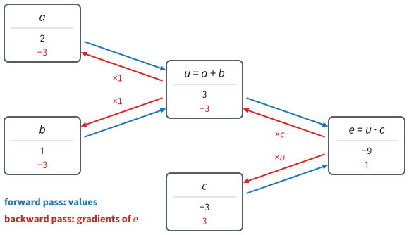
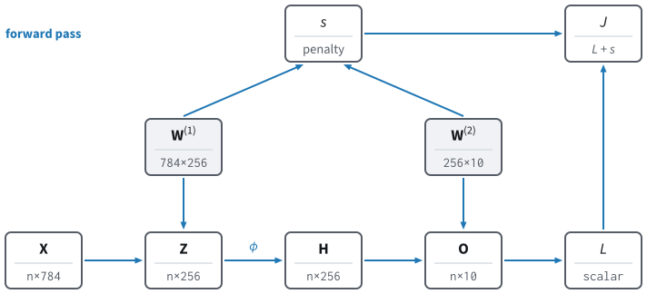
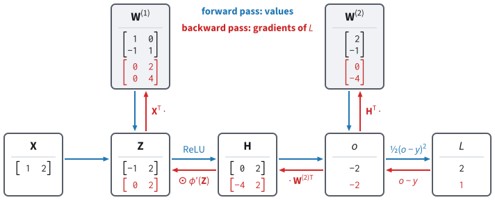

```{.python .input}
%load_ext d2lbook.tab
tab.interact_select('mxnet', 'pytorch', 'tensorflow', 'jax')
```

# Backpropagation
:label:`sec_backprop`

The MLP of :numref:`sec_mlp-implementation` has 203,530 parameters, and
every step of minibatch stochastic gradient descent needs the derivative of
the loss with respect to each of them. Automatic differentiation
(:numref:`sec_autograd`) computes all of these derivatives for a small
multiple of the cost of the forward pass: the framework records the
operations of the forward pass as a computational graph and then applies the
chain rule backward through the graph, one operation at a time. So far we
have called `backward` and used the result. Three practical questions depend
on what happens inside it. Why does training need more memory than
prediction, and why does that memory grow with the minibatch? Why does a
ReLU unit that is inactive for every example stop learning? And why do the
gradients of a deep network vanish or explode, the subject of the next
section?

The backward pass is built from local rules. Each operation receives the
gradient of the loss with respect to its output and passes back the
gradients with respect to its inputs, computed from values that the forward
pass stored. An MLP needs only three such rules: one for a matrix product,
one for adding a bias, and one for an elementwise activation function.
Applying them in reverse order, from the loss back to the first layer, is
backpropagation. We work through a graph with three inputs first,
then derive the three rules for an MLP in matrix form, check them against
automatic differentiation, and count what they cost in memory and time.

```{.python .input #backprop-forward-propagation-backward-propagation-and-computational-graphs}
%%tab mxnet
from mxnet import autograd, np as mnp, npx
npx.set_np()
```

```{.python .input #backprop-forward-propagation-backward-propagation-and-computational-graphs}
%%tab pytorch
import torch
from torch.nn import functional as F
```

```{.python .input #backprop-forward-propagation-backward-propagation-and-computational-graphs}
%%tab tensorflow
import tensorflow as tf
```

```{.python .input #backprop-forward-propagation-backward-propagation-and-computational-graphs}
%%tab jax
import random
import jax
from jax import numpy as jnp
import optax
```

## Computational Graphs

### A Small Graph

Before the backward pass can run, two questions must be answered for every
node of the graph. Which values from the forward pass does its local
derivative need? And when is its gradient ready to be passed on? We answer
both for the smallest graph that contains an addition and a multiplication,
$e = (a + b)\,c$, at $a = 2$, $b = 1$, and $c = -3$.

The forward pass computes the intermediate value $u = a + b = 3$ and then
$e = u\,c = -9$. The backward pass computes the derivative of $e$ with
respect to every node, starting from $\partial e / \partial e = 1$. The
multiplication $e = u\,c$ has the local derivatives
$\partial e / \partial u = c = -3$ and $\partial e / \partial c = u = 3$. The
addition $u = a + b$ has $\partial u / \partial a = \partial u / \partial b = 1$,
so the chain rule gives

$$
\frac{\partial e}{\partial a} = \frac{\partial e}{\partial u}\,\frac{\partial u}{\partial a} = -3, \qquad
\frac{\partial e}{\partial b} = \frac{\partial e}{\partial u}\,\frac{\partial u}{\partial b} = -3, \qquad
\frac{\partial e}{\partial c} = u = 3.
$$

An addition copies the incoming gradient to each of its inputs, and a
multiplication scales it by the value of the *other* input.
:numref:`fig_mdl-mlp-backprop-small` shows both passes.


:label:`fig_mdl-mlp-backprop-small`

The graph answers the two questions. The multiplication needs the values of
both of its inputs, $c$ to pass the gradient to $u$ and $u$ to pass it to
$c$, so the forward pass must keep $u$ and $c$ until the backward pass
reaches $e$. The addition needs no stored values, since its local
derivatives are constants. A gradient is ready once all the nodes that use
its value have passed theirs back. Here this means $e$ first, then $u$ and
$c$, then $a$ and $b$: the order of the forward pass, reversed.

### The Graph of an MLP

The same questions arise for the MLP of :numref:`sec_mlp`. A minibatch of
$n$ examples forms the rows of $\mathbf{X} \in \mathbb{R}^{n \times d}$. The
hidden layer has weights $\mathbf{W}^{(1)} \in \mathbb{R}^{d \times h}$,
biases $\mathbf{b}^{(1)} \in \mathbb{R}^{h}$, and activation function
$\phi$, and the output layer has weights
$\mathbf{W}^{(2)} \in \mathbb{R}^{h \times q}$ and biases
$\mathbf{b}^{(2)} \in \mathbb{R}^{q}$. The backward pass needs a name for the
input of $\phi$, the pre-activation $\mathbf{Z}$, so we write the forward
pass in three steps:

$$
\begin{aligned}
\mathbf{Z} &= \mathbf{X}\mathbf{W}^{(1)} + \mathbf{b}^{(1)}, \\
\mathbf{H} &= \phi(\mathbf{Z}), \\
\mathbf{O} &= \mathbf{H}\mathbf{W}^{(2)} + \mathbf{b}^{(2)}.
\end{aligned}
$$
:eqlabel:`eq_backprop-forward`

The first two lines are the hidden layer, and the third computes the logits.
The loss is the cross-entropy of :numref:`sec_softmax`. Row $i$ of
$\hat{\mathbf{Y}} = \mathrm{softmax}(\mathbf{O})$ holds the predicted
class probabilities of example $i$, its loss
$l_i = -\log \hat{y}_{i, y_i}$ is the negative log-probability of its true
class $y_i$, and $L$ is the average of $l_i$ over the $n$ examples. We also add weight decay (:numref:`sec_weight_decay`),
the penalty

$$s = \frac{\lambda}{2}\left(\|\mathbf{W}^{(1)}\|_\textrm{F}^2 + \|\mathbf{W}^{(2)}\|_\textrm{F}^2\right),$$

where the squared Frobenius norm $\|\mathbf{W}\|_\textrm{F}^2$ is the sum of
the squares of all entries of $\mathbf{W}$. Training minimizes the
*objective* $J = L + s$.

:numref:`fig_forward` draws this computation as a graph. Its bottom row is
the network itself: the input $\mathbf{X}$, the two values of the hidden
layer, $\mathbf{Z}$ and $\mathbf{H}$, the logits $\mathbf{O}$, and the loss
$L$. Each node is labeled with its shape for the MLP of
:numref:`sec_mlp-implementation`, which has $d = 784$ inputs, $h = 256$
hidden units, and $q = 10$ classes. The weight matrices sit above the layers
that use them, and each of them feeds two nodes: its layer and the penalty
$s$.


:label:`fig_forward`

## Backpropagation through an MLP

### Local Rules for Matrices

The backward pass of the MLP computes the gradient of the scalar $J$ with
respect to matrices. We write $\partial J / \partial \mathbf{W}$ for the
matrix of partial derivatives $\partial J / \partial w_{rj}$, which has the
same shape as $\mathbf{W}$. Each node of :numref:`fig_forward` needs a rule
that turns the gradient with respect to its output into gradients with
respect to its inputs.

Consider first a matrix product $\mathbf{A} = \mathbf{X}\mathbf{W}$ with
$\mathbf{X} \in \mathbb{R}^{n \times d}$ and
$\mathbf{W} \in \mathbb{R}^{d \times h}$, inside a larger computation whose
gradient $\mathbf{G} = \partial J / \partial \mathbf{A}$ is known. Entry
$a_{ij} = \sum_r x_{ir} w_{rj}$ depends on $w_{rj}$ with derivative $x_{ir}$,
and $w_{rj}$ enters every entry of column $j$ of $\mathbf{A}$. The chain rule
for many variables (:numref:`sec_calculus`) adds up the contributions of
all these paths: $\partial J / \partial w_{rj} = \sum_i g_{ij} x_{ir}$,
which is entry $(r, j)$ of $\mathbf{X}^\top \mathbf{G}$. In the same way,
$x_{ir}$ enters every entry of row $i$, and
$\partial J / \partial x_{ir} = \sum_j g_{ij} w_{rj}$. In matrix form,

$$
\frac{\partial J}{\partial \mathbf{W}} = \mathbf{X}^\top \mathbf{G}, \qquad
\frac{\partial J}{\partial \mathbf{X}} = \mathbf{G}\,\mathbf{W}^\top.
$$
:eqlabel:`eq_backprop-matmul`

The gradient with respect to the weights multiplies the transposed input by
the incoming gradient, and the gradient with respect to the input multiplies
the incoming gradient by the transposed weights. Shapes give a quick check:
$\mathbf{X}^\top \mathbf{G}$ is $d \times h$, like $\mathbf{W}$, and
$\mathbf{G}\mathbf{W}^\top$ is $n \times d$, like $\mathbf{X}$, and when
$n$, $d$, and $h$ differ, no other product of the two factors has the right
shape. Row $i$ of $\mathbf{X}$ is $\mathbf{x}_i^\top$, the transposed input
$\mathbf{x}_i \in \mathbb{R}^d$ of example $i$, and row $i$ of $\mathbf{G}$
is $\mathbf{g}_i^\top$ with $\mathbf{g}_i \in \mathbb{R}^h$. The weight
gradient $\mathbf{X}^\top\mathbf{G} = \sum_i \mathbf{x}_i \mathbf{g}_i^\top$
is therefore a sum of $n$ outer products, one per example. The rule is the
multiplication node of the small graph in matrix form. The gradient of each
factor involves the *other* factor, so the forward pass must keep
$\mathbf{X}$ for the gradient of $\mathbf{W}$.

The other two operations are simpler. Adding the bias,
$\mathbf{Z} = \mathbf{A} + \mathbf{b}$, adds $b_j$ to every entry of column
$j$. Like the addition of the small graph, it passes the incoming gradient
$\mathbf{G} = \partial J / \partial \mathbf{Z}$ through unchanged,
$\partial J / \partial \mathbf{A} = \mathbf{G}$, and the gradient of the
bias is the sum of the rows of $\mathbf{G}$, one row per example. The
activation $\mathbf{H} = \phi(\mathbf{Z})$ acts on each entry separately, so
entry $(i, j)$ of $\mathbf{H}$ depends on entry $(i, j)$ of $\mathbf{Z}$ alone, and

$$\frac{\partial J}{\partial \mathbf{Z}} = \frac{\partial J}{\partial \mathbf{H}} \odot \phi'(\mathbf{Z}),$$

where $\odot$ multiplies matrices entry by entry. Each entry of the gradient
is scaled by the slope of $\phi$ at the corresponding pre-activation. This
rule needs $\mathbf{Z}$. For the ReLU, $\phi'(z)$ is 1 for $z > 0$ and 0
otherwise, so the rule passes the gradient of every active unit and blocks
that of every inactive one. The ReLU can read the slope off its output, since
$[\mathbf{H}]_{ij} > 0$ exactly when $[\mathbf{Z}]_{ij} > 0$. These rules are special cases of the
vector–Jacobian products of :numref:`sec_autograd`; the appendix derives them
for general tensor operations in :numref:`sec_mdl-matrix-calculus-autodiff`.

### The Backward Pass

The backward pass starts at the objective with
$\partial J / \partial J = 1$. Since $J = L + s$, both $L$ and $s$ receive
the gradient 1. For the cross-entropy, :numref:`sec_softmax` showed that the
gradient of the loss of one example with respect to its logits is
$\hat{\mathbf{y}} - \mathbf{y}$, the predicted probabilities minus the
one-hot label. With the one-hot labels as the rows of
$\mathbf{Y} \in \{0, 1\}^{n \times q}$ and the average over $n$ examples,
this gives the first line below. Each further line applies one of the local
rules, from the top of :numref:`fig_forward` to the bottom:

$$
\begin{aligned}
\frac{\partial J}{\partial \mathbf{O}} &= \frac{1}{n}\bigl(\hat{\mathbf{Y}} - \mathbf{Y}\bigr), \\
\frac{\partial J}{\partial \mathbf{W}^{(2)}} &= \mathbf{H}^\top \frac{\partial J}{\partial \mathbf{O}} + \lambda \mathbf{W}^{(2)}, \qquad
\frac{\partial J}{\partial \mathbf{b}^{(2)}} = \Bigl(\frac{\partial J}{\partial \mathbf{O}}\Bigr)^\top \mathbf{1}, \\
\frac{\partial J}{\partial \mathbf{H}} &= \frac{\partial J}{\partial \mathbf{O}}\, \mathbf{W}^{(2)\top}, \\
\frac{\partial J}{\partial \mathbf{Z}} &= \frac{\partial J}{\partial \mathbf{H}} \odot \phi'(\mathbf{Z}), \\
\frac{\partial J}{\partial \mathbf{W}^{(1)}} &= \mathbf{X}^\top \frac{\partial J}{\partial \mathbf{Z}} + \lambda \mathbf{W}^{(1)}, \qquad
\frac{\partial J}{\partial \mathbf{b}^{(1)}} = \Bigl(\frac{\partial J}{\partial \mathbf{Z}}\Bigr)^\top \mathbf{1}.
\end{aligned}
$$
:eqlabel:`eq_backprop-mlp`

Here $\mathbf{1} \in \mathbb{R}^n$ is the vector of all ones, so
$\mathbf{G}^\top \mathbf{1}$ sums the rows of $\mathbf{G}$ into a column
vector, of the shape of the bias. Read from top to bottom,
:eqref:`eq_backprop-mlp` answers the two questions for the MLP. The
gradients reach the output layer first and the hidden layer last, and no
line computes $\partial J / \partial \mathbf{X}$, because nothing below the
input needs it. The values that the lines read are $\hat{\mathbf{Y}}$,
$\mathbf{H}$, $\mathbf{W}^{(2)}$, $\mathbf{Z}$, and $\mathbf{X}$, so the
forward pass must keep each of them until its line has run.

The weights receive two terms. $\mathbf{W}^{(2)}$ reaches $J$ along two
paths in :numref:`fig_forward`, through $\mathbf{O}$ and $L$ and through the
penalty $s$, and the chain rule adds the contributions of all paths:
$\mathbf{H}^\top \partial J / \partial \mathbf{O}$ from the first and
$\lambda \mathbf{W}^{(2)}$ from the second. In general, a value that feeds
several nodes collects the sum of the gradients that they pass back. A
hand-written backward pass that assigns the second contribution instead of
adding it, `=` where `+=` belongs, computes a wrong gradient without any
error message.

### A Worked Example

We now run :eqref:`eq_backprop-mlp` by hand on a network small enough to
check every number: $d = h = 2$ inputs and hidden units, $q = 1$ output, a
single example, ReLU activation, zero biases, and no weight decay. The
output is a single number $o$, and the loss is the squared error
$L = \frac{1}{2}(o - y)^2$. We take

$$
\mathbf{X} = \begin{bmatrix} 1 & 2 \end{bmatrix},\quad
\mathbf{W}^{(1)} = \begin{bmatrix} \phantom{-}1 & 0 \\ -1 & 1 \end{bmatrix},\quad
\mathbf{W}^{(2)} = \begin{bmatrix} \phantom{-}2 \\ -1 \end{bmatrix},\quad
y = 0.
$$
:eqlabel:`eq_backprop-example`

We treat the single example as a minibatch with $n = 1$, so $\mathbf{Z}$,
$\mathbf{H}$, and their gradients are $1 \times 2$ matrices, rows of two
numbers like $\mathbf{X}$. The forward pass gives
$\mathbf{Z} = \mathbf{X}\mathbf{W}^{(1)} = \begin{bmatrix} -1 & 2 \end{bmatrix}$ and
$\mathbf{H} = \begin{bmatrix} 0 & 2 \end{bmatrix}$: the first hidden unit is
inactive. Then
$o = \mathbf{H}\mathbf{W}^{(2)} = -2$ and $L = \frac{1}{2}(-2)^2 = 2$. For
the squared loss, only the first line of :eqref:`eq_backprop-mlp` changes:
$\partial L / \partial o = o - y = -2$. The other lines give

$$
\begin{aligned}
\frac{\partial L}{\partial \mathbf{W}^{(2)}} &= \mathbf{H}^\top \frac{\partial L}{\partial o} = \begin{bmatrix} 0 \\ 2 \end{bmatrix}(-2) = \begin{bmatrix} \phantom{-}0 \\ -4 \end{bmatrix}, &
\frac{\partial L}{\partial \mathbf{H}} &= \frac{\partial L}{\partial o}\,\mathbf{W}^{(2)\top} = \begin{bmatrix} -4 & 2 \end{bmatrix}, \\
\frac{\partial L}{\partial \mathbf{Z}} &= \begin{bmatrix} -4 & 2 \end{bmatrix} \odot \begin{bmatrix} 0 & 1 \end{bmatrix} = \begin{bmatrix} 0 & 2 \end{bmatrix}, &
\frac{\partial L}{\partial \mathbf{W}^{(1)}} &= \mathbf{X}^\top \frac{\partial L}{\partial \mathbf{Z}} = \begin{bmatrix} 1 \\ 2 \end{bmatrix}\begin{bmatrix} 0 & 2 \end{bmatrix} = \begin{bmatrix} 0 & 2 \\ 0 & 4 \end{bmatrix}.
\end{aligned}
$$

Column $j$ of $\mathbf{W}^{(1)}$ holds the weights into hidden unit $j$, and
the first column of $\partial L / \partial \mathbf{W}^{(1)}$ is zero: the
ReLU passed no gradient back to the inactive unit, so this example does not
change the weights into it. A unit that is inactive for every example of the
training set never receives a gradient and stays inactive; this is how a
ReLU unit dies. The bias gradients follow from the rows that we already
have. For a single example, the sum over rows is the row itself, so
$\partial L / \partial \mathbf{b}^{(1)} = (0, 2)$ holds the entries of
$\partial L / \partial \mathbf{Z}$, and
$\partial L / \partial \mathbf{b}^{(2)} = \partial L / \partial o = -2$.
:numref:`fig_mdl-mlp-backprop-graph` shows all the values and gradients in
the graph.


:label:`fig_mdl-mlp-backprop-graph`

Automatic differentiation should return the same numbers. By default the
frameworks report gradients for the parameters only. We therefore include the
zero biases as parameters, because their gradients are
$\partial L / \partial \mathbf{Z}$ and $\partial L / \partial o$.

```{.python .input #backprop-verify}
%%tab mxnet
X, y = mnp.array([[1., 2.]]), mnp.array([[0.]])
W1, b1 = mnp.array([[1., 0.], [-1., 1.]]), mnp.zeros(2)
W2, b2 = mnp.array([[2.], [-1.]]), mnp.zeros(1)
for p in (W1, b1, W2, b2):
    p.attach_grad()
with autograd.record():
    L = ((npx.relu(X @ W1 + b1) @ W2 + b2 - y) ** 2).sum() / 2
L.backward()
print(f'L = {L}, dL/db2 = {b2.grad}, dL/db1 = {b1.grad}')
print(f'dL/dW2 =\n{W2.grad}\ndL/dW1 =\n{W1.grad}')
```

```{.python .input #backprop-verify}
%%tab pytorch
X, y = torch.tensor([[1., 2.]]), torch.tensor([[0.]])
W1 = torch.tensor([[1., 0.], [-1., 1.]], requires_grad=True)
b1 = torch.zeros(2, requires_grad=True)
W2 = torch.tensor([[2.], [-1.]], requires_grad=True)
b2 = torch.zeros(1, requires_grad=True)
L = ((torch.relu(X @ W1 + b1) @ W2 + b2 - y) ** 2).sum() / 2
L.backward()
print(f'L = {L.item()}, dL/db2 = {b2.grad}, dL/db1 = {b1.grad}')
print(f'dL/dW2 =\n{W2.grad}\ndL/dW1 =\n{W1.grad}')
```

```{.python .input #backprop-verify}
%%tab tensorflow
X, y = tf.constant([[1., 2.]]), tf.constant([[0.]])
W1, b1 = tf.Variable([[1., 0.], [-1., 1.]]), tf.Variable(tf.zeros(2))
W2, b2 = tf.Variable([[2.], [-1.]]), tf.Variable(tf.zeros(1))
with tf.GradientTape() as tape:
    L = tf.reduce_sum((tf.nn.relu(X @ W1 + b1) @ W2 + b2 - y) ** 2) / 2
dW1, db1, dW2, db2 = tape.gradient(L, [W1, b1, W2, b2])
print(f'L = {L.numpy()}, dL/db2 = {db2.numpy()}, dL/db1 = {db1.numpy()}')
print(f'dL/dW2 =\n{dW2.numpy()}\ndL/dW1 =\n{dW1.numpy()}')
```

```{.python .input #backprop-verify}
%%tab jax
X, y = jnp.array([[1., 2.]]), jnp.array([[0.]])
params = {'W1': jnp.array([[1., 0.], [-1., 1.]]), 'b1': jnp.zeros(2),
          'W2': jnp.array([[2.], [-1.]]), 'b2': jnp.zeros(1)}

def loss(p):
    O = jax.nn.relu(X @ p['W1'] + p['b1']) @ p['W2'] + p['b2']
    return ((O - y) ** 2).sum() / 2

L, g = jax.value_and_grad(loss)(params)
print(f"L = {L}, dL/db2 = {g['b2']}, dL/db1 = {g['b1']}")
print(f"dL/dW2 =\n{g['W2']}\ndL/dW1 =\n{g['W1']}")
```

Every printed gradient matches the hand computation, including the zero
column for the inactive unit. Some outputs show $-0$, a zero with a negative
sign that floating-point arithmetic produces when it multiplies zero by a
negative number; it compares equal to $0$.

### Checking the Backward Pass on a Minibatch

The worked example used a single example, the squared loss, and no weight
decay. To test every line of :eqref:`eq_backprop-mlp`, we implement it for
the full MLP and compare the result with automatic differentiation. The
function `mlp_backward` runs the forward pass :eqref:`eq_backprop-forward`,
keeping the values that the backward pass reads, and then the five lines of
:eqref:`eq_backprop-mlp`, with ReLU as $\phi$.

```{.python .input #backprop-checking-the-backward-pass-on-a-minibatch-1}
%%tab mxnet
def mlp_backward(X, Y, W1, b1, W2, b2, lambd):
    """Gradients of J = cross-entropy + weight decay, by backprop."""
    Z = X @ W1 + b1  # forward pass, keeping X, Z, H, and Y_hat
    H = npx.relu(Z)
    Y_hat = npx.softmax(H @ W2 + b2, axis=1)
    G_O = (Y_hat - Y) / X.shape[0]  # dJ/dO
    dW2, db2 = H.T @ G_O + lambd * W2, G_O.sum(axis=0)
    G_Z = (G_O @ W2.T) * (Z > 0)  # dJ/dH, then dJ/dZ
    dW1, db1 = X.T @ G_Z + lambd * W1, G_Z.sum(axis=0)
    return dW1, db1, dW2, db2
```

```{.python .input #backprop-checking-the-backward-pass-on-a-minibatch-1}
%%tab pytorch
def mlp_backward(X, Y, W1, b1, W2, b2, lambd):
    """Gradients of J = cross-entropy + weight decay, by backprop."""
    Z = X @ W1 + b1  # forward pass, keeping X, Z, H, and Y_hat
    H = torch.relu(Z)
    Y_hat = torch.softmax(H @ W2 + b2, dim=1)
    G_O = (Y_hat - Y) / X.shape[0]  # dJ/dO
    dW2, db2 = H.T @ G_O + lambd * W2, G_O.sum(dim=0)
    G_Z = (G_O @ W2.T) * (Z > 0)  # dJ/dH, then dJ/dZ
    dW1, db1 = X.T @ G_Z + lambd * W1, G_Z.sum(dim=0)
    return dW1, db1, dW2, db2
```

```{.python .input #backprop-checking-the-backward-pass-on-a-minibatch-1}
%%tab tensorflow
def mlp_backward(X, Y, W1, b1, W2, b2, lambd):
    """Gradients of J = cross-entropy + weight decay, by backprop."""
    Z = X @ W1 + b1  # forward pass, keeping X, Z, H, and Y_hat
    H = tf.nn.relu(Z)
    Y_hat = tf.nn.softmax(H @ W2 + b2, axis=1)
    G_O = (Y_hat - Y) / X.shape[0]  # dJ/dO
    dW2 = tf.matmul(H, G_O, transpose_a=True) + lambd * W2
    G_Z = tf.matmul(G_O, W2, transpose_b=True) * tf.cast(Z > 0, Z.dtype)
    dW1 = tf.matmul(X, G_Z, transpose_a=True) + lambd * W1
    return dW1, tf.reduce_sum(G_Z, 0), dW2, tf.reduce_sum(G_O, 0)
```

```{.python .input #backprop-checking-the-backward-pass-on-a-minibatch-1}
%%tab jax
def mlp_backward(X, Y, W1, b1, W2, b2, lambd):
    """Gradients of J = cross-entropy + weight decay, by backprop."""
    Z = X @ W1 + b1  # forward pass, keeping X, Z, H, and Y_hat
    H = jax.nn.relu(Z)
    Y_hat = jax.nn.softmax(H @ W2 + b2, axis=1)
    G_O = (Y_hat - Y) / X.shape[0]  # dJ/dO
    dW2, db2 = H.T @ G_O + lambd * W2, G_O.sum(axis=0)
    G_Z = (G_O @ W2.T) * (Z > 0)  # dJ/dH, then dJ/dZ
    dW1, db1 = X.T @ G_Z + lambd * W1, G_Z.sum(axis=0)
    return dW1, db1, dW2, db2
```

We draw a minibatch of 256 random inputs and labels, initialize the
parameters as in :numref:`sec_mlp-implementation`, with weights from
$\mathcal{N}(0, 0.01^2)$ and zero biases, and set $\lambda = 10^{-3}$.
Automatic differentiation differentiates the framework's own cross-entropy
loss. As is usual for gradient checks, we compute in 64-bit floating point,
whose rounding error, about $10^{-16}$ relative to each result, is far
smaller than the error that a wrong line would cause. For each parameter we
print the largest difference between the two gradients, relative to the
largest entry of the gradient.

```{.python .input #backprop-checking-the-backward-pass-on-a-minibatch-2}
%%tab mxnet
n, d, h, q, lambd = 256, 784, 256, 10, 1e-3
f64 = 'float64'  # 64-bit floating point throughout the check
X = mnp.random.normal(size=(n, d), dtype=f64)
y = mnp.random.randint(0, q, (n,))
params = [mnp.random.normal(0, 0.01, (d, h), dtype=f64), mnp.zeros(h, f64),
          mnp.random.normal(0, 0.01, (h, q), dtype=f64), mnp.zeros(q, f64)]
for p in params:
    p.attach_grad()
W1, b1, W2, b2 = params
with autograd.record():
    O = npx.relu(X @ W1 + b1) @ W2 + b2
    J = (-npx.pick(npx.log_softmax(O), y).mean()
         + lambd / 2 * ((W1 ** 2).sum() + (W2 ** 2).sum()))
J.backward()  # automatic differentiation
grads = mlp_backward(X, npx.one_hot(y, q, dtype=f64), *params, lambd)
for name, p, g in zip(['W1', 'b1', 'W2', 'b2'], params, grads):
    rel = mnp.abs(p.grad - g).max() / mnp.abs(p.grad).max()
    print(f'{name}: relative difference {float(rel):.1e}')
```

```{.python .input #backprop-checking-the-backward-pass-on-a-minibatch-2}
%%tab pytorch
n, d, h, q, lambd = 256, 784, 256, 10, 1e-3
f64 = torch.float64  # 64-bit floating point throughout the check
X, y = torch.randn(n, d, dtype=f64), torch.randint(0, q, (n,))
params = [torch.randn(d, h, dtype=f64) * 0.01, torch.zeros(h, dtype=f64),
          torch.randn(h, q, dtype=f64) * 0.01, torch.zeros(q, dtype=f64)]
for p in params:
    p.requires_grad_(True)
W1, b1, W2, b2 = params
J = (F.cross_entropy(torch.relu(X @ W1 + b1) @ W2 + b2, y)
     + lambd / 2 * ((W1 ** 2).sum() + (W2 ** 2).sum()))
J.backward()  # automatic differentiation
with torch.no_grad():
    grads = mlp_backward(X, F.one_hot(y, q).to(f64), *params, lambd)
for name, p, g in zip(['W1', 'b1', 'W2', 'b2'], params, grads):
    rel = (p.grad - g).abs().max() / p.grad.abs().max()
    print(f'{name}: relative difference {float(rel):.1e}')
```

```{.python .input #backprop-checking-the-backward-pass-on-a-minibatch-2}
%%tab tensorflow
n, d, h, q, lambd = 256, 784, 256, 10, 1e-3
f64 = tf.float64  # 64-bit floating point throughout the check
X = tf.random.normal((n, d), dtype=f64)
y = tf.random.uniform((n,), 0, q, dtype=tf.int32)
params = [tf.Variable(tf.random.normal((d, h), stddev=0.01, dtype=f64)),
          tf.Variable(tf.zeros(h, f64)),
          tf.Variable(tf.random.normal((h, q), stddev=0.01, dtype=f64)),
          tf.Variable(tf.zeros(q, f64))]
W1, b1, W2, b2 = params
with tf.GradientTape() as tape:
    O = tf.nn.relu(X @ W1 + b1) @ W2 + b2
    J = (tf.reduce_mean(tf.nn.sparse_softmax_cross_entropy_with_logits(y, O))
         + lambd / 2 * (tf.reduce_sum(W1 ** 2) + tf.reduce_sum(W2 ** 2)))
auto = tape.gradient(J, params)  # automatic differentiation
grads = mlp_backward(X, tf.one_hot(y, q, dtype=f64), *params, lambd)
for name, a, g in zip(['W1', 'b1', 'W2', 'b2'], auto, grads):
    rel = tf.reduce_max(tf.abs(a - g)) / tf.reduce_max(tf.abs(a))
    print(f'{name}: relative difference {float(rel):.1e}')
```

```{.python .input #backprop-checking-the-backward-pass-on-a-minibatch-2}
%%tab jax
jax.config.update('jax_enable_x64', True)  # 64-bit is off by default
n, d, h, q, lambd = 256, 784, 256, 10, 1e-3
f64 = jnp.float64  # 64-bit floating point throughout the check
keys = jax.random.split(jax.random.key(random.getrandbits(32)), 4)
X = jax.random.normal(keys[0], (n, d), f64)
y = jax.random.randint(keys[1], (n,), 0, q)
params = [jax.random.normal(keys[2], (d, h), f64) * 0.01, jnp.zeros(h, f64),
          jax.random.normal(keys[3], (h, q), f64) * 0.01, jnp.zeros(q, f64)]

def objective(params):
    W1, b1, W2, b2 = params
    O = jax.nn.relu(X @ W1 + b1) @ W2 + b2
    return (optax.softmax_cross_entropy_with_integer_labels(O, y).mean()
            + lambd / 2 * ((W1 ** 2).sum() + (W2 ** 2).sum()))

auto = jax.grad(objective)(params)  # automatic differentiation
grads = mlp_backward(X, jax.nn.one_hot(y, q, dtype=f64), *params, lambd)
for name, a, g in zip(['W1', 'b1', 'W2', 'b2'], auto, grads):
    rel = jnp.abs(a - g).max() / jnp.abs(a).max()
    print(f'{name}: relative difference {float(rel):.1e}')
```

All relative differences are below $10^{-14}$, within a few rounding errors
of 64-bit floating point: for this network, :eqref:`eq_backprop-mlp` is the
computation that automatic differentiation performs.

## Memory and Computation

### Stored Values

The forward pass and the backward pass depend on each other. The forward
pass uses the current parameters, which the last update computed from the
last backward pass. The backward pass reads values that the forward pass
computed, so the forward pass must store them. Training alternates the two
passes and follows each backward pass with a parameter update.

The stored values take memory, and for the MLP of
:numref:`sec_mlp-implementation` we can count it. The lines of
:eqref:`eq_backprop-mlp` read $\mathbf{X}$, $\mathbf{H}$, and
$\hat{\mathbf{Y}}$, and with the ReLU, $\mathbf{H}$ also determines
$\phi'(\mathbf{Z})$, so $\mathbf{Z}$ need not be kept. A minibatch of
$n = 256$ examples has

$$256 \times 784 + 256 \times 256 + 256 \times 10 = 200{,}704 + 65{,}536 + 2{,}560 = 268{,}800$$

such numbers, which take 1.1 MB in 32-bit floating point at 4 bytes each.
The network has only 203,530 parameters, 0.8 MB. Unlike the parameters, the
stored values grow in proportion to the minibatch size $n$, and every
additional hidden layer of width 256 adds another $256 \times 256$ matrix
per minibatch. Prediction stores nothing for later: it can discard each
layer's input as soon as the layer's output is computed. This is why
training a large network runs out of memory long before prediction does,
and why the largest minibatch that fits on a GPU is often set by the
stored values rather than by the parameters. A framework can trade
computation for memory by discarding some of the stored values and
recomputing them from the nearest stored ones when the backward pass needs
them.

### Computation

The backward pass also costs about as much as the forward pass. Almost all
of the work lies in the matrix products. For each example, the forward pass
of the MLP computes $784 \times 256 + 256 \times 10 = 203{,}264$
multiply-adds. Each forward matrix product turns into two backward products
of the same size, :eqref:`eq_backprop-matmul`, one for the weights and one
for the input, except that the first layer needs no gradient for its input
$\mathbf{X}$. The backward pass therefore computes
$784 \times 256 + 2 \times 256 \times 10 = 205{,}824$ multiply-adds per
example. A training step costs about two forward passes for this network and
about three for a network whose first layer is small, since then nearly
every product appears twice in the backward pass.

We can now compute the gradient of an MLP by hand, check it against
automatic differentiation, and say what it costs in memory and time. The
backward pass multiplies the gradient by one transposed weight matrix and
one activation derivative per layer. A deep network multiplies many such
factors, and the next section asks what a long product of them does to the
size of the gradient.

## Summary

Backpropagation computes the gradient of a network's loss with respect to
all of its parameters in one pass from the loss back to the input. Each
operation has a local rule: an addition passes the incoming gradient
through, a matrix product $\mathbf{X}\mathbf{W}$ passes back
$\mathbf{X}^\top\mathbf{G}$ to the weights and $\mathbf{G}\mathbf{W}^\top$ to
its input, and an elementwise activation multiplies by its slope
$\phi'(\mathbf{Z})$. A value that feeds several nodes adds up the gradients
that they pass back. For the ReLU, the slope is zero for inactive units, so
their incoming weights receive no gradient. The rules read values from the
forward pass, which training must store: for the MLP of
:numref:`sec_mlp-implementation`, 1.1 MB per minibatch of 256 examples,
more than its parameters, and growing with the minibatch size and the depth.

## Exercises

1. **Jacobian of a layer.** The gradient of the scalar $J$ with respect to
   $\mathbf{W}^{(2)} \in \mathbb{R}^{h \times q}$ has the shape of
   $\mathbf{W}^{(2)}$. The derivative of the matrix
   $\mathbf{O} = \mathbf{H}\mathbf{W}^{(2)} \in \mathbb{R}^{n \times q}$
   with respect to $\mathbf{W}^{(2)}$ is a larger object, with one entry
   $\partial o_{ij} / \partial w_{rt}$ for every combination of the four
   indices.
    1. How many entries does $\partial \mathbf{O} / \partial \mathbf{W}^{(2)}$
       have, and how many of them can be nonzero?
    1. Evaluate the chain rule
       $\partial J / \partial w_{rt} = \sum_{i, j} (\partial J / \partial o_{ij})(\partial o_{ij} / \partial w_{rt})$
       to recover $\mathbf{H}^\top \partial J / \partial \mathbf{O}$.
    1. How much memory would $\partial \mathbf{O} / \partial \mathbf{W}^{(2)}$
       take in 32-bit floating point for the MLP of
       :numref:`sec_mlp-implementation` with $n = 256$? Explain why
       backpropagation never forms it.
1. **Modified activation.** The first hidden unit of the network in
   :eqref:`eq_backprop-example` receives the pre-activation $z_1 = -1$, so
   the ReLU derivative $\phi'(z_1) = 0$ blocks the gradient of every weight
   into this unit. Replace the activation of this unit alone by the leaky
   variant $\phi_1(z) = \max(0, z) + 0.1 \min(0, z)$; the second unit keeps
   its ReLU.
    1. Write the backward rule for $\partial J / \partial \mathbf{Z}$ when
       hidden unit $j$ has its own activation $\phi_j$.
    1. Redo the forward and backward passes, and give
       $\partial L / \partial \mathbf{W}^{(2)}$,
       $\partial L / \partial \mathbf{Z}$, and
       $\partial L / \partial \mathbf{W}^{(1)}$. Which of these gradients
       differ from the all-ReLU case even though the rules that produce
       them are unchanged, and why?

    *Adapted from Michael Nielsen,
    [Neural Networks and Deep Learning](http://neuralnetworksanddeeplearning.com/chap2.html),
    Chapter 2, and Simon Prince,
    [Understanding Deep Learning](https://udlbook.github.io/udlbook/),
    Problem 7.10.*
1. **Memory of a deeper network.** Consider an MLP with $d$ inputs, $q$
   outputs, and $K$ layers, of which the $K - 1$ hidden ones are ReLU layers
   of width $h$, trained on minibatches of $n$ examples.
    1. Generalize :eqref:`eq_backprop-mlp` to $K - 1$ hidden layers, list the
       values that the backward pass reads, and count them. Count the
       parameters.
    1. Prediction can discard each value as soon as the next layer has used
       it. Count the largest number of values that prediction holds at any
       moment.
    1. For $d = 784$, $h = 256$, and $q = 10$, find the smallest minibatch
       size at which the stored values outnumber the parameters, for
       $K = 2$ and for $K = 11$.
1. [code] **Gradient checking.** Before automatic differentiation, a
   hand-written backward pass was checked against finite differences.
    1. Pick one entry $w$ of $\mathbf{W}^{(1)}$ and compare its gradient from
       `mlp_backward` with the central difference
       $\bigl(J(w + \epsilon) - J(w - \epsilon)\bigr) / (2\epsilon)$ for
       $\epsilon = 10^{-1}, 10^{-2}, \ldots, 10^{-7}$, once in 32-bit and once
       in 64-bit floating point. Plot the relative error against $\epsilon$
       on logarithmic axes.
    1. Explain the shape of the curves. Which error decreases with
       $\epsilon$, which increases, and where do they balance in each
       precision?
    1. The check can fail at a correct gradient when a pre-activation lies
       within $\epsilon$ of zero. Explain why, and how to avoid it.
1. **Forward mode.** Backpropagation seeds $\partial J / \partial J = 1$ at
   the output and sweeps the graph backward. Forward-mode differentiation
   instead seeds $\partial w / \partial w = 1$ at one chosen scalar parameter
   $w$ and sweeps forward: each node computes the derivative of its value
   with respect to $w$ from the derivatives of its inputs.
    1. Use forward mode to recompute $\partial L / \partial \mathbf{W}^{(1)}$
       for the network in :eqref:`eq_backprop-example`, one sweep per entry
       of $\mathbf{W}^{(1)}$.
    1. How many sweeps does each mode need to obtain all six weight
       gradients of this network? Which products does forward mode compute
       again in every sweep that reverse mode computes only once?

    *Adapted from Simon Prince,
    [Understanding Deep Learning](https://udlbook.github.io/udlbook/),
    Problems 7.12 and 7.13.*
1. **Hessian of a ReLU network.** ● ReLU has $\phi''(z) = 0$ for
   $z \neq 0$. For the network in :eqref:`eq_backprop-example`, derive the
   $4 \times 4$ Hessian of $L$ with respect to the entries of
   $\mathbf{W}^{(1)}$, show that it has rank at most one, and evaluate it at
   the given values.
1. [extended] **Autograd engine.** ● Build a miniature automatic
   differentiation engine and use it to recompute the gradients of the
   network in :eqref:`eq_backprop-example`.
    1. Write a scalar `Value` class that records, for each result, its
       inputs and the operation that produced it (the computational graph),
       supporting `+`, `*`, and `relu`. (*Hint:* implement `__add__` and
       `__mul__` so that each returns a new `Value` holding references to
       its parents and a small function that propagates the gradient one
       step.)
    1. Implement `backward()`: sort the graph topologically, seed the
       output's gradient with $1$, and visit the nodes in reverse order,
       letting each node pass its gradient to its parents. Make sure that
       gradients *accumulate* (`+=`, not `=`) when a value is used more than
       once.
    1. Recompute the graph of :numref:`fig_mdl-mlp-backprop-small` and the
       worked example :eqref:`eq_backprop-example` with your engine (unroll
       the matrix products into scalars), and compare the gradients with
       those derived in this section.
    1. Consider the chain in which a scalar input $x$ produces
       $v_i = f_i(x)$ for $i = 1, 2, 3$, the intermediate value
       $m = v_1 + v_2 + v_3$, the values $p_j = g_j(m)$ for $j = 1, 2, 3$,
       and the loss $L = p_1 + p_2 + p_3$. Write $\alpha_i = f_i'(x)$ and
       $\beta_j = g_j'(m)$. The chain rule as a sum over paths enumerates
       $3 \times 3 = 9$ paths from $x$ to $L$, each contributing the product
       $\alpha_i \beta_j$. Show that your engine instead computes
       $(\alpha_1 + \alpha_2 + \alpha_3)(\beta_1 + \beta_2 + \beta_3)$ by
       accumulating the gradient at $m$ once, and explain why this sharing
       keeps backpropagation affordable in deep networks.

    *Adapted from Andrej Karpathy,
    [micrograd](https://github.com/karpathy/micrograd),
    `micrograd/engine.py`.*
   :exlabel:`ex_backprop-autograd-engine`

[Discussions](https://d2l.discourse.group/t/102)

<!-- slides -->

::: {.slide}
::: {.cover}
[Dive into Deep Learning · §4.3]{.kicker}

Backpropagation<br>**computational graphs · local rules · the backward pass of an MLP · memory**
:::
:::

::: {.slide title="One Backward Pass Returns All 203,530 Gradients"}
[The problem]{.kicker}

The Fashion-MNIST MLP, $784 \to 256 \to 10$, has 203,530 parameters.

- Finite differences: one extra forward pass per parameter, 203,530 per step.
- Automatic differentiation: one backward pass, about the cost of a forward
  pass.

. . .

So far `backward()` has been a black box. It decides:

- why training needs more memory than prediction;
- why a ReLU unit that is never active stops learning;
- why the gradients of deep networks vanish or explode (next deck).

::: {.d2l-note}
Open the box: three local rules and the values they read.
:::
:::

::: {.slide title="By the End of This Deck You Can"}
[Goals]{.kicker}

- run the backward pass of a small graph by hand;
- derive the gradients of $\mathbf{X}\mathbf{W}$, of a bias, and of an
  activation function;
- write the backward pass of an MLP and check it against autograd;
- count, in bytes, the values that training must store;
- read a dead ReLU unit off a gradient.

**Running example:** the Fashion-MNIST MLP: 203,530 parameters, 203,264
multiply-adds per example in the forward pass, minibatches of 256.
:::

::: {.slide title="Gradients by Local Rules, Between the MLP and Its Initialization"}
[Where this fits]{.kicker}

::: {.cols .vc}
::: {.col}
| section | adds |
|---|---|
| Multilayer Perceptrons | hidden layers, activation functions, universal approximation |
| Implementation of Multilayer Perceptrons | an MLP trained on Fashion-MNIST |
| **Backpropagation** | **how the gradients are computed, and at what memory cost** |
| Numerical Stability and Initialization | vanishing gradients, Xavier and He initialization |
| Generalization in Deep Learning | memorization, double descent, implicit bias, early stopping |
| Dropout | random masks, robustness to missing units |
| Predicting House Prices on Kaggle | the workflow on real data |
:::

::: {.col .narrow}
- **Uses:** the chain rule and autograd; the cross-entropy gradient
  $\hat{\mathbf{Y}} - \mathbf{Y}$; the MLP.
- **Skips:** forward mode; rules for general tensor operations.
:::
:::
:::

::: {.slide}
::: {.divider}
[01]{.dnum}

[Computational Graphs]{.dtitle}

[values flow forward · gradients flow back]{.dsub}
:::
:::

::: {.slide title="An Addition Copies the Gradient; a Multiplication Scales It by the Other Input"}
[Computational graphs]{.kicker}

$e = (a + b)\,c$ at $a = 2$, $b = 1$, $c = -3$. Forward: $u = a + b = 3$, $e = u\,c = -9$.
Backward: start from $\partial e/\partial e = 1$.

{width=62%}
:::

::: {.slide title="Every Node Needs Stored Values and a Finished Gradient"}
[Computational graphs]{.kicker}

Two questions for each node of the graph:

- **Which forward values does its rule read?** The multiplication reads
  both inputs: $c$ for $\partial e/\partial u$, $u$ for
  $\partial e/\partial c$. The addition reads nothing.
- **When is its gradient ready?** Once every node that uses its value has
  passed a gradient back: $e$, then $u$ and $c$, then $a$ and $b$.

::: {.d2l-note .rule}
The backward pass visits the graph in reverse order and reads values that
the forward pass kept.
:::
:::

::: {.slide title="Each Weight Matrix Feeds Two Nodes: Its Layer and the Penalty"}
[Computational graphs]{.kicker}

$\mathbf{Z} = \mathbf{X}\mathbf{W}^{(1)} + \mathbf{b}^{(1)}$,
$\mathbf{H} = \phi(\mathbf{Z})$,
$\mathbf{O} = \mathbf{H}\mathbf{W}^{(2)} + \mathbf{b}^{(2)}$,
$L$ = mean cross-entropy, $J = L + s$ with
$s = \tfrac{\lambda}{2}(\|\mathbf{W}^{(1)}\|_\textrm{F}^2 + \|\mathbf{W}^{(2)}\|_\textrm{F}^2)$.

{width=72%}
:::

::: {.slide}
::: {.divider}
[02]{.dnum}

[Local Rules]{.dtitle}

[three rules · the backward pass in five lines]{.dsub}
:::
:::

::: {.slide title="The Gradient of XW Is XᵀG for W and GWᵀ for X"}
[Local rules]{.kicker}

$\mathbf{A} = \mathbf{X}\mathbf{W}$, so $a_{ij} = \sum_r x_{ir} w_{rj}$; the
gradient arriving from above is $\mathbf{G} = \partial J/\partial \mathbf{A}$.

I. $w_{rj}$ enters every entry of column $j$:
$\;\partial J/\partial w_{rj} = \sum_i g_{ij}\, x_{ir} = [\mathbf{X}^\top\mathbf{G}]_{rj}$

II. $x_{ir}$ enters every entry of row $i$:
$\;\partial J/\partial x_{ir} = \sum_j g_{ij}\, w_{rj} = [\mathbf{G}\mathbf{W}^\top]_{ir}$

::: {.d2l-note .rule}
$\mathbf{X}^\top\mathbf{G}$ is $d \times h$ like $\mathbf{W}$, and
$\mathbf{G}\mathbf{W}^\top$ is $n \times d$ like $\mathbf{X}$. The weight
gradient needs the input, so $\mathbf{X}$ must be kept.
:::
:::

::: {.slide title="A Bias Sums the Gradient over Examples; an Activation Multiplies by Its Slope"}
[Local rules]{.kicker}

::: {.cols}
::: {.col}
**Bias** $\mathbf{Z} = \mathbf{A} + \mathbf{b}$, added to every row, with
$\mathbf{G} = \partial J/\partial \mathbf{Z}$:

$$\frac{\partial J}{\partial \mathbf{A}} = \mathbf{G}, \qquad
  \frac{\partial J}{\partial \mathbf{b}} = \mathbf{G}^\top \mathbf{1}.$$

The sum runs over the $n$ examples. Nothing is stored.
:::

::: {.col}
**Activation** $\mathbf{H} = \phi(\mathbf{Z})$, entry by entry:

$$\frac{\partial J}{\partial \mathbf{Z}} = \frac{\partial J}{\partial \mathbf{H}} \odot \phi'(\mathbf{Z}).$$

ReLU: $\phi'(z) = 1$ for $z > 0$, else 0. Active units pass the gradient;
inactive ones block it.
:::
:::
:::

::: {.slide title="The Backward Pass of an MLP Is Five Lines"}
[Local rules]{.kicker}

$$
\begin{aligned}
\tfrac{\partial J}{\partial \mathbf{O}} &= \tfrac{1}{n}(\hat{\mathbf{Y}} - \mathbf{Y}) \\
\tfrac{\partial J}{\partial \mathbf{W}^{(2)}} &= \mathbf{H}^\top \tfrac{\partial J}{\partial \mathbf{O}} + \lambda \mathbf{W}^{(2)} \\
\tfrac{\partial J}{\partial \mathbf{H}} &= \tfrac{\partial J}{\partial \mathbf{O}}\, \mathbf{W}^{(2)\top} \\
\tfrac{\partial J}{\partial \mathbf{Z}} &= \tfrac{\partial J}{\partial \mathbf{H}} \odot \phi'(\mathbf{Z}) \\
\tfrac{\partial J}{\partial \mathbf{W}^{(1)}} &= \mathbf{X}^\top \tfrac{\partial J}{\partial \mathbf{Z}} + \lambda \mathbf{W}^{(1)}
\end{aligned}
$$

::: {.d2l-note .rule}
Top to bottom is the order: the output layer first. The lines read
$\hat{\mathbf{Y}}$, $\mathbf{H}$, $\mathbf{W}^{(2)}$, $\mathbf{Z}$, and
$\mathbf{X}$; bias gradients are the row sums of the lines above them.
:::
:::

::: {.slide title="W⁽²⁾ Collects the Gradients of Two Paths"}
[Local rules]{.kicker}

$$J \leftarrow L \leftarrow \mathbf{O} \leftarrow \mathbf{W}^{(2)}
\qquad\text{and}\qquad
J \leftarrow s \leftarrow \mathbf{W}^{(2)}$$

The chain rule adds the paths:
$\mathbf{H}^\top \partial J/\partial \mathbf{O}$ from the loss plus
$\lambda\mathbf{W}^{(2)}$ from the penalty.

::: {.d2l-note .warn}
A value that feeds several nodes sums their gradients. In a hand-written
backward pass, `=` where `+=` belongs gives a wrong gradient and no error.
:::
:::

::: {.slide title="Check: The Shape of the First-Layer Gradient"}
[Check]{.kicker}

For a minibatch of 256 examples of the Fashion-MNIST MLP, what is the shape
of $\partial J/\partial \mathbf{W}^{(1)}$, and how many outer products does
$\mathbf{X}^\top \partial J/\partial \mathbf{Z}$ add up?

::: {.fragment .fade-up}
::: {.d2l-note}
**Answer.** $784 \times 256$, the shape of $\mathbf{W}^{(1)}$. It adds 256
outer products $\mathbf{x}_i \mathbf{g}_i^\top$, one per example, where
$\mathbf{x}_i^\top$ and $\mathbf{g}_i^\top$ are row $i$ of $\mathbf{X}$
and of $\partial J/\partial \mathbf{Z}$.
:::
:::
:::

::: {.slide}
::: {.divider}
[03]{.dnum}

[A Worked Example]{.dtitle}

[two inputs · two hidden units · one output]{.dsub}
:::
:::

::: {.slide title="Forward: z₁ = −1, so the First Hidden Unit Is Inactive"}
[Worked example]{.kicker}

ReLU, squared loss $L = \tfrac12(o - y)^2$, zero biases, $\lambda = 0$:

$$
\mathbf{X} = \begin{bmatrix} 1 & 2 \end{bmatrix},\quad
\mathbf{W}^{(1)} = \begin{bmatrix} \phantom{-}1 & 0 \\ -1 & 1 \end{bmatrix},\quad
\mathbf{W}^{(2)} = \begin{bmatrix} \phantom{-}2 \\ -1 \end{bmatrix},\quad
y = 0.
$$

. . .

$\mathbf{Z} = \mathbf{X}\mathbf{W}^{(1)} = \begin{bmatrix} -1 & 2 \end{bmatrix}$,
$\quad\mathbf{H} = \begin{bmatrix} 0 & 2 \end{bmatrix}$,
$\quad o = \mathbf{H}\mathbf{W}^{(2)} = -2$,
$\quad L = 2$.

Backward starts from $\partial L/\partial o = o - y = -2$.
:::

::: {.slide title="Backward: the Inactive Unit Zeros a Column of ∂L/∂W⁽¹⁾"}
[Worked example]{.kicker}

{width=80%}

Column $j$ of $\mathbf{W}^{(1)}$ feeds hidden unit $j$. A unit that is
inactive for every training example never gets a gradient: it is dead.
:::

::: {.slide title="Autograd Returns the Same Numbers"}
[Worked example]{.kicker}

The zero biases are parameters: their gradients are the entries of
$\partial L/\partial \mathbf{Z}$ and $\partial L/\partial o$.

@!backprop-verify

::: {.d2l-note}
The inactive unit leaves the first column of
$\partial L/\partial \mathbf{W}^{(1)}$ zero. A printed $-0$ equals $0$.
:::
:::

::: {.slide title="The Backward Pass in Code"}
[Worked example · minibatch]{.kicker}

The five lines, with cross-entropy, biases, weight decay, and ReLU:

@-backprop-checking-the-backward-pass-on-a-minibatch-1
:::

::: {.slide title="Hand-Written and Automatic Gradients Agree to Float64 Rounding"}
[Worked example · minibatch]{.kicker}

Random minibatch of 256 for the $784 \to 256 \to 10$ MLP, weights from
$\mathcal{N}(0, 0.01^2)$, $\lambda = 10^{-3}$, all in 64-bit floating point;
largest difference relative to the largest gradient entry:

@!backprop-checking-the-backward-pass-on-a-minibatch-2

::: {.d2l-note .rule}
All below $10^{-14}$, a few rounding errors: the five lines are what
autograd computes.
:::
:::

::: {.slide}
::: {.divider}
[04]{.dnum}

[Memory and Computation]{.dtitle}

[what training stores · what the backward pass costs]{.dsub}
:::
:::

::: {.slide title="Training Stores 1.1 MB per Minibatch, More than the 0.8 MB of Parameters"}
[Memory]{.kicker}

| stored for the backward pass | shape | numbers |
|---|---|---:|
| input $\mathbf{X}$ | $256 \times 784$ | 200,704 |
| activations $\mathbf{H}$ (also give $\phi'(\mathbf{Z})$ for ReLU) | $256 \times 256$ | 65,536 |
| probabilities $\hat{\mathbf{Y}}$ | $256 \times 10$ | 2,560 |
| **total**, at 4 bytes each | | **268,800 = 1.1 MB** |

Parameters: 203,530 = 0.8 MB. The stored values grow with the minibatch
and with every hidden layer; prediction discards each layer's input.
:::

::: {.slide title="The Backward Pass Costs About as Much as the Forward Pass"}
[Computation]{.kicker}

Multiply-adds per example:

- **forward:** $784 \cdot 256 + 256 \cdot 10 = 203{,}264$
- **backward:** each product becomes two (weights and input), except that
  $\partial J/\partial \mathbf{X}$ is not needed:
  $784 \cdot 256 + 2 \cdot 256 \cdot 10 = 205{,}824$

::: {.d2l-note}
A training step costs about two forward passes here, and about three in a
network whose first layer is small.
:::
:::

::: {.slide title="Check: Ten Hidden Layers of Width 256"}
[Check]{.kicker}

Give the Fashion-MNIST MLP ten hidden layers of width 256. How many bytes
does training store per minibatch of 256, and how does that compare with
the parameters?

::: {.fragment .fade-up}
::: {.d2l-note}
**Answer.** $\mathbf{X}$ (200,704) + ten $\mathbf{H}$ (655,360) +
$\hat{\mathbf{Y}}$ (2,560) = 858,624 numbers, 3.4 MB. Parameters:
200,960 + 9 × 65,792 + 2,570 = 795,658, 3.2 MB. Doubling the minibatch
doubles the first number only.
:::
:::
:::

::: {.slide title="Recap"}
[Wrap-up]{.kicker}

- **Local rules:** an addition copies the gradient, a multiplication scales
  it by the other input; $\mathbf{X}\mathbf{W}$ sends back
  $\mathbf{X}^\top\mathbf{G}$ and $\mathbf{G}\mathbf{W}^\top$; an activation
  multiplies by $\phi'(\mathbf{Z})$.
- **Order:** output layer first; a value that feeds two nodes sums their
  gradients.
- **Check:** five lines match autograd to float64 rounding.
- **Dead units:** an inactive ReLU unit zeros its column of
  $\partial L/\partial \mathbf{W}^{(1)}$.
- **Cost:** 1.1 MB stored per minibatch of 256 against 0.8 MB of
  parameters; the backward pass about as expensive as the forward pass.

**Next:** what a product of many layers' factors does to the gradient.
:::
