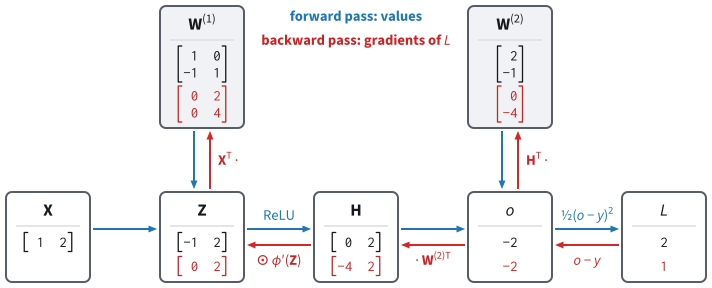

```{.python .input}
%load_ext d2lbook.tab
tab.interact_select('mxnet', 'pytorch', 'tensorflow', 'jax')
```

# Backpropagation
:label:`sec_backprop`

In :numref:`sec_mlp-implementation`, we trained a 203,530-parameter MLP
without writing a single line of calculus: the framework computed every
gradient automatically. Before automatic differentiation, even a minor
architectural tweak meant deriving pages of update rules by hand. While we
will gladly keep relying on autograd in day-to-day work, understanding what
happens under the hood is indispensable if you want more than a surface-level
grasp of deep learning. How can a single backward sweep through a network
deliver hundreds of thousands of partial derivatives for only a small
multiple of the cost of one forward pass?

In :numref:`sec_autograd`, we introduced the high-level mechanism: the
framework records the forward pass as a computational graph and walks the
chain rule backward through it, applying one local rule per operation while
reusing intermediate values saved along the way. Here we crack that black
box wide open for neural networks. Very little new calculus is required;
what changes is the setting—our parameters are matrices, nonlinearities sit
between layers, and error signals must travel *through* upper layers to
reach lower ones. Remarkably, an entire MLP requires just three local
rules—matrix multiplication, bias addition, and elementwise activation.
Applying them sequentially from the loss back to the first layer is
*backpropagation*.

Opening the hood also answers three pressing practical questions: why does
training consume far more memory than inference, and why does that memory
scale with batch size? Why does a permanently inactive ReLU unit freeze and
stop learning? And why do gradients in deep stacks tend to vanish or
explode—the central problem of the next section? After a quick warm-up on a
three-scalar graph, we derive the three matrix rules, interpret the backward
pass as error signals flowing downward through the network, verify our
hand-coded backward pass against automatic differentiation to 14 digits of
precision, and tally its exact cost in memory and arithmetic.

```{.python .input #backprop-forward-propagation-backward-propagation-and-computational-graphs}
%%tab mxnet
import math
import numpy as np
from mxnet import autograd, gluon, init, np as mnp, npx
from mxnet.gluon import nn
from d2l import mxnet as d2l
npx.set_np()
```

```{.python .input #backprop-forward-propagation-backward-propagation-and-computational-graphs}
%%tab pytorch
import math
import numpy as np
import torch
from torch import nn
from torch.nn import functional as F
from d2l import torch as d2l
```

```{.python .input #backprop-forward-propagation-backward-propagation-and-computational-graphs}
%%tab tensorflow
import math
import numpy as np
import tensorflow as tf
from d2l import tensorflow as d2l
```

```{.python .input #backprop-forward-propagation-backward-propagation-and-computational-graphs}
%%tab jax
import math
import numpy as np
import jax
from jax import numpy as jnp
from flax import nnx
import optax
from d2l import jax as d2l
```

## Computational Graphs

### A Small Graph

To refresh the mechanics of reverse-mode differentiation from
:numref:`sec_autograd`, consider the simplest nontrivial graph of three
scalars: $e = (a + b)\,c$ evaluated at $a = 2$, $b = 1$, and $c = -3$. The
*forward pass* computes $u = a + b = 3$ and then $e = u\,c = -9$. The
*backward pass* seeds the output with $\partial e / \partial e = 1$ and
multiplies by local derivatives on the way back to the inputs. At the
multiplication node, $\partial e / \partial u = c = -3$ and
$\partial e / \partial c = u = 3$; at the addition node,
$\partial u / \partial a = \partial u / \partial b = 1$. Chaining them
together yields

$$
\frac{\partial e}{\partial a} = \frac{\partial e}{\partial u}\,\frac{\partial u}{\partial a} = -3, \qquad
\frac{\partial e}{\partial b} = \frac{\partial e}{\partial u}\,\frac{\partial u}{\partial b} = -3, \qquad
\frac{\partial e}{\partial c} = u = 3.
$$

Notice the two elemental behaviors: an addition simply copies its incoming
gradient untouched to every input, whereas a multiplication scales the
incoming gradient by the value of the *other* input
(:numref:`fig_mdl-mlp-backprop-small`).


:label:`fig_mdl-mlp-backprop-small`

Even this tiny graph exhibits the two defining features of backpropagation.
First, the backward pass depends on values *saved during the forward
pass*: the multiplication node needed both $c$ (to compute $u$'s gradient)
and $u$ (to compute $c$'s gradient), whereas addition needed neither.
Second, execution runs strictly in reverse topological order ($e$, then
$u$ and $c$, then $a$ and $b$), because a node's gradient is complete only
after every downstream consumer has returned its contribution.

### The Graph of an MLP

Now let us scale up to the one-hidden-layer MLP of :numref:`sec_mlp`. For a
minibatch $\mathbf{X} \in \mathbb{R}^{n \times d}$, hidden weights and
biases $\mathbf{W}^{(1)} \in \mathbb{R}^{d \times h}$,
$\mathbf{b}^{(1)} \in \mathbb{R}^{h}$, activation $\phi$, and output
weights and biases $\mathbf{W}^{(2)} \in \mathbb{R}^{h \times q}$,
$\mathbf{b}^{(2)} \in \mathbb{R}^{q}$, we name the pre-activations
$\mathbf{Z}$ explicitly so the backward pass can refer to them:

$$
\begin{aligned}
\mathbf{Z} &= \mathbf{X}\mathbf{W}^{(1)} + \mathbf{b}^{(1)}, \\
\mathbf{H} &= \phi(\mathbf{Z}), \\
\mathbf{O} &= \mathbf{H}\mathbf{W}^{(2)} + \mathbf{b}^{(2)}.
\end{aligned}
$$
:eqlabel:`eq_backprop-forward`

From the logits $\mathbf{O}$, softmax produces predicted class
probabilities $\hat{\mathbf{Y}} = \mathrm{softmax}(\mathbf{O})$, and
averaging the per-example cross-entropy losses
$l_i = -\log \hat{y}_{i, y_i}$ yields the minibatch loss $L$. Let us also
include $\ell_2$ weight decay (:numref:`sec_weight_decay`),

$$s = \frac{\lambda}{2}\left(\|\mathbf{W}^{(1)}\|_\textrm{F}^2 + \|\mathbf{W}^{(2)}\|_\textrm{F}^2\right),$$

where the squared Frobenius norm $\|\mathbf{W}\|_\textrm{F}^2$ simply sums
the squares of all entries of $\mathbf{W}$. Including $s$ serves a dual
purpose: it reflects real training *and* forces each weight matrix to feed
two branches of the graph, showing how gradients from multiple paths add
up. Together, training minimizes the regularized *objective* $J = L + s$.

:numref:`fig_forward` lays out the full computational graph. Along the
bottom spine sit the forward tensors—$\mathbf{X}$, $\mathbf{Z}$,
$\mathbf{H}$, $\mathbf{O}$, and $L$—annotated with their exact shapes for
our Fashion-MNIST MLP ($d = 784, h = 256, q = 10$). Above sit the
trainable weight matrices, each branching downward into its layer and
upward into the regularization penalty $s$.


:label:`fig_forward`

## Backpropagation through an MLP

### Local Rules for Matrices

Our goal is to differentiate the scalar objective $J$ with respect to every
parameter matrix and vector, writing $\partial J / \partial \mathbf{W}$ for
the matrix of partial derivatives $\partial J / \partial w_{rj}$ (always
matching the shape of $\mathbf{W}$). Each operation in :numref:`fig_forward`
needs a local rule that converts an incoming upstream gradient into
gradients for its inputs.

Matrix multiplication is the one rule that merits careful derivation.
Suppose $\mathbf{A} = \mathbf{X}\mathbf{W}$ with
$\mathbf{X} \in \mathbb{R}^{n \times d}$ and
$\mathbf{W} \in \mathbb{R}^{d \times h}$, and suppose we already know the
upstream gradient $\mathbf{G} = \partial J / \partial \mathbf{A} \in \mathbb{R}^{n \times h}$.
Since $a_{ij} = \sum_r x_{ir} w_{rj}$, the weight entry $w_{rj}$ feeds into
every element of column $j$ of $\mathbf{A}$ with local derivative $x_{ir}$.
Summing over all paths via the multivariable chain rule
(:numref:`sec_calculus`) gives
$\partial J / \partial w_{rj} = \sum_i x_{ir} g_{ij}$, which is entry
$(r, j)$ of $\mathbf{X}^\top \mathbf{G}$. Symmetrically, $x_{ir}$ feeds
into every element of row $i$ of $\mathbf{A}$, giving
$\partial J / \partial x_{ir} = \sum_j g_{ij} w_{rj}$, or entry $(i, r)$ of
$\mathbf{G}\mathbf{W}^\top$. In compact matrix form:

$$
\frac{\partial J}{\partial \mathbf{W}} = \mathbf{X}^\top \mathbf{G}, \qquad
\frac{\partial J}{\partial \mathbf{X}} = \mathbf{G}\,\mathbf{W}^\top.
$$
:eqlabel:`eq_backprop-matmul`

A quick dimensional check makes these formulas almost impossible to
misremember: $\mathbf{X}^\top \mathbf{G}$ has shape $d \times h$ (matching
$\mathbf{W}$) and $\mathbf{G}\mathbf{W}^\top$ has shape $n \times d$
(matching $\mathbf{X}$)—whenever $n, d, h$ are distinct, no other matrix
product even fits! Writing row $i$ of $\mathbf{X}$ as $\mathbf{x}_i^\top$
and row $i$ of $\mathbf{G}$ as $\mathbf{g}_i^\top$, note that
$\mathbf{X}^\top\mathbf{G} = \sum_i \mathbf{x}_i \mathbf{g}_i^\top$ is
simply a sum of per-example outer products. Just like scalar multiplication
in our warm-up graph, each factor's gradient multiplies the upstream
gradient by the *other* factor—explaining why the forward pass must cache
$\mathbf{X}$ to differentiate $\mathbf{W}$, while $\mathbf{G}\mathbf{W}^\top$
transmits the error signal down to the layer below.

The remaining two local rules are immediate. Broadcasting a bias vector,
$\mathbf{Z} = \mathbf{A} + \mathbf{b}$, adds $b_j$ to every row in column
$j$: just like scalar addition, it passes
$\mathbf{G} = \partial J / \partial \mathbf{Z}$ straight back to
$\mathbf{A}$ unchanged ($\partial J / \partial \mathbf{A} = \mathbf{G}$),
while accumulating the gradient for $b_j$ by summing down column $j$ (all
$n$ rows of $\mathbf{G}$). Finally, an elementwise activation
$\mathbf{H} = \phi(\mathbf{Z})$ couples each entry $(i, j)$ exclusively to
itself, yielding the elementwise (Hadamard) product

$$\frac{\partial J}{\partial \mathbf{Z}} = \frac{\partial J}{\partial \mathbf{H}} \odot \phi'(\mathbf{Z}).$$

Each gradient entry is simply gated by the local slope of $\phi$ at its
pre-activation. For ReLU, $\phi'(z) = \mathbf{1}(z > 0)$ passes the
gradient of every active unit untouched and blocks every inactive one—and
conveniently, since $[\mathbf{H}]_{ij} > 0$ if and only if
$[\mathbf{Z}]_{ij} > 0$, ReLU can even infer the mask from $\mathbf{H}$
alone without keeping $\mathbf{Z}$. All three rules are concrete instances
of the vector--Jacobian products introduced in :numref:`sec_autograd` (and
derived for general tensor operations in :numref:`subsec_mdl-layer-vjp`).

### The Backward Pass

Those three rules give us the entire backward pass of our MLP. Starting at
the objective with $\partial J / \partial J = 1$, addition $J = L + s$
sends gradient 1 to both $L$ and $s$. From :numref:`sec_softmax`, the
gradient of the mean cross-entropy loss over $n$ examples with one-hot
label matrix $\mathbf{Y} \in \{0, 1\}^{n \times q}$ is
$\frac{1}{n}(\hat{\mathbf{Y}} - \mathbf{Y})$. Walking backward right to
left along :numref:`fig_forward` and applying our three rules line by line
yields:

$$
\begin{aligned}
\frac{\partial J}{\partial \mathbf{O}} &= \frac{1}{n}\bigl(\hat{\mathbf{Y}} - \mathbf{Y}\bigr), \\
\frac{\partial J}{\partial \mathbf{W}^{(2)}} &= \mathbf{H}^\top \frac{\partial J}{\partial \mathbf{O}} + \lambda \mathbf{W}^{(2)}, \qquad
\frac{\partial J}{\partial \mathbf{b}^{(2)}} = \Bigl(\frac{\partial J}{\partial \mathbf{O}}\Bigr)^\top \mathbf{1}, \\
\frac{\partial J}{\partial \mathbf{H}} &= \frac{\partial J}{\partial \mathbf{O}}\, \mathbf{W}^{(2)\top}, \\
\frac{\partial J}{\partial \mathbf{Z}} &= \frac{\partial J}{\partial \mathbf{H}} \odot \phi'(\mathbf{Z}), \\
\frac{\partial J}{\partial \mathbf{W}^{(1)}} &= \mathbf{X}^\top \frac{\partial J}{\partial \mathbf{Z}} + \lambda \mathbf{W}^{(1)}, \qquad
\frac{\partial J}{\partial \mathbf{b}^{(1)}} = \Bigl(\frac{\partial J}{\partial \mathbf{Z}}\Bigr)^\top \mathbf{1}.
\end{aligned}
$$
:eqlabel:`eq_backprop-mlp`

Here $\mathbf{1} \in \mathbb{R}^n$ is a column of ones, so
$\mathbf{G}^\top \mathbf{1}$ simply sums the rows of $\mathbf{G}$ into a
vector matching the bias. Reading :eqref:`eq_backprop-mlp` top to bottom
traces the exact execution order: output-layer gradients come first,
hidden-layer gradients come last, and we skip $\partial J / \partial \mathbf{X}$
altogether because inputs are fixed data rather than trainable parameters.
It also gives us the exact shopping list of forward-pass tensors that must
stay alive in memory until the backward sweep finishes: $\hat{\mathbf{Y}}$,
$\mathbf{H}$, $\mathbf{W}^{(2)}$, $\mathbf{Z}$, and $\mathbf{X}$.

Pause to appreciate the intuition behind line 3—it is literally why the
algorithm is called *backpropagation*. Line 1 computes the prediction error
at the outputs ($\hat{\mathbf{Y}} - \mathbf{Y}$). Line 3 propagates that
error *backward* through the transpose of the very same weights
$\mathbf{W}^{(2)}$ that carried hidden activations forward: hidden unit $j$
receives a weighted blend of every output error it contributed to. Because
hidden units have no ground-truth labels of their own, this backpropagated
error signal is their sole teacher—telling each unit how wrong the outputs
above it were and which direction to move—while line 4 gates that message
by each unit's activation slope $\phi'(\mathbf{Z})$.

Notice also how branching works on the weight gradients: because
$\mathbf{W}^{(2)}$ feeds both $\mathbf{O}$ (via $L$) and the weight-decay
term $s$ in :numref:`fig_forward`, the chain rule *sums* the two paths—
$\mathbf{H}^\top \partial J / \partial \mathbf{O}$ plus
$\lambda \mathbf{W}^{(2)}$. A notorious bug in hand-written backward passes
is overwriting instead of accumulating (`=` where `+=` belongs), which
silently corrupts gradients without raising any runtime error.

Extending from one hidden layer to an arbitrary $K$-layer MLP is effortless.
With $\mathbf{H}^{(0)} = \mathbf{X}$,
$\mathbf{Z}^{(k)} = \mathbf{H}^{(k-1)}\mathbf{W}^{(k)} + \mathbf{b}^{(k)}$,
hidden activations $\mathbf{H}^{(k)} = \phi(\mathbf{Z}^{(k)})$, and logits
$\mathbf{O} = \mathbf{Z}^{(K)}$, we seed
$\partial J / \partial \mathbf{Z}^{(K)} = \frac{1}{n}(\hat{\mathbf{Y}} - \mathbf{Y})$
and iterate one modular recurrence from the top layer down to the first:

$$
\frac{\partial J}{\partial \mathbf{Z}^{(k)}} = \Bigl(\frac{\partial J}{\partial \mathbf{Z}^{(k+1)}}\, \mathbf{W}^{(k+1)\top}\Bigr) \odot \phi'\bigl(\mathbf{Z}^{(k)}\bigr), \qquad
\frac{\partial J}{\partial \mathbf{W}^{(k)}} = \mathbf{H}^{(k-1)\top} \frac{\partial J}{\partial \mathbf{Z}^{(k)}} + \lambda \mathbf{W}^{(k)}.
$$

Every layer is completely self-contained: it receives the upstream error
from the layer above, computes its own parameter gradients, and passes the
error downward—multiplying by one transposed weight matrix and one matrix
of activation slopes at every hop. Keep that repeated matrix product in
mind: in :numref:`sec_numerical_stability`, it will explain why deep
networks are so vulnerable to vanishing and exploding gradients.

### A Worked Example

Let us step through :eqref:`eq_backprop-mlp` by hand on a tiny network
where every number is transparent: $d = h = 2$, $q = 1$, a single example
($n = 1$), ReLU hidden activation, zero biases, no weight decay, and
squared loss $L = \frac{1}{2}(o - y)^2$. Take

$$
\mathbf{X} = \begin{bmatrix} 1 & 2 \end{bmatrix},\quad
\mathbf{W}^{(1)} = \begin{bmatrix} \phantom{-}1 & 0 \\ -1 & 1 \end{bmatrix},\quad
\mathbf{W}^{(2)} = \begin{bmatrix} \phantom{-}2 \\ -1 \end{bmatrix},\quad
y = 0.
$$
:eqlabel:`eq_backprop-example`

Treating the example as a $1$-row minibatch, forward propagation gives
$\mathbf{Z} = \mathbf{X}\mathbf{W}^{(1)} = \begin{bmatrix} -1 & 2 \end{bmatrix}$
and $\mathbf{H} = \mathrm{ReLU}(\mathbf{Z}) = \begin{bmatrix} 0 & 2 \end{bmatrix}$—notice
that the first hidden unit is switched off—followed by
$o = \mathbf{H}\mathbf{W}^{(2)} = -2$ and $L = \frac{1}{2}(-2)^2 = 2$. For
squared loss, the seed gradient is simply $\partial L / \partial o = o - y = -2$.
Walking through the remaining lines of :eqref:`eq_backprop-mlp` yields:

$$
\begin{aligned}
\frac{\partial L}{\partial \mathbf{W}^{(2)}} &= \mathbf{H}^\top \frac{\partial L}{\partial o} = \begin{bmatrix} 0 \\ 2 \end{bmatrix}(-2) = \begin{bmatrix} \phantom{-}0 \\ -4 \end{bmatrix}, &
\frac{\partial L}{\partial \mathbf{H}} &= \frac{\partial L}{\partial o}\,\mathbf{W}^{(2)\top} = \begin{bmatrix} -4 & 2 \end{bmatrix}, \\
\frac{\partial L}{\partial \mathbf{Z}} &= \begin{bmatrix} -4 & 2 \end{bmatrix} \odot \begin{bmatrix} 0 & 1 \end{bmatrix} = \begin{bmatrix} 0 & 2 \end{bmatrix}, &
\frac{\partial L}{\partial \mathbf{W}^{(1)}} &= \mathbf{X}^\top \frac{\partial L}{\partial \mathbf{Z}} = \begin{bmatrix} 1 \\ 2 \end{bmatrix}\begin{bmatrix} 0 & 2 \end{bmatrix} = \begin{bmatrix} 0 & 2 \\ 0 & 4 \end{bmatrix}.
\end{aligned}
$$

Look right at the first column of $\partial L / \partial \mathbf{W}^{(1)}$:
it is identically zero! Even though $\partial L / \partial h_1 = -4$ was
sizable, ReLU's zero slope at $z_1 = -1$ slammed the gate shut, blocking
every gradient into unit 1. If a ReLU unit stays negative across *every*
training example, its incoming weights never receive a nonzero gradient
again—the exact anatomy of a *dead* ReLU unit from :numref:`sec_mlp`.
Meanwhile, for a single example the bias gradients equal the row gradients
themselves: $\partial L / \partial \mathbf{b}^{(1)} = (0, 2)$ and
$\partial L / \partial \mathbf{b}^{(2)} = -2$. :numref:`fig_mdl-mlp-backprop-graph`
summarizes both passes side by side.


:label:`fig_mdl-mlp-backprop-graph`

### Checking the Backward Pass on a Minibatch

Our by-hand example used a single sample, squared loss, and no weight
decay. To put every single line of :eqref:`eq_backprop-mlp` through its
paces, `mlp_backward` runs the forward pass :eqref:`eq_backprop-forward`
(caching the intermediate tensors needed on the way back) and then
executes the full minibatch ReLU MLP backward pass with cross-entropy
and weight decay, so we can check it head-to-head against automatic
differentiation.

```{.python .input #backprop-checking-the-backward-pass-on-a-minibatch-1}
%%tab mxnet
def mlp_backward(X, Y, W1, b1, W2, b2, lambd):
    """Gradients of J = cross-entropy + weight decay, by backprop."""
    Z = X @ W1 + b1  # forward pass, keeping X, Z, H, and Y_hat
    H = npx.relu(Z)
    Y_hat = npx.softmax(H @ W2 + b2, axis=1)
    G_O = (Y_hat - Y) / X.shape[0]  # dJ/dO
    dW2, db2 = H.T @ G_O + lambd * W2, G_O.sum(axis=0)
    G_Z = (G_O @ W2.T) * (Z > 0)  # dJ/dH, then dJ/dZ
    dW1, db1 = X.T @ G_Z + lambd * W1, G_Z.sum(axis=0)
    return dW1, db1, dW2, db2
```

```{.python .input #backprop-checking-the-backward-pass-on-a-minibatch-1}
%%tab pytorch
def mlp_backward(X, Y, W1, b1, W2, b2, lambd):
    """Gradients of J = cross-entropy + weight decay, by backprop."""
    Z = X @ W1 + b1  # forward pass, keeping X, Z, H, and Y_hat
    H = torch.relu(Z)
    Y_hat = torch.softmax(H @ W2 + b2, dim=1)
    G_O = (Y_hat - Y) / X.shape[0]  # dJ/dO
    dW2, db2 = H.T @ G_O + lambd * W2, G_O.sum(dim=0)
    G_Z = (G_O @ W2.T) * (Z > 0)  # dJ/dH, then dJ/dZ
    dW1, db1 = X.T @ G_Z + lambd * W1, G_Z.sum(dim=0)
    return dW1, db1, dW2, db2
```

```{.python .input #backprop-checking-the-backward-pass-on-a-minibatch-1}
%%tab tensorflow
def mlp_backward(X, Y, W1, b1, W2, b2, lambd):
    """Gradients of J = cross-entropy + weight decay, by backprop."""
    Z = X @ W1 + b1  # forward pass, keeping X, Z, H, and Y_hat
    H = tf.nn.relu(Z)
    Y_hat = tf.nn.softmax(H @ W2 + b2, axis=1)
    G_O = (Y_hat - Y) / X.shape[0]  # dJ/dO
    dW2 = tf.matmul(H, G_O, transpose_a=True) + lambd * W2
    G_Z = tf.matmul(G_O, W2, transpose_b=True) * tf.cast(Z > 0, Z.dtype)
    dW1 = tf.matmul(X, G_Z, transpose_a=True) + lambd * W1
    return dW1, tf.reduce_sum(G_Z, 0), dW2, tf.reduce_sum(G_O, 0)
```

```{.python .input #backprop-checking-the-backward-pass-on-a-minibatch-1}
%%tab jax
def mlp_backward(X, Y, W1, b1, W2, b2, lambd):
    """Gradients of J = cross-entropy + weight decay, by backprop."""
    Z = X @ W1 + b1  # forward pass, keeping X, Z, H, and Y_hat
    H = jax.nn.relu(Z)
    Y_hat = jax.nn.softmax(H @ W2 + b2, axis=1)
    G_O = (Y_hat - Y) / X.shape[0]  # dJ/dO
    dW2, db2 = H.T @ G_O + lambd * W2, G_O.sum(axis=0)
    G_Z = (G_O @ W2.T) * (Z > 0)  # dJ/dH, then dJ/dZ
    dW1, db1 = X.T @ G_Z + lambd * W1, G_Z.sum(axis=0)
    return dW1, db1, dW2, db2
```

Let us generate a random 256-example minibatch with the exact dimensions
and initialization of :numref:`sec_mlp-implementation` plus
$\lambda = 10^{-3}$, and compare `mlp_backward` against each framework's
built-in autograd. Following best practice for gradient checks, we run in
64-bit floating point (whose ~$10^{-16}$ rounding floor catches even tiny
algebraic bugs cleanly) and report the maximum relative discrepancy per
parameter tensor.

```{.python .input #backprop-checking-the-backward-pass-on-a-minibatch-2}
%%tab mxnet
n, d, h, q, lambd = 256, 784, 256, 10, 1e-3
f64 = 'float64'  # 64-bit floating point throughout the check
X = mnp.random.normal(size=(n, d), dtype=f64)
y = mnp.random.randint(0, q, (n,))
params = [mnp.random.normal(0, 0.01, (d, h), dtype=f64), mnp.zeros(h, f64),
          mnp.random.normal(0, 0.01, (h, q), dtype=f64), mnp.zeros(q, f64)]
for p in params:
    p.attach_grad()
W1, b1, W2, b2 = params
with autograd.record():
    O = npx.relu(X @ W1 + b1) @ W2 + b2
    J = (-npx.pick(npx.log_softmax(O), y).mean()
         + lambd / 2 * ((W1 ** 2).sum() + (W2 ** 2).sum()))
J.backward()  # automatic differentiation
grads = mlp_backward(X, npx.one_hot(y, q, dtype=f64), *params, lambd)
for name, p, g in zip(['W1', 'b1', 'W2', 'b2'], params, grads):
    rel = mnp.abs(p.grad - g).max() / mnp.abs(p.grad).max()
    print(f'{name}: relative difference {float(rel):.1e}')
```

```{.python .input #backprop-checking-the-backward-pass-on-a-minibatch-2}
%%tab pytorch
n, d, h, q, lambd = 256, 784, 256, 10, 1e-3
f64 = torch.float64  # 64-bit floating point throughout the check
X, y = torch.randn(n, d, dtype=f64), torch.randint(0, q, (n,))
params = [torch.randn(d, h, dtype=f64) * 0.01, torch.zeros(h, dtype=f64),
          torch.randn(h, q, dtype=f64) * 0.01, torch.zeros(q, dtype=f64)]
for p in params:
    p.requires_grad_(True)
W1, b1, W2, b2 = params
J = (F.cross_entropy(torch.relu(X @ W1 + b1) @ W2 + b2, y)
     + lambd / 2 * ((W1 ** 2).sum() + (W2 ** 2).sum()))
J.backward()  # automatic differentiation
with torch.no_grad():
    grads = mlp_backward(X, F.one_hot(y, q).to(f64), *params, lambd)
for name, p, g in zip(['W1', 'b1', 'W2', 'b2'], params, grads):
    rel = (p.grad - g).abs().max() / p.grad.abs().max()
    print(f'{name}: relative difference {float(rel):.1e}')
```

```{.python .input #backprop-checking-the-backward-pass-on-a-minibatch-2}
%%tab tensorflow
n, d, h, q, lambd = 256, 784, 256, 10, 1e-3
f64 = tf.float64  # 64-bit floating point throughout the check
X = tf.random.normal((n, d), dtype=f64)
y = tf.random.uniform((n,), 0, q, dtype=tf.int32)
params = [tf.Variable(tf.random.normal((d, h), stddev=0.01, dtype=f64)),
          tf.Variable(tf.zeros(h, f64)),
          tf.Variable(tf.random.normal((h, q), stddev=0.01, dtype=f64)),
          tf.Variable(tf.zeros(q, f64))]
W1, b1, W2, b2 = params
with tf.GradientTape() as tape:
    O = tf.nn.relu(X @ W1 + b1) @ W2 + b2
    J = (tf.reduce_mean(tf.nn.sparse_softmax_cross_entropy_with_logits(y, O))
         + lambd / 2 * (tf.reduce_sum(W1 ** 2) + tf.reduce_sum(W2 ** 2)))
auto = tape.gradient(J, params)  # automatic differentiation
grads = mlp_backward(X, tf.one_hot(y, q, dtype=f64), *params, lambd)
for name, a, g in zip(['W1', 'b1', 'W2', 'b2'], auto, grads):
    rel = tf.reduce_max(tf.abs(a - g)) / tf.reduce_max(tf.abs(a))
    print(f'{name}: relative difference {float(rel):.1e}')
```

```{.python .input #backprop-checking-the-backward-pass-on-a-minibatch-2}
%%tab jax
jax.config.update('jax_enable_x64', True)  # 64-bit is off by default
n, d, h, q, lambd = 256, 784, 256, 10, 1e-3
f64 = jnp.float64  # 64-bit floating point throughout the check
keys = jax.random.split(d2l.get_key(), 4)
X = jax.random.normal(keys[0], (n, d), f64)
y = jax.random.randint(keys[1], (n,), 0, q)
params = [jax.random.normal(keys[2], (d, h), f64) * 0.01, jnp.zeros(h, f64),
          jax.random.normal(keys[3], (h, q), f64) * 0.01, jnp.zeros(q, f64)]

def objective(params):
    W1, b1, W2, b2 = params
    O = jax.nn.relu(X @ W1 + b1) @ W2 + b2
    return (optax.softmax_cross_entropy_with_integer_labels(O, y).mean()
            + lambd / 2 * ((W1 ** 2).sum() + (W2 ** 2).sum()))

auto = jax.grad(objective)(params)  # automatic differentiation
grads = mlp_backward(X, jax.nn.one_hot(y, q, dtype=f64), *params, lambd)
for name, a, g in zip(['W1', 'b1', 'W2', 'b2'], auto, grads):
    rel = jnp.abs(a - g).max() / jnp.abs(a).max()
    print(f'{name}: relative difference {float(rel):.1e}')
```

Every relative discrepancy sits below $10^{-14}$—pure double-precision
rounding noise—confirming that :eqref:`eq_backprop-mlp` matches what
automatic differentiation computes under the hood.

## Memory and Computation

### Stored Values

Because backpropagation reuses intermediate activations saved during the
forward pass, training consumes substantially more memory than inference
(:numref:`sec_autograd`). Our Fashion-MNIST MLP
(:numref:`sec_mlp-implementation`) lets us put exact byte counts on this
gap. Evaluating :eqref:`eq_backprop-mlp` requires holding onto $\mathbf{X}$,
$\mathbf{H}$, and $\hat{\mathbf{Y}}$ (for ReLU, $\mathbf{H}$ already tells
us where $\mathbf{Z} > 0$, so $\mathbf{Z}$ can be freed). For a minibatch
of $n = 256$ examples, those cached activations total

$$256 \times 784 + 256 \times 256 + 256 \times 10 = 200{,}704 + 65{,}536 + 2{,}560 = 268{,}800$$

numbers—1.1 MB in 32-bit float, already *larger* than the entire model's
203,530 parameters (0.8 MB)! Worse still, while parameter memory is fixed,
activation memory scales linearly with *both* minibatch size $n$ and
network depth (every extra 256-unit hidden layer adds another
$256 \times 256$ matrix per batch). During inference, by contrast, each
layer's input can be discarded the instant its output is computed. That is
why deeper networks and larger minibatches trigger GPU out-of-memory errors
so readily: saved activations, not weights, usually fill the GPU first.

### Computation

What about arithmetic cost? Almost all compute sits inside the matrix
multiplications. Per example, the forward pass executes
$784 \times 256 + 256 \times 10 = 203{,}264$ multiply-adds. By
:eqref:`eq_backprop-matmul`, every forward matrix multiply spawns *two*
equally sized backward multiplies—one for the weight gradient and one for
the input gradient—except at the very first layer, which skips
$\partial J / \partial \mathbf{X}$. The backward pass thus executes
$784 \times 256 + 2 \times 256 \times 10 = 205{,}824$ multiply-adds per
example: roughly 2$\times$ the cost of a forward pass here, and roughly
3$\times$ in deeper architectures where most layers sit in the interior.

Now we have the full answer to our opening puzzle. Computing 203,530
derivatives by finite differences would demand 203,530 extra forward passes
per gradient step. Backpropagation computes the shared layer-level error
signals $\partial J / \partial \mathbf{O}$ and
$\partial J / \partial \mathbf{Z}$ *once* and reads every single parameter
gradient off them with one matrix product or sum—the hallmark efficiency of
reverse-mode differentiation (:numref:`sec_autograd`). In deep networks,
however, those error signals must pass through long chains of transposed
weight matrices and activation slopes. What happens to their magnitude over
ten or a hundred layers? That brings us directly to the next section.

## Summary

Backpropagation is reverse-mode automatic differentiation
(:numref:`sec_autograd`) specialized to neural networks. Three local matrix
rules suffice for any MLP: addition passes gradients through unchanged
(summing across the batch for biases), matrix multiplication
$\mathbf{X}\mathbf{W}$ returns $\mathbf{X}^\top\mathbf{G}$ for weights and
$\mathbf{G}\mathbf{W}^\top$ for inputs, and an elementwise activation
multiplies by its local slope $\phi'(\mathbf{Z})$ (blocking gradients
through inactive ReLU units). Whenever a parameter feeds multiple branches
such as the loss and weight decay, incoming gradients add. Because each
layer computes its parameter gradients from a single shared error signal
propagated downward from the layer above, one backward pass computes every
gradient for roughly 2–3$\times$ the cost of a forward pass—while requiring
the forward pass to retain intermediate activations whose memory grows with
both batch size and depth.

## Exercises

1. **Jacobian of a layer.** The gradient of the scalar $J$ with respect to
   $\mathbf{W}^{(2)} \in \mathbb{R}^{h \times q}$ has the shape of
   $\mathbf{W}^{(2)}$. The derivative of the matrix
   $\mathbf{O} = \mathbf{H}\mathbf{W}^{(2)} \in \mathbb{R}^{n \times q}$
   with respect to $\mathbf{W}^{(2)}$ is a larger object, with one entry
   $\partial o_{ij} / \partial w_{rt}$ for every combination of the four
   indices.
    1. How many entries does $\partial \mathbf{O} / \partial \mathbf{W}^{(2)}$
       have, and how many of them can be nonzero?
    1. Evaluate the chain rule
       $\partial J / \partial w_{rt} = \sum_{i, j} (\partial J / \partial o_{ij})(\partial o_{ij} / \partial w_{rt})$
       to recover $\mathbf{H}^\top \partial J / \partial \mathbf{O}$.
    1. How much memory would $\partial \mathbf{O} / \partial \mathbf{W}^{(2)}$
       take in 32-bit floating point for the MLP of
       :numref:`sec_mlp-implementation` with $n = 256$? Explain why
       backpropagation never forms it.
1. **Modified activation.** The first hidden unit of the network in
   :eqref:`eq_backprop-example` receives the pre-activation $z_1 = -1$, so
   the ReLU derivative $\phi'(z_1) = 0$ blocks the gradient of every weight
   into this unit. Replace the activation of this unit alone by the leaky
   variant $\phi_1(z) = \max(0, z) + 0.1 \min(0, z)$; the second unit keeps
   its ReLU.
    1. Write the backward rule for $\partial J / \partial \mathbf{Z}$ when
       hidden unit $j$ has its own activation $\phi_j$.
    1. Redo the forward and backward passes, and give
       $\partial L / \partial \mathbf{W}^{(2)}$,
       $\partial L / \partial \mathbf{Z}$, and
       $\partial L / \partial \mathbf{W}^{(1)}$. Which of these gradients
       differ from the all-ReLU case even though the rules that produce
       them are unchanged, and why?

    *Adapted from Michael Nielsen,
    [Neural Networks and Deep Learning](http://neuralnetworksanddeeplearning.com/chap2.html),
    Chapter 2, and Simon Prince,
    [Understanding Deep Learning](https://udlbook.github.io/udlbook/),
    Problem 7.10.*
1. **Memory of a deeper network.** Consider an MLP with $d$ inputs, $q$
   outputs, and $K$ layers, of which the $K - 1$ hidden ones are ReLU layers
   of width $h$, trained on minibatches of $n$ examples.
    1. Using the step for $K$ layers in the text, list the values that the
       backward pass reads, and count them. Count the parameters.
    1. Prediction can discard each value as soon as the next layer has used
       it. Count the largest number of values that prediction holds at any
       moment.
    1. For $d = 784$, $h = 256$, and $q = 10$, find the smallest minibatch
       size at which the stored values outnumber the parameters, for
       $K = 2$ and for $K = 11$.
1. [code] **Gradient checking.** Before automatic differentiation, a
   hand-written backward pass was checked against finite differences.
    1. Pick one entry $w$ of $\mathbf{W}^{(1)}$ and compare its gradient from
       `mlp_backward` with the central difference
       $\bigl(J(w + \epsilon) - J(w - \epsilon)\bigr) / (2\epsilon)$ for
       $\epsilon = 10^{-1}, 10^{-2}, \ldots, 10^{-7}$, once in 32-bit and once
       in 64-bit floating point. Plot the relative error against $\epsilon$
       on logarithmic axes.
    1. Explain the shape of the curves. Which error decreases with
       $\epsilon$, which increases, and where do they balance in each
       precision?
    1. The check can fail at a correct gradient when a pre-activation lies
       within $\epsilon$ of zero. Explain why, and how to avoid it.
1. **Forward mode.** Backpropagation seeds $\partial J / \partial J = 1$ at
   the output and sweeps the graph backward. Forward-mode differentiation
   instead seeds $\partial w / \partial w = 1$ at one chosen scalar parameter
   $w$ and sweeps forward: each node computes the derivative of its value
   with respect to $w$ from the derivatives of its inputs.
    1. Use forward mode to recompute $\partial L / \partial \mathbf{W}^{(1)}$
       for the network in :eqref:`eq_backprop-example`, one sweep per entry
       of $\mathbf{W}^{(1)}$.
    1. How many sweeps does each mode need to obtain all six weight
       gradients of this network? Which products does forward mode compute
       again in every sweep that reverse mode computes only once?

    *Adapted from Simon Prince,
    [Understanding Deep Learning](https://udlbook.github.io/udlbook/),
    Problems 7.12 and 7.13.*
1. **Hessian of a ReLU network.** ● ReLU has $\phi''(z) = 0$ for
   $z \neq 0$. For the network in :eqref:`eq_backprop-example`, derive the
   $4 \times 4$ Hessian of $L$ with respect to the entries of
   $\mathbf{W}^{(1)}$, show that it has rank at most one, and evaluate it at
   the given values.
1. [extended] **Autograd engine.** ● Build a miniature automatic
   differentiation engine and use it to recompute the gradients of the
   network in :eqref:`eq_backprop-example`.
    1. Write a scalar `Value` class that records, for each result, its
       inputs and the operation that produced it (the computational graph),
       supporting `+`, `*`, and `relu`. (*Hint:* implement `__add__` and
       `__mul__` so that each returns a new `Value` holding references to
       its parents and a small function that propagates the gradient one
       step.)
    1. Implement `backward()`: sort the graph topologically, seed the
       output's gradient with $1$, and visit the nodes in reverse order,
       letting each node pass its gradient to its parents. Make sure that
       gradients *accumulate* (`+=`, not `=`) when a value is used more than
       once.
    1. Recompute the graph of :numref:`fig_mdl-mlp-backprop-small` and the
       worked example :eqref:`eq_backprop-example` with your engine (unroll
       the matrix products into scalars), and compare the gradients with
       those derived in this section.
    1. Consider the chain in which a scalar input $x$ produces
       $v_i = f_i(x)$ for $i = 1, 2, 3$, the intermediate value
       $m = v_1 + v_2 + v_3$, the values $p_j = g_j(m)$ for $j = 1, 2, 3$,
       and the loss $L = p_1 + p_2 + p_3$. Write $\alpha_i = f_i'(x)$ and
       $\beta_j = g_j'(m)$. The chain rule as a sum over paths enumerates
       $3 \times 3 = 9$ paths from $x$ to $L$, each contributing the product
       $\alpha_i \beta_j$. Show that your engine instead computes
       $(\alpha_1 + \alpha_2 + \alpha_3)(\beta_1 + \beta_2 + \beta_3)$ by
       accumulating the gradient at $m$ once, and explain why this sharing
       keeps backpropagation affordable in deep networks.

    *Adapted from Andrej Karpathy,
    [micrograd](https://github.com/karpathy/micrograd),
    `micrograd/engine.py`.*
   :exlabel:`ex_backprop-autograd-engine`

[Discussions](https://d2l.discourse.group/t/102)

<!-- slides -->

::: {.slide}
::: {.cover}
[Dive into Deep Learning · §4.3]{.kicker}

Backpropagation<br>**computational graphs · local rules · the backward pass of an MLP · memory**
:::
:::

::: {.slide title="One Backward Pass Returns All 203,530 Gradients"}
[The problem]{.kicker}

The Fashion-MNIST MLP, $784 \to 256 \to 10$, has 203,530 parameters.

- Finite differences: one extra forward pass per parameter, 203,530 per step.
- Automatic differentiation: one backward pass, about the cost of a forward
  pass.

. . .

So far `backward()` has been a black box. It decides:

- why training needs more memory than prediction;
- why a ReLU unit that is never active stops learning;
- why the gradients of deep networks vanish or explode (next deck).

::: {.d2l-note}
Open the box: three local rules and the values they read.
:::
:::

::: {.slide title="By the End of This Deck You Can"}
[Goals]{.kicker}

- run the backward pass of a small graph by hand;
- say what the gradient of a hidden layer means, and why one backward pass
  suffices for every parameter;
- derive the gradients of $\mathbf{X}\mathbf{W}$, of a bias, and of an
  activation function;
- write the backward pass of an MLP and check it against autograd;
- count, in bytes, the values that training must store;
- read a dead ReLU unit off a gradient.

**Running example:** the Fashion-MNIST MLP: 203,530 parameters, 203,264
multiply-adds per example in the forward pass, minibatches of 256.
:::

::: {.slide title="Gradients by Local Rules, Between the MLP and Its Initialization"}
[Where this fits]{.kicker}

::: {.cols .vc}
::: {.col}
| section | adds |
|---|---|
| Multilayer Perceptrons | hidden layers, universal approximation, activation functions |
| Implementation | an MLP trained on Fashion-MNIST |
| **Backpropagation** | **how the gradients are computed, and at what memory cost** |
| Numerical Stability and Initialization | vanishing gradients, Xavier and He initialization |
| Generalization in Deep Learning | memorization, double descent, implicit bias, early stopping |
| Dropout | random masks, slower memorization of noisy labels |
| Predicting House Prices on Kaggle | the workflow on real data |
:::

::: {.col .narrow}
- **Uses:** the chain rule and autograd; the cross-entropy gradient
  $\hat{\mathbf{Y}} - \mathbf{Y}$; the MLP.
- **Skips:** forward mode; rules for general tensor operations.
:::
:::
:::

::: {.slide}
::: {.divider}
[01]{.dnum}

[Computational Graphs]{.dtitle}

[values flow forward · gradients flow back]{.dsub}
:::
:::

::: {.slide title="Reminder: an Addition Copies the Gradient; a Multiplication Scales It by the Other Input"}
[Computational graphs]{.kicker}

Automatic differentiation in its barest form, on three numbers:
$e = (a + b)\,c$ at $a = 2$, $b = 1$, $c = -3$. Forward: $u = a + b = 3$, $e = u\,c = -9$.
Backward: start from $\partial e/\partial e = 1$.

{width=62%}
:::

::: {.slide title="Every Node Needs Stored Values and a Finished Gradient"}
[Computational graphs]{.kicker}

Two questions for each node of the graph:

- **Which forward values does its rule read?** The multiplication reads
  both inputs: $c$ for $\partial e/\partial u$, $u$ for
  $\partial e/\partial c$. The addition reads nothing.
- **When is its gradient ready?** Once every node that uses its value has
  passed a gradient back: $e$, then $u$ and $c$, then $a$ and $b$.

::: {.d2l-note .rule}
The backward pass visits the graph in reverse order and reads values that
the forward pass kept.
:::
:::

::: {.slide title="Each Weight Matrix Feeds Two Nodes: Its Layer and the Penalty"}
[Computational graphs]{.kicker}

$\mathbf{Z} = \mathbf{X}\mathbf{W}^{(1)} + \mathbf{b}^{(1)}$,
$\mathbf{H} = \phi(\mathbf{Z})$,
$\mathbf{O} = \mathbf{H}\mathbf{W}^{(2)} + \mathbf{b}^{(2)}$,
$L$ = mean cross-entropy, $J = L + s$ with
$s = \tfrac{\lambda}{2}(\|\mathbf{W}^{(1)}\|_\textrm{F}^2 + \|\mathbf{W}^{(2)}\|_\textrm{F}^2)$.

{width=72%}
:::

::: {.slide}
::: {.divider}
[02]{.dnum}

[Local Rules]{.dtitle}

[three rules · the backward pass in five lines · K layers]{.dsub}
:::
:::

::: {.slide title="The Gradient of XW Is XᵀG for W and GWᵀ for X"}
[Local rules]{.kicker}

$\mathbf{A} = \mathbf{X}\mathbf{W}$, so $a_{ij} = \sum_r x_{ir} w_{rj}$; the
gradient arriving from above is $\mathbf{G} = \partial J/\partial \mathbf{A}$.

I. $w_{rj}$ enters every entry of column $j$:
$\;\partial J/\partial w_{rj} = \sum_i g_{ij}\, x_{ir} = [\mathbf{X}^\top\mathbf{G}]_{rj}$

II. $x_{ir}$ enters every entry of row $i$:
$\;\partial J/\partial x_{ir} = \sum_j g_{ij}\, w_{rj} = [\mathbf{G}\mathbf{W}^\top]_{ir}$

::: {.d2l-note .rule}
$\mathbf{X}^\top\mathbf{G}$ is $d \times h$ like $\mathbf{W}$, and
$\mathbf{G}\mathbf{W}^\top$ is $n \times d$ like $\mathbf{X}$. The weight
gradient needs the input, so $\mathbf{X}$ must be kept.
:::
:::

::: {.slide title="A Bias Sums the Gradient over Examples; an Activation Multiplies by Its Slope"}
[Local rules]{.kicker}

::: {.cols}
::: {.col}
**Bias** $\mathbf{Z} = \mathbf{A} + \mathbf{b}$, added to every row, with
$\mathbf{G} = \partial J/\partial \mathbf{Z}$:

$$\frac{\partial J}{\partial \mathbf{A}} = \mathbf{G}, \qquad
  \frac{\partial J}{\partial \mathbf{b}} = \mathbf{G}^\top \mathbf{1}.$$

The sum runs over the $n$ examples. Nothing is stored.
:::

::: {.col}
**Activation** $\mathbf{H} = \phi(\mathbf{Z})$, entry by entry:

$$\frac{\partial J}{\partial \mathbf{Z}} = \frac{\partial J}{\partial \mathbf{H}} \odot \phi'(\mathbf{Z}).$$

ReLU: $\phi'(z) = 1$ for $z > 0$, else 0. Active units pass the gradient;
inactive ones block it.
:::
:::
:::

::: {.slide title="The Backward Pass of an MLP Is Five Lines"}
[Local rules]{.kicker}

$$
\begin{aligned}
\tfrac{\partial J}{\partial \mathbf{O}} &= \tfrac{1}{n}(\hat{\mathbf{Y}} - \mathbf{Y}) \\
\tfrac{\partial J}{\partial \mathbf{W}^{(2)}} &= \mathbf{H}^\top \tfrac{\partial J}{\partial \mathbf{O}} + \lambda \mathbf{W}^{(2)} \\
\tfrac{\partial J}{\partial \mathbf{H}} &= \tfrac{\partial J}{\partial \mathbf{O}}\, \mathbf{W}^{(2)\top} \\
\tfrac{\partial J}{\partial \mathbf{Z}} &= \tfrac{\partial J}{\partial \mathbf{H}} \odot \phi'(\mathbf{Z}) \\
\tfrac{\partial J}{\partial \mathbf{W}^{(1)}} &= \mathbf{X}^\top \tfrac{\partial J}{\partial \mathbf{Z}} + \lambda \mathbf{W}^{(1)}
\end{aligned}
$$

::: {.d2l-note .rule}
Top to bottom is the order: the output layer first. The lines read
$\hat{\mathbf{Y}}$, $\mathbf{H}$, $\mathbf{W}^{(2)}$, $\mathbf{Z}$, and
$\mathbf{X}$; bias gradients are the row sums of the lines above them.
:::
:::

::: {.slide title="W⁽²⁾ Collects the Gradients of Two Paths"}
[Local rules]{.kicker}

$$J \leftarrow L \leftarrow \mathbf{O} \leftarrow \mathbf{W}^{(2)}
\qquad\text{and}\qquad
J \leftarrow s \leftarrow \mathbf{W}^{(2)}$$

The chain rule adds the paths:
$\mathbf{H}^\top \partial J/\partial \mathbf{O}$ from the loss plus
$\lambda\mathbf{W}^{(2)}$ from the penalty.

::: {.d2l-note .warn}
A value that feeds several nodes sums their gradients. In a hand-written
backward pass, `=` where `+=` belongs gives a wrong gradient and no error.
:::
:::

::: {.slide title="A Hidden Unit Learns from the Output Errors Sent Back to It"}
[Local rules]{.kicker}

The five lines, read as a message:

- **Line 1:** the error at the outputs, predicted probabilities minus
  labels.
- **Line 3:** $\partial J/\partial \mathbf{H} = \partial J/\partial \mathbf{O}\,\mathbf{W}^{(2)\top}$
  sends it back through the weights that carried $\mathbf{H}$ forward. Unit
  $j$ receives the errors of the $q$ outputs, each times its weight to that
  output.
- **Line 4:** the message passes only where the slope $\phi'$ is not zero.

::: {.d2l-note}
A hidden unit has no label of its own. It learns from how wrong the outputs
that it feeds are, and in which direction: hence *back-propagation*.
:::
:::

::: {.slide title="K Layers Repeat One Step"}
[Local rules]{.kicker}

$\mathbf{Z}^{(k)} = \mathbf{H}^{(k-1)}\mathbf{W}^{(k)} + \mathbf{b}^{(k)}$,
$\mathbf{H}^{(k)} = \phi(\mathbf{Z}^{(k)})$, $\mathbf{H}^{(0)} = \mathbf{X}$,
$\mathbf{O} = \mathbf{Z}^{(K)}$. Start from
$\partial J/\partial \mathbf{Z}^{(K)} = \tfrac1n(\hat{\mathbf{Y}} - \mathbf{Y})$,
then for $k = K - 1, \ldots, 1$:

$$
\frac{\partial J}{\partial \mathbf{Z}^{(k)}} = \Bigl(\frac{\partial J}{\partial \mathbf{Z}^{(k+1)}}\, \mathbf{W}^{(k+1)\top}\Bigr) \odot \phi'\bigl(\mathbf{Z}^{(k)}\bigr), \qquad
\frac{\partial J}{\partial \mathbf{W}^{(k)}} = \mathbf{H}^{(k-1)\top} \frac{\partial J}{\partial \mathbf{Z}^{(k)}} + \lambda \mathbf{W}^{(k)}
$$

::: {.d2l-note .rule}
A layer need not know how many others there are. On the way down the error
is multiplied by one transposed weight matrix and one matrix of slopes per
layer: the product that the next deck measures.
:::
:::

::: {.slide title="Check: The Shape of the First-Layer Gradient"}
[Check]{.kicker}

For a minibatch of 256 examples of the Fashion-MNIST MLP, what is the shape
of $\partial J/\partial \mathbf{W}^{(1)}$, and how many outer products does
$\mathbf{X}^\top \partial J/\partial \mathbf{Z}$ add up?

::: {.fragment .fade-up}
::: {.d2l-note}
**Answer.** $784 \times 256$, the shape of $\mathbf{W}^{(1)}$. It adds 256
outer products $\mathbf{x}_i \mathbf{g}_i^\top$, one per example, where
$\mathbf{x}_i^\top$ and $\mathbf{g}_i^\top$ are row $i$ of $\mathbf{X}$
and of $\partial J/\partial \mathbf{Z}$.
:::
:::
:::

::: {.slide}
::: {.divider}
[03]{.dnum}

[A Worked Example]{.dtitle}

[two inputs · two hidden units · one output]{.dsub}
:::
:::

::: {.slide title="Forward: z₁ = −1, so the First Hidden Unit Is Inactive"}
[Worked example]{.kicker}

ReLU, squared loss $L = \tfrac12(o - y)^2$, zero biases, $\lambda = 0$:

$$
\mathbf{X} = \begin{bmatrix} 1 & 2 \end{bmatrix},\quad
\mathbf{W}^{(1)} = \begin{bmatrix} \phantom{-}1 & 0 \\ -1 & 1 \end{bmatrix},\quad
\mathbf{W}^{(2)} = \begin{bmatrix} \phantom{-}2 \\ -1 \end{bmatrix},\quad
y = 0.
$$

. . .

$\mathbf{Z} = \mathbf{X}\mathbf{W}^{(1)} = \begin{bmatrix} -1 & 2 \end{bmatrix}$,
$\quad\mathbf{H} = \begin{bmatrix} 0 & 2 \end{bmatrix}$,
$\quad o = \mathbf{H}\mathbf{W}^{(2)} = -2$,
$\quad L = 2$.

Backward starts from $\partial L/\partial o = o - y = -2$.
:::

::: {.slide title="Backward: the Inactive Unit Zeros a Column of ∂L/∂W⁽¹⁾"}
[Worked example]{.kicker}

{width=80%}

Column $j$ of $\mathbf{W}^{(1)}$ feeds hidden unit $j$. A unit that is
inactive for every training example never gets a gradient: it is dead.
:::

::: {.slide title="The Backward Pass in Code"}
[Worked example · minibatch]{.kicker}

The five lines, with cross-entropy, biases, weight decay, and ReLU:

@-backprop-checking-the-backward-pass-on-a-minibatch-1
:::

::: {.slide title="Hand-Written and Automatic Gradients Agree to Float64 Rounding"}
[Worked example · minibatch]{.kicker}

Random minibatch of 256 for the $784 \to 256 \to 10$ MLP, weights from
$\mathcal{N}(0, 0.01^2)$, $\lambda = 10^{-3}$, all in 64-bit floating point;
largest difference relative to the largest gradient entry:

@!backprop-checking-the-backward-pass-on-a-minibatch-2

::: {.d2l-note .rule}
All below $10^{-14}$, a few rounding errors: the five lines are what
autograd computes.
:::
:::

::: {.slide}
::: {.divider}
[04]{.dnum}

[Memory and Computation]{.dtitle}

[what training stores · what the backward pass costs]{.dsub}
:::
:::

::: {.slide title="Training Stores 1.1 MB per Minibatch, More than the 0.8 MB of Parameters"}
[Memory]{.kicker}

| stored for the backward pass | shape | numbers |
|---|---|---:|
| input $\mathbf{X}$ | $256 \times 784$ | 200,704 |
| activations $\mathbf{H}$ (also give $\phi'(\mathbf{Z})$ for ReLU) | $256 \times 256$ | 65,536 |
| probabilities $\hat{\mathbf{Y}}$ | $256 \times 10$ | 2,560 |
| **total**, at 4 bytes each | | **268,800 = 1.1 MB** |

Parameters: 203,530 = 0.8 MB. The stored values grow with the minibatch
and with every hidden layer; prediction discards each layer's input.
:::

::: {.slide title="The Backward Pass Costs About as Much as the Forward Pass"}
[Computation]{.kicker}

Multiply-adds per example:

- **forward:** $784 \cdot 256 + 256 \cdot 10 = 203{,}264$
- **backward:** each product becomes two (weights and input), except that
  $\partial J/\partial \mathbf{X}$ is not needed:
  $784 \cdot 256 + 2 \cdot 256 \cdot 10 = 205{,}824$

::: {.d2l-note}
A training step costs about two forward passes here, and about three in a
network whose first layer is small.
:::
:::

::: {.slide title="One Pass Suffices Because the Derivatives Share Their Work"}
[Computation]{.kicker}

How can one backward pass return 203,530 derivatives?

- **Finite differences:** one forward pass per parameter, some two hundred
  thousand per training step.
- **Backward pass:** computes the two errors
  $\partial J/\partial \mathbf{O}$ and $\partial J/\partial \mathbf{Z}$
  once. Every parameter gradient is then one product or sum away:
  $\mathbf{H}^\top \partial J/\partial \mathbf{O}$,
  $\mathbf{X}^\top \partial J/\partial \mathbf{Z}$, and the row sums.

::: {.d2l-note .rule}
The work that the derivatives have in common is done once. This is the
advantage of reverse mode, with the shared quantities named: they are the
errors of the layers.
:::
:::

::: {.slide title="Check: Ten Hidden Layers of Width 256"}
[Check]{.kicker}

Give the Fashion-MNIST MLP ten hidden layers of width 256. How many bytes
does training store per minibatch of 256, and how does that compare with
the parameters?

::: {.fragment .fade-up}
::: {.d2l-note}
**Answer.** $\mathbf{X}$ (200,704) + ten $\mathbf{H}$ (655,360) +
$\hat{\mathbf{Y}}$ (2,560) = 858,624 numbers, 3.4 MB. Parameters:
200,960 + 9 × 65,792 + 2,570 = 795,658, 3.2 MB. Doubling the minibatch
doubles the first number only.
:::
:::
:::

::: {.slide title="Recap"}
[Wrap-up]{.kicker}

- **Local rules:** an addition copies the gradient, a multiplication scales
  it by the other input; $\mathbf{X}\mathbf{W}$ sends back
  $\mathbf{X}^\top\mathbf{G}$ and $\mathbf{G}\mathbf{W}^\top$; an activation
  multiplies by $\phi'(\mathbf{Z})$.
- **Order:** output layer first; a value that feeds two nodes sums their
  gradients.
- **Meaning:** each layer receives the error of the layer above through the
  transposed weights, and every parameter gradient is read off these
  errors, which is why one pass suffices.
- **Check:** five lines match autograd to float64 rounding.
- **Dead units:** an inactive ReLU unit zeros its column of
  $\partial L/\partial \mathbf{W}^{(1)}$.
- **Cost:** 1.1 MB stored per minibatch of 256 against 0.8 MB of
  parameters; the backward pass about as expensive as the forward pass.

**Next:** what a product of many layers' factors does to the gradient.
:::
