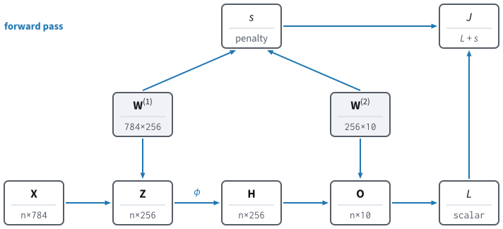

```{.python .input}
%load_ext d2lbook.tab
tab.interact_select('mxnet', 'pytorch', 'tensorflow', 'jax')
```

# Backpropagation
:label:`sec_backprop`

In :numref:`sec_mlp-implementation`, we trained all $203{,}530$ parameters of our Fashion-MNIST MLP without writing a single derivative by hand: calling `backward()` computed every gradient automatically. In :numref:`sec_autograd`, we saw the general principle—reverse-mode automatic differentiation records the forward pass as a computational graph and walks the chain rule backward from the scalar loss.

In this section, we open that black box for multilayer perceptrons. An entire MLP requires just **three local matrix-calculus rules**: matrix multiplication, broadcasted bias addition, and elementwise activation. Walking through them answers three essential engineering questions:

1. How does a single backward pass compute hundreds of thousands of partial derivatives for only $\sim 2\times$ the arithmetic cost of one forward pass?
2. Why does training consume so much more GPU memory than inference—and why does that memory scale linearly with minibatch size $n$ and depth $K$?
3. How do dead ReLU units and vanishing/exploding gradients arise mechanically from the backward recurrence?

```{.python .input #backprop-forward-propagation-backward-propagation-and-computational-graphs}
%%tab mxnet
import math
import numpy as np
from mxnet import autograd, gluon, init, np as mnp, npx
from mxnet.gluon import nn
from d2l import mxnet as d2l
npx.set_np()
```

```{.python .input #backprop-forward-propagation-backward-propagation-and-computational-graphs}
%%tab pytorch
import math
import numpy as np
import torch
from torch import nn
from torch.nn import functional as F
from d2l import torch as d2l
```

```{.python .input #backprop-forward-propagation-backward-propagation-and-computational-graphs}
%%tab tensorflow
import math
import numpy as np
import tensorflow as tf
from d2l import tensorflow as d2l
```

```{.python .input #backprop-forward-propagation-backward-propagation-and-computational-graphs}
%%tab jax
import math
import numpy as np
import jax
from jax import numpy as jnp
from flax import nnx
import optax
from d2l import jax as d2l
```


## Computational Graphs

### A Small Graph

To review reverse-mode differentiation in its barest form, consider the three-scalar expression $e = (a + b)\,c$ at $a = 2, b = 1, c = -3$ (:numref:`fig_mdl-mlp-backprop-small`). The *forward pass* (left to right) computes $u = a + b = 3$ and $e = u\,c = -9$. The *backward pass* (right to left) seeds $\partial e / \partial e = 1$ and applies one local derivative per node:
- At the multiplication node $e = u\,c$: $\partial e / \partial u = c = -3$ and $\partial e / \partial c = u = 3$.
- At the addition node $u = a + b$: $\partial u / \partial a = \partial u / \partial b = 1$, so $\partial e / \partial a = \partial e / \partial b = -3$.


:label:`fig_mdl-mlp-backprop-small`

Notice two universal rules already visible here: (i) an addition node copies its incoming gradient unchanged to each summand, whereas a multiplication node multiplies the incoming gradient by the *other* factor (requiring the forward pass to cache $u$ and $c$); and (ii) the backward pass traverses the graph in *reverse topological order*.

### The Graph of an MLP

Now consider our one-hidden-layer MLP (:numref:`fig_forward`) on a minibatch $\mathbf{X} \in \mathbb{R}^{n \times d}$ with parameters $\mathbf{W}^{(1)} \in \mathbb{R}^{d \times h}$, $\mathbf{b}^{(1)} \in \mathbb{R}^h$, $\mathbf{W}^{(2)} \in \mathbb{R}^{h \times q}$, $\mathbf{b}^{(2)} \in \mathbb{R}^q$, and $\ell_2$ weight-decay penalty $s = \frac{\lambda}{2}(\|\mathbf{W}^{(1)}\|_{\textrm{F}}^2 + \|\mathbf{W}^{(2)}\|_{\textrm{F}}^2)$:

$$
\begin{aligned}
\mathbf{Z} &= \mathbf{X}\mathbf{W}^{(1)} + \mathbf{b}^{(1)}, \\
\mathbf{H} &= \phi(\mathbf{Z}), \\
\mathbf{O} &= \mathbf{H}\mathbf{W}^{(2)} + \mathbf{b}^{(2)}, \\
J &= L(\mathbf{O}, \mathbf{Y}) + s,
\end{aligned}
$$
:eqlabel:`eq_backprop-forward`

where $L$ is the mean cross-entropy loss over the minibatch and $\|\mathbf{W}\|_{\textrm{F}}^2 = \sum_{r,j} w_{rj}^2$ is the squared Frobenius norm.


:label:`fig_forward`

## Backpropagation through an MLP

### Local Rules for Matrices

For any matrix $\mathbf{A}$, we write $\partial J / \partial \mathbf{A}$ for the matrix of partial derivatives $(\partial J / \partial a_{ij})$ of the *exact same shape* as $\mathbf{A}$. Three local vector--Jacobian rules (:numref:`subsec_mdl-layer-vjp`) handle every layer of an MLP:

1. **Matrix multiplication ($\mathbf{A} = \mathbf{X}\mathbf{W}$ with $\mathbf{X} \in \mathbb{R}^{n \times d}, \mathbf{W} \in \mathbb{R}^{d \times h}$):** Given upstream gradient $\mathbf{G} = \partial J / \partial \mathbf{A} \in \mathbb{R}^{n \times h}$, since $a_{ij} = \sum_r x_{ir} w_{rj}$, the chain rule yields $\partial J / \partial w_{rj} = \sum_i x_{ir} g_{ij}$ and $\partial J / \partial x_{ir} = \sum_j g_{ij} w_{rj}$, or in matrix form:
   $$
   \frac{\partial J}{\partial \mathbf{W}} = \mathbf{X}^\top \mathbf{G}, \qquad
   \frac{\partial J}{\partial \mathbf{X}} = \mathbf{G}\,\mathbf{W}^\top.
   $$
   :eqlabel:`eq_backprop-matmul`
   Notice how the shapes lock into place: $\mathbf{X}^\top\mathbf{G}$ is $(d \times n)(n \times h) = d \times h$ (matching $\mathbf{W}$), and $\mathbf{G}\mathbf{W}^\top$ is $(n \times h)(h \times d) = n \times d$ (matching $\mathbf{X}$). Just like scalar multiplication, computing $\partial J / \partial \mathbf{W}$ requires the cached input $\mathbf{X}$, while computing $\partial J / \partial \mathbf{X}$ propagates the error signal backward through $\mathbf{W}^\top$.
2. **Broadcasted bias addition ($\mathbf{Z} = \mathbf{A} + \mathbf{b}$ with $\mathbf{b} \in \mathbb{R}^h$):** Since $b_j$ is added to every row $i$ of column $j$, $\partial J / \partial \mathbf{A} = \mathbf{G}$ passes straight through unchanged, while $\partial J / \partial \mathbf{b} = \mathbf{G}^\top\mathbf{1}_n$ sums $\mathbf{G}$ across the $n$ examples (rows).
3. **Elementwise activation ($\mathbf{H} = \phi(\mathbf{Z})$):** Since $h_{ij} = \phi(z_{ij})$ depends only on entry $(i, j)$, the upstream gradient is gated entrywise (Hadamard product $\odot$) by the local activation slope:
   $$\frac{\partial J}{\partial \mathbf{Z}} = \frac{\partial J}{\partial \mathbf{H}} \odot \phi'(\mathbf{Z}).$$

### The Backward Pass

Starting from $\partial J / \partial \mathbf{O} = \frac{1}{n}(\hat{\mathbf{Y}} - \mathbf{Y})$ (:numref:`subsec_softmax_and_derivatives`, where $\hat{\mathbf{Y}} = \mathrm{softmax}(\mathbf{O})$ and $\mathbf{Y} \in \{0, 1\}^{n \times q}$ is the one-hot label matrix) and $\partial s / \partial \mathbf{W}^{(k)} = \lambda \mathbf{W}^{(k)}$, applying our three rules in reverse topological order from output to input gives the complete MLP backward pass:

$$
\begin{aligned}
\frac{\partial J}{\partial \mathbf{O}} &= \frac{1}{n}\bigl(\hat{\mathbf{Y}} - \mathbf{Y}\bigr), \\
\frac{\partial J}{\partial \mathbf{W}^{(2)}} &= \mathbf{H}^\top \frac{\partial J}{\partial \mathbf{O}} + \lambda \mathbf{W}^{(2)}, \qquad
\frac{\partial J}{\partial \mathbf{b}^{(2)}} = \Bigl(\frac{\partial J}{\partial \mathbf{O}}\Bigr)^\top \mathbf{1}, \\
\frac{\partial J}{\partial \mathbf{H}} &= \frac{\partial J}{\partial \mathbf{O}}\, \mathbf{W}^{(2)\top}, \\
\frac{\partial J}{\partial \mathbf{Z}} &= \frac{\partial J}{\partial \mathbf{H}} \odot \phi'(\mathbf{Z}), \\
\frac{\partial J}{\partial \mathbf{W}^{(1)}} &= \mathbf{X}^\top \frac{\partial J}{\partial \mathbf{Z}} + \lambda \mathbf{W}^{(1)}, \qquad
\frac{\partial J}{\partial \mathbf{b}^{(1)}} = \Bigl(\frac{\partial J}{\partial \mathbf{Z}}\Bigr)^\top \mathbf{1}.
\end{aligned}
$$
:eqlabel:`eq_backprop-mlp`

For a general $K$-layer MLP ($\mathbf{Z}^{(k)} = \mathbf{H}^{(k-1)}\mathbf{W}^{(k)} + \mathbf{b}^{(k)}, \mathbf{H}^{(k)} = \phi(\mathbf{Z}^{(k)})$), each layer $k = K-1, \ldots, 1$ executes the exact same two-step module:

$$
\frac{\partial J}{\partial \mathbf{Z}^{(k)}} = \Bigl(\frac{\partial J}{\partial \mathbf{Z}^{(k+1)}}\, \mathbf{W}^{(k+1)\top}\Bigr) \odot \phi'\bigl(\mathbf{Z}^{(k)}\bigr), \qquad
\frac{\partial J}{\partial \mathbf{W}^{(k)}} = \mathbf{H}^{(k-1)\top} \frac{\partial J}{\partial \mathbf{Z}^{(k)}} + \lambda \mathbf{W}^{(k)}.
$$

### A Worked Example

Let us trace :eqref:`eq_backprop-mlp` by hand on a tiny network ($n = 1, d = h = 2, q = 1$, ReLU activation, zero biases, $\lambda = 0$, and squared loss $L = \frac{1}{2}(o - y)^2$):

$$
\mathbf{X} = \begin{bmatrix} 1 & 2 \end{bmatrix},\quad
\mathbf{W}^{(1)} = \begin{bmatrix} \phantom{-}1 & 0 \\ -1 & 1 \end{bmatrix},\quad
\mathbf{W}^{(2)} = \begin{bmatrix} \phantom{-}2 \\ -1 \end{bmatrix},\quad
y = 0.
$$
:eqlabel:`eq_backprop-example`

In the forward pass (:numref:`fig_mdl-mlp-backprop-graph`), $\mathbf{Z} = \mathbf{X}\mathbf{W}^{(1)} = \begin{bmatrix} -1 & 2 \end{bmatrix}$, $\mathbf{H} = \mathrm{ReLU}(\mathbf{Z}) = \begin{bmatrix} 0 & 2 \end{bmatrix}$ (unit 1 is inactive!), $o = \mathbf{H}\mathbf{W}^{(2)} = -2$, and $L = \frac{1}{2}(-2)^2 = 2$. In the backward pass, $\partial L / \partial o = o - y = -2$, and

$$
\begin{aligned}
\frac{\partial L}{\partial \mathbf{W}^{(2)}} &= \mathbf{H}^\top \frac{\partial L}{\partial o} = \begin{bmatrix} 0 \\ 2 \end{bmatrix}(-2) = \begin{bmatrix} \phantom{-}0 \\ -4 \end{bmatrix}, &
\frac{\partial L}{\partial \mathbf{H}} &= \frac{\partial L}{\partial o}\,\mathbf{W}^{(2)\top} = \begin{bmatrix} -4 & 2 \end{bmatrix}, \\
\frac{\partial L}{\partial \mathbf{Z}} &= \begin{bmatrix} -4 & 2 \end{bmatrix} \odot \begin{bmatrix} 0 & 1 \end{bmatrix} = \begin{bmatrix} 0 & 2 \end{bmatrix}, &
\frac{\partial L}{\partial \mathbf{W}^{(1)}} &= \mathbf{X}^\top \frac{\partial L}{\partial \mathbf{Z}} = \begin{bmatrix} 1 \\ 2 \end{bmatrix}\begin{bmatrix} 0 & 2 \end{bmatrix} = \begin{bmatrix} 0 & 2 \\ 0 & 4 \end{bmatrix}.
\end{aligned}
$$

Notice that the entire first column of $\partial L / \partial \mathbf{W}^{(1)}$ is zero: because $z_1 = -1 < 0$, $\phi'(z_1) = 0$ blocks the upstream gradient $\partial L / \partial h_1 = -4$ from reaching any weight feeding unit 1.


:label:`fig_mdl-mlp-backprop-graph`

### Checking the Backward Pass on a Minibatch

Let us implement :eqref:`eq_backprop-mlp` in `mlp_backward` and verify it in 64-bit floating point against each framework's `autograd` on a random $256 \times 784$ minibatch ($h = 256, q = 10, \lambda = 10^{-3}$):

```{.python .input #backprop-checking-the-backward-pass-on-a-minibatch-1}
%%tab mxnet
def mlp_backward(X, Y, W1, b1, W2, b2, lambd):
    """Gradients of J = cross-entropy + weight decay, by backprop."""
    Z = X @ W1 + b1  # forward pass, keeping X, Z, H, and Y_hat
    H = npx.relu(Z)
    Y_hat = npx.softmax(H @ W2 + b2, axis=1)
    G_O = (Y_hat - Y) / X.shape[0]  # dJ/dO
    dW2, db2 = H.T @ G_O + lambd * W2, G_O.sum(axis=0)
    G_Z = (G_O @ W2.T) * (Z > 0)  # dJ/dH, then dJ/dZ
    dW1, db1 = X.T @ G_Z + lambd * W1, G_Z.sum(axis=0)
    return dW1, db1, dW2, db2
```

```{.python .input #backprop-checking-the-backward-pass-on-a-minibatch-1}
%%tab pytorch
def mlp_backward(X, Y, W1, b1, W2, b2, lambd):
    """Gradients of J = cross-entropy + weight decay, by backprop."""
    Z = X @ W1 + b1  # forward pass, keeping X, Z, H, and Y_hat
    H = torch.relu(Z)
    Y_hat = torch.softmax(H @ W2 + b2, dim=1)
    G_O = (Y_hat - Y) / X.shape[0]  # dJ/dO
    dW2, db2 = H.T @ G_O + lambd * W2, G_O.sum(dim=0)
    G_Z = (G_O @ W2.T) * (Z > 0)  # dJ/dH, then dJ/dZ
    dW1, db1 = X.T @ G_Z + lambd * W1, G_Z.sum(dim=0)
    return dW1, db1, dW2, db2
```

```{.python .input #backprop-checking-the-backward-pass-on-a-minibatch-1}
%%tab tensorflow
def mlp_backward(X, Y, W1, b1, W2, b2, lambd):
    """Gradients of J = cross-entropy + weight decay, by backprop."""
    Z = X @ W1 + b1  # forward pass, keeping X, Z, H, and Y_hat
    H = tf.nn.relu(Z)
    Y_hat = tf.nn.softmax(H @ W2 + b2, axis=1)
    G_O = (Y_hat - Y) / X.shape[0]  # dJ/dO
    dW2 = tf.matmul(H, G_O, transpose_a=True) + lambd * W2
    G_Z = tf.matmul(G_O, W2, transpose_b=True) * tf.cast(Z > 0, Z.dtype)
    dW1 = tf.matmul(X, G_Z, transpose_a=True) + lambd * W1
    return dW1, tf.reduce_sum(G_Z, 0), dW2, tf.reduce_sum(G_O, 0)
```

```{.python .input #backprop-checking-the-backward-pass-on-a-minibatch-1}
%%tab jax
def mlp_backward(X, Y, W1, b1, W2, b2, lambd):
    """Gradients of J = cross-entropy + weight decay, by backprop."""
    Z = X @ W1 + b1  # forward pass, keeping X, Z, H, and Y_hat
    H = jax.nn.relu(Z)
    Y_hat = jax.nn.softmax(H @ W2 + b2, axis=1)
    G_O = (Y_hat - Y) / X.shape[0]  # dJ/dO
    dW2, db2 = H.T @ G_O + lambd * W2, G_O.sum(axis=0)
    G_Z = (G_O @ W2.T) * (Z > 0)  # dJ/dH, then dJ/dZ
    dW1, db1 = X.T @ G_Z + lambd * W1, G_Z.sum(axis=0)
    return dW1, db1, dW2, db2
```

Let us generate a random 256-example minibatch with the exact dimensions
and initialization of :numref:`sec_mlp-implementation` plus
$\lambda = 10^{-3}$, and compare `mlp_backward` against each framework's
built-in autograd. Following best practice for gradient checks, we run in
64-bit floating point (whose ~$10^{-16}$ rounding floor catches even tiny
algebraic bugs cleanly) and report the maximum relative discrepancy per
parameter tensor.

```{.python .input #backprop-checking-the-backward-pass-on-a-minibatch-2}
%%tab mxnet
n, d, h, q, lambd = 256, 784, 256, 10, 1e-3
f64 = 'float64'  # 64-bit floating point throughout the check
X = mnp.random.normal(size=(n, d), dtype=f64)
y = mnp.random.randint(0, q, (n,))
params = [mnp.random.normal(0, 0.01, (d, h), dtype=f64), mnp.zeros(h, f64),
          mnp.random.normal(0, 0.01, (h, q), dtype=f64), mnp.zeros(q, f64)]
for p in params:
    p.attach_grad()
W1, b1, W2, b2 = params
with autograd.record():
    O = npx.relu(X @ W1 + b1) @ W2 + b2
    J = (-npx.pick(npx.log_softmax(O), y).mean()
         + lambd / 2 * ((W1 ** 2).sum() + (W2 ** 2).sum()))
J.backward()  # automatic differentiation
grads = mlp_backward(X, npx.one_hot(y, q, dtype=f64), *params, lambd)
for name, p, g in zip(['W1', 'b1', 'W2', 'b2'], params, grads):
    rel = mnp.abs(p.grad - g).max() / mnp.abs(p.grad).max()
    print(f'{name}: relative difference {float(rel):.1e}')
```

```{.python .input #backprop-checking-the-backward-pass-on-a-minibatch-2}
%%tab pytorch
n, d, h, q, lambd = 256, 784, 256, 10, 1e-3
f64 = torch.float64  # 64-bit floating point throughout the check
X, y = torch.randn(n, d, dtype=f64), torch.randint(0, q, (n,))
params = [torch.randn(d, h, dtype=f64) * 0.01, torch.zeros(h, dtype=f64),
          torch.randn(h, q, dtype=f64) * 0.01, torch.zeros(q, dtype=f64)]
for p in params:
    p.requires_grad_(True)
W1, b1, W2, b2 = params
J = (F.cross_entropy(torch.relu(X @ W1 + b1) @ W2 + b2, y)
     + lambd / 2 * ((W1 ** 2).sum() + (W2 ** 2).sum()))
J.backward()  # automatic differentiation
with torch.no_grad():
    grads = mlp_backward(X, F.one_hot(y, q).to(f64), *params, lambd)
for name, p, g in zip(['W1', 'b1', 'W2', 'b2'], params, grads):
    rel = (p.grad - g).abs().max() / p.grad.abs().max()
    print(f'{name}: relative difference {float(rel):.1e}')
```

```{.python .input #backprop-checking-the-backward-pass-on-a-minibatch-2}
%%tab tensorflow
n, d, h, q, lambd = 256, 784, 256, 10, 1e-3
f64 = tf.float64  # 64-bit floating point throughout the check
X = tf.random.normal((n, d), dtype=f64)
y = tf.random.uniform((n,), 0, q, dtype=tf.int32)
params = [tf.Variable(tf.random.normal((d, h), stddev=0.01, dtype=f64)),
          tf.Variable(tf.zeros(h, f64)),
          tf.Variable(tf.random.normal((h, q), stddev=0.01, dtype=f64)),
          tf.Variable(tf.zeros(q, f64))]
W1, b1, W2, b2 = params
with tf.GradientTape() as tape:
    O = tf.nn.relu(X @ W1 + b1) @ W2 + b2
    J = (tf.reduce_mean(tf.nn.sparse_softmax_cross_entropy_with_logits(y, O))
         + lambd / 2 * (tf.reduce_sum(W1 ** 2) + tf.reduce_sum(W2 ** 2)))
auto = tape.gradient(J, params)  # automatic differentiation
grads = mlp_backward(X, tf.one_hot(y, q, dtype=f64), *params, lambd)
for name, a, g in zip(['W1', 'b1', 'W2', 'b2'], auto, grads):
    rel = tf.reduce_max(tf.abs(a - g)) / tf.reduce_max(tf.abs(a))
    print(f'{name}: relative difference {float(rel):.1e}')
```

```{.python .input #backprop-checking-the-backward-pass-on-a-minibatch-2}
%%tab jax
jax.config.update('jax_enable_x64', True)  # 64-bit is off by default
n, d, h, q, lambd = 256, 784, 256, 10, 1e-3
f64 = jnp.float64  # 64-bit floating point throughout the check
keys = jax.random.split(d2l.get_key(), 4)
X = jax.random.normal(keys[0], (n, d), f64)
y = jax.random.randint(keys[1], (n,), 0, q)
params = [jax.random.normal(keys[2], (d, h), f64) * 0.01, jnp.zeros(h, f64),
          jax.random.normal(keys[3], (h, q), f64) * 0.01, jnp.zeros(q, f64)]

def objective(params):
    W1, b1, W2, b2 = params
    O = jax.nn.relu(X @ W1 + b1) @ W2 + b2
    return (optax.softmax_cross_entropy_with_integer_labels(O, y).mean()
            + lambd / 2 * ((W1 ** 2).sum() + (W2 ** 2).sum()))

auto = jax.grad(objective)(params)  # automatic differentiation
grads = mlp_backward(X, jax.nn.one_hot(y, q, dtype=f64), *params, lambd)
for name, a, g in zip(['W1', 'b1', 'W2', 'b2'], auto, grads):
    rel = jnp.abs(a - g).max() / jnp.abs(a).max()
    print(f'{name}: relative difference {float(rel):.1e}')
```


Every parameter gradient matches `autograd` to within $10^{-14}$ relative error (double-precision machine epsilon).

## Memory and Computation

### Stored Activations vs. Parameter Memory

Looking at :eqref:`eq_backprop-mlp`, computing $\partial J / \partial \mathbf{W}^{(2)}$ and $\partial J / \partial \mathbf{W}^{(1)}$ during the backward pass requires the forward pass to retain $\mathbf{X}$, $\mathbf{H}$ (which for ReLU also encodes the mask $\mathbf{Z} > 0$), and $\hat{\mathbf{Y}}$. On our Fashion-MNIST MLP ($d = 784, h = 256, q = 10$) with minibatch size $n = 256$, these cached tensors hold

$$256 \times 784 + 256 \times 256 + 256 \times 10 = 268{,}800\textrm{ floats} \approx 1.1\textrm{ MB},$$

already exceeding the $203{,}530$ parameters ($\approx 0.8\textrm{ MB}$)! In a $K$-layer network, activation memory grows linearly with *both* batch size $n$ and depth $K$, whereas inference can discard each layer's activations immediately after computing the next layer.

### Arithmetic Cost

In the forward pass, each example performs $d h + h q = 784 \times 256 + 256 \times 10 = 203{,}264$ multiply-adds. In the backward pass, each interior matrix multiply $\mathbf{H}^{(k-1)}\mathbf{W}^{(k)}$ spawns *two* backward matrix multiplies of the same size ($\mathbf{H}^{(k-1)\top}\mathbf{G}$ for the weights and $\mathbf{G}\mathbf{W}^{(k)\top}$ for the activations below), while the first layer needs only $\mathbf{X}^\top\mathbf{G}_Z$ (since $\partial J / \partial \mathbf{X}$ is not needed). Thus one backward pass costs $\sim 2\times$ a forward pass for a two-layer MLP (and $\sim 2\times$ the forward matrix multiplies, making a full forward-plus-backward training step roughly $3\times$ the cost of forward inference in deep networks)—computing all $203{,}530$ derivatives in the time finite differences would spend on *two* scalar parameters!

## Summary

- **Three local matrix rules:** Backpropagation through any MLP reduces to (i) $\partial J / \partial \mathbf{W} = \mathbf{X}^\top\mathbf{G}$ and $\partial J / \partial \mathbf{X} = \mathbf{G}\mathbf{W}^\top$ for $\mathbf{A} = \mathbf{X}\mathbf{W}$, (ii) row summation $\mathbf{G}^\top\mathbf{1}$ for bias vectors, and (iii) elementwise gating $\mathbf{G} \odot \phi'(\mathbf{Z})$ for activations (plus summing gradients wherever a tensor branches into both data loss and weight decay).
- **Memory and compute scaling:** Because $\mathbf{X}^\top\mathbf{G}$ reads forward activations, training must cache intermediate layer outputs across the forward pass (scaling as $O(n K h)$ in memory) while requiring roughly $2\times$ the FLOPs of the forward pass for the backward sweep.

## Exercises

1. **Jacobian of a layer.** The gradient of the scalar $J$ with respect to
   $\mathbf{W}^{(2)} \in \mathbb{R}^{h \times q}$ has the shape of
   $\mathbf{W}^{(2)}$. The derivative of the matrix
   $\mathbf{O} = \mathbf{H}\mathbf{W}^{(2)} \in \mathbb{R}^{n \times q}$
   with respect to $\mathbf{W}^{(2)}$ is a larger object, with one entry
   $\partial o_{ij} / \partial w_{rt}$ for every combination of the four
   indices.
    1. How many entries does $\partial \mathbf{O} / \partial \mathbf{W}^{(2)}$
       have, and how many of them can be nonzero?
    1. Evaluate the chain rule
       $\partial J / \partial w_{rt} = \sum_{i, j} (\partial J / \partial o_{ij})(\partial o_{ij} / \partial w_{rt})$
       to recover $\mathbf{H}^\top \partial J / \partial \mathbf{O}$.
    1. How much memory would $\partial \mathbf{O} / \partial \mathbf{W}^{(2)}$
       take in 32-bit floating point for the MLP of
       :numref:`sec_mlp-implementation` with $n = 256$? Explain why
       backpropagation never forms it.

1. **Memory of a deeper network.** Consider an MLP with $d$ inputs, $q$
   outputs, and $K$ layers, of which the $K - 1$ hidden ones are ReLU layers
   of width $h$, trained on minibatches of $n$ examples.
    1. Using the step for $K$ layers in the text, list the values that the
       backward pass reads, and count them. Count the parameters.
    1. Prediction can discard each value as soon as the next layer has used
       it. Count the largest number of values that prediction holds at any
       moment.
    1. For $d = 784$, $h = 256$, and $q = 10$, find the smallest minibatch
       size at which the stored values outnumber the parameters, for
       $K = 2$ and for $K = 11$.
1. [code] **Gradient checking.** Before automatic differentiation, a
   hand-written backward pass was checked against finite differences.
    1. Pick one entry $w$ of $\mathbf{W}^{(1)}$ and compare its gradient from
       `mlp_backward` with the central difference
       $\bigl(J(w + \epsilon) - J(w - \epsilon)\bigr) / (2\epsilon)$ for
       $\epsilon = 10^{-1}, 10^{-2}, \ldots, 10^{-7}$, once in 32-bit and once
       in 64-bit floating point. Plot the relative error against $\epsilon$
       on logarithmic axes.
    1. Explain the shape of the curves. Which error decreases with
       $\epsilon$, which increases, and where do they balance in each
       precision?
    1. The check can fail at a correct gradient when a pre-activation lies
       within $\epsilon$ of zero. Explain why, and how to avoid it.
1. **Forward mode.** Backpropagation seeds $\partial J / \partial J = 1$ at
   the output and sweeps the graph backward. Forward-mode differentiation
   instead seeds $\partial w / \partial w = 1$ at one chosen scalar parameter
   $w$ and sweeps forward: each node computes the derivative of its value
   with respect to $w$ from the derivatives of its inputs.
    1. Use forward mode to recompute $\partial L / \partial \mathbf{W}^{(1)}$
       for the network in :eqref:`eq_backprop-example`, one sweep per entry
       of $\mathbf{W}^{(1)}$.
    1. How many sweeps does each mode need to obtain all six weight
       gradients of this network? Which products does forward mode compute
       again in every sweep that reverse mode computes only once?

    *Adapted from Simon Prince,
    [Understanding Deep Learning](https://udlbook.github.io/udlbook/),
    Problems 7.12 and 7.13.*

1. [extended] **Autograd engine.** ● Build a miniature automatic
   differentiation engine and use it to recompute the gradients of the
   network in :eqref:`eq_backprop-example`.
    1. Write a scalar `Value` class that records, for each result, its
       inputs and the operation that produced it (the computational graph),
       supporting `+`, `*`, and `relu`. (*Hint:* implement `__add__` and
       `__mul__` so that each returns a new `Value` holding references to
       its parents and a small function that propagates the gradient one
       step.)
    1. Implement `backward()`: sort the graph topologically, seed the
       output's gradient with $1$, and visit the nodes in reverse order,
       letting each node pass its gradient to its parents. Make sure that
       gradients *accumulate* (`+=`, not `=`) when a value is used more than
       once.
    1. Recompute the graph of :numref:`fig_mdl-mlp-backprop-small` and the
       worked example :eqref:`eq_backprop-example` with your engine (unroll
       the matrix products into scalars), and compare the gradients with
       those derived in this section.
    1. Consider the chain in which a scalar input $x$ produces
       $v_i = f_i(x)$ for $i = 1, 2, 3$, the intermediate value
       $m = v_1 + v_2 + v_3$, the values $p_j = g_j(m)$ for $j = 1, 2, 3$,
       and the loss $L = p_1 + p_2 + p_3$. Write $\alpha_i = f_i'(x)$ and
       $\beta_j = g_j'(m)$. The chain rule as a sum over paths enumerates
       $3 \times 3 = 9$ paths from $x$ to $L$, each contributing the product
       $\alpha_i \beta_j$. Show that your engine instead computes
       $(\alpha_1 + \alpha_2 + \alpha_3)(\beta_1 + \beta_2 + \beta_3)$ by
       accumulating the gradient at $m$ once, and explain why this sharing
       keeps backpropagation affordable in deep networks.

    *Adapted from Andrej Karpathy,
    [micrograd](https://github.com/karpathy/micrograd),
    `micrograd/engine.py`.*
   :exlabel:`ex_backprop-autograd-engine`

[Discussions](https://d2l.discourse.group/t/102)

<!-- slides -->

::: {.slide}
::: {.cover}
[Dive into Deep Learning · §4.3]{.kicker}

Backpropagation<br>**computational graphs · local rules · the backward pass of an MLP · memory**
:::
:::

::: {.slide title="One Backward Pass Returns All 203,530 Gradients"}
[The problem]{.kicker}

The Fashion-MNIST MLP, $784 \to 256 \to 10$, has 203,530 parameters.

- Finite differences: one extra forward pass per parameter, 203,530 per step.
- Automatic differentiation: one backward pass, about the cost of a forward
  pass.

. . .

So far `backward()` has been a black box. It decides:

- why training needs more memory than prediction;
- why a ReLU unit that is never active stops learning;
- why the gradients of deep networks vanish or explode (next deck).

::: {.d2l-note}
Open the box: three local rules and the values they read.
:::
:::

::: {.slide title="By the End of This Deck You Can"}
[Goals]{.kicker}

- run the backward pass of a small graph by hand;
- say what the gradient of a hidden layer means, and why one backward pass
  suffices for every parameter;
- derive the gradients of $\mathbf{X}\mathbf{W}$, of a bias, and of an
  activation function;
- write the backward pass of an MLP and check it against autograd;
- count, in bytes, the values that training must store;
- read a dead ReLU unit off a gradient.

**Running example:** the Fashion-MNIST MLP: 203,530 parameters, 203,264
multiply-adds per example in the forward pass, minibatches of 256.
:::

::: {.slide title="Gradients by Local Rules, Between the MLP and Its Initialization"}
[Where this fits]{.kicker}

::: {.cols .vc}
::: {.col}
| section | adds |
|---|---|
| Multilayer Perceptrons | hidden layers, universal approximation, activation functions |
| Implementation | an MLP trained on Fashion-MNIST |
| **Backpropagation** | **how the gradients are computed, and at what memory cost** |
| Numerical Stability and Initialization | vanishing gradients, Xavier and He initialization |
| Generalization in Deep Learning | memorization, double descent, implicit bias, early stopping |
| Dropout | random masks, slower memorization of noisy labels |
| Predicting House Prices on Kaggle | the workflow on real data |
:::

::: {.col .narrow}
- **Uses:** the chain rule and autograd; the cross-entropy gradient
  $\hat{\mathbf{Y}} - \mathbf{Y}$; the MLP.
- **Skips:** forward mode; rules for general tensor operations.
:::
:::
:::

::: {.slide}
::: {.divider}
[01]{.dnum}

[Computational Graphs]{.dtitle}

[values flow forward · gradients flow back]{.dsub}
:::
:::

::: {.slide title="Reminder: an Addition Copies the Gradient; a Multiplication Scales It by the Other Input"}
[Computational graphs]{.kicker}

Automatic differentiation in its barest form, on three numbers:
$e = (a + b)\,c$ at $a = 2$, $b = 1$, $c = -3$. Forward: $u = a + b = 3$, $e = u\,c = -9$.
Backward: start from $\partial e/\partial e = 1$.

{width=62%}
:::

::: {.slide title="Every Node Needs Stored Values and a Finished Gradient"}
[Computational graphs]{.kicker}

Two questions for each node of the graph:

- **Which forward values does its rule read?** The multiplication reads
  both inputs: $c$ for $\partial e/\partial u$, $u$ for
  $\partial e/\partial c$. The addition reads nothing.
- **When is its gradient ready?** Once every node that uses its value has
  passed a gradient back: $e$, then $u$ and $c$, then $a$ and $b$.

::: {.d2l-note .rule}
The backward pass visits the graph in reverse order and reads values that
the forward pass kept.
:::
:::

::: {.slide title="Each Weight Matrix Feeds Two Nodes: Its Layer and the Penalty"}
[Computational graphs]{.kicker}

$\mathbf{Z} = \mathbf{X}\mathbf{W}^{(1)} + \mathbf{b}^{(1)}$,
$\mathbf{H} = \phi(\mathbf{Z})$,
$\mathbf{O} = \mathbf{H}\mathbf{W}^{(2)} + \mathbf{b}^{(2)}$,
$L$ = mean cross-entropy, $J = L + s$ with
$s = \tfrac{\lambda}{2}(\|\mathbf{W}^{(1)}\|_\textrm{F}^2 + \|\mathbf{W}^{(2)}\|_\textrm{F}^2)$.

{width=72%}
:::

::: {.slide}
::: {.divider}
[02]{.dnum}

[Local Rules]{.dtitle}

[three rules · the backward pass in five lines · K layers]{.dsub}
:::
:::

::: {.slide title="The Gradient of XW Is XᵀG for W and GWᵀ for X"}
[Local rules]{.kicker}

$\mathbf{A} = \mathbf{X}\mathbf{W}$, so $a_{ij} = \sum_r x_{ir} w_{rj}$; the
gradient arriving from above is $\mathbf{G} = \partial J/\partial \mathbf{A}$.

I. $w_{rj}$ enters every entry of column $j$:
$\;\partial J/\partial w_{rj} = \sum_i g_{ij}\, x_{ir} = [\mathbf{X}^\top\mathbf{G}]_{rj}$

II. $x_{ir}$ enters every entry of row $i$:
$\;\partial J/\partial x_{ir} = \sum_j g_{ij}\, w_{rj} = [\mathbf{G}\mathbf{W}^\top]_{ir}$

::: {.d2l-note .rule}
$\mathbf{X}^\top\mathbf{G}$ is $d \times h$ like $\mathbf{W}$, and
$\mathbf{G}\mathbf{W}^\top$ is $n \times d$ like $\mathbf{X}$. The weight
gradient needs the input, so $\mathbf{X}$ must be kept.
:::
:::

::: {.slide title="A Bias Sums the Gradient over Examples; an Activation Multiplies by Its Slope"}
[Local rules]{.kicker}

::: {.cols}
::: {.col}
**Bias** $\mathbf{Z} = \mathbf{A} + \mathbf{b}$, added to every row, with
$\mathbf{G} = \partial J/\partial \mathbf{Z}$:

$$\frac{\partial J}{\partial \mathbf{A}} = \mathbf{G}, \qquad
  \frac{\partial J}{\partial \mathbf{b}} = \mathbf{G}^\top \mathbf{1}.$$

The sum runs over the $n$ examples. Nothing is stored.
:::

::: {.col}
**Activation** $\mathbf{H} = \phi(\mathbf{Z})$, entry by entry:

$$\frac{\partial J}{\partial \mathbf{Z}} = \frac{\partial J}{\partial \mathbf{H}} \odot \phi'(\mathbf{Z}).$$

ReLU: $\phi'(z) = 1$ for $z > 0$, else 0. Active units pass the gradient;
inactive ones block it.
:::
:::
:::

::: {.slide title="The Backward Pass of an MLP Is Five Lines"}
[Local rules]{.kicker}

$$
\begin{aligned}
\tfrac{\partial J}{\partial \mathbf{O}} &= \tfrac{1}{n}(\hat{\mathbf{Y}} - \mathbf{Y}) \\
\tfrac{\partial J}{\partial \mathbf{W}^{(2)}} &= \mathbf{H}^\top \tfrac{\partial J}{\partial \mathbf{O}} + \lambda \mathbf{W}^{(2)} \\
\tfrac{\partial J}{\partial \mathbf{H}} &= \tfrac{\partial J}{\partial \mathbf{O}}\, \mathbf{W}^{(2)\top} \\
\tfrac{\partial J}{\partial \mathbf{Z}} &= \tfrac{\partial J}{\partial \mathbf{H}} \odot \phi'(\mathbf{Z}) \\
\tfrac{\partial J}{\partial \mathbf{W}^{(1)}} &= \mathbf{X}^\top \tfrac{\partial J}{\partial \mathbf{Z}} + \lambda \mathbf{W}^{(1)}
\end{aligned}
$$

::: {.d2l-note .rule}
Top to bottom is the order: the output layer first. The lines read
$\hat{\mathbf{Y}}$, $\mathbf{H}$, $\mathbf{W}^{(2)}$, $\mathbf{Z}$, and
$\mathbf{X}$; bias gradients are the row sums of the lines above them.
:::
:::

::: {.slide title="W⁽²⁾ Collects the Gradients of Two Paths"}
[Local rules]{.kicker}

$$J \leftarrow L \leftarrow \mathbf{O} \leftarrow \mathbf{W}^{(2)}
\qquad\text{and}\qquad
J \leftarrow s \leftarrow \mathbf{W}^{(2)}$$

The chain rule adds the paths:
$\mathbf{H}^\top \partial J/\partial \mathbf{O}$ from the loss plus
$\lambda\mathbf{W}^{(2)}$ from the penalty.

::: {.d2l-note .warn}
A value that feeds several nodes sums their gradients. In a hand-written
backward pass, `=` where `+=` belongs gives a wrong gradient and no error.
:::
:::

::: {.slide title="A Hidden Unit Learns from the Output Errors Sent Back to It"}
[Local rules]{.kicker}

The five lines, read as a message:

- **Line 1:** the error at the outputs, predicted probabilities minus
  labels.
- **Line 3:** $\partial J/\partial \mathbf{H} = \partial J/\partial \mathbf{O}\,\mathbf{W}^{(2)\top}$
  sends it back through the weights that carried $\mathbf{H}$ forward. Unit
  $j$ receives the errors of the $q$ outputs, each times its weight to that
  output.
- **Line 4:** the message passes only where the slope $\phi'$ is not zero.

::: {.d2l-note}
A hidden unit has no label of its own. It learns from how wrong the outputs
that it feeds are, and in which direction: hence *back-propagation*.
:::
:::

::: {.slide title="K Layers Repeat One Step"}
[Local rules]{.kicker}

$\mathbf{Z}^{(k)} = \mathbf{H}^{(k-1)}\mathbf{W}^{(k)} + \mathbf{b}^{(k)}$,
$\mathbf{H}^{(k)} = \phi(\mathbf{Z}^{(k)})$, $\mathbf{H}^{(0)} = \mathbf{X}$,
$\mathbf{O} = \mathbf{Z}^{(K)}$. Start from
$\partial J/\partial \mathbf{Z}^{(K)} = \tfrac1n(\hat{\mathbf{Y}} - \mathbf{Y})$,
then for $k = K - 1, \ldots, 1$:

$$
\frac{\partial J}{\partial \mathbf{Z}^{(k)}} = \Bigl(\frac{\partial J}{\partial \mathbf{Z}^{(k+1)}}\, \mathbf{W}^{(k+1)\top}\Bigr) \odot \phi'\bigl(\mathbf{Z}^{(k)}\bigr), \qquad
\frac{\partial J}{\partial \mathbf{W}^{(k)}} = \mathbf{H}^{(k-1)\top} \frac{\partial J}{\partial \mathbf{Z}^{(k)}} + \lambda \mathbf{W}^{(k)}
$$

::: {.d2l-note .rule}
A layer need not know how many others there are. On the way down the error
is multiplied by one transposed weight matrix and one matrix of slopes per
layer: the product that the next deck measures.
:::
:::

::: {.slide title="Check: The Shape of the First-Layer Gradient"}
[Check]{.kicker}

For a minibatch of 256 examples of the Fashion-MNIST MLP, what is the shape
of $\partial J/\partial \mathbf{W}^{(1)}$, and how many outer products does
$\mathbf{X}^\top \partial J/\partial \mathbf{Z}$ add up?

::: {.fragment .fade-up}
::: {.d2l-note}
**Answer.** $784 \times 256$, the shape of $\mathbf{W}^{(1)}$. It adds 256
outer products $\mathbf{x}_i \mathbf{g}_i^\top$, one per example, where
$\mathbf{x}_i^\top$ and $\mathbf{g}_i^\top$ are row $i$ of $\mathbf{X}$
and of $\partial J/\partial \mathbf{Z}$.
:::
:::
:::

::: {.slide}
::: {.divider}
[03]{.dnum}

[A Worked Example]{.dtitle}

[two inputs · two hidden units · one output]{.dsub}
:::
:::

::: {.slide title="Forward: z₁ = −1, so the First Hidden Unit Is Inactive"}
[Worked example]{.kicker}

ReLU, squared loss $L = \tfrac12(o - y)^2$, zero biases, $\lambda = 0$:

$$
\mathbf{X} = \begin{bmatrix} 1 & 2 \end{bmatrix},\quad
\mathbf{W}^{(1)} = \begin{bmatrix} \phantom{-}1 & 0 \\ -1 & 1 \end{bmatrix},\quad
\mathbf{W}^{(2)} = \begin{bmatrix} \phantom{-}2 \\ -1 \end{bmatrix},\quad
y = 0.
$$

. . .

$\mathbf{Z} = \mathbf{X}\mathbf{W}^{(1)} = \begin{bmatrix} -1 & 2 \end{bmatrix}$,
$\quad\mathbf{H} = \begin{bmatrix} 0 & 2 \end{bmatrix}$,
$\quad o = \mathbf{H}\mathbf{W}^{(2)} = -2$,
$\quad L = 2$.

Backward starts from $\partial L/\partial o = o - y = -2$.
:::

::: {.slide title="Backward: the Inactive Unit Zeros a Column of ∂L/∂W⁽¹⁾"}
[Worked example]{.kicker}

{width=80%}

Column $j$ of $\mathbf{W}^{(1)}$ feeds hidden unit $j$. A unit that is
inactive for every training example never gets a gradient: it is dead.
:::

::: {.slide title="The Backward Pass in Code"}
[Worked example · minibatch]{.kicker}

The five lines, with cross-entropy, biases, weight decay, and ReLU:

@-backprop-checking-the-backward-pass-on-a-minibatch-1
:::

::: {.slide title="Hand-Written and Automatic Gradients Agree to Float64 Rounding"}
[Worked example · minibatch]{.kicker}

Random minibatch of 256 for the $784 \to 256 \to 10$ MLP, weights from
$\mathcal{N}(0, 0.01^2)$, $\lambda = 10^{-3}$, all in 64-bit floating point;
largest difference relative to the largest gradient entry:

@!backprop-checking-the-backward-pass-on-a-minibatch-2

::: {.d2l-note .rule}
All below $10^{-14}$, a few rounding errors: the five lines are what
autograd computes.
:::
:::

::: {.slide}
::: {.divider}
[04]{.dnum}

[Memory and Computation]{.dtitle}

[what training stores · what the backward pass costs]{.dsub}
:::
:::

::: {.slide title="Training Stores 1.1 MB per Minibatch, More than the 0.8 MB of Parameters"}
[Memory]{.kicker}

| stored for the backward pass | shape | numbers |
|---|---|---:|
| input $\mathbf{X}$ | $256 \times 784$ | 200,704 |
| activations $\mathbf{H}$ (also give $\phi'(\mathbf{Z})$ for ReLU) | $256 \times 256$ | 65,536 |
| probabilities $\hat{\mathbf{Y}}$ | $256 \times 10$ | 2,560 |
| **total**, at 4 bytes each | | **268,800 = 1.1 MB** |

Parameters: 203,530 = 0.8 MB. The stored values grow with the minibatch
and with every hidden layer; prediction discards each layer's input.
:::

::: {.slide title="The Backward Pass Costs About as Much as the Forward Pass"}
[Computation]{.kicker}

Multiply-adds per example:

- **forward:** $784 \cdot 256 + 256 \cdot 10 = 203{,}264$
- **backward:** each product becomes two (weights and input), except that
  $\partial J/\partial \mathbf{X}$ is not needed:
  $784 \cdot 256 + 2 \cdot 256 \cdot 10 = 205{,}824$

::: {.d2l-note}
A training step costs about two forward passes here, and about three in a
network whose first layer is small.
:::
:::

::: {.slide title="One Pass Suffices Because the Derivatives Share Their Work"}
[Computation]{.kicker}

How can one backward pass return 203,530 derivatives?

- **Finite differences:** one forward pass per parameter, some two hundred
  thousand per training step.
- **Backward pass:** computes the two errors
  $\partial J/\partial \mathbf{O}$ and $\partial J/\partial \mathbf{Z}$
  once. Every parameter gradient is then one product or sum away:
  $\mathbf{H}^\top \partial J/\partial \mathbf{O}$,
  $\mathbf{X}^\top \partial J/\partial \mathbf{Z}$, and the row sums.

::: {.d2l-note .rule}
The work that the derivatives have in common is done once. This is the
advantage of reverse mode, with the shared quantities named: they are the
errors of the layers.
:::
:::

::: {.slide title="Check: Ten Hidden Layers of Width 256"}
[Check]{.kicker}

Give the Fashion-MNIST MLP ten hidden layers of width 256. How many bytes
does training store per minibatch of 256, and how does that compare with
the parameters?

::: {.fragment .fade-up}
::: {.d2l-note}
**Answer.** $\mathbf{X}$ (200,704) + ten $\mathbf{H}$ (655,360) +
$\hat{\mathbf{Y}}$ (2,560) = 858,624 numbers, 3.4 MB. Parameters:
200,960 + 9 × 65,792 + 2,570 = 795,658, 3.2 MB. Doubling the minibatch
doubles the first number only.
:::
:::
:::

::: {.slide title="Recap"}
[Wrap-up]{.kicker}

- **Local rules:** an addition copies the gradient, a multiplication scales
  it by the other input; $\mathbf{X}\mathbf{W}$ sends back
  $\mathbf{X}^\top\mathbf{G}$ and $\mathbf{G}\mathbf{W}^\top$; an activation
  multiplies by $\phi'(\mathbf{Z})$.
- **Order:** output layer first; a value that feeds two nodes sums their
  gradients.
- **Meaning:** each layer receives the error of the layer above through the
  transposed weights, and every parameter gradient is read off these
  errors, which is why one pass suffices.
- **Check:** five lines match autograd to float64 rounding.
- **Dead units:** an inactive ReLU unit zeros its column of
  $\partial L/\partial \mathbf{W}^{(1)}$.
- **Cost:** 1.1 MB stored per minibatch of 256 against 0.8 MB of
  parameters; the backward pass about as expensive as the forward pass.

**Next:** what a product of many layers' factors does to the gradient.
:::
