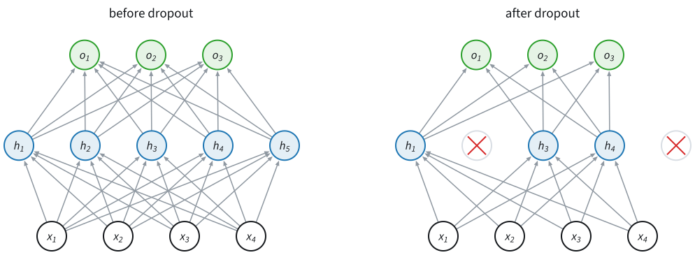

```{.python .input}
%load_ext d2lbook.tab
tab.interact_select('mxnet', 'pytorch', 'tensorflow', 'jax')
```

# Dropout
:label:`sec_dropout`

An MLP left to train long enough memorizes whatever labels it is given, wrong
ones included, and it loses accuracy on new images as it does so
(:numref:`sec_generalization_deep`). The two regularizers we have met so far
stand in its way differently: weight decay (:numref:`sec_weight_decay`)
penalizes large weights, and early stopping (:numref:`subsec_early_stopping`)
ends training before the mislabeled examples are memorized. *Dropout* takes a
third route, and a rather drastic one. It disturbs the network while it
learns. At every training step, each hidden unit is set to zero with some
probability, independently of the others, and the network computes its output
from the units that remain. At test time the full network runs.

The idea came from a suspicion about how networks overfit. Neither weight
decay nor early stopping has anything to say about how the hidden units
divide the work among themselves. A unit may become useful only together with
particular other units, for instance because it corrects their errors on the
training images, and there is no reason why such arrangements should carry
over to new images. :citet:`Hinton.Srivastava.Krizhevsky.ea.2012` called this
*co-adaptation*. If units come and go at random, no unit can count on any
other being present.

We state the operation, implement it in an MLP with two hidden layers, and
train that MLP on Fashion-MNIST. To see what dropout changes, we then return
to the setting in which the last section watched memorization happen, a small
training set with many wrong labels. Finally we ask why dropout has the
effect it has. Three explanations are on offer, and we shall have to be
careful with all of them.

```{.python .input #dropout}
%%tab mxnet
import math
import numpy as np
from mxnet import autograd, gluon, init, np as mnp, npx
from mxnet.gluon import nn
from d2l import mxnet as d2l
npx.set_np()
```

```{.python .input #dropout}
%%tab pytorch
import math
import numpy as np
import torch
from torch import nn
from torch.nn import functional as F
from d2l import torch as d2l
```

```{.python .input #dropout}
%%tab tensorflow
import math
import numpy as np
import tensorflow as tf
from d2l import tensorflow as d2l
```

```{.python .input #dropout}
%%tab jax
import math
import numpy as np
import jax
from jax import numpy as jnp
from flax import nnx
import optax
from d2l import jax as d2l
```

## Noise in Hidden Layers

### Simplicity and Robustness

So far we have measured the simplicity of a model in two ways: by the number
of its features (:numref:`subsec_polynomial-curve-fitting`) and by the norm
of its weights, which weight decay keeps small. A third measure is
robustness. A good image classifier should not change its prediction when a
little noise is added to the pixels, so we may train it on noisy pixels and
ask it to predict the clean label.

For a linear model this turns out to be nothing new. Add to the input a noise
vector $\boldsymbol{\epsilon}$ whose entries are independent with mean zero
and variance $s^2$, and the expected squared error grows by
$s^2\|\mathbf{w}\|^2$, the variance of $\mathbf{w}^\top\boldsymbol{\epsilon}$:
training on noisy inputs is weight decay. For nonlinear models and small
noise, the penalty is approximately one on how fast the output changes with
the input :cite:`Bishop.1995`. Dropout carries the idea from the inputs to
the hidden units, and it changes the noise: instead of nudging a unit, it
removes it. Noise of that size lies outside Bishop's analysis, so we take
from it the motivation and no more.

### Masking and Rescaling

Removing units shrinks the input of the next layer. With half of the units
set to zero, a weighted sum over them is on average half as large, so
dropout scales up the units that it keeps. Consider one hidden unit, whose
activation $h_j$ is entry $j$ of the hidden representation $\mathbf{h}$ of
an example. At each training step, dropout draws a random *mask* $\xi_j$,
equal to 0 with probability $p$ and to 1 with probability $1 - p$,
independently for every unit and every example, and replaces $h_j$ by

$$
h_j' = \frac{\xi_j h_j}{1 - p} =
\begin{cases}
0 & \textrm{with probability } p,\\
\dfrac{h_j}{1 - p} & \textrm{with probability } 1 - p.
\end{cases}
$$
:eqlabel:`eq_dropout`

The number $p$ is the *dropout probability*. Does the factor $1/(1 - p)$
make up for the dropped units? For a fixed $h_j$, the expected value over
the mask is

$$\mathbb{E}[h_j'] = p \cdot 0 + (1 - p)\frac{h_j}{1 - p} = h_j,$$

so on average the next layer receives the activation it would receive
without dropout, and $1/(1 - p)$ is the only factor with this property. The
fluctuations around this average are large. Since
$\mathbb{E}[h_j'^2] = (1 - p)\, h_j^2/(1 - p)^2 = h_j^2/(1 - p)$, the variance is

$$\textrm{Var}[h_j'] = \mathbb{E}[h_j'^2] - h_j^2 = \frac{p}{1 - p}\, h_j^2.$$

The noise grows with $p$ and with the size of the activation. For $p = 0.5$
a kept unit is doubled and a dropped one vanishes, so the standard deviation
of $h_j'$ equals $|h_j|$. Unlike the small input noise above, dropout
perturbs a unit by as much as its own value.

The original formulation :cite:`Hinton.Srivastava.Krizhevsky.ea.2012` left the
kept activations unscaled and instead multiplied the outgoing weights of each
unit by $1 - p$ at test time. Deep learning frameworks rescale during
training, as in :eqref:`eq_dropout`, a version called *inverted dropout*.
Its merit is practical: the network at test time is the plain network, with
no dropout code at all.

### Training and Inference

At test time we want a deterministic prediction, so dropout is switched off:
the full network runs, with no masks and no rescaling. Does it compute the
average of the random networks seen in training? For a single unit it does,
since each hidden activation equals the expected value of its dropped
version. This remains true through the next linear layer: a pre-activation
$z = \sum_j w_j h_j'$ has $\mathbb{E}[z] = \sum_j w_j h_j$, the value of the
full network. The activation function that follows is not linear, however,
and the expected value does not pass through it.

A small example shows the difference. Let two units with activations
$h_1 = h_2 = 1$ feed the pre-activation $z = h_1' - h_2'$, with $p = 0.5$.
Each $h_j'$ is 0 or 2 with equal probability, so $z$ takes the values $-2$,
$0$, $0$, $2$, each with probability $1/4$, and $\mathbb{E}[z] = 0$, the value of the
full network. After a ReLU, however, the average over the masks is
$\mathbb{E}[\textrm{ReLU}(z)] = \frac{1}{4} \cdot 2 = 0.5$, whereas the full network
computes $\textrm{ReLU}(0) = 0$. In a network with nonlinear layers, the
network at test time therefore does not compute the average output of the
networks that dropout samples during training. It approximates that
average, and we return to the quality of the approximation at the end of the
section. Averaging the outputs of many passes with dropout switched on
estimates the average itself (exercise
:exref:`ex_dropout-monte-carlo-dropout`).

## Implementation

### The Dropout Layer

To drop the entries of a tensor `X` with probability `dropout`, we draw a
number uniformly from $[0, 1)$ for each entry and keep the entry if the
number is at least `dropout`, which happens with probability
$1 -$ `dropout`. Multiplying `X` by this 0/1 mask and dividing by
$1 -$ `dropout` applies :eqref:`eq_dropout` to every entry at once. The case
`dropout` $= 1$ drops everything and is handled separately, to avoid a
division by zero.

:begin_tab:`jax`
JAX has no global random state, so `dropout_layer` takes a random key as an
argument, and each call needs a fresh one (:numref:`sec_ndarray`).
:end_tab:

```{.python .input #dropout-implementation-from-scratch-1}
%%tab mxnet
def dropout_layer(X, dropout):
    assert 0 <= dropout <= 1
    if dropout == 1: return mnp.zeros_like(X)
    mask = mnp.random.uniform(0, 1, X.shape, device=X.device) >= dropout
    return mask.astype(X.dtype) * X / (1.0 - dropout)
```

```{.python .input #dropout-implementation-from-scratch-1}
%%tab pytorch
def dropout_layer(X, dropout):
    assert 0 <= dropout <= 1
    if dropout == 1: return torch.zeros_like(X)
    mask = torch.rand_like(X) >= dropout
    return mask.to(X.dtype) * X / (1.0 - dropout)
```

```{.python .input #dropout-implementation-from-scratch-1}
%%tab tensorflow
def dropout_layer(X, dropout):
    assert 0 <= dropout <= 1
    if dropout == 1: return tf.zeros_like(X)
    mask = tf.random.uniform(tf.shape(X)) >= dropout
    return tf.cast(mask, X.dtype) * X / (1.0 - dropout)
```

```{.python .input #dropout-implementation-from-scratch-1}
%%tab jax
def dropout_layer(X, dropout, key):
    assert 0 <= dropout <= 1
    if dropout == 1: return jnp.zeros_like(X)
    mask = jax.random.uniform(key, X.shape) >= dropout
    return mask.astype(X.dtype) * X / (1.0 - dropout)
```

We apply `dropout_layer` to a $2 \times 8$ tensor with the probabilities 0,
0.5, and 1. Then we drop the entries of a vector of a million ones with
probability 0.2 and compare the mean and the variance of the result with the
values $1$ and $p/(1 - p) = 0.25$ computed above.

```{.python .input #dropout-implementation-from-scratch-2}
%%tab pytorch, tensorflow, mxnet
X = d2l.reshape(d2l.arange(16, dtype=d2l.float32), (2, 8))
for p in (0, 0.5, 1):
    print(f'p = {p}:', dropout_layer(X, p))
Y = dropout_layer(d2l.ones(10**6), 0.2)
print(f'mean {float(d2l.reduce_mean(Y)):.3f}, '
      f'variance {float(d2l.reduce_mean((Y - 1) ** 2)):.3f}')
```

```{.python .input #dropout-implementation-from-scratch-2}
%%tab jax
X = jnp.arange(16, dtype=jnp.float32).reshape(2, 8)
for p in (0, 0.5, 1):
    print(f'p = {p}:', dropout_layer(X, p, d2l.get_key()))
Y = dropout_layer(jnp.ones(10**6), 0.2, d2l.get_key())
print(f'mean {float(Y.mean()):.3f}, '
      f'variance {float(((Y - 1) ** 2).mean()):.3f}')
```

With $p = 0.5$, each entry is either zeroed or doubled, and how many of the
16 are zeroed varies from run to run. The million entries dropped with
$p = 0.2$ have mean 1 and variance 0.25 up to about 0.001, as computed.

### The Model

We apply dropout to the output of each hidden layer, after the activation
function. :numref:`fig_dropout2` shows the effect on the MLP of
:numref:`fig_mlp`, with four inputs, five hidden units, and three outputs,
for one draw of the masks, in which $h_2$ and $h_5$ are dropped. The outputs
no longer depend on these two units. Backpropagation sends zero gradient
through a multiplication by zero, so the weights into and out of $h_2$ and
$h_5$ receive no update from this example. The next step draws new masks and
removes other units.


:label:`fig_dropout2`

Our model has two hidden layers of 256 ReLU units each. Each hidden layer may
have its own dropout probability. A common choice drops fewer units in the
layers close to the input; we use $p = 0.2$ after the first hidden layer and
$p = 0.5$ after the second. We register the parameters with the framework as
in :numref:`sec_softmax_scratch` and give them the He initialization of
:numref:`subsec_he_init`: normal weights with variance $2/n_\textrm{in}$,
where $n_\textrm{in}$ is the number of inputs of the layer, and biases of 0.
The model applies dropout only while it is being trained.

:begin_tab:`mxnet`
`autograd.is_training()` is true inside the `autograd.record()` block in
which the `Trainer` computes the loss for an update, and false when it
evaluates the model.
:end_tab:

:begin_tab:`pytorch`
`self.training` is set by `train()` and `eval()`, which the `Trainer` calls
before updating and before evaluating the model.
:end_tab:

:begin_tab:`tensorflow`
`self.training` records the `training` argument with which the `Trainer`
calls the model: `True` for an update, `False` for an evaluation.
:end_tab:

:begin_tab:`jax`
The `Trainer` evaluates a view of the model, made by `nnx.view`, which calls
`set_view` to set `deterministic` to `True`. The keys for the masks come from
the stream `rngs`, which advances at every call, so every step draws new
masks.
:end_tab:

```{.python .input #dropout-defining-the-model}
%%tab mxnet
class DropoutMLPScratch(d2l.Classifier):
    def __init__(self, num_outputs, num_hiddens_1, num_hiddens_2,
                 dropout_1, dropout_2, lr, num_inputs=784):
        super().__init__()
        self.save_hyperparameters()
        he = lambda name, n_in, n_out: gluon.Parameter(  # Variance 2 / n_in
            name, shape=(n_in, n_out), init=init.Normal((2 / n_in) ** 0.5))
        zero = lambda name, n: gluon.Parameter(name, shape=(n,),
                                               init=init.Zero())
        self.W1 = he('W1', num_inputs, num_hiddens_1)
        self.W2 = he('W2', num_hiddens_1, num_hiddens_2)
        self.W3 = he('W3', num_hiddens_2, num_outputs)
        self.b1 = zero('b1', num_hiddens_1)
        self.b2 = zero('b2', num_hiddens_2)
        self.b3 = zero('b3', num_outputs)
        self.initialize()

    def forward(self, X):
        X = X.reshape(-1, self.num_inputs)
        H1 = npx.relu(mnp.dot(X, self.W1.data()) + self.b1.data())
        if autograd.is_training():
            H1 = dropout_layer(H1, self.dropout_1)
        H2 = npx.relu(mnp.dot(H1, self.W2.data()) + self.b2.data())
        if autograd.is_training():
            H2 = dropout_layer(H2, self.dropout_2)
        return mnp.dot(H2, self.W3.data()) + self.b3.data()
```

```{.python .input #dropout-defining-the-model}
%%tab pytorch
class DropoutMLPScratch(d2l.Classifier):
    def __init__(self, num_outputs, num_hiddens_1, num_hiddens_2,
                 dropout_1, dropout_2, lr, num_inputs=784):
        super().__init__()
        self.save_hyperparameters()
        he = lambda n_in, n_out: nn.Parameter(  # Variance 2 / n_in
            d2l.normal(0, (2 / n_in) ** 0.5, (n_in, n_out)))
        self.W1 = he(num_inputs, num_hiddens_1)
        self.W2 = he(num_hiddens_1, num_hiddens_2)
        self.W3 = he(num_hiddens_2, num_outputs)
        self.b1 = nn.Parameter(d2l.zeros(num_hiddens_1))
        self.b2 = nn.Parameter(d2l.zeros(num_hiddens_2))
        self.b3 = nn.Parameter(d2l.zeros(num_outputs))

    def forward(self, X):
        X = X.reshape(-1, self.num_inputs)
        H1 = torch.relu(X @ self.W1 + self.b1)
        if self.training:
            H1 = dropout_layer(H1, self.dropout_1)
        H2 = torch.relu(H1 @ self.W2 + self.b2)
        if self.training:
            H2 = dropout_layer(H2, self.dropout_2)
        return H2 @ self.W3 + self.b3
```

```{.python .input #dropout-defining-the-model}
%%tab tensorflow
class DropoutMLPScratch(d2l.Classifier):
    def __init__(self, num_outputs, num_hiddens_1, num_hiddens_2,
                 dropout_1, dropout_2, lr, num_inputs=784):
        super().__init__()
        self.save_hyperparameters()
        def he(name, n_in, n_out):  # Normal weights with variance 2 / n_in
            normal = tf.random_normal_initializer(stddev=(2 / n_in) ** 0.5)
            return self.add_weight(name=name, shape=(n_in, n_out),
                                   initializer=normal)
        zero = lambda name, n: self.add_weight(name=name, shape=(n,),
                                               initializer='zeros')
        self.W1 = he('W1', num_inputs, num_hiddens_1)
        self.W2 = he('W2', num_hiddens_1, num_hiddens_2)
        self.W3 = he('W3', num_hiddens_2, num_outputs)
        self.b1 = zero('b1', num_hiddens_1)
        self.b2 = zero('b2', num_hiddens_2)
        self.b3 = zero('b3', num_outputs)

    def forward(self, X):
        X = tf.reshape(X, (-1, self.num_inputs))
        H1 = tf.nn.relu(X @ self.W1 + self.b1)
        if self.training:
            H1 = dropout_layer(H1, self.dropout_1)
        H2 = tf.nn.relu(H1 @ self.W2 + self.b2)
        if self.training:
            H2 = dropout_layer(H2, self.dropout_2)
        return H2 @ self.W3 + self.b3
```

```{.python .input #dropout-defining-the-model}
%%tab jax
class DropoutMLPScratch(d2l.Classifier):
    def __init__(self, num_outputs, num_hiddens_1, num_hiddens_2,
                 dropout_1, dropout_2, lr, num_inputs=784, rngs=None):
        super().__init__()
        self.save_hyperparameters(ignore=['rngs'])
        self.rngs = nnx.Rngs(d2l.get_key()) if rngs is None else rngs
        he = lambda n_in, n_out: nnx.Param(  # Variance 2 / n_in
            self.rngs.params.normal((n_in, n_out)) * (2 / n_in) ** 0.5)
        self.W1 = he(num_inputs, num_hiddens_1)
        self.W2 = he(num_hiddens_1, num_hiddens_2)
        self.W3 = he(num_hiddens_2, num_outputs)
        self.b1 = nnx.Param(jnp.zeros(num_hiddens_1))
        self.b2 = nnx.Param(jnp.zeros(num_hiddens_2))
        self.b3 = nnx.Param(jnp.zeros(num_outputs))
        self.deterministic = False

    def set_view(self, *, deterministic):
        self.deterministic = deterministic

    def forward(self, X):
        X = X.reshape(-1, self.num_inputs)
        H1 = nnx.relu(X @ self.W1 + self.b1)
        if not self.deterministic:
            H1 = dropout_layer(H1, self.dropout_1, self.rngs.dropout())
        H2 = nnx.relu(H1 @ self.W2 + self.b2)
        if not self.deterministic:
            H2 = dropout_layer(H2, self.dropout_2, self.rngs.dropout())
        return H2 @ self.W3 + self.b3
```

### Training

We train the model like softmax regression in :numref:`sec_softmax_concise`,
with minibatch SGD at learning rate 0.1 and minibatches of 256 images, here
for 20 epochs.

```{.python .input #dropout-training}
hparams = {'num_outputs': 10, 'num_hiddens_1': 256, 'num_hiddens_2': 256,
           'dropout_1': 0.2, 'dropout_2': 0.5, 'lr': 0.1}
model = DropoutMLPScratch(**hparams)
data = d2l.FashionMNIST(batch_size=256)
trainer = d2l.Trainer(max_epochs=20, num_gpus=1)
trainer.fit(model, data)
```

After 20 epochs the validation accuracy is about 87%, and it moves by a
point or more from one epoch to the next, as it did in
:numref:`sec_mlp-implementation`. The training loss needs a word of
explanation. It is computed with the masks switched on, so it measures the
thinned networks, which predict worse than the full network that the
validation loss measures. For the first few epochs the training loss
therefore lies above the validation loss, which looks like a bug and is not.
It ends a little below it.

### Concise Implementation

The framework provides dropout as a layer that takes the dropout
probability as its argument. The layer applies :eqref:`eq_dropout` while the
model is being trained and passes its input through unchanged otherwise, so
the model needs no test for the training mode. We place a dropout layer
after the activation function of each hidden layer and ask the framework for
the initialization of the scratch model, normal weights with variance
$2/n_\textrm{in}$.

:begin_tab:`mxnet`
The framework files this initialization under `init.Xavier`, with
`rnd_type='gaussian'`, `factor_type='in'`, and `magnitude=2`.
:end_tab:

:begin_tab:`pytorch`
The `Trainer` initializes the lazy layers through the model's `weight_init`
method, as in :numref:`sec_softmax_concise`.
:end_tab:

:begin_tab:`tensorflow`
Each layer gets an initializer of its own: an instance created without a
seed returns the same random values on every call, so layers that shared one
would start from related weights.
:end_tab:

:begin_tab:`jax`
NNX dropout layers draw their keys from `rngs`, and `nnx.view` switches them
off for evaluation, as for the scratch model; it reaches them inside
`nnx.Sequential` as well.
:end_tab:

```{.python .input #dropout-concise-implementation-1}
%%tab mxnet
class DropoutMLP(d2l.Classifier):
    def __init__(self, num_outputs, num_hiddens_1, num_hiddens_2,
                 dropout_1, dropout_2, lr):
        super().__init__()
        self.save_hyperparameters()
        self.net = nn.Sequential()
        self.net.add(nn.Dense(num_hiddens_1, activation='relu'),
                     nn.Dropout(dropout_1),
                     nn.Dense(num_hiddens_2, activation='relu'),
                     nn.Dropout(dropout_2),
                     nn.Dense(num_outputs))
        self.net.initialize(init.Xavier(rnd_type='gaussian', factor_type='in',
                                        magnitude=2))
```

```{.python .input #dropout-concise-implementation-1}
%%tab pytorch
class DropoutMLP(d2l.Classifier):
    def __init__(self, num_outputs, num_hiddens_1, num_hiddens_2,
                 dropout_1, dropout_2, lr):
        super().__init__()
        self.save_hyperparameters()
        self.net = nn.Sequential(
            nn.Flatten(), nn.LazyLinear(num_hiddens_1), nn.ReLU(),
            nn.Dropout(dropout_1), nn.LazyLinear(num_hiddens_2), nn.ReLU(),
            nn.Dropout(dropout_2), nn.LazyLinear(num_outputs))

    def weight_init(self, module):
        if isinstance(module, nn.Linear):
            nn.init.kaiming_normal_(module.weight, nonlinearity='relu')
            nn.init.zeros_(module.bias)
```

```{.python .input #dropout-concise-implementation-1}
%%tab tensorflow
class DropoutMLP(d2l.Classifier):
    def __init__(self, num_outputs, num_hiddens_1, num_hiddens_2,
                 dropout_1, dropout_2, lr):
        super().__init__()
        self.save_hyperparameters()
        # One initializer per layer: an instance repeats its random values
        he = lambda: tf.keras.initializers.VarianceScaling(
            2.0, 'fan_in', 'untruncated_normal')
        self.net = tf.keras.models.Sequential([
            tf.keras.layers.Flatten(),
            tf.keras.layers.Dense(num_hiddens_1, activation='relu',
                                  kernel_initializer=he()),
            tf.keras.layers.Dropout(dropout_1),
            tf.keras.layers.Dense(num_hiddens_2, activation='relu',
                                  kernel_initializer=he()),
            tf.keras.layers.Dropout(dropout_2),
            tf.keras.layers.Dense(num_outputs, kernel_initializer=he())])
```

```{.python .input #dropout-concise-implementation-1}
%%tab jax
class DropoutMLP(d2l.Classifier):
    def __init__(self, num_outputs, num_hiddens_1, num_hiddens_2,
                 dropout_1, dropout_2, lr, num_inputs=784, rngs=None):
        super().__init__()
        self.save_hyperparameters(ignore=['rngs'])
        rngs = nnx.Rngs(d2l.get_key()) if rngs is None else rngs
        he = nnx.initializers.variance_scaling(2.0, 'fan_in', 'normal')
        self.net = nnx.Sequential(
            nnx.Linear(num_inputs, num_hiddens_1, kernel_init=he, rngs=rngs),
            nnx.relu, nnx.Dropout(dropout_1, rngs=rngs),
            nnx.Linear(num_hiddens_1, num_hiddens_2, kernel_init=he,
                       rngs=rngs),
            nnx.relu, nnx.Dropout(dropout_2, rngs=rngs),
            nnx.Linear(num_hiddens_2, num_outputs, kernel_init=he, rngs=rngs))

    def forward(self, X):
        return self.net(X.reshape((X.shape[0], -1)))  # Flatten each image
```

We do not train this model here. The experiment that follows does.

## Effects of Dropout

### Too Little to Regularize

Does dropout make our MLP more accurate? On all 60,000 training images the
question has little to bite on. A regularizer can only remove overfitting
that is there, and after 20 epochs the training loss of our network, even
with the masks switched on, ends only a little below the validation loss.
To see what dropout does, we need a network that overfits.
:numref:`subsec_early_stopping` gave us one: an MLP trained for 200 epochs
on 1,000 images, part of whose labels had been redrawn at random, memorized
the wrong labels and lost validation accuracy doing so.

### Noisy Labels

We repeat that experiment with the MLP of this section and make it harsher:
we redraw 40% of the labels, so that about 36% of them are wrong. More than
one training image in three now teaches the network something false. The
helpers of :numref:`subsec_early_stopping` do the work: `d2l.corrupt`
redraws the labels, `d2l.ArrayData` serves arrays as minibatches, and
`d2l.Tracker` records the accuracy on named datasets after every epoch. We
validate on the first 2,000 images of the validation set.

```{.python .input #dropout-noisy-labels-1}
images = d2l.FashionMNIST(batch_size=2000)
X, y = (d2l.numpy(a) for a in next(iter(images.train_dataloader())))
X_val, y_val = (d2l.numpy(a) for a in next(iter(images.val_dataloader())))
X, y, X_val = X[:1000].reshape(1000, -1), y[:1000], X_val.reshape(2000, -1)
labels = d2l.corrupt(y, 0.4, np.random.default_rng())
wrong = labels != y  # The training labels that are now wrong
```

We train the concise model twice for 200 epochs, with minibatches of 64,
once with dropout probability 0.5 in both hidden layers and once without
dropout. After every epoch we record how many of the wrong labels the
network reproduces and its accuracy on the validation images.

```{.python .input #dropout-noisy-labels-2}
acc = {}
for p in (0, 0.5):
    trainer = d2l.Tracker(max_epochs=200, datasets={
        'wrong labels': d2l.ArrayData(X[wrong], labels[wrong], 1000),
        'validation': d2l.ArrayData(X_val, y_val, 1000)})
    trainer.fit(DropoutMLP(**{**hparams, 'dropout_1': p, 'dropout_2': p}),
                d2l.ArrayData(X, labels))
    acc[p] = trainer.accuracy
    print(f'dropout {p}: wrong labels reproduced '
          f'{acc[p]["wrong labels"][-1]:.2f}, validation accuracy over the '
          f'last 10 epochs {np.mean(acc[p]["validation"][-10:]):.3f}')
d2l.plot(list(range(1, 201)), [acc[0]['wrong labels'], acc[0.5]['wrong labels'],
                               acc[0]['validation'], acc[0.5]['validation']],
         'epoch', 'accuracy', fmts=('C0--', 'C1--', 'C0-', 'C1-'),
         legend=['wrong labels, p = 0', 'wrong labels, p = 0.5',
                 'validation, p = 0', 'validation, p = 0.5'],
         legend_loc='outside', figsize=(4.5, 3))
```

Without dropout, the network reproduces every wrong label by about epoch
100, and its validation accuracy falls as it memorizes them, by about ten
points from its early best. With dropout, the wrong labels are learned far
more slowly: after 200 epochs the network reproduces only three quarters to
four fifths of them, and over the last ten epochs its validation accuracy is
three to five points higher than without dropout. Here, then, dropout does
what a regularizer should. It changes which fit training finds when there is
noise to fit.

Note also what dropout has not done. It slows the memorization and does not
stop it. The curve of the wrong labels is still rising after 200 epochs, and
the network trained with dropout loses validation accuracy too, only later
and less. Neither network ends as accurate as it was within its first fifty
epochs, so dropout has not made early stopping superfluous.

## Interpretations

Why does dropout help, here and on the benchmarks of images, speech, and
text on which :citet:`Srivastava.Hinton.Krizhevsky.ea.2014` reported lower
test errors with it? Our experiment shows what dropout does, not why. Three
accounts are standard, and we present them as accounts: each describes part
of the mechanism, and none is complete.

### Noise Injection

The first account takes dropout as noise: a network that must tolerate noise
in its hidden units is pushed toward functions that are insensitive to it.
For a linear model we can say what this means. Apply dropout to the inputs
of the linear model $\mathbf{w}^\top\mathbf{x} + b$ and train it with the
squared loss. The dropped inputs $x_j'$ are independent, each has mean $x_j$
and variance $\frac{p}{1 - p}x_j^2$, so the prediction has mean
$\mathbf{w}^\top\mathbf{x} + b$ and variance
$\frac{p}{1-p}\sum_j w_j^2 x_j^2$. The expected loss is the squared error of
the mean plus this variance,

$$\mathbb{E}\left[\left(\mathbf{w}^\top\mathbf{x}' + b - y\right)^2\right] = \left(\mathbf{w}^\top\mathbf{x} + b - y\right)^2 + \frac{p}{1 - p}\sum_j x_j^2 w_j^2.$$

In expectation, dropout on the inputs of a linear model is thus a weight
decay :cite:`Srivastava.Hinton.Krizhevsky.ea.2014`, though not the plain one
that additive noise gave us. Summed over the training examples, the penalty
on $w_j$ is proportional to the sum of the squares of feature $j$: weights
of features that are often large are penalized more, and the weight of a
feature that is always 0 is not penalized at all. This is as far as the
calculation goes. In a deep network the penalty depends on the hidden
activations, which change during training, and no such closed form exists.

### Co-adaptation

The second account is the one for which dropout was invented, and with which
this section began. Units that cannot count on their partners must each be
useful on their own, and such units should carry over to new data better
than fragile arrangements of many. The account is plausible. Our experiment
neither supports nor refutes it: any regularizer that slows the memorization
of wrong labels would have shown the same curves. We have used the idea as a
motivation, and it should not be taken for more than that.

### An Implicit Ensemble

Our network has 512 hidden units and hence $2^{512}$ masks, each of which
defines a *thinned* network, and all of them share one set of weights. Every
training step trains as many of them as the minibatch has examples, each on
one example. The network at test time can be read as an approximation of the
average of their predictions. Averaging the predictions of many models, an
*ensemble*, typically predicts better than any single one of them, so
dropout would obtain such an average while training a single network. The
reading is loose. The thinned networks are not trained independently of each
other, as the members of an ensemble are, and the
two-unit example above showed that the full network does not compute their
average. When the only dropped units feed the output layer directly, the full
network computes a weighted geometric mean of the thinned networks'
predictions (exercise :exref:`ex_dropout-geometric-mean`); deeper in the
network, not even that holds.

### Dropout in Practice

Where, then, should we expect dropout to matter? Where our experiment found
it to: many more parameters than examples, and many passes over each
example. This was the situation of the large fully connected layers in the
image classifiers of the early 2010s, among them AlexNet
(:numref:`sec_alexnet`), for which dropout was introduced. Later
architectures use it at small probabilities, around 0.1, and
models that see each training example only once, as large language models
do, are often trained without it. One caution: during training the mean
square of a dropped unit is $1/(1 - p)$ times that of the unit itself, and
layers that normalize their inputs (:numref:`sec_batch_norm`) are sensitive
to this mismatch between training and test :cite:`Li.Chen.Hu.ea.2019`.

The next section meets many parameters and few examples outside images: an
MLP with nineteen parameters for each of the houses whose prices it is to
predict.

## Summary

Dropout sets each hidden unit to zero with probability $p$ at every
training step and scales the remaining units by $1/(1 - p)$, so that each
unit keeps its expected value; at test time the full network runs. The
expected value is preserved only unit by unit, so the full network is not
the average of the networks that dropout trains. On all of Fashion-MNIST our
MLP overfits too little for dropout to matter. Trained on 1,000 images with
many wrong labels, the MLP without dropout memorizes all of them and loses
validation accuracy; with dropout it memorizes them more slowly and keeps
more of its accuracy. For a linear model, dropout of the inputs is, in
expectation, a weight decay that penalizes each weight by the square of its
input. For deep networks, noise, co-adaptation, and the implicit ensemble
are partial accounts of its effect.

## Exercises

1. [code] **Dropout probabilities.** The model of this section drops units
   with probability 0.2 after the first hidden layer and 0.5 after the
   second.
    1. Train it with the two probabilities swapped, with both set to 0.5,
       and with both set to 0.8. For each run, report the best validation
       accuracy. Which layer tolerates the higher probability?
    1. The `Trainer` computes the training loss that it plots with the masks
       switched on. After training, evaluate the loss on the training images
       with the masks switched off, and compare the gap between training and
       validation loss for the networks trained with and without dropout.
1. **Dropout and He initialization.** The He initialization of
   :numref:`subsec_he_init` chooses the variance of the weights so that the
   mean square of the pre-activations stays the same from layer to layer.
    1. During training, by what factor does dropout with probability $p$
       change the mean square of the pre-activations of the next layer?
       Give the factor for each of the two dropout layers of this section's
       model.
    1. In a network with $K - 1$ hidden layers, each followed by dropout
       with probability $p$, how does the factor grow with $K$? Should the
       initialization correct for it, given that the network runs without
       dropout at test time? Relate your answer to the mismatch between
       training and test that dropout causes before a batch normalization
       layer.
1. [code] **Less noise, less dropout.** The noisy-label experiment of this
   section redrew 40% of the labels and dropped units with probability 0.5
   in both hidden layers.
    1. Repeat it with 20% of the labels redrawn, as in
       :numref:`subsec_early_stopping`, once with probability 0.5 in both
       layers and once with the 0.2 and 0.5 of the full-data run. In each
       case, does dropout still raise the validation accuracy of the last
       epochs, or does it only delay the memorization?
    1. In every run, with and without dropout, find the best validation
       accuracy and the epoch at which it is reached. Which helps more
       against wrong labels, dropout or stopping early? Do the two combine?
1. **Ensemble size.** The two hidden layers of this section's model have
   512 units together, so they admit $2^{512}$ joint dropout masks, and the
   ensemble interpretation views each mask as a thinned network.
    1. Training runs for 20 epochs over the 60,000 Fashion-MNIST training
       images, and a fresh mask is drawn for every example. How many joint
       masks are sampled during training, and what fraction of all joint
       masks is that? How likely is it that any mask is drawn twice? The
       masks are not equally likely, since the first layer drops units with
       probability 0.2: bound the probability that two draws coincide by
       the probability of the most likely joint mask.
    1. Using these numbers, explain in what sense dropout does, and does
       not, train an ensemble of all these networks.
1. [code] **Monte Carlo dropout.** Instead of switching dropout off at test
   time, keep it on in the trained `DropoutMLPScratch` and run $T = 20$
   forward passes per validation image, then average the softmax outputs
   :cite:`Gal.Ghahramani.2016`. Compare the accuracy and the calibration
   (the mean of the largest softmax probability against the accuracy) with
   those of the single pass of the full network. How does the accuracy
   change as $T$ grows from 1 to 20?
   :exlabel:`ex_dropout-monte-carlo-dropout`
1. [code] **Dropout and weight decay.** Weight decay and dropout both
   regularize the model of this section, by different mechanisms. Measure
   each run by its best validation accuracy and by the gap between training
   and validation loss, with both losses evaluated with the masks switched
   off.
    1. With both dropout probabilities set to zero, add weight decay as in
       :numref:`sec_weight_decay` at strengths
       $\lambda \in \{10^{-4}, 10^{-3}, 10^{-2}\}$. Compare these runs
       with the runs with and without dropout of this section.
    1. Keep the dropout probabilities at 0.2 and 0.5, and add weight decay
       at the same strengths. Are the effects of the two regularizers
       additive, do they show diminishing returns, or do they cancel each
       other out?
1. **Dropout at test time.** ● Set `dropout_1` to zero, so that only the
   second hidden layer is masked, and let $\boldsymbol{\xi}$ range over its
   masks. Let $\mathbf{o}(\boldsymbol{\xi})$ and $\hat{\mathbf{y}}(\boldsymbol{\xi})$
   be the logits and the softmax output under mask $\boldsymbol{\xi}$, which
   occurs with probability $P(\boldsymbol{\xi})$. Show that the logits of the
   full network equal $\sum_{\boldsymbol{\xi}} P(\boldsymbol{\xi})\, \mathbf{o}(\boldsymbol{\xi})$.
   Show further that its softmax output equals the normalized weighted
   geometric mean

    $$\tilde{y}_j = \frac{\prod_{\boldsymbol{\xi}} \hat{y}_j(\boldsymbol{\xi})^{P(\boldsymbol{\xi})}}{\sum_k \prod_{\boldsymbol{\xi}} \hat{y}_k(\boldsymbol{\xi})^{P(\boldsymbol{\xi})}}.$$

    Explain why neither equality holds in general once `dropout_1` is
    nonzero.
   :exlabel:`ex_dropout-geometric-mean`

:begin_tab:`mxnet`
[Discussions](https://d2l.discourse.group/t/100)
:end_tab:

:begin_tab:`pytorch`
[Discussions](https://d2l.discourse.group/t/101)
:end_tab:

:begin_tab:`tensorflow`
[Discussions](https://d2l.discourse.group/t/261)
:end_tab:

:begin_tab:`jax`
[Discussions](https://d2l.discourse.group/t/17987)
:end_tab:

<!-- slides -->

::: {.slide}
::: {.cover}
[Dive into Deep Learning · §4.6]{.kicker}

Dropout<br>**random masks · inverted dropout · noisy labels**
:::
:::

::: {.slide title="An MLP Trained Long Enough Memorizes Its Wrong Labels"}
[The problem]{.kicker}

- The MLP of this chapter fits 1,000 Fashion-MNIST images even with
  **random** labels, and it loses accuracy on new images as it memorizes
  wrong ones.
- **Weight decay** limits the size of the weights; **early stopping**
  limits the length of training.
- **Dropout** disturbs the network while it learns: at every step, each
  hidden unit is set to zero with probability $p$.

::: {.d2l-note}
The motivation (Hinton et al., 2012): a unit may be useful only together
with particular partners. Such *co-adapted* combinations fit the training
set and need not carry over to new images. With random units missing at
every step, no unit can count on a partner.
:::
:::

::: {.slide title="By the End of This Deck You Can"}
[Goals]{.kicker}

- compute the mean and the variance of a dropped unit;
- explain why the network at test time is **not** the average of the
  thinned networks, with a two-unit counterexample;
- implement a dropout layer and an MLP that uses it;
- measure what dropout changes when there are wrong labels to memorize,
  and what it does not;
- show that, for a linear model, dropout is a form of weight decay.

**Running example:** Fashion-MNIST. Softmax regression: 7,850 parameters,
about 84% after 30 epochs. Here: an MLP with two hidden layers of 256 units,
269,322 parameters, trained for 20 epochs at learning rate 0.1.
:::

::: {.slide title="Dropout Is the Third Regularizer of the Book"}
[Where this fits]{.kicker}

::: {.cols .vc}
::: {.col}
| section | adds |
|---|---|
| Multilayer Perceptrons | hidden layers, universal approximation, activation functions |
| Implementation | an MLP trained on Fashion-MNIST |
| Backpropagation | how the gradients are computed, and at what memory cost |
| Numerical Stability and Initialization | vanishing gradients, Xavier and He initialization |
| Generalization in Deep Learning | memorization, double descent, implicit bias, early stopping |
| **Dropout** | **random masks, slower memorization of noisy labels** |
| Predicting House Prices on Kaggle | the workflow on real data |
:::

::: {.col .narrow}
- **Uses:** weight decay, He initialization, the `Trainer`, Fashion-MNIST.
- **Skips:** variants such as DropConnect and stochastic depth, and the
  Bayesian reading of dropout beyond one exercise.
:::
:::
:::

::: {.slide}
::: {.divider}
[01]{.dnum}

[Noise in Hidden Layers]{.dtitle}

[masks, rescaling, and the network at test time]{.dsub}
:::
:::

::: {.slide title="For a Linear Model, Input Noise Is Weight Decay"}
[Noise · motivation]{.kicker}

Perturb the input, $\mathbf{x} + \boldsymbol{\epsilon}$, with independent
entries of mean 0 and variance $s^2$:

$$\mathbb{E}\left[\left(\mathbf{w}^\top(\mathbf{x} + \boldsymbol{\epsilon}) + b - y\right)^2\right] = \left(\mathbf{w}^\top\mathbf{x} + b - y\right)^2 + s^2\|\mathbf{w}\|^2.$$

- The cross term vanishes: $\mathbb{E}[\boldsymbol{\epsilon}] = \mathbf{0}$.
- Training on noisy inputs = squared loss + weight decay $s^2\|\mathbf{w}\|^2$.

::: {.d2l-note}
Dropout moves the noise to the hidden units, and makes it large: it removes
units instead of nudging them.
:::
:::

::: {.slide title="Dropout Zeros a Unit with Probability p and Rescales the Rest"}
[Noise · the operation]{.kicker}

With a mask $\xi_j$ that is 0 with probability $p$ and 1 otherwise:

$$h_j' = \frac{\xi_j h_j}{1 - p} = \begin{cases} 0 & \textrm{with probability } p,\\ h_j/(1 - p) & \textrm{with probability } 1 - p.\end{cases}$$

- A fresh mask for every unit, every example, every step.
- $\mathbb{E}[h_j'] = p \cdot 0 + (1 - p)\frac{h_j}{1-p} = h_j$: the expected value
  is kept, and $1/(1 - p)$ is the only factor that keeps it.

::: {.d2l-note}
**Inverted dropout** rescales during training, so the test network is the
plain network. The original version (Hinton et al., 2012) scaled the
weights by $1 - p$ at test time instead.
:::
:::

::: {.slide title="The Noise Is as Large as the Activation"}
[Noise · the variance]{.kicker}

$$\mathbb{E}[h_j'^2] = \frac{h_j^2}{1 - p}, \qquad \textrm{Var}[h_j'] = \frac{p}{1 - p}\, h_j^2.$$

| $p$ | kept unit scaled by | variance for $h_j = 1$ |
|---|---:|---:|
| 0.2 | 1.25 | 0.25 |
| 0.5 | 2 | 1 |

::: {.d2l-note}
At $p = 0.5$ the standard deviation of $h_j'$ equals $|h_j|$: this is not
a small perturbation.
:::
:::

::: {.slide title="The Test Network Is Not the Average of the Thinned Networks"}
[Noise · test time]{.kicker}

Two units, $h_1 = h_2 = 1$, $p = 0.5$, pre-activation $z = h_1' - h_2'$:

| $(h_1', h_2')$ | (0,0) | (2,0) | (0,2) | (2,2) |
|---|---:|---:|---:|---:|
| $z$ | 0 | 2 | −2 | 0 |
| $\textrm{ReLU}(z)$ | 0 | 2 | 0 | 0 |

- Linear layer: $\mathbb{E}[z] = 0$, the full network's value.
- After the ReLU: $\mathbb{E}[\textrm{ReLU}(z)] = 0.5$, but the full network gives
  $\textrm{ReLU}(0) = 0$.

::: {.d2l-note}
The expected value is kept unit by unit, not through nonlinear layers.
:::
:::

::: {.slide title="Check: How Large Is the Noise at p = 0.8?"}
[Check]{.kicker}

A unit has activation $h_j = 1$ and dropout probability $p = 0.8$. What is
a kept unit scaled to, and what is the variance of $h_j'$?

::: {.fragment .fade-up}
::: {.d2l-note}
**Answer.** A kept unit becomes $1/(1 - 0.8) = 5$, kept one time in five.
The variance is $0.8/0.2 = 4$: a standard deviation twice the
activation.
:::
:::
:::

::: {.slide}
::: {.divider}
[02]{.dnum}

[Implementation]{.dtitle}

[a dropout layer and an MLP that uses it]{.dsub}
:::
:::

::: {.slide title="A Dropout Layer in Three Lines"}
[Implementation · the layer]{.kicker}

Draw a uniform number per entry, keep the entry if it is at least $p$,
scale the survivors by $1/(1 - p)$:

@dropout-implementation-from-scratch-1
:::

::: {.slide title="A Million Ones at p = 0.2: Mean 1, Variance 0.25"}
[Implementation · check]{.kicker}

@!dropout-implementation-from-scratch-2

- $p = 0.5$: each entry is 0 with probability $1/2$, otherwise doubled.
- The sample mean and variance match $1$ and $p/(1 - p) = 0.25$.
:::

::: {.slide title="Dropout Goes after Each Hidden Activation, Only in Training"}
[Implementation · the model]{.kicker}

::: {.cols .vc}
::: {.col}
`Linear → ReLU → dropout(0.2) → Linear → ReLU → dropout(0.5) → Linear`

- Dropped units get no gradient on that example.
- Fewer units dropped near the input, more deeper.
- He initialization (variance $2/n_\textrm{in}$), zero biases, in every
  framework.
:::

::: {.col .fig .big}

:::
:::
:::

::: {.slide title="Training: 20 Epochs on Fashion-MNIST"}
[Implementation · training]{.kicker}

Two hidden layers of 256 units, $p = 0.2$ and $0.5$, SGD at learning rate
0.1, minibatches of 256:

@!dropout-training

::: {.d2l-note}
The training loss is computed with masks, on thinned networks; the
validation loss on the full network.
:::
:::

::: {.slide title="Concise: One Dropout Layer after Each Activation"}
[Implementation · concise]{.kicker}

A framework `Dropout(p)` layer masks and rescales in training mode and passes
its input through at test time; the `Trainer` switches the mode.

@dropout-concise-implementation-1
:::

::: {.slide}
::: {.divider}
[03]{.dnum}

[Effects of Dropout]{.dtitle}

[too little to regularize · noisy labels]{.dsub}
:::
:::

::: {.slide title="On All 60,000 Images There Is Too Little to Regularize"}
[Effects · the full data]{.kicker}

- A regularizer can only remove overfitting that is there.
- After 20 epochs on all of Fashion-MNIST, the training loss, even with the
  masks switched on, ends only a little below the validation loss.
- To see what dropout does, we need a network that overfits.

::: {.d2l-note}
The last deck supplied one: 1,000 images with redrawn labels, 200 epochs.
The MLP memorized the wrong labels and lost validation accuracy doing so.
:::
:::

::: {.slide title="With Noisy Labels, Dropout Slows Memorization"}
[Effects · noisy labels]{.kicker}

1,000 images, 40% of the labels redrawn (about 36% wrong), 200 epochs,
minibatches of 64; dropout 0.5 in both hidden layers against none:

@!dropout-noisy-labels-2
:::

::: {.slide title="Dropout Slows the Memorization and Does Not Stop It"}
[Effects · reading]{.kicker}

| | no dropout | dropout 0.5 |
|---|---|---|
| wrong labels reproduced | all, by about epoch 100 | three quarters to four fifths after 200 epochs, still rising |
| validation accuracy, last ten epochs | about ten points below its early best | three to five points higher |

::: {.d2l-note}
Dropout changes which fit training finds when there is noise to fit. Both
networks end below their early best: early stopping is still worth having.
:::
:::

::: {.slide title="Check: How Often Can a Unit Count on a Given Partner?"}
[Check]{.kicker}

The second hidden layer has 256 units and $p = 0.5$. How many of them does
an example keep on average, and in what fraction of the steps are two given
units of that layer both present?

::: {.fragment .fade-up}
::: {.d2l-note}
**Answer.** $256 \times 0.5 = 128$ units. Two given units are both kept with
probability $0.5^2 = 0.25$: a unit can count on a partner in one step of
four. In the first layer ($p = 0.2$): about 205 units, a given pair in 64%
of the steps.
:::
:::
:::

::: {.slide}
::: {.divider}
[04]{.dnum}

[Interpretations]{.dtitle}

[noise, co-adaptation, an implicit ensemble]{.dsub}
:::
:::

::: {.slide title="For Linear Regression, Dropout Is Weight Decay Scaled by x²"}
[Interpretations · noise]{.kicker}

Drop the inputs $x_j' = \xi_j x_j/(1 - p)$: mean $x_j$, variance
$\frac{p}{1-p}x_j^2$, independent.

$$\mathbb{E}\left[\left(\mathbf{w}^\top\mathbf{x}' + b - y\right)^2\right] = \left(\mathbf{w}^\top\mathbf{x} + b - y\right)^2 + \frac{p}{1 - p}\sum_j x_j^2 w_j^2.$$

- Expected loss = loss of the mean + variance of the prediction.
- Each weight is penalized by the square of its input; no penalty where
  $x_j = 0$.

::: {.d2l-note}
For deep networks the penalty depends on activations that change during
training: no closed form.
:::
:::

::: {.slide title="Three Explanations, None Complete"}
[Interpretations · overview]{.kicker}

| view | what it says | limit |
|---|---|---|
| noise injection | tolerate noise → smoother function | exact only for linear models |
| co-adaptation | units must work alone | plausible; not tested by our experiment |
| implicit ensemble | $2^{512}$ thinned networks, shared weights | test network ≠ their average |

::: {.d2l-note}
Only the expected value of each unit is exact. With 512 hidden units there
are $2^{512} \approx 10^{154}$ masks.
:::
:::

::: {.slide title="Dropout Today: Sparingly, at About 0.1, or Not at All"}
[Interpretations · practice]{.kicker}

- **Where it matters:** many more parameters than examples, and many passes
  over each example.
- **Early-2010s image classifiers** (AlexNet): dropout kept large fully
  connected layers from overfitting.
- **Later architectures:** small probabilities, around 0.1.
- **Models that see each example once** (large language models): often 0.
- **Caution:** dropout before a normalization layer changes the mean square
  by $1/(1-p)$ between training and test.
:::

::: {.slide title="Recap"}
[Wrap-up]{.kicker}

::: {.cols}
::: {.col}
- **Operation:** zero with probability $p$, scale by $1/(1-p)$;
  $\mathbb{E}[h_j'] = h_j$, $\textrm{Var}[h_j'] = \frac{p}{1-p}h_j^2$.
- **Test time:** full network, no masks; not the average of the thinned
  networks once a nonlinearity intervenes.
:::

::: {.col}
- **Fashion-MNIST, 2 × 256, 20 epochs:** about 87%; too little overfitting
  for dropout to matter.
- **1,000 images, 40% of labels redrawn:** no dropout memorizes every wrong
  label; dropout 0.5 memorizes more slowly and ends three to five points
  higher.
- **Linear model:** dropout = weight decay scaled by $x_j^2$.
- **Why it works:** noise, co-adaptation, ensemble; each a partial account.
:::
:::

**Next:** house prices on Kaggle, a table of mixed numbers and categories,
where preprocessing and validation decide the result.
:::
