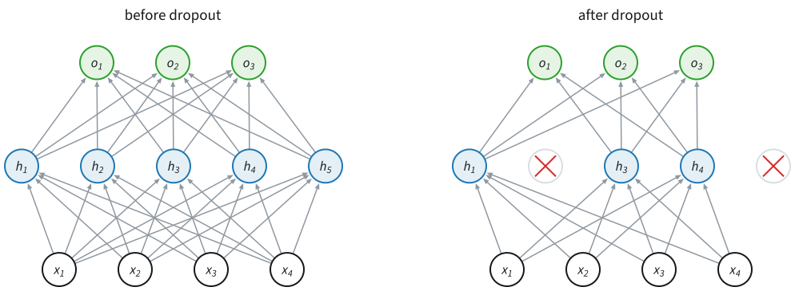

```{.python .input}
%load_ext d2lbook.tab
tab.interact_select('mxnet', 'pytorch', 'tensorflow', 'jax')
```

# Dropout
:label:`sec_dropout`

Gradient descent can make an MLP fit every one of its training images, even
when the labels are random (:numref:`sec_generalization_deep`). Which of the
many exact fits it finds depends on the training procedure. The two
regularizers we have met so far change the procedure in different ways: weight
decay (:numref:`sec_weight_decay`) penalizes large weights, and early stopping
(:numref:`subsec_early_stopping`) ends training before the network memorizes
the mislabeled examples. Neither constrains how the hidden units divide the
work among themselves. A unit may become useful only together with particular
other units, for instance because it corrects their errors on the training
images, and such arrangements need not carry over to new images.
:citet:`Hinton.Srivastava.Krizhevsky.ea.2012` called this *co-adaptation* and
proposed *dropout* to prevent it. At every training step, each hidden unit is
set to zero with some probability, independently of the others, and the
network computes its output from the units that remain. No unit can then count
on any other being present. At test time the full network runs.

This section first states the operation and the rescaling that keeps the
expected value of each unit unchanged, and then implements dropout in an MLP
with two hidden layers. We train that MLP with and without dropout on
Fashion-MNIST and measure what dropout changes in the trained network.
Finally, we compare the explanations that have been offered for its
effect.

```{.python .input #dropout}
%%tab mxnet
from d2l import mxnet as d2l
from mxnet import autograd, gluon, init, np as mnp, npx
from mxnet.gluon import nn
npx.set_np()
```

```{.python .input #dropout}
%%tab pytorch
from d2l import torch as d2l
import torch
from torch import nn
```

```{.python .input #dropout}
%%tab tensorflow
from d2l import tensorflow as d2l
import tensorflow as tf
```

```{.python .input #dropout}
%%tab jax
from d2l import jax as d2l
from flax import nnx
import jax
from jax import numpy as jnp
```

## Noise in Hidden Layers

### Simplicity and Robustness

Classical arguments for generalization favor simple functions, and so far
we have measured simplicity in two ways: by the number of features, as with
the polynomials of :numref:`subsec_polynomial-curve-fitting`, whose degree
sets how many weights a fit has, and by the norm of the weights, which
weight decay keeps small. A third measure is robustness. A good image
classifier should not change its prediction when a little noise is added to
the pixels, so we may train it on noisy pixels and ask it to predict the
clean label.

For a linear model this is exactly weight decay. Let the input
$\mathbf{x}$ be perturbed to $\mathbf{x} + \boldsymbol{\epsilon}$, where the
entries of $\boldsymbol{\epsilon}$ are independent with mean zero and
variance $s^2$. The expected squared error of the prediction
$\mathbf{w}^\top(\mathbf{x} + \boldsymbol{\epsilon}) + b$ for the label $y$
is

$$E\left[\left(\mathbf{w}^\top\mathbf{x} + b - y + \mathbf{w}^\top\boldsymbol{\epsilon}\right)^2\right] = \left(\mathbf{w}^\top\mathbf{x} + b - y\right)^2 + s^2\|\mathbf{w}\|^2.$$

The cross term vanishes because $\boldsymbol{\epsilon}$ has mean zero, and
$E[(\mathbf{w}^\top\boldsymbol{\epsilon})^2] = s^2 \|\mathbf{w}\|^2$ because
its entries are independent. Training on noisy inputs thus minimizes the
squared loss plus the penalty $s^2\|\mathbf{w}\|^2$ of weight decay. For
nonlinear models and small noise, :citet:`Bishop.1995` showed that the noise
adds, approximately, a penalty on how fast the output changes with the
input. Dropout carries the idea from the inputs to the hidden units, with a
different kind of noise: instead of adding a small perturbation to a unit,
it removes the unit. Bishop's analysis does not apply to such large,
multiplicative noise, so it motivates dropout without explaining it.

### Masking and Rescaling

Consider one hidden unit, whose activation $h_j$ is entry $j$ of the hidden
representation $\mathbf{h}$ of an example. At each training step, dropout
draws a random *mask* $m_j$, equal to 0 with probability $p$ and to 1 with
probability $1 - p$, independently for every unit and every example, and
replaces $h_j$ by

$$
h_j' = \frac{m_j h_j}{1 - p} =
\begin{cases}
0 & \textrm{with probability } p,\\
\dfrac{h_j}{1 - p} & \textrm{with probability } 1 - p.
\end{cases}
$$
:eqlabel:`eq_dropout`

The number $p$ is the *dropout probability*. A dropped unit outputs 0, and a
kept unit is scaled up by $1/(1 - p)$, which makes up, on average, for the
units that were dropped. For a fixed $h_j$, the expected value over the
mask is

$$E[h_j'] = p \cdot 0 + (1 - p)\frac{h_j}{1 - p} = h_j,$$

so on average the next layer receives the activation it would receive
without dropout, and $1/(1 - p)$ is the only factor with this property. The
fluctuations around this average are large. Since
$E[h_j'^2] = (1 - p)\, h_j^2/(1 - p)^2 = h_j^2/(1 - p)$, the variance is

$$\textrm{Var}[h_j'] = E[h_j'^2] - h_j^2 = \frac{p}{1 - p}\, h_j^2.$$

The noise grows with $p$ and with the size of the activation. For $p = 0.5$
a kept unit is doubled and a dropped one vanishes, so the standard deviation
of $h_j'$ equals $|h_j|$. Unlike the small input noise above, dropout
perturbs a unit by as much as its own value.

This version of the method, which rescales during training, is called
*inverted dropout*, and it is the one that deep learning frameworks implement.
The original formulation :cite:`Hinton.Srivastava.Krizhevsky.ea.2012` left the
kept activations unscaled and instead multiplied the outgoing weights of each
unit by $1 - p$ at test time. The two versions give the next layer inputs of
the same expected size during training and at test time. Inverted dropout puts
the correction into training, so that the network at test time is the plain
network, with no dropout code at all.

### Training and Inference

At test time we want a deterministic prediction, so dropout is switched off:
the full network runs, with no masks and no rescaling. By the rescaling,
each hidden activation then equals the expected value of its dropped
version. This statement concerns one unit. The next layer is linear, and the
expected value passes through it: a pre-activation
$z = \sum_j w_j h_j'$ has $E[z] = \sum_j w_j h_j$, the value of the full
network. The activation function that follows is not linear, and the
expected value does not pass through it.

A small example shows the difference. Let two units with activations
$h_1 = h_2 = 1$ feed the pre-activation $z = h_1' - h_2'$, with $p = 0.5$.
Each $h_j'$ is 0 or 2 with equal probability, so $z$ takes the values $-2$,
$0$, $0$, $2$, each with probability $1/4$, and $E[z] = 0$, the value of the
full network. After a ReLU, however, the average over the masks is
$E[\textrm{ReLU}(z)] = \frac{1}{4} \cdot 2 = 0.5$, whereas the full network
computes $\textrm{ReLU}(0) = 0$. In a network with nonlinear layers, the
network at test time therefore does not compute the average output of the
networks that dropout samples during training. It approximates that
average, and we return to the quality of the approximation at the end of the
section. Averaging the outputs of many passes with dropout switched on
estimates the average itself (exercise
:exref:`ex_dropout-monte-carlo-dropout`).

## Implementation

### The Dropout Layer

To drop the entries of a tensor `X` with probability `dropout`, we draw a
number uniformly from $[0, 1)$ for each entry and keep the entry if the
number is at least `dropout`, which happens with probability
$1 -$ `dropout`. Multiplying `X` by this 0/1 mask and dividing by
$1 -$ `dropout` applies :eqref:`eq_dropout` to every entry at once. The case
`dropout` $= 1$ drops everything and is handled separately, to avoid a
division by zero.

:begin_tab:`jax`
JAX has no global random state, so `dropout_layer` takes a random key as an
argument, and each call needs a fresh one (:numref:`sec_ndarray`).
:end_tab:

```{.python .input #dropout-implementation-from-scratch-1}
%%tab mxnet
def dropout_layer(X, dropout):
    assert 0 <= dropout <= 1
    if dropout == 1: return mnp.zeros_like(X)
    mask = mnp.random.uniform(0, 1, X.shape, device=X.device) >= dropout
    return mask.astype(X.dtype) * X / (1.0 - dropout)
```

```{.python .input #dropout-implementation-from-scratch-1}
%%tab pytorch
def dropout_layer(X, dropout):
    assert 0 <= dropout <= 1
    if dropout == 1: return torch.zeros_like(X)
    mask = torch.rand_like(X) >= dropout
    return mask.to(X.dtype) * X / (1.0 - dropout)
```

```{.python .input #dropout-implementation-from-scratch-1}
%%tab tensorflow
def dropout_layer(X, dropout):
    assert 0 <= dropout <= 1
    if dropout == 1: return tf.zeros_like(X)
    mask = tf.random.uniform(tf.shape(X)) >= dropout
    return tf.cast(mask, X.dtype) * X / (1.0 - dropout)
```

```{.python .input #dropout-implementation-from-scratch-1}
%%tab jax
def dropout_layer(X, dropout, key):
    assert 0 <= dropout <= 1
    if dropout == 1: return jnp.zeros_like(X)
    mask = jax.random.uniform(key, X.shape) >= dropout
    return mask.astype(X.dtype) * X / (1.0 - dropout)
```

We apply `dropout_layer` to a $2 \times 8$ tensor with the probabilities 0,
0.5, and 1. Then we drop the entries of a vector of a million ones with
probability 0.2 and compare the mean and the variance of the result with the
values $1$ and $p/(1 - p) = 0.25$ computed above.

```{.python .input #dropout-implementation-from-scratch-2}
%%tab pytorch, tensorflow, mxnet
X = d2l.reshape(d2l.arange(16, dtype=d2l.float32), (2, 8))
for p in (0, 0.5, 1):
    print(f'p = {p}:', dropout_layer(X, p))
Y = dropout_layer(d2l.ones(10**6), 0.2)
print(f'mean {float(d2l.reduce_mean(Y)):.3f}, '
      f'variance {float(d2l.reduce_mean((Y - 1) ** 2)):.3f}')
```

```{.python .input #dropout-implementation-from-scratch-2}
%%tab jax
X = jnp.arange(16, dtype=jnp.float32).reshape(2, 8)
for p in (0, 0.5, 1):
    print(f'p = {p}:', dropout_layer(X, p, d2l.get_key()))
Y = dropout_layer(jnp.ones(10**6), 0.2, d2l.get_key())
print(f'mean {float(Y.mean()):.3f}, '
      f'variance {float(((Y - 1) ** 2).mean()):.3f}')
```

With $p = 0.5$, each entry is set to 0 with probability one half and doubled
otherwise, so how many of the 16 entries are zeroed varies from run to run.
The million entries dropped with $p = 0.2$ have mean 1 and variance 0.25 up
to about 0.001, as computed.

### The Model

We apply dropout to the output of each hidden layer, after the activation
function. :numref:`fig_dropout2` shows the effect on the MLP of
:numref:`fig_mlp`, with four inputs, five hidden units, and three outputs,
for one draw of the masks, in which $h_2$ and $h_5$ are dropped. The outputs
no longer depend on these two units. Backpropagation sends zero gradient
through a multiplication by zero, so the weights into and out of $h_2$ and
$h_5$ receive no update from this example. The next step draws new masks and
removes other units.


:label:`fig_dropout2`

Our model has two hidden layers of 256 ReLU units each, so in the notation of
:numref:`sec_mlp` it has $K = 3$ layers. Each hidden layer may have its own
dropout probability. A common choice drops fewer units in the layers close to
the input; we use $p = 0.2$ after the first hidden layer and $p = 0.5$ after
the second. We register the parameters with the framework as in
:numref:`sec_softmax_scratch` and initialize them as
:numref:`subsec_he_init` recommends for ReLU layers: each weight matrix is
drawn from a normal distribution with mean 0 and variance $2/n_\textrm{in}$,
where $n_\textrm{in}$ is the number of inputs of the layer, and each bias
starts at 0. The model applies dropout only while it is being trained.

:begin_tab:`mxnet`
`autograd.is_training()` is true inside the `autograd.record()` block in
which the `Trainer` computes the loss for an update, and false when it
evaluates the model.
:end_tab:

:begin_tab:`pytorch`
`self.training` is set by `train()` and `eval()`, which the `Trainer` calls
before updating and before evaluating the model.
:end_tab:

:begin_tab:`tensorflow`
`self.training` records the `training` argument with which the `Trainer`
calls the model: `True` for an update, `False` for an evaluation.
:end_tab:

:begin_tab:`jax`
The `Trainer` evaluates a view of the model, made by `nnx.view`, which calls
`set_view` to set `deterministic` to `True`. The keys for the masks come from
the stream `rngs`, which advances at every call, so every step draws new
masks.
:end_tab:

```{.python .input #dropout-defining-the-model}
%%tab mxnet
class DropoutMLPScratch(d2l.Classifier):
    def __init__(self, num_outputs, num_hiddens_1, num_hiddens_2,
                 dropout_1, dropout_2, lr, num_inputs=784):
        super().__init__()
        self.save_hyperparameters()
        he = lambda name, n_in, n_out: gluon.Parameter(  # Variance 2 / n_in
            name, shape=(n_in, n_out), init=init.Normal((2 / n_in) ** 0.5))
        zero = lambda name, n: gluon.Parameter(name, shape=(n,),
                                               init=init.Zero())
        self.W1 = he('W1', num_inputs, num_hiddens_1)
        self.W2 = he('W2', num_hiddens_1, num_hiddens_2)
        self.W3 = he('W3', num_hiddens_2, num_outputs)
        self.b1 = zero('b1', num_hiddens_1)
        self.b2 = zero('b2', num_hiddens_2)
        self.b3 = zero('b3', num_outputs)
        self.initialize()

    def forward(self, X):
        X = X.reshape(-1, self.num_inputs)
        H1 = npx.relu(mnp.dot(X, self.W1.data()) + self.b1.data())
        if autograd.is_training():
            H1 = dropout_layer(H1, self.dropout_1)
        H2 = npx.relu(mnp.dot(H1, self.W2.data()) + self.b2.data())
        if autograd.is_training():
            H2 = dropout_layer(H2, self.dropout_2)
        return mnp.dot(H2, self.W3.data()) + self.b3.data()
```

```{.python .input #dropout-defining-the-model}
%%tab pytorch
class DropoutMLPScratch(d2l.Classifier):
    def __init__(self, num_outputs, num_hiddens_1, num_hiddens_2,
                 dropout_1, dropout_2, lr, num_inputs=784):
        super().__init__()
        self.save_hyperparameters()
        he = lambda n_in, n_out: nn.Parameter(  # Variance 2 / n_in
            d2l.normal(0, (2 / n_in) ** 0.5, (n_in, n_out)))
        self.W1 = he(num_inputs, num_hiddens_1)
        self.W2 = he(num_hiddens_1, num_hiddens_2)
        self.W3 = he(num_hiddens_2, num_outputs)
        self.b1 = nn.Parameter(d2l.zeros(num_hiddens_1))
        self.b2 = nn.Parameter(d2l.zeros(num_hiddens_2))
        self.b3 = nn.Parameter(d2l.zeros(num_outputs))

    def forward(self, X):
        X = X.reshape(-1, self.num_inputs)
        H1 = torch.relu(X @ self.W1 + self.b1)
        if self.training:
            H1 = dropout_layer(H1, self.dropout_1)
        H2 = torch.relu(H1 @ self.W2 + self.b2)
        if self.training:
            H2 = dropout_layer(H2, self.dropout_2)
        return H2 @ self.W3 + self.b3
```

```{.python .input #dropout-defining-the-model}
%%tab tensorflow
class DropoutMLPScratch(d2l.Classifier):
    def __init__(self, num_outputs, num_hiddens_1, num_hiddens_2,
                 dropout_1, dropout_2, lr, num_inputs=784):
        super().__init__()
        self.save_hyperparameters()
        def he(name, n_in, n_out):  # Normal weights with variance 2 / n_in
            normal = tf.random_normal_initializer(stddev=(2 / n_in) ** 0.5)
            return self.add_weight(name=name, shape=(n_in, n_out),
                                   initializer=normal)
        zero = lambda name, n: self.add_weight(name=name, shape=(n,),
                                               initializer='zeros')
        self.W1 = he('W1', num_inputs, num_hiddens_1)
        self.W2 = he('W2', num_hiddens_1, num_hiddens_2)
        self.W3 = he('W3', num_hiddens_2, num_outputs)
        self.b1 = zero('b1', num_hiddens_1)
        self.b2 = zero('b2', num_hiddens_2)
        self.b3 = zero('b3', num_outputs)

    def forward(self, X):
        X = tf.reshape(X, (-1, self.num_inputs))
        H1 = tf.nn.relu(X @ self.W1 + self.b1)
        if self.training:
            H1 = dropout_layer(H1, self.dropout_1)
        H2 = tf.nn.relu(H1 @ self.W2 + self.b2)
        if self.training:
            H2 = dropout_layer(H2, self.dropout_2)
        return H2 @ self.W3 + self.b3
```

```{.python .input #dropout-defining-the-model}
%%tab jax
class DropoutMLPScratch(d2l.Classifier):
    def __init__(self, num_outputs, num_hiddens_1, num_hiddens_2,
                 dropout_1, dropout_2, lr, num_inputs=784, rngs=None):
        super().__init__()
        self.save_hyperparameters(ignore=['rngs'])
        self.rngs = nnx.Rngs(d2l.get_key()) if rngs is None else rngs
        he = lambda n_in, n_out: nnx.Param(  # Variance 2 / n_in
            self.rngs.params.normal((n_in, n_out)) * (2 / n_in) ** 0.5)
        self.W1 = he(num_inputs, num_hiddens_1)
        self.W2 = he(num_hiddens_1, num_hiddens_2)
        self.W3 = he(num_hiddens_2, num_outputs)
        self.b1 = nnx.Param(jnp.zeros(num_hiddens_1))
        self.b2 = nnx.Param(jnp.zeros(num_hiddens_2))
        self.b3 = nnx.Param(jnp.zeros(num_outputs))
        self.deterministic = False

    def set_view(self, *, deterministic):
        self.deterministic = deterministic

    def forward(self, X):
        X = X.reshape(-1, self.num_inputs)
        H1 = nnx.relu(X @ self.W1 + self.b1)
        if not self.deterministic:
            H1 = dropout_layer(H1, self.dropout_1, self.rngs.dropout())
        H2 = nnx.relu(H1 @ self.W2 + self.b2)
        if not self.deterministic:
            H2 = dropout_layer(H2, self.dropout_2, self.rngs.dropout())
        return H2 @ self.W3 + self.b3
```

### Training

We train the model like softmax regression in :numref:`sec_softmax_concise`,
with minibatch SGD at learning rate 0.1 and minibatches of 256 images, here
for 20 epochs.

```{.python .input #dropout-training}
hparams = {'num_outputs': 10, 'num_hiddens_1': 256, 'num_hiddens_2': 256,
           'dropout_1': 0.2, 'dropout_2': 0.5, 'lr': 0.1}
model = DropoutMLPScratch(**hparams)
data = d2l.FashionMNIST(batch_size=256)
trainer = d2l.Trainer(max_epochs=20, num_gpus=1)
trainer.fit(model, data)
```

After 20 epochs the validation accuracy is about 87%, and it moves by a
point or more from one epoch to the next. The training loss in the plot is
computed with the masks switched on, so it measures the thinned networks,
which predict worse than the full network that the validation loss measures.
For the first few epochs it lies above the validation loss. It ends somewhat
below it, at about 0.32, while the validation loss levels off near 0.35.

### Concise Implementation

The framework provides dropout as a layer that takes the dropout
probability as its argument. The layer applies :eqref:`eq_dropout` while the
model is being trained and passes its input through unchanged otherwise, so
the model needs no test for the training mode. We place a dropout layer
after the activation function of each hidden layer and initialize the
weights as in the scratch implementation.

:begin_tab:`mxnet`
`init.Xavier` with `magnitude=2` and `factor_type='in'` draws weights with
variance $2/n_\textrm{in}$, from a normal distribution if
`rnd_type='gaussian'`.
:end_tab:

:begin_tab:`pytorch`
The `Trainer` initializes the lazy layers through the model's `weight_init`
method, as in :numref:`sec_softmax_concise`. `kaiming_normal_` draws normal
weights with variance $2/n_\textrm{in}$.
:end_tab:

:begin_tab:`tensorflow`
`VarianceScaling(2.0, 'fan_in', 'untruncated_normal')` draws normal weights
with variance $2/n_\textrm{in}$. Each layer gets an initializer of its own:
an instance created without a seed returns the same random values on every
call, so layers that shared one would start from related weights.
:end_tab:

:begin_tab:`jax`
`variance_scaling(2.0, 'fan_in', 'normal')` draws normal weights with
variance $2/n_\textrm{in}$. NNX dropout layers draw their keys from `rngs`,
and `nnx.view` switches them off for evaluation, as for the scratch model;
it reaches them inside `nnx.Sequential` as well. The method `forward`
flattens each image before the sequence of layers.
:end_tab:

```{.python .input #dropout-concise-implementation-1}
%%tab mxnet
class DropoutMLP(d2l.Classifier):
    def __init__(self, num_outputs, num_hiddens_1, num_hiddens_2,
                 dropout_1, dropout_2, lr):
        super().__init__()
        self.save_hyperparameters()
        self.net = nn.Sequential()
        self.net.add(nn.Dense(num_hiddens_1, activation='relu'),
                     nn.Dropout(dropout_1),
                     nn.Dense(num_hiddens_2, activation='relu'),
                     nn.Dropout(dropout_2),
                     nn.Dense(num_outputs))
        self.net.initialize(init.Xavier(rnd_type='gaussian', factor_type='in',
                                        magnitude=2))
```

```{.python .input #dropout-concise-implementation-1}
%%tab pytorch
class DropoutMLP(d2l.Classifier):
    def __init__(self, num_outputs, num_hiddens_1, num_hiddens_2,
                 dropout_1, dropout_2, lr):
        super().__init__()
        self.save_hyperparameters()
        self.net = nn.Sequential(
            nn.Flatten(), nn.LazyLinear(num_hiddens_1), nn.ReLU(),
            nn.Dropout(dropout_1), nn.LazyLinear(num_hiddens_2), nn.ReLU(),
            nn.Dropout(dropout_2), nn.LazyLinear(num_outputs))

    def weight_init(self, module):
        if isinstance(module, nn.Linear):
            nn.init.kaiming_normal_(module.weight, nonlinearity='relu')
            nn.init.zeros_(module.bias)
```

```{.python .input #dropout-concise-implementation-1}
%%tab tensorflow
class DropoutMLP(d2l.Classifier):
    def __init__(self, num_outputs, num_hiddens_1, num_hiddens_2,
                 dropout_1, dropout_2, lr):
        super().__init__()
        self.save_hyperparameters()
        # One initializer per layer: an instance repeats its random values
        he = lambda: tf.keras.initializers.VarianceScaling(
            2.0, 'fan_in', 'untruncated_normal')
        self.net = tf.keras.models.Sequential([
            tf.keras.layers.Flatten(),
            tf.keras.layers.Dense(num_hiddens_1, activation='relu',
                                  kernel_initializer=he()),
            tf.keras.layers.Dropout(dropout_1),
            tf.keras.layers.Dense(num_hiddens_2, activation='relu',
                                  kernel_initializer=he()),
            tf.keras.layers.Dropout(dropout_2),
            tf.keras.layers.Dense(num_outputs, kernel_initializer=he())])
```

```{.python .input #dropout-concise-implementation-1}
%%tab jax
class DropoutMLP(d2l.Classifier):
    def __init__(self, num_outputs, num_hiddens_1, num_hiddens_2,
                 dropout_1, dropout_2, lr, num_inputs=784, rngs=None):
        super().__init__()
        self.save_hyperparameters(ignore=['rngs'])
        rngs = nnx.Rngs(d2l.get_key()) if rngs is None else rngs
        he = nnx.initializers.variance_scaling(2.0, 'fan_in', 'normal')
        self.net = nnx.Sequential(
            nnx.Linear(num_inputs, num_hiddens_1, kernel_init=he, rngs=rngs),
            nnx.relu, nnx.Dropout(dropout_1, rngs=rngs),
            nnx.Linear(num_hiddens_1, num_hiddens_2, kernel_init=he,
                       rngs=rngs),
            nnx.relu, nnx.Dropout(dropout_2, rngs=rngs),
            nnx.Linear(num_hiddens_2, num_outputs, kernel_init=he, rngs=rngs))

    def forward(self, X):
        return self.net(X.reshape((X.shape[0], -1)))  # Flatten each image
```

We train it with the same settings as the scratch model, with a trainer of
its own, so that the scratch model and its history remain available for the
experiments that follow.

```{.python .input #dropout-concise-implementation-3}
concise = DropoutMLP(**hparams)
concise_trainer = d2l.Trainer(max_epochs=20, num_gpus=1)
concise_trainer.fit(concise, data)
```

The concise model reaches the same validation accuracy as the scratch
model, about 87%, up to the same movement from one epoch to the next.

## Effects of Dropout

### A Network without Dropout

To see what dropout changes, we train the scratch model again, with the same
initialization, learning rate, and number of epochs, but with both dropout
probabilities set to 0.

```{.python .input #dropout-accuracy}
baseline = DropoutMLPScratch(**{**hparams, 'dropout_1': 0, 'dropout_2': 0})
baseline_trainer = d2l.Trainer(max_epochs=20, num_gpus=1)
baseline_trainer.fit(baseline, data)
```

Without masks, the training loss falls below the validation loss within the
first three epochs and ends at about 0.25, against 0.32 for the thinned
networks of the run with dropout.

### Accuracy and Robustness

We compare the two trained networks, each with the parameters it has at the
end of training, in two ways. The first is the validation accuracy after the
last epoch, the last entry of `history['val_acc']`. The second tests what
dropout trains a network to do: to predict well when some of its units are
missing. We switch the masks of training back on, with $p = 0.2$ and
$p = 0.5$, in both networks, and measure their accuracy on the validation
images. Both measurements use the same parameters, so their difference is
the cost of the masks alone. The function `masked_accuracy` does this for
one model; the trainer's `prepare_batch` moves each minibatch to the device
of the model.

```{.python .input #dropout-robustness-to-missing-units-1}
%%tab mxnet
def masked_accuracy(model, data, trainer):
    """Validation accuracy with the dropout masks of training switched on."""
    with autograd.train_mode():  # Masks on, no gradients recorded
        correct = [model.accuracy(model(X), y, averaged=False)
                   for X, y in map(trainer.prepare_batch,
                                   data.val_dataloader())]
    return float(d2l.reduce_mean(d2l.concat(correct, 0)))
```

```{.python .input #dropout-robustness-to-missing-units-1}
%%tab pytorch
def masked_accuracy(model, data, trainer):
    """Validation accuracy with the dropout masks of training switched on."""
    mode = model.training
    model.train()  # Masks on
    with torch.no_grad():
        correct = [model.accuracy(model(X), y, averaged=False)
                   for X, y in map(trainer.prepare_batch,
                                   data.val_dataloader())]
    model.train(mode)  # Restore the previous mode
    return float(d2l.reduce_mean(d2l.concat(correct, 0)))
```

```{.python .input #dropout-robustness-to-missing-units-1}
%%tab tensorflow
def masked_accuracy(model, data, trainer):
    """Validation accuracy with the dropout masks of training switched on."""
    mode = model.training  # A call with training=True overwrites it
    correct = [model.accuracy(model(X, training=True), y, averaged=False)
               for X, y in map(trainer.prepare_batch, data.val_dataloader())]
    model.training = mode  # Restore the previous mode
    return float(d2l.reduce_mean(d2l.concat(correct, 0)))
```

```{.python .input #dropout-robustness-to-missing-units-1}
%%tab jax
def masked_accuracy(model, data, trainer):
    """Validation accuracy with the dropout masks of training switched on."""
    masked = nnx.view(model, deterministic=False)
    correct = [model.accuracy(masked(X), y, averaged=False)
               for X, y in map(trainer.prepare_batch, data.val_dataloader())]
    return float(d2l.reduce_mean(d2l.concat(correct, 0)))
```

Before the comparison, the network trained without dropout gets the
dropout probabilities of the other one.

```{.python .input #dropout-robustness-to-missing-units-2}
baseline.dropout_1 = hparams['dropout_1']
baseline.dropout_2 = hparams['dropout_2']
for name, net, t in (('with dropout', model, trainer),
                     ('without dropout', baseline, baseline_trainer)):
    print(f'trained {name}: validation accuracy '
          f'{t.history["val_acc"][-1]:.3f}, '
          f'with masks {masked_accuracy(net, data, t):.3f}')
```

Both networks end with a validation accuracy of about 84% to 88%, and which
of them is ahead changes from run to run. The value after a single epoch is
noisy. The learning rate stays at 0.1 to the end of training, so the
minibatch noise keeps moving the parameters, and the validation accuracy
wobbles by about a point from one epoch to the next, with occasional dips of
several points; averaged over the last five epochs, both networks reach about
85% to 87%. The fix is to decay the learning rate toward the end of
training, so that the last steps are small and the parameters settle, and to
warm it up over the first steps, which allows a larger rate in between;
:numref:`sec_scheduler` introduces these schedules.

On Fashion-MNIST, with this network and 20 epochs of training, dropout does
not make the MLP more accurate. With the masks switched on,
however, the two networks behave very differently. The network trained with
dropout loses about 1 to 2 points of accuracy. The network trained without
dropout loses about 8 to 12 points. Its units have learned to work in the
combinations present during training and fail when some of their partners
are missing: they are co-adapted. Dropout removes this dependence among the
units, and here it does so without changing the accuracy of the full
network.

## Interpretations

The experiment shows what dropout does to this network.
:citet:`Srivastava.Hinton.Krizhevsky.ea.2014` reported lower test errors
with dropout on benchmarks of images, speech, and text, and why it helps
there is a different question. Three explanations have been offered; each
accounts for part of the mechanism, and none is complete.

### Noise Injection

Dropout adds noise to the hidden units, and a network that must tolerate
the noise is pushed toward functions that are insensitive to it, as
Gaussian input noise pushes a linear model toward small weights. For a
linear model the analogy is exact. Apply dropout to the inputs of the
linear model $\mathbf{w}^\top\mathbf{x} + b$ and train it with the squared
loss. The dropped inputs $x_j'$ are independent, each has mean $x_j$ and
variance $\frac{p}{1 - p}x_j^2$, so the prediction has mean
$\mathbf{w}^\top\mathbf{x} + b$ and variance
$\frac{p}{1-p}\sum_j w_j^2 x_j^2$. The expected loss is the squared error of
the mean plus this variance,

$$E\left[\left(\mathbf{w}^\top\mathbf{x}' + b - y\right)^2\right] = \left(\mathbf{w}^\top\mathbf{x} + b - y\right)^2 + \frac{p}{1 - p}\sum_j x_j^2 w_j^2.$$

In expectation, dropout on the inputs of a linear model is a weight decay
:cite:`Srivastava.Hinton.Krizhevsky.ea.2014`. Summed over the training
examples, the penalty on $w_j$ is proportional to the sum of the squares of
feature $j$: weights of features that are often large are penalized more,
and the weight of a feature that is always 0 is not penalized at all. In a
deep network the penalty depends on the hidden activations, which change
during training, and no such closed form exists.

### Co-adaptation

The masked accuracies measured above confirm the effect that dropout was
designed to have. The units of the network trained without dropout work
only in the combinations in which they were trained: removing some of them
at random costs about 8 to 12 points of accuracy. The units of the network
trained with dropout do not depend on each other in this way.
It does not follow that independent units generalize better. On
Fashion-MNIST the network with co-adapted units is as accurate as the
other, so whatever co-adaptation costs elsewhere, it does not cost accuracy
here.

### An Implicit Ensemble

Our network has 512 hidden units and hence $2^{512}$ masks, each of which
defines a *thinned* network, and all of them share one set of weights. Every
training step trains as many of them as the minibatch has examples, each on
one example. The network at test time can be read as an approximation of the
average of their predictions. Averaging the predictions of many models, an
*ensemble*, typically predicts better than any single one of them, and this
reading suggests that dropout obtains such an average at the cost of one
network. The reading is loose. The thinned networks are not trained
independently of each other, as the members of an ensemble are, and the
two-unit example above showed that the full network does not compute their
average. When the only dropped units feed the output layer directly, the full
network computes a weighted geometric mean of the thinned networks'
predictions (exercise :exref:`ex_dropout-geometric-mean`); deeper in the
network, not even that holds.

### Use in Practice

Dropout kept the large fully connected layers of the image classifiers of
the early 2010s, among them AlexNet (:numref:`sec_alexnet`), from
overfitting. Later convolutional networks rely more on data augmentation,
batch normalization (:numref:`sec_batch_norm`), and weight decay, and use
dropout sparingly. Networks with residual connections (:numref:`sec_resnet`)
often drop whole residual branches for a training example instead of single
units, a variant called *stochastic depth* :cite:`huang2016stochasticdepth`
(:numref:`sec_training_recipes`). The placement of dropout matters: dropout
before a batch normalization layer changes the variance of that layer's
inputs between training and test, because the mean square of a dropped unit
is $1/(1 - p)$ times that of the unit itself, and this mismatch hurts
accuracy :cite:`Li.Chen.Hu.ea.2019`. Transformers typically apply dropout
with probabilities around 0.1 to their attention weights and to the outputs
of their layers. Models that see each training example only once, as large
language models do, have little opportunity to memorize, and are often
trained without dropout.

Dropout completes the regularizers of this chapter: weight decay limits the
size of the weights, early stopping the length of training, and dropout the
reliance of units on each other. The next section turns to a prediction
problem that comes as a table of mixed numbers and categories, where the
data must be prepared before any model is trained.

## Summary

Dropout sets each hidden unit to zero with probability $p$ at every
training step and scales the remaining units by $1/(1 - p)$, so that each
unit keeps its expected value; at test time the full network runs. The
noise is large, with a variance of $\frac{p}{1-p}$ times the square of the
activation, and the expected value is preserved only unit by unit, so the
full network is not the average of the networks that dropout trains. On
Fashion-MNIST, an MLP with two hidden layers reaches the same accuracy with
and without dropout, but only the network trained with dropout keeps its
accuracy when units are removed at random. For a linear model, dropout of
the inputs equals, in expectation, a weight decay that penalizes each
weight by the square of its input; for deep networks, the noise, the
independence of the units, and the implicit ensemble each explain part of
its effect.

## Exercises

1. [code] **Dropout probabilities.** The model of this section drops units
   with probability 0.2 after the first hidden layer and 0.5 after the
   second.
    1. Train it with the two probabilities swapped, with both set to 0.5,
       and with both set to 0.8. For each run, report the best validation
       accuracy and the accuracy of `masked_accuracy`. Which layer tolerates
       the higher probability?
    1. The `Trainer` computes the training loss that it plots with the masks
       switched on. After training, evaluate the loss on the training images
       with the masks switched off, and compare the gap between training and
       validation loss for the networks trained with and without dropout.
1. **Dropout and He initialization.** The He initialization of
   :numref:`subsec_he_init` chooses the variance of the weights so that the
   mean square of the pre-activations stays the same from layer to layer.
    1. During training, by what factor does dropout with probability $p$
       change the mean square of the pre-activations of the next layer?
       Give the factor for each of the two dropout layers of this section's
       model.
    1. In a network with $L$ hidden layers, each followed by dropout with
       probability $p$, how does the factor grow with $L$? Should the
       initialization correct for it, given that the network runs without
       dropout at test time? Relate your answer to the mismatch between
       training and test that dropout causes before a batch normalization
       layer.
1. [code] **Dropout and label noise.** In
   :numref:`subsec_early_stopping`, an MLP trained on 1,000 Fashion-MNIST
   images, of which 20% had their label redrawn at random, fit the
   correctly labeled images first and memorized the mislabeled ones later.
    1. Repeat that experiment with `DropoutMLPScratch(**hparams)`, and with
       the same model with both probabilities set to 0. After every epoch,
       record the fraction of mislabeled training images whose wrong label
       the network predicts. Does dropout prevent the memorization of the
       wrong labels, or does it delay it?
    1. Compare the best validation accuracy of the two runs and the epoch at
       which each is reached. Does dropout make early stopping more or less
       important?
1. **Ensemble size.** The two hidden layers of this section's model have
   512 units together, so they admit $2^{512}$ joint dropout masks, and the
   ensemble interpretation views each mask as a thinned network.
    1. Training runs for 20 epochs over the 60,000 Fashion-MNIST training
       images, and a fresh mask is drawn for every example. How many joint
       masks are sampled during training, and what fraction of all joint
       masks is that? How likely is it that any mask is drawn twice? The
       masks are not equally likely, since the first layer drops units with
       probability 0.2: bound the probability that two draws coincide by
       the probability of the most likely joint mask.
    1. Using these numbers, explain in what sense dropout does, and does
       not, train an ensemble of all these networks.
1. [code] **Monte Carlo dropout.** Instead of switching dropout off at test
   time, keep it on in the trained `DropoutMLPScratch` and run $T = 20$
   forward passes per validation image, then average the softmax outputs
   :cite:`Gal.Ghahramani.2016`. Compare the accuracy and the calibration
   (the mean of the largest softmax probability against the accuracy) with
   those of the single pass of the full network. How does the accuracy
   change as $T$ grows from 1 to 20?
   :exlabel:`ex_dropout-monte-carlo-dropout`
1. [code] **Dropout and weight decay.** Weight decay and dropout both
   regularize the model of this section, by different mechanisms. Measure
   each run by its best validation accuracy and by the gap between training
   and validation loss, with both losses evaluated with the masks switched
   off.
    1. With both dropout probabilities set to zero, add weight decay as in
       :numref:`sec_weight_decay` at strengths
       $\lambda \in \{10^{-4}, 10^{-3}, 10^{-2}\}$. Compare these runs
       with the runs with and without dropout of this section.
    1. Keep the dropout probabilities at 0.2 and 0.5, and add weight decay
       at the same strengths. Are the effects of the two regularizers
       additive, do they show diminishing returns, or do they cancel each
       other out?
1. **Dropout at test time.** ● Set `dropout_1` to zero, so that only the
   second hidden layer is masked, and let $\mathbf{m}$ range over its
   masks. Let $\mathbf{o}(\mathbf{m})$ and $\hat{\mathbf{y}}(\mathbf{m})$
   be the logits and the softmax output under mask $\mathbf{m}$, which
   occurs with probability $P(\mathbf{m})$. Show that the logits of the
   full network equal $\sum_{\mathbf{m}} P(\mathbf{m})\, \mathbf{o}(\mathbf{m})$.
   Show further that its softmax output equals the normalized weighted
   geometric mean

    $$\tilde{y}_j = \frac{\prod_{\mathbf{m}} \hat{y}_j(\mathbf{m})^{P(\mathbf{m})}}{\sum_k \prod_{\mathbf{m}} \hat{y}_k(\mathbf{m})^{P(\mathbf{m})}}.$$

    Explain why neither equality holds in general once `dropout_1` is
    nonzero.
   :exlabel:`ex_dropout-geometric-mean`

:begin_tab:`mxnet`
[Discussions](https://d2l.discourse.group/t/100)
:end_tab:

:begin_tab:`pytorch`
[Discussions](https://d2l.discourse.group/t/101)
:end_tab:

:begin_tab:`tensorflow`
[Discussions](https://d2l.discourse.group/t/261)
:end_tab:

:begin_tab:`jax`
[Discussions](https://d2l.discourse.group/t/17987)
:end_tab:

<!-- slides -->

::: {.slide}
::: {.cover}
[Dive into Deep Learning · §4.6]{.kicker}

Dropout<br>**random masks · inverted dropout · robustness to missing units**
:::
:::

::: {.slide title="Nothing Stops Hidden Units from Relying on Each Other"}
[The problem]{.kicker}

- The MLP of this chapter fits 1,000 Fashion-MNIST images even with
  **random** labels: 203,530 parameters are plenty.
- **Weight decay** limits the size of the weights; **early stopping**
  limits the length of training.
- Neither limits how hidden units **share the work**: a unit may be useful
  only together with particular partners, for instance by correcting their
  errors on the training images.

::: {.d2l-note}
Such *co-adapted* combinations fit the training set and need not carry
over to new images. Dropout removes random units at every step, so no unit
can count on a partner.
:::
:::

::: {.slide title="By the End of This Deck You Can"}
[Goals]{.kicker}

- compute the mean and the variance of a dropped unit;
- explain why the network at test time is **not** the average of the
  thinned networks, with a two-unit counterexample;
- implement a dropout layer and an MLP that uses it;
- measure what dropout changes in a trained network, and what it does not;
- show that, for a linear model, dropout is a form of weight decay.

**Running example:** Fashion-MNIST. Softmax regression: 7,850 parameters,
about 84% after 30 epochs. Here: an MLP with two hidden layers of 256 units,
269,322 parameters, trained for 20 epochs at learning rate 0.1.
:::

::: {.slide title="Dropout Is the Third Regularizer of the Book"}
[Where this fits]{.kicker}

::: {.cols .vc}
::: {.col}
| section | adds |
|---|---|
| Multilayer Perceptrons | hidden layers, activation functions, universal approximation |
| Implementation of Multilayer Perceptrons | an MLP trained on Fashion-MNIST |
| Backpropagation | how the gradients are computed, and at what memory cost |
| Numerical Stability and Initialization | vanishing gradients, Xavier and He initialization |
| Generalization in Deep Learning | memorization, double descent, implicit bias, early stopping |
| **Dropout** | **random masks, robustness to missing units** |
| Predicting House Prices on Kaggle | the workflow on real data |
:::

::: {.col .narrow}
- **Uses:** weight decay, He initialization, the `Trainer`, Fashion-MNIST.
- **Skips:** variants such as DropConnect and stochastic depth, and the
  Bayesian reading of dropout beyond one exercise.
:::
:::
:::

::: {.slide}
::: {.divider}
[01]{.dnum}

[Noise in Hidden Layers]{.dtitle}

[masks, rescaling, and the network at test time]{.dsub}
:::
:::

::: {.slide title="For a Linear Model, Input Noise Is Weight Decay"}
[Noise · motivation]{.kicker}

Perturb the input, $\mathbf{x} + \boldsymbol{\epsilon}$, with independent
entries of mean 0 and variance $s^2$:

$$E\left[\left(\mathbf{w}^\top(\mathbf{x} + \boldsymbol{\epsilon}) + b - y\right)^2\right] = \left(\mathbf{w}^\top\mathbf{x} + b - y\right)^2 + s^2\|\mathbf{w}\|^2.$$

- The cross term vanishes: $E[\boldsymbol{\epsilon}] = \mathbf{0}$.
- Training on noisy inputs = squared loss + weight decay $s^2\|\mathbf{w}\|^2$.

::: {.d2l-note}
Dropout moves the noise to the hidden units, and makes it large: it removes
units instead of nudging them.
:::
:::

::: {.slide title="Dropout Zeros a Unit with Probability p and Rescales the Rest"}
[Noise · the operation]{.kicker}

With a mask $m_j$ that is 0 with probability $p$ and 1 otherwise:

$$h_j' = \frac{m_j h_j}{1 - p} = \begin{cases} 0 & \textrm{with probability } p,\\ h_j/(1 - p) & \textrm{with probability } 1 - p.\end{cases}$$

- A fresh mask for every unit, every example, every step.
- $E[h_j'] = p \cdot 0 + (1 - p)\frac{h_j}{1-p} = h_j$: the expected value
  is kept, and $1/(1 - p)$ is the only factor that keeps it.

::: {.d2l-note}
**Inverted dropout** rescales during training, so the test network is the
plain network. The original version (Hinton et al., 2012) scaled the
weights by $1 - p$ at test time instead.
:::
:::

::: {.slide title="The Noise Is as Large as the Activation"}
[Noise · the variance]{.kicker}

$$E[h_j'^2] = \frac{h_j^2}{1 - p}, \qquad \textrm{Var}[h_j'] = \frac{p}{1 - p}\, h_j^2.$$

| $p$ | kept unit scaled by | variance for $h_j = 1$ |
|---|---:|---:|
| 0.2 | 1.25 | 0.25 |
| 0.5 | 2 | 1 |

::: {.d2l-note}
At $p = 0.5$ the standard deviation of $h_j'$ equals $|h_j|$: this is not
a small perturbation.
:::
:::

::: {.slide title="The Test Network Is Not the Average of the Thinned Networks"}
[Noise · test time]{.kicker}

Two units, $h_1 = h_2 = 1$, $p = 0.5$, pre-activation $z = h_1' - h_2'$:

| $(h_1', h_2')$ | (0,0) | (2,0) | (0,2) | (2,2) |
|---|---:|---:|---:|---:|
| $z$ | 0 | 2 | −2 | 0 |
| $\textrm{ReLU}(z)$ | 0 | 2 | 0 | 0 |

- Linear layer: $E[z] = 0$, the full network's value.
- After the ReLU: $E[\textrm{ReLU}(z)] = 0.5$, but the full network gives
  $\textrm{ReLU}(0) = 0$.

::: {.d2l-note}
The expected value is kept unit by unit, not through nonlinear layers.
:::
:::

::: {.slide title="Check: How Large Is the Noise at p = 0.8?"}
[Check]{.kicker}

A unit has activation $h_j = 1$ and dropout probability $p = 0.8$. What is
a kept unit scaled to, and what is the variance of $h_j'$?

::: {.fragment .fade-up}
::: {.d2l-note}
**Answer.** A kept unit becomes $1/(1 - 0.8) = 5$, kept one time in five.
The variance is $0.8/0.2 = 4$: a standard deviation twice the
activation.
:::
:::
:::

::: {.slide}
::: {.divider}
[02]{.dnum}

[Implementation]{.dtitle}

[a dropout layer and an MLP that uses it]{.dsub}
:::
:::

::: {.slide title="A Dropout Layer in Three Lines"}
[Implementation · the layer]{.kicker}

Draw a uniform number per entry, keep the entry if it is at least $p$,
scale the survivors by $1/(1 - p)$:

@dropout-implementation-from-scratch-1
:::

::: {.slide title="A Million Ones at p = 0.2: Mean 1, Variance 0.25"}
[Implementation · check]{.kicker}

@!dropout-implementation-from-scratch-2

- $p = 0.5$: each entry is 0 with probability $1/2$, otherwise doubled.
- The sample mean and variance match $1$ and $p/(1 - p) = 0.25$.
:::

::: {.slide title="Dropout Goes after Each Hidden Activation, Only in Training"}
[Implementation · the model]{.kicker}

::: {.cols .vc}
::: {.col}
`Linear → ReLU → dropout(0.2) → Linear → ReLU → dropout(0.5) → Linear`

- Dropped units get no gradient on that example.
- Fewer units dropped near the input, more deeper.
- He initialization (variance $2/n_\textrm{in}$), zero biases, in every
  framework.
:::

::: {.col .fig .big}

:::
:::
:::

::: {.slide title="Training: 20 Epochs on Fashion-MNIST"}
[Implementation · training]{.kicker}

Two hidden layers of 256 units, $p = 0.2$ and $0.5$, SGD at learning rate
0.1, minibatches of 256:

@!dropout-training

::: {.d2l-note}
The training loss is computed with masks, on thinned networks; the
validation loss on the full network.
:::
:::

::: {.slide title="Concise: One Dropout Layer after Each Activation"}
[Implementation · concise]{.kicker}

A framework `Dropout(p)` layer masks and rescales in training mode and passes
its input through at test time; the `Trainer` switches the mode.

@!dropout-concise-implementation-3
:::

::: {.slide}
::: {.divider}
[03]{.dnum}

[Effects of Dropout]{.dtitle}

[the same network, trained with and without masks]{.dsub}
:::
:::

::: {.slide title="Same Accuracy with and without Dropout"}
[Effects · accuracy]{.kicker}

Same model, initialization, learning rate, and 20 epochs; only $p$
differs:

@!dropout-robustness-to-missing-units-2

- Final validation accuracy: about 84–88% for both networks; which one is
  ahead changes from run to run.
- One epoch is a noisy measurement: at a constant learning rate the
  accuracy wobbles by about a point per epoch, with larger dips.
  Over the last five epochs both average about 85–87%.
- Fix: decay the learning rate toward the end (and warm it up at the
  start); see the section on learning-rate schedules.
- On this dataset and budget, dropout does not raise accuracy.
:::

::: {.slide title="Without Dropout, Removing Units Costs 8 to 12 Points"}
[Effects · robustness]{.kicker}

Switch the masks of training ($p = 0.2$, $0.5$) on in both trained networks,
with their final parameters:

| trained | final accuracy | with masks | loss |
|---|---:|---:|---:|
| with dropout | 85–88% | 83–87% | 1–2 points |
| without dropout | 84–88% | 74–78% | 8–12 points |

::: {.d2l-note}
Units trained without dropout work only in the combinations they were
trained in: they are co-adapted. Dropout removes this dependence, which
here does not change accuracy.
:::
:::

::: {.slide title="Check: How Often Can a Unit Count on a Given Partner?"}
[Check]{.kicker}

The second hidden layer has 256 units and $p = 0.5$. How many of them does
an example keep on average, and in what fraction of the steps are two given
units of that layer both present?

::: {.fragment .fade-up}
::: {.d2l-note}
**Answer.** $256 \times 0.5 = 128$ units. Two given units are both kept with
probability $0.5^2 = 0.25$: a unit can count on a partner in one step of
four. In the first layer ($p = 0.2$): about 205 units, a given pair in 64%
of the steps.
:::
:::
:::

::: {.slide}
::: {.divider}
[04]{.dnum}

[Interpretations]{.dtitle}

[noise, co-adaptation, an implicit ensemble]{.dsub}
:::
:::

::: {.slide title="For Linear Regression, Dropout Is Weight Decay Scaled by x²"}
[Interpretations · noise]{.kicker}

Drop the inputs $x_j' = m_j x_j/(1 - p)$: mean $x_j$, variance
$\frac{p}{1-p}x_j^2$, independent.

$$E\left[\left(\mathbf{w}^\top\mathbf{x}' + b - y\right)^2\right] = \left(\mathbf{w}^\top\mathbf{x} + b - y\right)^2 + \frac{p}{1 - p}\sum_j x_j^2 w_j^2.$$

- Expected loss = loss of the mean + variance of the prediction.
- Each weight is penalized by the square of its input; no penalty where
  $x_j = 0$.

::: {.d2l-note}
For deep networks the penalty depends on activations that change during
training: no closed form.
:::
:::

::: {.slide title="Three Explanations, None Complete"}
[Interpretations · overview]{.kicker}

| view | what it says | limit |
|---|---|---|
| noise injection | tolerate noise → smoother function | exact only for linear models |
| co-adaptation | units must work alone | measured, yet same accuracy here |
| implicit ensemble | $2^{512}$ thinned networks, shared weights | test network ≠ their average |

::: {.d2l-note}
Only the expected value of each unit is exact. With 512 hidden units there
are $2^{512} \approx 10^{154}$ masks.
:::
:::

::: {.slide title="Dropout Today: Sparingly, at About 0.1, or Not at All"}
[Interpretations · practice]{.kicker}

- **Early-2010s image classifiers** (AlexNet): dropout kept large fully
  connected layers from overfitting.
- **Later CNNs:** augmentation, batch norm, weight decay; dropout sparingly.
  Dropout before batch norm shifts the variance by $1/(1-p)$ between
  training and test.
- **Transformers:** about 0.1 on attention weights and layer outputs.
- **Models that see each example once** (large language models): often 0.
:::

::: {.slide title="Recap"}
[Wrap-up]{.kicker}

::: {.cols}
::: {.col}
- **Operation:** zero with probability $p$, scale by $1/(1-p)$;
  $E[h_j'] = h_j$, $\textrm{Var}[h_j'] = \frac{p}{1-p}h_j^2$.
- **Test time:** full network, no masks; not the average of the thinned
  networks once a nonlinearity intervenes.
:::

::: {.col}
- **Fashion-MNIST, 2 × 256, 20 epochs:** about 84–88% with and without
  dropout; with masks on, the same parameters lose 1–2 points with dropout,
  8–12 without.
- **Linear model:** dropout = weight decay scaled by $x_j^2$.
:::
:::

**Next:** house prices on Kaggle, a table of mixed numbers and categories,
where preprocessing and validation decide the result.
:::
