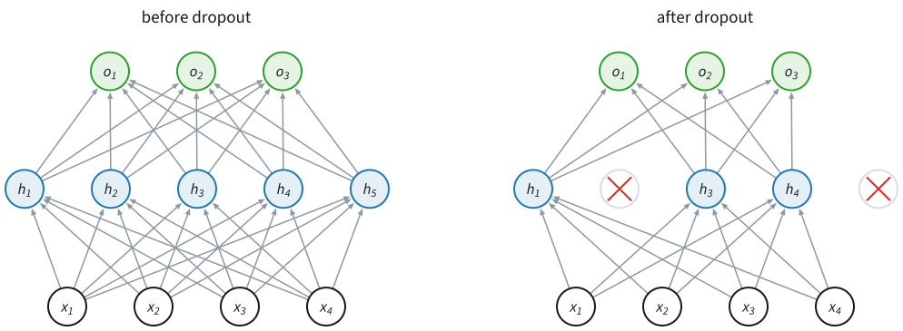

```{.python .input}
%load_ext d2lbook.tab
tab.interact_select('mxnet', 'pytorch', 'tensorflow', 'jax')
```

# Dropout
:label:`sec_dropout`

When an overparameterized network trains for many epochs on scarce or noisy data, it eventually memorizes training quirks and corrupted labels (:numref:`sec_generalization_deep`). Where weight decay (:numref:`sec_weight_decay`) penalizes large weights and early stopping (:numref:`subsec_early_stopping`) halts training before late-stage memorization, *dropout* :cite:`Hinton.Srivastava.Krizhevsky.ea.2012,Srivastava.Hinton.Krizhevsky.ea.2014` regularizes a network by injecting multiplicative noise directly into its hidden layers during training: on every forward pass, each hidden unit is independently zeroed out with probability $p$, forcing every unit to learn features that work reliably without counting on specific partner units (*co-adaptation*). At test time, dropout is disabled and the full network runs deterministically.

In this section, we formulate inverted dropout masking and rescaling, implement it from scratch and concisely in a two-hidden-layer MLP on Fashion-MNIST, and demonstrate on a heavily corrupted label-noise experiment how dropout slows memorization and preserves validation accuracy.

```{.python .input #dropout}
%%tab mxnet
import math
import numpy as np
from mxnet import autograd, gluon, init, np as mnp, npx
from mxnet.gluon import nn
from d2l import mxnet as d2l
npx.set_np()
```

```{.python .input #dropout}
%%tab pytorch
import math
import numpy as np
import torch
from torch import nn
from torch.nn import functional as F
from d2l import torch as d2l
```

```{.python .input #dropout}
%%tab tensorflow
import math
import numpy as np
import tensorflow as tf
from d2l import tensorflow as d2l
```

```{.python .input #dropout}
%%tab jax
import math
import numpy as np
import jax
from jax import numpy as jnp
from flax import nnx
import optax
from d2l import jax as d2l
```


## Noise in Hidden Layers

### Masking and Rescaling (Inverted Dropout)

Injecting random noise into inputs during training encourages smooth, perturbation-resilient functions :cite:`Bishop.1995`—in fact, for a linear model $\mathbf{w}^\top\mathbf{x} + b$ under squared error, adding zero-mean independent noise of variance $s^2$ to the inputs adds $s^2\|\mathbf{w}\|_2^2$ to the expected loss, which is literally $\ell_2$ weight decay! Dropout extends noise injection to hidden layers via random binary masking.

For a hidden activation $h_j$ and *dropout probability* $p \in [0, 1)$, on each training step we draw an independent Bernoulli mask $\xi_j \in \{0, 1\}$ with $P(\xi_j = 0) = p$ and $P(\xi_j = 1) = 1 - p$, and replace $h_j$ with

$$
h_j' = \frac{\xi_j h_j}{1 - p} =
\begin{cases}
0 & \textrm{with probability } p,\\
\dfrac{h_j}{1 - p} & \textrm{with probability } 1 - p.
\end{cases}
$$
:eqlabel:`eq_dropout`

Dividing the surviving activations by $1 - p$ during training (*inverted dropout*) keeps the expectation unbiased:

$$\mathbb{E}[h_j'] = p \cdot 0 + (1 - p)\,\frac{h_j}{1 - p} = h_j, \qquad \mathrm{Var}[h_j'] = \frac{p}{1 - p}\,h_j^2.$$

Because $\mathbb{E}[h_j'] = h_j$ is preserved during training, **at inference time we simply turn dropout off ($h_j' = h_j$) without any weight rescaling**. (Note that for a linear regression model with input dropout, the variance formula $\mathrm{Var}[x_j'] = \frac{p}{1-p}x_j^2$ adds an adaptive ridge penalty $\mathbb{E}[(\mathbf{w}^\top\mathbf{x}' + b - y)^2] = (\mathbf{w}^\top\mathbf{x} + b - y)^2 + \frac{p}{1-p}\sum_j x_j^2 w_j^2$ to the squared loss; in a deep nonlinear network, because $\mathbb{E}[\mathrm{ReLU}(z)] \neq \mathrm{ReLU}(\mathbb{E}[z])$, the deterministic test-time network is an effective approximation to the ensemble of $2^h$ thinned subnetworks—see Exercises :exref:`ex_dropout-monte-carlo-dropout` and :exref:`ex_dropout-geometric-mean`.)

## Implementation

### The Dropout Layer

Our from-scratch `dropout_layer(X, dropout)` draws a uniform tensor in $[0, 1)$, keeps entries $\geq$ `dropout`, and divides by `1.0 - dropout` (returning zeros when `dropout == 1`). Let us test it on a $2 \times 8$ array for $p \in \{0, 0.5, 1\}$ and verify on $10^6$ ones at $p = 0.2$ that the sample mean is $1.000$ and the sample variance is $p/(1 - p) = 0.250$:

```{.python .input #dropout-implementation-from-scratch-1}
%%tab mxnet
def dropout_layer(X, dropout):
    assert 0 <= dropout <= 1
    if dropout == 1: return mnp.zeros_like(X)
    mask = mnp.random.uniform(0, 1, X.shape, device=X.device) >= dropout
    return mask.astype(X.dtype) * X / (1.0 - dropout)
```

```{.python .input #dropout-implementation-from-scratch-1}
%%tab pytorch
def dropout_layer(X, dropout):
    assert 0 <= dropout <= 1
    if dropout == 1: return torch.zeros_like(X)
    mask = torch.rand_like(X) >= dropout
    return mask.to(X.dtype) * X / (1.0 - dropout)
```

```{.python .input #dropout-implementation-from-scratch-1}
%%tab tensorflow
def dropout_layer(X, dropout):
    assert 0 <= dropout <= 1
    if dropout == 1: return tf.zeros_like(X)
    mask = tf.random.uniform(tf.shape(X)) >= dropout
    return tf.cast(mask, X.dtype) * X / (1.0 - dropout)
```

```{.python .input #dropout-implementation-from-scratch-1}
%%tab jax
def dropout_layer(X, dropout, key):
    assert 0 <= dropout <= 1
    if dropout == 1: return jnp.zeros_like(X)
    mask = jax.random.uniform(key, X.shape) >= dropout
    return mask.astype(X.dtype) * X / (1.0 - dropout)
```

Let's test `dropout_layer` on a $2 \times 8$ tensor with dropout probabilities
$0$, $0.5$, and $1$. We also apply $p = 0.2$ to a vector of one million ones and
verify that its empirical mean and variance match the theoretical values $1$ and
$p/(1 - p) = 0.25$.

```{.python .input #dropout-implementation-from-scratch-2}
%%tab pytorch, tensorflow, mxnet
X = d2l.reshape(d2l.arange(16, dtype=d2l.float32), (2, 8))
for p in (0, 0.5, 1):
    print(f'p = {p}:', dropout_layer(X, p))
Y = dropout_layer(d2l.ones(10**6), 0.2)
print(f'mean {float(d2l.reduce_mean(Y)):.3f}, '
      f'variance {float(d2l.reduce_mean((Y - 1) ** 2)):.3f}')
```

```{.python .input #dropout-implementation-from-scratch-2}
%%tab jax
X = jnp.arange(16, dtype=jnp.float32).reshape(2, 8)
for p in (0, 0.5, 1):
    print(f'p = {p}:', dropout_layer(X, p, d2l.get_key()))
Y = dropout_layer(jnp.ones(10**6), 0.2, d2l.get_key())
print(f'mean {float(Y.mean()):.3f}, '
      f'variance {float(((Y - 1) ** 2).mean()):.3f}')
```


### Defining and Training the Model from Scratch

We apply dropout to the outputs of each hidden layer right after its ReLU activation (:numref:`fig_dropout2`)—active *only* during training (`autograd.is_training()` in MXNet, `self.training` in PyTorch/TensorFlow, and `not self.deterministic` in Flax/JAX). For our two-hidden-layer MLP ($784 \to 256 \to 256 \to 10$, He-initialized), we use `dropout_1 = 0.2` after the first hidden layer and `dropout_2 = 0.5` after the second, and train for 20 epochs on Fashion-MNIST:


:label:`fig_dropout2`

```{.python .input #dropout-defining-the-model}
%%tab mxnet
class DropoutMLPScratch(d2l.Classifier):
    def __init__(self, num_outputs, num_hiddens_1, num_hiddens_2,
                 dropout_1, dropout_2, lr, num_inputs=784):
        super().__init__()
        self.save_hyperparameters()
        he = lambda name, n_in, n_out: gluon.Parameter(  # Variance 2 / n_in
            name, shape=(n_in, n_out), init=init.Normal((2 / n_in) ** 0.5))
        zero = lambda name, n: gluon.Parameter(name, shape=(n,),
                                               init=init.Zero())
        self.W1 = he('W1', num_inputs, num_hiddens_1)
        self.W2 = he('W2', num_hiddens_1, num_hiddens_2)
        self.W3 = he('W3', num_hiddens_2, num_outputs)
        self.b1 = zero('b1', num_hiddens_1)
        self.b2 = zero('b2', num_hiddens_2)
        self.b3 = zero('b3', num_outputs)
        self.initialize()

    def forward(self, X):
        X = X.reshape(-1, self.num_inputs)
        H1 = npx.relu(mnp.dot(X, self.W1.data()) + self.b1.data())
        if autograd.is_training():
            H1 = dropout_layer(H1, self.dropout_1)
        H2 = npx.relu(mnp.dot(H1, self.W2.data()) + self.b2.data())
        if autograd.is_training():
            H2 = dropout_layer(H2, self.dropout_2)
        return mnp.dot(H2, self.W3.data()) + self.b3.data()
```

```{.python .input #dropout-defining-the-model}
%%tab pytorch
class DropoutMLPScratch(d2l.Classifier):
    def __init__(self, num_outputs, num_hiddens_1, num_hiddens_2,
                 dropout_1, dropout_2, lr, num_inputs=784):
        super().__init__()
        self.save_hyperparameters()
        he = lambda n_in, n_out: nn.Parameter(  # Variance 2 / n_in
            d2l.normal(0, (2 / n_in) ** 0.5, (n_in, n_out)))
        self.W1 = he(num_inputs, num_hiddens_1)
        self.W2 = he(num_hiddens_1, num_hiddens_2)
        self.W3 = he(num_hiddens_2, num_outputs)
        self.b1 = nn.Parameter(d2l.zeros(num_hiddens_1))
        self.b2 = nn.Parameter(d2l.zeros(num_hiddens_2))
        self.b3 = nn.Parameter(d2l.zeros(num_outputs))

    def forward(self, X):
        X = X.reshape(-1, self.num_inputs)
        H1 = torch.relu(X @ self.W1 + self.b1)
        if self.training:
            H1 = dropout_layer(H1, self.dropout_1)
        H2 = torch.relu(H1 @ self.W2 + self.b2)
        if self.training:
            H2 = dropout_layer(H2, self.dropout_2)
        return H2 @ self.W3 + self.b3
```

```{.python .input #dropout-defining-the-model}
%%tab tensorflow
class DropoutMLPScratch(d2l.Classifier):
    def __init__(self, num_outputs, num_hiddens_1, num_hiddens_2,
                 dropout_1, dropout_2, lr, num_inputs=784):
        super().__init__()
        self.save_hyperparameters()
        def he(name, n_in, n_out):  # Normal weights with variance 2 / n_in
            normal = tf.random_normal_initializer(stddev=(2 / n_in) ** 0.5)
            return self.add_weight(name=name, shape=(n_in, n_out),
                                   initializer=normal)
        zero = lambda name, n: self.add_weight(name=name, shape=(n,),
                                               initializer='zeros')
        self.W1 = he('W1', num_inputs, num_hiddens_1)
        self.W2 = he('W2', num_hiddens_1, num_hiddens_2)
        self.W3 = he('W3', num_hiddens_2, num_outputs)
        self.b1 = zero('b1', num_hiddens_1)
        self.b2 = zero('b2', num_hiddens_2)
        self.b3 = zero('b3', num_outputs)

    def forward(self, X):
        X = tf.reshape(X, (-1, self.num_inputs))
        H1 = tf.nn.relu(X @ self.W1 + self.b1)
        if self.training:
            H1 = dropout_layer(H1, self.dropout_1)
        H2 = tf.nn.relu(H1 @ self.W2 + self.b2)
        if self.training:
            H2 = dropout_layer(H2, self.dropout_2)
        return H2 @ self.W3 + self.b3
```

```{.python .input #dropout-defining-the-model}
%%tab jax
class DropoutMLPScratch(d2l.Classifier):
    def __init__(self, num_outputs, num_hiddens_1, num_hiddens_2,
                 dropout_1, dropout_2, lr, num_inputs=784, rngs=None):
        super().__init__()
        self.save_hyperparameters(ignore=['rngs'])
        self.rngs = nnx.Rngs(d2l.get_key()) if rngs is None else rngs
        he = lambda n_in, n_out: nnx.Param(  # Variance 2 / n_in
            self.rngs.params.normal((n_in, n_out)) * (2 / n_in) ** 0.5)
        self.W1 = he(num_inputs, num_hiddens_1)
        self.W2 = he(num_hiddens_1, num_hiddens_2)
        self.W3 = he(num_hiddens_2, num_outputs)
        self.b1 = nnx.Param(jnp.zeros(num_hiddens_1))
        self.b2 = nnx.Param(jnp.zeros(num_hiddens_2))
        self.b3 = nnx.Param(jnp.zeros(num_outputs))
        self.deterministic = False

    def set_view(self, *, deterministic):
        self.deterministic = deterministic

    def forward(self, X):
        X = X.reshape(-1, self.num_inputs)
        H1 = nnx.relu(X @ self.W1 + self.b1)
        if not self.deterministic:
            H1 = dropout_layer(H1, self.dropout_1, self.rngs.dropout())
        H2 = nnx.relu(H1 @ self.W2 + self.b2)
        if not self.deterministic:
            H2 = dropout_layer(H2, self.dropout_2, self.rngs.dropout())
        return H2 @ self.W3 + self.b3
```


```{.python .input #dropout-training}
hparams = {'num_outputs': 10, 'num_hiddens_1': 256, 'num_hiddens_2': 256,
           'dropout_1': 0.2, 'dropout_2': 0.5, 'lr': 0.1}
model = DropoutMLPScratch(**hparams)
data = d2l.FashionMNIST(batch_size=256)
trainer = d2l.Trainer(max_epochs=20, num_gpus=1)
trainer.fit(model, data)
```


Notice that during the opening epochs, training loss sits *above* validation loss because training loss is evaluated with noisy dropout masks active while validation loss runs the full deterministic network.

### Concise Implementation

Using framework `Dropout` layers inside `Sequential`, we can express the exact same two-hidden-layer architecture in a few lines:

```{.python .input #dropout-concise-implementation-1}
%%tab mxnet
class DropoutMLP(d2l.Classifier):
    def __init__(self, num_outputs, num_hiddens_1, num_hiddens_2,
                 dropout_1, dropout_2, lr):
        super().__init__()
        self.save_hyperparameters()
        self.net = nn.Sequential()
        self.net.add(nn.Dense(num_hiddens_1, activation='relu'),
                     nn.Dropout(dropout_1),
                     nn.Dense(num_hiddens_2, activation='relu'),
                     nn.Dropout(dropout_2),
                     nn.Dense(num_outputs))
        self.net.initialize(init.Xavier(rnd_type='gaussian', factor_type='in',
                                        magnitude=2))
```

```{.python .input #dropout-concise-implementation-1}
%%tab pytorch
class DropoutMLP(d2l.Classifier):
    def __init__(self, num_outputs, num_hiddens_1, num_hiddens_2,
                 dropout_1, dropout_2, lr):
        super().__init__()
        self.save_hyperparameters()
        self.net = nn.Sequential(
            nn.Flatten(), nn.LazyLinear(num_hiddens_1), nn.ReLU(),
            nn.Dropout(dropout_1), nn.LazyLinear(num_hiddens_2), nn.ReLU(),
            nn.Dropout(dropout_2), nn.LazyLinear(num_outputs))

    def weight_init(self, module):
        if isinstance(module, nn.Linear):
            nn.init.kaiming_normal_(module.weight, nonlinearity='relu')
            nn.init.zeros_(module.bias)
```

```{.python .input #dropout-concise-implementation-1}
%%tab tensorflow
class DropoutMLP(d2l.Classifier):
    def __init__(self, num_outputs, num_hiddens_1, num_hiddens_2,
                 dropout_1, dropout_2, lr):
        super().__init__()
        self.save_hyperparameters()
        # One initializer per layer: an instance repeats its random values
        he = lambda: tf.keras.initializers.VarianceScaling(
            2.0, 'fan_in', 'untruncated_normal')
        self.net = tf.keras.models.Sequential([
            tf.keras.layers.Flatten(),
            tf.keras.layers.Dense(num_hiddens_1, activation='relu',
                                  kernel_initializer=he()),
            tf.keras.layers.Dropout(dropout_1),
            tf.keras.layers.Dense(num_hiddens_2, activation='relu',
                                  kernel_initializer=he()),
            tf.keras.layers.Dropout(dropout_2),
            tf.keras.layers.Dense(num_outputs, kernel_initializer=he())])
```

```{.python .input #dropout-concise-implementation-1}
%%tab jax
class DropoutMLP(d2l.Classifier):
    def __init__(self, num_outputs, num_hiddens_1, num_hiddens_2,
                 dropout_1, dropout_2, lr, num_inputs=784, rngs=None):
        super().__init__()
        self.save_hyperparameters(ignore=['rngs'])
        rngs = nnx.Rngs(d2l.get_key()) if rngs is None else rngs
        he = nnx.initializers.variance_scaling(2.0, 'fan_in', 'normal')
        self.net = nnx.Sequential(
            nnx.Linear(num_inputs, num_hiddens_1, kernel_init=he, rngs=rngs),
            nnx.relu, nnx.Dropout(dropout_1, rngs=rngs),
            nnx.Linear(num_hiddens_1, num_hiddens_2, kernel_init=he,
                       rngs=rngs),
            nnx.relu, nnx.Dropout(dropout_2, rngs=rngs),
            nnx.Linear(num_hiddens_2, num_outputs, kernel_init=he, rngs=rngs))

    def forward(self, X):
        return self.net(X.reshape((X.shape[0], -1)))  # Flatten each image
```


## Effects of Dropout under Label Noise

On the full $60{,}000$-image Fashion-MNIST dataset over 20 epochs, an unregularized MLP barely overfits, leaving little room for dropout to shine. To watch dropout combat severe memorization, we return to the $1{,}000$-image noisy-label benchmark from :numref:`subsec_early_stopping`, corrupting $40\%$ of the training labels at random ($\sim 36\%$ genuinely wrong labels) and comparing `DropoutMLP` over 200 epochs with $p = 0$ (no dropout) versus $p = 0.5$ in both hidden layers:

```{.python .input #dropout-noisy-labels-1}
images = d2l.FashionMNIST(batch_size=2000)
X, y = (d2l.numpy(a) for a in next(iter(images.train_dataloader())))
X_val, y_val = (d2l.numpy(a) for a in next(iter(images.val_dataloader())))
X, y, X_val = X[:1000].reshape(1000, -1), y[:1000], X_val.reshape(2000, -1)
labels = d2l.corrupt(y, 0.4, np.random.default_rng())
wrong = labels != y  # The training labels that are now wrong
```

```{.python .input #dropout-noisy-labels-2}
acc = {}
for p in (0, 0.5):
    trainer = d2l.Tracker(max_epochs=200, datasets={
        'wrong labels': d2l.ArrayData(X[wrong], labels[wrong], 1000),
        'validation': d2l.ArrayData(X_val, y_val, 1000)})
    trainer.fit(DropoutMLP(**{**hparams, 'dropout_1': p, 'dropout_2': p}),
                d2l.ArrayData(X, labels))
    acc[p] = trainer.accuracy
    print(f'dropout {p}: wrong labels reproduced '
          f'{acc[p]["wrong labels"][-1]:.2f}, validation accuracy over the '
          f'last 10 epochs {np.mean(acc[p]["validation"][-10:]):.3f}')
d2l.plot(list(range(1, 201)), [acc[0]['wrong labels'], acc[0.5]['wrong labels'],
                               acc[0]['validation'], acc[0.5]['validation']],
         'epoch', 'accuracy', fmts=('C0--', 'C1--', 'C0-', 'C1-'),
         legend=['wrong labels, p = 0', 'wrong labels, p = 0.5',
                 'validation, p = 0', 'validation, p = 0.5'],
         legend_loc='outside', figsize=(4.5, 3))
```


Look at the two trajectories:

- **Without dropout ($p = 0$):** By epoch 100, the MLP memorizes $100\%$ of the corrupted training labels, and validation accuracy degrades by $\sim 10$ percentage points from its early peak.
- **With dropout ($p = 0.5$):** Memorization of wrong labels is strongly damped, leaving validation accuracy over the final 10 epochs **3 to 5 percentage points higher** than the unregularized network!

In practice, dropout is most valuable precisely when parameter count dwarfs dataset size and training runs for many epochs (as in early-2010s vision classifiers like AlexNet in :numref:`sec_alexnet`); in single-pass foundation-model pretraining or directly before batch normalization layers (:numref:`sec_batch_norm`, where dropout's $1/(1-p)$ training variance inflation creates a train--test variance shift :cite:`Li.Chen.Hu.ea.2019`), dropout is typically reduced or omitted.

## Summary

- **Inverted dropout:** Zeroing each hidden activation independently with probability $p$ and rescaling survivors by $1/(1 - p)$ during training preserves $\mathbb{E}[h_j'] = h_j$ while injecting variance $\frac{p}{1-p}h_j^2$, allowing the full unscaled network to run deterministically at test time.
- **Resistance to noise memorization:** On small datasets with corrupted labels, dropout substantially slows the memorization of wrong labels and preserves higher held-out accuracy, complementing early stopping and weight decay.

## Exercises

1. [code] **Dropout probabilities.** The model of this section drops units
   with probability 0.2 after the first hidden layer and 0.5 after the
   second.
    1. Train it with the two probabilities swapped, with both set to 0.5,
       and with both set to 0.8. For each run, report the best validation
       accuracy. Which layer tolerates the higher probability?
    1. The `Trainer` computes the training loss that it plots with the masks
       switched on. After training, evaluate the loss on the training images
       with the masks switched off, and compare the gap between training and
       validation loss for the networks trained with and without dropout.
1. **Dropout and He initialization.** The He initialization of
   :numref:`subsec_he_init` chooses the variance of the weights so that the
   mean square of the pre-activations stays the same from layer to layer.
    1. During training, by what factor does dropout with probability $p$
       change the mean square of the pre-activations of the next layer?
       Give the factor for each of the two dropout layers of this section's
       model.
    1. In a network with $K - 1$ hidden layers, each followed by dropout
       with probability $p$, how does the factor grow with $K$? Should the
       initialization correct for it, given that the network runs without
       dropout at test time? Relate your answer to the mismatch between
       training and test that dropout causes before a batch normalization
       layer.

1. [code] **Monte Carlo dropout.** Instead of switching dropout off at test
   time, keep it on in the trained `DropoutMLPScratch` and run $T = 20$
   forward passes per validation image, then average the softmax outputs
   :cite:`Gal.Ghahramani.2016`. Compare the accuracy and the calibration
   (the mean of the largest softmax probability against the accuracy) with
   those of the single pass of the full network. How does the accuracy
   change as $T$ grows from 1 to 20?
   :exlabel:`ex_dropout-monte-carlo-dropout`
1. [code] **Dropout and weight decay.** Weight decay and dropout both
   regularize the model of this section, by different mechanisms. Measure
   each run by its best validation accuracy and by the gap between training
   and validation loss, with both losses evaluated with the masks switched
   off.
    1. With both dropout probabilities set to zero, add weight decay as in
       :numref:`sec_weight_decay` at strengths
       $\lambda \in \{10^{-4}, 10^{-3}, 10^{-2}\}$. Compare these runs
       with the runs with and without dropout of this section.
    1. Keep the dropout probabilities at 0.2 and 0.5, and add weight decay
       at the same strengths. Are the effects of the two regularizers
       additive, do they show diminishing returns, or do they cancel each
       other out?
1. **Dropout at test time.** ● Set `dropout_1` to zero, so that only the
   second hidden layer is masked, and let $\boldsymbol{\xi}$ range over its
   masks. Let $\mathbf{o}(\boldsymbol{\xi})$ and $\hat{\mathbf{y}}(\boldsymbol{\xi})$
   be the logits and the softmax output under mask $\boldsymbol{\xi}$, which
   occurs with probability $P(\boldsymbol{\xi})$. Show that the logits of the
   full network equal $\sum_{\boldsymbol{\xi}} P(\boldsymbol{\xi})\, \mathbf{o}(\boldsymbol{\xi})$.
   Show further that its softmax output equals the normalized weighted
   geometric mean

    $$\tilde{y}_j = \frac{\prod_{\boldsymbol{\xi}} \hat{y}_j(\boldsymbol{\xi})^{P(\boldsymbol{\xi})}}{\sum_k \prod_{\boldsymbol{\xi}} \hat{y}_k(\boldsymbol{\xi})^{P(\boldsymbol{\xi})}}.$$

    Explain why neither equality holds in general once `dropout_1` is
    nonzero.
   :exlabel:`ex_dropout-geometric-mean`

:begin_tab:`mxnet`
[Discussions](https://d2l.discourse.group/t/100)
:end_tab:

:begin_tab:`pytorch`
[Discussions](https://d2l.discourse.group/t/101)
:end_tab:

:begin_tab:`tensorflow`
[Discussions](https://d2l.discourse.group/t/261)
:end_tab:

:begin_tab:`jax`
[Discussions](https://d2l.discourse.group/t/17987)
:end_tab:

<!-- slides -->

::: {.slide}
::: {.cover}
[Dive into Deep Learning · §4.6]{.kicker}

Dropout<br>**random masks · inverted dropout · noisy labels**
:::
:::

::: {.slide title="An MLP Trained Long Enough Memorizes Its Wrong Labels"}
[The problem]{.kicker}

- The MLP of this chapter fits 1,000 Fashion-MNIST images even with
  **random** labels, and it loses accuracy on new images as it memorizes
  wrong ones.
- **Weight decay** limits the size of the weights; **early stopping**
  limits the length of training.
- **Dropout** disturbs the network while it learns: at every step, each
  hidden unit is set to zero with probability $p$.

::: {.d2l-note}
The motivation (Hinton et al., 2012): a unit may be useful only together
with particular partners. Such *co-adapted* combinations fit the training
set and need not carry over to new images. With random units missing at
every step, no unit can count on a partner.
:::
:::

::: {.slide title="By the End of This Deck You Can"}
[Goals]{.kicker}

- compute the mean and the variance of a dropped unit;
- explain why the network at test time is **not** the average of the
  thinned networks, with a two-unit counterexample;
- implement a dropout layer and an MLP that uses it;
- measure what dropout changes when there are wrong labels to memorize,
  and what it does not;
- show that, for a linear model, dropout is a form of weight decay.

**Running example:** Fashion-MNIST. Softmax regression: 7,850 parameters,
about 84% after 30 epochs. Here: an MLP with two hidden layers of 256 units,
269,322 parameters, trained for 20 epochs at learning rate 0.1.
:::

::: {.slide title="Dropout Is the Third Regularizer of the Book"}
[Where this fits]{.kicker}

::: {.cols .vc}
::: {.col}
| section | adds |
|---|---|
| Multilayer Perceptrons | hidden layers, universal approximation, activation functions |
| Implementation | an MLP trained on Fashion-MNIST |
| Backpropagation | how the gradients are computed, and at what memory cost |
| Numerical Stability and Initialization | vanishing gradients, Xavier and He initialization |
| Generalization in Deep Learning | memorization, double descent, implicit bias, early stopping |
| **Dropout** | **random masks, slower memorization of noisy labels** |
| Predicting House Prices on Kaggle | the workflow on real data |
:::

::: {.col .narrow}
- **Uses:** weight decay, He initialization, the `Trainer`, Fashion-MNIST.
- **Skips:** variants such as DropConnect and stochastic depth, and the
  Bayesian reading of dropout beyond one exercise.
:::
:::
:::

::: {.slide}
::: {.divider}
[01]{.dnum}

[Noise in Hidden Layers]{.dtitle}

[masks, rescaling, and the network at test time]{.dsub}
:::
:::

::: {.slide title="For a Linear Model, Input Noise Is Weight Decay"}
[Noise · motivation]{.kicker}

Perturb the input, $\mathbf{x} + \boldsymbol{\epsilon}$, with independent
entries of mean 0 and variance $s^2$:

$$\mathbb{E}\left[\left(\mathbf{w}^\top(\mathbf{x} + \boldsymbol{\epsilon}) + b - y\right)^2\right] = \left(\mathbf{w}^\top\mathbf{x} + b - y\right)^2 + s^2\|\mathbf{w}\|^2.$$

- The cross term vanishes: $\mathbb{E}[\boldsymbol{\epsilon}] = \mathbf{0}$.
- Training on noisy inputs = squared loss + weight decay $s^2\|\mathbf{w}\|^2$.

::: {.d2l-note}
Dropout moves the noise to the hidden units, and makes it large: it removes
units instead of nudging them.
:::
:::

::: {.slide title="Dropout Zeros a Unit with Probability p and Rescales the Rest"}
[Noise · the operation]{.kicker}

With a mask $\xi_j$ that is 0 with probability $p$ and 1 otherwise:

$$h_j' = \frac{\xi_j h_j}{1 - p} = \begin{cases} 0 & \textrm{with probability } p,\\ h_j/(1 - p) & \textrm{with probability } 1 - p.\end{cases}$$

- A fresh mask for every unit, every example, every step.
- $\mathbb{E}[h_j'] = p \cdot 0 + (1 - p)\frac{h_j}{1-p} = h_j$: the expected value
  is kept, and $1/(1 - p)$ is the only factor that keeps it.

::: {.d2l-note}
**Inverted dropout** rescales during training, so the test network is the
plain network. The original version (Hinton et al., 2012) scaled the
weights by $1 - p$ at test time instead.
:::
:::

::: {.slide title="The Noise Is as Large as the Activation"}
[Noise · the variance]{.kicker}

$$\mathbb{E}[h_j'^2] = \frac{h_j^2}{1 - p}, \qquad \textrm{Var}[h_j'] = \frac{p}{1 - p}\, h_j^2.$$

| $p$ | kept unit scaled by | variance for $h_j = 1$ |
|---|---:|---:|
| 0.2 | 1.25 | 0.25 |
| 0.5 | 2 | 1 |

::: {.d2l-note}
At $p = 0.5$ the standard deviation of $h_j'$ equals $|h_j|$: this is not
a small perturbation.
:::
:::

::: {.slide title="The Test Network Is Not the Average of the Thinned Networks"}
[Noise · test time]{.kicker}

Two units, $h_1 = h_2 = 1$, $p = 0.5$, pre-activation $z = h_1' - h_2'$:

| $(h_1', h_2')$ | (0,0) | (2,0) | (0,2) | (2,2) |
|---|---:|---:|---:|---:|
| $z$ | 0 | 2 | −2 | 0 |
| $\textrm{ReLU}(z)$ | 0 | 2 | 0 | 0 |

- Linear layer: $\mathbb{E}[z] = 0$, the full network's value.
- After the ReLU: $\mathbb{E}[\textrm{ReLU}(z)] = 0.5$, but the full network gives
  $\textrm{ReLU}(0) = 0$.

::: {.d2l-note}
The expected value is kept unit by unit, not through nonlinear layers.
:::
:::

::: {.slide title="Check: How Large Is the Noise at p = 0.8?"}
[Check]{.kicker}

A unit has activation $h_j = 1$ and dropout probability $p = 0.8$. What is
a kept unit scaled to, and what is the variance of $h_j'$?

::: {.fragment .fade-up}
::: {.d2l-note}
**Answer.** A kept unit becomes $1/(1 - 0.8) = 5$, kept one time in five.
The variance is $0.8/0.2 = 4$: a standard deviation twice the
activation.
:::
:::
:::

::: {.slide}
::: {.divider}
[02]{.dnum}

[Implementation]{.dtitle}

[a dropout layer and an MLP that uses it]{.dsub}
:::
:::

::: {.slide title="A Dropout Layer in Three Lines"}
[Implementation · the layer]{.kicker}

Draw a uniform number per entry, keep the entry if it is at least $p$,
scale the survivors by $1/(1 - p)$:

@dropout-implementation-from-scratch-1
:::

::: {.slide title="A Million Ones at p = 0.2: Mean 1, Variance 0.25"}
[Implementation · check]{.kicker}

@!dropout-implementation-from-scratch-2

- $p = 0.5$: each entry is 0 with probability $1/2$, otherwise doubled.
- The sample mean and variance match $1$ and $p/(1 - p) = 0.25$.
:::

::: {.slide title="Dropout Goes after Each Hidden Activation, Only in Training"}
[Implementation · the model]{.kicker}

::: {.cols .vc}
::: {.col}
`Linear → ReLU → dropout(0.2) → Linear → ReLU → dropout(0.5) → Linear`

- Dropped units get no gradient on that example.
- Fewer units dropped near the input, more deeper.
- He initialization (variance $2/n_\textrm{in}$), zero biases, in every
  framework.
:::

::: {.col .fig .big}

:::
:::
:::

::: {.slide title="Training: 20 Epochs on Fashion-MNIST"}
[Implementation · training]{.kicker}

Two hidden layers of 256 units, $p = 0.2$ and $0.5$, SGD at learning rate
0.1, minibatches of 256:

@!dropout-training

::: {.d2l-note}
The training loss is computed with masks, on thinned networks; the
validation loss on the full network.
:::
:::

::: {.slide title="Concise: One Dropout Layer after Each Activation"}
[Implementation · concise]{.kicker}

A framework `Dropout(p)` layer masks and rescales in training mode and passes
its input through at test time; the `Trainer` switches the mode.

@dropout-concise-implementation-1
:::

::: {.slide}
::: {.divider}
[03]{.dnum}

[Effects of Dropout]{.dtitle}

[too little to regularize · noisy labels]{.dsub}
:::
:::

::: {.slide title="On All 60,000 Images There Is Too Little to Regularize"}
[Effects · the full data]{.kicker}

- A regularizer can only remove overfitting that is there.
- After 20 epochs on all of Fashion-MNIST, the training loss, even with the
  masks switched on, ends only a little below the validation loss.
- To see what dropout does, we need a network that overfits.

::: {.d2l-note}
The last deck supplied one: 1,000 images with redrawn labels, 200 epochs.
The MLP memorized the wrong labels and lost validation accuracy doing so.
:::
:::

::: {.slide title="With Noisy Labels, Dropout Slows Memorization"}
[Effects · noisy labels]{.kicker}

1,000 images, 40% of the labels redrawn (about 36% wrong), 200 epochs,
minibatches of 64; dropout 0.5 in both hidden layers against none:

@!dropout-noisy-labels-2
:::

::: {.slide title="Dropout Slows the Memorization and Does Not Stop It"}
[Effects · reading]{.kicker}

| | no dropout | dropout 0.5 |
|---|---|---|
| wrong labels reproduced | all, by about epoch 100 | three quarters to four fifths after 200 epochs, still rising |
| validation accuracy, last ten epochs | about ten points below its early best | three to five points higher |

::: {.d2l-note}
Dropout changes which fit training finds when there is noise to fit. Both
networks end below their early best: early stopping is still worth having.
:::
:::

::: {.slide title="Check: How Often Can a Unit Count on a Given Partner?"}
[Check]{.kicker}

The second hidden layer has 256 units and $p = 0.5$. How many of them does
an example keep on average, and in what fraction of the steps are two given
units of that layer both present?

::: {.fragment .fade-up}
::: {.d2l-note}
**Answer.** $256 \times 0.5 = 128$ units. Two given units are both kept with
probability $0.5^2 = 0.25$: a unit can count on a partner in one step of
four. In the first layer ($p = 0.2$): about 205 units, a given pair in 64%
of the steps.
:::
:::
:::

::: {.slide}
::: {.divider}
[04]{.dnum}

[Interpretations]{.dtitle}

[noise, co-adaptation, an implicit ensemble]{.dsub}
:::
:::

::: {.slide title="For Linear Regression, Dropout Is Weight Decay Scaled by x²"}
[Interpretations · noise]{.kicker}

Drop the inputs $x_j' = \xi_j x_j/(1 - p)$: mean $x_j$, variance
$\frac{p}{1-p}x_j^2$, independent.

$$\mathbb{E}\left[\left(\mathbf{w}^\top\mathbf{x}' + b - y\right)^2\right] = \left(\mathbf{w}^\top\mathbf{x} + b - y\right)^2 + \frac{p}{1 - p}\sum_j x_j^2 w_j^2.$$

- Expected loss = loss of the mean + variance of the prediction.
- Each weight is penalized by the square of its input; no penalty where
  $x_j = 0$.

::: {.d2l-note}
For deep networks the penalty depends on activations that change during
training: no closed form.
:::
:::

::: {.slide title="Three Explanations, None Complete"}
[Interpretations · overview]{.kicker}

| view | what it says | limit |
|---|---|---|
| noise injection | tolerate noise → smoother function | exact only for linear models |
| co-adaptation | units must work alone | plausible; not tested by our experiment |
| implicit ensemble | $2^{512}$ thinned networks, shared weights | test network ≠ their average |

::: {.d2l-note}
Only the expected value of each unit is exact. With 512 hidden units there
are $2^{512} \approx 10^{154}$ masks.
:::
:::

::: {.slide title="Dropout Today: Sparingly, at About 0.1, or Not at All"}
[Interpretations · practice]{.kicker}

- **Where it matters:** many more parameters than examples, and many passes
  over each example.
- **Early-2010s image classifiers** (AlexNet): dropout kept large fully
  connected layers from overfitting.
- **Later architectures:** small probabilities, around 0.1.
- **Models that see each example once** (large language models): often 0.
- **Caution:** dropout before a normalization layer changes the mean square
  by $1/(1-p)$ between training and test.
:::

::: {.slide title="Recap"}
[Wrap-up]{.kicker}

::: {.cols}
::: {.col}
- **Operation:** zero with probability $p$, scale by $1/(1-p)$;
  $\mathbb{E}[h_j'] = h_j$, $\textrm{Var}[h_j'] = \frac{p}{1-p}h_j^2$.
- **Test time:** full network, no masks; not the average of the thinned
  networks once a nonlinearity intervenes.
:::

::: {.col}
- **Fashion-MNIST, 2 × 256, 20 epochs:** about 87%; too little overfitting
  for dropout to matter.
- **1,000 images, 40% of labels redrawn:** no dropout memorizes every wrong
  label; dropout 0.5 memorizes more slowly and ends three to five points
  higher.
- **Linear model:** dropout = weight decay scaled by $x_j^2$.
- **Why it works:** noise, co-adaptation, ensemble; each a partial account.
:::
:::

**Next:** house prices on Kaggle, a table of mixed numbers and categories,
where preprocessing and validation decide the result.
:::
