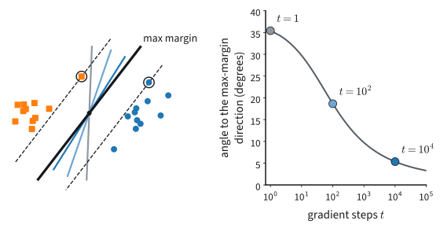

```{.python .input}
%load_ext d2lbook.tab
tab.interact_select('mxnet', 'pytorch', 'tensorflow', 'jax')
```

# Generalization in Deep Learning
:label:`sec_generalization_deep`

In :numref:`sec_generalization_basics`, a degree-19 polynomial with $20$ parameters interpolated $20$ noisy data points and blew up on test data. By that classical intuition, our Fashion-MNIST MLP in :numref:`sec_mlp-implementation`—with $203{,}530$ parameters for $60{,}000$ training images ($3.4$ parameters per image)—ought to overfit severely, especially if trained until it interpolates every single training image. Yet even when driven to $100\%$ training accuracy, it still generalizes to $\sim 87\%$ on unseen images!

Understanding why heavily overparameterized networks generalize is one of the central open problems of modern machine learning. In this section, we combine controlled experiments with exact results on tractable models to uncover four key pieces of the puzzle:

1. **Random-label memorization:** Standard MLPs easily reach $100\%$ training accuracy on completely random labels :cite:`zhang2021understanding`, proving that classical distribution-free capacity bounds (like VC dimension) cannot explain their generalization on real labels.
2. **Double descent:** Sweeping model width past the interpolation threshold $h = n$ reveals a spike in test error at $h = n$ (where the feature matrix is nearly singular) followed by a *second descent* as extra parameters allow smaller-norm interpolators :cite:`Belkin.Hsu.Ma.ea.2019`.
3. **Implicit bias of gradient descent:** Among infinitely many zero-loss solutions, gradient descent automatically selects the minimum-norm interpolator under squared loss and the maximum-margin separator under logistic loss :cite:`Soudry.Hoffer.Nacson.ea.2018`.
4. **Clean-first learning and early stopping:** On noisy datasets, gradient descent fits clean structured patterns long before memorizing corrupted labels :cite:`Arpit.Jastrzebski.Ballas.ea.2017`, making *early stopping* a potent regularizer.

```{.python .input #generalization-deep-fitting-random-labels-1}
%%tab mxnet
import math
import numpy as np
from mxnet import autograd, gluon, init, np as mnp, npx
from mxnet.gluon import nn
from d2l import mxnet as d2l
npx.set_np()
```

```{.python .input #generalization-deep-fitting-random-labels-1}
%%tab pytorch
import math
import numpy as np
import torch
from torch import nn
from torch.nn import functional as F
from d2l import torch as d2l
```

```{.python .input #generalization-deep-fitting-random-labels-1}
%%tab tensorflow
import math
import numpy as np
import tensorflow as tf
from d2l import tensorflow as d2l
```

```{.python .input #generalization-deep-fitting-random-labels-1}
%%tab jax
import math
import numpy as np
import jax
from jax import numpy as jnp
from flax import nnx
import optax
from d2l import jax as d2l
```

## Memorization and Capacity

### Random Labels
:label:`subsec_random_labels`

To test raw memorization capacity following :citet:`zhang2021understanding`, we draw $2{,}000$ Fashion-MNIST training images ($1{,}000$ for training, $1{,}000$ for validation) and $2{,}000$ test images, define `ArrayData` and `Tracker` helpers along with a He-initialized 256-unit `MLP`, and train for 200 epochs once on the true labels (`fraction=0`) and once on completely random labels (`fraction=1`):

```{.python .input #generalization-deep-fitting-random-labels-2}
data = d2l.FashionMNIST(batch_size=2000)
X, y = next(iter(data.train_dataloader()))          # 2,000 random images
X_test, y_test = next(iter(data.val_dataloader()))  # the first 2,000
X, y, X_test, y_test = (d2l.numpy(a) for a in (X, y, X_test, y_test))
X, X_test = X.reshape(2000, -1), X_test.reshape(2000, -1)
X_train, y_train, X_val, y_val = X[:1000], y[:1000], X[1000:], y[1000:]
```

Two lightweight helpers streamline the experiments ahead: `ArrayData` wraps
NumPy arrays into shuffled minibatches, and `Tracker` subclasses `Trainer`
to log epoch-by-epoch accuracy across an arbitrary dictionary of named
datasets.

```{.python .input #generalization-deep-fitting-random-labels-3}
class ArrayData(d2l.DataModule):  #@save
    """Minibatches of the arrays X and y; training batches are shuffled."""
    def __init__(self, X, y, batch_size=64):
        super().__init__()
        self.save_hyperparameters()

    def get_dataloader(self, train):
        return self.get_tensorloader(
            (d2l.tensor(self.X), d2l.tensor(self.y)), train)

class Tracker(d2l.Trainer):  #@save
    """A Trainer that records the accuracy on named datasets every epoch."""
    def __init__(self, max_epochs, datasets):
        super().__init__(max_epochs, num_gpus=1)
        self.datasets = datasets
        self.accuracy = {name: [] for name in datasets}
        self.board.display = False  # We plot the accuracies ourselves

    def validate(self):
        for name, dataset in self.datasets.items():
            self.val_dataloader = dataset.val_dataloader()
            self.accuracy[name].append(super().validate()['acc'])
        return {}
```

Our model is the same 256-unit ReLU MLP from
:numref:`sec_mlp-implementation`, upgraded with He initialization
(:numref:`subsec_he_init`) in place of `std=0.01` so training takes off
immediately from epoch 1 (with zero biases and pre-flattened inputs).

```{.python .input #generalization-deep-fitting-random-labels-4}
%%tab mxnet
class MLP(d2l.Classifier):
    def __init__(self, num_hiddens, lr):
        super().__init__()
        self.save_hyperparameters()
        self.net = nn.Sequential()
        self.net.add(nn.Dense(num_hiddens, activation='relu'), nn.Dense(10))
        # Normal weights with variance 2 / fan_in; biases stay zero
        self.net.initialize(init.Xavier(rnd_type='gaussian', factor_type='in',
                                        magnitude=2))
```

```{.python .input #generalization-deep-fitting-random-labels-4}
%%tab pytorch
class MLP(d2l.Classifier):
    def __init__(self, num_hiddens, lr):
        super().__init__()
        self.save_hyperparameters()
        self.net = nn.Sequential(nn.LazyLinear(num_hiddens), nn.ReLU(),
                                 nn.LazyLinear(10))

    def weight_init(self, module):
        if isinstance(module, nn.Linear):
            nn.init.kaiming_normal_(module.weight, nonlinearity='relu')
            nn.init.zeros_(module.bias)
```

```{.python .input #generalization-deep-fitting-random-labels-4}
%%tab tensorflow
class MLP(d2l.Classifier):
    def __init__(self, num_hiddens, lr):
        super().__init__()
        self.save_hyperparameters()
        # One initializer per layer: an unseeded Keras initializer returns
        # the same values on every call
        he = lambda: tf.keras.initializers.VarianceScaling(
            2.0, 'fan_in', 'untruncated_normal')
        self.net = tf.keras.models.Sequential([
            tf.keras.layers.Dense(num_hiddens, activation='relu',
                                  kernel_initializer=he()),
            tf.keras.layers.Dense(10, kernel_initializer=he())])
```

```{.python .input #generalization-deep-fitting-random-labels-4}
%%tab jax
class MLP(d2l.Classifier):
    def __init__(self, num_hiddens, lr, num_inputs=784, rngs=None):
        super().__init__()
        self.save_hyperparameters(ignore=['rngs'])
        rngs = nnx.Rngs(d2l.get_key()) if rngs is None else rngs
        he = nnx.initializers.variance_scaling(2.0, 'fan_in', 'normal')
        self.net = nnx.Sequential(
            nnx.Linear(num_inputs, num_hiddens, kernel_init=he, rngs=rngs),
            nnx.relu,
            nnx.Linear(num_hiddens, 10, kernel_init=he, rngs=rngs))
```

Now we define `corrupt(y, fraction, rng)` to replace each training label with a uniform random class in $\{0, \ldots, 9\}$ with probability `fraction`, train `MLP(num_hiddens=256, lr=0.1)` for $200$ epochs at `fraction = 0` (true labels) and `fraction = 1` (pure random labels), and plot both training and test accuracy trajectories:

```{.python .input #generalization-deep-fitting-random-labels-5}
def corrupt(y, fraction, rng):  #@save
    """Replace each label, with probability fraction, by a random class."""
    redraw = rng.random(len(y)) < fraction
    y = y.copy()
    y[redraw] = rng.integers(0, 10, redraw.sum())
    return y

rng = np.random.default_rng()
curves = []
for fraction in (0, 1):
    labels = corrupt(y_train, fraction, rng)
    trainer = Tracker(max_epochs=200, datasets={
        'train': ArrayData(X_train, labels, 1000),
        'test': ArrayData(X_test, y_test, 1000)})
    trainer.fit(MLP(num_hiddens=256, lr=0.1), ArrayData(X_train, labels))
    curves += [trainer.accuracy['train'], trainer.accuracy['test']]
d2l.plot(list(range(1, 201)), curves, 'epoch', 'accuracy',
         fmts=('C0-', 'C1-', 'C0--', 'C1--'), figsize=(5, 3))
d2l.plt.legend(['train, true labels', 'test, true labels',
                'train, random labels', 'test, random labels'],
               loc='center right', bbox_to_anchor=(1, 0.4));
```


Look at what the two runs prove:

- On **true labels**, training accuracy hits $100\%$ within 60–90 epochs while test accuracy plateaus above $80\%$ (even on just $1{,}000$ training images).
- On **completely random labels**, the exact same architecture and optimizer still reach $100\%$ training accuracy (taking slightly longer, $\sim 120$–$150$ epochs) while test accuracy remains at $10\%$ random chance.

### Why Distribution-Free Capacity Bounds Fail, and Inductive Bias

Because our MLP achieves zero training error ($\epsilon_{\mathcal{S}}(f) = 0$) on random labels where the true population error is $\epsilon(f) = 0.90$, *any* distribution-free bound of the form $\epsilon(f) \leq \epsilon_{\mathcal{S}}(f) + B(\mathcal{F}, n, \delta)$ that depends only on the hypothesis class $\mathcal{F}$ must have $B(\mathcal{F}, n, \delta) \geq 0.90$—making it completely vacuous on real labels as well (Exercise :exref:`ex_generalization-deep-complexity`).

By the *no free lunch theorem* :cite:`Wolpert.1996`, no learner can generalize across all distributions; generalization depends on whether the learner's *inductive bias*—which interpolating function it prefers among infinitely many—matches the structure of real data (just as a 1-nearest-neighbor classifier interpolates $100\%$ of its training data yet generalizes well whenever nearby inputs share labels :cite:`Cover.Hart.1967`).

## Double Descent
:label:`subsec_double_descent`

### The Interpolation Threshold and Conditioning

What happens when we increase model width $h$ right past the sample size $n$? Let us test a tractable *random-features* model :cite:`Rahimi.Recht.2007`: we freeze a He-initialized first layer $\mathbf{W}^{(1)} \in \mathbb{R}^{784 \times 10000}$ on our $n = 1{,}000$ centered training images to precompute $10{,}000$ random ReLU features `H` and `H_test`, encode the labels as a one-hot matrix `Y`, and define `error(H, W2, y)`:

```{.python .input #generalization-deep-beyond-the-interpolation-threshold-1}
W1 = rng.normal(0, np.sqrt(2 / 784), (784, 10000))  # He-initialized, frozen
mean = X_train.mean(axis=0)                         # The mean training image
H = np.maximum((X_train - mean) @ W1, 0)
H_test = np.maximum((X_test - mean) @ W1, 0)
Y = np.eye(10)[y_train]                             # One-hot labels

def error(H, W2, y):
    """Fraction of examples whose largest output is not their label."""
    return (np.argmax(H @ W2, axis=1) != y).mean()
```

We now sweep the hidden width `h` across 15 values from $50$ to $10{,}000$, fitting the output weights $\mathbf{W}^{(2)} \in \mathbb{R}^{h \times 10}$ on the first `h` feature columns `H[:, :h]` by minimum-norm least squares (`np.linalg.lstsq`) while recording the smallest singular value `s_min[h]` and Frobenius norm `norm[h]`:

```{.python .input #generalization-deep-beyond-the-interpolation-threshold-2}
widths = [50, 100, 200, 400, 600, 800, 900, 1000, 1100, 1200, 1500, 2000,
          3000, 5000, 10000]
train_err, test_err, s_min, norm = [], [], {}, {}
for h in widths:
    W2, _, _, s = np.linalg.lstsq(H[:, :h], Y, rcond=None)
    train_err.append(error(H[:, :h], W2, y_train))
    test_err.append(error(H_test[:, :h], W2, y_test))
    s_min[h], norm[h] = s.min(), np.linalg.norm(W2)
d2l.plot([widths, widths, [1000, 1000]], [train_err, test_err, [0, 1]],
         'hidden units h', 'error', legend=['train', 'test', 'h = n'],
         xscale='log', fmts=('C0-', 'C1-', 'k:'), figsize=(5, 3))
```


This is the celebrated *double-descent* curve :cite:`Belkin.Hsu.Ma.ea.2019`:

1. **Classical U-curve ($h < n$):** Test error drops from $\sim 30\%$ at $h = 50$ to $\sim 23\%$ around $h = 200$, then shoots up to $\sim 90\%$ right at the *interpolation threshold* $h = n = 1{,}000$.
2. **Second descent ($h > n$):** As $h$ grows past $n = 1{,}000$ up to $10{,}000$, every model interpolates the training set perfectly, yet test error plunges back down to $\sim 20\%$—beating the best underparameterized model!

Why does test error spike so violently at $h = n$ and heal for $h \gg n$? Let us inspect the smallest singular value $s_{\min}$ of $\mathbf{H}_{:, :h}$ and the Frobenius norm $\|\mathbf{W}^{(2)}\|_{\textrm{F}}$:

```{.python .input #generalization-deep-conditioning-at-the-threshold-1}
for h in (200, 900, 1000, 1100, 10000):
    print(f'h = {h:5d}: smallest singular value {s_min[h]:.1e}, '
          f'norm of W2 {norm[h]:6.1f}')
```


At $h = n = 1{,}000$, $\mathbf{H}$ is a square $1000 \times 1000$ matrix with a tiny smallest singular value $s_{\min}$, so the unique exact inverse $\mathbf{H}^{-1}\mathbf{Y}$ divides label noise by $s_{\min}$ and explodes $\|\mathbf{W}^{(2)}\|_{\textrm{F}}$ into the hundreds! For $h \gg n$, the extra columns open up an entire $(h - n)$-dimensional subspace of exact interpolators, allowing the *minimum-norm* solution to avoid poorly conditioned directions and shrink $\|\mathbf{W}^{(2)}\|_{\textrm{F}}$ all the way down to $\sim 2$. In fact, holding $h = 1{,}000$ fixed, doubling the training set from $n = 500$ to $n = 1{,}000$ lands the unregularized fit squarely on the $h = n$ cliff and drives test error *up* from $<30\%$ to $\sim 90\%$:

```{.python .input #generalization-deep-conditioning-at-the-threshold-2}
for n in (500, 1000):
    W2 = np.linalg.lstsq(H[:n, :1000], Y[:n], rcond=None)[0]
    test_error = error(H_test[:, :1000], W2, y_test)
    print(f'{n} training images: test error {test_error:.2f}')
```


## Implicit Bias of Gradient Descent
:label:`subsec_implicit_regularization`

The second descent above relied on `lstsq` picking the *minimum-norm* interpolator among infinitely many zero-loss solutions. Remarkably, gradient descent has that exact preference built in—an *implicit bias* (or *implicit regularization*) that operates even without any explicit penalty term.

### Minimum-Norm Interpolation under Squared Loss

For an overparameterized linear system $\mathbf{H}\mathbf{w} = \mathbf{y}$ ($h > n$, full row rank), the unique minimum-norm interpolator is $\mathbf{w}^\star = \mathbf{H}^\top(\mathbf{H}\mathbf{H}^\top)^{-1}\mathbf{y}$.

**Proposition.** Gradient descent on $L(\mathbf{w}) = \frac{1}{2}\|\mathbf{H}\mathbf{w} - \mathbf{y}\|_2^2$ initialized at $\mathbf{w}_0 = \mathbf{0}$ (with a converging step size) converges to the minimum-norm interpolator $\mathbf{w}^\star$.

**Proof.** Every gradient $\nabla L(\mathbf{w}) = \mathbf{H}^\top(\mathbf{H}\mathbf{w} - \mathbf{y})$ lies in the row space of $\mathbf{H}$. Starting at $\mathbf{w}_0 = \mathbf{0}$, every iterate $\mathbf{w}_t$—and hence the limit $\mathbf{w}_{\infty} = \mathbf{H}^\top\mathbf{a}$—remains in the row space of $\mathbf{H}$ (:numref:`fig_mdl-mlp-min-norm`). Since $\mathbf{H}\mathbf{w}_{\infty} = \mathbf{H}\mathbf{H}^\top\mathbf{a} = \mathbf{y}$, we have $\mathbf{a} = (\mathbf{H}\mathbf{H}^\top)^{-1}\mathbf{y}$ and $\mathbf{w}_{\infty} = \mathbf{w}^\star$. Any other interpolator $\mathbf{w}^\star + \mathbf{v}$ has $\mathbf{H}\mathbf{v} = \mathbf{0}$ (so $\mathbf{v} \perp \mathbf{w}^\star$) and strictly larger norm $\|\mathbf{w}^\star\|_2^2 + \|\mathbf{v}\|_2^2$. $\blacksquare$


:label:`fig_mdl-mlp-min-norm`

Let us verify this proposition numerically on $20$ equations in $100$ unknowns, comparing $\mathbf{w}_0 = \mathbf{0}$ against a random initialization:

```{.python .input #generalization-deep-minimum-norm-interpolation}
H_small = rng.normal(size=(20, 100))
y_small = rng.normal(size=20)
w_star = np.linalg.lstsq(H_small, y_small, rcond=None)[0]
lr = 1 / np.linalg.norm(H_small, 2) ** 2  # Below 2 / largest curvature
for name, w in (('zero', np.zeros(100)), ('random', rng.normal(size=100))):
    for _ in range(2000):
        w = w - lr * H_small.T @ (H_small @ w - y_small)
    residual = np.linalg.norm(H_small @ w - y_small)
    print(f'start {name:6s}: residual {residual:.0e}, norm '
          f'{np.linalg.norm(w):5.2f}, distance to w* '
          f'{np.linalg.norm(w - w_star):.1f}')
```


### Maximum-Margin Classification under Logistic Loss

On linearly separable binary classification data ($y_i \in \{-1, +1\}$) under the logistic (cross-entropy) loss $\sum_i \log(1 + \exp(-y_i \mathbf{w}^\top\mathbf{x}_i))$, $\|\mathbf{w}_t\|_2 \to \infty$ as $t \to \infty$, and :citet:`Soudry.Hoffer.Nacson.ea.2018` proved that the *direction* $\mathbf{w}_t / \|\mathbf{w}_t\|_2$ converges (at a $1/\log t$ rate) to the hard-margin SVM *maximum-margin separator* (:numref:`fig_mdl-mlp-max-margin`), because support vectors with the smallest margins dominate the exponentially decaying tail of $\log(1 + e^{-m})$ (see Exercise :exref:`ex_generalization-deep-implicit-bias` for how layer rescaling complicates parameter-norm margins in multi-layer ReLU networks).


:label:`fig_mdl-mlp-max-margin`

## Early Stopping
:label:`subsec_early_stopping`

Even when an MLP has enough capacity to memorize corrupted labels, gradient descent learns *clean structured patterns first* and memorizes *label noise much later* :cite:`Arpit.Jastrzebski.Ballas.ea.2017`. Let us corrupt $20\%$ of the labels in our $1{,}000$-image training set and track accuracy separately on the clean training examples, the mislabeled training examples (scored against their corrupted labels), and the $1{,}000$ clean validation images over 200 epochs:

```{.python .input #generalization-deep-clean-labels-first}
labels = corrupt(y_train, 0.2, rng)
wrong = labels != y_train
trainer = Tracker(max_epochs=200, datasets={
    'clean': ArrayData(X_train[~wrong], labels[~wrong], 1000),
    'mislabeled': ArrayData(X_train[wrong], labels[wrong], 1000),
    'validation': ArrayData(X_val, y_val, 1000),
    'test': ArrayData(X_test, y_test, 1000)})
trainer.fit(MLP(num_hiddens=256, lr=0.1), ArrayData(X_train, labels))
acc = trainer.accuracy
d2l.plot(list(range(1, 201)), [acc['clean'], acc['mislabeled'],
                               acc['validation']], 'epoch', 'accuracy',
         legend=['clean training labels', 'wrong training labels',
                 'validation'], figsize=(5, 3))
```


By epoch 20, the MLP gets over $80\%$ of the clean training images right while memorizing fewer than $20\%$ of the corrupted labels—and validation accuracy reaches its peak right in this early window before late-epoch noise memorization drags it down! *Early stopping*—halting training once validation performance fails to improve for a specified *patience* window (Exercise :exref:`ex_generalization-deep-patience`) and restoring the best validation checkpoint—recovers several percentage points of test accuracy while saving compute (and in linear least squares acts analogously to $\ell_2$ weight decay; see Exercise :exref:`ex_generalization-deep-early-stopping-ridge`):

```{.python .input #generalization-deep-stopping-rule}
best = int(np.argmax(acc['validation']))
print(f'best validation accuracy after epoch {best + 1}: '
      f'test accuracy {acc["test"][best]:.3f}')
print(f'after all 200 epochs: test accuracy {acc["test"][-1]:.3f}')
```


One famous exception to early stopping is *grokking* :cite:`Power.Burda.Edwards.ea.2022` (:numref:`fig_grokking`, Exercise :exref:`ex_generalization-deep-grokking`), where networks trained with weight decay on small algorithmic tasks (such as modular addition) memorize the training table rapidly while validation accuracy remains near chance for $100\times$ longer before suddenly jumping to $100\%$.


:label:`fig_grokking`

## Summary

- **Memorization vs. capacity bounds:** Overparameterized MLPs can memorize $100\%$ of random labels while generalizing on true labels, rendering distribution-free capacity bounds vacuous and placing the burden of explanation on inductive bias.
- **Double descent:** In random-features least squares, test error spikes at the interpolation threshold $h = n$ (where $s_{\min}(\mathbf{H}) \approx 0$ inflates $\|\mathbf{W}^{(2)}\|$) and descends a second time for $h \gg n$ as minimum-norm interpolation spreads weights across redundant features.
- **Implicit bias and early stopping:** Gradient descent from zero converges to the minimum-norm interpolator under squared loss and the maximum-margin direction under logistic loss, and fits clean structure before label noise—making early stopping a simple, effective regularizer.

## Exercises

1. **Limits of complexity measures.** Consider a generalization bound that
   holds for every data distribution: with probability at least
   $1 - \delta$ over the draw of $n$ training examples, every classifier
   $f$ in a class $\mathcal{F}$ satisfies

    $$\epsilon(f) \leq \epsilon_\mathcal{S}(f) + B(\mathcal{F}, n, \delta).$$

    Here $\epsilon(f)$ is the population error, $\epsilon_\mathcal{S}(f)$ is
    the training error, and the term $B$ depends only on $\mathcal{F}$, $n$,
    and $\delta$, as the term $c\sqrt{(v + \log(1/\delta))/n}$ of the VC
    bound does. The text ran the random-label argument against such a bound
    for 1,000 images.
    1. Suppose that training also finds a member of $\mathcal{F}$ with zero
       training error on all 60,000 Fashion-MNIST training images when their
       labels are drawn uniformly at random, as
       :citet:`zhang2021understanding` observed for image classifiers. What
       lower bound on $B(\mathcal{F}, 60{,}000, \delta)$ follows, and what
       does the bound then guarantee for the network trained on the true
       labels?
    1. Many later bounds let the second term depend on the classifier that
       training returns, for example through the norm of its weights or
       through its margins on the training examples. Which step of the
       argument no longer goes through? What must such a quantity do on the
       random-label run if the bound is to say something on the true labels?
   :exlabel:`ex_generalization-deep-complexity`
1. [code] **Patience-based stopping.** `FashionMNIST` uses the Fashion-MNIST
   test set as its validation data, so hold out 10,000 training images as a
   validation set instead. Train an MLP with one hidden layer of 256 units,
   as in :numref:`sec_mlp-implementation`, on the remaining images for a
   fixed number of epochs large enough to overfit, and record the validation loss
   and the test accuracy after every epoch. A patience rule with tolerance
   $\theta$ and patience $k$ stops once the validation loss has failed to
   improve on its best value by more than $\theta$ for $k$ consecutive
   epochs. It then retains the parameters of the epoch with the lowest
   validation loss so far.
    1. Fix $\theta$ and apply the rule to the recorded curves for
       $k \in \{1, 5, 20\}$. For each $k$, report the stopping epoch, the
       retained epoch, and the test accuracy at both.
    1. How does the test accuracy at the retained epoch depend on $k$?
       Relate the dependence to the epoch-to-epoch fluctuation of the
       validation loss.

    *Adapted from Michael Nielsen,
    [Neural Networks and Deep Learning](http://neuralnetworksanddeeplearning.com/chap3.html),
    Chapter 3.*
   :exlabel:`ex_generalization-deep-patience`

1. [code] **Weight decay at the threshold.** Replace the minimum-norm fit of
   the double-descent experiment by the ridge solution
   $\mathbf{W}^{(2)} = (\frac{1}{n}\mathbf{H}^\top\mathbf{H} + \lambda
   \mathbf{I})^{-1}\frac{1}{n}\mathbf{H}^\top\mathbf{Y}$ of
   :numref:`sec_weight_decay`, which, as there, averages the squared error
   over the $n$ examples.
    1. Plot the test error against the width for $\lambda \in \{10^{-5},
       10^{-3}, 10^{-1}\}$. What happens to the peak at $h = n$?
    1. Show that the ridge solution approaches the minimum-norm solution as
       $\lambda \to 0$ for $h > n$. Hint: write
       $(\frac{1}{n}\mathbf{H}^\top\mathbf{H} + \lambda
       \mathbf{I})^{-1}\frac{1}{n}\mathbf{H}^\top =
       \mathbf{H}^\top(\mathbf{H}\mathbf{H}^\top + n\lambda \mathbf{I})^{-1}$.
    1. For each width, choose $\lambda$ on the 1,000 validation images. Does
       the curve of the tuned model still descend twice?
1. **Early stopping and weight decay.** ● Early stopping limits the number
   of training epochs where weight decay limits the weights. Linear least
   squares makes this precise. Let $\mathbf{X}^\top\mathbf{X}/n$ have
   eigenvalues $\mu_i > 0$, let $\mathbf{w}^*$ minimize
   $L(\mathbf{w}) = \frac{1}{2n}\|\mathbf{X}\mathbf{w} - \mathbf{y}\|^2$, and
   run gradient descent on $L$ from $\mathbf{w}_0 = \mathbf{0}$ with learning
   rate $\eta < 1/\max_i \mu_i$.
    1. Show that after $t$ steps the coordinate of $\mathbf{w}_t$ along the
       $i$-th eigenvector equals $1 - (1 - \eta\mu_i)^t$ times that of
       $\mathbf{w}^*$.
    1. The minimizer of $L(\mathbf{w}) + \frac{\lambda}{2}\|\mathbf{w}\|^2$
       scales the same coordinate by
       $\mu_i/(\mu_i + \lambda)$ (:numref:`subsec_wd-shrinkage`). For which
       $\lambda$, as a function of $\eta$ and $t$, do the two factors
       approximately agree both in the directions with $\eta\mu_i t \ll 1$
       and in those with $\eta\mu_i t \gg 1$?

    *Adapted from Ian Goodfellow, Yoshua Bengio, and Aaron Courville,
    [Deep Learning](https://www.deeplearningbook.org/contents/regularization.html),
    Section 7.8.*
   :exlabel:`ex_generalization-deep-early-stopping-ridge`
1. **Implicit bias of the logistic loss.** ● For linearly separable data,
   gradient descent on the logistic loss converges in direction to the
   maximum-margin separator :cite:`Soudry.Hoffer.Nacson.ea.2018`. Take
   labels $y_i \in \{-1, +1\}$.
    1. For a linear predictor $f(\mathbf{x}) = \mathbf{w}^\top\mathbf{x}$,
       show that on separable data the loss
       $\sum_i \log\left(1 + \exp(-y_i \mathbf{w}^\top\mathbf{x}_i)\right)$
       is positive for every $\mathbf{w}$ but has infimum zero. Conclude that
       $\|\mathbf{w}_t\|$ grows without bound when gradient descent drives
       the loss to zero, so that only the direction
       $\mathbf{w}_t/\|\mathbf{w}_t\|$ can converge.
    1. For a two-layer ReLU network
       $f(\mathbf{x}) = \sum_j v_j \max(0, \mathbf{w}_j^\top\mathbf{x})$,
       show that replacing $(\mathbf{w}_j, v_j)$ by
       $(c_j\mathbf{w}_j, v_j/c_j)$ with $c_j > 0$ leaves $f$ unchanged. Find
       the smallest value of $\sum_j (\|\mathbf{w}_j\|^2 + v_j^2)$ over these
       rescalings. Explain why a margin measured with the parameter norm of
       the network, unlike one measured with $\|\mathbf{w}\|$ for the linear
       predictor, is not a property of the function $f$ alone.
   :exlabel:`ex_generalization-deep-implicit-bias`

1. [extended] **Grokking.** ●● Reproduce the setup of
   :citet:`Power.Burda.Edwards.ea.2022`: train a small network (they use a
   two-layer transformer, but a wide MLP on one-hot pairs also works) to
   predict $c = (a + b) \bmod 97$ from the pair $(a, b)$, using a random 50%
   of all pairs for training, with weight decay, for $10^5$ or more steps.
   Plot training and validation accuracy against the logarithm of the step
   count, and compare with :numref:`fig_grokking`. How does the delay before
   generalization change with the training fraction and with the
   weight-decay strength?
   :exlabel:`ex_generalization-deep-grokking`

[Discussions](https://d2l.discourse.group/t/7473)

<!-- slides -->

::: {.slide}
::: {.cover}
[Dive into Deep Learning · §4.5]{.kicker}

Generalization in Deep Learning<br>**random-label memorization · double descent · minimum-norm & max-margin implicit bias · early stopping & grokking**
:::
:::

::: {.slide title="The Overparameterization Paradox in Deep Learning"}
[Classical vs. Modern Intuition]{.kicker}

::: {.cols .vc}
::: {.col}
- **Classical threshold ($p / n = 1.0$):** A degree-19 polynomial ($p = 20$) interpolating $n = 20$ noisy points oscillates wildly (test MSE $>1{,}000\times$ the true cubic).
- **Overparameterized MLPs ($p \gg n$):** Our 256-unit MLP ($p = 203{,}530$) reaches $\sim 87\%$ test accuracy on $n = 60{,}000$ images ($p/n = 3.4$) and $>81\%$ test accuracy on $n = 1{,}000$ images ($p/n = 203.5$) despite $100\%$ training accuracy!
- **The puzzle:** Resolving why $p/n = 203.5$ generalizes requires testing capacity, conditioning at $h = n$, and SGD's implicit bias.
:::

::: {.col .fig .big}
@fig:ch04-mlp-overparam-paradox
:::
:::
:::

::: {.slide title="Experiment 1: Memorizing Random Labels vs. True Labels"}
[Memorization & Capacity]{.kicker}

Following Zhang et al. (2017), we train our He-initialized 256-unit MLP ($203{,}530$ parameters) for $200$ epochs on $n = 1{,}000$ Fashion-MNIST images, once with true labels and once with uniformly random labels:

::: {.cols .vc}
::: {.col}
- **True labels (`fraction = 0`):** Reaches $100\%$ training accuracy within 60–90 epochs while test accuracy plateaus above $80\%$.
- **Random labels (`fraction = 1`):** The exact same network and SGD learning rate still hit **$100\%$ training accuracy** (in $\sim 120$–$150$ epochs), with test accuracy at $10\%$ random chance.
:::

::: {.col .fig .big}
@!generalization-deep-fitting-random-labels-5
:::
:::
:::

::: {.slide title="Why Distribution-Free Capacity Bounds Are Vacuous"}
[Memorization & Capacity · Theory]{.kicker}

::: {.cols .vc}
::: {.col}
$$\epsilon(f) \le \epsilon_{\mathcal{S}}(f) + B(\mathcal{F}, n, \delta)$$

- **Naive parameter count fails:** Approximating VC dimension $v \approx p = 203{,}530$ on $n = 60{,}000$ gives $\sqrt{p/n} \approx 1.84 > 1$.
- **Random labels break *every* label-blind class bound:** Because $B(\mathcal{F}, n, \delta)$ depends only on the function class $\mathcal{F}$ and sample size $n$, achieving $\epsilon_{\mathcal{S}}(f) = 0$ on random labels ($\epsilon(f) = 0.90$) forces $B(\mathcal{F}, n, \delta) \ge 0.90$ on true labels too!
:::

::: {.col .fig}
@fig:ch04-mlp-vacuous-vc-bound
:::
:::
:::

::: {.slide title="No Free Lunch and the Role of Inductive Bias"}
[Inductive Bias]{.kicker}

::: {.cols .vc}
::: {.col}
- **No Free Lunch (Wolpert, 1996):** Averaged uniformly over all possible labelings of unseen inputs, every learning algorithm has the exact same expected test error.
- **Interpolation $\neq$ overfitting:** 1-Nearest Neighbor achieves $100\%$ training accuracy yet has asymptotic test error $\le 2\epsilon^\star$ via local Voronoi smoothness.
- **Deep learning inductive bias:** Overparameterized MLPs + SGD select minimum-norm / maximum-margin interpolators that fit coherent signal before noise.
:::

::: {.col .fig .big}
@fig:ch04-mlp-inductive-bias-map
:::
:::
:::

::: {.slide title="Classical Bias-Variance U-Curve vs. Overparameterization"}
[From Classical to Modern Regimes]{.kicker}

In the classical underparameterized regime ($h < n$), increasing capacity lowers training error while test error traces a U-curve:

::: {.cols .vc}
::: {.col}
- **Underfitting (left of U):** Too few features to capture the true signal.
- **Overfitting approaching $h = n$ (right of U):** Having just enough parameters to interpolate all $n$ noisy points forces wild oscillations between training examples.
- **The question beyond the chart:** What happens when width $h$ grows *past* $n$ ($h \gg n$), where infinitely many zero-error interpolators exist and we select the **minimum-norm** one?
:::

::: {.col .fig .big}
{.nostretch width=100%}
:::
:::
:::

::: {.slide title="Double Descent in Random-Features Least Squares"}
[Double Descent · Experiment]{.kicker}

We freeze a He-initialized random ReLU layer $\mathbf{H} = \mathrm{ReLU}((\mathbf{X} - \bar{\mathbf{x}})\mathbf{W}^{(1)}) \in \mathbb{R}^{n \times h}$ on $n = 1{,}000$ images and fit $\mathbf{W}^{(2)} \in \mathbb{R}^{h \times 10}$ by minimum-norm least squares (`np.linalg.lstsq`) across widths $h \in [50, 10{,}000]$:

::: {.cols .vc}
::: {.col}
- **Classical U-curve ($h < 1{,}000$):** Test error drops to $\sim 23\%$ at $h = 200$, then spikes to $\sim 90\%$ right at the **interpolation threshold** $h = n = 1{,}000$.
- **Second descent ($h > 1{,}000$):** Past $h = n$, training error stays at $0$, yet test error plunges to $\sim 20\%$ at $h = 10{,}000$—beating the best $h < n$ model!
:::

::: {.col .fig .big}
@!generalization-deep-beyond-the-interpolation-threshold-2
:::
:::
:::

::: {.slide title="Why Test Error Spikes at h = n: Singular Conditioning"}
[Double Descent · Conditioning]{.kicker}

Inspecting the smallest singular value $s_{\min}(\mathbf{H})$ and the weight norm $\|\mathbf{W}^{(2)}\|_{\textrm{F}}$ explains both the spike at $h = n$ and the healing at $h \gg n$:

@!generalization-deep-conditioning-at-the-threshold-1

- **At $h = n = 1{,}000$:** $\mathbf{H}$ is a square $1000 \times 1000$ matrix with a single unique exact inverse $\mathbf{W}^{(2)} = \mathbf{H}^{-1}\mathbf{Y}$. Because random features have nearly collinear directions ($s_{\min} \approx 10^{-5}$), inverting $\mathbf{H}$ divides label noise by $s_{\min}$ and blows up $\|\mathbf{W}^{(2)}\|_{\textrm{F}}$.
- **At $h = 10{,}000 \gg n$:** Extra features provide a $9{,}000$-dimensional subspace of exact interpolators, allowing the minimum-norm fit to spread weights across well-conditioned directions ($s_{\min} \approx 30$, $\|\mathbf{W}^{(2)}\|_{\textrm{F}} \approx 2.2$).
:::

::: {.slide title="When Adding More Training Data Hurts Test Accuracy"}
[Double Descent · Sample-Wise]{.kicker}

Because the ill-conditioned cliff sits along the diagonal $h = n$, increasing sample size $n$ at a *fixed* model width $h = 1{,}000$ can push an overparameterized model onto the interpolation threshold:

@!generalization-deep-conditioning-at-the-threshold-2

::: {.d2l-note .warn}
With width fixed at $h = 1{,}000$, training on $n = 500$ images sits safely in the overparameterized regime ($h = 2n$, test error $\sim 26\%$), whereas doubling the dataset to $n = 1{,}000$ lands squarely on $h = n$ and degrades test error to $\sim 90\%$! Regularization ($\ell_2$ ridge penalty) damps $1/s_{\min}$ and eliminates this spike.
:::
:::

::: {.slide title="Implicit Bias 1: Minimum-Norm Fit in Least Squares"}
[Implicit Bias · Squared Loss]{.kicker}

Why did `lstsq`'s minimum-norm preference generalize for $h \gg n$? Because **gradient descent from $\mathbf{w}_0 = \mathbf{0}$ finds the minimum-norm interpolator automatically**, without any explicit regularizer:

::: {.cols .vc}
::: {.col}
$$\nabla_{\mathbf{w}} \tfrac{1}{2}\|\mathbf{H}\mathbf{w} - \mathbf{y}\|_2^2 = \mathbf{H}^\top(\mathbf{H}\mathbf{w} - \mathbf{y}) \in \mathrm{row}(\mathbf{H})$$

- **Row-space invariance:** Every gradient step is a linear combination of the rows of $\mathbf{H}$. Starting at $\mathbf{w}_0 = \mathbf{0}$, every iterate $\mathbf{w}_t = \mathbf{H}^\top\mathbf{a}_t$ remains orthogonal to $\mathrm{null}(\mathbf{H})$.
- **Pythagorean optimality:** At convergence ($\mathbf{H}\mathbf{w}^\star = \mathbf{y}$), $\mathbf{w}^\star = \mathbf{H}^\top(\mathbf{H}\mathbf{H}^\top)^{-1}\mathbf{y}$. Any other interpolator $\mathbf{w}^\star + \mathbf{v}$ ($\mathbf{H}\mathbf{v} = \mathbf{0}$) has strictly larger norm $\|\mathbf{w}^\star\|_2^2 + \|\mathbf{v}\|_2^2$.
:::

::: {.col .fig}
{.nostretch width=100%}
:::
:::
:::

::: {.slide title="Numerical Verification of Minimum-Norm Implicit Bias"}
[Implicit Bias · Verification]{.kicker}

Running $2{,}000$ steps of unregularized gradient descent on an underdetermined $20 \times 100$ system confirms the role of initialization $\mathbf{w}_0$:

@!generalization-deep-minimum-norm-interpolation

- **Initialized at $\mathbf{w}_0 = \mathbf{0}$:** Converges to the exact minimum-norm solution $\mathbf{w}^\star$ (`distance to w* = 0.0`, norm $\approx 0.44$).
- **Initialized at random $\mathbf{w}_0 \sim \mathcal{N}(\mathbf{0}, \mathbf{I})$:** Still interpolates the data (`residual = 0e+00`), but retains its initial null-space component $\mathbf{v}_0 \in \mathrm{null}(\mathbf{H})$, ending with a $>20\times$ larger weight norm!
:::

::: {.slide title="Implicit Bias 2: Max-Margin Direction in Classification"}
[Implicit Bias · Classification]{.kicker}

What is the implicit bias of gradient descent on linearly separable classification ($y_i \in \{-1, +1\}$) under logistic (cross-entropy) loss $\sum_i \log(1 + e^{-y_i \mathbf{w}^\top\mathbf{x}_i})$?

::: {.cols .vc}
::: {.col}
- **Norm diverges, direction converges:** Because $\log(1 + e^{-m}) > 0$ for all finite margins, $\|\mathbf{w}_t\|_2 \to \infty$, while $\mathbf{w}_t / \|\mathbf{w}_t\|_2$ rotates toward the hard-margin SVM **maximum-margin separator** (Soudry et al., 2018).
- **Why margins keep improving after $100\%$ train accuracy:** Boundary examples with the smallest margins dominate the gradient $\propto e^{-y_i\mathbf{w}^\top\mathbf{x}_i}$, driving test error down long after training error hits $0$.
:::

::: {.col .fig}
{.nostretch width=100%}
:::
:::
:::

::: {.slide title="Temporal Bias: SGD Fits Clean Structure Before Noise"}
[Early Stopping · Dynamics]{.kicker}

On noisy datasets, gradient descent exhibits a striking temporal ordering (Arpit et al., 2017). Corrupting $20\%$ of our $1{,}000$ Fashion-MNIST labels ($\sim 18\%$ wrong), we track accuracy on clean training examples, mislabeled training examples, and clean validation images:

::: {.cols .vc}
::: {.col}
- **Epochs 1–20 (clean-first window):** Coherent gradients across clean images drive clean training accuracy above $80\%$ while fewer than $20\%$ of wrong labels are memorized; validation accuracy peaks here.
- **Epochs 20–200 (memorization phase):** As clean residuals shrink, SGD fits the conflicting wrong labels to $\sim 100\%$, pulling validation accuracy down by several points.
:::

::: {.col .fig .big}
@!generalization-deep-clean-labels-first
:::
:::
:::

::: {.slide title="Early Stopping and Its Exception: Grokking"}
[Early Stopping vs. Grokking]{.kicker}

Halting training at the best validation checkpoint (*early stopping*) prevents late-epoch noise memorization, though algorithmic tasks with weight decay can exhibit the opposite phenomenon (*grokking*, Power et al., 2022):

::: {.cols .vc}
::: {.col}
@!generalization-deep-stopping-rule

- **Early stopping as implicit ridge:** In linear least squares, stopping after $t$ steps of rate $\eta$ acts like $\ell_2$ weight decay with $\lambda \approx 1/(\eta t)$.
- **Grokking exception (right):** On modular addition $(a + b) \bmod 97$ with weight decay, training accuracy hits $100\%$ by $10^3$ steps while validation accuracy stays at chance until jumping to $100\%$ at $10^5$ steps!
:::

::: {.col .fig}
{.nostretch width=100%}
:::
:::
:::

::: {.slide title="Concept Check: Capacity, Conditioning, and Implicit Bias"}
[Check]{.kicker}

Test your understanding of modern generalization phenomena:

1. **Corrupted-label arithmetic:** When $20\%$ of $1{,}000$ labels across $10$ classes are redrawn uniformly at random and the network memorizes $100\%$ of the corrupted training set at epoch 200, what is its accuracy measured against the *true* uncorrupted training labels?
2. **Gradient descent from non-zero start:** For the single linear equation $w_1 + 2w_2 = 4$ ($\mathbf{h} = (1, 2)^\top$), where does gradient descent converge when initialized at $\mathbf{w}_0 = (0, 0)$ vs. $\mathbf{w}_0 = (1, 1)$?
3. **Eliminating the double-descent peak:** Why does adding an $\ell_2$ ridge penalty $\lambda\mathbf{I}$ eliminate the test-error spike at the interpolation threshold $h = n$?

::: {.d2l-note .fragment .fade-up}
**Answers:**

1. **$82\%$ true-label accuracy:** A redrawn label accidentally matches the true class $1/10$ of the time, so $0.20 \times (9/10) = 18\%$ of training labels are genuinely wrong and memorized.
2. **Projection onto $w_1 + 2w_2 = 4$:** From $(0, 0)$, it lands at the minimum-norm point $\mathbf{w}^\star = \frac{4}{5}(1, 2) = (0.8, 1.6)$ (norm $1.79$). From $(1, 1)$, it steps along $\mathbf{h}$ to $(1, 1) + \frac{4 - 3}{5}(1, 2) = (1.2, 1.4)$ (norm $1.84$).
3. **Damping $s_{\min}$:** Ridge replaces singular value inversion $1/s_i$ with $s_i / (s_i^2 + n\lambda)$, bounding the amplification of tiny singular values $s_{\min} \approx 0$ at $h = n$.
:::
:::

::: {.slide title="Summary: Generalization in Deep Learning"}
[Key Takeaways]{.kicker}

::: {.cols .vc}
::: {.col}
- **Capacity & double descent:** Random-label memorization makes label-blind VC bounds vacuous; test error spikes at $h = n$ ($s_{\min}(\mathbf{H}) \approx 0$) and falls for $h \gg n$.
- **Spatial implicit bias:** Gradient descent from $\mathbf{w}_0 = \mathbf{0}$ finds the minimum-$\ell_2$-norm interpolator under squared loss and rotates toward the maximum-margin SVM separator under logistic loss.
- **Temporal implicit bias:** SGD fits coherent clean labels in $\sim 20$ epochs before memorizing noise, making early stopping act like $\lambda \approx 1/(\eta t)$ ridge regularization.
:::

::: {.col .fig .big}
@fig:ch04-mlp-gen-summary
:::
:::
:::

