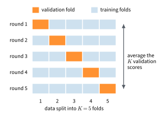

```{.python .input  n=1}
%load_ext d2lbook.tab
tab.interact_select('mxnet', 'pytorch', 'tensorflow', 'jax')
```

# Predicting House Prices on Kaggle
:label:`sec_kaggle_house`

Fashion-MNIST arrives clean: every example is an image of the same size,
every pixel lies between 0 and 1, and every label comes from the same ten
classes. Most data that people want to predict from looks different. In this
section we predict the sale prices of houses in Ames, Iowa, from a table in
which each house is described by 79 attributes. Some are numbers, such as
the living area; others are categories, such as the type of roof; many
entries are missing; and the numbers range from 0 or 1 to tens of thousands.
Only 1,460 houses come with a price. A model cannot read such a table
directly, and with so few examples, a careless estimate of its error can be
off by more than the differences between the models we want to compare.

The task brings together much of what the book has covered so far: the
squared loss and minibatch SGD of :numref:`chap_regression`, cross-validation
(:numref:`sec_generalization_basics`) and weight decay
(:numref:`sec_weight_decay`), and the MLP of this chapter with the
initialization of :numref:`sec_numerical_stability`. We first describe the
data and the error measure, then turn the table into tensors, estimate the
error of a linear model and of an MLP by cross-validation, and finally
produce a file of predictions to submit. Most of the work lies in preparing
the data and in estimating the error; the models take a few lines each.

```{.python .input #kaggle-house-price-predicting-house-prices-on-kaggle}
%%tab mxnet
from d2l import mxnet as d2l
from mxnet import gluon, init, npx
from mxnet.gluon import nn
import numpy as np
import pandas as pd
npx.set_np()
```

```{.python .input #kaggle-house-price-predicting-house-prices-on-kaggle}
%%tab pytorch
from d2l import torch as d2l
import numpy as np
import pandas as pd
import torch
from torch import nn
```

```{.python .input #kaggle-house-price-predicting-house-prices-on-kaggle}
%%tab tensorflow
from d2l import tensorflow as d2l
import numpy as np
import pandas as pd
import tensorflow as tf
```

```{.python .input #kaggle-house-price-predicting-house-prices-on-kaggle}
%%tab jax
from d2l import jax as d2l
from flax import nnx
import jax
import numpy as np
import optax
import pandas as pd
```

## The Competition

### Kaggle

[Kaggle](https://www.kaggle.com) hosts machine learning competitions. Each
competition provides a training set with labels and a test set without
them. Participants upload predictions for the test set, and Kaggle scores
them against labels that it keeps hidden, so no participant can tune a model
on the test labels. The scores of all participants appear on a leaderboard.
The data of this section belong to the competition
[House Prices: Advanced Regression Techniques](https://www.kaggle.com/c/house-prices-advanced-regression-techniques),
a practice competition without a deadline. The data were collected by
:citet:`De-Cock.2011` from the sales of 2006 to 2010, as a larger and more
varied replacement for small teaching datasets such as Boston Housing.

### The Data

We download the training and the test table with `d2l.download`, which keeps
a copy on disk and checks it against a SHA-1 hash, and read them with
`pandas` (:numref:`sec_pandas`).

```{.python .input #kaggle-house-price-accessing-and-reading-the-dataset-1  n=30}
def read_house_prices(root='../data'):
    """Download and read the training and test tables of the competition."""
    train = pd.read_csv(d2l.download(
        d2l.DATA_URL + 'kaggle_house_pred_train.csv', root,
        sha1_hash='585e9cc93e70b39160e7921475f9bcd7d31219ce'))
    test = pd.read_csv(d2l.download(
        d2l.DATA_URL + 'kaggle_house_pred_test.csv', root,
        sha1_hash='fa19780a7b011d9b009e8bff8e99922a8ee2eb90'))
    return train, test
```

The training table has one row for each of 1,460 houses: an identifier, 79
attributes, and the sale price, the label. The test table has 1,459 houses,
with identifiers and attributes but no prices.

```{.python .input #kaggle-house-price-accessing-and-reading-the-dataset-2  n=31}
raw_train, raw_test = read_house_prices()
print(raw_train.shape, raw_test.shape)
```

Here are the first four houses, with the first three attributes, the last
two, and the price:

```{.python .input #kaggle-house-price-data-preprocessing-1  n=10}
print(raw_train.iloc[:4, [0, 1, 2, 3, -3, -2, -1]])
```

`MSSubClass` encodes the type of dwelling as a number, `MSZoning` the zoning
of the lot as a category, and `LotFrontage` the length of the lot's street
front in feet; `SaleType` and `SaleCondition` describe the sale. Of the 79
attributes, 36 are stored as numbers and 43 as categories, and 19 have
missing entries. Most of these mean that a feature is absent: `PoolQC`, the
quality of the pool, is missing for 1,453 houses, which have no pool. The first
column, `Id`, numbers the rows. The competition defines it as an identifier,
so we do not use it as a feature. Identifiers are not always harmless: an
identifier assigned in order of collection may correlate with time, and
such a column should be checked before it is dropped or kept.

### The Error Measure

Prices span a wide range: the cheapest house in the training table sold for
\$34,900, the most expensive for \$755,000. An error of \$50,000 is large
for the first and small for the second, so what matters is the relative
error, not the error in dollars. The competition therefore measures the
error on a logarithmic scale. If a prediction $\hat{y}$ satisfies
$|\log \hat{y} - \log y| \leq \delta$, then
$e^{-\delta} \leq \hat{y}/y \leq e^{\delta}$, and for small $\delta$ the
prediction lies within a fraction of about $\delta$ of the true price $y$.
Over the $n$ houses of the test set, the score is the root-mean-squared
error (RMSE) of the logarithms,

$$\sqrt{\frac{1}{n}\sum_{i=1}^n\left(\log y_i - \log \hat{y}_i\right)^2}.$$

An RMSE of 0.1 thus corresponds to typical errors of about 10% of the price.
We train our models to predict $\log y$ with the squared loss, so the
training loss is the square of the score computed on the training houses.

## Preprocessing

### Numerical Features

The numerical attributes have very different scales: the number of
fireplaces is a small integer, the area of the lot runs to tens of thousands
of square feet. A weight that suits one of them is far too large or too
small for another, which slows minibatch SGD, and weight decay, which
penalizes all weights alike, would penalize the coefficients of
small-valued features more. We therefore *standardize* each numerical
feature: with $\mu$ and $s$ the mean and the standard deviation of the
feature over the training rows, we replace its value $x$ by
$(x - \mu)/s$. Every standardized feature has mean 0 and variance 1 over
the training rows where it is observed.

A missing numerical value is then replaced by 0, the mean of the
standardized feature. This is *mean imputation*: we assume that a missing
value is typical. For `LotFrontage`, missing for 259 houses, this is a fair
guess. The filled column keeps its mean of 0, and its variance falls
slightly below 1, to about 0.82 for `LotFrontage`. For features whose
absence means something, such as the year in which a garage was built, it is
not, and exercise :exref:`ex_kaggle-house-mean-imputation` examines the bias
it introduces.

### Categorical Features

A category cannot be multiplied by a weight. We replace each categorical
feature by indicator features, one per category, as we encoded class labels
in :numref:`subsec_classification-problem`. `MSZoning` takes five values in
the training table, among them `RL` (residential, low density) and `RM`
(residential, medium density), so it becomes five indicator features
`MSZoning_RL`, `MSZoning_RM`, and so on. A house in zone `RL` has
`MSZoning_RL` equal to 1 and the other four equal to 0. This is the *one-hot
encoding*. We add one more indicator per feature for a missing value, so that
"no pool" gets its own column. `pandas` computes this encoding with
`get_dummies`.

A column stored as numbers is not always a quantity. `MSSubClass` codes the
type of dwelling with numbers from 20 to 190: 20 stands for a one-story
house built in 1946 or later, 60 for a two-story house of the same period,
and 90 for a duplex. The differences between these codes measure nothing,
but with one weight on the standardized column, the prediction of a linear
model would change in proportion to them. We therefore convert the codes to
strings before the encoding, and `MSSubClass` becomes a categorical feature
with 15 indicators for the codes in the training table and one for a
missing value. The model thus sees 35 numerical and 44 categorical
attributes.

### Fitting on the Training Rows

Each preprocessing step uses statistics of the data: the means and standard
deviations of the numerical features, and the set of categories that become
columns. We compute these statistics from the training rows alone and apply
the same transformation to all other rows. If the statistics included the
rows on which we measure the error, information about those rows would enter
the model before it is evaluated, and the error estimate would be too
optimistic. This is called *leakage*. A category that does not occur in the
training rows gets no column, so a house with such a value has all of that
feature's indicators equal to 0. The `MSSubClass` code 150, for example,
occurs in the test table but not in the training table.

The function `preprocess` fits the transformation on the table `train` and
applies it to `train` and to any further tables. It returns NumPy arrays of
features, without the identifier and the price.

```{.python .input #kaggle-house-price-data-preprocessing-2  n=32}
def preprocess(train, *others):
    """Fit the feature preprocessing on train; apply it to all tables."""
    frames = [df.drop(columns=['Id', 'SalePrice'], errors='ignore')
                .astype({'MSSubClass': str})  # A code, not a quantity
              for df in (train, *others)]
    numeric = frames[0].select_dtypes(include='number').columns
    mean, std = frames[0][numeric].mean(), frames[0][numeric].std()
    for df in frames:
        df[numeric] = ((df[numeric] - mean) / std).fillna(0)
    frames = [pd.get_dummies(df, dummy_na=True) for df in frames]
    return [df.reindex(columns=frames[0].columns, fill_value=0)
              .to_numpy(dtype=np.float32) for df in frames]
```

Fitted on the whole training table, the encoding turns the 79 attributes
into 345 features:

```{.python .input #kaggle-house-price-data-preprocessing-3  n=33}
X_train, X_test = preprocess(raw_train, raw_test)
X_train.shape, X_test.shape
```

The label needs one step of preparation as well. The logarithms of the
prices lie around 12, with a standard deviation of 0.4. A model whose
initial predictions are near 0 would spend its first updates learning this
offset, and the one-hot features, each group of which sums to 1, compete
with the bias in doing so, which slows SGD (exercise
:exref:`ex_kaggle-house-scaling`). We therefore
subtract the mean log price of the training rows from the targets, and add
it back to the predictions. Shifting targets and predictions by the same
constant leaves their differences, and hence the RMSE, unchanged.

The data module `KaggleHouse` holds one split of the labeled houses into
training and validation rows. It fits the preprocessing and the mean log
price on the training rows, and it serves the features together with the
centered log prices. A table without prices, such as the test table, can
take the place of the validation rows: the module then provides its
features for prediction but no validation data.

```{.python .input #kaggle-house-price-error-measure  n=60}
class KaggleHouse(d2l.DataModule):
    """Features and centered log prices, fitted on the training rows."""
    def __init__(self, raw_train, raw_val, batch_size=64):
        super().__init__()
        self.save_hyperparameters(ignore=['raw_train', 'raw_val'])
        self.X_train, self.X_val = preprocess(raw_train, raw_val)
        self.num_inputs = self.X_train.shape[1]
        log_price = lambda df: np.log(
            df['SalePrice'].to_numpy(np.float32)).reshape(-1, 1)
        self.offset = log_price(raw_train).mean()  # Mean log price
        self.y_train = log_price(raw_train) - self.offset
        self.y_val = (log_price(raw_val) - self.offset
                      if 'SalePrice' in raw_val else None)

    def get_dataloader(self, train):
        X, y = ((self.X_train, self.y_train) if train
                else (self.X_val, self.y_val))
        if y is None:  # No prices to validate against
            return None
        return self.get_tensorloader((d2l.tensor(X), d2l.tensor(y)), train)
```

## Model Selection

### $K$-Fold Cross-Validation

To choose between models we need an estimate of their error on new houses.
A single validation set would be small: if we held out a fifth of the 1,460
houses, the estimate would rest on 292 of them, and it would depend on which
ones. *$K$-fold cross-validation* (:numref:`sec_generalization_basics`)
uses every house for validation once. It splits the labeled houses at random
into $K$ parts of almost equal size, the *folds*, trains $K$ models, each on
$K - 1$ folds, and evaluates each model on the fold that it did not see. The
average of the $K$ validation errors estimates the error of the model on new
data. We use $K = 5$.

`k_fold_data` draws the folds and builds one `KaggleHouse` per round, so that
the preprocessing of each round is fitted on its own training folds. Fitting
it once on all labeled houses would leak the statistics of each validation
fold into its features.

```{.python .input #kaggle-house-price-k-fold-cross-validation-1}
def k_fold_data(raw, k):
    """Split the table raw into k random folds; one data module per round."""
    folds = np.array_split(np.random.default_rng().permutation(len(raw)), k)
    return [KaggleHouse(raw.drop(index=raw.index[f]), raw.iloc[f])
            for f in folds]
```

`k_fold` trains a fresh model in each round and reads the losses of the last
epoch from the trainer's history. The training loss there is the mean of the
minibatch losses during that epoch, while the parameters still change, not
the result of a separate pass over the training folds. The square root of
the mean squared error of the log prices is the RMSE of the competition. The
function prints the training and validation RMSE averaged over the rounds,
together with the smallest and the largest validation RMSE of a single fold,
and returns the average validation RMSE. The argument `make_model` builds a
model for a given number of input features. This number varies slightly
from round to round, between about 335 and 345, because each round fits its
own set of categories.

:begin_tab:`mxnet, pytorch, tensorflow`
The layers of our models infer their number of inputs from the first
minibatch, so the models built here ignore the argument.
:end_tab:

:begin_tab:`jax`
NNX layers need their number of inputs when they are constructed, so the
models built here pass the argument on to their first layer.
:end_tab:

```{.python .input #kaggle-house-price-k-fold-cross-validation-2}
def k_fold(folds, make_model, max_epochs=100):
    """Train a fresh model in each round; print and return the RMSEs."""
    rmse = []
    for fold in folds:
        trainer = d2l.Trainer(max_epochs=max_epochs)
        trainer.board.display = False
        trainer.fit(make_model(fold.num_inputs), fold)
        rmse.append([trainer.history[f'{split}_loss'][-1] ** 0.5
                     for split in ('train', 'val')])
    train, val = np.array(rmse).T
    print(f'training RMSE {train.mean():.3f}, validation RMSE '
          f'{val.mean():.3f} (folds {val.min():.3f} to {val.max():.3f})')
    return val.mean()
```

We draw the folds once and evaluate every model on the same folds, so that
differences between the models do not come from different splits.

```{.python .input #kaggle-house-price-k-fold-cross-validation-3}
folds = k_fold_data(raw_train, 5)
```

### A Linear Baseline

The first model is linear regression, `LinearRegression` of
:numref:`sec_linear_concise`, with weights drawn from
$\mathcal{N}(0, 0.01^2)$ and a zero bias. We train it, and every later
model, with minibatches of 64 houses at learning rate 0.02 for 100 epochs.
A baseline is only useful if it is trained as carefully as the models it is
compared with, so it gets the same budget.

```{.python .input #kaggle-house-price-model-selection-linear}
%%tab mxnet, pytorch, tensorflow
make_linear = lambda num_inputs: d2l.LinearRegression(lr=0.02)
```

```{.python .input #kaggle-house-price-model-selection-linear}
%%tab jax
make_linear = lambda num_inputs: d2l.LinearRegression(num_inputs, lr=0.02)
```

```{.python .input #kaggle-house-price-a-linear-baseline-1}
linear_rmse = k_fold(folds, make_linear)
```

The linear model predicts the validation folds with an RMSE of about 0.15,
a typical error of about 15% of the price, against about 0.11 on its
training folds. Single folds differ a lot: within one run, the best fold
has an RMSE of 0.11 to 0.13 and the worst one of 0.16 to 0.24, depending on
which houses they contain. The mean over the five folds varies far less, by
one or two hundredths from one random split to the next, occasionally more.
Models evaluated on the same folds share
much of this variation, so the difference between two of them is measured
more precisely than either error alone.

### An MLP with Weight Decay

Can an MLP do better? Our MLP has one hidden layer of 64 ReLU units and one
output, He-initialized weights (:numref:`subsec_he_init`), and zero biases.
It reuses the squared loss of `LinearRegression`. With about 340
features it has about 22,000 parameters, nineteen times as many as there are
training houses in a round, so we expect it to fit the training folds
closely, including their noise. Weight decay with strength `wd`
(:numref:`sec_weight_decay`) limits this; as there, we decay the weights but
not the biases.

```{.python .input #kaggle-house-price-mlp-model}
%%tab mxnet
class HouseMLP(d2l.Module):
    """An MLP with one hidden layer, squared loss, and weight decay."""
    loss = d2l.LinearRegression.loss

    def __init__(self, num_hiddens, wd, lr):
        super().__init__()
        self.save_hyperparameters()
        self.net = nn.Sequential()
        self.net.add(nn.Dense(num_hiddens, activation='relu'), nn.Dense(1))
        self.net.initialize(init.Xavier(rnd_type='gaussian', factor_type='in',
                                        magnitude=2))

    def configure_optimizers(self):
        for p in self.collect_params('.*bias').values():
            p.wd_mult = 0
        return gluon.Trainer(self.collect_params(), 'sgd',
                             {'learning_rate': self.lr, 'wd': self.wd})

make_mlp = lambda num_inputs, wd: HouseMLP(num_hiddens=64, wd=wd, lr=0.02)
```

```{.python .input #kaggle-house-price-mlp-model}
%%tab pytorch
class HouseMLP(d2l.Module):
    """An MLP with one hidden layer, squared loss, and weight decay."""
    loss = d2l.LinearRegression.loss

    def __init__(self, num_hiddens, wd, lr):
        super().__init__()
        self.save_hyperparameters()
        self.net = nn.Sequential(nn.LazyLinear(num_hiddens), nn.ReLU(),
                                 nn.LazyLinear(1))

    def weight_init(self, module):
        if isinstance(module, nn.Linear):
            nn.init.kaiming_normal_(module.weight, nonlinearity='relu')
            nn.init.zeros_(module.bias)

    def configure_optimizers(self):
        weights = [p for p in self.parameters() if p.dim() > 1]
        biases = [p for p in self.parameters() if p.dim() == 1]
        return torch.optim.SGD([{'params': weights, 'weight_decay': self.wd},
                                {'params': biases}], lr=self.lr)

make_mlp = lambda num_inputs, wd: HouseMLP(num_hiddens=64, wd=wd, lr=0.02)
```

```{.python .input #kaggle-house-price-mlp-model}
%%tab tensorflow
class HouseMLP(d2l.Module):
    """An MLP with one hidden layer, squared loss, and weight decay."""
    loss = d2l.LinearRegression.loss

    def __init__(self, num_hiddens, wd, lr):
        super().__init__()
        self.save_hyperparameters()
        # One initializer per layer: an instance repeats its random values
        he = lambda: tf.keras.initializers.VarianceScaling(
            2.0, 'fan_in', 'untruncated_normal')
        self.net = tf.keras.models.Sequential([
            tf.keras.layers.Dense(num_hiddens, activation='relu',
                                  kernel_initializer=he()),
            tf.keras.layers.Dense(1, kernel_initializer=he())])

    def configure_optimizers(self):
        optimizer = tf.keras.optimizers.SGD(self.lr, weight_decay=self.wd)
        optimizer.exclude_from_weight_decay(var_names=['bias'])
        return optimizer

make_mlp = lambda num_inputs, wd: HouseMLP(num_hiddens=64, wd=wd, lr=0.02)
```

```{.python .input #kaggle-house-price-mlp-model}
%%tab jax
def is_matrix(params):
    """Mask that selects the parameters with more than one dimension."""
    return jax.tree.map(lambda p: p.ndim > 1, params)

class HouseMLP(d2l.Module):
    """An MLP with one hidden layer, squared loss, and weight decay."""
    loss = d2l.LinearRegression.loss

    def __init__(self, num_inputs, num_hiddens, wd, lr, rngs=None):
        super().__init__()
        self.save_hyperparameters(ignore=['rngs'])
        rngs = nnx.Rngs(d2l.get_key()) if rngs is None else rngs
        he = nnx.initializers.variance_scaling(2.0, 'fan_in', 'normal')
        self.net = nnx.Sequential(
            nnx.Linear(num_inputs, num_hiddens, kernel_init=he, rngs=rngs),
            nnx.relu,
            nnx.Linear(num_hiddens, 1, kernel_init=he, rngs=rngs))

    def configure_optimizers(self):
        return optax.chain(
            optax.masked(optax.add_decayed_weights(self.wd), is_matrix),
            optax.sgd(self.lr))

make_mlp = lambda num_inputs, wd: HouseMLP(num_inputs, num_hiddens=64,
                                           wd=wd, lr=0.02)
```

We train the MLP with the learning rate, minibatch size, and number of
epochs of the linear model, on the same folds, for five strengths of weight
decay, from none to 0.3, and keep the validation RMSE of each.

```{.python .input #kaggle-house-price-mlp-select}
val_rmse = {}
for wd in (0, 0.01, 0.03, 0.1, 0.3):
    print(f'weight decay {wd}: ', end='')
    val_rmse[wd] = k_fold(folds, lambda num_inputs: make_mlp(num_inputs, wd))
```

Without weight decay, the MLP fits the training folds more closely than the
linear model, with a training RMSE of about 0.09 against 0.11, but it
predicts the validation folds worse, at 0.16 to 0.18: it has fit noise. From
a weight decay of 0.03 on, the training RMSE rises, from about 0.09 to about
0.16 at 0.3. The validation RMSE first falls, to between 0.13 and 0.145 at a
weight decay of 0.03, with 0.1 nearly as good, and then rises again, to
about 0.17 at 0.3, where the MLP no longer fits even the training folds as
well as the linear model does. This is the U-shaped curve of
:numref:`sec_generalization_basics`, traced here by the strength of weight
decay instead of the degree of a polynomial. At its minimum, the MLP beats
the linear model on the same folds in every run, typically by about 0.01,
which lowers the typical error from about 15% to about 14% of the price.

## Submitting Predictions
:label:`subsec_kaggle_submission`

Cross-validation has selected a model: the MLP with the weight decay of the
lowest validation RMSE. Each of its five models was trained on four fifths
of the houses. For the submission we train it once more, on all 1,460, with
the same hyperparameters, as in :numref:`sec_generalization_basics`. The
test table takes the place of the validation rows, so the preprocessing and
the mean log price are fitted on the whole training table, and the module
provides the features of the test houses. The model predicts centered log
prices; we add the mean log price back, exponentiate, and write one line per
house to the file `submission.csv`, in the format that the competition
expects.

```{.python .input #kaggle-house-price-submitting-predictions-on-kaggle}
data = KaggleHouse(raw_train, raw_test)
model = make_mlp(data.num_inputs, wd=min(val_rmse, key=val_rmse.get))
trainer = d2l.Trainer(max_epochs=100)
trainer.board.display = False
trainer.fit(model, data)
log_price = d2l.numpy(model(d2l.tensor(data.X_val))).reshape(-1) + data.offset
submission = pd.DataFrame({'Id': raw_test['Id'],
                           'SalePrice': np.exp(log_price)})
submission.to_csv('submission.csv', index=False)
submission.head()
```

Each line of the file holds the identifier of a test house and its
predicted price in dollars. To submit the file, sign in to Kaggle, open the
competition page, choose "Submit Prediction", and upload `submission.csv`. Kaggle computes the score and shows it with the
position that the submission would take on the leaderboard. The
cross-validated RMSE estimates this score but does not guarantee it: the
model trained on all houses differs from the five models that were
evaluated, and the weight decay was selected among five candidates on the
same folds that estimate its error.

Retraining on all houses is not the only way to produce the predictions.
The five models of the selected configuration could instead each predict
the test houses, and their log-price predictions could be averaged;
exercise :exref:`ex_kaggle-house-fold-ensemble` compares the two.

Nothing in this pipeline is specific to neural networks. The same
preprocessing, the same loss, and the same folds serve any model that
predicts a number from a vector of features. On tables like this one,
ensembles of decision trees trained by gradient boosting often predict
better than MLPs :cite:`Grinsztajn.Oyallon.Varoquaux.2022,Shwartz-Ziv.Armon.2022`,
and exercise :exref:`ex_kaggle-house-trees` measures how much better on
this dataset. Neural networks
have the advantage where the inputs have structure that a network can
exploit, such as the pixels of an image or the words of a sentence, which
the following chapters turn to.

## Summary

A table of mixed numerical and categorical attributes becomes a matrix of
features by three steps: standardize the numerical features, replace their
missing values by the mean, and encode the categories, including numbers
that only name categories, as indicator features, with one more indicator
for a missing value. All statistics of these steps come from the training
rows only; otherwise the error estimate leaks
information from the rows it is computed on. Prices matter relative to
their size, so we predict their logarithms with the squared loss, which
trains the model on the square of the competition's score, and we center
the logarithms so that SGD need not learn their offset. $K$-fold
cross-validation estimates the error of each candidate from all 1,460
houses, and evaluating every candidate on the same folds makes their
comparison fair. An MLP with 64 hidden units fits the noise of 1,460 houses
unless weight decay restrains it; with the weight decay that
cross-validation selects, it predicts the log prices with an RMSE of 0.13 to
0.145, slightly below the 0.15 of a linear model.

## Exercises

1. [code] **Mean imputation.** `preprocess` replaces every missing
   numerical value by the training-set mean of its column. Its call to
   `pd.get_dummies` with `dummy_na=True` also adds a missing-value
   indicator column for every categorical feature.
    1. Identify a numerical feature in this dataset whose missingness is not
       random with respect to the sale price.
    1. Explain what bias mean imputation alone would introduce for that
       feature, and in which direction it would shift the predictions for
       the affected houses. Then determine whether the indicator columns
       that `preprocess` already creates let a linear model remove this
       bias.
    1. Replace mean imputation by median imputation, and separately add a
       binary missingness indicator column for each imputed feature. Compare
       the cross-validated errors of the three variants.

    *Adapted from Kaggle Learn,
    [Intermediate Machine Learning](https://www.kaggle.com/learn/intermediate-machine-learning),
    Exercise 2.*
   :exlabel:`ex_kaggle-house-mean-imputation`
1. [code] **Numbers that name categories.** `preprocess` encodes
   `MSSubClass` as a category because its codes name types of dwelling.
    1. Find the other numerical columns with at most a dozen distinct
       values, among them `MoSold`, `YrSold`, `OverallQual`, and
       `OverallCond`. For each, decide whether its values are quantities,
       ordered levels, or names, and whether one weight on the standardized
       value can express its effect on the log price. Which of them is
       cyclic, so that its largest and smallest values are neighbors?
    1. One-hot encode the columns that you judged to be categories, and
       compare the cross-validated RMSE of the linear model and of the
       selected MLP with that of this section on the same folds. Is the
       difference larger than the variation between random splits?
1. [code] **Scaling the features and the target.** Remove the
   standardization from `preprocess`. Because `fillna(0)` imputes the
   column mean only for standardized columns, fill missing numerical values
   with the training-set column means explicitly instead.
    1. Rerun the cross-validation of the linear model at the section's
       learning rate of $0.02$, and describe the training loss.
    1. Find, to within a factor of ten, the largest learning rate at which
       the unstandardized linear model trains without diverging. Compare
       its cross-validated error after $100$ epochs with that of the
       standardized pipeline, and explain both observations.
    1. Restore the standardization, but train on the log prices without
       subtracting their mean. Compare the cross-validated error after
       $100$ epochs with that of the centered targets, and explain the
       difference.
   :exlabel:`ex_kaggle-house-scaling`
1. [code] **Gradient-boosted trees.** On tabular data like this,
   ensembles of decision trees often predict better than neural networks
   :cite:`Grinsztajn.Oyallon.Varoquaux.2022,Shwartz-Ziv.Armon.2022`. Fit a
   gradient-boosted tree model (for example scikit-learn's
   `GradientBoostingRegressor`, or XGBoost or LightGBM if installed) to the
   centered log prices of the training rows of each fold in `folds`, and
   compute its validation RMSE on each fold. Compare the average with those
   of this section's models. Which properties of the data favor trees?
   :exlabel:`ex_kaggle-house-trees`
1. [code] **Target leakage.** A feature that is recorded only after, or
   because of, the event being predicted inflates validation scores without
   helping a deployed model.
    1. Identify at least one raw feature in this dataset that could
       plausibly be filled in only after the sale, and explain why
       cross-validation does not catch the problem.
    1. Verify the mechanism empirically: add a synthetic feature equal to
       the log sale price plus small Gaussian noise, rerun the
       cross-validation, and report the change in the validation RMSE.

    *Adapted from Kaggle Learn,
    [Intermediate Machine Learning](https://www.kaggle.com/learn/intermediate-machine-learning),
    Exercise 7.*
1. [code] **Fold ensembling versus retraining.**
   :numref:`subsec_kaggle_submission` retrains the selected MLP on all
   houses. Alternatively, the five models trained during cross-validation
   could each predict the test houses, with the preprocessing of their own
   round, and their log-price predictions could be averaged.
    1. Implement this fold ensemble and submit both its predictions and
       those of the retrained model. Compare the two leaderboard scores with
       each other and with the cross-validated RMSE.
    1. Each model of the ensemble was trained on four fifths of the houses.
       Why might the ensemble nevertheless predict better than the model
       retrained on all of them?
    1. Explain why the training error of the retrained model is not a
       substitute for the cross-validated estimate.
   :exlabel:`ex_kaggle-house-fold-ensemble`
1. [code] **Target encoding.** ● *Target encoding* replaces each category
   of a categorical column by the mean log sale price of the training rows
   in that category, so that the feature occupies a single column instead
   of the one column per category that `preprocess` creates.
    1. Target-encode every categorical column with more than ten categories
       instead of one-hot encoding it, computing the category means from
       the training rows of each fold. Give a category that does not occur
       in those rows the overall mean, and standardize the encoded columns
       like the numerical features. Compare the cross-validated error with
       that of one-hot encoding.
    1. The encoding above computes each training row's value from a mean
       that includes that row's own label. Encode the training rows out of
       fold instead: split the training rows of each fold into five parts,
       and encode each part with category means computed from the other four
       parts. Compare the cross-validated error with that of the in-sample
       encoding, and explain how the size of a category affects the
       difference between the two encodings.
1. [code] **Improving the score.** ● Lower the cross-validated RMSE of the
   MLP, and then its leaderboard score.
    1. Vary the width and the number of hidden layers, the learning rate,
       and the number of epochs, and tune the weight decay of each
       configuration on the same folds. Which change helps most?
    1. Replace weight decay by dropout (:numref:`sec_dropout`) after the
       hidden layer, and tune its probability. Does dropout help on this
       dataset, alone or together with weight decay?
    1. You have now compared many configurations on the same five folds.
       Why is the lowest cross-validated RMSE among them a biased estimate
       of the leaderboard score of the chosen configuration? Check how large
       the bias is by drawing new folds.
1. **Geometric averaging.** ● An ensemble of $K$ models that predict the log
   prices $z_1, \ldots, z_K$ of a house can average them before
   exponentiating, which amounts to a geometric mean in price space.
    1. Compare $\exp\bigl(\frac{1}{K}\sum_{k=1}^K z_k\bigr)$ with the
       price-space average $\frac{1}{K}\sum_{k=1}^K e^{z_k}$. Show which of
       the two never exceeds the other, and state when they coincide.
    1. Let $\log y$ be the true log price of the house. Show that the
       log-space average satisfies

       $$\Bigl(\log y - \frac{1}{K}\sum_{k=1}^K z_k\Bigr)^2 \leq \frac{1}{K}\sum_{k=1}^K \left(\log y - z_k\right)^2.$$

       Determine whether the logarithm of the price-space average satisfies
       the same bound for all predictions $z_1, \ldots, z_K$.

:begin_tab:`mxnet`
[Discussions](https://d2l.discourse.group/t/106)
:end_tab:

:begin_tab:`pytorch`
[Discussions](https://d2l.discourse.group/t/107)
:end_tab:

:begin_tab:`tensorflow`
[Discussions](https://d2l.discourse.group/t/237)
:end_tab:

:begin_tab:`jax`
[Discussions](https://d2l.discourse.group/t/17988)
:end_tab:

<!-- slides -->

::: {.slide}
::: {.cover}
[Dive into Deep Learning · §4.7]{.kicker}

Predicting House Prices on Kaggle<br>**tabular data · preprocessing · log RMSE · cross-validated model selection**
:::
:::

::: {.slide title="1,460 Houses, 79 Mixed Attributes, Prices from $34,900 to $755,000"}
[The problem]{.kicker}

| | Fashion-MNIST | Ames house prices |
|---|---|---|
| examples with labels | 60,000 | 1,460 |
| inputs | 784 pixels in $[0, 1]$ | 35 numbers, 44 categories |
| missing values | none | in 19 attributes |
| label | one of 10 classes | a price, range 22× |

- A model cannot read the table as it is.
- With 1,460 houses, a careless error estimate is off by more than the
  differences between models.
:::

::: {.slide title="By the End of This Deck You Can"}
[Goals]{.kicker}

- turn a table of numbers and categories into features, without leaking
  validation data into the preprocessing;
- choose a loss that matches the competition's metric, the RMSE of log
  prices;
- estimate the error of a model by 5-fold cross-validation, on folds shared
  by all models;
- select the weight decay of an MLP by cross-validation;
- retrain the selected model and write a submission.

**Running example:** the validation RMSE of log prices; linear regression is
the baseline every MLP is compared with.
:::

::: {.slide title="The Chapter Ends with a Real Dataset"}
[Where this fits]{.kicker}

::: {.cols .vc}
::: {.col}
| section | adds |
|---|---|
| Multilayer Perceptrons | hidden layers, activation functions, universal approximation |
| Implementation of Multilayer Perceptrons | an MLP trained on Fashion-MNIST |
| Backpropagation | how the gradients are computed, and at what memory cost |
| Numerical Stability and Initialization | vanishing gradients, Xavier and He initialization |
| Generalization in Deep Learning | memorization, double descent, implicit bias, early stopping |
| Dropout | random masks, robustness to missing units |
| **Predicting House Prices on Kaggle** | **the workflow on real data** |
:::

::: {.col .narrow}
- **Uses:** squared loss and SGD, standardization, $K$-fold
  cross-validation, weight decay, He initialization.
- **Skips:** feature engineering, tree ensembles (an exercise), stacking.
:::
:::
:::

::: {.slide}
::: {.divider}
[01]{.dnum}

[The Competition]{.dtitle}

[hidden labels, the data, and the score]{.dsub}
:::
:::

::: {.slide title="Kaggle Scores Predictions against Hidden Labels"}
[Competition · Kaggle]{.kicker}

- Training table: 1,460 houses with prices. Test table: 1,459 houses
  without.
- Upload one predicted price per test house; Kaggle scores it against
  prices it keeps hidden and ranks it on a leaderboard.
- No one can tune a model on the test labels.

::: {.d2l-note}
Data: sales in Ames, Iowa, 2006 to 2010, collected by De Cock (2011) as a
larger replacement for teaching datasets such as Boston Housing.
:::
:::

::: {.slide title="Numbers, Categories, and Gaps in One Table"}
[Competition · the data]{.kicker}

@!kaggle-house-price-data-preprocessing-1

- `MSZoning`, `SaleType`: categories. `LotFrontage`: feet, missing for 259
  houses.
- `MSSubClass`: a dwelling-type code stored as a number (20 to 190);
  we encode it as a category.
- Most gaps mean "absent": `PoolQC` is missing for the 1,453 houses
  without a pool.
- `Id` numbers the rows and is not a feature.
:::

::: {.slide title="Score Relative Errors: the RMSE of Log Prices"}
[Competition · the metric]{.kicker}

$$\textrm{RMSE} = \sqrt{\frac{1}{n}\sum_{i=1}^n\left(\log y_i - \log \hat{y}_i\right)^2}$$

- $|\log\hat{y} - \log y| \leq \delta$ means
  $e^{-\delta} \leq \hat{y}/y \leq e^{\delta}$: within about $\delta$ of the
  price.
- RMSE 0.1 ≈ typical error of 10%, for a \$35,000 and a \$750,000 house
  alike.

::: {.d2l-note}
Train on $\log y$ with the squared loss: SGD minimizes the square of the
score.
:::
:::

::: {.slide title="Check: How Much Does One Bad Prediction Cost?"}
[Check]{.kicker}

A house sold for \$200,000 is predicted at \$250,000. What is its squared
error in log prices? And for a \$100,000 house predicted at \$125,000?

::: {.fragment .fade-up}
::: {.d2l-note}
**Answer.** Both are $(\log 1.25)^2 \approx 0.223^2 \approx 0.05$. The
metric sees only the ratio $\hat{y}/y$, not the dollars.
:::
:::
:::

::: {.slide}
::: {.divider}
[02]{.dnum}

[Preprocessing]{.dtitle}

[from a table to a matrix, without leakage]{.dsub}
:::
:::

::: {.slide title="Standardize Numbers; a Missing Number Becomes the Mean, 0"}
[Preprocessing · numbers]{.kicker}

$$x \leftarrow \frac{x - \mu}{s}, \qquad \mu, s \textrm{ from the training rows}$$

- Lot areas in the ten thousands, fireplace counts in single digits: one
  learning rate and one weight decay cannot suit both scales.
- After standardization, mean imputation fills a gap with 0.

::: {.d2l-note .warn}
Mean imputation assumes a gap is typical. For "year the garage was built",
a gap means "no garage".
:::
:::

::: {.slide title="One-Hot Encode Categories, with a Column for Missing"}
[Preprocessing · categories]{.kicker}

`MSZoning` takes 5 values in the training rows:

| house | `MSZoning` | `_RL` | `_RM` | `_FV` | `_RH` | `_C (all)` | `_nan` |
|---|---|---:|---:|---:|---:|---:|---:|
| 1 | RL | 1 | 0 | 0 | 0 | 0 | 0 |
| 2 | RM | 0 | 1 | 0 | 0 | 0 | 0 |

- A category absent from the training rows gets no column: all its
  indicators are 0.
:::

::: {.slide title="Fit Every Statistic on the Training Rows Only"}
[Preprocessing · leakage]{.kicker}

```{.python #kaggle-house-price-exercises}
def preprocess(train, *others):
    frames = [df.drop(columns=['Id', 'SalePrice'], errors='ignore')
                .astype({'MSSubClass': str})  # A code, not a quantity
              for df in (train, *others)]
    numeric = frames[0].select_dtypes(include='number').columns
    mean, std = frames[0][numeric].mean(), frames[0][numeric].std()
    for df in frames:
        df[numeric] = ((df[numeric] - mean) / std).fillna(0)
    frames = [pd.get_dummies(df, dummy_na=True) for df in frames]
    return [df.reindex(columns=frames[0].columns, fill_value=0)
              .to_numpy(dtype=np.float32) for df in frames]
```

::: {.d2l-note .warn}
Means, standard deviations, and the set of categories come from `train`;
statistics that include validation rows make the error estimate optimistic.
:::
:::

::: {.slide title="79 Attributes Become 345 Features"}
[Preprocessing · result]{.kicker}

@!kaggle-house-price-data-preprocessing-3

- Log prices: mean 12.0, standard deviation 0.4. We subtract the mean of
  the training rows, so that a model starting near 0 is right on average.
- `KaggleHouse` holds one split: preprocessing and mean log price fitted on
  its training rows.
:::

::: {.slide}
::: {.divider}
[03]{.dnum}

[Model Selection]{.dtitle}

[five folds, one baseline, one sweep]{.dsub}
:::
:::

::: {.slide title="Five Folds: Every House Is Validated Once"}
[Model selection · cross-validation]{.kicker}

::: {.cols .vc}
::: {.col}
- One validation set of a fifth: 292 houses, a noisy estimate.
- 5 folds: train on 4, validate on 1, five times; average.
- Each round refits the preprocessing on its own training folds.
- The same folds for every model.
:::

::: {.col .fig .big}
{width=100%}
:::
:::
:::

::: {.slide title="Linear Regression: Validation RMSE About 0.15"}
[Model selection · baseline]{.kicker}

Minibatches of 64, learning rate 0.02, 100 epochs, the same for every model:

@!kaggle-house-price-a-linear-baseline-1

- Training RMSE about 0.11; the best fold 0.11–0.13, the worst 0.16–0.24.
- The five-fold mean moves by one or two hundredths between random splits.
:::

::: {.slide title="An MLP with 64 Units: About 22,000 Parameters for 1,168 Houses"}
[Model selection · the MLP]{.kicker}

- One hidden layer of 64 ReLUs, one output; He initialization, zero biases.
- Squared loss reused from `LinearRegression`.
- Weight decay `wd` on the weights, not on the biases.

::: {.d2l-note}
Nineteen parameters per training house: expect it to fit their noise
unless something restrains it.
:::
:::

::: {.slide title="A Moderate Weight Decay Gives the Lowest Validation RMSE"}
[Model selection · the sweep]{.kicker}

@!kaggle-house-price-mlp-select

::: {.d2l-note}
Training RMSE rises from a weight decay of 0.03 on; validation RMSE falls,
then rises.
:::
:::

::: {.slide title="The Sweep Traces the U-Curve of Generalization"}
[Model selection · reading]{.kicker}

- **No decay:** fits training folds better than the linear model (0.09 vs
  0.11), validates worse (0.16–0.18 vs about 0.15): it fits noise.
- **0.03:** 0.13–0.145, a typical error of about 14% of the price.
- **0.3:** fits even the training folds worse than the linear model: it
  underfits.

::: {.d2l-note}
On the same folds, the selected MLP beats the linear model in every run,
typically by about 0.01.
:::
:::

::: {.slide title="Check: Is the Lowest RMSE an Unbiased Estimate of the Score?"}
[Check]{.kicker}

We picked the weight decay with the lowest of five cross-validated RMSEs,
computed on the same folds. Is the selected RMSE an unbiased estimate of the
score on the test houses?

::: {.fragment .fade-up}
::: {.d2l-note}
**Answer.** No. The minimum of five noisy estimates is biased downward, and
the selection used the folds that measure the error. With five candidates
the bias is small; with hundreds it is not.
:::
:::
:::

::: {.slide}
::: {.divider}
[04]{.dnum}

[Submission]{.dtitle}

[retrain, predict, upload]{.dsub}
:::
:::

::: {.slide title="Retrain on All 1,460 Houses, Then Predict"}
[Submission · code]{.kicker}

The selected MLP is trained once more, with the same hyperparameters, on all
houses. The first lines of `submission.csv`:

@!kaggle-house-price-submitting-predictions-on-kaggle

- The test table takes the place of the validation rows, so preprocessing and
  mean log price are fitted on all 1,460 houses.
- The model predicts centered log prices: add the mean back, exponentiate.
:::

::: {.slide title="Upload the File; the Score Should Be Near the Cross-Validated RMSE"}
[Submission · Kaggle]{.kicker}

- Competition page → "Submit Prediction" → upload `submission.csv`.
- The cross-validated RMSE estimates the score; the retrained model and the
  selection make it an estimate, not a guarantee.
- Alternative: average the log-price predictions of the five fold models.

::: {.d2l-note}
On tables like this, gradient-boosted trees often beat neural networks;
the pipeline stays the same.
:::
:::

::: {.slide title="Recap"}
[Wrap-up]{.kicker}

::: {.cols}
::: {.col}
- **Preprocess:** standardize, impute 0, one-hot with a missing column;
  fit on the training rows only.
- **Loss:** squared error of centered log prices = square of the
  competition's RMSE.
- **Estimate:** 5-fold cross-validation on shared folds.
:::

::: {.col}
- **Linear:** validation RMSE about 0.15.
- **MLP, 64 units:** 0.16–0.18 without weight decay, 0.13–0.145 with 0.03.
- **Submit:** retrain the selected model on all houses.
:::
:::

**Next:** Computation: modules, parameters, and devices, the software
structure behind the models so far.
:::
