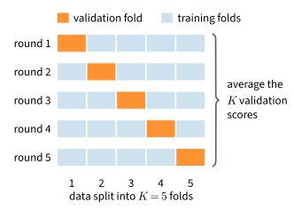

```{.python .input  n=1}
%load_ext d2lbook.tab
tab.interact_select('mxnet', 'pytorch', 'tensorflow', 'jax')
```

# Predicting House Prices on Kaggle
:label:`sec_kaggle_house`

Fashion-MNIST arrives remarkably clean: every image has the same dimensions,
every pixel lies in $[0, 1]$, and every label belongs to one of ten neatly
balanced classes. Real-world tabular data rarely looks like that. In this
section, we predict house sale prices in Ames, Iowa, from a table describing
each home through 79 heterogeneous attributes—numerical measurements like living
area alongside categorical fields like roof style, values spanning orders of
magnitude from 0 to tens of thousands, and plenty of missing entries. Worse
still, only 1,460 houses come with observed sale prices. No neural network can
ingest such a table raw, and with so few labeled examples, a careless validation
scheme can easily introduce more noise than the actual gap between competing
models.

Putting everything together in an end-to-end pipeline draws on much of what we
have built so far: squared loss and minibatch SGD from
:numref:`chap_regression`, $K$-fold cross-validation
(:numref:`sec_generalization_basics`), weight decay (:numref:`sec_weight_decay`),
and the MLP architecture and initialization strategies of this chapter
(:numref:`sec_numerical_stability`). As is often true in applied machine
learning, most of the engineering effort goes into careful data preprocessing
and trustworthy error estimation; the models themselves take only a handful of
lines.

```{.python .input #kaggle-house-price-predicting-house-prices-on-kaggle}
%%tab mxnet
import math
import numpy as np
from mxnet import autograd, gluon, init, np as mnp, npx
from mxnet.gluon import nn
from d2l import mxnet as d2l
npx.set_np()
```

```{.python .input #kaggle-house-price-predicting-house-prices-on-kaggle}
%%tab pytorch
import math
import numpy as np
import torch
from torch import nn
from torch.nn import functional as F
from d2l import torch as d2l
```

```{.python .input #kaggle-house-price-predicting-house-prices-on-kaggle}
%%tab tensorflow
import math
import numpy as np
import tensorflow as tf
from d2l import tensorflow as d2l
```

```{.python .input #kaggle-house-price-predicting-house-prices-on-kaggle}
%%tab jax
import math
import numpy as np
import jax
from jax import numpy as jnp
from flax import nnx
import optax
from d2l import jax as d2l
```

```{.python .input #kaggle-house-price-predicting-house-prices-on-kaggle-1}
import pandas as pd
```

## The Competition

### Kaggle

[Kaggle](https://www.kaggle.com) hosts machine learning competitions that pair
datasets with an objective benchmark. Each competition supplies a labeled
training set and an unlabeled test set; participants upload predictions for the
test set, which Kaggle scores against hidden ground-truth labels so that no one
can tune directly on the test targets, and ranks submissions on a public
leaderboard. Our dataset comes from the open practice competition
[House Prices: Advanced Regression Techniques](https://www.kaggle.com/c/house-prices-advanced-regression-techniques),
which has no deadline. Compiled by :citet:`De-Cock.2011` from Ames housing sales
between 2006 and 2010, it was designed as a richer, larger replacement for
classic teaching datasets such as Boston Housing.

### The Data

We download and cache the training and test CSV files with `d2l.download` and
load them into `pandas` DataFrames (:numref:`sec_pandas`).

```{.python .input #kaggle-house-price-accessing-and-reading-the-dataset-1  n=30}
def read_house_prices(root='../data'):
    """Download and read the training and test tables of the competition."""
    train = pd.read_csv(d2l.download(
        d2l.DATA_URL + 'kaggle_house_pred_train.csv', root,
        sha1_hash='585e9cc93e70b39160e7921475f9bcd7d31219ce'))
    test = pd.read_csv(d2l.download(
        d2l.DATA_URL + 'kaggle_house_pred_test.csv', root,
        sha1_hash='fa19780a7b011d9b009e8bff8e99922a8ee2eb90'))
    return train, test
```

The training table contains 1,460 houses—each with an ID column, 79 attributes,
and the target `SalePrice`. The test table holds 1,459 houses with the same ID
and attribute columns, minus the price.

```{.python .input #kaggle-house-price-accessing-and-reading-the-dataset-2  n=31}
raw_train, raw_test = read_house_prices()
print(raw_train.shape, raw_test.shape)
```

Let's inspect the first four houses, looking at the ID, the first three
attributes, the final two attributes, and the sale price:

```{.python .input #kaggle-house-price-data-preprocessing-1  n=10}
print(raw_train.iloc[:4, [0, 1, 2, 3, -3, -2, -1]])
```

Here `MSSubClass` encodes the type of dwelling numerically, `MSZoning` records
the lot's zoning classification as a string, `LotFrontage` measures street
frontage in feet, and `SaleType` and `SaleCondition` describe the terms of the
sale. Of the 79 attributes, 36 are stored as numbers and 43 as categories, and
19 contain missing entries. In most cases, a missing value signals the absence
of a feature rather than a recording error: `PoolQC` (pool quality) is missing
for 1,453 of the 1,460 houses simply because those homes have no pool. The
leading `Id` column merely indexes the rows and carries no predictive
information, so we drop it before modeling.

### The Error Measure

House prices span more than an order of magnitude: the cheapest home in the
training set sold for \$34,900, while the most expensive fetched \$755,000. A
\$50,000 error would exceed the entire value of the first home yet amount to
less than 7% of the second. As with stock prices, what matters here is
*relative* error rather than absolute error in dollars. Accordingly, the
competition evaluates predictions on a logarithmic scale. Whenever a prediction
$\hat{y}$ satisfies $|\log \hat{y} - \log y| \leq \delta$, we have
$e^{-\delta} \leq \hat{y}/y \leq e^{\delta}$, so for small $\delta$ the
prediction falls within roughly a fraction $\delta$ of the true price $y$.
Across the $n$ test houses, submissions are scored by the root-mean-squared
error (RMSE) of the log prices,

$$\sqrt{\frac{1}{n}\sum_{i=1}^n\left(\log y_i - \log \hat{y}_i\right)^2}.$$

An RMSE of 0.1 therefore corresponds to typical errors of about 10% of the sale
price. By training our models to predict $\log y$ under squared error loss, we
optimize the square of the competition metric directly.

## Preprocessing

### Numerical Features

The numerical attributes vary wildly in scale: the number of fireplaces is a
small integer, whereas lot area runs into tens of thousands of square feet.
Feeding raw features of such disparate scales into minibatch SGD slows
convergence because no single learning rate fits all coordinates equally well.
Weight decay provides a second motivation: since it penalizes every weight
uniformly, unscaled inputs would disproportionately penalize small-magnitude
features that require larger coefficients. Following :numref:`sec_pandas`, we
standardize each numerical feature using its training-set mean $\mu$ and
standard deviation $s$, replacing $x$ with $(x - \mu)/s$.

Once standardized, every missing numerical entry is filled with 0—the mean of
the standardized column. This *mean imputation* (:numref:`sec_pandas`) assumes
that a missing value is typical. For `LotFrontage` (missing for 259 houses),
that assumption is reasonable, though filling with zeros shrinks the column's
variance from 1 to about 0.82. For `GarageYrBlt` (the year the garage was
built), however, it is a poor assumption, because a missing entry means the
house has no garage at all. Exercise :exref:`ex_kaggle-house-mean-imputation`
explores the bias that mean imputation introduces in such cases.

### Categorical Features

Since a neural network cannot multiply a string category by a weight, we convert
each categorical attribute into indicator variables via one-hot encoding with
`pd.get_dummies` (:numref:`sec_pandas`). For instance, `MSZoning` takes five
values in the training table—including `RL` (residential low density) and `RM`
(residential medium density)—so it expands into five binary indicator columns
(`MSZoning_RL`, `MSZoning_RM`, and so forth). Setting `dummy_na=True` treats
missingness as its own explicit category, giving "no pool" its own indicator.

Be careful, too, with columns stored as numbers that are not genuine quantities.
`MSSubClass` labels dwelling types using numeric codes from 20 to 190: 20
denotes a one-story home built in 1946 or later, 60 a two-story home of the same
era, and 90 a duplex. Numeric differences between these codes are meaningless,
yet assigning a single weight to the standardized column would force a linear
model to treat code 90 as linearly interpolated from codes 20 and 60. Converting
`MSSubClass` to strings before one-hot encoding turns it into 15 indicators for
the codes observed during training plus one for missing values, leaving 35
numerical and 44 categorical attributes.

### Fitting on the Training Rows

Every preprocessing step depends on statistics estimated from data: the means
and standard deviations of numerical columns, and the vocabulary of observed
categories. In :numref:`sec_pandas`, we computed those statistics across the
entire table as a convenient shortcut while warning never to do so in practice.
Here we do it properly: all statistics are fitted strictly on the training rows,
and the exact same transformation is then applied to validation and test rows.
Allowing validation or test rows to influence normalization or category lists
would let information about the evaluation set seep into the model, producing
an artificially optimistic error estimate—a pitfall known as *data leakage*. A
natural consequence is that any category absent from the training rows receives
no indicator column; houses carrying an unseen category simply have all zeros
across that attribute's indicators (for example, `MSSubClass` code 150 appears
in the test table but never in the training table).

The `preprocess` function below fits the transformation on `train`, applies it
consistently to `train` and any additional tables, and returns `float32` NumPy
feature matrices with `Id` and `SalePrice` stripped out.

```{.python .input #kaggle-house-price-data-preprocessing-2  n=32}
def preprocess(train, *others):
    """Fit the feature preprocessing on train; apply it to all tables."""
    frames = [df.drop(columns=['Id', 'SalePrice'], errors='ignore')
                .astype({'MSSubClass': str})  # A code, not a quantity
              for df in (train, *others)]
    numeric = frames[0].select_dtypes(include='number').columns
    mean, std = frames[0][numeric].mean(), frames[0][numeric].std()
    for df in frames:
        df[numeric] = ((df[numeric] - mean) / std).fillna(0)
    frames = [pd.get_dummies(df, dummy_na=True) for df in frames]
    return [df.reindex(columns=frames[0].columns, fill_value=0)
              .to_numpy(dtype=np.float32) for df in frames]
```

When fitted on the full training table, this pipeline expands the 79 raw
attributes into 345 numerical and indicator features:

```{.python .input #kaggle-house-price-data-preprocessing-3  n=33}
X_train, X_test = preprocess(raw_train, raw_test)
X_train.shape, X_test.shape
```

The target variable benefits from one more adjustment. Log sale prices cluster
around 12 with a standard deviation of roughly 0.4. A network initialized to
output values near 0 would waste its early updates just climbing up to that
constant baseline—an offset that says nothing about any individual house
(exercise :exref:`ex_kaggle-house-scaling` quantifies this cost). Subtracting
the training set's mean log price from the targets and adding it back to our
predictions shifts targets and predictions identically, leaving residuals and
RMSE completely unchanged while letting training focus immediately on
house-to-house variation.

The `KaggleHouse` data module below encapsulates a single train/validation split.
It fits both feature preprocessing and the mean log-price offset strictly on the
training rows and serves standardized features paired with centered log prices.
When an unlabeled table like `raw_test` is passed as `raw_val`, the module still
produces its preprocessed features (`self.X_val`) for inference while omitting a
validation dataloader.

```{.python .input #kaggle-house-price-error-measure  n=60}
class KaggleHouse(d2l.DataModule):
    """Features and centered log prices, fitted on the training rows."""
    def __init__(self, raw_train, raw_val, batch_size=64):
        super().__init__()
        self.save_hyperparameters(ignore=['raw_train', 'raw_val'])
        self.X_train, self.X_val = preprocess(raw_train, raw_val)
        self.num_inputs = self.X_train.shape[1]
        log_price = lambda df: np.log(
            df['SalePrice'].to_numpy(np.float32)).reshape(-1, 1)
        self.offset = log_price(raw_train).mean()  # Mean log price
        self.y_train = log_price(raw_train) - self.offset
        self.y_val = (log_price(raw_val) - self.offset
                      if 'SalePrice' in raw_val else None)

    def get_dataloader(self, train):
        X, y = ((self.X_train, self.y_train) if train
                else (self.X_val, self.y_val))
        if y is None:  # No prices to validate against
            return None
        return self.get_tensorloader((d2l.tensor(X), d2l.tensor(y)), train)
```

## Model Selection

### $K$-Fold Cross-Validation

To compare models reliably, we need an accurate estimate of generalization error
on unseen houses. Holding out a single 20% validation split from 1,460 examples
would leave just 292 houses for evaluation, making the estimate noisy and
sensitive to which homes happen to land in the split. Instead, we use $K$-fold
cross-validation (:numref:`sec_generalization_basics`) with $K = 5$ (here $K$
denotes the number of folds, not layers): every house serves as a validation
example exactly once, and we average the validation errors across all five
folds.

`k_fold_data` partitions the table into $K$ random folds and constructs a
separate `KaggleHouse` module for each round so that normalization, imputation,
and one-hot vocabularies are fitted anew on each round's training folds.
Preprocessing the full table once upfront would be slightly simpler, but it
would leak validation-fold statistics into every fold's features.

```{.python .input #kaggle-house-price-k-fold-cross-validation-1}
def k_fold_data(raw, k):
    """Split the table raw into k random folds; one data module per round."""
    folds = np.array_split(np.random.default_rng().permutation(len(raw)), k)
    return [KaggleHouse(raw.drop(index=raw.index[f]), raw.iloc[f])
            for f in folds]
```

Next, `k_fold` trains a fresh model on each fold, prints the mean training and
validation RMSE alongside the best and worst single-fold validation RMSEs, and
returns the per-fold scores. Rather than reading off only the final epoch, we
average the mean squared log error over the last five epochs before taking its
square root. As in :numref:`sec_mlp-implementation`, averaging damps
epoch-to-epoch noise—which is especially pronounced here because every house
activates 45 constant-valued terms (the bias plus one indicator for each of the
44 categorical attributes), causing a single minibatch step to shift all
predictions simultaneously by more than any individual weight update.

The factory function `make_model` accepts the fold's input dimension, which
varies slightly between roughly 335 and 345 across folds depending on which rare
categories appear in the training rows. Only JAX needs this argument explicitly,
since NNX layers declare their input dimension at construction time whereas the
other frameworks infer it lazily on the first minibatch.

```{.python .input #kaggle-house-price-k-fold-cross-validation-2}
def k_fold(folds, make_model, max_epochs=100):
    """Train a fresh model in each round; return the RMSEs of every fold."""
    rmse = []
    for fold in folds:
        trainer = d2l.Trainer(max_epochs=max_epochs)
        trainer.board.display = False
        trainer.fit(make_model(fold.num_inputs), fold)
        rmse.append([np.mean(trainer.history[f'{split}_loss'][-5:]) ** 0.5
                     for split in ('train', 'val')])  # Last five epochs
    train, val = np.array(rmse).T
    print(f'training RMSE {train.mean():.3f}, validation RMSE '
          f'{val.mean():.3f} (folds {val.min():.3f} to {val.max():.3f})')
    return train, val
```

We generate the five folds once and reuse them for every model so that
performance comparisons reflect genuine modeling differences rather than random
split luck.

```{.python .input #kaggle-house-price-k-fold-cross-validation-3}
folds = k_fold_data(raw_train, 5)
```

### A Linear Baseline

Before reaching for a neural network, we establish a linear baseline using
`LinearRegression` from :numref:`sec_linear_concise`—weights drawn from
$\mathcal{N}(0, 0.01^2)$ and zero bias. A baseline is only informative when
given the same care as the models we pit against it, so we train both it and our
subsequent MLPs with minibatches of 64 houses, learning rate $0.02$, and 100
epochs. If a linear model already captures most of the signal, we immediately
know both that our preprocessing pipeline is sound and how high the bar sits for
more expressive models.

```{.python .input #kaggle-house-price-model-selection-linear}
%%tab mxnet, pytorch, tensorflow
make_linear = lambda num_inputs: d2l.LinearRegression(lr=0.02)
```

```{.python .input #kaggle-house-price-model-selection-linear}
%%tab jax
make_linear = lambda num_inputs: d2l.LinearRegression(num_inputs, lr=0.02)
```

```{.python .input #kaggle-house-price-a-linear-baseline-1}
linear = k_fold(folds, make_linear)
```

The linear baseline achieves a validation RMSE of about 0.15—roughly a 15%
typical pricing error—compared with about 0.11 on its training folds (where the
training figure averages minibatch losses over the last five epochs rather than
performing a separate evaluation pass). Individual folds vary substantially:
within a single run, the easiest fold lands around 0.11–0.13 while the hardest
reaches about 0.20, depending on which unusual properties fall inside it.
Averaging across all five folds cuts that variance dramatically, down to roughly
0.01 from one random split to another. That remaining split-to-split noise is
still comparable to the gap between models—which is precisely why evaluating
every model on the *exact same* folds is so helpful, canceling most of the
fold-level variation when comparing two models head to head.

### An MLP with Weight Decay

Can a nonlinear model improve on this baseline? Let's build an MLP with a single
hidden layer of 64 ReLU units, one linear output, He-initialized weights
(:numref:`subsec_he_init`), and zero biases, reusing the squared loss from
`LinearRegression`. With roughly 340 input features, this modest network already
has about 22,000 parameters—nineteen parameters for every training house in a
fold—so without regularization it will readily fit noise in the training set. We
control overfitting using weight decay (`wd`, :numref:`sec_weight_decay`),
applied to weight matrices only and not to biases. Dropout
(:numref:`sec_dropout`) is another natural option, which we leave to the
exercises.

```{.python .input #kaggle-house-price-mlp-model}
%%tab mxnet
class HouseMLP(d2l.Module):
    """An MLP with one hidden layer, squared loss, and weight decay."""
    loss = d2l.LinearRegression.loss

    def __init__(self, num_hiddens, wd, lr):
        super().__init__()
        self.save_hyperparameters()
        self.net = nn.Sequential()
        self.net.add(nn.Dense(num_hiddens, activation='relu'), nn.Dense(1))
        self.net.initialize(init.Xavier(rnd_type='gaussian', factor_type='in',
                                        magnitude=2))

    def configure_optimizers(self):
        for p in self.collect_params('.*bias').values():
            p.wd_mult = 0
        return gluon.Trainer(self.collect_params(), 'sgd',
                             {'learning_rate': self.lr, 'wd': self.wd})

make_mlp = lambda num_inputs, wd: HouseMLP(num_hiddens=64, wd=wd, lr=0.02)
```

```{.python .input #kaggle-house-price-mlp-model}
%%tab pytorch
class HouseMLP(d2l.Module):
    """An MLP with one hidden layer, squared loss, and weight decay."""
    loss = d2l.LinearRegression.loss

    def __init__(self, num_hiddens, wd, lr):
        super().__init__()
        self.save_hyperparameters()
        self.net = nn.Sequential(nn.LazyLinear(num_hiddens), nn.ReLU(),
                                 nn.LazyLinear(1))

    def weight_init(self, module):
        if isinstance(module, nn.Linear):
            nn.init.kaiming_normal_(module.weight, nonlinearity='relu')
            nn.init.zeros_(module.bias)

    def configure_optimizers(self):
        weights = [p for p in self.parameters() if p.dim() > 1]
        biases = [p for p in self.parameters() if p.dim() == 1]
        return torch.optim.SGD([{'params': weights, 'weight_decay': self.wd},
                                {'params': biases}], lr=self.lr)

make_mlp = lambda num_inputs, wd: HouseMLP(num_hiddens=64, wd=wd, lr=0.02)
```

```{.python .input #kaggle-house-price-mlp-model}
%%tab tensorflow
class HouseMLP(d2l.Module):
    """An MLP with one hidden layer, squared loss, and weight decay."""
    loss = d2l.LinearRegression.loss

    def __init__(self, num_hiddens, wd, lr):
        super().__init__()
        self.save_hyperparameters()
        # One initializer per layer: an instance repeats its random values
        he = lambda: tf.keras.initializers.VarianceScaling(
            2.0, 'fan_in', 'untruncated_normal')
        self.net = tf.keras.models.Sequential([
            tf.keras.layers.Dense(num_hiddens, activation='relu',
                                  kernel_initializer=he()),
            tf.keras.layers.Dense(1, kernel_initializer=he())])

    def configure_optimizers(self):
        optimizer = tf.keras.optimizers.SGD(self.lr, weight_decay=self.wd)
        optimizer.exclude_from_weight_decay(var_names=['bias'])
        return optimizer

make_mlp = lambda num_inputs, wd: HouseMLP(num_hiddens=64, wd=wd, lr=0.02)
```

```{.python .input #kaggle-house-price-mlp-model}
%%tab jax
def is_matrix(params):
    """Mask that selects the parameters with more than one dimension."""
    return jax.tree.map(lambda p: p.ndim > 1, params)

class HouseMLP(d2l.Module):
    """An MLP with one hidden layer, squared loss, and weight decay."""
    loss = d2l.LinearRegression.loss

    def __init__(self, num_inputs, num_hiddens, wd, lr, rngs=None):
        super().__init__()
        self.save_hyperparameters(ignore=['rngs'])
        rngs = nnx.Rngs(d2l.get_key()) if rngs is None else rngs
        he = nnx.initializers.variance_scaling(2.0, 'fan_in', 'normal')
        self.net = nnx.Sequential(
            nnx.Linear(num_inputs, num_hiddens, kernel_init=he, rngs=rngs),
            nnx.relu,
            nnx.Linear(num_hiddens, 1, kernel_init=he, rngs=rngs))

    def configure_optimizers(self):
        return optax.chain(
            optax.masked(optax.add_decayed_weights(self.wd), is_matrix),
            optax.sgd(self.lr))

make_mlp = lambda num_inputs, wd: HouseMLP(num_inputs, num_hiddens=64,
                                           wd=wd, lr=0.02)
```

We train `HouseMLP` on the exact same folds with the same learning rate,
minibatch size, and epoch budget across six weight decay values spaced by
factors of three from $0.001$ to $0.3$, then plot the mean training and
validation RMSE against the linear baseline.

```{.python .input #kaggle-house-price-mlp-select}
wds = [0.001, 0.003, 0.01, 0.03, 0.1, 0.3]
mlp = {}
for wd in wds:
    print(f'weight decay {wd}: ', end='')
    mlp[wd] = k_fold(folds, lambda num_inputs: make_mlp(num_inputs, wd))
d2l.plot(wds, [[mlp[wd][0].mean() for wd in wds],
               [mlp[wd][1].mean() for wd in wds], [linear[1].mean()] * 6],
         'weight decay', 'RMSE', xscale='log', fmts=('C0-o', 'C1-o', 'k:'),
         legend=['MLP, training', 'MLP, validation', 'linear, validation'],
         legend_loc='outside', figsize=(4.5, 3))
```

The validation curve traces the classic U-shape from
:numref:`sec_generalization_basics`, swept here by weight decay rather than
polynomial degree. At the left end (`wd = 0.001`), where the weights are barely
constrained, the MLP fits the training folds tighter than the linear model
(training RMSE around 0.09 vs. 0.11) yet performs *worse* on validation (about
0.16, above the dotted baseline)—a textbook signature of fitting noise. As
weight decay increases, training error climbs while validation error drops below
the linear baseline, bottoming out near 0.135 around `wd = 0.03`. Push decay too
far (`wd = 0.3`), and both curves converge just below 0.17: the weights are
shrunk so aggressively that the network underfits even the training data. At its
sweet spot, the MLP edges out linear regression by roughly 0.01 in log RMSE,
bringing typical relative error down from about 15% to 13–14%. Even with 22,000
parameters, a generic MLP uncovers only modest nonlinear structure beyond a
simple weighted sum on this table.

Because both models share the same five folds, we can inspect their paired
difference fold by fold:

```{.python .input #kaggle-house-price-mlp-paired}
best = min(wds, key=lambda wd: mlp[wd][1].mean())
print(f'weight decay {best}: MLP minus linear, per fold',
      np.round(mlp[best][1] - linear[1], 3))
```

The MLP outperforms linear regression on most folds—by up to about 0.04—and
matches it within 0.005 on the rest. The improvement is consistent across folds,
though modest in magnitude.

## Submitting Predictions
:label:`subsec_kaggle_submission`

Cross-validation has picked our winner: the MLP with the weight decay that
minimized validation RMSE. Each cross-validation model saw only four-fifths of
the labeled data, so before generating test predictions we retrain the chosen
configuration on all 1,460 labeled houses using the same hyperparameters
(:numref:`sec_generalization_basics`). Passing `raw_test` in place of the
validation split fits the feature preprocessing and mean log-price offset on the
entire training table. Finally, we add the mean log price back to the model's
predictions, exponentiate to recover dollar amounts, and write `submission.csv`.

```{.python .input #kaggle-house-price-submitting-predictions-on-kaggle}
data = KaggleHouse(raw_train, raw_test)
model = make_mlp(data.num_inputs, wd=best)
trainer = d2l.Trainer(max_epochs=100)
trainer.board.display = False
trainer.fit(model, data)
log_price = d2l.numpy(model(d2l.tensor(data.X_val))).reshape(-1) + data.offset
submission = pd.DataFrame({'Id': raw_test['Id'],
                           'SalePrice': np.exp(log_price)})
submission.to_csv('submission.csv', index=False)
submission.head()
```

Each row of `submission.csv` pairs a test house's `Id` with its predicted dollar
`SalePrice`, matching Kaggle's submission format. To see how the model ranks,
log in to Kaggle, open the competition page, click "Submit Predictions", and
upload `submission.csv`. Do not expect the leaderboard score to match our
cross-validated RMSE exactly: the final model was retrained on all 1,460 houses
rather than four-fifths of them, and selecting the best weight decay among six
candidates on the same folds used to estimate its error introduces a slight
optimistic selection bias.

Retraining on all data is not the only option. Alternatively, we can keep all
five cross-validation models, let each predict the test houses using its own
fold's preprocessing, and average their log-price predictions—a fold ensemble
compared against full retraining in exercise
:exref:`ex_kaggle-house-fold-ensemble`.

Notice also that nothing in this preprocessing, loss, or cross-validation
pipeline is unique to neural networks. On small-to-medium tabular datasets like
Ames Housing, ensembles of gradient-boosted decision trees frequently
outperform MLPs :cite:`Grinsztajn.Oyallon.Varoquaux.2022,Shwartz-Ziv.Armon.2022`,
a comparison you can verify directly in exercise
:exref:`ex_kaggle-house-trees`.

That makes a grounded, instructive note on which to close our chapter on
multilayer perceptrons. Back in :numref:`chap_perceptrons`, we set out to move
beyond linear models so that evidence from one feature could interact with
another, and hidden layers delivered that expressiveness. Of the three
challenges hidden layers introduced, two are now well in hand: backpropagation
computes exact gradients efficiently, and principled initialization keeps
signals and gradients well scaled across depth. The third—understanding why
overparameterized networks generalize despite the capacity to memorize—remains
active territory that we can diagnose and regularize empirically even where
theory is still catching up. Crucially, however, a fully connected layer knows
nothing about the geometry of its inputs: to an MLP, a house is an unordered
vector of 345 numbers, and an image is an unordered vector of 784 pixels. Deep
learning truly pulls ahead when architectures exploit the structure of the
data—spatial locality in images, sequential order in language, and relationships
in graphs. After one chapter covering the modular building blocks shared by all
modern deep learning code, we turn directly to those structured architectures.

## Summary

Turning a raw table of mixed numerical and categorical attributes into
model-ready features takes three core steps: standardize numerical features,
impute their missing entries with the mean, and one-hot encode categorical
attributes—including numeric codes that merely name categories—with an explicit
indicator for missing values. Crucially, every preprocessing statistic must be
fitted on the training rows alone to prevent data leakage into validation error
estimates. Because relative pricing errors matter more than absolute dollar
errors, we predict centered log prices under squared loss, aligning training
directly with Kaggle's log-RMSE metric. Five-fold cross-validation on shared
splits yields fair, lower-variance model comparisons on small datasets. On Ames
Housing, an unregularized 64-unit MLP overfits the training folds, while tuning
weight decay via cross-validation allows it to edge out a linear baseline.

## Exercises

1. [code] **Mean imputation.** `preprocess` replaces every missing
   numerical value by the training-set mean of its column. Its call to
   `pd.get_dummies` with `dummy_na=True` also adds a missing-value
   indicator column for every categorical feature.
    1. Identify a numerical feature in this dataset whose missingness is not
       random with respect to the sale price.
    1. Explain what bias mean imputation alone would introduce for that
       feature, and in which direction it would shift the predictions for
       the affected houses. Then determine whether the indicator columns
       that `preprocess` already creates let a linear model remove this
       bias.
    1. Replace mean imputation by median imputation, and separately add a
       binary missingness indicator column for each imputed feature. Compare
       the cross-validated errors of the three variants.

    *Adapted from Kaggle Learn,
    [Intermediate Machine Learning](https://www.kaggle.com/learn/intermediate-machine-learning),
    Exercise 2.*
   :exlabel:`ex_kaggle-house-mean-imputation`
1. [code] **Numbers that name categories.** `preprocess` encodes
   `MSSubClass` as a category because its codes name types of dwelling.
    1. Find the other numerical columns with at most a dozen distinct
       values, among them `MoSold`, `YrSold`, `OverallQual`, and
       `OverallCond`. For each, decide whether its values are quantities,
       ordered levels, or names, and whether one weight on the standardized
       value can express its effect on the log price. Which of them is
       cyclic, so that its largest and smallest values are neighbors?
    1. One-hot encode the columns that you judged to be categories, and
       compare the cross-validated RMSE of the linear model and of the
       selected MLP with that of this section on the same folds. Is the
       difference larger than the variation between random splits?
1. [code] **Scaling the features and the target.** Remove the
   standardization from `preprocess`. Because `fillna(0)` imputes the
   column mean only for standardized columns, fill missing numerical values
   with the training-set column means explicitly instead.
    1. Rerun the cross-validation of the linear model at the section's
       learning rate of $0.02$, and describe the training loss.
    1. Find, to within a factor of ten, the largest learning rate at which
       the unstandardized linear model trains without diverging. Compare
       its cross-validated error after $100$ epochs with that of the
       standardized pipeline, and explain both observations.
    1. Restore the standardization, but train on the log prices without
       subtracting their mean. Compare the cross-validated error after
       $100$ epochs with that of the centered targets, and explain the
       difference.
    1. With the section's pipeline, record the validation RMSE of the linear
       model and the mean of its residuals on the validation fold after
       every epoch. In the epochs where the RMSE jumps, what has moved?
       Every house has 45 features equal to 1. Explain why a step of SGD
       changes the mean prediction more than it changes any single weight,
       and check whether halving the learning rate removes the jumps.
   :exlabel:`ex_kaggle-house-scaling`
1. [code] **Gradient-boosted trees.** On tabular data like this,
   ensembles of decision trees often predict better than neural networks
   :cite:`Grinsztajn.Oyallon.Varoquaux.2022,Shwartz-Ziv.Armon.2022`. Fit a
   gradient-boosted tree model (for example scikit-learn's
   `GradientBoostingRegressor`, or XGBoost or LightGBM if installed) to the
   centered log prices of the training rows of each fold in `folds`, and
   compute its validation RMSE on each fold. Compare the average with those
   of this section's models. Which properties of the data favor trees?
   :exlabel:`ex_kaggle-house-trees`
1. [code] **Target leakage.** A feature that is recorded only after, or
   because of, the event being predicted inflates validation scores without
   helping a deployed model.
    1. Identify at least one raw feature in this dataset that could
       plausibly be filled in only after the sale, and explain why
       cross-validation does not catch the problem.
    1. Verify the mechanism empirically: add a synthetic feature equal to
       the log sale price plus small Gaussian noise, rerun the
       cross-validation, and report the change in the validation RMSE.

    *Adapted from Kaggle Learn,
    [Intermediate Machine Learning](https://www.kaggle.com/learn/intermediate-machine-learning),
    Exercise 7.*
1. [code] **Fold ensembling versus retraining.**
   :numref:`subsec_kaggle_submission` retrains the selected MLP on all
   houses. Alternatively, the five models trained during cross-validation
   could each predict the test houses, with the preprocessing of their own
   round, and their log-price predictions could be averaged.
    1. Implement this fold ensemble and submit both its predictions and
       those of the retrained model. Compare the two leaderboard scores with
       each other and with the cross-validated RMSE.
    1. Each model of the ensemble was trained on four fifths of the houses.
       Why might the ensemble nevertheless predict better than the model
       retrained on all of them?
    1. Explain why the training error of the retrained model is not a
       substitute for the cross-validated estimate.
   :exlabel:`ex_kaggle-house-fold-ensemble`
1. [code] **Target encoding.** ● *Target encoding* replaces each category
   of a categorical column by the mean log sale price of the training rows
   in that category, so that the feature occupies a single column instead
   of the one column per category that `preprocess` creates.
    1. Target-encode every categorical column with more than ten categories
       instead of one-hot encoding it, computing the category means from
       the training rows of each fold. Give a category that does not occur
       in those rows the overall mean, and standardize the encoded columns
       like the numerical features. Compare the cross-validated error with
       that of one-hot encoding.
    1. The encoding above computes each training row's value from a mean
       that includes that row's own label. Encode the training rows out of
       fold instead: split the training rows of each fold into five parts,
       and encode each part with category means computed from the other four
       parts. Compare the cross-validated error with that of the in-sample
       encoding, and explain how the size of a category affects the
       difference between the two encodings.
1. [code] **Improving the score.** ● Lower the cross-validated RMSE of the
   MLP, and then its leaderboard score.
    1. Vary the width and the number of hidden layers, the learning rate,
       and the number of epochs, and tune the weight decay of each
       configuration on the same folds. Which change helps most?
    1. Replace weight decay by dropout (:numref:`sec_dropout`) after the
       hidden layer, and tune its probability. Does dropout help on this
       dataset, alone or together with weight decay?
    1. You have now compared many configurations on the same five folds.
       Why is the lowest cross-validated RMSE among them a biased estimate
       of the leaderboard score of the chosen configuration? Check how large
       the bias is by drawing new folds.
1. **Geometric averaging.** ● An ensemble of $K$ models that predict the log
   prices $z_1, \ldots, z_K$ of a house can average them before
   exponentiating, which amounts to a geometric mean in price space.
    1. Compare $\exp\bigl(\frac{1}{K}\sum_{k=1}^K z_k\bigr)$ with the
       price-space average $\frac{1}{K}\sum_{k=1}^K e^{z_k}$. Show which of
       the two never exceeds the other, and state when they coincide.
    1. Let $\log y$ be the true log price of the house. Show that the
       log-space average satisfies

       $$\Bigl(\log y - \frac{1}{K}\sum_{k=1}^K z_k\Bigr)^2 \leq \frac{1}{K}\sum_{k=1}^K \left(\log y - z_k\right)^2.$$

       Determine whether the logarithm of the price-space average satisfies
       the same bound for all predictions $z_1, \ldots, z_K$.

:begin_tab:`mxnet`
[Discussions](https://d2l.discourse.group/t/106)
:end_tab:

:begin_tab:`pytorch`
[Discussions](https://d2l.discourse.group/t/107)
:end_tab:

:begin_tab:`tensorflow`
[Discussions](https://d2l.discourse.group/t/237)
:end_tab:

:begin_tab:`jax`
[Discussions](https://d2l.discourse.group/t/17988)
:end_tab:

<!-- slides -->

::: {.slide}
::: {.cover}
[Dive into Deep Learning · §4.7]{.kicker}

Predicting House Prices on Kaggle<br>**tabular data · preprocessing · log RMSE · cross-validated model selection**
:::
:::

::: {.slide title="1,460 Houses, 79 Mixed Attributes, Prices from $34,900 to $755,000"}
[The problem]{.kicker}

| | Fashion-MNIST | Ames house prices |
|---|---|---|
| examples with labels | 60,000 | 1,460 |
| inputs | 784 pixels in $[0, 1]$ | 35 numbers, 44 categories |
| missing values | none | in 19 attributes |
| label | one of 10 classes | a price, range 22× |

- A model cannot read the table as it is.
- With 1,460 houses, a careless error estimate is off by more than the
  differences between models.
:::

::: {.slide title="By the End of This Deck You Can"}
[Goals]{.kicker}

- turn a table of numbers and categories into features, without leaking
  validation data into the preprocessing;
- choose a loss that matches the competition's metric, the RMSE of log
  prices;
- estimate the error of a model by 5-fold cross-validation, on folds shared
  by all models;
- select the weight decay of an MLP by cross-validation;
- retrain the selected model and write a submission.

**Running example:** the validation RMSE of log prices; linear regression is
the baseline every MLP is compared with.
:::

::: {.slide title="The Chapter Ends with a Real Dataset"}
[Where this fits]{.kicker}

::: {.cols .vc}
::: {.col}
| section | adds |
|---|---|
| Multilayer Perceptrons | hidden layers, universal approximation, activation functions |
| Implementation | an MLP trained on Fashion-MNIST |
| Backpropagation | how the gradients are computed, and at what memory cost |
| Numerical Stability and Initialization | vanishing gradients, Xavier and He initialization |
| Generalization in Deep Learning | memorization, double descent, implicit bias, early stopping |
| Dropout | random masks, slower memorization of noisy labels |
| **Predicting House Prices on Kaggle** | **the workflow on real data** |
:::

::: {.col .narrow}
- **Uses:** squared loss and SGD, standardization, $K$-fold
  cross-validation, weight decay, He initialization.
- **Skips:** feature engineering, tree ensembles (an exercise), stacking.
:::
:::
:::

::: {.slide}
::: {.divider}
[01]{.dnum}

[The Competition]{.dtitle}

[hidden labels, the data, and the score]{.dsub}
:::
:::

::: {.slide title="Kaggle Scores Predictions against Hidden Labels"}
[Competition · Kaggle]{.kicker}

- Training table: 1,460 houses with prices. Test table: 1,459 houses
  without.
- Upload one predicted price per test house; Kaggle scores it against
  prices it keeps hidden and ranks it on a leaderboard.
- No one can tune a model on the test labels.

::: {.d2l-note}
Data: sales in Ames, Iowa, 2006 to 2010, collected by De Cock (2011) as a
larger replacement for teaching datasets such as Boston Housing.
:::
:::

::: {.slide title="Numbers, Categories, and Gaps in One Table"}
[Competition · the data]{.kicker}

@!kaggle-house-price-data-preprocessing-1

- `MSZoning`, `SaleType`: categories. `LotFrontage`: feet, missing for 259
  houses.
- `MSSubClass`: a dwelling-type code stored as a number (20 to 190);
  we encode it as a category.
- Most gaps mean "absent": `PoolQC` is missing for the 1,453 houses
  without a pool.
- `Id` numbers the rows and is not a feature.
:::

::: {.slide title="Score Relative Errors: the RMSE of Log Prices"}
[Competition · the metric]{.kicker}

$$\textrm{RMSE} = \sqrt{\frac{1}{n}\sum_{i=1}^n\left(\log y_i - \log \hat{y}_i\right)^2}$$

- $|\log\hat{y} - \log y| \leq \delta$ means
  $e^{-\delta} \leq \hat{y}/y \leq e^{\delta}$: within about $\delta$ of the
  price.
- RMSE 0.1 ≈ typical error of 10%, for a \$35,000 and a \$750,000 house
  alike.

::: {.d2l-note}
Train on $\log y$ with the squared loss: SGD minimizes the square of the
score.
:::
:::

::: {.slide title="Check: How Much Does One Bad Prediction Cost?"}
[Check]{.kicker}

A house sold for \$200,000 is predicted at \$250,000. What is its squared
error in log prices? And for a \$100,000 house predicted at \$125,000?

::: {.fragment .fade-up}
::: {.d2l-note}
**Answer.** Both are $(\log 1.25)^2 \approx 0.223^2 \approx 0.05$. The
metric sees only the ratio $\hat{y}/y$, not the dollars.
:::
:::
:::

::: {.slide}
::: {.divider}
[02]{.dnum}

[Preprocessing]{.dtitle}

[from a table to a matrix, without leakage]{.dsub}
:::
:::

::: {.slide title="Standardize Numbers; a Missing Number Becomes the Mean, 0"}
[Preprocessing · numbers]{.kicker}

$$x \leftarrow \frac{x - \mu}{s}, \qquad \mu, s \textrm{ from the training rows}$$

- Lot areas in the ten thousands, fireplace counts in single digits: one
  learning rate and one weight decay cannot suit both scales.
- After standardization, mean imputation fills a gap with 0.

::: {.d2l-note .warn}
Mean imputation assumes a gap is typical. For "year the garage was built",
a gap means "no garage".
:::
:::

::: {.slide title="One-Hot Encode Categories, with a Column for Missing"}
[Preprocessing · categories]{.kicker}

`MSZoning` takes 5 values in the training rows:

| house | `MSZoning` | `_RL` | `_RM` | `_FV` | `_RH` | `_C (all)` | `_nan` |
|---|---|---:|---:|---:|---:|---:|---:|
| 1 | RL | 1 | 0 | 0 | 0 | 0 | 0 |
| 2 | RM | 0 | 1 | 0 | 0 | 0 | 0 |

- A category absent from the training rows gets no column: all its
  indicators are 0.
:::

::: {.slide title="Fit Every Statistic on the Training Rows Only"}
[Preprocessing · leakage]{.kicker}

```{.python #kaggle-house-price-exercises}
def preprocess(train, *others):
    frames = [df.drop(columns=['Id', 'SalePrice'], errors='ignore')
                .astype({'MSSubClass': str})  # A code, not a quantity
              for df in (train, *others)]
    numeric = frames[0].select_dtypes(include='number').columns
    mean, std = frames[0][numeric].mean(), frames[0][numeric].std()
    for df in frames:
        df[numeric] = ((df[numeric] - mean) / std).fillna(0)
    frames = [pd.get_dummies(df, dummy_na=True) for df in frames]
    return [df.reindex(columns=frames[0].columns, fill_value=0)
              .to_numpy(dtype=np.float32) for df in frames]
```

::: {.d2l-note .warn}
Means, standard deviations, and the set of categories come from `train`;
statistics that include validation rows make the error estimate optimistic.
:::
:::

::: {.slide title="79 Attributes Become 345 Features"}
[Preprocessing · result]{.kicker}

@!kaggle-house-price-data-preprocessing-3

- Log prices: mean 12.0, standard deviation 0.4. We subtract the mean of
  the training rows, so that a model starting near 0 is right on average.
- `KaggleHouse` holds one split: preprocessing and mean log price fitted on
  its training rows.
:::

::: {.slide}
::: {.divider}
[03]{.dnum}

[Model Selection]{.dtitle}

[five folds, one baseline, one sweep]{.dsub}
:::
:::

::: {.slide title="Five Folds: Every House Is Validated Once"}
[Model selection · cross-validation]{.kicker}

::: {.cols .vc}
::: {.col}
- One validation set of a fifth: 292 houses, a noisy estimate.
- 5 folds: train on 4, validate on 1, five times; average.
- Each round refits the preprocessing on its own training folds.
- The same folds for every model.
:::

::: {.col .fig .big}
{width=100%}
:::
:::
:::

::: {.slide title="Linear Regression: Validation RMSE About 0.15"}
[Model selection · baseline]{.kicker}

Minibatches of 64, learning rate 0.02, 100 epochs, the same for every model:

@!kaggle-house-price-a-linear-baseline-1

- Training RMSE about 0.11; the best fold 0.11 to 0.13, the worst about 0.2.
- The five-fold mean moves by about a hundredth between random splits.
- Each RMSE averages the last five epochs: a single epoch can land far off.
:::

::: {.slide title="An MLP with 64 Units: About 22,000 Parameters for 1,168 Houses"}
[Model selection · the MLP]{.kicker}

- One hidden layer of 64 ReLUs, one output; He initialization, zero biases.
- Squared loss reused from `LinearRegression`.
- Weight decay `wd` on the weights, not on the biases.

::: {.d2l-note}
Nineteen parameters per training house: expect it to fit their noise
unless something restrains it.
:::
:::

::: {.slide title="A Moderate Weight Decay Gives the Lowest Validation RMSE"}
[Model selection · the sweep]{.kicker}

@!kaggle-house-price-mlp-select

::: {.d2l-note}
Training RMSE rises from a weight decay of 0.03 on; validation RMSE falls,
then rises.
:::
:::

::: {.slide title="The Sweep Traces the U-Curve of Generalization"}
[Model selection · reading]{.kicker}

- **0.001, hardly any decay:** fits training folds better than the linear
  model (0.09 vs 0.11), validates worse (about 0.16 vs about 0.15): it fits
  noise.
- **0.03:** about 0.135, a typical error of about 14% of the price.
- **0.3:** about 0.17; it fits even the training folds worse than the
  linear model: it underfits.

::: {.d2l-note}
On the same folds, the selected MLP is ahead of the linear model by about a
hundredth on average.
:::
:::

::: {.slide title="Fold by Fold, the MLP's Advantage Holds Up, and It Is Small"}
[Model selection · paired comparison]{.kicker}

The folds are shared, so the two models can be compared on each fold:
validation RMSE of the best MLP minus that of the linear model.

@!kaggle-house-price-mlp-paired

- Ahead on most folds, by up to about four hundredths; on the others the
  two models are within half a hundredth.
- Shared folds cancel much of the variation between splits: the difference
  is measured more precisely than either error.

::: {.d2l-note}
For all its 22,000 parameters, the MLP finds little in this table that a
weighted sum had missed.
:::
:::

::: {.slide title="Check: Is the Lowest RMSE an Unbiased Estimate of the Score?"}
[Check]{.kicker}

We picked the weight decay with the lowest of six cross-validated RMSEs,
computed on the same folds. Is the selected RMSE an unbiased estimate of the
score on the test houses?

::: {.fragment .fade-up}
::: {.d2l-note}
**Answer.** No. The minimum of six noisy estimates is biased downward, and
the selection used the folds that measure the error. With six candidates
the bias is small; with hundreds it is not.
:::
:::
:::

::: {.slide}
::: {.divider}
[04]{.dnum}

[Submission]{.dtitle}

[retrain, predict, upload]{.dsub}
:::
:::

::: {.slide title="Retrain on All 1,460 Houses, Then Predict"}
[Submission · code]{.kicker}

The selected MLP is trained once more, with the same hyperparameters, on all
houses. The first lines of `submission.csv`:

@!kaggle-house-price-submitting-predictions-on-kaggle

- The test table takes the place of the validation rows, so preprocessing and
  mean log price are fitted on all 1,460 houses.
- The model predicts centered log prices: add the mean back, exponentiate.
:::

::: {.slide title="Upload the File; the Score Should Be Near the Cross-Validated RMSE"}
[Submission · Kaggle]{.kicker}

- Competition page → "Submit Prediction" → upload `submission.csv`.
- The cross-validated RMSE estimates the score; the retrained model and the
  selection make it an estimate, not a guarantee.
- Alternative: average the log-price predictions of the five fold models.

::: {.d2l-note}
On tables like this, gradient-boosted trees often beat neural networks;
the pipeline stays the same.
:::
:::

::: {.slide title="Recap"}
[Wrap-up]{.kicker}

::: {.cols}
::: {.col}
- **Preprocess:** standardize, impute 0, one-hot with a missing column;
  fit on the training rows only.
- **Loss:** squared error of centered log prices = square of the
  competition's RMSE.
- **Estimate:** 5-fold cross-validation on shared folds.
:::

::: {.col}
- **Linear:** validation RMSE about 0.15.
- **MLP, 64 units:** about 0.16 with weight decay 0.001, about 0.135 with
  0.03; ahead of the linear model on most folds, by little.
- **Submit:** retrain the selected model on all houses.
:::
:::

**Next:** Computation: modules, parameters, and devices, the software
structure behind the models so far.
:::
