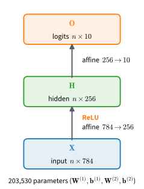

```{.python .input}
%load_ext d2lbook.tab
tab.interact_select('mxnet', 'pytorch', 'tensorflow', 'jax')
```

# Implementation of Multilayer Perceptrons
:label:`sec_mlp-implementation`

An MLP implementation extends a linear classifier by composing affine layers
with nonlinear activations. We first write this composition explicitly and
then use the corresponding framework layers.

```{.python .input #mlp-implementation-implementation-of-multilayer-perceptrons}
%%tab mxnet
from d2l import mxnet as d2l
from mxnet import np, npx
from mxnet.gluon import nn
npx.set_np()
```

```{.python .input #mlp-implementation-implementation-of-multilayer-perceptrons}
%%tab pytorch
from d2l import torch as d2l
import torch
from torch import nn
```

```{.python .input #mlp-implementation-implementation-of-multilayer-perceptrons}
%%tab tensorflow
from d2l import tensorflow as d2l
import tensorflow as tf
```

```{.python .input #mlp-implementation-implementation-of-multilayer-perceptrons}
%%tab jax
from d2l import jax as d2l
from flax import nnx
from jax import numpy as jnp
```

## Implementation from Scratch

We begin with an implementation using tensors and automatic differentiation.

### Initializing Model Parameters

Recall that Fashion-MNIST contains 10 classes,
and that each image consists of a $28 \times 28 = 784$
grid of grayscale pixel values.
As before we will disregard the spatial structure
among the pixels for now,
so we can think of this as a classification dataset
with 784 input features and 10 classes.
To begin, we will implement an MLP
with one hidden layer and 256 hidden units
(:numref:`fig_mdl-mlp-arch`).
Both the number of layers and their width are adjustable
(they are considered hyperparameters).
Powers-of-two widths often align well with accelerator kernels, although the
fastest dimensions depend on the hardware and numerical precision.


:label:`fig_mdl-mlp-arch`

Again, we will represent our parameters with several tensors.
Note that *for every layer*, we must keep track of
one weight matrix and one bias vector.
As always, we allocate memory
for the gradients of the loss with respect to these parameters.
We use small Gaussian noise ($\sigma = 0.01$) as a simple starting point;
principled strategies for choosing this scale are the subject of
:numref:`sec_numerical_stability`.

:begin_tab:`mxnet`
In the code below, we first define and initialize the parameters
and then enable gradient tracking.
:end_tab:

:begin_tab:`pytorch`
In the code below we use `nn.Parameter`
to automatically register
a class attribute as a parameter to be tracked by `autograd` (:numref:`sec_autograd`).
:end_tab:

:begin_tab:`tensorflow`
In the code below we use `tf.Variable`
to define the model parameter.
:end_tab:

:begin_tab:`jax`
In the code below, `nnx.Param` marks each array as a trainable parameter.
:end_tab:

```{.python .input #mlp-implementation-initializing-model-parameters}
%%tab mxnet
class MLPScratch(d2l.Classifier):
    def __init__(self, num_inputs, num_outputs, num_hiddens, lr, sigma=0.01):
        super().__init__()
        self.save_hyperparameters()
        self.W1 = np.random.randn(num_inputs, num_hiddens) * sigma
        self.b1 = np.zeros(num_hiddens)
        self.W2 = np.random.randn(num_hiddens, num_outputs) * sigma
        self.b2 = np.zeros(num_outputs)
        for param in self.get_scratch_params():
            param.attach_grad()
```

```{.python .input #mlp-implementation-initializing-model-parameters}
%%tab pytorch
class MLPScratch(d2l.Classifier):
    def __init__(self, num_inputs, num_outputs, num_hiddens, lr, sigma=0.01):
        super().__init__()
        self.save_hyperparameters()
        self.W1 = nn.Parameter(torch.randn(num_inputs, num_hiddens) * sigma)
        self.b1 = nn.Parameter(torch.zeros(num_hiddens))
        self.W2 = nn.Parameter(torch.randn(num_hiddens, num_outputs) * sigma)
        self.b2 = nn.Parameter(torch.zeros(num_outputs))
```

```{.python .input #mlp-implementation-initializing-model-parameters}
%%tab tensorflow
class MLPScratch(d2l.Classifier):
    def __init__(self, num_inputs, num_outputs, num_hiddens, lr, sigma=0.01):
        super().__init__()
        self.save_hyperparameters()
        self.W1 = tf.Variable(
            tf.random.normal((num_inputs, num_hiddens)) * sigma)
        self.b1 = tf.Variable(tf.zeros(num_hiddens))
        self.W2 = tf.Variable(
            tf.random.normal((num_hiddens, num_outputs)) * sigma)
        self.b2 = tf.Variable(tf.zeros(num_outputs))
```

```{.python .input #mlp-implementation-initializing-model-parameters}
%%tab jax
class MLPScratch(d2l.Classifier):
    def __init__(self, num_inputs, num_outputs, num_hiddens, lr,
                 sigma=0.01, rngs=None):
        super().__init__()
        self.save_hyperparameters(ignore=['rngs'])
        rngs = nnx.Rngs(d2l.get_key()) if rngs is None else rngs
        self.W1 = nnx.Param(
            rngs.params.normal((num_inputs, num_hiddens)) * sigma)
        self.b1 = nnx.Param(jnp.zeros(num_hiddens))
        self.W2 = nnx.Param(
            rngs.params.normal((num_hiddens, num_outputs)) * sigma)
        self.b2 = nnx.Param(jnp.zeros(num_outputs))
```

### Model

To expose the complete forward computation, we implement ReLU directly rather
than invoking the built-in `relu` function.

```{.python .input #mlp-implementation-model-1}
%%tab mxnet
def relu(X):
    return np.maximum(X, 0)
```

```{.python .input #mlp-implementation-model-1}
%%tab pytorch
def relu(X):
    return torch.maximum(X, torch.zeros_like(X))
```

```{.python .input #mlp-implementation-model-1}
%%tab tensorflow
def relu(X):
    return tf.math.maximum(X, 0)
```

```{.python .input #mlp-implementation-model-1}
%%tab jax
def relu(X):
    return jnp.maximum(X, 0)
```

Since we are disregarding spatial structure,
we `reshape` each two-dimensional image into
a flat vector of length  `num_inputs`.
The forward method then requires only the flattening and two affine
computations. Automatic differentiation supplies the backward pass.

```{.python .input #mlp-implementation-model-2}
@d2l.add_to_class(MLPScratch)
def forward(self, X):
    X = d2l.reshape(X, (-1, self.num_inputs))
    H = relu(d2l.matmul(X, self.W1) + self.b1)
    return d2l.matmul(H, self.W2) + self.b2
```

### Training

The training loop is the same as for softmax regression. We define the model,
data, and trainer, then invoke `fit` on the model and data.

```{.python .input #mlp-implementation-training}
model = MLPScratch(num_inputs=784, num_outputs=10, num_hiddens=256, lr=0.1)
data = d2l.FashionMNIST(batch_size=256)
trainer = d2l.Trainer(max_epochs=30)
trainer.fit(model, data)
```

In the displayed run, validation accuracy settles near $0.87$, above the earlier
softmax-regression run. This comparison is illustrative: initialization,
shuffling, framework defaults, and optimization settings also affect the result.

## Concise Implementation

High-level framework layers provide a more concise implementation of the same
architecture.

### Model

Compared with our concise implementation
of softmax regression
(:numref:`sec_softmax_concise`),
the only difference is that we add
*two* fully connected layers where we previously added only *one*.
The first is the hidden layer,
the second is the output layer.

```{.python .input #mlp-implementation-model-2-2}
%%tab mxnet
class MLP(d2l.Classifier):
    def __init__(self, num_outputs, num_hiddens, lr):
        super().__init__()
        self.save_hyperparameters()
        self.net = nn.Sequential()
        self.net.add(nn.Dense(num_hiddens, activation='relu'),
                     nn.Dense(num_outputs))
        self.net.initialize()
```

```{.python .input #mlp-implementation-model-2-2}
%%tab pytorch
class MLP(d2l.Classifier):
    def __init__(self, num_outputs, num_hiddens, lr):
        super().__init__()
        self.save_hyperparameters()
        self.net = nn.Sequential(nn.Flatten(), nn.LazyLinear(num_hiddens),
                                 nn.ReLU(), nn.LazyLinear(num_outputs))
```

```{.python .input #mlp-implementation-model-2-2}
%%tab tensorflow
class MLP(d2l.Classifier):
    def __init__(self, num_outputs, num_hiddens, lr):
        super().__init__()
        self.save_hyperparameters()
        self.net = tf.keras.models.Sequential([
            tf.keras.layers.Flatten(),
            tf.keras.layers.Dense(num_hiddens, activation='relu'),
            tf.keras.layers.Dense(num_outputs)])
```

```{.python .input #mlp-implementation-model-2-2}
%%tab jax
class MLP(d2l.Classifier):
    def __init__(self, num_outputs, num_hiddens, lr, num_inputs=784,
                 rngs=None):
        super().__init__()
        self.save_hyperparameters(ignore=['rngs'])
        rngs = nnx.Rngs(d2l.get_key()) if rngs is None else rngs
        self.hidden = nnx.Linear(num_inputs, num_hiddens, rngs=rngs)
        self.output = nnx.Linear(num_hiddens, num_outputs, rngs=rngs)

    def forward(self, X):
        X = X.reshape((X.shape[0], -1))  # Flatten
        return self.output(nnx.relu(self.hidden(X)))
```

A `forward` method applies each model transformation to the output of the
preceding one. Here, `MLP` inherits the `Module` implementation
(:numref:`subsec_oo-design-models`), which invokes `self.net(X)`. The
`Sequential` container applies its registered transformations in order and
therefore defines the forward computation. :numref:`subsec_model-construction-sequential`
examines this container in detail.


### Training

The training loop is the same as for softmax regression.
This modularity enables us to separate
matters concerning the model architecture
from orthogonal considerations.
Note that while the two versions compute the same *architecture*, they do not
start from the same *parameters*: the scratch model draws its weights from
$\mathcal{N}(0, 0.01^2)$, whereas the concise version uses the library's
default initializer. Defaults differ across libraries and layer types, so the
two versions need not start at comparable scales. Their training trajectories
and final accuracies can therefore differ.

```{.python .input #mlp-implementation-training-2}
model = MLP(num_outputs=10, num_hiddens=256, lr=0.1)
trainer.fit(model, data)
```

## Summary

We have built and trained a multilayer perceptron in both from-scratch and concise
forms. The from-scratch version exposes two weight matrices, two bias vectors, a
ReLU, and the two affine computations. The concise version represents the same
architecture as a four-element `nn.Sequential` stack. The training loop, loss,
and data loader remain unchanged from softmax regression.

The from-scratch version also shows why high-level containers are useful:
manually naming and tracking parameters becomes cumbersome as layers are added
or reordered. `nn.Sequential` handles both registration and execution order.

Three questions remain open, and each is the subject of one of the next sections:

* **How do gradients flow through this stack, and what can go wrong as it gets deeper?** (:numref:`sec_backprop`, :numref:`sec_numerical_stability`)
* **Why does such a flexible model generalize to unseen data at all?** (:numref:`sec_generalization_deep`)
* **How can we regularize it to generalize better?** (:numref:`sec_dropout`)

The following sections address these requirements for reliable training.


## Exercises

1. [code] **Width and learning rate.** Train `MLP` for 10 epochs at every
   combination of learning rate in $\{0.01, 0.03, 0.1, 0.3\}$ and hidden
   width `num_hiddens` in $\{32, 64, 128, 256\}$, and plot the final
   validation accuracy as a heatmap.
    1. At the learning rate $0.1$ used in this section, which width gives the
       best result, and how strongly does accuracy depend on width there?
    1. Does the best learning rate shift systematically with width?
    1. Repeat the sweep over learning rates at width 256 with 20 epochs
       instead of 10. How does the best learning rate relate to the training
       budget?
1. **Parameter count.** The one-hidden-layer model of this section maps 784
   inputs through $h$ hidden units to 10 outputs.
    1. Give a closed-form expression for the total number of parameters as a
       function of $h$.
    1. At which $h$ does the parameter count equal the number of training
       examples in Fashion-MNIST (60,000)? Compare this value with the 256
       units used in this section.
1. [code] **Single hidden unit.** Set `num_hiddens=1` in `MLP`, so that its
   hidden layer has a single ReLU unit with weights
   $\mathbf{w}^{(1)} \in \mathbb{R}^{784 \times 1}$ and bias
   $b^{(1)} \in \mathbb{R}$. Each input $\mathbf{x} \in \mathbb{R}^{1 \times 784}$
   is then reduced to the scalar
   $t = \operatorname{ReLU}(\mathbf{x}\mathbf{w}^{(1)} + b^{(1)}) \geq 0$,
   and the logits are $\mathbf{o} = t\, \mathbf{w}^{(2)} + \mathbf{b}^{(2)}$
   with $\mathbf{w}^{(2)}, \mathbf{b}^{(2)} \in \mathbb{R}^{1 \times 10}$.
    1. Show that each class is predicted on at most one interval of $t$, and
       that the order of these intervals along the $t$ axis is fixed by the
       entries of $\mathbf{w}^{(2)}$. Describe the regions of input space
       that the model assigns to the classes, and state what they imply for
       separating the ten Fashion-MNIST classes.
    1. Suppose that after some update
       $\mathbf{x}\mathbf{w}^{(1)} + b^{(1)} < 0$ for every training
       example. Which parameters receive nonzero gradients from then on, and
       what does the network predict? Why does the same event do little
       harm when it hits one of the 256 hidden units of this section?
    1. Train the model five times from different random initializations, and
       report for each run the validation accuracy and the fraction of
       validation examples on which $t > 0$. Compare any run in which this
       fraction is zero with your answer to (b).
1. [extended] **Joint hyperparameter search.** ● Extend `MLP` so that the
   number of hidden layers is a constructor argument. Treat the learning
   rate, the number of epochs, the number of hidden layers, and the number
   of hidden units per layer as four hyperparameters with four candidate
   values each.
    1. How many training runs does a full grid over these values need? How
       many does tuning one hyperparameter at a time need, sweeping it over
       its four values while the others stay fixed? Use the heatmap of
       Exercise 1 to explain when the cheaper procedure misses the best
       configuration.
    1. Describe a search strategy that covers all four hyperparameters at a
       small fraction of the grid's cost. Use it to find the best validation
       accuracy you can reach, and report the configuration that achieves
       it.
1. [code] **Gradient check.** ● Cast the parameters of `MLPScratch` and one
   minibatch of Fashion-MNIST to double precision. For an entry $w$ of `W1`,
   the central difference

    $$\hat{g} = \frac{\ell(w + \epsilon) - \ell(w - \epsilon)}{2\epsilon}$$

    approximates the derivative $g = \partial \ell / \partial w$ of the
    minibatch loss $\ell$. Compute $\hat{g}$ and the gradient $g$ from
    automatic differentiation for 50 randomly chosen entries of `W1`.
    1. For some entries both $g$ and $\hat{g}$ are exactly zero. Explain how
       this happens in this network, and exclude these entries below.
    1. Plot the maximum over the sample of the relative error
       $|g - \hat{g}| / \max(|g|, |\hat{g}|)$ against $\epsilon$ for
       $\epsilon = 10^{-1}, 10^{-2}, \ldots, 10^{-9}$. Inspect the entries
       that attain the maximum, and explain why the error grows at both
       ends of this range.

    *Adapted from Stanford CS231n,
    [Assignment 1](https://cs231n.github.io/assignments2023/assignment1/),
    two-layer network.*
1. [code] **Benchmarking implementations.** Compare the speed of `MLPScratch`
   and `MLP`: train both at hidden widths 256, 1024, and 4096 for three
   epochs each on Fashion-MNIST, recording the wall-clock time per epoch.
   Plot the ratio of `MLPScratch` time to `MLP` time as a function of width.
   Does the ratio grow, shrink, or stay flat as the network gets larger?
   Suggest an explanation.
1. [code] **Memory alignment.** Time the product of two $n \times n$
   matrices for $n \in \{1024, 1025, 1026, 1028, 1032\}$. Divide the $2n^3$
   floating-point operations of each product by its time to obtain the
   throughput. Measure the throughput on a CPU in single precision and on a
   GPU in single and half precision. For which $n$ does the throughput drop
   on each device and precision, and by how much?
1. **Arithmetic intensity.** ● The matrix product of Exercise 7 reads two
   $n \times n$ matrices and writes one, so it performs $2n^3$ operations on
   $3n^2$ numbers. Compare this ratio, in operations per byte at $n = 1024$
   in single precision (4 bytes per number),
   with the ratio of your device's peak arithmetic rate to its memory
   bandwidth. Does memory bandwidth or arithmetic limit the speed? Which
   property of the hardware or of its matrix-multiplication kernels makes
   some $n$ faster than others?
1. [code] **Activation functions.** Replace the ReLU in `MLP` by tanh,
   sigmoid, and GELU in turn, and train each of the four versions on
   Fashion-MNIST for 10 epochs.
    1. For each activation, pick the best learning rate from
       $\{0.03, 0.1, 0.3, 1\}$. Which activation reaches the highest
       validation accuracy, and by how much does it beat the worst?
    1. Repeat the comparison with three hidden layers of width 256. Does the
       ranking change? Relate the result to the derivative of each
       activation.
1. [code] **Initialization scale and depth.** ● `MLPScratch` initializes its
   weights with Gaussian noise of standard deviation $\sigma = 0.01$.
    1. Train the one-hidden-layer model with $\sigma = 0.001$, $0.01$, and
       $0.1$, and plot the training and validation curves for each. How
       much do the curves differ, and does the difference persist as
       training continues? Relate your observation to the scale of the
       hidden activations and the logits on the first forward pass.
    1. Extend `MLPScratch` to two and to four hidden layers, each of width
       256. Before running anything, predict which depth is more sensitive
       to $\sigma$, and why.
    1. Sweep $\sigma$ over $\{0.001, 0.003, 0.01, 0.03, 0.1\}$ for both
       depths. For each depth, report the range of $\sigma$ for which the
       network reaches at least 70% validation accuracy within five epochs.
       :numref:`sec_numerical_stability` develops the principled answer.

    *Adapted from Stanford CS231n,
    [Assignment 2](https://cs231n.github.io/assignments2023/assignment2/),
    FullyConnectedNets Inline Question 1.*

:begin_tab:`mxnet`
[Discussions](https://d2l.discourse.group/t/92)
:end_tab:

:begin_tab:`pytorch`
[Discussions](https://d2l.discourse.group/t/93)
:end_tab:

:begin_tab:`tensorflow`
[Discussions](https://d2l.discourse.group/t/227)
:end_tab:

:begin_tab:`jax`
[Discussions](https://d2l.discourse.group/t/17985)
:end_tab:

<!-- slides -->

::: {.slide}
::: {.cover}
[Dive into Deep Learning · §5.2]{.kicker}

**Implementing a Multilayer Perceptron**<br>From-scratch and framework-layer implementations; the displayed run reaches $\approx 0.87$ validation accuracy
:::
:::

::: {.slide title="The MLP architecture"}
[What we are building]{.kicker}

::: {.cols .vc}
::: {.col}
A batched image is **flattened** to 784 features, mapped by
an **affine layer + ReLU** to a 256-dim hidden vector, then
by a **second affine layer** to 10 logits.

- One hidden layer, one nonlinearity.
- Same loss, loaders, and `Trainer` as softmax regression.

::: {.d2l-note .rule}
That ReLU between the two affine maps, together with the hidden
layer, is the *entire* difference from a linear classifier like
softmax regression.
:::
:::

::: {.col .fig .big}

:::
:::
:::

::: {.slide title="Why these sizes?"}
[Design choices]{.kicker}

::: {.cols .vc}
::: {.col}
Fashion-MNIST: $784$ inputs, $10$ classes. We pick **256**
hidden units, giving $\approx 200\text{k}$ parameters.

- **Width 256:** a representative capacity for this example.
- **A power of 2:** often favorable for accelerator kernels,
  although performance depends on hardware and precision.
- **One hidden layer** suffices here; spatial structure
  waits for convolutions.

::: {.d2l-note .rule}
Depth, width, and learning rate are **hyperparameters**:
chosen by hand, not learned.
:::
:::

::: {.col .fig}

:::
:::
:::

::: {.slide}
::: {.divider}
[01]{.dnum}

[From Scratch]{.dtitle}

[parameters, ReLU, and forward by hand]{.dsub}
:::
:::

::: {.slide title="Parameters: two weights, two biases"}
[From Scratch]{.kicker}

::: {.cols .vc}
::: {.col}
@mlp-implementation-initializing-model-parameters
:::

::: {.col .narrow}
Weights start as small Gaussian noise ($\sigma=0.01$) to break symmetry, biases at zero:

$$\mathbf{W}^{(1)}\!\in\mathbb{R}^{784\times256},\;
  \mathbf{b}^{(1)}\!\in\mathbb{R}^{256}$$
$$\mathbf{W}^{(2)}\!\in\mathbb{R}^{256\times10},\;
  \mathbf{b}^{(2)}\!\in\mathbb{R}^{10}$$

::: {.d2l-note}
$784\cdot256 + 256 + 256\cdot10 + 10 = 203{,}530$ learnable numbers.
:::
:::
:::
:::

::: {.slide title="ReLU, by hand"}
[From Scratch]{.kicker}

We write the activation directly as $\max(x, 0)$,
applied elementwise:

@mlp-implementation-model-1

::: {.d2l-note}
Map negative inputs to zero and retain positive inputs. This
nonlinearity prevents the affine maps from collapsing into one.
:::
:::

::: {.slide title="The forward pass is two lines"}
[From Scratch]{.kicker}

Flatten, then an affine-ReLU, then a second affine, exactly
the data flow in the diagram:

$$\mathbf{H} = \mathrm{ReLU}(\mathbf{X}\mathbf{W}^{(1)} + \mathbf{b}^{(1)}),
\qquad
  \mathbf{O} = \mathbf{H}\mathbf{W}^{(2)} + \mathbf{b}^{(2)}.$$

@mlp-implementation-model-2
:::

::: {.slide title="Training the from-scratch model"}
[From Scratch]{.kicker}

The loss, the loaders, and the `Trainer` are **unchanged**
from softmax regression. Only the model class is new:

@!mlp-implementation-training

::: {.d2l-note .rule}
In this run, validation accuracy settles around $\approx 0.87$ over 30 epochs,
a modest gain over the softmax regression baseline on the same data,
for a model with one hidden layer and a ReLU.
:::
:::

::: {.slide}
::: {.divider}
[02]{.dnum}

[Concise]{.dtitle}

[framework layers register parameters and compose operations]{.dsub}
:::
:::

::: {.slide title="The same model, declared" except="jax"}
[Concise]{.kicker}

::: {.cols .vc}
::: {.col}
Stack the layers in the framework's container. Lazy linear
layers infer their input size; `ReLU` and `Flatten` come
built in:

@mlp-implementation-model-2-2
:::

::: {.col .narrow}
::: {.d2l-note .rule}
`Sequential` *is* the forward pass: apply each layer in
turn. No hand-written `forward`, no parameter bookkeeping.
:::

Same architecture as the diagram, four lines instead of two
classes.
:::
:::
:::

::: {.slide title="The same model, declared" only="jax"}
[Concise]{.kicker}

::: {.cols .vc}
::: {.col}
NNX stores each layer as an ordinary attribute and registers its
parameters automatically:

@mlp-implementation-model-2-2
:::

::: {.col .narrow}
::: {.d2l-note .rule}
No hand-written parameter dictionary: each `nnx.Linear` owns
its weights from construction onward.
:::

Same architecture as the diagram, one compact method.
:::
:::
:::

::: {.slide title="Reusing the training loop"}
[Concise]{.kicker}

The concise model reuses the same `trainer` and data. Its
trajectory can differ because its initializer is different:

@mlp-implementation-training-2

::: {.d2l-note}
Same *architecture*, different init (framework default vs
$\mathcal{N}(0, 0.01^2)$), so trajectories differ slightly.
:::
:::

::: {.slide}
::: {.divider}
[03]{.dnum}

[What's next]{.dtitle}

[from a working MLP to a reliable one]{.dsub}
:::
:::

::: {.slide title="Four open questions"}
[Where this goes]{.kicker}

We have a working MLP. Making it *reliable* is the rest of
this chapter:

- **Backprop (the forward/backward-propagation section):** how gradients
  flow through an arbitrary stack.
- **Initialization (the numerical-stability section):** choose $\sigma$ so
  signals neither vanish nor explode through depth.
- **Generalization (the generalization-in-deep-learning section):** why a
  flexible model does well on unseen data at all.
- **Regularization (the dropout section):** dropout, and friends.

::: {.d2l-note}
Each question gets its own section, and exercise 2 hands you the
next question: add a second hidden layer while keeping
$\sigma = 0.01$, and the deeper net trains *worse*. The numerical-stability
section explains.
:::
:::

::: {.slide title="Recap"}
[Wrap-up]{.kicker}

::: {.cols}
::: {.col}
- An **MLP** = a linear classifier plus a hidden layer and
  a **nonlinearity** between affine maps.
- **From scratch:** four parameter tensors, a hand-rolled
  ReLU, a two-line forward. Concrete, but tedious to ship.
- **Concise:** declare the layer stack; `Sequential` holds
  the parameters and defines the forward pass.
:::

::: {.col}
- Both forms declare the **same architecture** (inits differ).
- The **training loop is unchanged** from softmax
  regression (modularity paying off).
- Hyperparameters (depth, width, lr) live **outside** the
  model; the same loop trains any of them.
- The displayed run settles around **$\approx 0.87$**; a controlled comparison
  would also match seeds, initialization, and optimization settings.
:::
:::

::: {.d2l-note}
The next section derives the gradients computed by `backward()` and verifies
them numerically.
:::
:::
