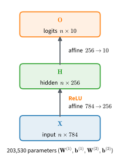

```{.python .input}
%load_ext d2lbook.tab
tab.interact_select('mxnet', 'pytorch', 'tensorflow', 'jax')
```

# Implementation
:label:`sec_mlp-implementation`

In :numref:`sec_mlp` we chose the weights of a hidden layer by hand, which
is feasible for the four points of XOR and for little else. Let us now leave
the choice to training, on real images. On Fashion-MNIST, softmax
regression reached about 83% validation accuracy after ten epochs, and most
of its errors confused garments of similar outline, such as shirts,
pullovers, and coats (:numref:`sec_softmax_scratch`). Telling such garments
apart depends on how pixels combine, which is what a hidden layer can
compute. How many of the errors does one hidden layer remove, which ones,
and what does it cost? On paper the cost is considerable: with 256 hidden
units the MLP
has 26 times the parameters of softmax regression (:numref:`sec_mlp`) and
performs 26 times the arithmetic on every image. Whether the gain in
accuracy justifies this extra work is a question for experiment.

We implement the MLP twice and train it as we trained softmax regression.
The first implementation writes the four parameter arrays, the activation
function, and the forward pass with tensor operations, and it checks the
untrained model before any training time is spent. The second assembles the
same model from the framework's layers. The data, the cross-entropy loss,
minibatch stochastic gradient descent (SGD), and the `Trainer` stay as they
were, so any change in accuracy comes from the hidden layer. Finally we
compare the MLP with softmax regression trained under the same settings, in
accuracy, class by class, and in training time, and we look at what its
hidden units compute. Automatic differentiation computes
all gradients in this section; the next section shows how.

```{.python .input #mlp-implementation-implementation-of-multilayer-perceptrons}
%%tab mxnet
import math
import numpy as np
from mxnet import autograd, gluon, init, np as mnp, npx
from mxnet.gluon import nn
from d2l import mxnet as d2l
npx.set_np()
```

```{.python .input #mlp-implementation-implementation-of-multilayer-perceptrons}
%%tab pytorch
import math
import numpy as np
import torch
from torch import nn
from torch.nn import functional as F
from d2l import torch as d2l
```

```{.python .input #mlp-implementation-implementation-of-multilayer-perceptrons}
%%tab tensorflow
import math
import numpy as np
import tensorflow as tf
from d2l import tensorflow as d2l
```

```{.python .input #mlp-implementation-implementation-of-multilayer-perceptrons}
%%tab jax
import math
import numpy as np
import jax
from jax import numpy as jnp
from flax import nnx
import optax
from d2l import jax as d2l
```

```{.python .input #mlp-implementation-implementation-1}
import time
```

## Implementation from Scratch

### The Parameters

Each $28 \times 28$ image becomes a vector of $d = 784$ pixel values, and
there are $q = 10$ classes. We give the hidden layer $h = 256$ units
(:numref:`fig_mdl-mlp-arch`). The width is a hyperparameter, like the
learning rate: training does not choose it, and Exercise
:exref:`ex_mlp-implementation-width` compares other widths. In the notation
of :numref:`sec_mlp`, each layer has a weight matrix with one row per input
and one column per output, and a bias vector with one entry per output:

$$\mathbf{W}^{(1)} \in \mathbb{R}^{784 \times 256}, \quad \mathbf{b}^{(1)} \in \mathbb{R}^{256}, \quad \mathbf{W}^{(2)} \in \mathbb{R}^{256 \times 10}, \quad \mathbf{b}^{(2)} \in \mathbb{R}^{10}.$$

Together these hold the 203,530 numbers counted in :numref:`sec_mlp`. All
but 2,570 of them belong to the hidden layer.


:label:`fig_mdl-mlp-arch`

How should the four arrays start? As for softmax regression, we draw the
weights from a normal distribution with mean 0 and standard deviation 0.01
and set the biases to 0. The weights must be random: hidden units that
start with equal weights receive equal gradients and stay identical
throughout training, as :numref:`sec_numerical_stability` shows. Small
weights keep the logits close to 0 at first, so the untrained model gives
every class a probability close to 1/10. The scale 0.01 itself is merely
inherited from softmax regression, which keeps the comparison between the
two models clean. It is not a good scale for a network with a hidden layer,
and the first epochs of training will show it.

We register the four arrays as parameters of the module, as in
:numref:`sec_softmax_scratch`. The default optimizer of `Classifier`,
minibatch SGD at the learning rate `lr`, then finds them by itself, and the
model needs no `configure_optimizers` of its own. The argument `std` sets
the standard deviation of the initial weights.

:begin_tab:`mxnet`
`initialize` allocates the values of the four parameters, which `data()`
returns.
:end_tab:

:begin_tab:`jax`
As in :numref:`sec_softmax_scratch`, the argument `rngs` supplies the random
key for the initialization.
:end_tab:

```{.python .input #mlp-implementation-initializing-model-parameters}
%%tab mxnet
class MLPScratch(d2l.Classifier):
    """An MLP with one hidden layer, implemented from scratch."""
    def __init__(self, num_inputs, num_outputs, num_hiddens, lr, std=0.01):
        super().__init__()
        self.save_hyperparameters()
        normal, zero = init.Normal(std), init.Zero()
        self.W1 = gluon.Parameter('W1', shape=(num_inputs, num_hiddens),
                                  init=normal)
        self.b1 = gluon.Parameter('b1', shape=(num_hiddens,), init=zero)
        self.W2 = gluon.Parameter('W2', shape=(num_hiddens, num_outputs),
                                  init=normal)
        self.b2 = gluon.Parameter('b2', shape=(num_outputs,), init=zero)
        self.initialize()
```

```{.python .input #mlp-implementation-initializing-model-parameters}
%%tab pytorch
class MLPScratch(d2l.Classifier):
    """An MLP with one hidden layer, implemented from scratch."""
    def __init__(self, num_inputs, num_outputs, num_hiddens, lr, std=0.01):
        super().__init__()
        self.save_hyperparameters()
        self.W1 = nn.Parameter(d2l.normal(0, std, (num_inputs, num_hiddens)))
        self.b1 = nn.Parameter(d2l.zeros(num_hiddens))
        self.W2 = nn.Parameter(d2l.normal(0, std, (num_hiddens, num_outputs)))
        self.b2 = nn.Parameter(d2l.zeros(num_outputs))
```

```{.python .input #mlp-implementation-initializing-model-parameters}
%%tab tensorflow
class MLPScratch(d2l.Classifier):
    """An MLP with one hidden layer, implemented from scratch."""
    def __init__(self, num_inputs, num_outputs, num_hiddens, lr, std=0.01):
        super().__init__()
        self.save_hyperparameters()
        self.W1 = self.add_weight(name='W1', shape=(num_inputs, num_hiddens),
                                  initializer=self.normal())
        self.b1 = self.add_weight(name='b1', shape=(num_hiddens,),
                                  initializer='zeros')
        self.W2 = self.add_weight(name='W2', shape=(num_hiddens, num_outputs),
                                  initializer=self.normal())
        self.b2 = self.add_weight(name='b2', shape=(num_outputs,),
                                  initializer='zeros')

    def normal(self):
        # A new initializer for each weight matrix: one initializer object
        # returns the same values every time it is called
        return tf.keras.initializers.RandomNormal(stddev=self.std)
```

```{.python .input #mlp-implementation-initializing-model-parameters}
%%tab jax
class MLPScratch(d2l.Classifier):
    """An MLP with one hidden layer, implemented from scratch."""
    def __init__(self, num_inputs, num_outputs, num_hiddens, lr, std=0.01,
                 rngs=None):
        super().__init__()
        self.save_hyperparameters(ignore=['rngs'])
        rngs = nnx.Rngs(d2l.get_key()) if rngs is None else rngs
        self.W1 = nnx.Param(
            rngs.params.normal((num_inputs, num_hiddens)) * std)
        self.b1 = nnx.Param(jnp.zeros(num_hiddens))
        self.W2 = nnx.Param(
            rngs.params.normal((num_hiddens, num_outputs)) * std)
        self.b2 = nnx.Param(jnp.zeros(num_outputs))
```

### The Forward Pass

Let us start with the activation function, which we write ourselves. The
ReLU keeps the positive entries and zeros the others, so it multiplies each
entry $z$ by 1 if $z > 0$ and by 0 otherwise. (Written as a product with
this mask, it also gets the derivative 0 at $z = 0$ from automatic
differentiation, as the built-in ReLU does. A maximum with 0 may get 1 or
$1/2$, depending on the framework, and
:numref:`subsec_activation-functions` explained why we need not care.)

```{.python .input #mlp-implementation-model-1}
%%tab mxnet
def relu(X):
    return X * (X > 0)
```

```{.python .input #mlp-implementation-model-1}
%%tab pytorch
def relu(X):
    return X * (X > 0)
```

```{.python .input #mlp-implementation-model-1}
%%tab tensorflow
def relu(X):
    return X * tf.cast(X > 0, X.dtype)
```

```{.python .input #mlp-implementation-model-1}
%%tab jax
def relu(X):
    return X * (X > 0)
```

For a minibatch of $n$ images, flattened into the rows of
$\mathbf{X} \in \mathbb{R}^{n \times 784}$, the model computes

$$\mathbf{H} = \mathrm{ReLU}\left(\mathbf{X}\mathbf{W}^{(1)} + \mathbf{b}^{(1)}\right), \qquad \mathbf{O} = \mathbf{H}\mathbf{W}^{(2)} + \mathbf{b}^{(2)}.$$

Row $i$ of $\mathbf{H} \in \mathbb{R}^{n \times 256}$ is the hidden
representation of image $i$, and row $i$ of
$\mathbf{O} \in \mathbb{R}^{n \times 10}$ holds its logits; the biases are
added to every row by broadcasting. The method `hidden` computes
$\mathbf{H}$, and `forward` computes $\mathbf{O}$ from it. That is the
whole model. Note that it returns logits, not probabilities: the loss that
every `Classifier` inherits computes the cross-entropy from the logits
(:numref:`sec_softmax_concise`).

```{.python .input #mlp-implementation-model-2}
%%tab mxnet
@d2l.add_to_class(MLPScratch)
def hidden(self, X):
    X = d2l.reshape(X, (-1, self.num_inputs))  # One flattened image per row
    return relu(d2l.matmul(X, self.W1.data()) + self.b1.data())

@d2l.add_to_class(MLPScratch)
def forward(self, X):
    return d2l.matmul(self.hidden(X), self.W2.data()) + self.b2.data()
```

```{.python .input #mlp-implementation-model-2}
%%tab pytorch, tensorflow, jax
@d2l.add_to_class(MLPScratch)
def hidden(self, X):
    X = d2l.reshape(X, (-1, self.num_inputs))  # One flattened image per row
    return relu(d2l.matmul(X, self.W1) + self.b1)

@d2l.add_to_class(MLPScratch)
def forward(self, X):
    return d2l.matmul(self.hidden(X), self.W2) + self.b2  # The logits
```

### Checks before Training

Training takes minutes, and a mistake in the model may only show as poor
accuracy at the end. A forward pass through the untrained model on a few
images tests three predictions in a fraction of a second. First, each image
should have a hidden representation of 256 entries and one logit per class.
Second, since the logits start close to 0, the loss should be close to
$\log 10 \approx 2.30$, the cross-entropy of a prediction that gives every
class the probability 1/10. Third, about half of the hidden activations
should be positive. With zero biases, the pre-activation of a hidden unit is
a sum of pixel values times weights drawn symmetrically around 0, so it is
positive or negative with equal probability, and the ReLU sets the negative
ones to 0.

```{.python .input #mlp-implementation-checks-before-training}
data = d2l.FashionMNIST(batch_size=256)
model = MLPScratch(num_inputs=784, num_outputs=10, num_hiddens=256, lr=0.1)
X, y = next(iter(data.train_dataloader()))
X, y = X[:8], y[:8]  # Eight images suffice for the checks
H, O = model.hidden(X), model(X)
active = d2l.reduce_mean(d2l.astype(H > 0, d2l.float32))
print('H:', H.shape, 'O:', O.shape)
print(f'loss {d2l.numpy(model.loss(O, y)):.3f}, '
      f'fraction of active units {d2l.numpy(active):.2f}')
```

The shapes are $8 \times 256$ and $8 \times 10$, the loss is close to 2.30,
and about half of the hidden units are active. A weight matrix with its axes
swapped would stop the forward pass with an error, a wrong number of inputs
would show up in the shapes, and a loss far from 2.30 would point to weights
that are too large or to a mistake in the loss.

### Training

We train with the minibatch size and the learning rate of softmax regression
in :numref:`sec_softmax_scratch`, 256 images and 0.1, but for 30 epochs
instead of 10. The longer run is a consequence of our initialization: with
weights this small the hidden layer starts slowly, as the comparison at the
end of this section shows. With `num_gpus=1` the `Trainer` trains on a GPU
if the machine has one and on the CPU otherwise (:numref:`sec_use_gpu`).

```{.python .input #mlp-implementation-training}
trainer = d2l.Trainer(max_epochs=30, num_gpus=1)
trainer.fit(model, data)
```

The training loss falls over all 30 epochs. After the first few epochs the
validation loss lies above it and falls more slowly, and the validation
accuracy climbs for most of the run. The climb is far from smooth. From one
epoch to the next the accuracy moves by about a point, and a single epoch
can fall several points below its neighbors. Nothing is broken: minibatch
SGD at a constant learning rate never settles, and we measure the validation
accuracy wherever the last step of the epoch happened to leave the
parameters.

## Concise Implementation

Nobody who builds networks for a living registers four arrays by hand. A
fully connected layer of the framework holds a weight matrix and a bias
vector and computes the affine map of one layer, as in the concise softmax
regression of :numref:`sec_softmax_concise`. The concise MLP applies four
operations in order: flattening, a fully connected layer with 256 outputs,
the ReLU, and a fully connected layer with 10 outputs. The framework's
sequential container holds the layers that perform them. We initialize the
model like the scratch model. Left to its default, each framework would
draw the weights from a distribution of its own, and the scratch and the
concise model would start from different scales.

:begin_tab:`mxnet`
The `Dense` layer flattens its input itself, and its argument `activation`
applies the ReLU to its output.
:end_tab:

:begin_tab:`pytorch`
As for `SoftmaxRegression`, the lazy layers have no weights before the
first forward pass, so the `Trainer` initializes them afterwards through
the method `weight_init`.
:end_tab:

:begin_tab:`tensorflow`
The argument `activation` of the first `Dense` layer applies the ReLU to its
output.
:end_tab:

:begin_tab:`jax`
`nnx.relu` enters the sequence as a plain function, each `nnx.Linear` needs
its number of inputs up front, and `forward` flattens the images before it
calls the sequence.
:end_tab:

```{.python .input #mlp-implementation-model-2-2}
%%tab mxnet
class MLP(d2l.Classifier):
    """An MLP with one hidden layer, built from framework layers."""
    def __init__(self, num_outputs, num_hiddens, lr):
        super().__init__()
        self.save_hyperparameters()
        self.net = nn.Sequential()
        self.net.add(nn.Dense(num_hiddens, activation='relu'),
                     nn.Dense(num_outputs))
        self.net.initialize(init.Normal(sigma=0.01))
```

```{.python .input #mlp-implementation-model-2-2}
%%tab pytorch
class MLP(d2l.Classifier):
    """An MLP with one hidden layer, built from framework layers."""
    def __init__(self, num_outputs, num_hiddens, lr):
        super().__init__()
        self.save_hyperparameters()
        self.net = nn.Sequential(nn.Flatten(), nn.LazyLinear(num_hiddens),
                                 nn.ReLU(), nn.LazyLinear(num_outputs))

    def weight_init(self, module):
        # The Trainer calls this once the lazy layers know their shapes
        if isinstance(module, nn.Linear):
            nn.init.normal_(module.weight, std=0.01)
            nn.init.zeros_(module.bias)
```

```{.python .input #mlp-implementation-model-2-2}
%%tab tensorflow
class MLP(d2l.Classifier):
    """An MLP with one hidden layer, built from framework layers."""
    def __init__(self, num_outputs, num_hiddens, lr):
        super().__init__()
        self.save_hyperparameters()
        normal = tf.keras.initializers.RandomNormal
        self.net = tf.keras.models.Sequential([
            tf.keras.layers.Flatten(),
            tf.keras.layers.Dense(num_hiddens, activation='relu',
                                  kernel_initializer=normal(stddev=0.01)),
            tf.keras.layers.Dense(num_outputs,
                                  kernel_initializer=normal(stddev=0.01))])
```

```{.python .input #mlp-implementation-model-2-2}
%%tab jax
class MLP(d2l.Classifier):
    """An MLP with one hidden layer, built from framework layers."""
    def __init__(self, num_outputs, num_hiddens, lr, num_inputs=784,
                 rngs=None):
        super().__init__()
        self.save_hyperparameters(ignore=['rngs'])
        rngs = nnx.Rngs(d2l.get_key()) if rngs is None else rngs
        normal = nnx.initializers.normal(0.01)
        self.net = nnx.Sequential(
            nnx.Linear(num_inputs, num_hiddens, kernel_init=normal,
                       rngs=rngs),
            nnx.relu,
            nnx.Linear(num_hiddens, num_outputs, kernel_init=normal,
                       rngs=rngs))

    def forward(self, X):
        return self.net(X.reshape((X.shape[0], -1)))  # Flatten each image
```

:begin_tab:`mxnet, pytorch, tensorflow`
The model needs no `forward` method of its own. It inherits the `forward`
of `Module` (:numref:`subsec_oo-design-models`), which calls `self.net(X)`.
:numref:`subsec_model-construction-sequential` looks inside such a
container.
:end_tab:

The scratch model spelled out every array and every operation. Here the
layers hold the parameters and the container fixes the order of the
operations, and this is the form that scales: with a deeper network, or one
whose layers we want to reorder, nothing has to be named and registered by
hand.

## Comparison with Softmax Regression

### Accuracy

We now train the concise MLP and, for comparison, the concise softmax
regression of :numref:`sec_softmax_concise`, `d2l.SoftmaxRegression`, with
the same trainer: 30 epochs, minibatches of 256, and learning rate 0.1. All
three models start from the same initialization. We time each run and keep
its validation accuracy after every epoch from `trainer.history`. The
trainer's plot is switched off, and we draw the validation curves of the
three models, the scratch MLP included, in one plot instead.

```{.python .input #mlp-implementation-accuracy-1}
curves, seconds = {'MLP from scratch': trainer.history['val_acc']}, {}
trainer.board.display = False
models = {'concise MLP': MLP(num_outputs=10, num_hiddens=256, lr=0.1),
          'softmax regression': d2l.SoftmaxRegression(num_outputs=10, lr=0.1)}
for name, net in models.items():
    start = time.perf_counter()
    trainer.fit(net, data)
    seconds[name] = (time.perf_counter() - start) / trainer.max_epochs
    curves[name] = trainer.history['val_acc']
```

```{.python .input #mlp-implementation-accuracy-2}
d2l.plot(list(range(1, trainer.max_epochs + 1)), list(curves.values()),
         'epoch', 'validation accuracy', legend=list(curves))
```

```{.python .input #mlp-implementation-accuracy-3}
print('validation accuracy averaged over the last 5 epochs')
for name, acc in curves.items():  # A single epoch can land a few points low
    print(f'  {name}: {sum(acc[-5:]) / 5:.3f}')
train_acc = trainer.evaluate(model, data, train=True)['acc']
print(f'training accuracy of the MLP from scratch: {train_acc:.3f}')
```

The scratch and the concise MLP follow the same curve up to the variation
from run to run, as they should: they are the same model, written in two
ways. Both start more slowly than softmax regression and usually trail it
by a few points after the first epoch. Our initialization is to blame.
With weights of standard deviation 0.01, the hidden activations are small,
and every gradient that reaches $\mathbf{W}^{(1)}$ is multiplied by entries
of $\mathbf{W}^{(2)}$, which are just as small, so at first the hidden
layer learns slowly. After ten epochs, the training
length of :numref:`sec_softmax_scratch`, the MLP is ahead by about a point
on average, within its variation from epoch to epoch. Had we stopped there,
we could hardly have told the two models apart. Since any single epoch can
land a few points low, we compare the models by their validation accuracy
averaged over the last five epochs: softmax regression levels off at about
84%, while the MLP climbs to about 87%. Three points sound modest. Read as
errors, they are more: the hidden layer removes about a fifth of the errors
of softmax regression. On its own training images the MLP is right about
89% of the time, only a few points more often than on the validation
images.

### Errors by Class

Which fifth? It is tempting to assume that it is the shirts taken for
pullovers and coats, the errors we set out to remove. A total accuracy
cannot tell us. We therefore count, for each class, the fraction of its
validation images that a model classifies correctly. This is the *recall* of
the class, the diagonal of the confusion matrix of
:numref:`sec_softmax_scratch`. The table that follows has a useful feature:
its two MLPs are the same model trained twice, so wherever their columns
disagree, we see how much a single run varies.

```{.python .input #mlp-implementation-errors-by-class}
def recall(net):
    """Fraction of the validation images of each class that net gets right."""
    correct, total = np.zeros(10), np.zeros(10)
    for X, y in map(trainer.prepare_batch, data.val_dataloader()):
        y_hat = d2l.numpy(d2l.argmax(net(X), axis=1))
        y = d2l.numpy(y).astype(int)
        total += np.bincount(y, minlength=10)
        correct += np.bincount(y, weights=y_hat == y, minlength=10)
    return correct / total

recalls = {'softmax': recall(models['softmax regression']),
           'MLP, scratch': recall(model),
           'MLP, concise': recall(models['concise MLP'])}
names = data.text_labels(range(10))
print(f'{"class":11s}' + ''.join(f'{name:>14s}' for name in recalls))
for j, name in enumerate(names):
    print(f'{name:11s}' + ''.join(f'{r[j]:14.2f}' for r in recalls.values()))
```

The answer is less tidy than the question. Start with the six classes that
softmax regression already recognized well: trousers, dresses, bags, and the
three kinds of shoes. Their recall changes by a few points, more often up
than down, and summed over the six, both MLPs make fewer errors than softmax
regression. Among the four tops (T-shirts, pullovers, coats, and shirts)
the table is harder to read, because the two MLPs can disagree with each
other by ten points or more on a single class, although they are the same
model. What we see there is a boundary in motion. The last steps of SGD at a
constant learning rate push the boundaries between similar garments back
and forth, and what one top gains another loses. Only the sum is stable.
Over the four tops together the MLP usually makes fewer errors than softmax
regression, often by a few hundred, which is most of what it saves; after an
unlucky last epoch it can even make more. So we cannot say that the shirts
gain most, and neither does any other single class. The tops remain where
most of the errors are.

### The Learned Features

In :numref:`sec_softmax_scratch` the weights themselves showed what softmax
regression had learned: one template per class, each a blurred garment. For
XOR we chose the hidden features by hand, and we said that for images
training would have to choose them. What has it chosen? The weights tell
again. Column $j$ of $\mathbf{W}^{(1)}$ holds the weights of the 784 pixels
into hidden unit $j$. Reshaped to $28 \times 28$, it is an image: a bright
pixel where it is red raises the pre-activation of the unit, and a bright
pixel where it is blue lowers it. Not every one of the 256 units makes a
clear picture, so we draw the ten units of the scratch MLP with the largest
incoming weights, each on its own color scale. Each is titled
with the class whose logit it raises most, the largest entry of its row of
$\mathbf{W}^{(2)}$.

```{.python .input #mlp-implementation-what-the-hidden-units-compute-1}
%%tab pytorch, tensorflow
W1, W2 = d2l.numpy(model.W1), d2l.numpy(model.W2)
```

```{.python .input #mlp-implementation-what-the-hidden-units-compute-1}
%%tab mxnet
W1, W2 = d2l.numpy(model.W1.data()), d2l.numpy(model.W2.data())
```

```{.python .input #mlp-implementation-what-the-hidden-units-compute-1}
%%tab jax
W1, W2 = d2l.numpy(model.W1[...]), d2l.numpy(model.W2[...])
```

```{.python .input #mlp-implementation-what-the-hidden-units-compute-2}
units = np.argsort(np.linalg.norm(W1, axis=0))[::-1][:10]  # Largest weights
images = W1[:, units].T.reshape(10, 28, 28)
images /= np.abs(images).max(axis=(1, 2), keepdims=True)  # Own color scale
d2l.show_images(images, 2, 5, titles=[names[k] for k in W2[units].argmax(1)],
                cmap='RdBu_r', vmin=-1, vmax=1);
```

These are not ten more templates. Few of the units look like a whole
garment. Most of them weigh a region: a neckline, the edge of a sleeve, the
gap between the legs of a pair of trousers. Often red lies right beside
blue, so that the unit responds to a contrast between neighboring pixels and
not to brightness alone. A template asks how much an image looks like a
shirt. A hidden unit asks a smaller question, about one part of the image,
and the output layer weighs 256 such answers. Note also the titles: most of
the ten units raise the logit of one of the four tops, the shirt most often.
It is at least suggestive that the units which training moved furthest
serve the classes that softmax regression confused most, though ten units
out of 256 do not prove it.

### Parameters, Computation, and Time

The following table collects what the hidden layer adds. The multiply-adds
are those of the forward pass for one image, $784 \cdot 10 = 7{,}840$ for
softmax regression and $784 \cdot 256 + 256 \cdot 10 = 203{,}264$ for the
MLP.

| model | parameters | multiply-adds per image | validation accuracy, epochs 26–30 |
|:--|--:|--:|--:|
| softmax regression | 7,850 | 7,840 | about 84% |
| MLP, 256 hidden units | 203,530 | 203,264 | about 87% |

The hidden layer multiplies the parameters and the arithmetic by 26. Does
it multiply the training time as well?

```{.python .input #mlp-implementation-parameters-computation-and-time}
for name, s in seconds.items():
    print(f'{name}: {s:.1f} s per epoch')
```

Surprisingly, on a GPU it does not: the two times are about the same. For
models this small, nearly all of an epoch goes to reading the images and to
the fixed cost of every step, which do not grow with the width of the
model; Exercise :exref:`ex_mlp-implementation-width` measures how much.

The experiment leaves three questions open, and they are the three problems
of the chapter introduction. Automatic differentiation computed the
gradients of some two hundred thousand parameters without our looking
inside; the next section derives them. Weights of standard deviation 0.01
slowed the start of training, and with more hidden layers they stop it
altogether, as :numref:`sec_numerical_stability` will show. And a model with
3.4 parameters per training image could memorize its training set. Ours did
nothing of the kind: it is hardly more accurate on the images it was fitted
to than on those it never saw.

## Summary

A multilayer perceptron with one hidden layer adds a weight matrix, a bias
vector, and an activation function to softmax regression, and everything
else in the training code stays as it was. From scratch, it consists of four
registered parameter arrays, the ReLU written by hand, and a forward
pass of two lines that returns logits. Before training, a forward pass
through the untrained model checks the shapes, the initial loss, and the
fraction of active hidden units against values we can predict. The concise
version stacks the same operations in the framework's sequential container.
On Fashion-MNIST, after 30 epochs, the hidden layer of 256 units removes
about a fifth of the errors of softmax regression, with 26 times the
parameters and multiply-adds and, on a GPU, about the same training time per
epoch. No single class gains reliably. The four tops still hold most of the
errors, and the hidden units with the largest weights respond to parts of
garments, not to whole ones.

## Exercises

1. [code] **A hidden layer without activation.** Replace `relu` by the
   identity in `MLPScratch` and train the resulting model as in this
   section.
    1. Compare its validation accuracy after 30 epochs with that of the MLP
       and of softmax regression.
    1. After training, compute $\mathbf{W} = \mathbf{W}^{(1)}\mathbf{W}^{(2)}$
       and $\mathbf{b} = \mathbf{W}^{(2)\top}\mathbf{b}^{(1)} + \mathbf{b}^{(2)}$,
       and verify on a minibatch that $\mathbf{X}\mathbf{W} + \mathbf{b}$
       reproduces the logits of the model.
    1. Exercise :exref:`ex_mlp-linear-networks` showed that such a network
       computes exactly the affine maps whose weight matrix has rank at most
       the hidden width. Explain why this restriction costs nothing here,
       and state below which hidden width it would reduce what the model
       can represent on Fashion-MNIST.
1. [code] **Recall across runs.** The recall table of this section holds
   one run of softmax regression and two runs of the MLP, too few to say
   which differences between the models are real.
    1. Train each model five times and report, for every class, the mean and
       the range of its recall. For which classes is the difference between
       the two models larger than the spread within either of them?
    1. Compute the column-normalized confusion matrix $\mathbf{C}$ of
       :numref:`sec_softmax_scratch` for one run of each model. Which
       confusions among the four tops does the hidden layer reduce, and
       which does it only move from one pair of classes to another?
    1. Keep a copy of the parameters of the MLP after each of its last five
       epochs, and classify each validation image by the average of the five
       predicted probabilities. Does the recall of the tops vary less
       between runs than that of a single epoch?
1. [code] **Single hidden unit.** Set `num_hiddens=1` in `MLPScratch`, so
   that its hidden layer has a single ReLU unit with weights
   $\mathbf{w}^{(1)} \in \mathbb{R}^{784 \times 1}$ and bias
   $b^{(1)} \in \mathbb{R}$. Each input $\mathbf{x} \in \mathbb{R}^{1 \times 784}$
   is then reduced to the scalar
   $t = \operatorname{ReLU}(\mathbf{x}\mathbf{w}^{(1)} + b^{(1)}) \geq 0$,
   and the logits are $\mathbf{o} = t\, \mathbf{w}^{(2)} + \mathbf{b}^{(2)}$
   with $\mathbf{w}^{(2)} \in \mathbb{R}^{1 \times 10}$ and
   $\mathbf{b}^{(2)} \in \mathbb{R}^{10}$.
    1. Show that each class is predicted on at most one interval of $t$, and
       that the order of these intervals along the $t$ axis is fixed by the
       entries of $\mathbf{w}^{(2)}$. Describe the regions of input space
       that the model assigns to the classes, and state what they imply for
       separating the ten Fashion-MNIST classes.
    1. Suppose that after some update
       $\mathbf{x}\mathbf{w}^{(1)} + b^{(1)} < 0$ for every training
       example. Which parameters receive nonzero gradients from then on, and
       what does the network predict? Why does the same event do little
       harm when it hits one of the 256 hidden units of this section?
    1. Train the model five times, and report for each run the validation
       accuracy and the fraction of validation examples on which $t > 0$,
       which `model.hidden` gives you. Compare any run in which this
       fraction is zero with your answer to (b).
1. [code] **Width.** Train `MLP` as in this section, for 30 epochs at
   learning rate 0.1, with hidden widths
   $h \in \{16, 64, 256, 1024, 4096\}$, and record the final validation
   accuracy and the time per epoch.
    1. Plot both against $h$ on a logarithmic axis. Beyond which width does
       the accuracy stop improving by more than its variation from epoch to
       epoch?
    1. The multiply-adds grow in proportion to $h$. Time one pass over the
       training data that only reads the minibatches, without any model,
       and use it to explain the part of the time curve that does not grow
       with $h$. From which width on does the arithmetic dominate on your
       hardware?
    1. Repeat the training at widths 64 and 1024 with learning rates
       $\{0.03, 0.1, 0.3\}$. Does the best learning rate depend on the
       width?
   :exlabel:`ex_mlp-implementation-width`
1. [code] **Initialization scale and depth.** ● `MLPScratch` draws its
   weights with standard deviation 0.01, which its argument `std` sets.
    1. Train the one-hidden-layer model with standard deviations 0.001,
       0.01, and 0.1, and plot the training and validation curves for each.
       How much do the curves differ, and does the difference persist as
       training continues? Relate your observation to the scale of the
       hidden activations and the logits on the first forward pass.
    1. Extend `MLPScratch` to two and to four hidden layers, each of
       width 256. Before running anything, predict which depth is more
       sensitive to the standard deviation, and why.
    1. Sweep the standard deviation over
       $\{0.001, 0.003, 0.01, 0.03, 0.1\}$ for both depths. For each depth,
       report the range for which the network reaches at least 70%
       validation accuracy within five epochs.
       :numref:`sec_numerical_stability` explains the pattern and trains a
       network with ten hidden layers.

    *Adapted from Stanford CS231n,
    [Assignment 2](https://cs231n.github.io/assignments2023/assignment2/),
    FullyConnectedNets Inline Question 1.*
   :exlabel:`ex_mlp-implementation-initialization-scale-depth`

:begin_tab:`mxnet`
[Discussions](https://d2l.discourse.group/t/92)
:end_tab:

:begin_tab:`pytorch`
[Discussions](https://d2l.discourse.group/t/93)
:end_tab:

:begin_tab:`tensorflow`
[Discussions](https://d2l.discourse.group/t/227)
:end_tab:

:begin_tab:`jax`
[Discussions](https://d2l.discourse.group/t/17985)
:end_tab:

<!-- slides -->

::: {.slide}
::: {.cover}
[Dive into Deep Learning · §4.2]{.kicker}

Implementation<br>**four parameter arrays · checks before training · framework layers · a comparison with softmax regression**
:::
:::

::: {.slide title="A Hidden Layer of 256 Units Multiplies the Arithmetic by 26"}
[The problem]{.kicker}

Softmax regression on Fashion-MNIST: one weighted sum of the 784 pixels per
class.

- 7,850 parameters, 7,840 multiply-adds per image, about 83% validation
  accuracy after ten epochs.
- Most errors confuse tops of similar outline: shirts, pullovers, coats.

. . .

An MLP with one hidden layer of 256 ReLU units:

- 203,530 parameters, 203,264 multiply-adds per image: 26 times as many.

::: {.d2l-note}
Does the hidden layer make the classifier more accurate, and by how much?
Train both models under the same settings and measure.
:::
:::

::: {.slide title="By the End of This Deck You Can"}
[Goals]{.kicker}

- write the four parameter arrays of an MLP and register them with your
  framework;
- write the ReLU and a forward pass of two lines that returns logits;
- check an untrained model in a second: shapes, a loss of $\log 10$, half
  of the hidden units active;
- build the same model from framework layers with the same initialization;
- compare the MLP with softmax regression in accuracy, class by class, and
  in parameters, multiply-adds, and time per epoch;
- read the weights of a hidden unit as an image.

**Running example:** Fashion-MNIST in minibatches of 256 at learning rate
0.1; softmax regression, 7,850 parameters and about 83% after ten epochs,
against the MLP.
:::

::: {.slide title="The First MLP Trained on Real Images"}
[Where this fits]{.kicker}

::: {.cols .vc}
::: {.col}
| section | adds |
|---|---|
| Multilayer Perceptrons | hidden layers, universal approximation, activation functions |
| **Implementation** | **an MLP trained on Fashion-MNIST** |
| Backpropagation | how the gradients are computed, and at what memory cost |
| Numerical Stability and Initialization | vanishing gradients, Xavier and He initialization |
| Generalization in Deep Learning | memorization, double descent, implicit bias, early stopping |
| Dropout | random masks, slower memorization of noisy labels |
| Predicting House Prices on Kaggle | the workflow on real data |
:::

::: {.col .narrow}
- **Uses:** $\mathbf{H} = \phi(\mathbf{X}\mathbf{W}^{(1)} + \mathbf{b}^{(1)})$,
  $\mathbf{O} = \mathbf{H}\mathbf{W}^{(2)} + \mathbf{b}^{(2)}$; the
  `Classifier` and its loss on logits; the `Trainer`; `SoftmaxRegression`.
- **Skips:** the backward pass (next deck); how to choose the initial
  scale (two decks on).
:::
:::
:::

::: {.slide}
::: {.divider}
[01]{.dnum}

[From scratch]{.dtitle}

[parameters · forward pass · checks · training]{.dsub}
:::
:::

::: {.slide title="203,530 Parameters, All but 2,570 in the Hidden Layer"}
[From scratch]{.kicker}

::: {.cols .vc}
::: {.col}
$d = 784$ pixels, $h = 256$ hidden units, $q = 10$ classes:

- $\mathbf{W}^{(1)}$: $784 \times 256$; $\mathbf{b}^{(1)}$: 256 entries
- $\mathbf{W}^{(2)}$: $256 \times 10$; $\mathbf{b}^{(2)}$: 10 entries

$$785 \cdot 256 + 257 \cdot 10 = 203{,}530$$

::: {.d2l-note}
The width $h$ is a hyperparameter: training does not choose it.
:::
:::

::: {.col .fig .big}

:::
:::
:::

::: {.slide title="Random Weights Keep the Hidden Units Different" except="tensorflow"}
[From scratch]{.kicker}

Weights from $\mathcal{N}(0, 0.01^2)$, biases 0, as for softmax regression.

- **Why random:** if all weights of a layer were equal, every hidden unit
  would compute the same activation and receive the same gradient. The
  units would stay identical: one unit, 256 times.
- **Why small:** the logits start near 0, so every class gets probability
  about 1/10.
:::

::: {.slide title="Random Weights Keep the Hidden Units Different" only="tensorflow"}
[From scratch]{.kicker}

Weights from $\mathcal{N}(0, 0.01^2)$, biases 0, as for softmax regression.

- **Why random:** if all weights of a layer were equal, every hidden unit
  would compute the same activation and receive the same gradient. The
  units would stay identical: one unit, 256 times.
- **Why small:** the logits start near 0, so every class gets probability
  about 1/10.

::: {.d2l-note .warn}
A Keras initializer object returns the same values on every call. Shared
by $\mathbf{W}^{(1)}$ and $\mathbf{W}^{(2)}$, it would make
$\mathbf{W}^{(2)}$ repeat the first entries of $\mathbf{W}^{(1)}$. Give each
weight its own.
:::
:::

::: {.slide title="Registered Parameters Need No Optimizer Code" only="mxnet"}
[From scratch]{.kicker}

The default minibatch SGD of `Module` finds every registered array:

- A `gluon.Parameter(...)` assigned as an attribute is registered with the
  block; `initialize` allocates it, and `data()` reads its value.
- `model.collect_params()` lists the four arrays, and Gluon's `Trainer`
  with the `'sgd'` update updates them.

::: {.d2l-note}
Four arrays, `W1`, `b1`, `W2`, `b2`; the argument `std` sets the standard
deviation of the weights.
:::
:::

::: {.slide title="Registered Parameters Need No Optimizer Code" only="pytorch"}
[From scratch]{.kicker}

The default minibatch SGD of `Module` finds every registered array:

- `nn.Parameter(tensor)` registers a tensor with the module.
- `model.parameters()` lists the four arrays, and `torch.optim.SGD`
  updates them.

::: {.d2l-note}
Four arrays, `W1`, `b1`, `W2`, `b2`; the argument `std` sets the standard
deviation of the weights.
:::
:::

::: {.slide title="Registered Parameters Need No Optimizer Code" only="tensorflow"}
[From scratch]{.kicker}

The default minibatch SGD of `Module` finds every registered array:

- `self.add_weight(...)` creates a variable and registers it with the
  Keras model.
- `model.trainable_variables` lists the four arrays, and Keras's `SGD`
  updates them.

::: {.d2l-note}
Four arrays, `W1`, `b1`, `W2`, `b2`; the argument `std` sets the standard
deviation of the weights.
:::
:::

::: {.slide title="Registered Parameters Need No Optimizer Code" only="jax"}
[From scratch]{.kicker}

The default minibatch SGD of `Module` finds every registered array:

- `nnx.Param(array)` marks an array as a trainable parameter.
- `nnx.state(model)` contains the four arrays, and `optax.sgd` updates
  them.

::: {.d2l-note}
Four arrays, `W1`, `b1`, `W2`, `b2`; the argument `std` sets the standard
deviation of the weights.
:::
:::

::: {.slide title="The ReLU Keeps the Positive Entries and Zeros the Rest"}
[From scratch]{.kicker}

Written by hand instead of calling the built-in function: each entry times
1 if it is positive, times 0 otherwise.

@mlp-implementation-model-1

::: {.d2l-note}
The derivative at $z = 0$ is then 0, the value that the built-in ReLU uses.
:::
:::

::: {.slide title="The Forward Pass Is Two Lines and Returns Logits"}
[From scratch]{.kicker}

$$\mathbf{H} = \mathrm{ReLU}(\mathbf{X}\mathbf{W}^{(1)} + \mathbf{b}^{(1)}), \qquad \mathbf{O} = \mathbf{H}\mathbf{W}^{(2)} + \mathbf{b}^{(2)}$$

@mlp-implementation-model-2

- Rows of $\mathbf{X}$: flattened images; rows of $\mathbf{O}$: logits.
- The inherited loss takes logits and never forms probabilities; autograd
  supplies the backward pass.
:::

::: {.slide title="Check: What Should the Untrained Model Report?"}
[Check]{.kicker}

Pass the first 8 images of a minibatch through the untrained model, with
weights from $\mathcal{N}(0, 0.01^2)$ and zero biases. Predict:

1. the shapes of $\mathbf{H}$ and $\mathbf{O}$;
2. the cross-entropy loss;
3. the fraction of positive hidden activations.

::: {.fragment .fade-up}
::: {.d2l-note}
**Answer.** $8 \times 256$ and $8 \times 10$. The logits are near 0, so
every class gets about 1/10 and the loss is $\log 10 \approx 2.30$. Each
pre-activation is a sum of pixels times weights of random sign, positive or
negative with equal probability: about half.
:::
:::
:::

::: {.slide title="The Untrained Model Passes All Three Checks"}
[From scratch]{.kicker}

@!mlp-implementation-checks-before-training

- A weight matrix with swapped axes stops the forward pass with an error.
- A wrong number of inputs shows in the shapes.
- A loss far from 2.30 points to weights that are too large or to a mistake
  in the loss.

::: {.d2l-note}
A second of checking before minutes of training.
:::
:::

::: {.slide title="Thirty Epochs at Learning Rate 0.1 Reach About 87%"}
[From scratch]{.kicker}

::: {.cols .vc}
::: {.col .narrow}
Minibatches of 256, learning rate 0.1, as for softmax regression, but 30
epochs instead of 10.

- The training loss falls throughout.
- Validation accuracy: about 87% at the end, moving by about a point from
  epoch to epoch and sometimes dipping several points for one epoch.
:::

::: {.col .fig .big}
@!mlp-implementation-training
:::
:::
:::

::: {.slide}
::: {.divider}
[02]{.dnum}

[Framework layers]{.dtitle}

[the same model, declared]{.dsub}
:::
:::

::: {.slide title="The Same Model Is Four Operations in a Sequential Container" only="mxnet"}
[Framework layers]{.kicker}

Flatten, fully connected to 256, ReLU, fully connected to 10:

- `nn.Sequential()` with `Dense(256, activation='relu')` and `Dense(10)`;
  `Dense` flattens its input itself.
- Initialization: `initialize(init.Normal(sigma=0.01))`.

::: {.d2l-note}
The layers hold the parameters, and the container fixes the order of the
operations: nothing to name or register by hand.
:::
:::

::: {.slide title="The Same Model Is Four Operations in a Sequential Container" only="pytorch"}
[Framework layers]{.kicker}

Flatten, fully connected to 256, ReLU, fully connected to 10:

- `nn.Sequential(nn.Flatten(), nn.LazyLinear(256), nn.ReLU(),
  nn.LazyLinear(10))`.
- Initialization: the `Trainer` calls `weight_init` after the first
  forward pass, once the lazy layers know their shapes.

::: {.d2l-note}
The layers hold the parameters, and the container fixes the order of the
operations: nothing to name or register by hand.
:::
:::

::: {.slide title="The Same Model Is Four Operations in a Sequential Container" only="tensorflow"}
[Framework layers]{.kicker}

Flatten, fully connected to 256, ReLU, fully connected to 10:

- `Sequential([Flatten(), Dense(256, activation='relu'), Dense(10)])`.
- Initialization: a `RandomNormal(stddev=0.01)` per layer, since one
  initializer object repeats its values.

::: {.d2l-note}
The layers hold the parameters, and the container fixes the order of the
operations: nothing to name or register by hand.
:::
:::

::: {.slide title="The Same Model Is Four Operations in a Sequential Container" only="jax"}
[Framework layers]{.kicker}

Flatten, fully connected to 256, ReLU, fully connected to 10:

- `nnx.Sequential(nnx.Linear(784, 256), nnx.relu, nnx.Linear(256, 10))`;
  `forward` flattens each image first.
- Initialization: `kernel_init=nnx.initializers.normal(0.01)`.

::: {.d2l-note}
The layers hold the parameters, and the container fixes the order of the
operations: nothing to name or register by hand.
:::
:::

::: {.slide title="The Default Initialization Would Start at a Different Scale" only="mxnet"}
[Framework layers]{.kicker}

- `initialize()` by default: uniform on $[-0.07, 0.07]$ for every layer.
- Standard deviation 0.040 in both layers, against 0.01 in the scratch
  model.

::: {.d2l-note .rule}
`init.Normal(sigma=0.01)` and zero biases match the scratch model, so both
implementations start from the same distribution.
:::
:::

::: {.slide title="The Default Initialization Would Start at a Different Scale" only="pytorch"}
[Framework layers]{.kicker}

- `nn.LazyLinear` by default: uniform with bound $1/\sqrt{\text{inputs}}$.
- Standard deviation 0.021 for 784 inputs, 0.036 for 256 inputs, against
  0.01 in the scratch model.

::: {.d2l-note .rule}
`weight_init` sets $\mathcal{N}(0, 0.01^2)$ and zero biases, as the scratch
model does, so both implementations start from the same distribution.
:::
:::

::: {.slide title="The Default Initialization Would Start at a Different Scale" only="tensorflow"}
[Framework layers]{.kicker}

- `Dense` by default: Glorot uniform, variance $2/(\text{inputs} + \text{outputs})$.
- Standard deviation 0.044 for the first layer (784 to 256), 0.087 for the
  second (256 to 10), against 0.01 in the scratch model.

::: {.d2l-note .rule}
A `RandomNormal(stddev=0.01)` per layer and zero biases match the scratch
model, so both implementations start from the same distribution.
:::
:::

::: {.slide title="The Default Initialization Would Start at a Different Scale" only="jax"}
[Framework layers]{.kicker}

- `nnx.Linear` by default: LeCun normal, variance $1/\text{inputs}$.
- Standard deviation 0.036 for 784 inputs, 0.0625 for 256 inputs, against
  0.01 in the scratch model.

::: {.d2l-note .rule}
`kernel_init=normal(0.01)` and zero biases match the scratch model, so both
implementations start from the same distribution.
:::
:::

::: {.slide title="Check: Which Model Learns Faster in the First Epoch?"}
[Check]{.kicker}

Softmax regression and the MLP both start from weights
$\mathcal{N}(0, 0.01^2)$ and zero biases and train at learning rate 0.1.
Which one has the lower average training loss in its first epoch, and why?

::: {.fragment .fade-up}
::: {.d2l-note}
**Answer.** Softmax regression: about 0.79, against about 1.04 for the MLP.
The hidden activations start small, and every gradient that reaches
$\mathbf{W}^{(1)}$ is multiplied by entries of $\mathbf{W}^{(2)}$ of size
about 0.01, so the hidden layer learns slowly at first.
:::
:::
:::

::: {.slide}
::: {.divider}
[03]{.dnum}

[Comparison]{.dtitle}

[accuracy · classes · hidden units · cost]{.dsub}
:::
:::

::: {.slide title="The MLP Starts Behind and Ends Three Points Ahead"}
[Comparison]{.kicker}

::: {.cols .vc}
::: {.col .narrow}
Same data, loss, learning rate, and 30 epochs for all three models.

- Scratch and concise MLP: one curve, up to run-to-run noise.
- Usually behind after one epoch; about a point ahead after ten.
- Averaged over epochs 26–30: about 87% against about 84%, a fifth of the
  errors removed.
- Training accuracy of the MLP: about 89%.
:::

::: {.col .fig .big}
@!mlp-implementation-accuracy-2
:::
:::
:::

::: {.slide title="26 Times the Parameters and Arithmetic Remove a Fifth of the Errors"}
[Comparison]{.kicker}

| model | parameters | multiply-adds per image | accuracy, epochs 26–30 |
|:--|--:|--:|--:|
| softmax regression | 7,850 | 7,840 | about 84% |
| MLP, 256 hidden units | 203,530 | 203,264 | about 87% |

Measured time per epoch:

@!mlp-implementation-parameters-computation-and-time

::: {.d2l-note}
On a GPU the times are about the same: reading the images and the fixed
cost of each step take nearly all of an epoch.
:::
:::

::: {.slide title="Recall by Class: No Single Class Gains Reliably"}
[Comparison · classes]{.kicker}

Which fifth of the errors? Recall: the fraction of each class's validation
images classified correctly. The two MLPs are the same model, trained twice.

@!mlp-implementation-errors-by-class

::: {.d2l-note}
The six classes outside the tops gain a few points. Among the four tops the
two MLPs differ by ten points or more: SGD moves the boundaries, and only
the sum over the tops is stable.
:::
:::

::: {.slide title="Hidden Units Respond to Parts of Garments"}
[Comparison · features]{.kicker}

The ten units with the largest incoming weights: column $j$ of
$\mathbf{W}^{(1)}$ as a $28 \times 28$ image (red raises the unit, blue
lowers it), titled by the class whose logit the unit raises most.

@!mlp-implementation-what-the-hidden-units-compute-2

::: {.d2l-note}
Softmax regression: ten templates, each a blurred garment. Here: necklines,
sleeve edges, the gap between trouser legs, red beside blue. Most of the
ten serve one of the four tops.
:::
:::

::: {.slide title="Check: What Do 1,024 Hidden Units Cost?"}
[Check]{.kicker}

Widen the hidden layer from 256 to 1,024 units. How many parameters and
multiply-adds per image does the MLP have, and how do they compare with the
256-unit MLP and with softmax regression?

::: {.fragment .fade-up}
::: {.d2l-note}
**Answer.** $785 \cdot 1024 + 1025 \cdot 10 = 814{,}090$ parameters and
$784 \cdot 1024 + 1024 \cdot 10 = 813{,}056$ multiply-adds: 4 times the
256-unit MLP and about 104 times softmax regression.
:::
:::
:::

::: {.slide title="Recap"}
[Wrap-up]{.kicker}

- **Model:** $\mathbf{W}^{(1)}$ ($784 \times 256$), $\mathbf{b}^{(1)}$,
  $\mathbf{W}^{(2)}$ ($256 \times 10$), $\mathbf{b}^{(2)}$: 203,530
  registered parameters, from $\mathcal{N}(0, 0.01^2)$ and zeros.
- **Forward:** $\mathbf{H} = \mathrm{ReLU}(\mathbf{X}\mathbf{W}^{(1)} + \mathbf{b}^{(1)})$,
  $\mathbf{O} = \mathbf{H}\mathbf{W}^{(2)} + \mathbf{b}^{(2)}$, logits into
  the stable cross-entropy.
- **Checks:** shapes $8 \times 256$ and $8 \times 10$, loss
  $\log 10 \approx 2.30$, half of the units active.
- **Concise:** flatten, linear, ReLU, linear in a sequential container, with
  the initialization of the scratch model.
- **Result after 30 epochs:** about 87% against 84% for softmax regression;
  26 times the parameters and multiply-adds, about the same time per epoch
  on a GPU.
- **Where:** no single class gains reliably, and the tops keep most of the
  errors; the hidden units with the largest weights respond to parts of
  garments.

**Next:** how automatic differentiation computes the 203,530 gradients.
:::
