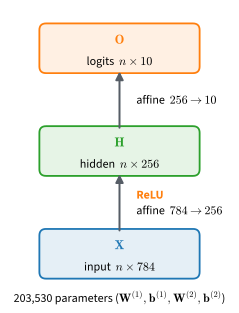

```{.python .input}
%load_ext d2lbook.tab
tab.interact_select('mxnet', 'pytorch', 'tensorflow', 'jax')
```

# Implementation
:label:`sec_mlp-implementation`

In :numref:`sec_mlp`, we hand-crafted the weights of a two-unit ReLU network to solve XOR. Now let us let minibatch SGD learn hidden features directly from Fashion-MNIST images. Inserting a single hidden layer of $h = 256$ ReLU units between the $d = 784$ input pixels and the $q = 10$ class logits multiplies our parameter count and per-image FLOPs 26-fold ($203{,}530$ parameters vs. $7{,}850$ for softmax regression).

In this section, we implement this two-layer MLP both from scratch (`MLPScratch`) and concisely (`MLP`) using framework `Sequential` containers, verify our untrained network with three quick pre-training sanity checks, compare its learning curve and GPU epoch time head-to-head against softmax regression, and visualize the localized garment-part detectors that emerge inside $\mathbf{W}^{(1)}$.

```{.python .input #mlp-implementation-implementation-of-multilayer-perceptrons}
%%tab mxnet
import math
import numpy as np
from mxnet import autograd, gluon, init, np as mnp, npx
from mxnet.gluon import nn
from d2l import mxnet as d2l
npx.set_np()
```

```{.python .input #mlp-implementation-implementation-of-multilayer-perceptrons}
%%tab pytorch
import math
import numpy as np
import torch
from torch import nn
from torch.nn import functional as F
from d2l import torch as d2l
```

```{.python .input #mlp-implementation-implementation-of-multilayer-perceptrons}
%%tab tensorflow
import math
import numpy as np
import tensorflow as tf
from d2l import tensorflow as d2l
```

```{.python .input #mlp-implementation-implementation-of-multilayer-perceptrons}
%%tab jax
import math
import numpy as np
import jax
from jax import numpy as jnp
from flax import nnx
import optax
from d2l import jax as d2l
```

```{.python .input #mlp-implementation-implementation-1}
import time
```

## Implementation from Scratch

### The Parameters and Forward Pass

Flattening each $28 \times 28$ image to $d = 784$ features, a one-hidden-layer MLP with $h = 256$ hidden units and $q = 10$ outputs (:numref:`fig_mdl-mlp-arch`) allocates four parameter tensors:

$$\mathbf{W}^{(1)} \in \mathbb{R}^{784 \times 256}, \quad \mathbf{b}^{(1)} \in \mathbb{R}^{256}, \quad \mathbf{W}^{(2)} \in \mathbb{R}^{256 \times 10}, \quad \mathbf{b}^{(2)} \in \mathbb{R}^{10}.$$


:label:`fig_mdl-mlp-arch`

To keep our head-to-head comparison with softmax regression controlled, we initialize both weight matrices from $\mathcal{N}(0, 0.01^2)$ and both biases to $0$ (in :numref:`sec_numerical_stability`, we will see why random initialization is mandatory to break symmetry between hidden units, and how He initialization improves upon `std=0.01`). We write `relu(X)` from scratch via boolean masking `X * (X > 0)` and factor the hidden activation into `hidden(X)` so `forward(X)` returns the raw class logits $\mathbf{O} = \mathbf{H}\mathbf{W}^{(2)} + \mathbf{b}^{(2)}$:

```{.python .input #mlp-implementation-initializing-model-parameters}
%%tab mxnet
class MLPScratch(d2l.Classifier):
    """An MLP with one hidden layer, implemented from scratch."""
    def __init__(self, num_inputs, num_outputs, num_hiddens, lr, std=0.01):
        super().__init__()
        self.save_hyperparameters()
        normal, zero = init.Normal(std), init.Zero()
        self.W1 = gluon.Parameter('W1', shape=(num_inputs, num_hiddens),
                                  init=normal)
        self.b1 = gluon.Parameter('b1', shape=(num_hiddens,), init=zero)
        self.W2 = gluon.Parameter('W2', shape=(num_hiddens, num_outputs),
                                  init=normal)
        self.b2 = gluon.Parameter('b2', shape=(num_outputs,), init=zero)
        self.initialize()
```

```{.python .input #mlp-implementation-initializing-model-parameters}
%%tab pytorch
class MLPScratch(d2l.Classifier):
    """An MLP with one hidden layer, implemented from scratch."""
    def __init__(self, num_inputs, num_outputs, num_hiddens, lr, std=0.01):
        super().__init__()
        self.save_hyperparameters()
        self.W1 = nn.Parameter(d2l.normal(0, std, (num_inputs, num_hiddens)))
        self.b1 = nn.Parameter(d2l.zeros(num_hiddens))
        self.W2 = nn.Parameter(d2l.normal(0, std, (num_hiddens, num_outputs)))
        self.b2 = nn.Parameter(d2l.zeros(num_outputs))
```

```{.python .input #mlp-implementation-initializing-model-parameters}
%%tab tensorflow
class MLPScratch(d2l.Classifier):
    """An MLP with one hidden layer, implemented from scratch."""
    def __init__(self, num_inputs, num_outputs, num_hiddens, lr, std=0.01):
        super().__init__()
        self.save_hyperparameters()
        self.W1 = self.add_weight(name='W1', shape=(num_inputs, num_hiddens),
                                  initializer=self.normal())
        self.b1 = self.add_weight(name='b1', shape=(num_hiddens,),
                                  initializer='zeros')
        self.W2 = self.add_weight(name='W2', shape=(num_hiddens, num_outputs),
                                  initializer=self.normal())
        self.b2 = self.add_weight(name='b2', shape=(num_outputs,),
                                  initializer='zeros')

    def normal(self):
        # A new initializer for each weight matrix: one initializer object
        # returns the same values every time it is called
        return tf.keras.initializers.RandomNormal(stddev=self.std)
```

```{.python .input #mlp-implementation-initializing-model-parameters}
%%tab jax
class MLPScratch(d2l.Classifier):
    """An MLP with one hidden layer, implemented from scratch."""
    def __init__(self, num_inputs, num_outputs, num_hiddens, lr, std=0.01,
                 rngs=None):
        super().__init__()
        self.save_hyperparameters(ignore=['rngs'])
        rngs = nnx.Rngs(d2l.get_key()) if rngs is None else rngs
        self.W1 = nnx.Param(
            rngs.params.normal((num_inputs, num_hiddens)) * std)
        self.b1 = nnx.Param(jnp.zeros(num_hiddens))
        self.W2 = nnx.Param(
            rngs.params.normal((num_hiddens, num_outputs)) * std)
        self.b2 = nnx.Param(jnp.zeros(num_outputs))
```


```{.python .input #mlp-implementation-model-1}
%%tab mxnet
def relu(X):
    return X * (X > 0)
```

```{.python .input #mlp-implementation-model-1}
%%tab pytorch
def relu(X):
    return X * (X > 0)
```

```{.python .input #mlp-implementation-model-1}
%%tab tensorflow
def relu(X):
    return X * tf.cast(X > 0, X.dtype)
```

```{.python .input #mlp-implementation-model-1}
%%tab jax
def relu(X):
    return X * (X > 0)
```

```{.python .input #mlp-implementation-model-2}
%%tab mxnet
@d2l.add_to_class(MLPScratch)
def hidden(self, X):
    X = d2l.reshape(X, (-1, self.num_inputs))  # One flattened image per row
    return relu(d2l.matmul(X, self.W1.data()) + self.b1.data())

@d2l.add_to_class(MLPScratch)
def forward(self, X):
    return d2l.matmul(self.hidden(X), self.W2.data()) + self.b2.data()
```

```{.python .input #mlp-implementation-model-2}
%%tab pytorch, tensorflow, jax
@d2l.add_to_class(MLPScratch)
def hidden(self, X):
    X = d2l.reshape(X, (-1, self.num_inputs))  # One flattened image per row
    return relu(d2l.matmul(X, self.W1) + self.b1)

@d2l.add_to_class(MLPScratch)
def forward(self, X):
    return d2l.matmul(self.hidden(X), self.W2) + self.b2  # The logits
```


### Checks before Training

Before launching a long training run, passing a tiny 8-image slice through the *untrained* network verifies three invariants in milliseconds:
1. **Shapes:** `H` has shape `(8, 256)` and `O` has shape `(8, 10)`.
2. **Initial loss:** Near-zero weights produce near-zero logits ($\hat{y}_j \approx 1/10$), so the initial cross-entropy loss sits right near $\log 10 \approx 2.303$.
3. **Active ReLU fraction:** With zero biases and symmetric weights, roughly $50\%$ of hidden pre-activations are positive.

```{.python .input #mlp-implementation-checks-before-training}
data = d2l.FashionMNIST(batch_size=256)
model = MLPScratch(num_inputs=784, num_outputs=10, num_hiddens=256, lr=0.1)
X, y = next(iter(data.train_dataloader()))
X, y = X[:8], y[:8]  # Eight images suffice for the checks
H, O = model.hidden(X), model(X)
active = d2l.reduce_mean(d2l.astype(H > 0, d2l.float32))
print('H:', H.shape, 'O:', O.shape)
print(f'loss {d2l.numpy(model.loss(O, y)):.3f}, '
      f'fraction of active units {d2l.numpy(active):.2f}')
```

### Training

Now we train `MLPScratch` for $30$ epochs on Fashion-MNIST with minibatch size $256$ and learning rate $\eta = 0.1$ (passing `num_gpus=1` so `Trainer` uses a GPU when available):

```{.python .input #mlp-implementation-training}
trainer = d2l.Trainer(max_epochs=30, num_gpus=1)
trainer.fit(model, data)
```

## Concise Implementation

Using each framework's `Sequential` container and built-in linear and ReLU layers, we can express the exact same architecture in a few lines without manual parameter arrays (initializing weights from $\mathcal{N}(0, 0.01^2)$ and biases to $0$ to match `MLPScratch`):

```{.python .input #mlp-implementation-model-2-2}
%%tab mxnet
class MLP(d2l.Classifier):
    """An MLP with one hidden layer, built from framework layers."""
    def __init__(self, num_outputs, num_hiddens, lr):
        super().__init__()
        self.save_hyperparameters()
        self.net = nn.Sequential()
        self.net.add(nn.Dense(num_hiddens, activation='relu'),
                     nn.Dense(num_outputs))
        self.net.initialize(init.Normal(sigma=0.01))
```

```{.python .input #mlp-implementation-model-2-2}
%%tab pytorch
class MLP(d2l.Classifier):
    """An MLP with one hidden layer, built from framework layers."""
    def __init__(self, num_outputs, num_hiddens, lr):
        super().__init__()
        self.save_hyperparameters()
        self.net = nn.Sequential(nn.Flatten(), nn.LazyLinear(num_hiddens),
                                 nn.ReLU(), nn.LazyLinear(num_outputs))

    def weight_init(self, module):
        # The Trainer calls this once the lazy layers know their shapes
        if isinstance(module, nn.Linear):
            nn.init.normal_(module.weight, std=0.01)
            nn.init.zeros_(module.bias)
```

```{.python .input #mlp-implementation-model-2-2}
%%tab tensorflow
class MLP(d2l.Classifier):
    """An MLP with one hidden layer, built from framework layers."""
    def __init__(self, num_outputs, num_hiddens, lr):
        super().__init__()
        self.save_hyperparameters()
        normal = tf.keras.initializers.RandomNormal
        self.net = tf.keras.models.Sequential([
            tf.keras.layers.Flatten(),
            tf.keras.layers.Dense(num_hiddens, activation='relu',
                                  kernel_initializer=normal(stddev=0.01)),
            tf.keras.layers.Dense(num_outputs,
                                  kernel_initializer=normal(stddev=0.01))])
```

```{.python .input #mlp-implementation-model-2-2}
%%tab jax
class MLP(d2l.Classifier):
    """An MLP with one hidden layer, built from framework layers."""
    def __init__(self, num_outputs, num_hiddens, lr, num_inputs=784,
                 rngs=None):
        super().__init__()
        self.save_hyperparameters(ignore=['rngs'])
        rngs = nnx.Rngs(d2l.get_key()) if rngs is None else rngs
        normal = nnx.initializers.normal(0.01)
        self.net = nnx.Sequential(
            nnx.Linear(num_inputs, num_hiddens, kernel_init=normal,
                       rngs=rngs),
            nnx.relu,
            nnx.Linear(num_hiddens, num_outputs, kernel_init=normal,
                       rngs=rngs))

    def forward(self, X):
        return self.net(X.reshape((X.shape[0], -1)))  # Flatten each image
```


## Comparison with Softmax Regression

### Accuracy

Let us train both the concise `MLP` and `d2l.SoftmaxRegression` for $30$ epochs under identical settings, timing each epoch and plotting all three validation accuracy curves together:

```{.python .input #mlp-implementation-accuracy-1}
curves, seconds = {'MLP from scratch': trainer.history['val_acc']}, {}
trainer.board.display = False
models = {'concise MLP': MLP(num_outputs=10, num_hiddens=256, lr=0.1),
          'softmax regression': d2l.SoftmaxRegression(num_outputs=10, lr=0.1)}
for name, net in models.items():
    start = time.perf_counter()
    trainer.fit(net, data)
    seconds[name] = (time.perf_counter() - start) / trainer.max_epochs
    curves[name] = trainer.history['val_acc']
```

```{.python .input #mlp-implementation-accuracy-2}
d2l.plot(list(range(1, trainer.max_epochs + 1)), list(curves.values()),
         'epoch', 'validation accuracy', legend=list(curves))
```

```{.python .input #mlp-implementation-accuracy-3}
print('validation accuracy averaged over the last 5 epochs')
for name, acc in curves.items():  # A single epoch can land a few points low
    print(f'  {name}: {sum(acc[-5:]) / 5:.3f}')
train_acc = trainer.evaluate(model, data, train=True)['acc']
print(f'training accuracy of the MLP from scratch: {train_acc:.3f}')
```

Notice two instructive patterns in the learning curves:
1. **Slow warmup from `std=0.01`:** On epoch 1, both MLPs actually trail softmax regression! Because both $\mathbf{W}^{(1)}$ and $\mathbf{W}^{(2)}$ start with entries around $0.01$, the hidden activations $\mathbf{H}$ and the backpropagated gradients into $\mathbf{W}^{(1)}$ are suppressed by a factor of $0.01$ until $\mathbf{W}^{(2)}$ grows—a bottleneck we eliminate with He initialization in :numref:`sec_numerical_stability`.
2. **Cutting a fifth of the classification errors:** By epochs 26–30, softmax regression plateaus around $84\%$ validation accuracy ($16\%$ error rate), whereas both MLPs reach $\sim 87\%$ validation accuracy ($\sim 13\%$ error rate, and $\sim 89\%$ training accuracy)—eliminating roughly $20\%$ of softmax regression's mistakes, primarily by reducing confusions among the four look-alike upper-body tops.

### The Learned Features

In :numref:`sec_softmax_scratch`, the 10 columns of softmax regression's weight matrix $\mathbf{W}$ had to act as whole-garment templates. What did our MLP's 256 hidden units learn? Let us reshape the 10 columns of $\mathbf{W}^{(1)} \in \mathbb{R}^{784 \times 256}$ with the largest Euclidean norms into $28 \times 28$ images, titling each hidden unit by the garment class to which $\mathbf{W}^{(2)}$ assigns its largest positive outgoing weight:

```{.python .input #mlp-implementation-what-the-hidden-units-compute-1}
%%tab pytorch, tensorflow
W1, W2 = d2l.numpy(model.W1), d2l.numpy(model.W2)
```

```{.python .input #mlp-implementation-what-the-hidden-units-compute-1}
%%tab mxnet
W1, W2 = d2l.numpy(model.W1.data()), d2l.numpy(model.W2.data())
```

```{.python .input #mlp-implementation-what-the-hidden-units-compute-1}
%%tab jax
W1, W2 = d2l.numpy(model.W1[...]), d2l.numpy(model.W2[...])
```

```{.python .input #mlp-implementation-what-the-hidden-units-compute-2}
units = np.argsort(np.linalg.norm(W1, axis=0))[::-1][:10]  # Largest weights
images = W1[:, units].T.reshape(10, 28, 28)
images /= np.abs(images).max(axis=(1, 2), keepdims=True)  # Own color scale
d2l.show_images(images, 2, 5, titles=[names[k] for k in W2[units].argmax(1)],
                cmap='RdBu_r', vmin=-1, vmax=1);
```


Instead of blurring an entire garment into one template, high-norm hidden units specialize in **localized parts, edges, and pixel contrasts**—collar cutouts, sleeve boundaries, and the dark vertical gap between trouser legs—with adjacent red (excitatory) and blue (inhibitory) lobes that fire on local shape transitions rather than uniform brightness.

### Parameters, Computation, and Time

| Model | Parameters | Multiply-adds / image | Validation accuracy (epochs 26–30) |
|:--|--:|--:|--:|
| Softmax regression | $7{,}850$ | $7{,}840$ | $\sim 84\%$ |
| MLP ($h = 256$ ReLU units) | $203{,}530$ | $203{,}264$ | $\sim 87\%$ |

Even though our MLP performs 26 times as many multiply-adds per image as softmax regression, let us compare their wall-clock times per epoch:

```{.python .input #mlp-implementation-parameters-computation-and-time}
for name, s in seconds.items():
    print(f'{name}: {s:.1f} s per epoch')
```

On modern hardware (especially a GPU), both models take almost the exact same wall-clock time per epoch! At width $h = 256$, data loading and Python/kernel launch overhead dominate the runtime, so the 26-fold increase in dense matrix arithmetic runs virtually for free (Exercise :exref:`ex_mlp-implementation-width` explores the width at which matrix arithmetic finally overtakes data-loading overhead).

## Summary

- **Pre-training checks:** A single forward pass on a small batch before training verifies tensor shapes, confirms that the initial cross-entropy loss sits near $\log q \approx 2.30$, and checks that roughly half of ReLU hidden units activate.
- **Empirical gain over linear classification:** Adding one 256-unit ReLU hidden layer lifts Fashion-MNIST validation accuracy from $\sim 84\%$ to $\sim 87\%$ (cutting error rate by nearly a fifth) at virtually identical per-epoch wall-clock time, as hidden units learn localized part and edge detectors.

## Exercises

1. [code] **A hidden layer without activation.** Replace `relu` by the
   identity in `MLPScratch` and train the resulting model as in this
   section.
    1. Compare its validation accuracy after 30 epochs with that of the MLP
       and of softmax regression.
    1. After training, compute $\mathbf{W} = \mathbf{W}^{(1)}\mathbf{W}^{(2)}$
       and $\mathbf{b} = \mathbf{W}^{(2)\top}\mathbf{b}^{(1)} + \mathbf{b}^{(2)}$,
       and verify on a minibatch that $\mathbf{X}\mathbf{W} + \mathbf{b}$
       reproduces the logits of the model.
    1. Exercise :exref:`ex_mlp-linear-networks` showed that such a network
       computes exactly the affine maps whose weight matrix has rank at most
       the hidden width. Explain why this restriction costs nothing here,
       and state below which hidden width it would reduce what the model
       can represent on Fashion-MNIST.

1. [code] **Single hidden unit.** Set `num_hiddens=1` in `MLPScratch`, so
   that its hidden layer has a single ReLU unit with weights
   $\mathbf{w}^{(1)} \in \mathbb{R}^{784 \times 1}$ and bias
   $b^{(1)} \in \mathbb{R}$. Each input $\mathbf{x} \in \mathbb{R}^{1 \times 784}$
   is then reduced to the scalar
   $t = \operatorname{ReLU}(\mathbf{x}\mathbf{w}^{(1)} + b^{(1)}) \geq 0$,
   and the logits are $\mathbf{o} = t\, \mathbf{w}^{(2)} + \mathbf{b}^{(2)}$
   with $\mathbf{w}^{(2)} \in \mathbb{R}^{1 \times 10}$ and
   $\mathbf{b}^{(2)} \in \mathbb{R}^{10}$.
    1. Show that each class is predicted on at most one interval of $t$, and
       that the order of these intervals along the $t$ axis is fixed by the
       entries of $\mathbf{w}^{(2)}$. Describe the regions of input space
       that the model assigns to the classes, and state what they imply for
       separating the ten Fashion-MNIST classes.
    1. Suppose that after some update
       $\mathbf{x}\mathbf{w}^{(1)} + b^{(1)} < 0$ for every training
       example. Which parameters receive nonzero gradients from then on, and
       what does the network predict? Why does the same event do little
       harm when it hits one of the 256 hidden units of this section?
    1. Train the model five times, and report for each run the validation
       accuracy and the fraction of validation examples on which $t > 0$,
       which `model.hidden` gives you. Compare any run in which this
       fraction is zero with your answer to (b).
1. [code] **Width.** Train `MLP` as in this section, for 30 epochs at
   learning rate 0.1, with hidden widths
   $h \in \{16, 64, 256, 1024, 4096\}$, and record the final validation
   accuracy and the time per epoch.
    1. Plot both against $h$ on a logarithmic axis. Beyond which width does
       the accuracy stop improving by more than its variation from epoch to
       epoch?
    1. The multiply-adds grow in proportion to $h$. Time one pass over the
       training data that only reads the minibatches, without any model,
       and use it to explain the part of the time curve that does not grow
       with $h$. From which width on does the arithmetic dominate on your
       hardware?
    1. Repeat the training at widths 64 and 1024 with learning rates
       $\{0.03, 0.1, 0.3\}$. Does the best learning rate depend on the
       width?
   :exlabel:`ex_mlp-implementation-width`

:begin_tab:`mxnet`
[Discussions](https://d2l.discourse.group/t/92)
:end_tab:

:begin_tab:`pytorch`
[Discussions](https://d2l.discourse.group/t/93)
:end_tab:

:begin_tab:`tensorflow`
[Discussions](https://d2l.discourse.group/t/227)
:end_tab:

:begin_tab:`jax`
[Discussions](https://d2l.discourse.group/t/17985)
:end_tab:

