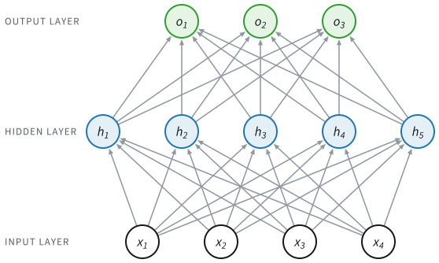
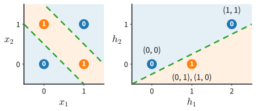
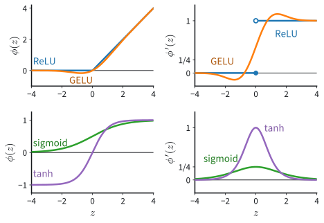
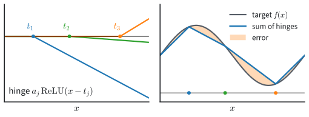
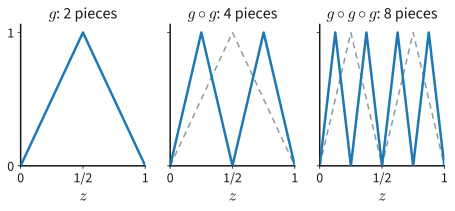

```{.python .input}
%load_ext d2lbook.tab
tab.interact_select('mxnet', 'pytorch', 'tensorflow', 'jax')
```

# Multilayer Perceptrons
:label:`sec_mlp`

Softmax regression scores each class with a weighted sum of the inputs, so
each input moves a score by the same amount whatever the other inputs are.
On Fashion-MNIST this model reaches about 83% validation accuracy with 7,850
parameters. Yet in an image, whether a bright pixel belongs to a sleeve, a
strap, or the background depends on the pixels around it. The smallest
problem of this kind has four points. Label each corner of the unit square
by whether its two coordinates differ, the *exclusive or* (XOR) of two bits.
No line separates the two classes, so every linear classifier gets at least
one of the four points wrong.

A *multilayer perceptron* (MLP) removes this limit by computing new features
before it classifies. A hidden layer applies an affine map followed by a
fixed nonlinear function, and an output layer, which is softmax regression,
classifies the result. Both layers are trained together, with the loss and
the minibatch stochastic gradient descent (SGD) of the previous chapter.
This section defines the model and builds a network with two hidden units
that computes XOR. It then compares the nonlinear functions in common use
and asks which functions such networks can represent. The next section
trains an MLP on Fashion-MNIST.

```{.python .input #mlp-multilayer-perceptrons}
%%tab mxnet
from d2l import mxnet as d2l
import numpy as np
from mxnet import autograd, np as mnp, npx
npx.set_np()
```

```{.python .input #mlp-multilayer-perceptrons}
%%tab pytorch
from d2l import torch as d2l
import numpy as np
import torch
from torch.nn import functional as F
```

```{.python .input #mlp-multilayer-perceptrons}
%%tab tensorflow
from d2l import tensorflow as d2l
import numpy as np
import tensorflow as tf
```

```{.python .input #mlp-multilayer-perceptrons}
%%tab jax
from d2l import jax as d2l
import numpy as np
import jax
from jax import numpy as jnp
```

## Limits of Linear Models

### Monotonicity and Interactions

In softmax regression (:numref:`sec_softmax`), an input
$\mathbf{x} \in \mathbb{R}^d$ gives class $j$ the score

$$o_j = \sum_{i=1}^d x_i w_{ij} + b_j.$$

Each score is therefore *monotonic* in each input: it rises with $x_i$ if
$w_{ij} > 0$ and falls if $w_{ij} < 0$. Moreover, the inputs do not
interact: raising $x_i$ by one changes $o_j$ by $w_{ij}$, whatever the other
inputs are. Both properties often fail. The risk of illness rises as body
temperature departs from 37°C in either direction. This case we can repair
by hand, using the distance from 37°C as the input. Images resist such
repairs. Whether a bright pixel is evidence for a shirt or for a bag depends
on its neighbors, and writing down features that capture all such
dependencies is impractical. We want the model to learn its features from
data instead.

### The XOR Problem

The smallest problem in which inputs interact has two binary inputs and the
label

| $x_1$ | $x_2$ | $y$ |
|:---:|:---:|:---:|
| 0 | 0 | 0 |
| 0 | 1 | 1 |
| 1 | 0 | 1 |
| 1 | 1 | 0 |

which is 1 if exactly one input is 1. Changing $x_1$ from 0 to 1 changes the
label from 0 to 1 when $x_2 = 0$, but from 1 to 0 when $x_2 = 1$. With two
classes, softmax regression predicts class 1 where the difference of the two
logits is positive (:numref:`sec_softmax`). This difference is an affine
score $o = w_1 x_1 + w_2 x_2 + b$, so the decision boundary is the line
$o = 0$.

**Proposition.** For all $w_1, w_2, b$, the rule "predict class 1 if
$w_1 x_1 + w_2 x_2 + b > 0$" misclassifies at least one of the four points
of XOR.

**Proof.** Suppose that some $w_1, w_2, b$ classify all four points
correctly. The two points of class 1 give $w_2 + b > 0$ and $w_1 + b > 0$,
and adding the two inequalities gives $w_1 + w_2 + 2b > 0$. The two points
of class 0 give $b \leq 0$ and $w_1 + w_2 + b \leq 0$, and adding these gives
$w_1 + w_2 + 2b \leq 0$, a contradiction. $\blacksquare$

The proof has a picture. Both pairs of points have the midpoint
$(1/2, 1/2)$, where an affine score equals the average of its values at
either pair, so it would have to be positive and not positive at once. A
line can classify three of the four points correctly: the line
$x_1 + x_2 = 3/2$, for example, misclassifies only $(0, 0)$.

## Hidden Layers

### The Model

An MLP first computes $h$ new features, each an affine function of the input
followed by a fixed nonlinear function $\phi$, and then applies a linear
model to them. The features form a *hidden layer* of *hidden units*, so
called because their values are neither given by the data nor reported as
outputs. :numref:`fig_mlp` shows an MLP with four inputs, five hidden units,
and three outputs. Every input feeds every hidden unit, and every hidden
unit feeds every output, so both layers are fully connected. The inputs
involve no computation, so we count only the layers with parameters: this
MLP has two layers, one of them hidden. The name comes from the perceptron,
an early linear classifier, of which an MLP stacks several layers.


:label:`fig_mlp`

We keep the layout of :numref:`subsec_softmax_vectorization`: the $n$
examples of a minibatch are the rows of $\mathbf{X} \in \mathbb{R}^{n \times d}$,
and each weight matrix has one row per input and one column per output of
its layer. With a superscript numbering the layers, the hidden layer has
weights $\mathbf{W}^{(1)} \in \mathbb{R}^{d \times h}$ and biases
$\mathbf{b}^{(1)} \in \mathbb{R}^{h}$, the output layer has weights
$\mathbf{W}^{(2)} \in \mathbb{R}^{h \times q}$ and biases
$\mathbf{b}^{(2)} \in \mathbb{R}^{q}$, and the MLP computes

$$
\begin{aligned}
\mathbf{H} &= \phi\left(\mathbf{X}\mathbf{W}^{(1)} + \mathbf{b}^{(1)}\right),\\
\mathbf{O} &= \mathbf{H}\mathbf{W}^{(2)} + \mathbf{b}^{(2)}.
\end{aligned}
$$
:eqlabel:`eq_mlp`

The biases are added to every row by broadcasting, and $\phi$ acts on each
entry separately. Row $i$ of $\mathbf{H} \in \mathbb{R}^{n \times h}$ is the
*hidden representation* of example $i$, and row $i$ of
$\mathbf{O} \in \mathbb{R}^{n \times q}$ holds its logits, which the softmax
turns into probabilities as before. For a single example $\mathbf{x}$, the
model reads $\mathbf{h} = \phi(\mathbf{W}^{(1)\top}\mathbf{x} + \mathbf{b}^{(1)})$
and $\mathbf{o} = \mathbf{W}^{(2)\top}\mathbf{h} + \mathbf{b}^{(2)}$.

The function $\phi$ is the *activation function*. Its inputs, the entries of
$\mathbf{X}\mathbf{W}^{(1)} + \mathbf{b}^{(1)}$, are called
*pre-activations*, and its outputs *activations*. Minibatch SGD fits all four parameter arrays
together on the cross-entropy loss, with gradients from automatic
differentiation, so the network learns a representation and a linear
classifier of that representation at once.

The hidden layer adds parameters. With $d$ inputs, $h$ hidden units, and
$q$ outputs, an MLP has $(d + 1)h + (h + 1)q$ parameters, against
$(d + 1)q$ for softmax regression. For Fashion-MNIST, with $d = 784$ and
$q = 10$, a hidden layer of $h = 256$ units gives
$785 \cdot 256 + 257 \cdot 10 = 203{,}530$ parameters, 26 times the 7,850 of
softmax regression.

### The Role of the Nonlinearity

Why apply $\phi$ at all? Suppose that we omit it, so that
$\mathbf{H} = \mathbf{X}\mathbf{W}^{(1)} + \mathbf{b}^{(1)}$. Substituting
$\mathbf{H}$ into the output layer gives

$$\mathbf{O} = \left(\mathbf{X}\mathbf{W}^{(1)} + \mathbf{b}^{(1)}\right)\mathbf{W}^{(2)} + \mathbf{b}^{(2)} = \mathbf{X}\mathbf{W} + \mathbf{b},$$

where $\mathbf{W} = \mathbf{W}^{(1)}\mathbf{W}^{(2)}$ and
$\mathbf{b} = \mathbf{W}^{(2)\top}\mathbf{b}^{(1)} + \mathbf{b}^{(2)}$. The
two layers compute an affine function of the input, one that softmax
regression computes with the weights $\mathbf{W}$ and the bias $\mathbf{b}$.
The hidden layer adds parameters but no new functions (it can even remove
some, Exercise :exref:`ex_mlp-linear-networks`), and the network still fails
on XOR.

With a nonlinear $\phi$, the substitution no longer simplifies. The simplest
useful choice, and the default in this book, is the *rectified linear unit*
(ReLU),

$$\mathrm{ReLU}(z) = \max(z, 0),$$

which keeps positive values and replaces negative ones by zero.

### Solving XOR

Two hidden ReLU units suffice for XOR. One choice of weights
:cite:`Goodfellow.Bengio.Courville.2016` is

$$\mathbf{W}^{(1)} = \begin{pmatrix} 1 & 1 \\ 1 & 1 \end{pmatrix}, \quad \mathbf{b}^{(1)} = (0, -1), \quad \mathbf{w}^{(2)} = (1, -2), \quad b^{(2)} = 0,$$

where the output layer has a single output $o$, so its weights form one
column $\mathbf{w}^{(2)}$. Both hidden units see the sum $s = x_1 + x_2$.
The first, $h_1 = \mathrm{ReLU}(s) = s$, counts the inputs that are 1. The
second, $h_2 = \mathrm{ReLU}(s - 1)$, is positive only when both inputs are
1, and the output $o = h_1 - 2h_2$ subtracts 2 in that case. We check the
network on the four inputs, stored as the rows of $\mathbf{X}$.

```{.python .input #mlp-xor}
X = np.array([[0, 0], [0, 1], [1, 0], [1, 1]])
W1, b1 = np.array([[1, 1], [1, 1]]), np.array([0, -1])
w2, b2 = np.array([1, -2]), 0
H = np.maximum(X @ W1 + b1, 0)  # hidden layer with ReLU
o = H @ w2 + b2  # output layer
for x, h, out in zip(X, H, o):
    print(f'x = {x}, h = {h}, o = {out}')
```

The output equals the XOR label on every input. As a function of $s$, the
output $o = \mathrm{ReLU}(s) - 2\,\mathrm{ReLU}(s - 1)$ rises from 0 at
$s = 0$ to 1 at $s = 1$ and falls back to 0 at $s = 2$. The second unit
*folds* the line of values of $s$ at $s = 1$, so that its two ends reach the
same output. In the hidden space (:numref:`fig_mdl-mlp-xor`, right), the two
inputs of class 1 land on the same point $(1, 0)$, and the line
$h_1 - 2h_2 = 1/2$ separates the classes. In the input space (left), the
network predicts class 1 in the band $1/2 < x_1 + x_2 < 3/2$, a region that
no single line can bound.

![XOR and the two-unit ReLU network that computes it. Left: the four inputs, labeled by XOR (blue: class 0, orange: class 1); the network predicts class 1 in the shaded band between the dashed lines $x_1 + x_2 = 1/2$ and $x_1 + x_2 = 3/2$. Right: the same inputs after the hidden layer $\mathbf{h} = \mathrm{ReLU}(\mathbf{W}^{(1)\top}\mathbf{x} + \mathbf{b}^{(1)})$, each marked with the input it came from; the two inputs of class 1 land on the same point $(1, 0)$, and the dashed line $h_1 - 2h_2 = 1/2$ separates the classes.](../img/mdl-mlp-xor.svg)
:label:`fig_mdl-mlp-xor`

The hidden layer has re-represented the inputs so that a linear classifier
suffices. Here we chose its weights by hand. For a problem such as
Fashion-MNIST nobody could, and training chooses them instead, adjusting the
hidden layer together with the output layer.

### Deeper Networks

Nothing stops us from stacking more hidden layers. Starting from
$\mathbf{H}^{(0)} = \mathbf{X}$, hidden layer $k$ computes

$$\mathbf{H}^{(k)} = \phi\left(\mathbf{H}^{(k-1)}\mathbf{W}^{(k)} + \mathbf{b}^{(k)}\right), \quad k = 1, \ldots, K-1,$$

and the output layer computes
$\mathbf{O} = \mathbf{H}^{(K-1)}\mathbf{W}^{(K)} + \mathbf{b}^{(K)}$. Such a
network has $K$ layers, $K - 1$ of them hidden, and each hidden layer may
have its own width. Each hidden layer computes a new representation from the
one below it, and the output layer classifies the last one. For $K = 2$ this
is :eqref:`eq_mlp`. Whether several narrow layers do better than one wide
layer is a question we return to at the end of this section.

## Activation Functions
:label:`subsec_activation-functions`

Any nonlinear $\phi$ prevents the collapse into one affine map, but the
choice matters for training. Gradient descent changes each parameter in
proportion to the derivative of the loss $l$ with respect to it. For one
example, hidden unit $j$ computes $h_j = \phi(z_j)$ from its pre-activation
$z_j = \sum_i x_i w^{(1)}_{ij} + b^{(1)}_j$, where $w^{(1)}_{ij}$ is an
entry of $\mathbf{W}^{(1)}$. By the chain rule,

$$\frac{\partial l}{\partial w^{(1)}_{ij}} = \frac{\partial l}{\partial h_j}\,\phi'(z_j)\,x_i.$$

Every weight into unit $j$ is scaled by the same factor $\phi'(z_j)$. Where
it is close to zero, none of these weights moves, whatever the loss.
:numref:`fig_mdl-mlp-activations` shows four activation functions in common
use, with their derivatives.


:label:`fig_mdl-mlp-activations`

### ReLU and GELU

The ReLU passes positive pre-activations unchanged and sets negative ones to
zero. Its derivative is 1 for $z > 0$ and 0 for $z < 0$. At $z = 0$, where
the ReLU has no derivative, the frameworks use 0, a choice that rarely
matters because a pre-activation is seldom exactly zero. For every positive
pre-activation, however large, the gradient passes through a ReLU unit
unchanged. This is the main reason why the ReLU replaced the sigmoid,
discussed below, as the default activation of hidden layers
:cite:`Nair.Hinton.2010,Glorot.Bordes.Bengio.2011`. It is also cheap: a
single comparison.

The flat side has a cost. A unit whose pre-activation is negative for every
training example outputs zero, receives zero gradient, and never changes
again. Such a unit is called *dead*. The leaky ReLU, $\max(z, \alpha z)$
with a small slope such as $\alpha = 0.01$, keeps a small gradient for
negative inputs, so its units cannot die.

The *Gaussian error linear unit* (GELU) is a smooth relative of the ReLU,

$$\mathrm{GELU}(z) = z\,\Phi(z),$$

where $\Phi$ is the cumulative distribution function of the standard normal
distribution. Since $\Phi(z)$ rises smoothly from 0 for very negative $z$ to
1 for very positive $z$, the GELU matches the ReLU for $|z|$ beyond about 3
and rounds off its corner in between. Its slope at $z = 0$ is 1/2, and
unlike the ReLU it dips below zero, to about $-0.17$ near $z = -0.75$. Many
transformer models use the GELU :cite:`Hendrycks.Gimpel.2016`.

### Sigmoid and Tanh

The sigmoid, $\sigma(z) = 1/(1 + \exp(-z))$, turns the logit of a two-class
classifier into a probability (:numref:`sec_softmax`): it maps the real line
onto the interval $(0, 1)$. Early neural networks used it in hidden layers
as a smooth version of a threshold unit, which outputs 1 when its input
exceeds a threshold and 0 otherwise :cite:`McCulloch.Pitts.1943`. Unlike the
threshold, the sigmoid has a derivative that gradient descent can use,

$$\sigma'(z) = \sigma(z)\,\bigl(1 - \sigma(z)\bigr).$$

It is largest at $z = 0$, where it equals $1/4$, and approaches zero in both
tails. A unit whose pre-activation is large in magnitude is *saturated*: its
output barely changes with its input, so it passes almost no gradient to the
weights below it.

Even at $z = 0$, every sigmoid unit between a weight and the loss shrinks
the gradient by a factor of 4. Through a chain of ten sigmoid units with
weights of 1, the gradient therefore shrinks by a factor of at least
$4^{10} \approx 10^6$. Such *vanishing gradients* made deep sigmoid networks
hard to train; :numref:`sec_numerical_stability` analyzes them and their
remedies.

The *hyperbolic tangent*,

$$\tanh(z) = \frac{1 - \exp(-2z)}{1 + \exp(-2z)},$$

maps the real line onto $(-1, 1)$. It is a sigmoid stretched to this
interval and centered at zero (Exercise :exref:`ex_mlp-sigmoid-tanh`), and
its derivative, $1 - \tanh^2(z)$, reaches 1 at $z = 0$ and vanishes in both
tails as well. Today the sigmoid serves mainly to produce probabilities and
gates, numbers between 0 and 1 that decide what fraction of a signal passes,
and tanh to keep the state of recurrent networks bounded.

We check the four derivatives with automatic differentiation
(:numref:`sec_autograd`) at $z = -4, -1, 0, 1, 4$. Each activation function
acts on every entry separately, so the gradient of the sum of its outputs
holds its derivative at each point.

```{.python .input #mlp-sigmoid-and-tanh}
%%tab mxnet
z = mnp.array([-4.0, -1.0, 0.0, 1.0, 4.0])
z.attach_grad()
activations = {'ReLU': npx.relu, 'sigmoid': npx.sigmoid, 'tanh': mnp.tanh,
               'GELU': lambda z: npx.leaky_relu(z, act_type='gelu')}
for name, phi in activations.items():
    with autograd.record():
        total = phi(z).sum()
    total.backward()
    print(f'{name:8s}', ' '.join(f'{g:7.4f}' for g in z.grad.asnumpy()))
```

```{.python .input #mlp-sigmoid-and-tanh}
%%tab pytorch
z = torch.tensor([-4.0, -1.0, 0.0, 1.0, 4.0], requires_grad=True)
activations = {'ReLU': torch.relu, 'sigmoid': torch.sigmoid,
               'tanh': torch.tanh, 'GELU': F.gelu}
for name, phi in activations.items():
    # returns the gradient rather than accumulating it in z.grad
    grad, = torch.autograd.grad(phi(z).sum(), z)
    print(f'{name:8s}', ' '.join(f'{g:7.4f}' for g in grad.tolist()))
```

```{.python .input #mlp-sigmoid-and-tanh}
%%tab tensorflow
z = tf.constant([-4.0, -1.0, 0.0, 1.0, 4.0])
activations = {'ReLU': tf.nn.relu, 'sigmoid': tf.nn.sigmoid,
               'tanh': tf.nn.tanh, 'GELU': tf.nn.gelu}
for name, phi in activations.items():
    with tf.GradientTape() as tape:
        tape.watch(z)
        total = tf.reduce_sum(phi(z))
    grad = tape.gradient(total, z)
    print(f'{name:8s}', ' '.join(f'{g:7.4f}' for g in grad.numpy()))
```

```{.python .input #mlp-sigmoid-and-tanh}
%%tab jax
z = jnp.array([-4.0, -1.0, 0.0, 1.0, 4.0])
activations = {'ReLU': jax.nn.relu, 'sigmoid': jax.nn.sigmoid,
               'tanh': jnp.tanh,
               # the exact GELU, z * Phi(z), as in the other frameworks
               'GELU': lambda z: jax.nn.gelu(z, approximate=False)}
for name, phi in activations.items():
    grad = jax.grad(lambda z: phi(z).sum())(z)
    print(f'{name:8s}', ' '.join(f'{g:7.4f}' for g in grad.tolist()))
```

The ReLU passes a gradient of 0 or 1, and every framework uses 0 at
$z = 0$. The sigmoid passes at most 1/4 of the gradient and tanh at most all
of it, but at $z = \pm 4$ both are saturated, passing 0.018 and 0.0013 of
it. The GELU passes a small negative gradient at $z = -1$.

## Expressive Power

### Universal Approximation

Two hidden units sufficed for XOR. Can a network with one hidden layer
approximate every function that we might want to learn? For a single input
$x$ and ReLU units, a picture answers the question. A hidden unit with input
weight 1, bias $-t$, and output weight $a$ adds $a\,\mathrm{ReLU}(x - t)$ to
the output. This term is a *hinge*: zero to the left of its joint $t$ and a
line of slope $a$ to the right of it. A sum of $h$ hinges and a constant is
continuous and linear between the joints, so it has at most $h + 1$ linear
pieces (:numref:`fig_mdl-mlp-uat-hinges`). Conversely, every polyline on a
closed interval is such a sum: one hinge at the left end with the slope of
the first piece, and one hinge at each later joint with the change of slope
there.


:label:`fig_mdl-mlp-uat-hinges`

The approximation result for one input follows. A continuous function $f$
on a closed interval changes by less than any given $\epsilon > 0$ between
points that are close enough together. The polyline through the values of
$f$ at such closely spaced points therefore stays within $\epsilon$ of $f$
on the whole interval, and a hidden layer with one unit per joint computes
it. The same
conclusion holds for any number of inputs, on any closed and bounded set,
and for every continuous activation function that is not a polynomial
:cite:`Cybenko.1989,Leshno.Lin.Pinkus.ea.1993`. Polynomials must be
excluded, because with a polynomial activation function the network computes
a polynomial of bounded degree, and such polynomials cannot approximate every
continuous function. This result is the *universal approximation theorem*.
Exercise :exref:`ex_mlp-one-hidden-layer` proves it for two inputs.

### Limits of the Theorem

The theorem says that good weights exist, and it leaves three questions
open. The first is width. The construction above uses one unit per joint,
and a target that changes direction often needs many joints. With many
inputs, constructions of this kind cover the input space with small cells,
and the number of cells, and with it the number of hidden units, can grow
exponentially with the number of inputs. The second question is training:
the theorem does not say that minibatch SGD, started from random weights,
finds good weights. The third is generalization. Approximating a function
that we know everywhere differs from learning it from $n$ examples, and a
network flexible enough to approximate any function can also fit the noise
in its training labels.

### Depth

Width adds linear pieces one unit at a time: on one input, $h$ hidden units
give at most $h + 1$ pieces. Depth can multiply them. Consider the tent

$$g(z) = 2\,\mathrm{ReLU}(z) - 4\,\mathrm{ReLU}(z - 1/2),$$

which rises from 0 to 1 on $[0, 1/2]$ and falls back to 0 on $[1/2, 1]$.
It is the XOR network read along the diagonal: with $s = 2z$, the output
$\mathrm{ReLU}(s) - 2\,\mathrm{ReLU}(s - 1)$ equals $g(z)$. Now feed $g$ its
own output. As $z$ runs from 0 to 1/2, $g(z)$ runs from 0 to 1, so
$g(g(z))$ traces the whole tent. As $z$ runs on from 1/2 to 1, $g(z)$ runs
back from 1 to 0, and $g(g(z))$ traces the tent again in reverse. The first
layer folds the interval $[0, 1]$ in half, and whatever comes after it is
computed on both halves. Each composition with $g$ doubles the number of
pieces (:numref:`fig_mdl-mlp-depth-folding`), and it takes one more hidden
layer of two units, since the output map of one layer and the affine map of
the next merge into a single affine map.


:label:`fig_mdl-mlp-depth-folding`

Thus composing $g$ with itself $m$ times gives a zigzag with $2^m$ pieces,
computed by $m$ hidden layers of two units, $2m$ hidden units in all. A
single hidden layer needs at least $2^m - 1$ units for the same function,
since $h$ units give at most $h + 1$ pieces. For $m = 10$, this means 20
units in ten hidden layers against at least 1,023 in one.
:citet:`Telgarsky.2016` used this construction to prove that some functions
computed by deep, narrow networks require exponentially wide shallow
networks. Depth does not help with every function, and nothing guarantees
that training finds such compact solutions.

We can now build models that represent nonlinear functions: hidden layers of
affine maps and activation functions, followed by the linear classifier of
softmax regression. Whether training finds good weights, and whether they
predict well on new data, are questions for experiment. The next section
trains an MLP on Fashion-MNIST and compares it with softmax regression.

## Summary

A linear classifier scores each class with a weighted sum of the inputs, so
it cannot represent interactions between inputs, and the four points of XOR
already defeat it. A multilayer perceptron first computes a hidden
representation $\mathbf{H} = \phi(\mathbf{X}\mathbf{W}^{(1)} + \mathbf{b}^{(1)})$
and then classifies it linearly,
$\mathbf{O} = \mathbf{H}\mathbf{W}^{(2)} + \mathbf{b}^{(2)}$, training both
layers together. Without the activation function $\phi$, the layers
collapse into one affine map; with it, two ReLU units fold the XOR inputs so
that a line separates them. The ReLU passes gradients of 0 or 1 and is the
default for hidden layers, while the sigmoid and tanh saturate and pass at
most 1/4 and 1 of the gradient. One hidden layer can approximate any
continuous function, possibly only with very many units, and depth can
produce exponentially many linear pieces from a linear number of units.

## Exercises

1. **Linear networks.** Without activation functions, stacking layers
   composes affine maps into another affine map. Consider such a network
   with input dimension $d$, output dimension $q$, and hidden widths
   $h_1, \ldots, h_{K-1}$. Show that it represents exactly the affine maps
   $\mathbf{X}\mathbf{W} + \mathbf{b}$ whose weight matrix $\mathbf{W}$ has
   rank at most $\min(h_1, \ldots, h_{K-1})$. Use this result to give an
   example in which adding a hidden layer to a linear model strictly shrinks
   its function class.
   :exlabel:`ex_mlp-linear-networks`
1. **XOR by hand.** :numref:`fig_mdl-mlp-xor` shows a two-unit ReLU network
   that computes XOR by mapping the two inputs of class 1 to the same hidden
   point.
    1. Find weights for a two-unit ReLU network that also computes XOR but
       maps the two inputs of class 1 to *distinct* hidden points, and verify
       it on the four inputs.
    1. Show that no network with a single ReLU hidden unit and a linear
       output classifies XOR correctly, whatever threshold it applies to its
       output.
1. **Sigmoid and tanh.** The two squashing functions are closely related.
    1. Show that $\tanh(z) = 2\sigma(2z) - 1$.
    1. Show that for every MLP with tanh hidden activations there is an MLP
       of the same architecture with sigmoid hidden activations that
       computes the same function, and conversely. State how the weights and
       biases change.
   :exlabel:`ex_mlp-sigmoid-tanh`
1. [code] **Vanishing gradients.** Consider a chain of $K$ sigmoid units of
   width one, $h_k = \sigma(z_k)$ with pre-activation
   $z_k = w_k h_{k-1} + b_k$. By the chain rule,

    $$\frac{\partial h_K}{\partial h_0} = \prod_{k=1}^{K} w_k \sigma'(z_k).$$

    1. Explain why the weight feeding a *saturated* unit, one operating at
       large $|z_k|$, receives almost no gradient whatever the loss, and why
       a single saturated unit also stalls every earlier layer of the chain.
    1. Choose the biases so that every pre-activation equals $0$, where
       $\sigma'$ attains its maximum $1/4$. Compute the product for
       $K = 1, \ldots, 20$, once with every $w_k = 1$ and once with every
       $w_k = 4$, and plot both curves on a logarithmic vertical axis.
    1. Repeat with every pre-activation equal to $5$ and every $w_k = 1$.
       Find the weight $w$ for which $w \sigma'(5) = 1$, and compare it with
       the weight that keeps the product constant at the origin. State what
       the comparison implies for training deep sigmoid networks in either
       regime.
   :exlabel:`ex_mlp-vanishing-gradients`
1. **Depth and linear pieces.** ● A one-hidden-layer ReLU network with $h$
   hidden units on the real line has at most $h + 1$ linear pieces, while
   each composition with the two-unit tent of
   :numref:`fig_mdl-mlp-depth-folding` doubles the number of pieces. This
   problem makes the gain from depth exact for a network with three units
   per layer.
    1. Take three hidden units $\mathrm{ReLU}(w_j x + b_j)$ with input
       weights $w_1 = w_2 = 1$ and $w_3 = -1$ and with joints $-b_j/w_j$ at
       $1/6$, $2/6$, and $4/6$. Choose output weights and an output bias so
       that the network's output $f$ takes the values $0, 1, 0, 1, 0$ at
       $x = 0, 1/6, 2/6, 4/6, 1$.
    1. Count the linear pieces of $f \circ f$ on $[0, 1]$, and of the
       $m$-fold composition $f \circ \cdots \circ f$. Explain, in terms of
       how composing with $f$ folds the graph, why each composition
       multiplies the count rather than adding to it.
    1. The $m$-fold composition is computed by a network with $m$ hidden
       layers of three units each. How many hidden units would a network
       with a single hidden layer need to represent the same function?
       Compare the parameter counts of the two networks.

    *Adapted from Simon Prince,
    [Understanding Deep Learning](https://udlbook.github.io/udlbook/),
    Problem 4.8.*
1. **One hidden layer suffices.** ● On the real line, a single hidden layer
   approximates a continuous function by a polyline, one hinge per joint.
   For two inputs, a natural extension uses two hidden layers: the first
   builds steps along the coordinate axes from pairs of ReLU units, and the
   second combines them into localized bumps, which are then summed. Show that the second hidden layer is unnecessary.
    1. Let $\psi$ be continuous on $\mathbb{R}$ and let
       $\mathbf{w} \in \mathbb{R}^2$. Show that a single hidden layer
       approximates the *ridge function* $\psi(\mathbf{w}^\top \mathbf{x})$,
       which is constant along every line orthogonal to $\mathbf{w}$,
       uniformly on any compact subset of the plane.
    1. The Stone–Weierstrass theorem states the following. Let a set of
       continuous functions on a compact set be closed under sums, products,
       and scalar multiples, contain the constants, and contain, for any two
       distinct points, a function that takes different values at them. Then
       every continuous function on the compact set is a uniform limit of
       functions in the set. Show that the finite linear combinations of
       $\cos(\boldsymbol{\omega}^\top \mathbf{x})$ and
       $\sin(\boldsymbol{\omega}^\top \mathbf{x})$, with
       $\boldsymbol{\omega} \in \mathbb{R}^2$, form such a set.
    1. Conclude that a single hidden layer approximates any continuous
       function on a compact subset of the plane.
   :exlabel:`ex_mlp-one-hidden-layer`

    *Adapted from Michael Nielsen,
    [Neural Networks and Deep Learning](http://neuralnetworksanddeeplearning.com/chap4.html),
    Chapter 4.*
1. [code] **Weight scale and saturation.** ● Take the chain of Exercise
   :exref:`ex_mlp-vanishing-gradients` with $K = 20$, every weight
   $w_k = w$, and every bias $b_k = -w/2$, so that the input $h_0 = 1/2$
   gives $z_k = 0$ at every layer.
    1. Express $\partial h_K / \partial h_0$ as a function of $w$ for the
       input $h_0 = 1/2$. For which $w$ does it not vanish as $K$ grows?
    1. Implement the chain and run it from $h_0 = 0.6$ with $w = 4$ and with
       $w = 8$. Report $h_{20}$ and $\partial h_{20} / \partial h_0$ in each
       case.
    1. Treat the map $h_{k-1} \mapsto h_k$ as a one-dimensional iteration
       with fixed point $1/2$, and use its slope there to explain the
       difference between the two runs. State what the result implies for
       countering vanishing gradients in a sigmoid network by scaling up its
       weights.

:begin_tab:`mxnet`
[Discussions](https://d2l.discourse.group/t/90)
:end_tab:

:begin_tab:`pytorch`
[Discussions](https://d2l.discourse.group/t/91)
:end_tab:

:begin_tab:`tensorflow`
[Discussions](https://d2l.discourse.group/t/226)
:end_tab:

:begin_tab:`jax`
[Discussions](https://d2l.discourse.group/t/17984)
:end_tab:

<!-- slides -->

::: {.slide}
::: {.cover}
[Dive into Deep Learning · §4.1]{.kicker}

Multilayer Perceptrons<br>**hidden layers · activation functions · expressive power**
:::
:::

::: {.slide title="No Linear Classifier Gets All Four Points of XOR Right"}
[The problem]{.kicker}

::: {.cols .vc}
::: {.col}
Softmax regression scores class $j$ by $o_j = \sum_i x_i w_{ij} + b_j$:
each input moves a score by the same amount, whatever the other inputs are.

- Fashion-MNIST: 7,850 parameters, about 83% validation accuracy.
- XOR: $y = 1$ if exactly one of $x_1, x_2$ is 1. Every line
  misclassifies at least one of the four points.

::: {.d2l-note}
Compute new features first, then classify them with a linear layer.
:::
:::

::: {.col .narrow}
| $x_1$ | $x_2$ | $y$ |
|:---:|:---:|:---:|
| 0 | 0 | 0 |
| 0 | 1 | 1 |
| 1 | 0 | 1 |
| 1 | 1 | 0 |
:::
:::
:::

::: {.slide title="By the End of This Deck You Can"}
[Goals]{.kicker}

- prove that no linear classifier computes XOR;
- write an MLP with the shapes of its matrices and count its parameters;
- show why a hidden layer needs a nonlinearity, and solve XOR with two ReLU
  units;
- compare ReLU, GELU, sigmoid, and tanh by their derivatives;
- state what the universal approximation theorem promises and what it does
  not, and why depth helps.

**Running example:** Fashion-MNIST, model against model: parameters,
multiply-adds, validation accuracy. Softmax regression has 7,850
parameters and reaches about 83%.
:::

::: {.slide title="Hidden Layers Turn Softmax Regression into a Deep Network"}
[Where this fits]{.kicker}

::: {.cols .vc}
::: {.col}
| section | adds |
|---|---|
| **Multilayer Perceptrons** | **hidden layers, activation functions, universal approximation** |
| Implementation of Multilayer Perceptrons | an MLP trained on Fashion-MNIST |
| Backpropagation | how the gradients are computed, and at what memory cost |
| Numerical Stability and Initialization | vanishing gradients, Xavier and He initialization |
| Generalization in Deep Learning | memorization, double descent, implicit bias, early stopping |
| Dropout | random masks, robustness to missing units |
| Predicting House Prices on Kaggle | the workflow on real data |
:::

::: {.col .narrow}
- **Uses:** softmax regression, cross-entropy, minibatch SGD, the chain
  rule.
- **Skips:** universal approximation proofs for many inputs; training XOR
  from data.
:::
:::
:::

::: {.slide title="A Linear Score Is Monotonic and Ignores Interactions"}
[Linear models]{.kicker}

$$o_j = \sum_{i=1}^d x_i w_{ij} + b_j$$

- **Monotonic:** raising $x_i$ moves $o_j$ in the direction of the sign of
  $w_{ij}$, always.
- **No interactions:** raising $x_i$ by one changes $o_j$ by $w_{ij}$,
  whatever the other inputs are.

. . .

| relation | why a linear score fails | fix by hand? |
|---|---|---|
| illness risk and body temperature | risk rises on both sides of 37°C | yes: distance from 37°C |
| bright pixel: shirt or bag? | depends on the neighboring pixels | no |
:::

::: {.slide title="No Affine Score Classifies XOR"}
[Linear models]{.kicker}

Predict class 1 where $o = w_1 x_1 + w_2 x_2 + b > 0$. Suppose all four
points are right:

- class 1, $(0, 1)$ and $(1, 0)$: $w_2 + b > 0$ and $w_1 + b > 0$, so
  $w_1 + w_2 + 2b > 0$;
- class 0, $(0, 0)$ and $(1, 1)$: $b \le 0$ and $w_1 + w_2 + b \le 0$, so
  $w_1 + w_2 + 2b \le 0$.

A contradiction. $\blacksquare$

::: {.d2l-note .rule}
Both pairs have the midpoint $(1/2, 1/2)$, where an affine score is the
average of either pair. The best line gets three of the four points right.
:::
:::

::: {.slide}
::: {.divider}
[01]{.dnum}

[Hidden layers]{.dtitle}

[an affine map, then a nonlinearity]{.dsub}
:::
:::

::: {.slide title="A Hidden Layer Computes Features; a Linear Layer Classifies Them"}
[The model]{.kicker}

$$\mathbf{H} = \phi(\mathbf{X}\mathbf{W}^{(1)} + \mathbf{b}^{(1)}), \quad \mathbf{O} = \mathbf{H}\mathbf{W}^{(2)} + \mathbf{b}^{(2)}$$

::: {.cols .vc}
::: {.col}
- $\mathbf{X}$: $n \times d$, one example per row
- $\mathbf{W}^{(1)}$: $d \times h$; $\mathbf{H}$: $n \times h$, the hidden
  representation
- $\mathbf{W}^{(2)}$: $h \times q$; $\mathbf{O}$: $n \times q$, the logits
- $\phi$: the activation function, applied to each entry
:::

::: {.col .fig .big}

:::
:::
:::

::: {.slide title="Without φ, Two Layers Collapse into One Affine Map"}
[The model]{.kicker}

Substitute $\mathbf{H} = \mathbf{X}\mathbf{W}^{(1)} + \mathbf{b}^{(1)}$
into the output layer:

$$\mathbf{O} = \mathbf{X}\,\underbrace{\mathbf{W}^{(1)}\mathbf{W}^{(2)}}_{\mathbf{W}} + \underbrace{\mathbf{W}^{(2)\top}\mathbf{b}^{(1)} + \mathbf{b}^{(2)}}_{\mathbf{b}}$$

. . .

::: {.d2l-note .warn}
More parameters, no new functions: the network still fails on XOR.
:::

A nonlinear $\phi$ blocks the collapse. The default is the rectified linear
unit, $\mathrm{ReLU}(z) = \max(z, 0)$.
:::

::: {.slide title="Two ReLU Units Compute XOR"}
[The model]{.kicker}

$\mathbf{W}^{(1)} = \left(\begin{smallmatrix}1 & 1\\ 1 & 1\end{smallmatrix}\right)$,
$\mathbf{b}^{(1)} = (0, -1)$, $\mathbf{w}^{(2)} = (1, -2)$, $b^{(2)} = 0$:
both units see $s = x_1 + x_2$.

@mlp-xor
:::

::: {.slide title="The Hidden Layer Folds XOR So That One Line Separates It"}
[The model]{.kicker}

{width=90%}

$o = \mathrm{ReLU}(s) - 2\,\mathrm{ReLU}(s - 1)$ folds $s = x_1 + x_2$ at 1.
Right: the class-1 inputs meet at $(1, 0)$. Left: class 1 is a band.
:::

::: {.slide title="A Hidden Layer of 256 Units Multiplies the Parameters by 26"}
[Running example]{.kicker}

$d$ inputs, $h$ hidden units, $q$ outputs: $(d + 1)h + (h + 1)q$
parameters, against $(d + 1)q$. Here $d = 784$, $q = 10$, $h = 256$.

| model | parameters | multiply-adds per image | validation accuracy |
|---|---:|---:|---:|
| softmax regression | 7,850 | 7,840 | about 83% |
| MLP, 256 hidden units | 203,530 | 203,264 | next deck |

::: {.d2l-note}
$785 \cdot 256 + 257 \cdot 10 = 203{,}530$; the first layer holds 99% of
them.
:::
:::

::: {.slide title="Check: How Many Parameters Do Two Hidden Layers of 256 Units Have?"}
[Check]{.kicker}

Inputs 784, then 256 hidden units, 256 hidden units, and 10 outputs, all
with biases. How many parameters does the network have? And how many does
it need without its activation functions, written as a single layer?

::: {.fragment .fade-up}
::: {.d2l-note}
**Answer.** $785 \cdot 256 + 257 \cdot 256 + 257 \cdot 10 = 200{,}960 +
65{,}792 + 2{,}570 = 269{,}322$. Without $\phi$ the network collapses to
softmax regression: 7,850.
:::
:::
:::

::: {.slide}
::: {.divider}
[02]{.dnum}

[Activation functions]{.dtitle}

[ReLU, GELU, sigmoid, tanh]{.dsub}
:::
:::

::: {.slide title="Two Activations Rectify, Two Squash"}
[Activation functions]{.kicker}

Left: $\phi(z)$. Right: $\phi'(z)$, on one shared scale.

{width=66%}
:::

::: {.slide title="ReLU Passes the Whole Gradient or None of It"}
[Activation functions]{.kicker}

$\mathrm{ReLU}(z) = \max(z, 0)$; its derivative is 1 for $z > 0$ and 0 for
$z < 0$, and the frameworks use 0 at $z = 0$.

- No saturation for $z > 0$, one comparison: the default for hidden layers.
- **Dead unit:** $z < 0$ on every example gives zero gradient forever. The
  leaky ReLU $\max(z, \alpha z)$, $\alpha = 0.01$, keeps a small slope.
- **GELU** $= z\,\Phi(z)$, with $\Phi$ the standard normal CDF: a smooth
  ReLU with slope 1/2 at 0 and a dip to about $-0.17$, used in many
  transformers.
:::

::: {.slide title="A Saturated Unit Stops Every Weight Below It"}
[Activation functions]{.kicker}

Unit $j$: $h_j = \phi(z_j)$, $z_j = \sum_i x_i w^{(1)}_{ij} + b^{(1)}_j$,
loss $l$:

$$\frac{\partial l}{\partial w^{(1)}_{ij}} = \frac{\partial l}{\partial h_j}\,\phi'(z_j)\,x_i$$

- sigmoid $\sigma(z) = 1/(1 + e^{-z})$: $\sigma' = \sigma(1 - \sigma) \le 1/4$
- $\tanh(z) \in (-1, 1)$: $\tanh' = 1 - \tanh^2 \le 1$
- large $|z|$: the unit is **saturated**, $\phi' \approx 0$
- a chain of ten sigmoid units with weights 1: the gradient shrinks by at
  least $4^{10} \approx 10^6$, a **vanishing gradient**
:::

::: {.slide title="Autograd Agrees: At z = ±4, Sigmoid and Tanh Pass Under 2%"}
[Activation functions]{.kicker}

Derivatives at $z = -4, -1, 0, 1, 4$, from the gradient of
$\sum_i \phi(z_i)$:

@!mlp-sigmoid-and-tanh

::: {.d2l-note}
ReLU: 0 or 1, with 0 at $z = 0$. Sigmoid: at most 0.25. Tanh: at most 1.
Today the sigmoid makes probabilities and gates; tanh keeps recurrent
states bounded.
:::
:::

::: {.slide title="Check: How Much Gradient Survives Five Layers?"}
[Check]{.kicker}

A chain of five units with weights 1, all at the same pre-activation. What
fraction of the gradient reaches the first layer for sigmoid at $z = 0$,
tanh at $z = 0$, tanh at $z = 4$, and ReLU at $z = 4$?

::: {.fragment .fade-up}
::: {.d2l-note}
**Answer.** Sigmoid: $0.25^5 \approx 0.001$. Tanh at 0: all of it,
$1^5 = 1$. Tanh at 4: $0.0013^5 \approx 4 \cdot 10^{-15}$. ReLU at 4: all of
it.
:::
:::
:::

::: {.slide}
::: {.divider}
[03]{.dnum}

[Expressive power]{.dtitle}

[universal approximation · depth]{.dsub}
:::
:::

::: {.slide title="One Hidden Layer Approximates Any Continuous Function"}
[Expressive power]{.kicker}

{width=72%}

- A unit adds a **hinge** $a\,\mathrm{ReLU}(x - t)$; $h$ hinges give at most
  $h + 1$ pieces, and every polyline is such a sum.
- Joints close enough put the polyline within $\epsilon$ of a continuous
  $f$; the theorem extends to many inputs and non-polynomial $\phi$.
:::

::: {.slide title="Existence Is All the Theorem Promises"}
[Expressive power]{.kicker}

- **Width:** one unit per joint. With many inputs, the cells, and the units,
  can grow exponentially with the number of inputs.
- **Training:** good weights exist; SGD from a random start need not find
  them.
- **Generalization:** a network that can fit any function can also fit the
  noise in its labels.

::: {.d2l-note .warn}
The theorem guarantees that good weights exist, not that we can find or
trust them.
:::

Sources: Cybenko (1989); Leshno, Lin, Pinkus, and Schocken (1993).
:::

::: {.slide title="Depth Multiplies Linear Pieces; Width Only Adds Them"}
[Expressive power]{.kicker}

$g(z) = 2\,\mathrm{ReLU}(z) - 4\,\mathrm{ReLU}(z - 1/2)$: one hidden layer
of two units folds $[0, 1]$ in half.

{width=85%}

$m$ hidden layers of 2 units: $2^m$ pieces from $2m$ units. One hidden
layer needs at least $2^m - 1$ units. For $m = 10$: 20 units against 1,023.
:::

::: {.slide title="Check: How Many Pieces Can Six ReLU Units Make?"}
[Check]{.kicker}

One input, one output. Compare one hidden layer of six units with three
hidden layers of two units each. Then repeat with 20 units.

::: {.fragment .fade-up}
::: {.d2l-note}
**Answer.** One layer: at most 7 pieces. Three layers: 8, from
$g \circ g \circ g$. With 20 units: at most 21, against $2^{10} = 1{,}024$
for ten layers of two.
:::
:::
:::

::: {.slide title="Recap"}
[Wrap-up]{.kicker}

- **Linear limit:** each input moves a score by a fixed amount; no line
  classifies XOR, and the best gets three of four points.
- **MLP:** $\mathbf{H} = \phi(\mathbf{X}\mathbf{W}^{(1)} + \mathbf{b}^{(1)})$,
  $\mathbf{O} = \mathbf{H}\mathbf{W}^{(2)} + \mathbf{b}^{(2)}$; without
  $\phi$ it collapses to one affine map; two ReLU units fold XOR.
- **Fashion-MNIST:** softmax regression, 7,850 parameters and about 83%;
  MLP with 256 hidden units, 203,530 parameters.
- **Activations:** ReLU passes 0 or 1; sigmoid at most 1/4 and tanh at most
  1, and both saturate.
- **Expressive power:** one hidden layer approximates any continuous
  function, perhaps with very many units; $m$ hidden layers of 2 units give
  $2^m$ pieces.

**Next:** train the MLP on Fashion-MNIST and fill in its accuracy.
:::
