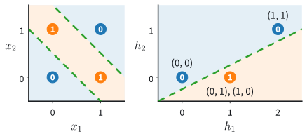
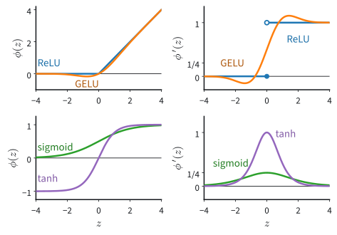

```{.python .input}
%load_ext d2lbook.tab
tab.interact_select('mxnet', 'pytorch', 'tensorflow', 'jax')
```

# Multilayer Perceptrons
:label:`sec_mlp`

Now that we have mastered data pipelines, probabilistic outputs,
cross-entropy, and minibatch SGD in the setting of linear models, we are
ready to explore deep neural networks—the far richer model family at the
heart of this book. In :numref:`chap_classification`, softmax regression
scored each garment class by summing weighted pixel values, meaning every
pixel moved a class score by a fixed amount completely independently of its
neighbors. What exactly does that linearity rule out, and what must we add
to break past it?

It helps to start with the simplest possible failure of a linear
classifier—a dataset of just four points. Label the four corners of the
unit square by whether their two coordinates disagree, the *exclusive-OR*
(XOR) of two binary bits. No straight line in the plane can separate the
two classes, so *every* linear classifier gets at least one corner wrong.

A *multilayer perceptron* (MLP) overcomes this barrier by computing learned
intermediate features before making a linear decision. A *hidden layer*
applies an affine transformation followed by a fixed nonlinear activation
function, and an output layer (ordinary softmax regression) classifies the
resulting representation—all trained jointly end to end with the same
cross-entropy loss and minibatch SGD we already know. In this section, we
define MLPs formally, solve XOR by hand with two ReLU hidden units, examine
what functions shallow and deep networks can represent, and compare the
activation functions used in modern practice.

```{.python .input #mlp-multilayer-perceptrons}
%%tab mxnet
import math
import numpy as np
from mxnet import autograd, gluon, init, np as mnp, npx
from mxnet.gluon import nn
from d2l import mxnet as d2l
npx.set_np()
```

```{.python .input #mlp-multilayer-perceptrons}
%%tab pytorch
import math
import numpy as np
import torch
from torch import nn
from torch.nn import functional as F
from d2l import torch as d2l
```

```{.python .input #mlp-multilayer-perceptrons}
%%tab tensorflow
import math
import numpy as np
import tensorflow as tf
from d2l import tensorflow as d2l
```

```{.python .input #mlp-multilayer-perceptrons}
%%tab jax
import math
import numpy as np
import jax
from jax import numpy as jnp
from flax import nnx
import optax
from d2l import jax as d2l
```

## Limits of Linear Models

### Monotonicity and Interactions

Linearity is a far stronger assumption than it first appears. Recall how
softmax regression (:numref:`sec_softmax`) scores class $j$ for an input
$\mathbf{x} \in \mathbb{R}^d$:

$$o_j = \sum_{i=1}^d x_i w_{ij} + b_j.$$

Two rigid constraints are baked directly into this formula. First, each
score is *monotonic* in every input feature: increasing $x_i$ always pushes
$o_j$ up if $w_{ij} > 0$, or always pulls it down if $w_{ij} < 0$. Second,
features can never *interact*: increasing $x_i$ by one shifts $o_j$ by the
exact same amount $w_{ij}$ regardless of every other coordinate. Both
assumptions routinely fail in the real world. Health risk rises whenever
body temperature strays from 37°C (98.6°F) in *either* direction—upward
into fever or downward into hypothermia. That simple non-monotonicity can
still be patched by hand by replacing temperature with $|T - 37|$. Feature
interactions, however, are a far deeper obstacle. For an image, should
brightening pixel $(13, 17)$ always make "shirt" more likely? Of course
not—inverting an image's brightness or shifting a garment by two pixels
flips individual pixel intensities while preserving the category, because a
pixel's meaning depends entirely on its neighbors. Hand-engineering every
pixel interaction is hopeless; instead, we want our model to *learn* a
representation of those interactions directly from data.

### The XOR Problem

The cleanest possible demonstration of feature interaction uses just two
binary inputs with the XOR label:

| $x_1$ | $x_2$ | $y$ |
|:---:|:---:|:---:|
| 0 | 0 | 0 |
| 0 | 1 | 1 |
| 1 | 0 | 1 |
| 1 | 1 | 0 |

Here $y = 1$ whenever *exactly one* input is 1. Flipping $x_1$ from 0 to 1
flips the label *up* from 0 to 1 when $x_2 = 0$, yet flips it *down* from
1 to 0 when $x_2 = 1$. In two-class softmax regression
(:numref:`sec_softmax`), the predicted class depends solely on the sign of
the logit difference $o = w_1 x_1 + w_2 x_2 + b$, whose decision boundary
is the straight line $o = 0$.

**Proposition.** For all $w_1, w_2, b \in \mathbb{R}$, the linear decision
rule "predict class 1 if $w_1 x_1 + w_2 x_2 + b > 0$" misclassifies at
least one of the four XOR points.

**Proof.** Suppose for contradiction that some $w_1, w_2, b$ separate all
four points cleanly. The two class-1 points require $w_2 + b > 0$ and
$w_1 + b > 0$, whose sum gives $w_1 + w_2 + 2b > 0$. Meanwhile, the two
class-0 points require $b \leq 0$ and $w_1 + w_2 + b \leq 0$, whose sum
gives $w_1 + w_2 + 2b \leq 0$—an immediate contradiction. $\blacksquare$

Geometrically, the failure is obvious at a glance: both diagonals share the
exact same midpoint $(1/2, 1/2)$, where any affine function must equal the
average of its values at the endpoints—meaning $o(1/2, 1/2)$ would have to
be simultaneously strictly positive and nonpositive! The best any straight
line can manage is three out of four (for instance, $x_1 + x_2 = 3/2$
misclassifies only $(0, 0)$).

## Hidden Layers

### The Model

To escape linearity, a multilayer perceptron inserts one or more *hidden
layers* between the raw inputs and the output classifier. A hidden layer
computes $h$ new features—each an affine combination of the inputs passed
through a fixed nonlinear function $\phi$—and the output layer then runs
ordinary linear classification on those learned features. They are called
*hidden units* because their values are neither observed in the dataset nor
reported directly as outputs. :numref:`fig_mlp` depicts an MLP with four
inputs, one hidden layer of five units, and three outputs. Every input
connects to every hidden unit, and every hidden unit connects to every
output, so both layers are *fully connected*. Because the input layer
performs no computation, we count only parameterized layers: this is a
two-layer MLP (one hidden layer plus one output layer). Historically, the
name pays homage to Rosenblatt's thresholded *perceptron*, replacing its
discontinuous step threshold with a smooth or piecewise-linear activation
$\phi$ and stacking layers of such units together.


:label:`fig_mlp`

Keeping the minibatch layout of :numref:`subsec_softmax_vectorization`,
stack $n$ examples as the rows of $\mathbf{X} \in \mathbb{R}^{n \times d}$,
with weight matrices oriented as $(\text{inputs} \times \text{outputs})$.
Using superscripts to index layers, let the hidden layer hold weights
$\mathbf{W}^{(1)} \in \mathbb{R}^{d \times h}$ and biases
$\mathbf{b}^{(1)} \in \mathbb{R}^{h}$, and the output layer hold weights
$\mathbf{W}^{(2)} \in \mathbb{R}^{h \times q}$ and biases
$\mathbf{b}^{(2)} \in \mathbb{R}^{q}$. The one-hidden-layer MLP computes

$$
\begin{aligned}
\mathbf{H} &= \phi\left(\mathbf{X}\mathbf{W}^{(1)} + \mathbf{b}^{(1)}\right),\\
\mathbf{O} &= \mathbf{H}\mathbf{W}^{(2)} + \mathbf{b}^{(2)}.
\end{aligned}
$$
:eqlabel:`eq_mlp`

Here each bias broadcasts across rows and $\phi$ acts *elementwise*. Row
$i$ of $\mathbf{H} \in \mathbb{R}^{n \times h}$ is the learned *hidden
representation* of example $i$, and row $i$ of
$\mathbf{O} \in \mathbb{R}^{n \times q}$ holds its class logits, ready for
softmax and cross-entropy just as before. Written for a single column
vector $\mathbf{x}$, the same equations read
$\mathbf{h} = \phi(\mathbf{W}^{(1)\top}\mathbf{x} + \mathbf{b}^{(1)})$ and
$\mathbf{o} = \mathbf{W}^{(2)\top}\mathbf{h} + \mathbf{b}^{(2)}$, with
transposes appearing solely because single examples are column vectors
while minibatch rows are row vectors.

The elementwise nonlinearity $\phi$ is the *activation function*; its
inputs $\mathbf{X}\mathbf{W}^{(1)} + \mathbf{b}^{(1)}$ are called
*pre-activations*, and its outputs $\mathbf{H}$ are called *activations*.
Because automatic differentiation computes gradients through all four
arrays $(\mathbf{W}^{(1)}, \mathbf{b}^{(1)}, \mathbf{W}^{(2)}, \mathbf{b}^{(2)})$,
minibatch SGD learns the hidden features and the linear classifier on top
of them *jointly*.

This extra expressivity comes with a steep jump in parameter count. With
$d$ inputs, $h$ hidden units, and $q$ outputs, an MLP requires
$(d + 1)h + (h + 1)q$ parameters versus $(d + 1)q$ for softmax regression.
On Fashion-MNIST ($d = 784, q = 10$), even a modest hidden layer of
$h = 256$ units uses $785 \cdot 256 + 257 \cdot 10 = 203{,}530$
parameters—26 times as many as softmax regression's 7,850!

### The Role of the Nonlinearity

Wait—why bother inserting $\phi$ at all? What happens if we stack two
fully connected affine layers *without* a nonlinearity, setting
$\mathbf{H} = \mathbf{X}\mathbf{W}^{(1)} + \mathbf{b}^{(1)}$?
Surprisingly, *we gain nothing for our troubles*! Substituting $\mathbf{H}$
directly into the output layer collapses the entire stack back into a
single affine transformation:

$$\mathbf{O} = \left(\mathbf{X}\mathbf{W}^{(1)} + \mathbf{b}^{(1)}\right)\mathbf{W}^{(2)} + \mathbf{b}^{(2)} = \mathbf{X}\mathbf{W} + \mathbf{b},$$

with $\mathbf{W} = \mathbf{W}^{(1)}\mathbf{W}^{(2)}$ and
$\mathbf{b} = \mathbf{W}^{(2)\top}\mathbf{b}^{(1)} + \mathbf{b}^{(2)}$.
An affine function of an affine function is still an affine function.
Adding a linear hidden layer piles on parameters without adding a single
new function (in fact, a narrow bottleneck can even *shrink* the class of
representable linear maps; see Exercise :exref:`ex_mlp-linear-networks`),
and the network still fails on XOR.

Inserting a nonlinear activation $\phi$ blocks this collapse. The simplest
effective nonlinearity—and our default throughout this book—is the
*rectified linear unit* (ReLU),

$$\mathrm{ReLU}(z) = \max(z, 0),$$

which passes positive inputs through unchanged and zeroes out negative ones.

### Solving XOR

How big a ReLU hidden layer do we need to conquer XOR? Just two hidden
units suffice! Following :citet:`Goodfellow.Bengio.Courville.2016`, set

$$\mathbf{W}^{(1)} = \begin{pmatrix} 1 & 1 \\ 1 & 1 \end{pmatrix}, \quad \mathbf{b}^{(1)} = (0, -1), \quad \mathbf{w}^{(2)} = (1, -2), \quad b^{(2)} = 0,$$

producing a single scalar output $o$. Both hidden units read the sum
$s = x_1 + x_2$: the first unit, $h_1 = \mathrm{ReLU}(s) = s$, simply
counts how many inputs equal 1, while the second unit,
$h_2 = \mathrm{ReLU}(s - 1)$, turns on *only* when both inputs equal 1 so
that $o = h_1 - 2h_2$ subtracts 2 to pull $(1, 1)$ back down to 0. Let us
verify this hand-crafted network on all four XOR corners:

```{.python .input #mlp-xor}
X = np.array([[0, 0], [0, 1], [1, 0], [1, 1]])
W1, b1 = np.array([[1, 1], [1, 1]]), np.array([0, -1])
w2, b2 = np.array([1, -2]), 0
H = np.maximum(X @ W1 + b1, 0)  # hidden layer with ReLU
o = H @ w2 + b2  # output layer
for x, h, out in zip(X, H, o):
    print(f'x = {x}, h = {h}, o = {out}')
```

Every single corner matches XOR exactly! As a function of $s = x_1 + x_2$,
the output $o = \mathrm{ReLU}(s) - 2\,\mathrm{ReLU}(s - 1)$ climbs from 0
at $s = 0$ to 1 at $s = 1$, then bends back down to 0 at $s = 2$: the
second hidden unit *folds* the number line at $s = 1$ so its two ends share
the same value. Look at what happened geometrically in hidden space
(:numref:`fig_mdl-mlp-xor`, right): the hidden layer collapsed both class-1
corners onto the exact same point $(1, 0)$, making the two classes cleanly
separable by the straight line $h_1 - 2h_2 = 1/2$. Mapped back into input
space (left), that single line carves out the diagonal strip
$1/2 < x_1 + x_2 < 3/2$—a non-halfspace region no single linear classifier
could ever produce.

![XOR and the two-unit ReLU network that computes it. Left: the four inputs, labeled by XOR (blue: class 0, orange: class 1); the network predicts class 1 in the shaded band between the dashed lines $x_1 + x_2 = 1/2$ and $x_1 + x_2 = 3/2$. Right: the same inputs after the hidden layer $\mathbf{h} = \mathrm{ReLU}(\mathbf{W}^{(1)\top}\mathbf{x} + \mathbf{b}^{(1)})$, each marked with the input it came from; the two inputs of class 1 land on the same point $(1, 0)$, and the dashed line $h_1 - 2h_2 = 1/2$ separates the classes.](../img/mdl-mlp-xor.svg)
:label:`fig_mdl-mlp-xor`

In short, the hidden layer transformed the inputs into a representation
where a plain linear classifier succeeds effortlessly. For XOR we could
write down those weights by hand; for Fashion-MNIST nobody could, so we
will let gradient descent discover them from data.

### Deeper Networks

There is no reason to stop at one hidden layer. Starting from
$\mathbf{H}^{(0)} = \mathbf{X}$, we can stack $K - 1$ hidden layers of
arbitrary widths,

$$\mathbf{H}^{(k)} = \phi\left(\mathbf{H}^{(k-1)}\mathbf{W}^{(k)} + \mathbf{b}^{(k)}\right), \quad k = 1, \ldots, K-1,$$

capped by the linear output layer
$\mathbf{O} = \mathbf{H}^{(K-1)}\mathbf{W}^{(K)} + \mathbf{b}^{(K)}$.
Such a $K$-layer network builds a hierarchy of representations, feeding
each layer's features into the next until the final layer classifies them
(setting $K = 2$ recovers :eqref:`eq_mlp`). Should we prefer one very wide
hidden layer or several narrower layers stacked deep? To answer that, let
us first see what a single hidden layer can already express.

## Expressive Power

### Universal Approximation

Two hidden units solved XOR. How rich is the class of functions computable
by a single hidden layer? For a scalar input $x$ and ReLU activations, a
single picture reveals the whole story. A hidden unit with input weight 1,
bias $-t$, and output weight $a$ contributes $a\,\mathrm{ReLU}(x - t)$—a
*hinge* that stays flat at zero left of its joint $t$ and rises (or falls)
with slope $a$ to the right. Summing $h$ hinges plus a constant produces a
continuous piecewise-linear curve with at most $h + 1$ linear segments
(:numref:`fig_mdl-mlp-uat-hinges`). Conversely, *any* polyline on a closed
interval can be built this way: place one hinge at the left endpoint to set
the initial slope, and one hinge at each interior joint to supply the exact
change in slope there.


:label:`fig_mdl-mlp-uat-hinges`

From polylines to arbitrary continuous functions is one short step: any
continuous function $f$ on a closed interval varies by less than any chosen
$\epsilon > 0$ across sufficiently small subintervals, so interpolating $f$
with a fine enough polyline stays within $\epsilon$ everywhere—and a
single ReLU hidden layer with one unit per joint computes that polyline
exactly.

Neither the one-dimensional input nor ReLU is special. The celebrated
*universal approximation theorem* proves that a single-hidden-layer MLP can
approximate *any* continuous function on any closed, bounded subset of
$\mathbb{R}^d$ to arbitrary precision, using *any* continuous non-polynomial
activation function (:citet:`Cybenko.1989` for sigmoids;
:citet:`Leshno.Lin.Pinkus.ea.1993` for the general characterization).
Polynomial activations must be excluded because a fixed-depth network with
polynomial activations can only compute polynomials of bounded degree. We
omit the general proof here, though Exercise
:exref:`ex_mlp-one-hidden-layer` walks you through the two-dimensional case.

### Limits of the Theorem

Universal approximation sounds almost magical—yet think of a neural network
like the C programming language. C can express any computable program, but
that fact alone does not write a bug-free compiler for you! Likewise, the
theorem only guarantees that good weights *exist*, leaving three huge
practical hurdles unresolved:

1. **Width:** Our hinge construction spends one hidden unit per joint, and
   in high dimensions partitioning space into fine cells can demand
   *exponentially* many hidden units as $d$ grows.
1. **Optimization:** Existence of good weights does not guarantee that
   minibatch SGD started from random initialization will ever find them.
1. **Generalization:** Approximating a known target everywhere is a far cry
   from learning it from $n$ noisy samples—a network flexible enough to fit
   any smooth function can equally well memorize pure label noise.

### Depth

Here is where *depth* earns its keep. Adding width to one hidden layer adds
linear pieces only *linearly* ($h$ ReLU units on $\mathbb{R}$ yield at most
$h + 1$ pieces). Stacking layers can *multiply* them. Consider the simple
tent function

$$g(z) = 2\,\mathrm{ReLU}(z) - 4\,\mathrm{ReLU}(z - 1/2),$$

which rises linearly from 0 to 1 on $[0, 1/2]$ and drops back to 0 on
$[1/2, 1]$—literally our XOR network evaluated along the diagonal $s = 2z$.
Now feed $g$ back into itself. As $z$ sweeps from $0$ to $1/2$, $g(z)$
sweeps across $[0, 1]$, so $g(g(z))$ draws a complete tent; as $z$
continues from $1/2$ to $1$, $g(z)$ sweeps back from $1$ to $0$, drawing a
second mirror-image tent! The first layer *folds* $[0, 1]$ cleanly in half,
duplicating everything computed by the layers above on both halves
(:numref:`fig_mdl-mlp-depth-folding`). And because two consecutive affine
maps fuse into one, each composition with $g$ adds just *one* hidden layer
of two ReLU units.


:label:`fig_mdl-mlp-depth-folding`

Composing $g$ with itself $m$ times produces a sawtooth wave with $2^m$
linear segments using $m$ hidden layers of two units—only $2m$ hidden units
in total! Representing that exact same sawtooth with a single hidden layer
requires at least $2^m - 1$ units. At $m = 10$, that is 20 units across ten
layers versus at least 1,023 units in one layer. :citet:`Telgarsky.2016`
used precisely this folding argument to prove an exponential separation in
expressive efficiency between deep and shallow networks. Naturally, a
sawtooth is a stylized function—depth does not help every target equally,
and expressivity alone never guarantees SGD will discover such compact
compositions—yet it illustrates vividly *why* deep hierarchies can compress
complex structure far more economically than flat lookup tables.

## Activation Functions
:label:`subsec_activation-functions`

For mere expressivity, almost any non-polynomial $\phi$ would do. Once we
actually *train* the network by gradient descent, however, the choice of
activation function matters enormously. Consider hidden unit $j$ computing
$h_j = \phi(z_j)$ from pre-activation
$z_j = \sum_i x_i w^{(1)}_{ij} + b^{(1)}_j$. By the chain rule,

$$\frac{\partial l}{\partial w^{(1)}_{ij}} = \frac{\partial l}{\partial h_j}\,\phi'(z_j)\,x_i.$$

Every weight feeding unit $j$ has its gradient multiplied by the local
slope $\phi'(z_j)$. Wherever $\phi'(z_j) \approx 0$, learning grinds to a
halt no matter how badly the network misses the target.
:numref:`fig_mdl-mlp-activations` plots four widely used activation
functions alongside their derivatives.


:label:`fig_mdl-mlp-activations`

### ReLU and GELU

The derivative of $\mathrm{ReLU}(z) = \max(z, 0)$ is remarkably clean: 1
for $z > 0$ and 0 for $z < 0$. Strictly speaking, ReLU is nondifferentiable
at the corner $z = 0$ (a set of measure zero); frameworks conventionally
assign derivative 0 there, which works seamlessly in practice since exact
zeros rarely occur in floating-point pre-activations. Crucially, for *every*
positive pre-activation—no matter how large—ReLU passes the incoming
gradient straight through unattenuated. That clean gradient flow, paired
with its dirt-cheap comparison operation, is why ReLU dethroned the sigmoid
as the default hidden-layer activation and helped spark the modern deep
learning resurgence :cite:`Nair.Hinton.2010,Glorot.Bordes.Bengio.2011`.

ReLU's flat negative half has one quirk: if a unit's weights ever drift so
that its pre-activation stays negative on every training example, it
outputs zero, receives zero gradient, and stays permanently *dead*.
Variants such as *leaky ReLU*, $\max(z, \alpha z)$ (typically with
$\alpha = 0.01$), preserve a gentle nonzero slope on the negative side so
units can always recover.

A popular smooth cousin of ReLU is the *Gaussian error linear unit* (GELU),

$$\mathrm{GELU}(z) = z\,\Phi(z),$$

where $\Phi$ is the standard normal cumulative distribution function. Since
$\Phi(z)$ transitions smoothly from 0 to 1, GELU hugs ReLU closely for
$|z| > 3$ while smoothly rounding the corner near zero—passing through
slope $1/2$ at the origin and dipping gently below zero (to about $-0.17$
around $z = -0.75$). GELU has become a standard workhorse in Transformer
architectures :cite:`Hendrycks.Gimpel.2016`, alongside its close sibling
*SiLU* (or Swish), $z\,\sigma(z)$, which swaps $\Phi$ for the logistic
sigmoid.

### Sigmoid and Tanh

We already met the logistic *sigmoid*, $\sigma(z) = 1/(1 + \exp(-z))$, as
a binary probability map in :numref:`sec_softmax`: it squashes the entire
real line smoothly into $(0, 1)$. Early neural network pioneers—inspired by
biological neurons that either fire or stay silent—modeled threshold units
:cite:`McCulloch.Pitts.1943`, and later adopted the sigmoid in hidden
layers as a differentiable substitute for a step function. Its derivative is

$$\sigma'(z) = \sigma(z)\,\bigl(1 - \sigma(z)\bigr),$$

which peaks at a modest $1/4$ at $z = 0$ and decays rapidly toward zero in
*both* tails. Any unit operating at large $|z|$ is *saturated*: its output
flattens near 0 or 1 and starves lower layers of gradient (even at
$z = \pm 4$, $\sigma'(z) \approx 0.018$).

Worse still, even at its peak $z = 0$, every sigmoid layer multiplies the
gradient by at most $1/4$. Across a chain of ten unit-weight sigmoid
layers, the gradient shrinks by at least $4^{10} \approx 10^6$! This
*vanishing gradient* problem crippled deep sigmoid networks for decades; we
diagnose it quantitatively and develop remedies in
:numref:`sec_numerical_stability`.

The *hyperbolic tangent*,

$$\tanh(z) = \frac{1 - \exp(-2z)}{1 + \exp(-2z)},$$

squashes inputs symmetrically into $(-1, 1)$—in fact, it is simply a
rescaled, zero-centered sigmoid (Exercise :exref:`ex_mlp-sigmoid-tanh`).
Its derivative $1 - \tanh^2(z)$ peaks at 1 at the origin, allowing
unsaturated units to pass gradients at full strength, though it vanishes
even faster in the tails (around $0.0013$ at $z = \pm 4$). In modern deep
learning, ReLU and GELU dominate standard hidden layers, while sigmoid is
reserved mainly for binary outputs and gating mechanisms (values in $(0, 1)$
that throttle signal flow) and $\tanh$ for keeping recurrent hidden states
bounded.

So far, every weight in this section was chosen by hand—we have not trained
a single MLP yet. Does minibatch SGD actually find useful hidden features
on real data, and how much accuracy does it buy over softmax regression? We
put it to the test on Fashion-MNIST in the next section.

## Summary

Linear models score each class by an additive weighted sum of inputs,
forcing monotonicity and ruling out feature interactions—limitations
already exposed by the four corners of XOR. A *multilayer perceptron*
breaks this barrier by inserting one or more hidden layers,
$\mathbf{H} = \phi(\mathbf{X}\mathbf{W}^{(1)} + \mathbf{b}^{(1)})$,
before a linear output layer
$\mathbf{O} = \mathbf{H}\mathbf{W}^{(2)} + \mathbf{b}^{(2)}$, learning
representations and decision boundaries jointly. Without a nonlinear
activation $\phi$, stacked layers collapse into a single affine map; with
ReLU, just two hidden units fold XOR into a linearly separable
representation. While a single hidden layer is a universal approximator for
continuous functions, depth can multiply linear pieces exponentially with
far fewer units. In practice, activation functions are chosen for healthy
gradient flow: ReLU and smooth variants like GELU avoid the saturating
tails and vanishing gradients that hamper sigmoid and $\tanh$ in deep
hidden layers.

## Exercises

1. **Linear networks.** Without activation functions, stacking layers
   composes affine maps into another affine map. Consider such a network
   with input dimension $d$, output dimension $q$, and hidden widths
   $h_1, \ldots, h_{K-1}$. Show that it represents exactly the affine maps
   $\mathbf{X}\mathbf{W} + \mathbf{b}$ whose weight matrix $\mathbf{W}$ has
   rank at most $\min(h_1, \ldots, h_{K-1})$. Use this result to give an
   example in which adding a hidden layer to a linear model strictly shrinks
   its function class.
   :exlabel:`ex_mlp-linear-networks`
1. **XOR by hand.** :numref:`fig_mdl-mlp-xor` shows a two-unit ReLU network
   that computes XOR by mapping the two inputs of class 1 to the same hidden
   point.
    1. Find weights for a two-unit ReLU network that also computes XOR but
       maps the two inputs of class 1 to *distinct* hidden points, and verify
       it on the four inputs.
    1. Show that no network with a single ReLU hidden unit and a linear
       output classifies XOR correctly, for any threshold applied to its
       output.
1. **Sigmoid and tanh.** The two squashing functions are closely related.
    1. Show that $\tanh(z) = 2\sigma(2z) - 1$.
    1. Show that for every MLP with tanh hidden activations there is an MLP
       of the same architecture with sigmoid hidden activations that
       computes the same function, and conversely. State how the weights and
       biases change.
   :exlabel:`ex_mlp-sigmoid-tanh`
1. [code] **Vanishing gradients.** Consider a chain of $K$ sigmoid units of
   width one, $h_k = \sigma(z_k)$ with pre-activation
   $z_k = w_k h_{k-1} + b_k$. By the chain rule,

    $$\frac{\partial h_K}{\partial h_0} = \prod_{k=1}^{K} w_k \sigma'(z_k).$$

    1. Explain why the weight feeding a *saturated* unit, one operating at
       large $|z_k|$, receives almost no gradient for any loss, and why
       a single saturated unit also stalls every earlier layer of the chain.
    1. Choose the biases so that every pre-activation equals $0$, where
       $\sigma'$ attains its maximum $1/4$. Compute the product for
       $K = 1, \ldots, 20$, once with every $w_k = 1$ and once with every
       $w_k = 4$, and plot both curves on a logarithmic vertical axis.
    1. Repeat with every pre-activation equal to $5$ and every $w_k = 1$.
       Find the weight $w$ for which $w \sigma'(5) = 1$, and compare it with
       the weight that keeps the product constant at the origin. State what
       the comparison implies for training deep sigmoid networks in either
       regime.
   :exlabel:`ex_mlp-vanishing-gradients`
1. **Depth and linear pieces.** ● A one-hidden-layer ReLU network with $h$
   hidden units on the real line has at most $h + 1$ linear pieces, while
   each composition with the two-unit tent of
   :numref:`fig_mdl-mlp-depth-folding` doubles the number of pieces. This
   problem makes the gain from depth exact for a network with three units
   per layer.
    1. Take three hidden units $\mathrm{ReLU}(w_j x + b_j)$ with input
       weights $w_1 = w_2 = 1$ and $w_3 = -1$ and with joints $-b_j/w_j$ at
       $1/6$, $2/6$, and $4/6$. Choose output weights and an output bias so
       that the network's output $f$ takes the values $0, 1, 0, 1, 0$ at
       $x = 0, 1/6, 2/6, 4/6, 1$.
    1. Count the linear pieces of $f \circ f$ on $[0, 1]$, and of the
       $m$-fold composition $f \circ \cdots \circ f$. Explain, in terms of
       how composing with $f$ folds the graph, why each composition
       multiplies the count rather than adding to it.
    1. The $m$-fold composition is computed by a network with $m$ hidden
       layers of three units each. How many hidden units would a network
       with a single hidden layer need to represent the same function?
       Compare the parameter counts of the two networks.

    *Adapted from Simon Prince,
    [Understanding Deep Learning](https://udlbook.github.io/udlbook/),
    Problem 4.8.*
1. **One hidden layer suffices.** ● On the real line, a single hidden layer
   approximates a continuous function by a polyline, one hinge per joint.
   In the plane there are no joints to place, and the proof needs another
   idea: functions that vary along one direction only.
    1. Let $\psi$ be continuous on $\mathbb{R}$ and let
       $\mathbf{w} \in \mathbb{R}^2$. Show that a single hidden layer
       approximates the *ridge function* $\psi(\mathbf{w}^\top \mathbf{x})$,
       which is constant along every line orthogonal to $\mathbf{w}$,
       uniformly on any compact subset of the plane.
    1. The Stone–Weierstrass theorem states the following. Let a set of
       continuous functions on a compact set be closed under sums, products,
       and scalar multiples, contain the constants, and contain, for any two
       distinct points, a function that takes different values at them. Then
       every continuous function on the compact set is a uniform limit of
       functions in the set. Show that the finite linear combinations of
       $\cos(\boldsymbol{\omega}^\top \mathbf{x})$ and
       $\sin(\boldsymbol{\omega}^\top \mathbf{x})$, with
       $\boldsymbol{\omega} \in \mathbb{R}^2$, form such a set.
    1. Conclude that a single hidden layer approximates any continuous
       function on a compact subset of the plane.
   :exlabel:`ex_mlp-one-hidden-layer`

    *Adapted from Michael Nielsen,
    [Neural Networks and Deep Learning](http://neuralnetworksanddeeplearning.com/chap4.html),
    Chapter 4.*
1. [code] **Weight scale and saturation.** ● Take the chain of Exercise
   :exref:`ex_mlp-vanishing-gradients` with $K = 20$, every weight
   $w_k = w$, and every bias $b_k = -w/2$, so that the input $h_0 = 1/2$
   gives $z_k = 0$ at every layer.
    1. Express $\partial h_K / \partial h_0$ as a function of $w$ for the
       input $h_0 = 1/2$. For which $w$ does it not vanish as $K$ grows?
    1. Implement the chain and run it from $h_0 = 0.6$ with $w = 4$ and with
       $w = 8$. Report $h_{20}$ and $\partial h_{20} / \partial h_0$ in each
       case.
    1. Treat the map $h_{k-1} \mapsto h_k$ as a one-dimensional iteration
       with fixed point $1/2$, and use its slope there to explain the
       difference between the two runs. State what the result implies for
       countering vanishing gradients in a sigmoid network by scaling up its
       weights.

:begin_tab:`mxnet`
[Discussions](https://d2l.discourse.group/t/90)
:end_tab:

:begin_tab:`pytorch`
[Discussions](https://d2l.discourse.group/t/91)
:end_tab:

:begin_tab:`tensorflow`
[Discussions](https://d2l.discourse.group/t/226)
:end_tab:

:begin_tab:`jax`
[Discussions](https://d2l.discourse.group/t/17984)
:end_tab:

<!-- slides -->

::: {.slide}
::: {.cover}
[Dive into Deep Learning · §4.1]{.kicker}

Multilayer Perceptrons<br>**hidden layers · expressive power · activation functions**
:::
:::

::: {.slide title="No Linear Classifier Gets All Four Points of XOR Right"}
[The problem]{.kicker}

::: {.cols .vc}
::: {.col}
Softmax regression scores class $j$ by $o_j = \sum_i x_i w_{ij} + b_j$:
each input moves a score by a fixed amount, independently of the others.

- Fashion-MNIST: a bright pixel may belong to a sleeve, a strap, or the
  background. Only its neighbors can tell which.
- XOR: $y = 1$ if exactly one of $x_1, x_2$ is 1. Every line
  misclassifies at least one of the four points.

::: {.d2l-note}
Compute new features first, then classify them with a linear layer.
:::
:::

::: {.col .narrow}
| $x_1$ | $x_2$ | $y$ |
|:---:|:---:|:---:|
| 0 | 0 | 0 |
| 0 | 1 | 1 |
| 1 | 0 | 1 |
| 1 | 1 | 0 |
:::
:::
:::

::: {.slide title="By the End of This Deck You Can"}
[Goals]{.kicker}

- prove that no linear classifier computes XOR;
- write an MLP with the shapes of its matrices and count its parameters;
- show why a hidden layer needs a nonlinearity, and solve XOR with two ReLU
  units;
- state what the universal approximation theorem promises and what it does
  not, and why depth helps;
- compare ReLU, GELU, sigmoid, and tanh by their derivatives.

**Running example:** Fashion-MNIST, model against model: parameters,
multiply-adds, validation accuracy. Softmax regression has 7,850
parameters and reaches about 83% in ten epochs.
:::

::: {.slide title="Hidden Layers Turn Softmax Regression into a Deep Network"}
[Where this fits]{.kicker}

::: {.cols .vc}
::: {.col}
| section | adds |
|---|---|
| **Multilayer Perceptrons** | **hidden layers, universal approximation, activation functions** |
| Implementation | an MLP trained on Fashion-MNIST |
| Backpropagation | how the gradients are computed, and at what memory cost |
| Numerical Stability and Initialization | vanishing gradients, Xavier and He initialization |
| Generalization in Deep Learning | memorization, double descent, implicit bias, early stopping |
| Dropout | random masks, slower memorization of noisy labels |
| Predicting House Prices on Kaggle | the workflow on real data |
:::

::: {.col .narrow}
- **Uses:** softmax regression, cross-entropy, minibatch SGD, the chain
  rule.
- **Skips:** universal approximation proofs for many inputs; training XOR
  from data.
:::
:::
:::

::: {.slide title="A Linear Score Is Monotonic and Ignores Interactions"}
[Linear models]{.kicker}

$$o_j = \sum_{i=1}^d x_i w_{ij} + b_j$$

- **Monotonic:** raising $x_i$ moves $o_j$ in the direction of the sign of
  $w_{ij}$, always.
- **No interactions:** raising $x_i$ by one changes $o_j$ by $w_{ij}$, no
  matter what the other inputs are.

. . .

| relation | why a linear score fails | fix by hand? |
|---|---|---|
| illness risk and body temperature | risk rises on both sides of 37°C | yes: distance from 37°C |
| bright pixel: shirt or bag? | depends on the neighboring pixels | no |
:::

::: {.slide title="No Affine Score Classifies XOR"}
[Linear models]{.kicker}

Predict class 1 where $o = w_1 x_1 + w_2 x_2 + b > 0$. Suppose all four
points are right:

- class 1, $(0, 1)$ and $(1, 0)$: $w_2 + b > 0$ and $w_1 + b > 0$, so
  $w_1 + w_2 + 2b > 0$;
- class 0, $(0, 0)$ and $(1, 1)$: $b \le 0$ and $w_1 + w_2 + b \le 0$, so
  $w_1 + w_2 + 2b \le 0$.

A contradiction. $\blacksquare$

::: {.d2l-note .rule}
Both pairs have the midpoint $(1/2, 1/2)$, where an affine score is the
average of either pair. The best line gets three of the four points right.
:::
:::

::: {.slide}
::: {.divider}
[01]{.dnum}

[Hidden layers]{.dtitle}

[an affine map, then a nonlinearity]{.dsub}
:::
:::

::: {.slide title="A Hidden Layer Computes Features; a Linear Layer Classifies Them"}
[The model]{.kicker}

$$\mathbf{H} = \phi(\mathbf{X}\mathbf{W}^{(1)} + \mathbf{b}^{(1)}), \quad \mathbf{O} = \mathbf{H}\mathbf{W}^{(2)} + \mathbf{b}^{(2)}$$

::: {.cols .vc}
::: {.col}
- $\mathbf{X}$: $n \times d$, one example per row
- $\mathbf{W}^{(1)}$: $d \times h$; $\mathbf{H}$: $n \times h$, the hidden
  representation
- $\mathbf{W}^{(2)}$: $h \times q$; $\mathbf{O}$: $n \times q$, the logits
- $\phi$: the activation function, applied to each entry
:::

::: {.col .fig .big}

:::
:::
:::

::: {.slide title="Without φ, Two Layers Collapse into One Affine Map"}
[The model]{.kicker}

Substitute $\mathbf{H} = \mathbf{X}\mathbf{W}^{(1)} + \mathbf{b}^{(1)}$
into the output layer:

$$\mathbf{O} = \mathbf{X}\,\underbrace{\mathbf{W}^{(1)}\mathbf{W}^{(2)}}_{\mathbf{W}} + \underbrace{\mathbf{W}^{(2)\top}\mathbf{b}^{(1)} + \mathbf{b}^{(2)}}_{\mathbf{b}}$$

. . .

::: {.d2l-note .warn}
More parameters, no new functions: the network still fails on XOR.
:::

A nonlinear $\phi$ blocks the collapse. The default is the rectified linear
unit, $\mathrm{ReLU}(z) = \max(z, 0)$.
:::

::: {.slide title="Two ReLU Units Compute XOR"}
[The model]{.kicker}

$\mathbf{W}^{(1)} = \left(\begin{smallmatrix}1 & 1\\ 1 & 1\end{smallmatrix}\right)$,
$\mathbf{b}^{(1)} = (0, -1)$, $\mathbf{w}^{(2)} = (1, -2)$, $b^{(2)} = 0$:
both units see $s = x_1 + x_2$.

@mlp-xor
:::

::: {.slide title="The Hidden Layer Folds XOR So That One Line Separates It"}
[The model]{.kicker}

{width=90%}

$o = \mathrm{ReLU}(s) - 2\,\mathrm{ReLU}(s - 1)$ folds $s = x_1 + x_2$ at 1.
Right: the class-1 inputs meet at $(1, 0)$. Left: class 1 is a band.

::: {.d2l-note}
Here the weights were chosen by hand. For images nobody could, so training
has to choose them: the next deck shows what its hidden units learn.
:::
:::

::: {.slide title="A Hidden Layer of 256 Units Multiplies the Parameters by 26"}
[Running example]{.kicker}

$d$ inputs, $h$ hidden units, $q$ outputs: $(d + 1)h + (h + 1)q$
parameters, against $(d + 1)q$. Here $d = 784$, $q = 10$, $h = 256$.

| model | parameters | multiply-adds per image | validation accuracy |
|---|---:|---:|---:|
| softmax regression | 7,850 | 7,840 | about 83% (10 epochs) |
| MLP, 256 hidden units | 203,530 | 203,264 | next deck |

::: {.d2l-note}
$785 \cdot 256 + 257 \cdot 10 = 203{,}530$; the first layer holds 99% of
them.
:::
:::

::: {.slide title="Check: How Many Parameters Do Two Hidden Layers of 256 Units Have?"}
[Check]{.kicker}

Inputs 784, then 256 hidden units, 256 hidden units, and 10 outputs, all
with biases. How many parameters does the network have? And how many does
it need without its activation functions, written as a single layer?

::: {.fragment .fade-up}
::: {.d2l-note}
**Answer.** $785 \cdot 256 + 257 \cdot 256 + 257 \cdot 10 = 200{,}960 +
65{,}792 + 2{,}570 = 269{,}322$. Without $\phi$ the network collapses to
softmax regression: 7,850.
:::
:::
:::

::: {.slide}
::: {.divider}
[02]{.dnum}

[Expressive power]{.dtitle}

[universal approximation · depth]{.dsub}
:::
:::

::: {.slide title="One Hidden Layer Approximates Any Continuous Function"}
[Expressive power]{.kicker}

{width=72%}

- A unit adds a **hinge** $a\,\mathrm{ReLU}(x - t)$; $h$ hinges give at most
  $h + 1$ pieces, and every polyline is such a sum.
- Joints close enough put the polyline within $\epsilon$ of a continuous
  $f$; the theorem extends to many inputs and non-polynomial $\phi$.
:::

::: {.slide title="Existence Is All the Theorem Promises"}
[Expressive power]{.kicker}

- **Width:** one unit per joint. With many inputs, the cells, and the units,
  can grow exponentially with the number of inputs.
- **Training:** good weights exist; SGD from a random start need not find
  them.
- **Generalization:** a network that can fit any function can also fit the
  noise in its labels.

::: {.d2l-note .warn}
The theorem guarantees that good weights exist, not that we can find or
trust them.
:::

Sources: Cybenko (1989) for sigmoids; Leshno, Lin, Pinkus, and Schocken
(1993) in general.
:::

::: {.slide title="Depth Multiplies Linear Pieces; Width Only Adds Them"}
[Expressive power]{.kicker}

$g(z) = 2\,\mathrm{ReLU}(z) - 4\,\mathrm{ReLU}(z - 1/2)$: one hidden layer
of two units folds $[0, 1]$ in half.

{width=85%}

$m$ hidden layers of 2 units: $2^m$ pieces from $2m$ units. One hidden
layer needs at least $2^m - 1$ units. For $m = 10$: 20 units against 1,023.
:::

::: {.slide title="Check: How Many Pieces Can Six ReLU Units Make?"}
[Check]{.kicker}

One input, one output. Compare one hidden layer of six units with three
hidden layers of two units each. Then repeat with 20 units.

::: {.fragment .fade-up}
::: {.d2l-note}
**Answer.** One layer: at most 7 pieces. Three layers: 8, from
$g \circ g \circ g$. With 20 units: at most 21, against $2^{10} = 1{,}024$
for ten layers of two.
:::
:::
:::

::: {.slide}
::: {.divider}
[03]{.dnum}

[Activation functions]{.dtitle}

[ReLU, GELU, sigmoid, tanh]{.dsub}
:::
:::

::: {.slide title="Two Activations Rectify, Two Squash"}
[Activation functions]{.kicker}

Any nonlinear $\phi$ blocks the collapse; the choice matters for training,
because every weight into a unit is scaled by $\phi'(z)$.
Left: $\phi(z)$. Right: $\phi'(z)$, on one shared scale.

{width=66%}
:::

::: {.slide title="ReLU Passes the Whole Gradient or None of It"}
[Activation functions]{.kicker}

$\mathrm{ReLU}(z) = \max(z, 0)$; its derivative is 1 for $z > 0$ and 0 for
$z < 0$, and the built-in ReLU uses 0 at $z = 0$.

- No saturation for $z > 0$, one comparison: the default for hidden layers.
- **Dead unit:** $z < 0$ on every example gives zero gradient forever. The
  leaky ReLU $\max(z, \alpha z)$, $\alpha = 0.01$, keeps a small slope.
- **GELU** $= z\,\Phi(z)$, with $\Phi$ the standard normal CDF: a smooth
  ReLU with slope 1/2 at 0 and a dip to about $-0.17$, used in many
  transformers.
:::

::: {.slide title="A Saturated Unit Stops Every Weight Below It"}
[Activation functions]{.kicker}

Unit $j$: $h_j = \phi(z_j)$, $z_j = \sum_i x_i w^{(1)}_{ij} + b^{(1)}_j$,
loss $l$:

$$\frac{\partial l}{\partial w^{(1)}_{ij}} = \frac{\partial l}{\partial h_j}\,\phi'(z_j)\,x_i$$

- sigmoid $\sigma(z) = 1/(1 + e^{-z})$: $\sigma' = \sigma(1 - \sigma) \le 1/4$
- $\tanh(z) \in (-1, 1)$: $\tanh' = 1 - \tanh^2 \le 1$
- large $|z|$: the unit is **saturated**, $\phi' \approx 0$
- a chain of ten sigmoid units with weights 1: the gradient shrinks by at
  least $4^{10} \approx 10^6$, a **vanishing gradient**
:::

::: {.slide title="At z = ±4, Sigmoid and Tanh Pass Under 2%"}
[Activation functions]{.kicker}

| $\phi$ | $\phi'(0)$ | $\phi'(\pm 4)$ |
|:--|--:|--:|
| ReLU | 0 (by convention) | 0 or 1 |
| sigmoid | 0.25 | 0.018 |
| tanh | 1 | 0.0013 |

::: {.d2l-note}
ReLU: 0 or 1, with 0 at $z = 0$. Sigmoid: at most 0.25. Tanh: at most 1.
Today the sigmoid makes probabilities and gates; tanh keeps recurrent
states bounded.
:::
:::

::: {.slide title="Check: How Much Gradient Survives Five Layers?"}
[Check]{.kicker}

A chain of five units with weights 1, all at the same pre-activation. What
fraction of the gradient reaches the first layer for sigmoid at $z = 0$,
tanh at $z = 0$, tanh at $z = 4$, and ReLU at $z = 4$?

::: {.fragment .fade-up}
::: {.d2l-note}
**Answer.** Sigmoid: $0.25^5 \approx 0.001$. Tanh at 0: all of it,
$1^5 = 1$. Tanh at 4: $0.0013^5 \approx 4 \cdot 10^{-15}$. ReLU at 4: all of
it.
:::
:::
:::

::: {.slide title="Recap"}
[Wrap-up]{.kicker}

- **Linear limit:** each input moves a score by a fixed amount; no line
  classifies XOR, and the best gets three of four points.
- **MLP:** $\mathbf{H} = \phi(\mathbf{X}\mathbf{W}^{(1)} + \mathbf{b}^{(1)})$,
  $\mathbf{O} = \mathbf{H}\mathbf{W}^{(2)} + \mathbf{b}^{(2)}$; without
  $\phi$ it collapses to one affine map; two ReLU units fold XOR.
- **Fashion-MNIST:** softmax regression, 7,850 parameters and about 83%;
  MLP with 256 hidden units, 203,530 parameters.
- **Expressive power:** one hidden layer approximates any continuous
  function, perhaps with very many units; $m$ hidden layers of 2 units give
  $2^m$ pieces. Good weights exist; nothing yet says training finds them.
- **Activations:** ReLU passes 0 or 1; sigmoid at most 1/4 and tanh at most
  1, and both saturate.

**Next:** train the MLP on Fashion-MNIST, fill in its accuracy, and look at
what its hidden units have learned.
:::
