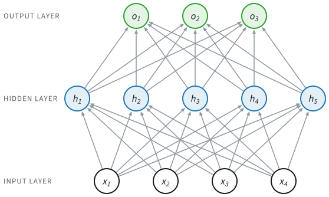
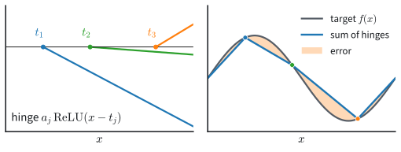
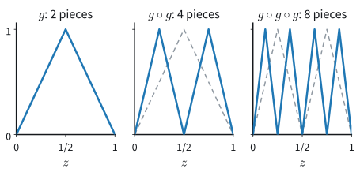

```{.python .input}
%load_ext d2lbook.tab
tab.interact_select('mxnet', 'pytorch', 'tensorflow', 'jax')
```

# Multilayer Perceptrons
:label:`sec_mlp`

In :numref:`chap_classification`, softmax regression scored each garment category by taking an affine weighted sum of the input pixels, $o_j = \sum_{i=1}^d x_i w_{ij} + b_j$. That linear form bakes in two severe restrictions:

1. **Monotonicity:** Increasing feature $x_i$ always pushes $o_j$ in the same direction (up if $w_{ij} > 0$, down if $w_{ij} < 0$). Yet many real relationships are non-monotonic: human health risk rises whenever body temperature strays from $37^\circ\textrm{C}$ in *either* direction.
2. **No feature interactions:** Increasing $x_i$ by one unit changes $o_j$ by $w_{ij}$ regardless of the values of every other coordinate. In an image, however, a bright pixel at $(13, 17)$ means completely different things depending on whether the neighboring pixels form a collar, a sleeve, or a handbag strap.

A *multilayer perceptron* (MLP) overcomes both limitations by inserting one or more *hidden layers* that transform raw inputs into learned intermediate representations—applying an affine map followed by a nonlinear *activation function*—before a linear output layer makes the final prediction. In this section, we prove that no linear model can solve the four-point XOR problem, solve XOR explicitly with two ReLU hidden units, examine what functions shallow and deep networks can represent, and compare the activation functions used across modern deep learning.

```{.python .input #mlp-multilayer-perceptrons}
%%tab mxnet
import math
import numpy as np
from mxnet import autograd, gluon, init, np as mnp, npx
from mxnet.gluon import nn
from d2l import mxnet as d2l
npx.set_np()
```

```{.python .input #mlp-multilayer-perceptrons}
%%tab pytorch
import math
import numpy as np
import torch
from torch import nn
from torch.nn import functional as F
from d2l import torch as d2l
```

```{.python .input #mlp-multilayer-perceptrons}
%%tab tensorflow
import math
import numpy as np
import tensorflow as tf
from d2l import tensorflow as d2l
```

```{.python .input #mlp-multilayer-perceptrons}
%%tab jax
import math
import numpy as np
import jax
from jax import numpy as jnp
from flax import nnx
import optax
from d2l import jax as d2l
```


## Limits of Linear Models: The XOR Problem

The starkest possible demonstration of feature interaction uses just four data points—the corners of the unit square $\{0, 1\}^2$ labeled by their *exclusive-OR* (XOR), where $y = 1$ if and only if *exactly one* coordinate equals $1$:

| $x_1$ | $x_2$ | $y$ |
|:---:|:---:|:---:|
| 0 | 0 | 0 |
| 0 | 1 | 1 |
| 1 | 0 | 1 |
| 1 | 1 | 0 |

Notice the interaction: flipping $x_1$ from $0$ to $1$ increases $y$ when $x_2 = 0$, but decreases $y$ when $x_2 = 1$.

**Proposition.** For all $w_1, w_2, b \in \mathbb{R}$, the linear decision rule "predict class 1 if $w_1 x_1 + w_2 x_2 + b > 0$" misclassifies at least one of the four XOR points.

**Proof.** Suppose for contradiction that some $w_1, w_2, b$ classify all four corners correctly. The two class-1 points $(0, 1)$ and $(1, 0)$ require $w_2 + b > 0$ and $w_1 + b > 0$, whose sum gives $w_1 + w_2 + 2b > 0$. Meanwhile, the two class-0 points $(0, 0)$ and $(1, 1)$ require $b \leq 0$ and $w_1 + w_2 + b \leq 0$, whose sum gives $w_1 + w_2 + 2b \leq 0$—an immediate contradiction. $\blacksquare$

Geometrically, both diagonals of the unit square share the midpoint $(1/2, 1/2)$, where any affine function equals the average of its values at either diagonal's endpoints—so no straight line can ever separate the two diagonals.

## Hidden Layers

### The Model

To escape linearity, an MLP inserts one or more *hidden layers* between the input features and the output layer (:numref:`fig_mlp`). For a minibatch design matrix $\mathbf{X} \in \mathbb{R}^{n \times d}$ ($n$ examples, $d$ input features), a single hidden layer of width $h$ holds weights $\mathbf{W}^{(1)} \in \mathbb{R}^{d \times h}$ and biases $\mathbf{b}^{(1)} \in \mathbb{R}^h$, while the output layer holds weights $\mathbf{W}^{(2)} \in \mathbb{R}^{h \times q}$ and biases $\mathbf{b}^{(2)} \in \mathbb{R}^q$. The two-layer (one-hidden-layer) MLP computes

$$
\begin{aligned}
\mathbf{H} &= \phi\left(\mathbf{X}\mathbf{W}^{(1)} + \mathbf{b}^{(1)}\right),\\
\mathbf{O} &= \mathbf{H}\mathbf{W}^{(2)} + \mathbf{b}^{(2)},
\end{aligned}
$$
:eqlabel:`eq_mlp`

where biases broadcast across rows and the nonlinear *activation function* $\phi$ acts elementwise on the *pre-activations* $\mathbf{Z} = \mathbf{X}\mathbf{W}^{(1)} + \mathbf{b}^{(1)}$ to produce the hidden *activations* $\mathbf{H} \in \mathbb{R}^{n \times h}$. Notice the parameter count: $(d + 1)h + (h + 1)q$. On Fashion-MNIST ($d = 784, q = 10$), a hidden layer of $h = 256$ units has $785 \times 256 + 257 \times 10 = 203{,}530$ parameters—26 times softmax regression's $7{,}850$.


:label:`fig_mlp`

### The Role of the Nonlinearity

Why is the nonlinear activation $\phi$ essential? Suppose we omitted $\phi$ (setting $\phi(z) = z$), so $\mathbf{H} = \mathbf{X}\mathbf{W}^{(1)} + \mathbf{b}^{(1)}$. Substituting $\mathbf{H}$ into the output equation collapses the two layers back into a single affine transformation:

$$\mathbf{O} = \left(\mathbf{X}\mathbf{W}^{(1)} + \mathbf{b}^{(1)}\right)\mathbf{W}^{(2)} + \mathbf{b}^{(2)} = \mathbf{X}\underbrace{\mathbf{W}^{(1)}\mathbf{W}^{(2)}}_{\mathbf{W}} + \underbrace{\mathbf{b}^{(1)}\mathbf{W}^{(2)} + \mathbf{b}^{(2)}}_{\mathbf{b}}.$$

Without a nonlinearity, stacking any number of fully connected layers never expands the family of functions beyond a single linear layer (and if a hidden layer is narrower than $\min(d, q)$, it actually restricts $\mathbf{W}$ to low rank; see Exercise :exref:`ex_mlp-linear-networks`). Inserting an elementwise nonlinearity such as the *rectified linear unit* (ReLU),

$$\mathrm{ReLU}(z) = \max(z, 0),$$

prevents this algebraic collapse.

### Solving XOR with Two ReLU Units

With ReLU activations, a hidden layer of just $h = 2$ units solves XOR cleanly :cite:`Goodfellow.Bengio.Courville.2016`. Set

$$\mathbf{W}^{(1)} = \begin{pmatrix} 1 & 1 \\ 1 & 1 \end{pmatrix}, \quad \mathbf{b}^{(1)} = (0, -1), \quad \mathbf{w}^{(2)} = (1, -2), \quad b^{(2)} = 0.$$

Both hidden units depend on the coordinate sum $s = x_1 + x_2$: unit 1 computes $h_1 = \mathrm{ReLU}(s) = s$, while unit 2 computes $h_2 = \mathrm{ReLU}(s - 1)$, turning on *only* when $s = 2$ (at $(1, 1)$) so that $o = h_1 - 2h_2$ subtracts $2$ and folds the output back down to $0$:

```{.python .input #mlp-xor}
X = np.array([[0, 0], [0, 1], [1, 0], [1, 1]])
W1, b1 = np.array([[1, 1], [1, 1]]), np.array([0, -1])
w2, b2 = np.array([1, -2]), 0
H = np.maximum(X @ W1 + b1, 0)  # hidden layer with ReLU
o = H @ w2 + b2  # output layer
for x, h, out in zip(X, H, o):
    print(f'x = {x}, h = {h}, o = {out}')
```

Look at the geometry in :numref:`fig_mdl-mlp-xor`: the hidden layer maps *both* class-1 corners $(0, 1)$ and $(1, 0)$ onto the exact same hidden point $(1, 0)$, allowing the straight line $h_1 - 2h_2 = 1/2$ in hidden space (right) to carve out the non-halfspace diagonal band $1/2 < x_1 + x_2 < 3/2$ in input space (left).


:label:`fig_mdl-mlp-xor`

### Deeper Networks

More generally, a $K$-layer MLP stacks $K - 1$ hidden layers above $\mathbf{H}^{(0)} = \mathbf{X}$,

$$\mathbf{H}^{(k)} = \phi\left(\mathbf{H}^{(k-1)}\mathbf{W}^{(k)} + \mathbf{b}^{(k)}\right) \quad (k = 1, \ldots, K-1), \qquad \mathbf{O} = \mathbf{H}^{(K-1)}\mathbf{W}^{(K)} + \mathbf{b}^{(K)},$$

building a compositional hierarchy of representations from raw inputs to class logits.

## Expressive Power

### Universal Approximation

How rich is the class of functions computable by a single hidden layer ($K = 2$)? On the real line ($d = 1$), each ReLU hidden unit $a_j\,\mathrm{ReLU}(x - t_j)$ contributes a *hinge* that is flat to the left of its knot $t_j$ and changes slope by $a_j$ to the right (:numref:`fig_mdl-mlp-uat-hinges`). Summing $h$ hinges plus a constant produces any continuous piecewise-linear polyline with $h$ interior knots—and since any continuous function on a closed bounded interval $[a, b]$ can be approximated uniformly to within any $\epsilon > 0$ by a fine enough polyline, a single wide enough ReLU hidden layer approximates any continuous 1D function to arbitrary precision.


:label:`fig_mdl-mlp-uat-hinges`

The *universal approximation theorem* generalizes this fact to arbitrary input dimension $d$: a single-hidden-layer MLP can approximate *any* continuous function on any compact subset of $\mathbb{R}^d$ to arbitrary uniform accuracy using *any* continuous non-polynomial activation function $\phi$ :cite:`Cybenko.1989,Leshno.Lin.Pinkus.ea.1993` (see Exercise :exref:`ex_mlp-one-hidden-layer` for a 2D proof via ridge functions and the Stone--Weierstrass theorem).

### Why Depth Matters

If one hidden layer can already approximate anything, why build *deep* networks? Because universal approximation says nothing about *how many units* a single layer needs (which can grow exponentially in $d$), nor whether gradient descent can learn or generalize from finite data.

Depth achieves exponential parameter efficiency by *composing* space-folding maps :cite:`Telgarsky.2016`. Consider the 1D tent function on $[0, 1]$ computed by two ReLU units:

$$g(z) = 2\,\mathrm{ReLU}(z) - 4\,\mathrm{ReLU}(z - 1/2),$$

which rises from $0$ to $1$ on $[0, 1/2]$ and falls back to $0$ on $[1/2, 1]$ (:numref:`fig_mdl-mlp-depth-folding`). Composing $g$ with itself folds $[0, 1]$ in half at every layer: $g \circ g$ has $4$ linear pieces, $g \circ g \circ g$ has $8$, and the $m$-fold composition $g^{\circ m}$—computed by $m$ hidden layers of $2$ ReLU units ($2m$ total units)—produces a sawtooth wave with $2^m$ linear pieces! Representing that same $2^m$-piece sawtooth with a *single* hidden layer requires at least $2^m - 1$ hidden units ($1{,}023$ units in one layer vs. $20$ units across $10$ layers when $m = 10$).


:label:`fig_mdl-mlp-depth-folding`

## Activation Functions
:label:`subsec_activation-functions`

While almost any non-polynomial $\phi$ suffices for universal approximation, optimization via gradient descent depends critically on the derivative $\phi'(z)$. For hidden unit $j$ with pre-activation $z_j = \sum_i x_i w^{(1)}_{ij} + b^{(1)}_j$ and activation $h_j = \phi(z_j)$, the chain rule scales every incoming weight gradient by the local slope $\phi'(z_j)$:

$$\frac{\partial l}{\partial w^{(1)}_{ij}} = \frac{\partial l}{\partial h_j}\,\phi'(z_j)\,x_i.$$

Wherever $\phi'(z_j) \approx 0$, gradient flow stalls. :numref:`fig_mdl-mlp-activations` compares the four principal activations and their derivatives.


:label:`fig_mdl-mlp-activations`

- **ReLU and Leaky ReLU:** $\mathrm{ReLU}(z) = \max(z, 0)$ has derivative $1$ for $z > 0$ and $0$ for $z < 0$ (conventionally $0$ at $z = 0$). Because its slope is identically $1$ across the entire positive half-line, active ReLU units never attenuate gradients as $z$ grows :cite:`Nair.Hinton.2010,Glorot.Bordes.Bengio.2011`. If a unit's weights shift so that $z < 0$ on every training input, however, its gradient vanishes permanently (a *dead ReLU*); *leaky ReLU*, $\max(z, \alpha z)$ with $\alpha \approx 0.01$, keeps a small positive slope for $z < 0$ so dead units can recover.
- **GELU and SiLU (Swish):** The *Gaussian error linear unit* $\mathrm{GELU}(z) = z\,\Phi(z)$ (where $\Phi$ is the standard normal CDF) and its cousin $\mathrm{SiLU}(z) = z\,\sigma(z)$ smooth out ReLU's kink at the origin (passing through $z = 0$ with slope $1/2$ and a gentle negative dip near $z \approx -0.75$) and serve as the default activations in modern Transformers :cite:`Hendrycks.Gimpel.2016`.
- **Sigmoid and Tanh:** The logistic sigmoid $\sigma(z) = 1/(1 + e^{-z}) \in (0, 1)$ has derivative $\sigma'(z) = \sigma(z)(1 - \sigma(z)) \leq 1/4$, while the zero-centered hyperbolic tangent $\tanh(z) = (1 - e^{-2z})/(1 + e^{-2z}) = 2\sigma(2z) - 1 \in (-1, 1)$ (Exercise :exref:`ex_mlp-sigmoid-tanh`) has derivative $1 - \tanh^2(z) \leq 1$. Both saturate to flat horizontal asymptotes ($\phi'(z) \to 0$) as $|z|$ grows beyond $\sim 3$, and multiplying $\sigma'(z) \leq 1/4$ across $K$ layers shrinks gradients by at least $4^{-K}$ (*vanishing gradients*, analyzed in :numref:`sec_numerical_stability`). Today, sigmoid and $\tanh$ are used primarily as bounded *gates* and state squashers in recurrent architectures (:numref:`chap_modern_rnn`).

## Summary

- **Limits of linearity and hidden layers:** Linear models are monotonic in each coordinate and cannot capture feature interactions such as XOR. An MLP inserts hidden layers $\mathbf{H} = \phi(\mathbf{X}\mathbf{W}^{(1)} + \mathbf{b}^{(1)})$ before the linear output layer; without a nonlinear $\phi$, stacked affine layers collapse into a single linear layer.
- **Expressive power and depth:** A single wide enough hidden layer with any continuous non-polynomial activation is a universal approximator on compact sets, while stacking $m$ hidden layers can compose space-folding functions to create $2^m$ linear regions with only $O(m)$ units.
- **Activation functions:** ReLU ($\max(z, 0)$) and GELU ($z\Phi(z)$) pass gradients with unit slope for positive pre-activations, avoiding the tail saturation and $1/4$ slope attenuation of sigmoid and $\tanh$.

## Exercises

1. **Linear networks.** Without activation functions, stacking layers
   composes affine maps into another affine map. Consider such a network
   with input dimension $d$, output dimension $q$, and hidden widths
   $h_1, \ldots, h_{K-1}$. Show that it represents exactly the affine maps
   $\mathbf{X}\mathbf{W} + \mathbf{b}$ whose weight matrix $\mathbf{W}$ has
   rank at most $\min(h_1, \ldots, h_{K-1})$. Use this result to give an
   example in which adding a hidden layer to a linear model strictly shrinks
   its function class.
   :exlabel:`ex_mlp-linear-networks`
1. **XOR by hand.** :numref:`fig_mdl-mlp-xor` shows a two-unit ReLU network
   that computes XOR by mapping the two inputs of class 1 to the same hidden
   point.
    1. Find weights for a two-unit ReLU network that also computes XOR but
       maps the two inputs of class 1 to *distinct* hidden points, and verify
       it on the four inputs.
    1. Show that no network with a single ReLU hidden unit and a linear
       output classifies XOR correctly, for any threshold applied to its
       output.
1. **Sigmoid and tanh.** The two squashing functions are closely related.
    1. Show that $\tanh(z) = 2\sigma(2z) - 1$.
    1. Show that for every MLP with tanh hidden activations there is an MLP
       of the same architecture with sigmoid hidden activations that
       computes the same function, and conversely. State how the weights and
       biases change.
   :exlabel:`ex_mlp-sigmoid-tanh`

1. **Depth and linear pieces.** ● A one-hidden-layer ReLU network with $h$
   hidden units on the real line has at most $h + 1$ linear pieces, while
   each composition with the two-unit tent of
   :numref:`fig_mdl-mlp-depth-folding` doubles the number of pieces. This
   problem makes the gain from depth exact for a network with three units
   per layer.
    1. Take three hidden units $\mathrm{ReLU}(w_j x + b_j)$ with input
       weights $w_1 = w_2 = 1$ and $w_3 = -1$ and with joints $-b_j/w_j$ at
       $1/6$, $2/6$, and $4/6$. Choose output weights and an output bias so
       that the network's output $f$ takes the values $0, 1, 0, 1, 0$ at
       $x = 0, 1/6, 2/6, 4/6, 1$.
    1. Count the linear pieces of $f \circ f$ on $[0, 1]$, and of the
       $m$-fold composition $f \circ \cdots \circ f$. Explain, in terms of
       how composing with $f$ folds the graph, why each composition
       multiplies the count rather than adding to it.
    1. The $m$-fold composition is computed by a network with $m$ hidden
       layers of three units each. How many hidden units would a network
       with a single hidden layer need to represent the same function?
       Compare the parameter counts of the two networks.

    *Adapted from Simon Prince,
    [Understanding Deep Learning](https://udlbook.github.io/udlbook/),
    Problem 4.8.*
1. **One hidden layer suffices.** ● On the real line, a single hidden layer
   approximates a continuous function by a polyline, one hinge per joint.
   In the plane there are no joints to place, and the proof needs another
   idea: functions that vary along one direction only.
    1. Let $\psi$ be continuous on $\mathbb{R}$ and let
       $\mathbf{w} \in \mathbb{R}^2$. Show that a single hidden layer
       approximates the *ridge function* $\psi(\mathbf{w}^\top \mathbf{x})$,
       which is constant along every line orthogonal to $\mathbf{w}$,
       uniformly on any compact subset of the plane.
    1. The Stone–Weierstrass theorem states the following. Let a set of
       continuous functions on a compact set be closed under sums, products,
       and scalar multiples, contain the constants, and contain, for any two
       distinct points, a function that takes different values at them. Then
       every continuous function on the compact set is a uniform limit of
       functions in the set. Show that the finite linear combinations of
       $\cos(\boldsymbol{\omega}^\top \mathbf{x})$ and
       $\sin(\boldsymbol{\omega}^\top \mathbf{x})$, with
       $\boldsymbol{\omega} \in \mathbb{R}^2$, form such a set.
    1. Conclude that a single hidden layer approximates any continuous
       function on a compact subset of the plane.
   :exlabel:`ex_mlp-one-hidden-layer`

    *Adapted from Michael Nielsen,
    [Neural Networks and Deep Learning](http://neuralnetworksanddeeplearning.com/chap4.html),
    Chapter 4.*

:begin_tab:`mxnet`
[Discussions](https://d2l.discourse.group/t/90)
:end_tab:

:begin_tab:`pytorch`
[Discussions](https://d2l.discourse.group/t/91)
:end_tab:

:begin_tab:`tensorflow`
[Discussions](https://d2l.discourse.group/t/226)
:end_tab:

:begin_tab:`jax`
[Discussions](https://d2l.discourse.group/t/17984)
:end_tab:

