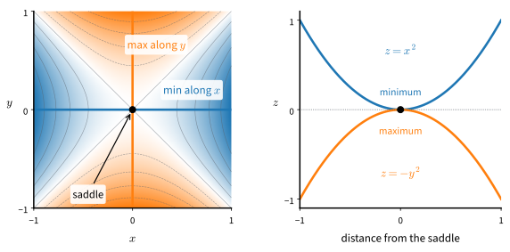
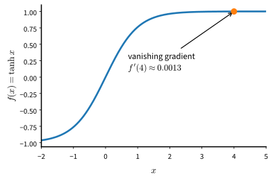

# Landscapes and Gradient Descent
:label:`sec_gd`

Underneath their differences in momentum, adaptive preconditioning, or learning-rate schedules, all standard deep learning optimizers iterate the same fundamental operation: evaluate the gradient of the loss and step in the opposite direction. Why does that step make rapid progress on some objective functions and crawl on others, and why does increasing the learning rate beyond a threshold cause sudden divergence?

A network with $d$ parameters defines an empirical risk $f: \mathbb{R}^d \to \mathbb{R}$ over a $d$-dimensional parameter vector $\mathbf{x}$. While generalization ultimately depends on the expected risk on unseen data (:numref:`subsec_empirical-risk-and-risk`), the primary task of an optimization algorithm is to reduce the empirical objective $f(\mathbf{x})$ as quickly and reliably as possible. Traditional accounts of non-convex optimization often emphasize the danger of getting trapped in poor local minima. In high-dimensional neural networks, however, two other geometric features dominate training dynamics: **ill-conditioning** (large disparities in curvature across different directions) and **saddle points**.

In this section, we first analyze gradient descent on an ill-conditioned two-dimensional quadratic valley to establish the exact relationship between curvature, the maximum stable learning rate, and the iteration count. We then examine critical points, saddle points, and plateaus in high-dimensional loss landscapes, prove the general descent guarantee for smooth functions, show how the learning rate selects among local minima by their sharpness (leading to the *edge of stability* in neural network training), and introduce *preconditioning* as a remedy for ill-conditioning.

```{.python .input #gd-one-dimensional-gradient-descent-1}
%%tab pytorch
import math
import numpy as np
import torch
from torch import nn
from torch.nn import functional as F
from d2l import torch as d2l
```

```{.python .input #gd-one-dimensional-gradient-descent-1}
%%tab jax
import math
import numpy as np
import jax
from jax import numpy as jnp
from flax import nnx
import optax
from d2l import jax as d2l
```

```{.python .input #gd-one-dimensional-gradient-descent-5}
%%tab jax
import functools
```

## Optimization Landscapes and the Condition Number
:label:`sec_optimization-intro`

To isolate the effect of uneven curvature, consider the two-dimensional quadratic objective

$$f(\mathbf{x}) = 0.1 x_1^2 + 2 x_2^2,$$
:eqlabel:`eq_opt-intro-valley`

whose unique minimum lies at the origin. The second derivative (curvature) is $\lambda_1 = 0.2$ along the flat axis $x_1$ and $\lambda_2 = 4$ along the steep axis $x_2$, producing elongated elliptical level sets that form a narrow valley.

Gradient descent with learning rate $\eta > 0$ updates the iterate via $\mathbf{x} \leftarrow \mathbf{x} - \eta \nabla f(\mathbf{x})$. Because $\nabla f(\mathbf{x}) = (0.2 x_1, 4 x_2)$, the two coordinates decouple and evolve multiplicatively on each step:

$$x_1 \leftarrow (1 - 0.2\eta)\, x_1, \qquad x_2 \leftarrow (1 - 4\eta)\, x_2.$$

Each coordinate places a competing constraint on $\eta$:
* **Stability ceiling (steep direction):** The steep coordinate $x_2$ contracts if and only if $|1 - 4\eta| < 1$, which imposes the hard stability ceiling $\eta < 0.5$.
* **Convergence pace (flat direction):** For any stable step size $\eta < 0.5$, the flat contraction factor satisfies $1 - 0.2\eta > 0.9$, meaning that each step removes less than $10\%$ of the remaining error along $x_1$.

We save the valley objective `f_valley`, its gradient `valley_grad`, a two-dimensional trajectory runner `train_2d` starting from $(-5, -2)$, and the plain gradient descent step `gd_2d` in `d2l` so that subsequent sections can benchmark every optimizer on the exact same surface.

```{.python .input #gd-multivariate-gradient-descent-4}
%%tab pytorch, jax
VALLEY_CURVATURES = (0.2, 4.0)  #@save
h1, h2 = VALLEY_CURVATURES  # Curvatures of the valley along x1 and x2

def f_valley(x1, x2):  #@save
    """The ill-conditioned quadratic valley h1/2 x1^2 + h2/2 x2^2, with
    (h1, h2) = VALLEY_CURVATURES."""
    h1, h2 = VALLEY_CURVATURES
    return h1 / 2 * x1 ** 2 + h2 / 2 * x2 ** 2

def valley_grad(x1, x2):  #@save
    """Gradient of f_valley."""
    h1, h2 = VALLEY_CURVATURES
    return h1 * x1, h2 * x2

def train_2d(trainer, f_grad, steps=20, **hparams):  #@save
    """Run a 2D update rule from (-5, -2) and return the iterates."""
    x1, x2, s1, s2 = -5, -2, 0, 0  # s1, s2: state of stateful optimizers
    results = [(x1, x2)]
    for _ in range(steps):
        x1, x2, s1, s2 = trainer(x1, x2, s1, s2, f_grad, **hparams)
        results.append((x1, x2))
    print(f'step {steps}, x1: {float(x1):f}, x2: {float(x2):f}')
    return results

def gd_2d(x1, x2, s1, s2, f_grad, eta):  #@save
    """One step of gradient descent in 2D; the state stays zero."""
    g1, g2 = f_grad(x1, x2)
    return x1 - eta * g1, x2 - eta * g2, 0, 0
```

At $\eta = 0.45$—just below the stability ceiling—the steep multiplier is $1 - 4(0.45) = -0.8$, so $x_2$ overshoots the valley floor and flips sign on every step while shrinking by $20\%$ in magnitude. Meanwhile, the flat multiplier is $1 - 0.2(0.45) = 0.91$, so after $30$ steps from $(-5, -2)$ the flat coordinate still remains near $-5 \times 0.91^{30} \approx -0.3$.

```{.python .input #optimization-intro-an-ill-conditioned-valley}
%%tab pytorch, jax
h = np.array([0.2, 4.0])  # Curvatures h1, h2 along x1 and x2

def gd_valley(eta, steps, x0=(-5.0, -2.0)):
    """Gradient descent on the valley; returns all iterates."""
    xs = [np.array(x0)]
    for _ in range(steps):
        xs.append(xs[-1] - eta * h * xs[-1])  # The gradient is h * x
    return np.stack(xs)

xs = gd_valley(0.45, steps=30)
d2l.plot(np.arange(31), [xs[:, 0], xs[:, 1]], 'step', 'coordinate',
         legend=['$x_1$', '$x_2$'])
```

Sweeping $\eta$ across $(0, 0.5]$ shows how the overall convergence time—measured by the number of steps required to bring both coordinates within $1\%$ of their initial distance from the origin—depends on balancing these two factors:

```{.python .input #optimization-intro-an-ill-conditioned-valley-1}
%%tab pytorch, jax
print('  eta   factor x1   factor x2   steps to 1%')
for eta in [0.1, 0.2, 0.3, 0.4, 0.45, 2 / 4.2, 0.49, 0.5]:
    xs = gd_valley(eta, steps=1000)
    done = np.all(np.abs(xs) <= 0.01 * np.abs(xs[0]), axis=1)
    steps = int(np.argmax(done)) if done.any() else 'never'
    print(f'{eta:5.3f}   {1 - 0.2 * eta:9.3f}   {1 - 4 * eta:9.3f}   '
          f'{steps:>11}')
```

The optimal step size equates the magnitudes of the flat and steep multipliers, $1 - 0.2\eta = -(1 - 4\eta)$, yielding $\eta^\star = 2 / 4.2 \approx 0.476$, where both factors have magnitude $0.905$ and convergence to $1\%$ takes $47$ steps. Notice the sharp asymmetry near the stability threshold: dropping slightly below $\eta^\star$ to $\eta = 0.45$ costs only two extra steps ($49$), whereas pushing slightly above to $\eta = 0.49$ more than doubles the step count ($113$).

This analysis extends immediately to any $d$-dimensional positive-definite quadratic $f(\mathbf{x}) = \frac{1}{2} \mathbf{x}^\top \mathbf{H} \mathbf{x}$ with symmetric Hessian $\mathbf{H} \succ \mathbf{0}$. Expanding $\mathbf{x} = \sum_{i=1}^d c_i \mathbf{v}_i$ in the orthonormal eigenbasis of $\mathbf{H}$ (where $\mathbf{H}\mathbf{v}_i = \lambda_i \mathbf{v}_i$ and $0 < \lambda_{\min} = \lambda_1 \le \cdots \le \lambda_d = \lambda_{\max}$) decouples the gradient descent step along each eigenvector:

$$(\mathbf{I} - \eta\mathbf{H}) \sum_{i=1}^d c_i \mathbf{v}_i = \sum_{i=1}^d (1 - \eta\lambda_i)\, c_i \mathbf{v}_i.$$

Stability requires $|1 - \eta\lambda_i| < 1$ for all $i$, which is governed by the largest eigenvalue:

$$\eta < \frac{2}{\lambda_{\max}}.$$

Subject to this ceiling, progress along the flattest eigenvector $\mathbf{v}_1$ depends only on the **condition number**

$$\kappa = \frac{\lambda_{\max}}{\lambda_{\min}}.$$

Rescaling the objective $f$ by a constant $c > 0$ multiplies all eigenvalues by $c$ and divides the stable learning rate by $c$, leaving the trajectory invariant; the dimensionless ratio $\kappa$ captures the intrinsic geometric difficulty of the surface. Balancing the extreme contraction factors $1 - \eta\lambda_{\min} = -(1 - \eta\lambda_{\max})$ gives the optimal constant learning rate $\eta^\star = 2 / (\lambda_{\min} + \lambda_{\max})$ and worst-case per-step contraction factor $(\kappa - 1)/(\kappa + 1) \approx 1 - 2/\kappa$ (:numref:`subsec_mdl-quadratic-model`). Reducing the error by a factor $\epsilon$ therefore requires

$$t \approx \frac{\kappa}{2} \log \frac{1}{\epsilon}$$

steps. On our valley ($\kappa = 4 / 0.2 = 20$, $\epsilon = 0.01$), this formula predicts $10 \log 100 \approx 46$ steps, matching the $47$ steps observed above. Because $t$ scales linearly with $\kappa$, no scalar learning rate can overcome ill-conditioning; accelerating convergence requires changing the update direction itself.

## Critical Points, Saddle Points, and Plateaus
:label:`subsec_opt-intro-saddles`

Unlike a convex quadratic bowl, a neural network loss surface is non-convex and possesses many **critical points** where $\nabla f(\mathbf{x}) = \mathbf{0}$, as well as **plateaus** where $\|\nabla f(\mathbf{x})\|$ is vanishingly small. At any critical point of a twice-differentiable function $f: \mathbb{R}^d \to \mathbb{R}$, the eigenvalues of the Hessian $\mathbf{H} = \nabla^2 f(\mathbf{x})$ classify the local geometry:
* **Local minimum:** all $d$ eigenvalues are strictly positive ($\mathbf{H} \succ \mathbf{0}$).
* **Local maximum:** all $d$ eigenvalues are strictly negative ($\mathbf{H} \prec \mathbf{0}$).
* **Saddle point:** $\mathbf{H}$ has both positive and negative eigenvalues, curving upward along some eigenvectors and downward along others, as illustrated by $f(x, y) = x^2 - y^2$ at the origin (:numref:`fig_mdl-opt-saddle`).
* **Degenerate critical point:** $\mathbf{H}$ has zero eigenvalues and no eigenvalues of opposite sign, so higher-order derivatives determine whether the point is an extremum (like $x^4$) or an inflection point (like $x^3$).


:label:`fig_mdl-opt-saddle`

In high dimensions, saddle points vastly outnumber local minima. For a critical point to be a local minimum, every one of the $d$ Hessian eigenvalues must be positive; under a simple random-sign heuristic, all $d$ eigenvalues are positive with probability $2^{-d}$ (and random matrix theory confirms that symmetric random matrices have eigenvalues split evenly around zero until the baseline loss is very low; see Exercise :exref:`ex_optimization-intro-eigenvalues-symmetric-random-matrices`). Empirical Hessian measurements on neural networks confirm that critical points at high loss are overwhelmingly saddle points with many negative eigenvalues, while the fraction of negative eigenvalues drops toward zero only at low loss values :cite:`Dauphin.Pascanu.Gulcehre.ea.2014`.

Crucially, **strict saddle points** (critical points with at least one negative eigenvalue $\lambda < 0$) do not trap gradient descent. Along a downward-curving eigenvector with curvature $-\mu < 0$, each gradient step amplifies the displacement by $(1 + \eta\mu) > 1$. The stable manifold of initializations that converge into a strict saddle has measure zero, so gradient descent from a random initialization escapes with probability one :cite:`Lee.Simchowitz.Jordan.ea.2016`. Starting at distance $\delta$ from the ridge, reaching distance $1$ along the unstable direction takes $\log(1/\delta)/\log(1 + \eta\mu) \approx \log(1/\delta)/(\eta\mu)$ steps—logarithmic in $\delta$, though inversely proportional to the negative curvature $\mu$. Moreover, minibatch gradient noise actively kicks iterates off the ridge even when $\delta = 0$ (Exercise :exref:`ex_optimization-intro-saddle-escape-time`).


:label:`fig_mdl-opt-tanh-flat`

By contrast, **plateaus** arise without any critical point when activation derivatives saturate, as in $f(x) = \tanh(x)$ at $x = 4$ (:numref:`fig_mdl-opt-tanh-flat`), where $f'(4) = 1 - \tanh^2(4) \approx 0.0013$ causes gradient descent with $\eta = 1$ to spend $370$ steps creeping from $x = 4$ to $x = 2$. In deep networks, such vanishing gradients (:numref:`sec_numerical_stability`) are eliminated primarily by architectural design—non-saturating activations (:numref:`subsec_activation-functions`), normalization layers (:numref:`sec_batch_norm`), and residual connections (:numref:`sec_resnet`)—leaving ill-conditioning as the central challenge for the optimizer.

Even though a neural network loss is globally non-convex (for instance, permuting the $d$ hidden units of a layer yields $d!$ distinct parameter vectors with identical loss whose average collapses to a single-unit network of higher loss; Exercise :exref:`ex_optimization-intro-permutation-symmetric-minima`), its local geometry around any iterate is governed by its Hessian spectrum. Empirical spectra of deep networks exhibit a massive bulk of eigenvalues near zero alongside a few large positive outlier eigenvalues :cite:`Ghorbani.Krishnan.Xiao.2019`. The largest eigenvalue—the **sharpness** $\lambda_{\max}$—caps the stable learning rate, while the flat bulk progresses at rate $\eta\lambda_i \ll 1$, reproducing the narrow-valley bottleneck in high dimensions.

## The Descent Guarantee and Stability of Minima
:label:`subsec_gd-local-minima`

On a non-quadratic objective, curvature varies from point to point. Why does the $2/\lambda_{\max}$ rule still govern step-size stability?

By a first-order Taylor expansion $f(\mathbf{x} + \boldsymbol{\epsilon}) \approx f(\mathbf{x}) + \boldsymbol{\epsilon}^\top \nabla f(\mathbf{x})$ and the Cauchy–Schwarz inequality, the negative gradient $-\nabla f(\mathbf{x})$ is the direction of steepest local descent. To guarantee that a finite step $\mathbf{x} - \eta \nabla f(\mathbf{x})$ actually decreases $f$, suppose $f$ is **$L$-smooth**, meaning its gradient is $L$-Lipschitz continuous (in one variable, $|f'(y) - f'(x)| \le L|y - x|$, or $|f''(x)| \le L$). Integrating the slope difference along a step $\epsilon$ bounds $f$ above by a touching parabola of curvature $L$:

$$f(x + \epsilon) - f(x) - \epsilon f'(x) = \int_0^\epsilon \big(f'(x + s) - f'(x)\big)\, ds \leq \int_0^\epsilon L s \, ds = \frac{L}{2} \epsilon^2.$$

Substituting the gradient step $\epsilon = -\eta f'(x)$ (or $\boldsymbol{\epsilon} = -\eta \nabla f(\mathbf{x})$ in $d$ dimensions, where $\|\nabla^2 f(\mathbf{x})\|_2 \le L$; :numref:`subsec_mdl-gd-smoothness`) yields the **descent lemma**:

$$f(\mathbf{x} - \eta \nabla f(\mathbf{x})) \leq f(\mathbf{x}) - \eta \Big(1 - \frac{\eta L}{2}\Big) \|\nabla f(\mathbf{x})\|^2.$$
:eqlabel:`gd-guarantee`

Whenever $0 < \eta < 2/L$, every gradient step strictly decreases $f$ at any non-critical point, with the largest guaranteed single-step decrease $\|\nabla f(\mathbf{x})\|^2 / (2L)$ occurring at $\eta = 1/L$.

Now invert this perspective: fix the learning rate $\eta$ on a loss surface with multiple local minima of different curvatures. Near any local minimum $x^\star$ with curvature $\lambda = f''(x^\star) > 0$, a gradient step multiplies a small displacement $x - x^\star$ by $1 - \eta\lambda$. Consequently:
* If $\lambda < 2/\eta$, then $|1 - \eta\lambda| < 1$ and the minimum is **linearly stable** (attracting nearby iterates).
* If $\lambda > 2/\eta$, then $1 - \eta\lambda < -1$ and the minimum is **unstable** (repelling any iterate that does not land on $x^\star$ exactly).

Thus, the learning rate $\eta$ filters local minima by their **sharpness** rather than their depth: gradient descent can only converge to minima whose sharpness satisfies $\lambda_{\max} \le 2/\eta$. We can observe this selection directly on $f(x) = x\cos(0.15\pi x)$, which has a deep, sharper minimum near $x = 7.27$ ($f'' \approx 1.81$) and a shallower, flatter minimum near $x = -1.83$ ($f'' \approx 0.98$), as summarized in :numref:`tab_gd-minima-factors`.

:Local curvature $f''$ and per-step displacement multiplier $1 - \eta f''$ at the two minima of $f(x) = x \cos(0.15\pi x)$.
:label:`tab_gd-minima-factors`

| Minimum | Curvature $f''$ | Multiplier at $\eta = 0.5$ | Multiplier at $\eta = 2$ |
|:--|--:|--:|--:|
| Deep ($x = 7.27$) | $1.81$ | $0.09$ (stable) | $-2.62$ (unstable) |
| Shallow ($x = -1.83$) | $0.98$ | $0.51$ (stable) | $-0.96$ (stable) |

```{.python .input #gd-one-dimensional-gradient-descent-3}
%%tab pytorch, jax
def gd(eta, f_grad, x=10.0, steps=10):
    """Gradient descent from x; returns all iterates."""
    xs = [x]
    for _ in range(steps):
        x = x - eta * f_grad(x)
        xs.append(float(x))
    return xs

def show_trace(f, *runs, legend=None):
    """Draw the iterates of one or more runs on the graph of f."""
    n = max(abs(x) for xs in runs for x in xs)
    grid = d2l.arange(-n, n, 0.01)
    d2l.plot([grid, *runs], [f(grid), *[[f(x) for x in xs] for xs in runs]],
             '$x$', '$f(x)$', legend=legend, fmts=['-', '-o', '-s'])
```

```{.python .input #gd-local-minima-1}
%%tab pytorch, jax
c = d2l.tensor(0.15 * np.pi)

def f_cos(x):  # Objective function
    return x * d2l.cos(c * x)

def f_cos_grad(x):  # Its derivative
    return d2l.cos(c * x) - c * x * d2l.sin(c * x)

def f_cos_hess(x):  # Its second derivative
    return -2 * c * d2l.sin(c * x) - c**2 * x * d2l.cos(c * x)
```

```{.python .input #gd-local-minima}
%%tab pytorch, jax
minima = [gd(0.5, f_cos_grad, x=x, steps=50)[-1] for x in (10.0, 0.0)]
print(', '.join(f"f''({x:.2f}) = {float(f_cos_hess(x)):.2f}" for x in minima))
runs = {eta: gd(eta, f_cos_grad, steps=100) for eta in (0.5, 2)}
for eta, xs in runs.items():
    print(f'eta {eta}, 2/eta = {2/eta:.0f}: x = {xs[10]:.3f} after 10 steps, '
          f'{xs[100]:.3f} after 100')
show_trace(f_cos, *[xs[:11] for xs in runs.values()],
           legend=['$f$', r'$\eta = 0.5$', r'$\eta = 2$'])
```

Starting from $x = 10$, the run with $\eta = 0.5$ ($2/\eta = 4 > 1.81$) converges rapidly into the deep minimum at $x = 7.269$. At $\eta = 2$ ($2/\eta = 1 < 1.81$), the deep minimum is unstable ($1 - \eta f'' = -2.62$), and the iterate settles instead into the flatter minimum at $x = -1.821$, where $f'' = 0.98 < 2/\eta$.

## The Edge of Stability
:label:`subsec_gd-edge-of-stability`

In neural network training, the relationship between sharpness $\lambda_{\max}$ and the stability limit $2/\eta$ becomes dynamic. :citet:`Cohen.Kaur.Li.ea.2021` demonstrated that under full-batch gradient descent, the Hessian sharpness $\lambda_{\max}(\nabla^2 f(\mathbf{x}_t))$ steadily increases as the loss falls—a phenomenon called **progressive sharpening**—until it reaches the stability threshold $2/\eta$. Instead of diverging, the sharpness then hovers near $2/\eta$ for the remainder of training while the loss continues to decrease non-monotonically. This operating regime is known as the **edge of stability**.

We can measure this phenomenon directly on a 25-parameter single-hidden-layer $\tanh$ network fitting $16$ points of $y = \sin(3x)$ on $[-2, 2]$. Because $d = 25$, we can compute the exact $25 \times 25$ Hessian and its largest eigenvalue $\lambda_{\max}$ every $500$ steps across $10$ random initializations for $\eta = 0.4$ ($2/\eta = 5$) and $\eta = 0.25$ ($2/\eta = 8$).

```{.python .input #optimization-intro-the-edge-of-stability-1}
%%tab pytorch
X = torch.linspace(-2, 2, 16)
Y = torch.sin(3 * X)

def mlp_loss(p):  # 8 hidden units: weights, biases, output weights, bias
    W1, b1, W2, b2 = p[:8], p[8:16], p[16:24], p[24]
    return 0.5 * ((torch.tanh(X[:, None] * W1 + b1) @ W2 + b2 - Y) ** 2).mean()

def sharpness(P):  # Largest eigenvalue of the Hessian, for each row of P
    H = torch.func.vmap(torch.func.hessian(mlp_loss))(P)
    return torch.linalg.eigvalsh(H)[:, -1]

def gd_sharpness(eta, P, steps=20000, every=500, last=1000):
    """Full-batch gradient descent from each row of P. Returns the sharpness
    every `every` steps, the final loss, and the fraction of the last `last`
    steps on which the loss rose."""
    grad_and_loss = torch.func.vmap(torch.func.grad_and_value(mlp_loss))
    sharp, losses = [], []
    for k in range(steps + 1):
        if k % every == 0:
            sharp.append(sharpness(P))
        g, loss = grad_and_loss(P)
        losses.append(loss)
        if k < steps:  # The last pass only measures
            P = P - eta * g
    losses = torch.stack(losses[-last - 1:])  # (last + 1, starts)
    return (torch.stack(sharp, 1), losses[-1],
            (losses[1:] > losses[:-1]).float().mean(0))

P0 = 0.5 * torch.randn(10, 25)  # Ten random starts, shared by both runs
```

```{.python .input #optimization-intro-the-edge-of-stability-1}
%%tab jax
X = jnp.linspace(-2, 2, 16)
Y = jnp.sin(3 * X)

def mlp_loss(p):  # 8 hidden units: weights, biases, output weights, bias
    W1, b1, W2, b2 = p[:8], p[8:16], p[16:24], p[24]
    return 0.5 * ((jnp.tanh(X[:, None] * W1 + b1) @ W2 + b2 - Y) ** 2).mean()

def sharpness(P):  # Largest eigenvalue of the Hessian, for each row of P
    return jnp.linalg.eigvalsh(jax.vmap(jax.hessian(mlp_loss))(P))[:, -1]

@functools.partial(jax.jit, static_argnames=('steps', 'every', 'last'))
def gd_sharpness(eta, P, steps=20000, every=500, last=1000):
    """Full-batch gradient descent from each row of P. Returns the sharpness
    every `every` steps, the final loss, and the fraction of the last `last`
    steps on which the loss rose."""
    grad_and_loss = jax.vmap(jax.value_and_grad(mlp_loss))
    def step(P, _):
        loss, g = grad_and_loss(P)
        return P - eta * g, loss
    def block(P, _):  # Measure the sharpness, then take `every` steps
        P_next, losses = jax.lax.scan(step, P, length=every)
        return P_next, (sharpness(P), losses)
    P, (sharp, losses) = jax.lax.scan(block, P, length=steps // every)
    losses = jnp.vstack([losses.reshape(steps, -1), jax.vmap(mlp_loss)(P)])
    losses = losses[-last - 1:]  # (last + 1, starts)
    return (jnp.vstack([sharp, sharpness(P)]).T, losses[-1],
            jnp.mean(losses[1:] > losses[:-1], axis=0))

P0 = 0.5 * jax.random.normal(d2l.get_key(), (10, 25))  # Ten random starts
```

```{.python .input #optimization-intro-the-edge-of-stability-2}
%%tab pytorch, jax
runs = {eta: gd_sharpness(eta, P0) for eta in (0.4, 0.25)}
print('      start      |' + '|'.join(
    f'    eta {eta}, 2/eta = {2 / eta:.0f}     ' for eta in runs))
print('sharpness   loss |' + '|'.join([' sharpness    loss  rising '] * 2))
for i in range(len(P0)):
    print(f'{float(runs[0.4][0][i, 0]):9.2f} {float(mlp_loss(P0[i])):6.3f} |'
          + '|'.join(f' {float(s[i, -1]):9.2f} {float(l[i]):7.1e} '
                     f'{float(r[i]):6.0%} ' for s, l, r in runs.values()))
```

```{.python .input #gd-the-edge-of-stability-1}
%%tab pytorch, jax
curves = {rf'$\eta = {eta}$': eta / 2 * s for eta, (s, _, _) in runs.items()}
d2l.plot_curves(curves, 'step', r'sharpness$\,/\,(2/\eta)$',
                x=np.arange(0, 20001, 500), reference=1)
```

From the exact same initializations, the normalized sharpness $\lambda_{\max} / (2/\eta)$ climbs to $1$ and plateaus there: runs with $\eta = 0.4$ arrest at sharpness $\lambda_{\max} \approx 5.0$, while runs with $\eta = 0.25$ climb to $\lambda_{\max} \approx 8.0$. Once at the threshold $2/\eta$, the loss rises on roughly $50\%$ of steps as the iterate oscillates along the sharpest eigenvector ($1 - \eta\lambda_{\max} \approx -1$) while continuing to descend along the remaining $24$ flatter directions. Whenever $\lambda_{\max}$ momentarily exceeds $2/\eta$, the growing oscillation along the sharpest eigenvector couples with the third-order derivatives of the loss to induce a restoring drift toward flatter regions, stabilizing $\lambda_{\max}$ at $2/\eta$ :cite:`Damian.Nichani.Lee.2023`. This self-stabilization also explains why gradually ramping up $\eta$ at the start of training (*learning-rate warmup*, :numref:`sec_scheduler`) steers the network into a region flat enough to tolerate the peak learning rate :cite:`Kalra.Barkeshli.2024`.

## Newton's Method and Preconditioning
:label:`subsec_gd-preconditioning`

### Second-Order Steps and Newton's Method
:label:`subsec_gd-newton`

Why does gradient descent struggle on the valley :eqref:`eq_opt-intro-valley`? At $(-5, -2)$, the negative gradient $(1, 8)$ points almost directly across the steep wall rather than toward the origin $(0, 0)$. The steep coordinate $x_2$ requires $\eta \le 0.25$ to reach the valley floor in one step, whereas the flat coordinate $x_1$ requires $\eta = 1/0.2 = 5$.

**Newton's method** supplies each direction with the inverse of its own local curvature by minimizing the second-order Taylor approximation around $\mathbf{x}$:

$$f(\mathbf{x} + \boldsymbol{\epsilon}) \approx f(\mathbf{x}) + \boldsymbol{\epsilon}^\top \nabla f(\mathbf{x}) + \frac{1}{2} \boldsymbol{\epsilon}^\top \mathbf{H} \boldsymbol{\epsilon}.$$

Setting the gradient with respect to $\boldsymbol{\epsilon}$ to zero yields the Newton update:

$$\mathbf{x} \leftarrow \mathbf{x} - \mathbf{H}^{-1} \nabla f(\mathbf{x}).$$

On any positive-definite quadratic, the second-order expansion is exact and a single Newton step reaches the minimum regardless of the condition number $\kappa$. Near a regular local minimum of a general smooth function, Newton's method achieves *quadratic convergence*, doubling the number of accurate digits on every step (:numref:`sec_mdl-curvature-methods`).

Despite this rapid local convergence, exact Newton steps are impractical for deep neural networks for three reasons:
1. **Computational cost:** Even when using Hessian–vector products (:numref:`subsec_mdl-hvp`) to avoid storing the $d \times d$ Hessian ($10^{18}$ entries for $d = 10^9$), solving $\mathbf{H}\boldsymbol{\epsilon} = -\nabla f(\mathbf{x})$ iteratively requires dozens of backpropagation passes per parameter update.
2. **Negative curvature:** Because $\mathbf{H}$ acts symmetrically on all critical points, negative eigenvalues invert the step direction and drive iterates uphill toward saddle points or local maxima unless modified by damping or absolute-spectrum projections (:numref:`subsec_mdl-why-not-newton`).
3. **Sensitivity to minibatch noise:** Inverting noisy curvature estimates near zero amplifies sampling noise catastrophically.

### Diagonal Preconditioning

Instead of inverting the full Hessian, practical deep learning optimizers keep the affordable core of second-order methods: rescaling each coordinate (or layer matrix) by an inexpensive estimate of its curvature. In general, any update of the form $\mathbf{x} \leftarrow \mathbf{x} - \eta \mathbf{P}^{-1} \nabla f(\mathbf{x})$ is called **preconditioned gradient descent**, where the **preconditioner** $\mathbf{P}$ reduces the effective condition number of $\mathbf{P}^{-1/2}\mathbf{H}\mathbf{P}^{-1/2}$.

The simplest choice is the **diagonal preconditioner** $\mathbf{P} = \operatorname{diag}(\mathbf{H})$, which divides each coordinate of the gradient by its own second derivative:

$$\mathbf{x} \leftarrow \mathbf{x} - \eta \, \textrm{diag}(\mathbf{H})^{-1} \nabla f(\mathbf{x}).$$
:eqlabel:`eq_gd-diag-precond`

On the axis-aligned valley where $\operatorname{diag}(\mathbf{H}) = (0.2, 4)$, :eqref:`eq_gd-diag-precond` contracts both coordinates by the identical factor $1 - \eta$ on every step, reducing the effective condition number from $\kappa = 20$ to $1$. At $\eta = 0.5$, both coordinates drop below $1\%$ of their initial values in just $7$ steps ($0.5^7 \approx 0.0078$) instead of $47$:

```{.python .input #gd-preconditioning}
%%tab pytorch, jax
def precond_gd_2d(x1, x2, s1, s2, f_grad, eta):
    g1, g2 = f_grad(x1, x2)
    return x1 - eta * g1 / h1, x2 - eta * g2 / h2, 0, 0  # diag(H) = (h1, h2)

def steps_to_1pct(xs):  # First step with both coordinates within 1% of start
    return next(t for t, (x1, x2) in enumerate(xs)
                if abs(x1) <= 0.01 * 5 and abs(x2) <= 0.01 * 2)

plain = train_2d(gd_2d, valley_grad, steps=100, eta=2 / (h1 + h2))
precond = train_2d(precond_gd_2d, valley_grad, steps=10, eta=0.5)
print(f'steps to 1%: plain at its best rate {steps_to_1pct(plain)}, '
      f'preconditioned {steps_to_1pct(precond)}')
d2l.show_trace_2d(f_valley, precond)
```

In deep networks, we are not given $\operatorname{diag}(\mathbf{H})$ directly, nor are the principal curvature directions aligned with the coordinate axes (rotating the valley by $45^\circ$ makes the diagonal entries of $\mathbf{H}$ equal and renders diagonal preconditioning ineffective; Exercise :exref:`ex_gd-diagonal-preconditioning`). Later sections address both limitations: Adam (:numref:`sec_adam`) estimates per-coordinate scales online from squared gradients, while Momentum (:numref:`sec_momentum`) and Muon (:numref:`sec_muon`) accelerate progress across non-axis-aligned directions. First, however, we examine what happens when exact gradients are replaced by noisy minibatch estimates (:numref:`sec_sgd`).

## Summary

* On a positive-definite quadratic with Hessian eigenvalues $\lambda_{\min} \le \cdots \le \lambda_{\max}$, gradient descent is stable if and only if $\eta < 2/\lambda_{\max}$. Below this ceiling, convergence to relative accuracy $\epsilon$ at the optimal constant step size $\eta^\star = 2/(\lambda_{\min} + \lambda_{\max})$ requires $t \approx (\kappa/2)\log(1/\epsilon)$ steps, where $\kappa = \lambda_{\max}/\lambda_{\min}$ is the condition number.
* High-dimensional critical points at elevated loss are predominantly strict saddle points, which gradient descent escapes along negative-curvature eigenvectors, while activation plateaus are mitigated by architectural choices (ReLU, normalization, residual connections).
* For any $L$-smooth function, the descent lemma guarantees that $0 < \eta < 2/L$ strictly lowers the objective at every non-critical point. Conversely, at a fixed $\eta$, any local minimum with sharpness $\lambda_{\max} > 2/\eta$ is linearly unstable, and full-batch neural network training sharpens progressively until $\lambda_{\max}$ stabilizes at the *edge of stability* $2/\eta$.
* Preconditioning rescales the gradient by an approximation to the curvature matrix $\mathbf{H}$. Diagonal preconditioning eliminates axis-aligned ill-conditioning in $O(d)$ memory, motivating the adaptive coordinate-wise methods of :numref:`sec_adam`.

## Exercises

1. [code] **Saddle escape time.** Consider the saddle surface $f(x, y) = x^2 - \mu y^2$ with $\mu > 0$ (downward curvature $2\mu$), and start gradient descent with learning rate $\eta$ at $(1, \delta)$.
    1. Show that the number of steps until $|y| \geq 1$ is approximately $\log(1/\delta)/(2\eta\mu)$ for small $\eta\mu$. Verify this estimate numerically for $\mu \in \{1, 0.01\}$ at $\delta = 10^{-2}$ and $\eta = 0.1$, and compare it with the steps required to shrink a positive-curvature coordinate of curvature $2\mu$ by factor $\delta$.
    1. Set $\mu = 1$ and $\delta = 0$, add zero-mean Gaussian noise of standard deviation $\sigma \in \{10^{-3}, 10^{-1}\}$ to each gradient evaluation, and measure the escape time. Reconcile your findings with the measure-zero stable manifold result of :numref:`subsec_opt-intro-saddles`.
   :exlabel:`ex_optimization-intro-saddle-escape-time`

1. [code] **Learning rate and sharpness.** A two-layer scalar linear network predicts $ab$ on input $1$ with squared loss $\ell(a, b) = \frac{1}{2}(ab - 1)^2$, so every point on the hyperbola $ab = 1$ is a global minimizer.
    1. Show that the Hessian at a minimizer $(a, b)$ on $ab = 1$ has largest eigenvalue $\lambda_{\max} = a^2 + b^2$. Which minimizers are flattest?
    1. Run $200$ steps of gradient descent from $(a, b) = (4, 0.1)$ at $\eta \in \{0.05, 0.1, 0.15, 0.2\}$, and compare the final sharpness $\lambda_{\max}$ against the stability threshold $2/\eta$.
   :exlabel:`ex_optimization-intro-learning-rate-sharpness`

1. **Permutation-symmetric minima and non-convexity.** ● Let $\boldsymbol{\theta}^\star$ be a local minimum of a single-hidden-layer MLP with $d \ge 2$ hidden units at which no two hidden units share identical incoming weights.
    1. Show that permuting the hidden units yields $d!$ distinct parameter vectors with identical loss, and prove that if the loss were convex, their average would also be a global minimizer equivalent to a single-hidden-unit network.
    1. For a $\tanh$ activation, identify the sign-flip symmetry of each hidden unit and state the resulting number of equivalent minima.
   :exlabel:`ex_optimization-intro-permutation-symmetric-minima`

1. **Eigenvalues of symmetric random matrices.** ● Let $\mathbf{M}$ be a symmetric $k \times k$ random matrix with independent entries $M_{ij} = M_{ji}$ ($i \le j$) drawn from symmetric distributions $p_{ij}(x) = p_{ij}(-x)$ :cite:`Wigner.1958`.
    1. Prove that a uniformly chosen eigenvalue $\lambda$ of $\mathbf{M}$ satisfies $P(\lambda > 0) = P(\lambda < 0)$, and use Wigner's semicircle law on $[-2\sigma, 2\sigma]$ to state the limiting fraction of negative eigenvalues in a single large realization of $\mathbf{M}/\sqrt{k}$.
    1. For $k = 2$ with $M_{ii} \sim \mathcal{N}(0, 1)$ and $M_{12} \sim \mathcal{N}(0, 1/2)$, compute the exact probability that both eigenvalues are positive and compare it with the independent coin-flip estimate $2^{-2}$.
   :exlabel:`ex_optimization-intro-eigenvalues-symmetric-random-matrices`

1. **The descent guarantee over many steps.** Let $f$ be $L$-smooth and bounded below by $f^\star$, and run gradient descent at $\eta = 1/L$ from $\mathbf{x}_0$.
    1. Sum :eqref:`gd-guarantee` over $T$ steps to show that $\min_{0 \le t < T} \|\nabla f(\mathbf{x}_t)\|^2 \le 2L\,(f(\mathbf{x}_0) - f^\star)/T$. Does this bound require convexity?
    1. On the valley from $(-5, -2)$ at $T = 100$, compare this upper bound with the actual squared gradient norm reached by the iterate.
   :exlabel:`ex_gd-guarantee-long-run`

1. [code] **Minima within reach and operating below the edge.**
    1. Locate the four local minima of $f(x) = x\cos(0.15\pi x)$ on $(-20, 30)$, compute $f''$ and the stability threshold $2/f''$ at each, and test gradient descent initialized $0.01$ away from each minimum at $0.9\times$ and $1.1\times$ its threshold.
       :exlabel:`ex_gd-minima-within-reach`
    1. On the 25-parameter network of :numref:`subsec_gd-edge-of-stability`, predict the final sharpness of `gd_sharpness(0.5, P0)` before running it, then test $\eta = 0.1$ for $50{,}000$ steps ($2/\eta = 20$) and explain why runs that fit the data before reaching $2/\eta$ remain monotonic (`rising = 0%`).
       :exlabel:`ex_gd-below-the-edge`

1. [code] **Diagonal preconditioning under rotation and Newton's convergence order.** ●
    1. Rotate the valley by angle $\theta$ via $\mathbf{H}_\theta = \mathbf{R}_\theta \operatorname{diag}(0.2, 4)\mathbf{R}_\theta^\top$. Compute the condition number of the diagonally preconditioned Hessian $\mathbf{D}^{-1/2}\mathbf{H}_\theta\mathbf{D}^{-1/2}$ (where $\mathbf{D} = \operatorname{diag}(\mathbf{H}_\theta)$) as a function of $\theta$, and verify numerically at $\theta = 45^\circ$ that diagonal preconditioning reduces to a scalar learning-rate change with $\kappa = 20$.
       :exlabel:`ex_gd-diagonal-preconditioning`
    1. Run 1D Newton's method $x_{t+1} = x_t - f'(x_t)/f''(x_t)$ on $f(x) = \cosh(0.5x)$ from $x_0 = 10$, estimate the local convergence order $p$ in $|x_{t+1}| \approx C|x_t|^p$ near $0$, and derive $p = 3$ from the Taylor expansion of $x - 2\tanh(0.5x)$.
       :exlabel:`ex_gd-newton-order`

[Discussions](https://d2l.discourse.group/t/351)

<!-- slides -->

::: {.slide}
::: {.cover}
[Dive into Deep Learning · §9.1]{.kicker}

Landscapes and Gradient Descent<br>
**ill-conditioned valleys · condition number · saddles and plateaus · descent guarantee · edge of stability · preconditioning**
:::
:::

::: {.slide title="One Learning Rate Must Serve Curvatures 0.2 and 4"}
[The problem]{.kicker}

The valley $f(\mathbf{x}) = 0.1 x_1^2 + 2 x_2^2$ has **curvature** (second
derivative) $0.2$ along $x_1$ and $4$ along $x_2$. Gradient descent with
learning rate $\eta$ steps against the gradient $(0.2 x_1, 4 x_2)$:

$$\mathbf{x} \leftarrow \mathbf{x} - \eta \nabla f(\mathbf{x}): \qquad x_1 \leftarrow (1 - 0.2\eta)\, x_1, \quad x_2 \leftarrow (1 - 4\eta)\, x_2$$

- $\eta \geq 0.5$: the steep coordinate $x_2$ never shrinks.
- $\eta < 0.5$: the flat coordinate $x_1$ loses less than 10% per step.
:::

::: {.slide title="At η = 0.45 the Steep Coordinate Swings While the Flat One Creeps" layout="tight"}
[A narrow valley]{.kicker}

@!optimization-intro-an-ill-conditioned-valley
:::

::: {.slide title="Balancing Both Factors Gives 47 Steps at η = 0.476"}
[A narrow valley]{.kicker}

@!optimization-intro-an-ill-conditioned-valley-1
:::

::: {.slide title="Every Learning Rate Below 2/L Lowers f"}
[The descent guarantee]{.kicker}

Insert the gradient step $\epsilon = -\eta f'(x)$:

$$\boxed{f(x - \eta f'(x)) \leq f(x) - \eta \Big(1 - \frac{\eta L}{2}\Big) f'(x)^2}$$

- $0 < \eta < 2/L$: a strict decrease wherever $f'(x) \neq 0$.
- $\eta = 1/L$ lands where the parabola is lowest: the largest guaranteed
  decrease, $f'(x)^2 / (2L)$.
- In $d$ variables: $\|\nabla f(\mathbf{x})\|^2$ replaces $f'(x)^2$, and
  $L$ bounds the size of every eigenvalue of the Hessian.
:::

::: {.slide title="At η = 2 the Run Ends in the Shallow Minimum, the Flatter One"}
[Stability of minima]{.kicker}

@!gd-local-minima

From $x = 10$: $\eta = 0.5$ settles in the deep minimum; $\eta = 2$ jumps
over it and creeps into the shallow one (factor $-0.96$). The learning
rate selects by curvature, not by depth.
:::

::: {.slide title="Normalized Sharpness Climbs to 1 and Plateaus There"}
[Edge of stability]{.kicker}

@!gd-the-edge-of-stability-1
:::

::: {.slide title="Sharpness Stops at 2/η: 5.0 at η = 0.4, 8 or Just Below at η = 0.25"}
[Edge of stability]{.kicker}

@!optimization-intro-the-edge-of-stability-2
:::

::: {.slide title="Preconditioning Solves the Valley in 7 Steps, Not 47"}
[Preconditioning]{.kicker}

@!gd-preconditioning

$\eta = 0.5$: both coordinates keep the factor $1 - \eta = 0.5$, and
$0.5^7 \approx 0.008$. The condition number has dropped out. At
$\eta = 1$ this is Newton's method.
:::
