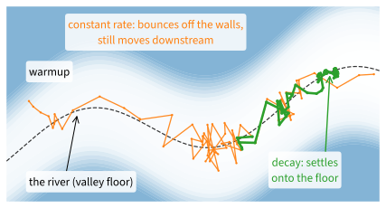

# Schedules
:label:`sec_scheduler`

Throughout the preceding sections, we held the learning rate $\eta$ constant across training—and twice observed why a fixed step size is suboptimal. Under minibatch SGD (:numref:`sec_sgd`), a constant learning rate traps the iterate in a stationary noise ball of variance $O(\eta\sigma^2 / \lambda)$: halving $\eta$ halves the noise floor but doubles the transient steps required to reach it. Under normalized optimizers such as AdamW (:numref:`sec_adam`) and Muon (:numref:`sec_muon`), the update magnitude remains $O(\eta)$ even as the gradient approaches zero, preventing the iterate from settling at a minimum until $\eta$ is reduced.

Modern training recipes resolve this trade-off with a **learning-rate schedule** $\eta_t$ that varies across steps $t = 0, \ldots, T-1$. Almost every contemporary schedule combines two phases: an initial **warmup** ramp from zero to a peak learning rate $\eta_0$, followed by a **decay** phase toward zero. In this section, we first analyze learning-rate decay on the noisy quadratic valley in terms of two quantities—the **cumulative learning-rate budget** $B_T = \sum_{t=0}^{T-1}\eta_t$ and the **terminal learning rate** $\eta_T$. We then compare constant, cosine, and warmup–stable–decay (WSD) schedules on `TinyLM`, demonstrate why linear warmup prevents early step instability at high peak learning rates, and show how branching short decay phases off a constant-rate plateau produces competitive checkpoints across multiple training horizons.

```{.python .input #lr-scheduler-a-testbed-1}
%%tab pytorch
import math
import numpy as np
import torch
from torch import nn
from torch.nn import functional as F
from d2l import torch as d2l
```

```{.python .input #lr-scheduler-a-testbed-1}
%%tab jax
import math
import numpy as np
import jax
from jax import numpy as jnp
from flax import nnx
import optax
from d2l import jax as d2l
```

```{.python .input #lr-scheduler-schedules-1}
%%tab pytorch
import copy
import random
```

## Learning-Rate Decay on the Noisy Valley
:label:`subsec_scheduler-valley`

Consider a single coordinate of the quadratic valley with curvature $\lambda > 0$ and zero-mean gradient noise $\xi_t$ of variance $\sigma^2$ under time-varying step sizes $\eta_t$:

$$x_{t+1} = (1 - \eta_t \lambda)\, x_t - \eta_t\, \xi_t.$$

Over $t$ steps, the deterministic mean contracts by $\prod_{s < t}(1 - \eta_s\lambda) \approx e^{-\lambda B_t}$, where

$$B_t = \sum_{s=0}^{t-1} \eta_s$$

is the **cumulative learning-rate budget** (the area under the learning-rate curve up to step $t$). Provided that $\eta_t$ changes slowly over the local relaxation window $1/(\eta_t\lambda)$, the variance tracks the instantaneous noise ball $\eta_t\sigma^2 / (2\lambda)$, yielding the mean-squared error decomposition

$$\mathbb{E}\big[x_t^2\big] \approx e^{-2\lambda B_t}\, x_0^2 + \frac{\eta_t\, \sigma^2}{2\lambda}.$$
:eqlabel:`eq_scheduler-bias-noise`

Equation :eqref:`eq_scheduler-bias-noise` highlights the two requirements on any finite-horizon schedule over $T$ steps:

1. **Sufficient cumulative budget $B_T$:** The total budget $B_T = \sum_{t=0}^{T-1}\eta_t$ must be large enough that the initial bias $e^{-2\lambda_{\min} B_T} x_0^2$ vanishes along the flattest direction.
2. **Small terminal learning rate $\eta_T$ with sufficient remaining budget:** The terminal rate $\eta_T$ must decay toward zero slowly enough that noise injected at intermediate steps $s$ is contracted by the remaining budget $R_s = \sum_{u=s}^{T-1}\eta_u \gtrsim 1/\lambda_{\min}$.

Three classical parametric schedule families are piecewise-constant (step) decay, exponential decay, and polynomial decay:

$$
\begin{aligned}
\eta_t &= \eta_i \quad \textrm{for } t_i \leq t < t_{i+1} && \textrm{(piecewise constant)}, \\
\eta_t &= \eta_0\, \gamma^t && \textrm{(exponential)}, \\
\eta_t &= \eta_0\, (1 + t/\tau)^{-\alpha} && \textrm{(polynomial)},
\end{aligned}
$$
:eqlabel:`eq_scheduler-classical`

with decay factor $\gamma \in (0, 1)$, timescale $\tau > 0$, and exponent $\alpha > 0$. Simulating $1{,}000$ independent SGD runs on the valley $f(\mathbf{x}) = 0.1 x_1^2 + 2 x_2^2$ over $T = 3{,}000$ steps illustrates how the cumulative budget $B_T$ and terminal rate $\eta_T$ govern convergence—and why overly rapid exponential decay freezes noise:

```{.python .input #lr-scheduler-four-schedules-on-the-valley}
%%tab pytorch, jax
def sgd_valley(schedule, num_steps=3000, num_runs=1000):
    """Mean squared distance to the minimum of SGD runs on the valley."""
    rng = np.random.default_rng()
    h = np.array(d2l.VALLEY_CURVATURES)  # Curvatures along x1 and x2
    x = np.tile([-5.0, -2.0], (num_runs, 1))
    dist = []
    for t in range(num_steps):
        x = x - schedule(t) * (h * x + rng.normal(size=x.shape))
        dist.append((x ** 2).sum(axis=1).mean())
    return dist

valley_schedules = {
    'constant': lambda t: 0.1,
    'exponential': lambda t: 0.4 * 0.98 ** t,
    'polynomial 1/2': lambda t: 0.4 / (1 + t / 25) ** 0.5,
    'polynomial 1': lambda t: 0.4 / (1 + t / 25)}
dists = {}
for name, schedule in valley_schedules.items():
    dists[name] = sgd_valley(schedule)
    budget = sum(schedule(t) for t in range(3000))
    print(f'{name:15s} budget {budget:6.1f}, final rate {schedule(2999):.2g}, '
          f'mean squared distance {dists[name][-1]:.3f}')
d2l.plot(np.arange(1, 3001), list(dists.values()), 'step',
         'mean squared distance', legend=list(dists), xscale='log',
         yscale='log')
```

The constant rate ($\eta = 0.1$) plateaus at its stationary noise ball ($0.25 + 0.016 \approx 0.27$). Polynomial decay with $\alpha = 1/2$ ($\eta_T \approx 0.036$) and $\alpha = 1$ ($\eta_T \approx 0.0033$) track :eqref:`eq_scheduler-bias-noise` down to $0.09\text{--}0.10$ and $0.011\text{--}0.012$, respectively. By contrast, exponential decay ($\gamma = 0.98$) has a terminal rate of $10^{-27}$ yet freezes at a mean-squared error of $0.12\text{--}0.13$: because its remaining budget after step $s$ is only $R_s \approx \eta_s / (1-\gamma) = 50\eta_s$, noise injected once $\eta_s \lesssim 0.1$ ($R_s \lambda_1 \lesssim 1$) is never contracted away, leaving a frozen variance of $(1-\gamma)\sigma^2 / (4\lambda_1^2) = 0.125$ (Exercise :exref:`ex_scheduler-frozen-noise`).

## Decay Shapes on a Language Model
:label:`subsec_scheduler-decay-shapes`

On a fixed step budget $T$, two decay profiles dominate modern deep learning:

* **Cosine decay** :cite:`Loshchilov.Hutter.2016`, which follows a half-cosine wave from peak rate $\eta_0$ at $t = 0$ to terminal rate $\eta_T$ at $t = T$:
  $$
  \eta_t = \eta_T + \frac{\eta_0 - \eta_T}{2}\left(1 + \cos\frac{\pi t}{T}\right).
  $$
  :eqlabel:`eq_scheduler-cosine`
  When $\eta_T = 0$, cosine decay has cumulative budget $B_T = \frac{1}{2}\eta_0 T$ (half the budget of a constant rate $\eta_0$).
* **Stable–then–decay (late linear decay)**, which holds the peak rate $\eta_0$ constant until step $t_{\text{decay}}$ (here $0.8\,T = 1{,}600$) and then decays linearly to $0$ over the final $20\%$ of training, preserving $90\%$ of the constant-rate budget ($B_T = 0.9\,\eta_0 T$) while still finishing at $\eta_T = 0$.

To compare constant, cosine, and stable–then–decay schedules ($\eta_0 = 3 \times 10^{-3}, T = 2{,}000$) with AdamW ($\lambda = 0$) on `TinyLM`, we first load `WikiText103` and define the model constructor `tiny_lm(seed)` and scheduled optimizer wrapper `adamw(model, schedule)`:

```{.python .input #lr-scheduler-language-model-1}
%%tab pytorch
data = d2l.WikiText103(batch_size=64, num_steps=64)
new_seed = lambda: random.getrandbits(31)

def tiny_lm(seed):
    torch.manual_seed(seed)  # The initialization and the minibatch order
    return d2l.TinyLM(len(data.vocab)).to(d2l.try_gpu())

class Scheduled:
    """An optimizer whose learning rate at step t is schedule(t)."""
    def __init__(self, optimizer, schedule, start=0):
        self.optimizer = optimizer  # Its rate is 1, which LambdaLR multiplies
        self.scheduler = torch.optim.lr_scheduler.LambdaLR(
            optimizer, schedule, last_epoch=start - 1)

    def step(self):
        self.optimizer.step()
        self.scheduler.step()

    def zero_grad(self):
        self.optimizer.zero_grad()

def adamw(model, schedule):
    """AdamW without weight decay at the learning rate schedule(t)."""
    return Scheduled(torch.optim.AdamW(model.parameters(), lr=1.0,
                                       weight_decay=0), schedule)
```

```{.python .input #lr-scheduler-language-model-1}
%%tab jax
data = d2l.WikiText103(batch_size=64, num_steps=64)
new_seed = d2l.get_seed

def tiny_lm(seed):
    return d2l.TinyLM(len(data.vocab), rngs=nnx.Rngs(seed))

def adamw(model, schedule):
    """AdamW without weight decay at the learning rate schedule(t)."""
    return nnx.Optimizer(model, optax.adamw(schedule, weight_decay=0),
                         wrt=nnx.Param)
```

Next we define the schedule functions `constant`, `cosine`, and `stable_decay` (which holds $\eta_0$ until `decay_start=1600` before decaying linearly to zero at $T = 2{,}000$), along with the linear ramp wrapper `warmup`:

```{.python .input #lr-scheduler-language-model-2}
%%tab pytorch
def constant(t, eta=3e-3):
    return eta

def cosine(t, eta=3e-3, T=2000):
    return eta * (1 + math.cos(math.pi * t / T)) / 2

def stable_decay(t, eta=3e-3, decay_start=1600, T=2000):
    """eta until decay_start, then a linear decay to zero at step T."""
    return eta * min(1, (T - t) / (T - decay_start))

def warmup(schedule, num_steps):
    """schedule, ramped up linearly over its first num_steps steps."""
    return lambda t: min(1, (t + 1) / num_steps) * schedule(t)
```

```{.python .input #lr-scheduler-language-model-2}
%%tab jax
def constant(t, eta=3e-3):
    return eta

def cosine(t, eta=3e-3, T=2000):
    return eta * (1 + jnp.cos(jnp.pi * t / T)) / 2

def stable_decay(t, eta=3e-3, decay_start=1600, T=2000):
    """eta until decay_start, then a linear decay to zero at step T."""
    return eta * jnp.minimum(1, (T - t) / (T - decay_start))

def warmup(schedule, num_steps):
    """schedule, ramped up linearly over its first num_steps steps."""
    return lambda t: jnp.minimum(1, (t + 1) / num_steps) * schedule(t)
```

We now train `TinyLM` under each of the three decay profiles across two seeds, recording the cumulative budget $B_T$ and the validation loss at step $1{,}500$ (before late decay starts) and step $2{,}000$:

```{.python .input #lr-scheduler-decay-on-a-language-model-1}
%%tab pytorch, jax
schedules = {'constant': constant, 'cosine': cosine,
             'stable, then decay': stable_decay}
val_loss = lambda model: math.log(d2l.lm_perplexity(model,
                                                    data.val_dataloader()))
seeds, curves = [new_seed(), new_seed()], {}
print(f'{"schedule":<20}{"budget":>7}  validation loss at step 1500, 2000')
for name, schedule in schedules.items():
    at_1500, at_2000 = [], []
    for seed in seeds:
        model = tiny_lm(seed)
        optimizer = adamw(model, schedule)
        losses = d2l.train_steps(model, data, optimizer, 1500)
        at_1500.append(val_loss(model))
        losses += d2l.train_steps(model, data, optimizer, 500)
        at_2000.append(val_loss(model))
    curves[name] = d2l.smooth(losses)
    budget = sum(float(schedule(t)) for t in range(2000))
    print(f'{name:<20}{budget:7.2f}  ', ' '.join(f'{v:.3f}' for v in at_1500),
          '  ', ' '.join(f'{v:.3f}' for v in at_2000))
d2l.plot(list(range(25, 2001, 25)), list(curves.values()), 'step',
         'training loss', legend=list(curves), xlim=[500, 2000],
         ylim=[1.45, 1.95])
```

At step $1{,}500$, cosine decay leads because its learning rate has already fallen to $15\%$ of the peak, damping high-frequency oscillation. However, between steps $1{,}600$ and $2{,}000$, when `stable_decay` linearly reduces $\eta_t \to 0$, its loss drops sharply by $\sim 0.10$ nats—finishing $0.05\text{--}0.06$ nats below the constant schedule and $\sim 0.05$ nats ahead of cosine decay, which had only half the cumulative travel budget ($B_T = 3.0$ vs. $5.4$). Notice that comparing checkpoints before learning-rate decay completes can reverse the true end-of-training ranking :cite:`Wen.Hall.Ma.ea.2025`.

## Learning-Rate Warmup
:label:`subsec_scheduler-warmup`

While decay settles the iterate at the end of training, **learning-rate warmup** stabilizes the opening steps by ramping $\eta_t$ linearly from $0$ to $\eta_0$ over $W$ steps (typically $1\%\text{--}5\%$ of $T$).

Why is warmup needed? First, under Adam (:numref:`sec_adam`), step $1$ moves every coordinate by $\pm\eta_0$ based on a single minibatch before the momentum average $\mathbf{m}_t$ and second-moment average $\mathbf{v}_t$ have accumulated multi-batch statistics. On `TinyLM`, where initial linear weight matrices have $\text{RMS}(\mathbf{W}_0) \approx 0.045$, a cold start at $\eta_0 = 0.03$ alters every weight by $\sim 67\%$ of its initial magnitude on step $1$, corrupting the initialization and causing the run to stall near $2.8$ nats. Second, as shown in :numref:`subsec_gd-edge-of-stability`, gradually raising $\eta_t$ lowers the sharpness ceiling $2/\eta_t$ progressively, guiding the network into a flat region that can tolerate the peak learning rate :cite:`Goyal.Dollar.Girshick.ea.2017,Kalra.Barkeshli.2024`.

Adding a $20$-step linear ramp (`warmup(peak, 20)`, just $1\%$ of the $2{,}000$-step run) caps the initial relative weight change at about $10\%$ and rescues training at $\eta_0 = 0.03$, lowering the final validation loss by about a full nat. To measure the step-by-step weight change, `linear_weights` extracts the 2D non-embedding weight matrices of `TinyLM`:

```{.python .input #lr-scheduler-cold-and-ramped-1}
%%tab pytorch
def linear_weights(model):
    return [p.detach().clone() for name, p in model.named_parameters()
            if p.ndim == 2 and 'emb' not in name]
```

```{.python .input #lr-scheduler-cold-and-ramped-1}
%%tab jax
def linear_weights(model):
    params = nnx.to_flat_state(nnx.state(model, nnx.Param))
    return [p[...] for path, p in params
            if p.ndim == 2 and 'emb' not in str(path)]
```

Using `relative_change` to compute $\|\Delta\mathbf{W}\|_{\text{RMS}} / \|\mathbf{W}\|_{\text{RMS}}$ at steps $1, 5, 20,$ and $100$, we compare a cold start at $\eta_0 = 0.03$ against a $20$-step linear warmup over $2{,}000$ steps:

```{.python .input #lr-scheduler-cold-and-ramped-2}
%%tab pytorch, jax
def relative_change(old, new):
    """RMS change of a list of weight matrices relative to their RMS."""
    return math.sqrt(float(sum(((n - o) ** 2).sum() for o, n in zip(old, new))
                           / sum((o ** 2).sum() for o in old)))

peak = lambda t: constant(t, eta=3e-2)
seed = new_seed()
print('step size / weight size at steps 1, 5, 20, 100; final loss')
for name, schedule in [('cold start', peak),
                       ('20-step ramp', warmup(peak, 20))]:
    model = tiny_lm(seed)
    optimizer = adamw(model, schedule)
    losses, sizes = [], []
    for step in range(1, 101):
        before = linear_weights(model)
        losses += d2l.train_steps(model, data, optimizer, 1)
        if step in (1, 5, 20, 100):
            sizes.append(relative_change(before, linear_weights(model)))
    losses += d2l.train_steps(model, data, optimizer, 1900)
    print(f'{name:<14}', ' '.join(f'{s:.2f}' for s in sizes),
          f'  training {d2l.final_loss(losses):.3f},',
          f'validation {val_loss(model):.3f}')
```

## Warmup–Stable–Decay (WSD) and Checkpoint Branching

Cosine decay :eqref:`eq_scheduler-cosine` requires fixing the total step horizon $T$ before step $1$: intermediate checkpoints are still at elevated learning rates, and extending training beyond $T$ requires restarting or splicing schedules. Combining a short warmup with a constant peak-rate plateau and a short final decay yields the **warmup–stable–decay (WSD)** schedule :cite:`Hu.Tu.Han.ea.2024,Hagele.Bakouch.Kosson.ea.2024`.

Geometrically, :citet:`Wen.Li.Wang.ea.2024` model the WSD trajectory via a **river valley** landscape (:numref:`fig_opt_river_valley`): during the high-rate plateau, the iterate oscillates across the steep transverse walls while making rapid progress down the flat longitudinal river bed; the short final decay damps the transverse oscillations (which have large curvature $\lambda_{\text{steep}}$ and therefore require only a small remaining budget $R \gtrsim 1/\lambda_{\text{steep}}$) and drops the iterate directly onto the valley floor.


:label:`fig_opt_river_valley`

### Branching Off the Plateau
:label:`subsec_scheduler-branching`

Because the plateau phase does not depend on the target horizon $T$, we can maintain a single continuous plateau run and **branch** a short linear cooldown ($250$ steps) from any checkpoint. First, `branch(model, optimizer, schedule)` clones both the model weights and AdamW's moment buffers $(\mathbf{m}_t, \mathbf{v}_t)$ to continue under a cooldown `schedule`:

```{.python .input #lr-scheduler-branching-1}
%%tab pytorch
def branch(model, optimizer, schedule):
    """Copies of model and optimizer that continue under schedule."""
    model, adam = copy.deepcopy((model, optimizer.optimizer))  # With moments
    return model, Scheduled(adam, schedule, optimizer.scheduler.last_epoch)
```

```{.python .input #lr-scheduler-branching-1}
%%tab jax
def branch(model, optimizer, schedule):
    """Copies of model and optimizer that continue under schedule."""
    model = nnx.clone(model)
    twin = adamw(model, schedule)
    nnx.update(twin, nnx.clone(nnx.state(optimizer)))  # Moments, step count
    return model, twin
```

We now run a $2{,}000$-step constant-rate plateau on `TinyLM`, fork $250$-step linear decay branches at steps $500, 1{,}000,$ and $1{,}500$, and compare the step-$1{,}000 \to 1{,}250$ branch against a dedicated $1{,}250$-step run planned from scratch:

```{.python .input #lr-scheduler-branching-2}
%%tab pytorch, jax
seed = new_seed()  # The planned run below starts from the same weights
model = tiny_lm(seed)
optimizer = adamw(model, constant)
plateau, branched = {}, {}
for step in range(250, 2001, 250):
    d2l.train_steps(model, data, optimizer, 250)
    plateau[step] = val_loss(model)
    if step in (500, 1000, 1500):  # A 250-step decay on a copy
        decay = lambda t, s=step: stable_decay(t, decay_start=s, T=s + 250)
        twin, twin_optimizer = branch(model, optimizer, decay)
        d2l.train_steps(twin, data, twin_optimizer, 250)
        branched[step + 250] = val_loss(twin)
planned = tiny_lm(seed)  # Decays from step 1000 to 1250 by design
d2l.train_steps(planned, data, adamw(planned, lambda t: stable_decay(
    t, decay_start=1000, T=1250)), 1250)
print('step  plateau  branch')
for step, v in branched.items():
    print(f'{step:>4} {plateau[step]:8.3f} {v:7.3f}')
planned_loss = val_loss(planned)
print(f'planned run of 1250 steps: {planned_loss:.3f}')
d2l.plot([list(plateau), [1250]] + [[s - 250, s] for s in branched],
         [list(plateau.values()), [planned_loss]] +
         [[plateau[s - 250], v] for s, v in branched.items()],
         'step', 'validation loss', legend=['plateau', 'planned', 'branches'],
         fmts=('-', 'ko', 'r--', 'r--', 'r--'))
```

Every branched cooldown drops the validation loss sharply below the continuing plateau ($0.05\text{--}0.06$ nats at steps $1{,}250$ and $1{,}750$), and the branch at step $1{,}000 \to 1{,}250$ matches a dedicated $1{,}250$-step run planned from scratch—delivering finished models across three training horizons in $2{,}250$ total steps instead of $3{,}750$.

## Summary

* A learning-rate schedule $\eta_t$ is governed by its **cumulative learning-rate budget** $B_T = \sum_{t=0}^{T-1}\eta_t$ (how far the iterate can travel along flat directions) and its **terminal learning rate** $\eta_T$ (the final noise floor), subject to retaining sufficient post-step budget $R_s \gtrsim 1/\lambda$ to damp earlier noise.
* On `TinyLM`, decaying the learning rate to zero at the end of training eliminates the $O(\eta)$ oscillation of constant-rate AdamW, reducing validation loss by $0.05\text{--}0.06$ nats.
* **Linear warmup** over the first $1\%\text{--}5\%$ of steps prevents oversized initial Adam steps before $(\mathbf{m}_t, \mathbf{v}_t)$ stabilize and steers the trajectory below the sharpness threshold $2/\eta_0$.
* **Warmup–stable–decay (WSD)** holds $\eta_0$ constant after warmup and decays only over the final $10\%\text{--}20\%$ of steps, allowing short cooldown branches to be forked from any intermediate checkpoint.

## Exercises

1. [code] **Frozen noise under exponential decay.** Under $\eta_s = \eta_0\gamma^s$ with remaining budget $R_s \approx \eta_s/(1-\gamma)$, integrate $\sum_{s} \eta_s^2 \sigma^2 e^{-2\lambda R_s}$ to show that the asymptotic frozen variance along curvature $\lambda$ is $(1-\gamma)\sigma^2 / (4\lambda^2)$ when $2\lambda\eta_0 \gg 1-\gamma$. Verify this prediction with `sgd_valley` for $\gamma \in \{0.98, 0.99, 0.995\}$.
   :exlabel:`ex_scheduler-frozen-noise`

1. [code] **Piecewise-constant step decay.** Use :eqref:`eq_scheduler-bias-noise` to design a $3$-stage piecewise-constant schedule over $3{,}000$ steps on `sgd_valley` and compare its final mean-squared distance against $\alpha = 1$ polynomial decay (about $0.01$).
   :exlabel:`ex_scheduler-step-decay`

1. [code] **Schedules with identical cumulative budget $B_T$ and terminal rate $\eta_T$.** ● Compare full-horizon linear decay $\eta_t = \eta_0(1 - t/T)$ and cosine decay :eqref:`eq_scheduler-cosine` with $\eta_T = 0$ (both of which have $B_T = \eta_0 T / 2$ and $\eta_T = 0$) on `sgd_valley` ($\eta_0 = 0.4, T = 3{,}000$), and explain why cosine decay finishes at a lower terminal distance by comparing their remaining budgets $R_t$ near $t \approx T$.
   :exlabel:`ex_scheduler-same-two-numbers`

1. [code] **Warmup duration and maximum tolerable peak rate.** ● On `TinyLM`, vary the linear warmup length across $W \in \{2, 5, 10, 20, 50\}$ steps at $\eta_0 = 0.03$, compare the minimum stable warmup against Adam's first-moment window $1/(1-\beta_1) = 10$, and find how much a $20$-step warmup increases the maximum trainable peak learning rate $\eta_0$.
   :exlabel:`ex_scheduler-warmup-length`

:begin_tab:`pytorch`
[Discussions](https://d2l.discourse.group/t/1080)
:end_tab:

:begin_tab:`jax`
[Discussions](https://d2l.discourse.group/t/1081)
:end_tab:

<!-- slides -->

::: {.slide}
::: {.cover}
[Dive into Deep Learning · §9.7]{.kicker}

Learning-Rate Schedules: Warmup, Cosine Decay, and WSD<br>**cumulative budget B_T & terminal rate η_T · frozen noise · linear warmup · cosine decay · warmup–stable–decay & branching**
:::
:::

::: {.slide title="Why the Learning Rate Must Rise Early and Fall Late"}
[Motivation]{.kicker}

Throughout §9.1–§9.6, we held the learning rate $\eta$ constant—and uncovered two opposite failure modes at the start and end of training:

| Training Phase | Failure Mode of a Constant Learning Rate $\eta$ | Schedule Remedy |
| :--- | :--- | :--- |
| **Opening steps ($t = 1, \ldots, W$)** | Under AdamW, step 1 moves every coordinate by $\pm\eta_0$ from a single noisy minibatch before moments $(\mathbf{m}_t, \mathbf{v}_t)$ stabilize, and before the iterate enters a flat region ($\lambda_{\max} \le 2/\eta_0$) | **Linear warmup:** Ramp $\eta_t$ linearly from $0 \to \eta_0$ over the first $1\%\text{--}5\%$ of steps |
| **Final steps ($t \to T$)** | Constant-rate SGD stalls in a stationary noise ball of variance $\frac{\eta\sigma^2}{2\lambda b}$, while normalized methods (AdamW, Muon) keep taking $O(\eta)$ steps regardless of how small $\|\nabla f\|$ becomes | **Learning-rate decay:** Lower $\eta_t \to \eta_T \approx 0$ gradually so iterates settle into the minimum |

::: {.d2l-note}
A time-varying **learning-rate schedule** $\eta_t$ ($t = 0, \ldots, T-1$) resolves both problems by ramping up to a high peak rate $\eta_0$ for rapid traversal and decaying at the end to eliminate step noise.
:::
:::

::: {.slide title="Bias–Variance Decomposition Under a Schedule η_t"}
[Analytical Model on the Noisy Valley]{.kicker}

Along an eigendirection of curvature $\lambda > 0$ with zero-mean gradient noise $\xi_t$ of variance $\sigma^2$, time-varying step sizes $\eta_t$ evolve as $x_{t+1} = (1 - \eta_t\lambda)x_t - \eta_t\xi_t$:

$$\mathbb{E}\big[x_t^2\big] \approx \underbrace{e^{-2\lambda B_t}\,x_0^2}_{\text{Initial distance (travel term)}} + \underbrace{\frac{\eta_t\,\sigma^2}{2\lambda}}_{\text{Instantaneous noise ball}}, \qquad B_t = \sum_{s=0}^{t-1} \eta_s$$

- **1. Cumulative learning-rate budget $B_t = \sum_{s < t} \eta_s$:** The area under the learning-rate curve up to step $t$. Deterministic error decays exponentially with $B_t$ as $\prod_{s < t}(1 - \eta_s\lambda) \approx e^{-\lambda B_t}$ (e.g., on the flat axis $\lambda_1 = 0.2$, a budget of $B_T = 25$ shrinks $x_0^2$ by $e^{-10} \approx 4.5 \times 10^{-5}$).
- **2. Terminal learning rate $\eta_T$ (and slow-change condition):** Provided $\eta_t$ decays slowly enough that the remaining budget after step $s$, $R_s = \sum_{u=s}^{T-1}\eta_u \gtrsim 1/\lambda_{\min}$, contracts earlier noise, the terminal variance tracks the instantaneous noise ball $\frac{\eta_T\sigma^2}{2\lambda}$.
:::

::: {.slide title="Classical Parametric Decay Families and Their Budgets"}
[Four Schedules on the Valley]{.kicker}

We compare four classical schedules over $T = 3{,}000$ steps on the noisy valley ($\lambda_1 = 0.2, \lambda_2 = 4.0, \sigma^2 = 1$) from $(-5, -2)$, with decaying runs starting at $\eta_0 = 0.4$:

| Schedule Family | Formula $\eta_t$ | Cumulative Budget $B_{3000} = \sum_{t=0}^{2999}\eta_t$ | Terminal Rate $\eta_{2999}$ | Naive Noise-Ball Prediction $\sum_i \frac{\eta_T\sigma^2}{2\lambda_i}$ |
| :--- | :--- | :---: | :---: | :---: |
| **Constant** | $\eta_t = 0.1$ | $300.0$ | $0.1000$ | $0.25 + 0.016 \approx 0.268$ |
| **Exponential ($\gamma = 0.98$)** | $\eta_t = \eta_0\,\gamma^t$ | $\frac{\eta_0}{1 - \gamma} = 20.0$ | $\approx 1.9 \times 10^{-27}$ | $\approx 0$ (**fails—freezes at $0.125$!**) |
| **Polynomial ($\alpha = 1/2$)** | $\eta_t = \eta_0(1 + t/25)^{-1/2}$ | $200.5$ | $0.0364$ | $0.268 \times 0.364 \approx 0.098$ |
| **Polynomial ($\alpha = 1$)** | $\eta_t = \eta_0(1 + t/25)^{-1}$ | $48.2$ | $0.0033$ | $0.268 \times 0.033 \approx 0.009$ |
:::

::: {.slide title="1,000 Valley Runs: Why Exponential Decay Freezes"}
[Empirical Verification]{.kicker}

::: {.cols .vc}
::: {.col}
- Averaging $1{,}000$ independent noisy valley trajectories over $T = 3{,}000$ steps:
  - **Constant ($\eta = 0.1$):** Plateaus at its stationary noise ball ($0.268$).
  - **Polynomial $\alpha = 1/2$ and $\alpha = 1$:** Track the instantaneous noise ball cleanly down to $0.097$ and $0.011$, respectively!
  - **Exponential ($\gamma = 0.98$):** Despite reaching $\eta_T \approx 10^{-27}$, the iterate **freezes at a mean-squared distance of $0.126$** from step $250$ onward!
:::

::: {.col .fig}
@!lr-scheduler-four-schedules-on-the-valley
:::
:::
:::

::: {.slide title="Noise Is Removed Only by Budget Still to Come (R_s)"}
[The Frozen-Noise Mechanism]{.kicker}

Why did exponential decay $\eta_t = \eta_0\gamma^t$ freeze at variance $0.125$ even though its total budget $B_\infty = 20$ easily erased the initial position ($25\,e^{-8} < 0.01$)?

- **Remaining budget after step $s$:** Noise $\eta_s^2\sigma^2$ injected at step $s$ is contracted only by steps *after* $s$, via the **remaining budget** $R_s = \sum_{u > s} \eta_u$:
  $$\mathbb{E}\big[x_T^2\big] \approx e^{-2\lambda B_T}x_0^2 + \sigma^2 \sum_{s=0}^{T-1} \eta_s^2\,e^{-2\lambda R_s}$$
- **Geometric starvation:** Under $\eta_s = \eta_0\gamma^s$, the remaining budget is only $R_s \approx \frac{\eta_s}{1 - \gamma} = 50\,\eta_s$. Once $\eta_s$ drops below $\frac{1-\gamma}{2\lambda_1} = \frac{0.02}{0.4} = 0.05$, $2\lambda_1 R_s < 1$ and all subsequent contraction stops!
- Integrating $\sigma^2 \int_0^\infty \eta_s^2 e^{-2\lambda\eta_s/(1-\gamma)} ds$ gives the exact frozen variance along curvature $\lambda$:
  $$\mathbb{E}\big[x_\infty^2\big]_{\text{exp}} \approx \frac{(1 - \gamma)\,\sigma^2}{4\lambda^2} = \frac{0.02 \times 1}{4 \times 0.2^2} = 0.125$$
:::

::: {.slide title="Modern Finite-Horizon Schedule Shapes"}
[Constant, Cosine, and Late Decay]{.kicker}

::: {.cols .vc}
::: {.col}
On a fixed budget of $T = 2{,}000$ steps with peak learning rate $\eta_0 = 3 \times 10^{-3}$, we compare three finite-horizon profiles:

- **1. Constant ($\eta_t = \eta_0$):** Rectangular area $B_T = \eta_0 T = 6.0$, terminal rate $\eta_T = 3 \times 10^{-3}$.
- **2. Cosine decay (Loshchilov & Hutter, 2016):**
  $$\eta_t = \frac{\eta_0}{2}\left(1 + \cos\frac{\pi t}{T}\right)$$
  Symmetric half-wave with **half the budget** ($B_T = 0.5\,\eta_0 T = 3.0$) and $\eta_T = 0$.
- **3. Stable–then–decay (late linear decay):** Holds $\eta_0$ until $t_{\text{decay}} = 0.8\,T = 1{,}600$, then decays linearly to $0$ (**$90\%$ budget $B_T = 5.4$**, $\eta_T = 0$).
:::

::: {.col .fig}
@-lr-scheduler-language-model-2
:::
:::
:::

::: {.slide title="Evaluating Decay Shapes on TinyLM"}
[Step 1,500 vs. Step 2,000]{.kicker}

::: {.cols .vc}
::: {.col}
- Training `TinyLM` with AdamW ($\lambda = 0$) across two seeds and evaluating validation loss at step $1{,}500$ and step $2{,}000$:
  - **At step $1{,}500$ (before late decay starts):** Cosine decay leads ($1.57\text{--}1.58$ vs. $1.60\text{--}1.64$) because $\eta_{1500}$ has already fallen to $15\%$ of $\eta_0$, damping step noise.
  - **At step $2{,}000$ (after late decay completes):** Between steps $1{,}600$ and $2{,}000$, `stable_decay` drops sharply by **$\sim 0.10$ nats** to **$1.50$ nats**, beating the constant run by $0.06\text{--}0.09$ nats and cosine decay by $\sim 0.05$ nats!
:::

::: {.col .fig}
@!lr-scheduler-decay-on-a-language-model-1
:::
:::
:::

::: {.slide title="Why Late Decay Wins and Mid-Run Comparisons Mislead"}
[Budget vs. Noise Floor]{.kicker}

| Schedule Shape ($\eta_0 = 3 \times 10^{-3}, T = 2{,}000$) | Cumulative Budget $B_T$ | Terminal Rate $\eta_T$ | Validation Drop (Steps $1{,}500 \to 2{,}000$) | Final Validation Loss |
| :--- | :---: | :---: | :---: | :---: |
| **Constant** | $6.0$ ($100\%$) | $3 \times 10^{-3}$ | $0.04\text{--}0.05$ nats | $1.56\text{--}1.60$ |
| **Cosine Decay** | $3.0$ ($50\%$) | $0$ | $0.02\text{--}0.03$ nats | $1.55\text{--}1.57$ |
| **Stable–then–Decay ($80\%$ plateau, $20\%$ linear)** | **$5.4$ ($90\%$)** | **$0$** | **$0.10$ nats** | **$1.50\text{--}1.51$** |

::: {.d2l-note .rule}
**Two practical lessons:**

1. **Why late decay wins on compute-bound runs:** When a model is still actively learning at step $T$, sacrificing $50\%$ of the travel budget $B_T$ under cosine decay costs as much progress as its zero terminal rate saves; holding $\eta_0$ for $80\%$ of steps keeps $90\%$ of the budget while still finishing at $\eta_T = 0$.
2. **Never rank schedules or optimizers mid-run before cooldown:** An uncooled plateau checkpoint includes $O(\eta_0)$ step oscillation that disappears as soon as $\eta_t \to 0$ (Wen et al., 2025).
:::
:::

::: {.slide title="Why High Peak Rates Fail Cold: Adam's First Step"}
[The Mechanics of Learning-Rate Warmup]{.kicker}

Why does AdamW on `TinyLM` stall near $2.8$ nats when started cold at $\eta_0 = 0.03$, yet train cleanly when ramped linearly over just $W = 20$ steps ($\eta_t = \eta_0 \min(1, \frac{t+1}{W})$)?

1. **Unaveraged step-1 sign jump:** At $t = 1$, Adam's bias-corrected moments come from a single minibatch, moving every weight coordinate by $\pm\eta_0$:
   - `TinyLM`'s linear weight matrices initialize at $\text{RMS}(\mathbf{W}_0) \approx 0.045$.
   - A cold start at $\eta_0 = 0.03$ changes every weight by **$\frac{0.03}{0.045} = 67\%$ of its initial magnitude on step 1**, scrambling the representation before $\mathbf{m}_t$ and $\mathbf{v}_t$ fill over their $\tau_1 = 10$-step window!
   - A $20$-step ramp starts at $\eta_0 / 20 = 0.0015$ (**$3.3\%$ relative step**), allowing $\mathbf{m}_t, \mathbf{v}_t$ to stabilize before reaching $\eta_0$.
2. **Progressive sharpening guidance (§9.1):** Gradually raising $\eta_t$ lowers the sharpness ceiling $2/\eta_t$ smoothly, steering iterates into a flat region before $\eta_t$ hits $\eta_0$ (Kalra & Barkeshli, 2024).
:::

::: {.slide title="A 20-Step Warmup Rescues Training at η₀ = 0.03"}
[Cold Start vs. Linear Ramp]{.kicker}

::: {.cols .vc}
::: {.col}
- Comparing a cold start against a $20$-step linear warmup ($1\%$ of $2{,}000$ steps) at $\eta_0 = 0.03$ from identical initial weights:
  - **Cold start:** Relative weight change $\|\Delta\mathbf{W}\|_{\text{RMS}}/\|\mathbf{W}\|_{\text{RMS}}$ is **$0.68$ ($68\%$)** on step 1; the network stalls above $2.6\text{--}2.8$ nats.
  - **20-step linear ramp:** Caps relative weight change at **$0.03$** on step 1 and $\le 0.11$ at peak step 20, lowering final validation loss by **nearly a full nat**!
:::

::: {.col .fig}
@!lr-scheduler-cold-and-ramped-2
:::
:::
:::

::: {.slide title="Practical Rules for Warmup Length and Peak-Rate Tuning"}
[Configuring the Opening Ramp]{.kicker}

Warmup rescues an aggressive peak learning rate $\eta_0 = 0.03$ from cold-start failure, but notice that $\eta_0 = 0.03$ with warmup ($1.74$ nats) still finishes higher than $\eta_0 = 0.003$ ($1.56$ nats):

| Design Parameter | Engineering Rule of Thumb | Quantitative Justification |
| :--- | :--- | :--- |
| **Warmup duration $W$** | **$1\%\text{--}5\%$ of total steps $T$** (and always $W \ge \frac{2}{1-\beta_1} = 20$ steps) | Gives Adam's first-moment buffer $\mathbf{m}_t$ ($\tau_1 = 10$) and early second-moment scale $\mathbf{v}_t$ time to accumulate multi-batch statistics |
| **Budget given up by warmup** | $\Delta B = \frac{W}{2}\,\eta_0$ (**$<0.5\%\text{--}2.5\%$ of $B_T$**) | For $W = 20, T = 2{,}000, \eta_0 = 0.03$, the triangle deficit is $9.5\eta_0 = 0.285$ out of $B_T = 60$ ($0.48\%$) |
| **Peak learning rate $\eta_0$** | Sweep $\eta_0$ in factors of $2\text{--}3\times$ **with warmup active** | Expect the optimal $\eta_0^\star$ to sit $3\text{--}10\times$ below the highest rate that warmup can stabilize |
:::

::: {.slide title="Cosine Decay vs. Warmup–Stable–Decay (WSD)"}
[Fixed Horizon vs. Anytime Stopping]{.kicker}

Why has **Warmup–Stable–Decay (WSD)** (Hu et al., 2024; Hägele et al., 2024) become a popular alternative to cosine decay in large language model pretraining?

| Scheduling Dimension | Cosine Decay | Warmup–Stable–Decay (WSD) |
| :--- | :--- | :--- |
| **Commitment to step horizon $T$** | Must fix exact $T$ before step $t = 1$ | **Horizon-free during plateau:** Decide when to stop on the fly |
| **Mid-run checkpoint usability** | Unfinished ($\eta_t$ is still elevated; needs full run) | Branch a short $10\text{--}20\%$ cooldown from **any** plateau checkpoint |
| **Continual pretraining / extension** | Requires learning-rate re-warming and schedule splicing | Simply continue the constant-rate plateau to any new token budget |
| **Cumulative travel budget $B_T$** | $0.50\,\eta_0 T$ (half of peak rectangle) | **$0.85\text{--}0.90\,\eta_0 T$** (nearly full peak rectangle) |
:::

::: {.slide title="The River-Valley Geometry of Warmup–Stable–Decay"}
[Landscape Interpretation]{.kicker}

::: {.cols .vc}
::: {.col}
- Wen et al. (2024) explain WSD's efficiency via a **river-valley loss surface**:
  - **High-rate plateau ($\eta_t = \eta_0$):** The iterate oscillates rapidly across the steep transverse valley walls ($\lambda_{\text{steep}}$) while making fast downstream progress along the flat longitudinal river bed ($\lambda_{\text{flat}} \ll \lambda_{\text{steep}}$).
  - **Short cooldown branch ($\eta_t \to 0$):** Because the transverse oscillations sit along high-curvature directions ($\lambda_{\text{steep}} \gg 1$), they need only a small remaining budget $R \gtrsim 1/\lambda_{\text{steep}}$ ($10\text{--}20\%$ of $T$) to damp out and drop onto the valley floor!
:::

::: {.col .fig}
{.nostretch width=100%}
:::
:::
:::

::: {.slide title="Implementing Checkpoint Branching: Cloning Adam's State"}
[Preserving Optimizer Moments]{.kicker}

When branching a short cooldown off a plateau checkpoint at step $s$, we must clone **both the model parameters and the optimizer state $(\mathbf{m}_s, \mathbf{v}_s, s)$**:

@-lr-scheduler-branching-1

::: {.d2l-note .warn}
**Common checkpoint bug:** Starting a cooldown branch with a freshly initialized `AdamW` ($\mathbf{m}_0 = \mathbf{v}_0 = \mathbf{0}$) triggers unaveraged step-1 sign jumps $\pm\eta_s$ that corrupt the plateau weights!
:::
:::

::: {.slide title="Multi-Horizon Models from a Single Plateau Run"}
[Anytime Cooldown Verification]{.kicker}

::: {.cols .vc}
::: {.col}
- We run a single $2{,}000$-step constant-rate plateau ($\eta_0 = 3 \times 10^{-3}$) on `TinyLM` and branch $250$-step linear cooldowns at steps $500, 1{,}000,$ and $1{,}500$:
  - Every $250$-step cooldown drops validation loss sharply below the continuing plateau ($0.05\text{--}0.06$ nats at steps $1{,}250$ and $1{,}750$).
  - The branch at $1{,}000 \to 1{,}250$ ($1.559$ nats) matches a dedicated $1{,}250$-step run planned from step 0 ($1.556$ nats)—delivering $3$ finished models in $2{,}250$ steps instead of $3{,}750$!
:::

::: {.col .fig}
@!lr-scheduler-branching-2
:::
:::
:::

::: {.slide title="Concept Check: Frozen Noise, Warmup, and WSD Branching"}
[Check Your Understanding]{.kicker}

Solve each scheduling design question quantitatively:

1. **Frozen noise under exponential decay:** On a 1D quadratic of curvature $\lambda = 0.2$ and noise variance $\sigma^2 = 1$, exponential decay $\eta_t = 0.4 \times \gamma^t$ with $\gamma = 0.98$ froze at variance $\frac{(1-\gamma)\sigma^2}{4\lambda^2} = 0.125$. What happens to the frozen variance if we slow the decay to $\gamma = 0.995$?
2. **Cosine vs. late decay on a fast quadratic:** On `TinyLM` ($2{,}000$ steps), late linear decay beat cosine decay because `TinyLM` needed the extra travel budget ($B_T = 5.4$ vs. $3.0$). Which schedule finishes lower on a 1D noisy quadratic that already reaches its noise ball in $20$ steps?
3. **Compute savings of WSD branching:** You want evaluated, cooled checkpoints at horizons $T_1 = 1{,}000$, $T_2 = 2{,}000$, and $T_3 = 3{,}000$ steps, each ending with a $300$-step linear cooldown. How many total training steps do three separate cosine runs require versus one WSD plateau with three branches?

::: {.d2l-note .fragment .fade-up}
**Answers:**

1. At $\gamma = 0.995$, $1 - \gamma = 0.005$ ($4\times$ smaller than $0.02$), so the asymptotic frozen variance drops **$4\times$ to $\frac{0.005}{4 \times 0.04} = 0.03125$**.
2. **Cosine decay!** Once initial bias $e^{-2\lambda B_t}x_0^2$ has vanished (after $20$ steps), only late-stage noise damping matters, and cosine decay spends far more steps at small learning rates near the end of the run.
3. Three separate cosine runs cost $1{,}000 + 2{,}000 + 3{,}000 =$ **$6{,}000$ steps**; one WSD plateau to step $2{,}700$ plus three $300$-step cooldown branches at steps $700, 1{,}700, 2{,}700$ costs $2{,}700 + 3 \times 300 =$ **$3{,}600$ steps ($40\%$ compute saved)**.
:::
:::

::: {.slide title="Summary: Learning-Rate Schedules, Warmup, and WSD"}
[Key Takeaways]{.kicker}

| Schedule Concept | Mathematical Form / Invariant | Budget & Terminal Behavior | Practical Guideline |
| :--- | :--- | :--- | :--- |
| **Bias–Noise Decomposition** | $\mathbb{E}[x_t^2] \approx e^{-2\lambda B_t}x_0^2 + \frac{\eta_t\sigma^2}{2\lambda}$ | Budget $B_t = \sum_{s<t}\eta_s$ erases start; $\eta_T$ sets floor | Requires both large $B_T$ and slow decay ($R_s \gtrsim 1/\lambda$) |
| **Exponential Decay Hazard** | $\eta_t = \eta_0\gamma^t,\quad R_s \approx \frac{\eta_s}{1-\gamma}$ | Freezes noise at $\frac{(1-\gamma)\sigma^2}{4\lambda^2}$ once $\eta_s \lesssim \frac{1-\gamma}{2\lambda}$ | Avoid fast geometric decay without a floor or polynomial tail |
| **Linear Warmup** | $\eta_t = \eta_0\min\!\left(1, \frac{t+1}{W}\right)$ | Prevents $67\%$ step-1 weight jump under AdamW | Ramp over $W \sim 1\%\text{--}5\%$ of steps (always $> \frac{1}{1-\beta_1} = 10$) |
| **Cosine Decay** | $\eta_t = \eta_T + \frac{\eta_0-\eta_T}{2}\left(1 + \cos\frac{\pi t}{T}\right)$ | Budget $B_T = 0.5\,\eta_0 T$ (for $\eta_T = 0$) | Standard for fixed-horizon runs where $T$ is known in advance |
| **Warmup–Stable–Decay (WSD)** | Constant plateau $\eta_0$, then linear/cosine cooldown | Budget $B_T \approx 0.9\,\eta_0 T$; supports anytime branching | Fork $10\text{--}20\%$ cooldown branches (copying weights + $\mathbf{m}, \mathbf{v}$) |
:::

