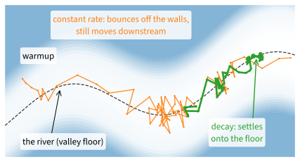

# Schedules
:label:`sec_scheduler`

The modern recipe of :numref:`sec_training_recipes` did not keep the
learning rate fixed. It raised the rate linearly over the first few epochs
and then let it fall along a cosine curve. Almost every large model today
is trained with a warmup followed by a decay. This section asks why the
learning rate should change during a run, and what shape the change should
have.

The two ends of a run need different things. At the end, a constant learning
rate keeps stochastic gradient descent from settling. On the valley
$f(\mathbf{x}) = 0.1 x_1^2 + 2 x_2^2$ with unit gradient noise, the iterates
at $\eta = 0.1$ keep wandering around the minimum with a standard deviation
of 0.5 along the flat direction, however long they run (:numref:`sec_sgd`).
Halving the rate halves the squared radius of that cloud, but it also halves
the speed at which the iterates approach it. The start of training has the
opposite problem. The convolutional network of this section trains at a
learning rate of 7.5 if the rate is raised to that value gradually, while a
run that starts at 7.5 stays close to chance accuracy.

A learning-rate *schedule* addresses both problems. It is a function that
gives the learning rate $\eta_t$ at each point $t$ of training, and it can
be changed without touching the rest of the training loop. An optimizer
makes three decisions (:numref:`sec_optimization-intro`): the descent
direction, the step size over time, and the treatment of noise. The
schedule is the second. We first ask what a decaying rate has to
achieve, on the valley, where the answer can be computed: it must carry
the iterate far enough to reach the minimum, and it must end small enough
to quench the noise. We then train one small network under the classical
decay shapes and under *warmup*, which raises the rate gradually at the
start. Last comes the warmup–stable–decay schedule used to train large
language models. It holds the rate constant for most of the run, which
lets us decide late in training how long to train.

```{.python .input #lr-scheduler-a-testbed-1}
%%tab pytorch
import math
import numpy as np
import torch
from torch import nn
from torch.nn import functional as F
from d2l import torch as d2l
```

```{.python .input #lr-scheduler-a-testbed-1}
%%tab jax
import math
import numpy as np
import jax
from jax import numpy as jnp
from flax import nnx
import optax
from d2l import jax as d2l
```

```{.python .input #lr-scheduler-schedules-1}
%%tab pytorch
import copy
```

## Decay on the Valley
:label:`subsec_scheduler-valley`

At the end of a run a schedule has two jobs: carry the iterate to the
minimum and shrink the noise around it. On the valley both effects can be
computed in closed form, so we start there.

### Progress and Noise

On the valley each coordinate of SGD evolves on its own. Take one
coordinate with curvature $\lambda$ and gradient noise $\xi_t$ of mean zero
and variance $\sigma^2$, and let the learning rate $\eta_t$ change from step
to step. One step of SGD reads

$$x_{t+1} = (1 - \eta_t \lambda)\, x_t - \eta_t\, \xi_t.$$

The first term pulls the iterate toward the minimum at $0$. The second
pushes it in a random direction. Their effects separate. The mean of $x_t$
shrinks by the factor $1 - \eta_s \lambda \approx e^{-\eta_s \lambda}$ at
every step $s$, so after $t$ steps it has shrunk by about
$e^{-\lambda B_t}$, where

$$B_t = \sum_{s < t} \eta_s$$

is the sum of all learning rates so far, which we call the *budget* of the
schedule. For a constant rate, :numref:`sec_sgd` showed that the noise
keeps the iterate in a *noise ball* of squared radius
$\eta\sigma^2 / (2\lambda)$ around the minimum, for $\eta\lambda \ll 1$.
When the rate changes slowly, compared with the $1/(\eta_t\lambda)$ steps
the iterate needs to forget its past, the ball follows the current rate.
Together,

$$\mathbb{E}\big[x_t^2\big] \approx e^{-2\lambda B_t}\, x_0^2 + \frac{\eta_t\, \sigma^2}{2\lambda}.$$
:eqlabel:`eq_scheduler-bias-noise`

The first term is what remains of the starting distance, and it shrinks
with the budget; the second is the noise ball of the current rate. On the
flat direction of the valley, $\lambda = 0.2$ and $x_0 = -5$, a budget of
$B = 10$ leaves $e^{-2} \approx 14\%$ of the starting distance and a
budget of $25$ leaves $e^{-5} \approx 0.7\%$. A schedule that converges
must therefore do two things: let the budget grow without bound, so that
the first term vanishes, and let the rate go to zero, so that the second
does.

The conditions of :citet:`Robbins.Monro.1951` that :numref:`sec_sgd`
stated, $\sum_t \eta_t = \infty$ and $\sum_t \eta_t^2 < \infty$, are a
sufficient form of these two requirements. The second is stronger than
$\eta_t \to 0$, and it is what their proof for general objectives needs. On
the quadratic, :eqref:`eq_scheduler-bias-noise` shows that a rate that goes
to zero with an infinite budget already suffices, as long as it falls
slowly enough for the noise ball to follow it. Polynomial decay with
$\alpha = 1/2$ below confirms this.

Three families of schedules have been used since the early days of
stochastic approximation:

$$
\begin{aligned}
\eta_t &= \eta_i \quad \textrm{for } t_i \leq t < t_{i+1} && \textrm{piecewise constant}, \\
\eta_t &= \eta_0\, \gamma^t && \textrm{exponential}, \\
\eta_t &= \eta_0\, (1 + t/\tau)^{-\alpha} && \textrm{polynomial},
\end{aligned}
$$
:eqlabel:`eq_scheduler-classical`

with a decay factor $\gamma \in (0, 1)$, a time scale $\tau$, and an
exponent $\alpha > 0$. Piecewise constant decay keeps the rate fixed and
cuts it at chosen steps $t_1 < t_2 < \ldots$. Exponential decay multiplies
the rate by $\gamma$ at every step, so its budget is the geometric sum
$\eta_0 / (1 - \gamma)$, which stays finite: it violates the first
condition. Polynomial decay has an infinite budget for $\alpha \leq 1$, and
its squares have a finite sum for $\alpha > 1/2$; the case $\alpha = 1$ is
the rate $\eta_t \propto 1/t$ of :numref:`sec_sgd`.

### Four Schedules on the Valley

We test these predictions with 1,000 independent SGD runs on the valley,
the rows of one array, all started at $(-5, -2)$ with unit gradient noise.
The function `sgd_valley` returns the mean squared distance to the minimum
after each step. We compare four schedules over 3,000 steps: the constant
rate $0.1$; exponential decay from $\eta_0 = 0.4$ with $\gamma = 0.98$; and
polynomial decay from $\eta_0 = 0.4$ with $\tau = 25$ and $\alpha = 1/2$ or
$\alpha = 1$. The decaying schedules start at $0.4$, close to the stability
limit $2/4 = 0.5$ of the steep direction.

```{.python .input #lr-scheduler-four-schedules-on-the-valley}
%%tab pytorch, jax
def sgd_valley(schedule, num_steps=3000, num_runs=1000):
    """Mean squared distance to the minimum of SGD runs on the valley."""
    rng = np.random.default_rng()
    h = np.array([d2l.h1, d2l.h2])  # Curvatures along x1 and x2
    x = np.tile([-5.0, -2.0], (num_runs, 1))
    dist = []
    for t in range(num_steps):
        x = x - schedule(t) * (h * x + rng.normal(size=x.shape))
        dist.append((x ** 2).sum(axis=1).mean())
    return dist

valley_schedules = {
    'constant': lambda t: 0.1,
    'exponential': lambda t: 0.4 * 0.98 ** t,
    'polynomial 1/2': lambda t: 0.4 / (1 + t / 25) ** 0.5,
    'polynomial 1': lambda t: 0.4 / (1 + t / 25)}
dists = {}
for name, schedule in valley_schedules.items():
    dists[name] = sgd_valley(schedule)
    budget = sum(schedule(t) for t in range(3000))
    print(f'{name:15s} budget {budget:6.1f}, final rate {schedule(2999):.2g}, '
          f'mean squared distance {dists[name][-1]:.3f}')
d2l.plot(np.arange(1, 3001), list(dists.values()), 'step',
         'mean squared distance', legend=list(dists), xscale='log',
         yscale='log')
```

The three decaying schedules start at the larger rate $0.4$ and approach
the minimum faster than the constant rate $0.1$. While the iterate is far
away, every schedule makes progress; the curves part once the noise
dominates. The constant rate stalls at the noise ball
$\eta\sigma^2 / (\lambda(2 - \eta\lambda))$ of :numref:`sec_sgd`: summed
over both coordinates it predicts a mean squared distance of $0.27$, and
the 1,000 runs land within a few hundredths of it.
Exponential decay does better for a while, then freezes at about $0.13$.
Its budget, $0.4/(1 - 0.98) = 20$, is enough to cover the starting
distance, but its rate falls by 2% per step, faster than the iterate can
follow. Once $\eta_t \lambda$ drops below $0.02$, the iterate no longer
moves far enough to shed the noise it has collected, and that noise stays. Both polynomial schedules keep improving. With
$\alpha = 1/2$ the distance falls in proportion to the rate, as the second
term of :eqref:`eq_scheduler-bias-noise` predicts, although the squares of
this schedule have an infinite sum. With $\alpha = 1$ it falls like $1/t$
and ends eight to nine times closer, with a budget a quarter as large: once
the starting distance has been covered, the final rate decides.

That last observation carries over to deep networks, which do not train
forever but for a fixed number of steps $T$. The conditions on infinite
sums then say little. What matters are the two numbers of
:eqref:`eq_scheduler-bias-noise` at the end of the run: the budget $B_T$,
which must be large enough to cover the distance to a good solution, and
the final rate $\eta_T$, which must be small enough to quench the noise.
Worst-case theory for a fixed $T$ even favors a constant rate if the
average of the iterates is the output. For convex problems, SGD at a
constant rate proportional to $1/\sqrt{T}$, with the average of its
iterates as the output, reaches an error of order $1/\sqrt{T}$. No method
that sees only noisy gradients has a better worst-case rate. For smooth
nonconvex problems the same constant rate is optimal for driving the
gradient toward zero (:numref:`subsec_mdl-fixed-budget-rates`). Training, however, returns the last
iterate, and for the last iterate the worst-case optimal schedule decays
linearly to zero :cite:`Defazio.Cutkosky.Mehta.ea.2023`, again a statement
about the final rate. No theorem ranks one decay shape against another on
a deep network, so we turn to experiments.

## Decay on a Network

### A Testbed
:label:`subsec_scheduler-testbed`

We need a network cheap enough to train many times. A LeNet-style
convolutional network on Fashion-MNIST (:numref:`sec_lenet`) fits: two
convolutional layers with 6 and 16 channels and three fully connected
layers, about 62,000 parameters, trained on 60,000 images in minibatches
of 256. We use ReLU activations, max-pooling, and batch normalization
(:numref:`sec_batch_norm`) after every hidden layer, and we set the
initialization explicitly: Xavier (:numref:`subsec_xavier`) for the
weights and zero for the biases. Both choices matter here. Batch
normalization widens the range of learning rates at which a network trains
:cite:`Santurkar.Tsipras.Ilyas.ea.2018`, and this section probes that range
up to its edge. The edge depends on the scale of the initial weights, so we
set their distribution ourselves instead of relying on a library
default.

We save the network as `lenet_bn`, since :numref:`sec_practice` trains it
again. The model `LeNetBN` around it takes its schedule as an argument: a
function from the training time $t$, measured in epochs, to the learning
rate. It also takes the
number of minibatches per epoch, 235 for 60,000 images in minibatches of
256, so that the time advances by $1/235$ with each minibatch.

```{.python .input #lr-scheduler-a-testbed-2}
%%tab pytorch
def lenet_bn():  #@save
    """LeNet with ReLU, max-pooling, batch normalization, Xavier weights."""
    net = nn.Sequential(
        nn.Conv2d(1, 6, kernel_size=5, padding=2), nn.BatchNorm2d(6),
        nn.ReLU(), nn.MaxPool2d(kernel_size=2, stride=2),
        nn.Conv2d(6, 16, kernel_size=5), nn.BatchNorm2d(16), nn.ReLU(),
        nn.MaxPool2d(kernel_size=2, stride=2), nn.Flatten(),
        nn.Linear(16 * 5 * 5, 120), nn.BatchNorm1d(120), nn.ReLU(),
        nn.Linear(120, 84), nn.BatchNorm1d(84), nn.ReLU(),
        nn.Linear(84, 10))
    for m in net.modules():  # Xavier weights, zero biases
        if isinstance(m, (nn.Conv2d, nn.Linear)):
            nn.init.xavier_uniform_(m.weight)
            nn.init.zeros_(m.bias)
    return net

class LeNetBN(d2l.Classifier):
    """lenet_bn trained by SGD with the learning rate schedule(t) at epoch
    t."""
    def __init__(self, schedule, num_batches):
        super().__init__()
        self.save_hyperparameters()
        self.net = lenet_bn()
```

```{.python .input #lr-scheduler-a-testbed-2}
%%tab jax
def lenet_bn(rngs):  #@save
    """LeNet with ReLU, max-pooling, batch normalization, Xavier weights."""
    xavier = dict(kernel_init=nnx.initializers.xavier_uniform(),
                  rngs=rngs)  # Biases start at zero by default
    bn = lambda n: nnx.BatchNorm(n, momentum=0.9, use_fast_variance=False,
                                 rngs=rngs)
    pool = lambda x: nnx.max_pool(x, window_shape=(2, 2), strides=(2, 2))
    flatten = lambda x: x.reshape((x.shape[0], -1))
    return nnx.Sequential(
        nnx.Conv(1, 6, kernel_size=(5, 5), padding=2, **xavier), bn(6),
        nnx.relu, pool,
        nnx.Conv(6, 16, kernel_size=(5, 5), padding='VALID', **xavier),
        bn(16), nnx.relu, pool, flatten,
        nnx.Linear(16 * 5 * 5, 120, **xavier), bn(120), nnx.relu,
        nnx.Linear(120, 84, **xavier), bn(84), nnx.relu,
        nnx.Linear(84, 10, **xavier))

class LeNetBN(d2l.Classifier):
    """lenet_bn trained by SGD with the learning rate schedule(t) at epoch
    t."""
    def __init__(self, schedule, num_batches, rngs=None):
        super().__init__()
        self.save_hyperparameters(ignore=['rngs'])
        self.net = lenet_bn(nnx.Rngs(d2l.get_key()) if rngs is None else rngs)
```

The method `configure_optimizers` hands the schedule to plain SGD. The rate
changes after every minibatch, not once per epoch.

```{.python .input #lr-scheduler-a-testbed-5}
%%tab pytorch
@d2l.add_to_class(LeNetBN)
def configure_optimizers(self):
    optim = torch.optim.SGD(self.parameters(), lr=1.0)
    scheduler = torch.optim.lr_scheduler.LambdaLR(
        optim, lambda step: self.schedule(step / self.num_batches))
    return optim, scheduler
```

```{.python .input #lr-scheduler-a-testbed-5}
%%tab jax
@d2l.add_to_class(LeNetBN)
def configure_optimizers(self):
    return optax.sgd(lambda step: self.schedule(step / self.num_batches))
```

:begin_tab:`pytorch`
A PyTorch scheduler is a separate object. `LambdaLR` sets the learning
rate to the optimizer's initial rate times the value of its function, so
with an initial rate of 1 the rate is `schedule(t)`. The function receives
the number of steps taken so far, which `d2l.Trainer` advances by calling
`scheduler.step()` after every minibatch. `BatchNorm2d` and `BatchNorm1d`
keep running averages with `momentum=0.1`, which weights the newest
minibatch by 0.1. The loop at the end of `lenet_bn` replaces the default
initialization of `Conv2d` and `Linear`, a uniform distribution with bound
$1/\sqrt{n_\textrm{in}}$, by Xavier.
:end_tab:

:begin_tab:`jax`
Optax takes the schedule as the learning rate itself: `optax.sgd` calls the
function with the number of steps taken so far and scales the gradient by
the result. The call happens inside the compiled training step, where the
step count is a traced array, so the schedules below are written with
`jnp` functions rather than Python's `min` and `math.cos`. Flax's
`BatchNorm` weights the old running average by `momentum`, which defaults to
0.99; we pass 0.9, which weights the newest minibatch by 0.1, and
`use_fast_variance=False` computes the variance in two passes. Xavier
initialization is passed explicitly, since Flax's default draws kernels from
a different distribution.
:end_tab:

The function `train` trains a fresh `LeNetBN` with a given schedule, or
continues training a model it is given. It returns the model and the
trainer's history: the training loss averaged over each epoch, and the
loss and accuracy on the 10,000 test images after each epoch, which
`d2l.Trainer` records under the names `val_loss` and `val_acc`. Every run
starts from a new random initialization and sees the training data in a new
random order. A difference between two schedules means something only if it
is larger than the difference between two runs of the same schedule.

```{.python .input #lr-scheduler-a-testbed-4}
%%tab pytorch, jax
data = d2l.FashionMNIST(batch_size=256)
num_batches = len(data.train_dataloader())

def train(schedule, num_epochs=30, model=None, board=True):
    """Train LeNetBN under a schedule; return the model and its history."""
    if model is None:
        model = LeNetBN(schedule, num_batches)
    model.schedule = schedule
    trainer = d2l.Trainer(max_epochs=num_epochs, num_gpus=1)
    trainer.board.display = board
    trainer.fit(model, data)
    history = trainer.history
    print(f"train loss {history['train_loss'][-1]:.3f}, "
          f"test loss {history['val_loss'][-1]:.3f}, "
          f"test accuracy {history['val_acc'][-1]:.3f}")
    return model, history
```

The baseline is the schedule most training code starts with, a constant.
We train for 30 epochs at $\eta = 0.3$.

```{.python .input #lr-scheduler-a-testbed-3}
%%tab pytorch, jax
def constant(t):
    return 0.3

_, history = train(constant)
histories = {'constant': history}
```

The training loss keeps falling for all 30 epochs. The test accuracy gains
little after about ten epochs, and from then on it moves up and down by a
point or more from one epoch to the next. The test loss drifts upward: the
network fits the training images ever more closely, and the closer fit no
longer carries over to the test images. The
jumps of the test accuracy are the noise ball of the network: at a constant
rate of 0.3 the weights never settle, and each epoch ends at a different
point of the cloud.

### Four Decay Shapes
:label:`subsec_scheduler-decay-shapes`

We compare four decaying schedules with the constant one, all starting at
$\eta_0 = 0.3$ and all running for $T = 30$ epochs. *Square-root decay*,
$\eta_t = \eta_0 / \sqrt{t + 1}$, is the polynomial decay of
:eqref:`eq_scheduler-classical` with $\alpha = 1/2$ and a time scale of one
epoch. *Exponential decay* multiplies the rate by $\gamma = 0.9$ per epoch.
*Piecewise constant decay* divides the rate by 10 at epochs 15 and 25, the
shape that trained the ImageNet classifiers of the 2010s. *Cosine decay*
:cite:`Loshchilov.Hutter.2016` follows half a cosine from $\eta_0$ down to
a final rate $\eta_T$,

$$\eta_t = \eta_T + \frac{\eta_0 - \eta_T}{2}\left(1 + \cos\frac{\pi t}{T}\right),$$
:eqlabel:`eq_scheduler-cosine`

which glides from $\eta_0$ at $t = 0$ to $\eta_T$ at $t = T$ without kinks,
falls slowly at both ends and fastest in the middle, and has no
milestones to choose. We let it end at $\eta_T = 0.01$.

```{.python .input #lr-scheduler-four-decay-shapes-1}
%%tab pytorch
def square_root(t, eta=0.3):
    return eta / math.sqrt(t + 1)

def exponential(t, eta=0.3, gamma=0.9):
    return eta * gamma ** t

def piecewise(t, eta=0.3, milestones=(15, 25), factor=0.1):
    return eta * factor ** sum(t >= m for m in milestones)

def cosine(t, eta=0.3, eta_T=0.01, T=30):
    return eta_T + (eta - eta_T) * (1 + math.cos(math.pi * min(t, T) / T)) / 2
```

```{.python .input #lr-scheduler-four-decay-shapes-1}
%%tab jax
def square_root(t, eta=0.3):
    return eta / jnp.sqrt(t + 1)

def exponential(t, eta=0.3, gamma=0.9):
    return eta * gamma ** t

def piecewise(t, eta=0.3, milestones=(15, 25), factor=0.1):
    return eta * factor ** sum(t >= m for m in milestones)

def cosine(t, eta=0.3, eta_T=0.01, T=30):
    return eta_T + (eta - eta_T) * (
        1 + jnp.cos(jnp.pi * jnp.minimum(t, T) / T)) / 2
```

By :eqref:`eq_scheduler-bias-noise`, two numbers summarize each schedule:
its budget, here the area under the curve $\int_0^T \eta_t\, dt$ measured
in epochs, and its final rate. We draw the five schedules and compute both.

```{.python .input #lr-scheduler-four-decay-shapes-2}
%%tab pytorch, jax
schedules = {'constant': constant, 'square root': square_root,
             'exponential': exponential, 'piecewise': piecewise,
             'cosine': cosine}
ts = np.linspace(0, 30, 301)
rates = {name: np.array([float(s(t)) for t in ts])
         for name, s in schedules.items()}
for name, r in rates.items():
    budget = r[:-1].mean() * 30  # Left Riemann sum of the area
    print(f'{name:12s} budget {budget:5.2f}, final rate {r[-1]:.3f}')
d2l.plot(ts, list(rates.values()), 'epoch', 'learning rate',
         legend=list(rates), ylim=[0, 0.65], figsize=(3.5, 3))
```

The shapes fall into two groups. Square-root and exponential decay cut the
rate early: square-root decay halves it by epoch 3 and exponential decay by
epoch 7, and both end with a budget of under 3, a third of the constant
schedule's 9. Piecewise constant and cosine decay keep the rate high for
longer, reach budgets of about 4.8 and 4.7, and end at $0.01$ or below.
Square-root decay is the slowest to come down at the end; its final rate, $0.3/\sqrt{31} \approx 0.054$, is
five times that of cosine decay.

### Five Schedules on the Network

We train the network under each of the four decaying schedules, without
drawing the progress of every run, and add the results to the constant
baseline.

```{.python .input #lr-scheduler-decay-schedules-compared-1}
%%tab pytorch, jax
for name in ['square root', 'exponential', 'piecewise', 'cosine']:
    print(f'{name}: ', end='')
    _, histories[name] = train(schedules[name], board=False)
```

We draw the training loss of every run on a logarithmic scale. For the
test accuracy, the table gives two numbers per run over its last five
epochs: the mean, and the standard deviation from epoch to epoch, which
measures how much the result depends on the epoch at which we stop.

```{.python .input #lr-scheduler-decay-schedules-compared-2}
%%tab pytorch, jax
epochs = np.arange(1, 31)
d2l.plot(epochs, [h['train_loss'] for h in histories.values()], 'epoch',
         'training loss', legend=list(histories), yscale='log')
print('test accuracy over the last 5 epochs: mean, std')
for name, h in histories.items():
    acc = np.array(h['val_acc'][-5:])
    print(f'{name:12s} {acc.mean():.3f} {acc.std():.3f}')
```

The two groups separate on the training loss. Square-root and exponential
decay end with a higher training loss than even the constant rate. Most
of their budget comes early, and with a third of the constant schedule's
budget the network has not traveled as far. Piecewise constant and cosine
decay drop below the constant rate as soon as their rate falls, piecewise
decay abruptly at epoch 15, and they end close to it with about half its
budget: their small final rate removed the noise that keeps the constant
run's loss up. The constant rate catches up only in the last epochs, on
twice the budget. This is :eqref:`eq_scheduler-bias-noise` at work on a
network: a schedule needs both a large budget and a small final rate, and
the shapes that stay high for most of the run and decay at the end provide
both.

The test accuracies sort the schedules by their final rate. The three that
end at a rate of about 0.01 or below, exponential, piecewise constant, and
cosine decay, reach a mean of about 91% over the last five epochs, within
about a point of each other, too close to rank them from single runs.
The constant rate ends two to three points lower, and square-root decay,
whose final rate is still 0.054, lies in between. The second column shows
why. As the rate falls, the test accuracy settles to a value instead of
jumping from epoch to epoch: for the three schedules with a small final
rate its standard deviation over the last five epochs is a few tenths of
a point at most, several times smaller than for the constant rate, and the
checkpoint we keep at the end is as good as any of the last few. Among the
late-decaying shapes, cosine decay became widespread because it is
convenient. Besides the peak rate it takes only a final rate, and it has
no milestones that must be moved whenever the budget changes.

## Warmup
:label:`subsec_scheduler-warmup`

Decay sets the end of the schedule. *Warmup* sets its beginning: it raises
the rate from near zero to its peak over the first part of training. At
initialization the weights are random, and the loss surface around them
can curve sharply in some directions. A learning rate that the network
tolerates after a few epochs of training can then be too large in the
first steps, and the updates can push the weights into a region from
which training at that rate does not recover.

:citet:`Goyal.Dollar.Girshick.ea.2017` met this problem when they scaled
ImageNet training to large minibatches and correspondingly
large learning rates, and their fix, a linear ramp of the rate over the
first five epochs, became standard practice. :citet:`Kalra.Barkeshli.2024`
studied why it works. Early training at a growing rate reduces the
sharpness of the loss around the iterate, its largest curvature, so by the
time the rate reaches its peak, the network has moved to a region where
that peak is stable. Adaptive optimizers such as Adam (:numref:`sec_adam`)
have a second reason to warm up: their per-coordinate step sizes are
estimated from the few gradients seen so far, and those estimates are
unreliable in the first steps (:numref:`subsec_mdl-schedules-warmup`). Our
network uses plain SGD, so it isolates the first reason.

Batch normalization lets the network tolerate a wide range of learning
rates, but not every rate. We train for ten epochs at a constant
$\eta = 7.5$, twenty-five times the baseline:

```{.python .input #lr-scheduler-warmup-1}
%%tab pytorch, jax
_ = train(lambda t: 7.5, num_epochs=10)
```

The run barely moves from chance. Its loss remains above 2, near
$\log 10 \approx 2.3$, the loss of predicting all ten classes with equal
probability, and the test accuracy stays close to the 10% of guessing,
far below the baseline's. A loss near $\log 10$ means that the network
assigns nearly equal probabilities to the classes for every image: its
output has almost stopped depending on the input.

A ramp at the start avoids this failure. The function `warmup` multiplies
a schedule by a linear ramp from 0 to 1 over its first `num_epochs`
epochs:

```{.python .input #lr-scheduler-warmup-2}
%%tab pytorch
def warmup(schedule, num_epochs=5):
    """Ramp the rate of schedule up linearly over the first num_epochs."""
    return lambda t: min(t / num_epochs, 1) * schedule(t)
```

```{.python .input #lr-scheduler-warmup-2}
%%tab jax
def warmup(schedule, num_epochs=5):
    """Ramp the rate of schedule up linearly over the first num_epochs."""
    return lambda t: jnp.minimum(t / num_epochs, 1) * schedule(t)
```

With a ramp of five epochs, the same target rate of 7.5 is reached at the
start of epoch 6:

```{.python .input #lr-scheduler-warmup-3}
%%tab pytorch, jax
_ = train(warmup(lambda t: 7.5), num_epochs=10)
```

With the ramp, the network trains at the rate that failed from a cold
start and reaches 80–90% test accuracy in ten epochs. Warmup does not make
every rate stable: a cold start at the baseline rate of 0.3 trains, and a
rate far enough above 7.5 fails even with a ramp (Exercise
:exref:`ex_scheduler-warmup-length` locates both edges). The ramp widens
the range of usable peak rates.

Combining the ramp with cosine decay gives a schedule that has been a
common default since the late 2010s: a linear warmup to the peak, then
cosine decay to near zero. It is the schedule of `d2l.cosine_warmup`
(:eqref:`eq_cosine_warmup`), with which we trained the convolutional
networks of :numref:`sec_alexnet` and the sections after it. That function
starts the cosine where the ramp ends; here we multiply the ramp into the
30-epoch cosine schedule instead, which lowers the rate by less than 7%
during the five epochs of the ramp.

```{.python .input #lr-scheduler-warmup-5}
%%tab pytorch, jax
_, histories['warmup + cosine'] = train(warmup(cosine), board=False)
```

## Warmup–Stable–Decay

Cosine decay fixes the length of training, the horizon $T$, at the first
step. Every checkpoint before $T$ comes from a run whose rate has not yet
come down. Such a checkpoint is fine for resuming training, but it is not
a finished model, because its noise has not been quenched. If we decide
after the fact that training should run twice as long, the cosine schedule
has already reached its end, and the only clean options are to start over
or to splice on a new schedule. For a single run of known length this is
no limitation. It becomes one when the length is not known in advance,
because data keep arriving or the loss is still falling at $T$, and when
one run should produce models for several budgets, as in a study of
scaling laws (:numref:`sec_scaling`).

The *warmup–stable–decay* (WSD) schedule avoids the fixed horizon
:cite:`Hu.Tu.Han.ea.2024`. It warms up, holds the peak rate constant for
most of the run, and decays only in a short final phase, typically the
last 10–20% of the steps. Every checkpoint of the constant phase can start
a decay, so the decision of how long to train can be made late.
:citet:`Hagele.Bakouch.Kosson.ea.2024` found that WSD matches cosine decay
across budgets when language models are trained this way. The function
`wsd` holds the rate at $\eta$ until `decay_epochs` before the end and then
lowers it linearly to $\eta_T$; with `warmup` in front it is the full
schedule.

```{.python .input #lr-scheduler-warmup-stable-decay-1}
%%tab pytorch
def wsd(t, eta=0.3, eta_T=0.01, T=30, decay_epochs=6):
    """Stable at eta, then a linear decay to eta_T over the last epochs."""
    progress = min(max((t - T + decay_epochs) / decay_epochs, 0), 1)
    return eta + (eta_T - eta) * progress
```

```{.python .input #lr-scheduler-warmup-stable-decay-1}
%%tab jax
def wsd(t, eta=0.3, eta_T=0.01, T=30, decay_epochs=6):
    """Stable at eta, then a linear decay to eta_T over the last epochs."""
    progress = jnp.clip((t - T + decay_epochs) / decay_epochs, 0, 1)
    return eta + (eta_T - eta) * progress
```

We train with a five-epoch warmup, 19 stable epochs at $\eta = 0.3$, and a
decay over the last six, the same peak rate and the same 30 epochs as the
warmup-plus-cosine run above, and compare the two training losses.

```{.python .input #lr-scheduler-warmup-stable-decay-2}
%%tab pytorch, jax
_, histories['warmup + WSD'] = train(warmup(wsd), board=False)
d2l.plot(epochs, [histories['warmup + cosine']['train_loss'],
                  histories['warmup + WSD']['train_loss']],
         'epoch', 'training loss', legend=['warmup + cosine', 'warmup + WSD'],
         yscale='log')
```

During the long constant phase the training loss of WSD stays above that
of the cosine run, whose rate is already falling. When the decay starts at
epoch 24, the WSD loss drops abruptly. The run ends at about half the
training loss of the cosine run, which ran at the peak rate for a smaller
part of the run, and with a test accuracy in the same range.

The same abrupt drop appears in the published loss curves of large WSD
runs, and :citet:`Wen.Li.Wang.ea.2024` explain it with the geometry of a
*river valley*: a loss surface with steep walls on both sides of a floor
that winds gently downhill. At the high constant rate, the iterate bounces
between the walls while it drifts quickly along the floor. The bouncing
raises the measured loss, since the iterate is always partway up a wall,
but the drift is real progress, covering a distance along the floor that
small steps could not cover in the same time. The decay stops the
bouncing: the iterate settles onto the part of the floor it has already
reached, and the loss falls quickly.

In this model the constant phase
travels along the shallow direction and the decay removes the oscillation
across the steep one, which is why the constant phase can run for as long
as training continues and a short decay suffices. It is the noise ball of
:eqref:`eq_scheduler-bias-noise` on a winding valley instead of a bowl:
the travel along the floor is the budget, and the bouncing between the
walls is the noise of the current rate. :numref:`fig_opt_river_valley`
draws two runs on such a valley. The same noise drives both runs, and the
only difference between bouncing indefinitely and landing on the floor is
what the learning rate does at the end.


:label:`fig_opt_river_valley`

### Branching Off the Plateau
:label:`subsec_scheduler-branching`

If the oscillation across the valley is what keeps a constant-rate
checkpoint from being a finished model, then a decay started from *any*
checkpoint of the constant phase should finish it. We test this with the
workflow WSD is used for. First we train with warmup and a constant rate
only, for 24 epochs. This is the run an open-ended training job would be
in the middle of.

```{.python .input #lr-scheduler-branching-off-the-plateau-1}
%%tab pytorch, jax
model, history_plateau = train(warmup(constant), num_epochs=24, board=False)
```

We now decide on a budget of 30 epochs. We copy the checkpoint and *branch*
a six-epoch decay off the copy: it continues `warmup(wsd)` from epoch 24,
the schedule that the WSD run above followed from the start. The original
continues at the constant rate for the same six epochs.

```{.python .input #lr-scheduler-branching-off-the-plateau-2}
%%tab pytorch
branch = copy.deepcopy(model)
```

```{.python .input #lr-scheduler-branching-off-the-plateau-2}
%%tab jax
branch = nnx.clone(model)
```

```{.python .input #lr-scheduler-branching-off-the-plateau-3}
%%tab pytorch, jax
print('branch: ', end='')
_, history_branch = train(lambda t: warmup(wsd)(t + 24), num_epochs=6,
                          model=branch, board=False)
print('plateau: ', end='')
_, history_continued = train(constant, num_epochs=6, model=model, board=False)
```

We draw the training loss of the plateau run over all 30 epochs, of the
branch over its six, and of the planned WSD run of the previous experiment
for comparison, and print the test accuracy of each over the last six
epochs.

```{.python .input #lr-scheduler-branching-off-the-plateau-4}
%%tab pytorch, jax
plateau = {k: history_plateau[k] + history_continued[k]
           for k in ('train_loss', 'val_acc')}
runs = {'plateau': plateau, 'branch': history_branch,
        'planned WSD': histories['warmup + WSD']}
d2l.plot([epochs, epochs[24:], epochs],
         [h['train_loss'] for h in runs.values()], 'epoch', 'training loss',
         legend=list(runs), yscale='log')
print('test accuracy, epochs 25 to 30')
for name, h in runs.items():
    print(f'{name:12s}', ' '.join(f'{a:.3f}' for a in h['val_acc'][-6:]))
```

The training loss of the branch drops as soon as its rate decays, while
the plateau run stays at the higher loss of the constant rate. After six
epochs the branch ends in the same range of training loss and test
accuracy as the planned WSD run, whose schedule it shares, although nobody
chose its horizon when training started. The test accuracy of the plateau
run keeps jumping from epoch to epoch; at some epochs it comes close to
the branch, at others it falls a point or more below. The quality of a
constant-rate checkpoint depends on the epoch at which it is taken, and
the decay removes that dependence.

This is the property that made WSD popular for training large models: one
long constant run, with short decays branched off it whenever a model is
needed, gives models at many budgets for little more than the compute of
the longest one, where cosine decay needs a separate full run for each budget
:cite:`Hagele.Bakouch.Kosson.ea.2024`. One practical detail: our
optimizer is plain SGD, which keeps no state, so copying the parameters
was enough. With momentum or Adam, the state of the optimizer must be
copied along with them.

Which late-decaying shape is best remains open. In published comparisons
on language models, cosine decay, WSD, and linear decay to zero end close
to each other when each is well tuned, with linear decay to zero slightly
ahead in recent sweeps
:cite:`Hagele.Bakouch.Kosson.ea.2024,Bergsma.Dey.Gosal.ea.2025`. What is
settled is a practical point: a constant phase whose checkpoints can be decayed
on demand is more flexible than a schedule that fixes its horizon at the
first step.

## Summary

A learning-rate schedule is a function from training time to the learning
rate. On a noisy quadratic the expected squared error splits into what
remains of the starting distance, which shrinks with the budget $\sum_s
\eta_s$, and the noise ball of the current rate, which shrinks with
$\eta_t$. A schedule therefore needs a large budget and a small final
rate. Exponential decay stops moving too early and keeps the noise it has
collected; polynomial decay keeps improving. On a network trained for a
fixed number of epochs, the shapes that stay high and decay late,
piecewise constant and cosine, reach a lower training loss than the shapes
that decay early and match the constant rate's with half its budget. The
schedules that end at a small rate settle their test accuracy, about two to
three points above the constant rate's. Warmup ramps the
rate up at the start and widens the range of usable peak rates.
Warmup–stable–decay holds the peak for most of the run and decays at the
end; a decay branched off any checkpoint of its constant phase yields a
finished model, so the length of training can be chosen late.

## Exercises

1. [code] **The constant baseline.** Train the network of
   :numref:`subsec_scheduler-testbed` with `train` at a constant
   $\eta \in \{0.03, 0.1, 0.3, 0.5\}$ for 30 epochs.
    1. Which rate gives the best final test accuracy, and at which epoch
       does each run's test accuracy stop improving?
    1. How does the gap between the test loss and the training loss at
       epoch 30 change as $\eta$ shrinks? Relate the trend to the noise term
       of :eqref:`eq_scheduler-bias-noise`.

1. [code] **Schedules on the valley.** Use the function `sgd_valley` of
   :numref:`subsec_scheduler-valley` for the following.
    1. Show that without noise the coordinate $x_1$ shrinks over a run by
       a factor of about $e^{-h_1 B}$, where $B = \sum_t \eta_t$ is the
       budget and $h_1 = 0.2$. Choose a decay factor $\gamma$ for
       exponential decay from $\eta_0 = 0.4$ whose predicted final $|x_1|$
       without noise is below $0.01$, run it, and compare its final mean
       squared distance with that of polynomial decay with $\alpha = 1$.
    1. Run the schedule $\eta_t = c/(t + \tau)$ with $\tau = 25$ for
       $c \in \{1, 2.5, 10\}$ for 30,000 steps, and estimate from a
       log–log plot the exponent $p$ in the decay of the mean squared
       distance, $t^{-p}$. Show that along a coordinate of curvature
       $\lambda$ the decay is like $1/t$ only if $c\lambda > 1/2$, and
       explain which coordinate of the valley limits the small values of
       $c$.
    1. Piecewise constant decay with finitely many drops is not covered by
       the Robbins–Monro conditions. Which of the two conditions does it
       violate, and why is it nonetheless a sensible choice when the number
       of steps is fixed in advance? Use :eqref:`eq_scheduler-bias-noise`
       to say when the next drop should come, and test your rule on the
       valley with `sgd_valley`.

1. [code] **Polynomial decay on the network.** Train the network with the
   polynomial decay $\eta_t = 0.3\, (1 + t)^{-\alpha}$, with $t$ in epochs,
   for $\alpha \in \{0.25, 1, 2\}$, and compare with the square-root decay
   of :numref:`subsec_scheduler-decay-shapes`, which is the case
   $\alpha = 1/2$.
    1. Compute the budget $\int_0^{30} \eta_t\, dt$ and the final rate of
       each of the four schedules, and relate them to the final training
       losses and test accuracies you measure.
    1. Polynomial decay satisfies both Robbins–Monro conditions exactly
       when $\alpha \in (1/2, 1]$. Does the best $\alpha$ on this network
       lie in that window? How far do conditions on infinite sums constrain
       a run of 30 epochs?

1. [code] **Schedule-free SGD.** :citet:`Defazio.Yang.Mehta.ea.2024`
   replace decay by averaging. With an interpolation weight $\beta = 0.9$
   and averaging weights $c_{t+1} = 1/(t+1)$, the iteration is
   $$\mathbf{y}_t = (1-\beta)\mathbf{z}_t + \beta \mathbf{x}_t, \qquad
   \mathbf{z}_{t+1} = \mathbf{z}_t - \eta\, \mathbf{g}_t, \qquad
   \mathbf{x}_{t+1} = (1 - c_{t+1})\mathbf{x}_t + c_{t+1}\mathbf{z}_{t+1},$$
   where $\mathbf{g}_t$ is a stochastic gradient at $\mathbf{y}_t$, and
   $\mathbf{x}_t$ is the point that is evaluated.
    1. Implement it on the valley $f(\mathbf{x}) = 0.1 x_1^2 + 2 x_2^2$
       with unit-variance Gaussian gradient noise, starting from
       $(-5, -2)$, and plot $f(\mathbf{z}_t)$ and $f(\mathbf{x}_t)$,
       averaged over 100 runs, for 3,000 steps at the constant rate
       $\eta = 0.1$. Compare with the constant and decaying schedules of
       `sgd_valley`.
    1. Explain the difference between the two curves with
       :eqref:`eq_scheduler-bias-noise`, and state which quantity in the
       iteration plays the role of a decaying learning rate.

1. [code] **Warmup length and the stability ceiling.** ● The cold start at
   $\eta = 7.5$ in :numref:`subsec_scheduler-warmup` fails, while a
   five-epoch ramp trains. Count a run as trained when its test accuracy
   after ten epochs exceeds 50%.
    1. Vary the length of the ramp in `warmup` from 0.5 to 8 epochs at
       $\eta = 7.5$ and report the test accuracy after ten epochs for
       each. What is the shortest ramp that trains?
    1. Keep the five-epoch ramp. Double the target rate from 7.5 until the
       ramped run no longer trains, and halve it from 7.5 until a cold
       start trains. By what factor does the ramp raise the largest rate
       that trains?
   :exlabel:`ex_scheduler-warmup-length`

1. [code] **Branching at several budgets.** ● Continue the plateau run of
   :numref:`subsec_scheduler-branching` at the constant rate to epoch 50,
   and branch a six-epoch decay off it at each of epochs 30, 40, and 50.
   This is the design of :citet:`Hagele.Bakouch.Kosson.ea.2024`.
    1. For each branch point, record the training loss and the test
       accuracy of the plateau checkpoint, averaged over its last three
       epochs, and of the branch after its decay. Does the gain from the
       decay grow, shrink, or stay constant as the branch point moves
       later?
    1. For the branch at epoch 40, train a fresh run with
       `warmup(cosine)` over the same 46 epochs at the same peak rate,
       with the argument `T` of `cosine` set to 46. Does the branched model
       match it? Compare the epochs spent on the plateau run and its three
       branches with the epochs of three separate cosine runs at the same
       budgets.

1. **From noise ball to sampler.** ● Constant-rate SGD does not converge;
   its iterates fluctuate in the noise ball of the second term of
   :eqref:`eq_scheduler-bias-noise`, a ball whose size is set by the rate.
   Stochastic gradient Langevin dynamics
   :cite:`Welling.Teh.2011` adds Gaussian noise to every step so that the
   iterates approximately sample the density proportional to $e^{-f}$:
   $$\mathbf{x}_{t+1} = \mathbf{x}_t - \eta\, \mathbf{g}_t + \sqrt{2\eta}\,
   \boldsymbol{\zeta}_t, \qquad \boldsymbol{\zeta}_t \sim \mathcal{N}(\mathbf{0}, \mathbf{I}),$$
   where $\mathbf{g}_t$ is a stochastic gradient of $f$.
    1. For $f(x) = \frac{\lambda}{2}x^2$ with the exact gradient, derive
       the stationary variance of $x_t$ and compare it with the variance
       $1/\lambda$ of the density proportional to $e^{-f(x)}$.
    1. Compare the injected noise $\sqrt{2\eta}\, \zeta_t$ with the
       gradient-noise term $\eta\, \xi_t$ of SGD. For which gradient-noise
       variance $\sigma^2$ do the two contributions have equal variance,
       and which of them dominates as $\eta$ decays?

1. [code] **Linear decay to zero.** ● :citet:`Defazio.Cutkosky.Mehta.ea.2023`
   argue from a worst-case analysis that the learning rate should decay
   linearly to exactly zero, and :citet:`Bergsma.Dey.Gosal.ea.2025` found
   that warmup followed by linear decay to zero matched or beat cosine and
   WSD in large sweeps of language-model training.
    1. Choose the arguments of `wsd` that turn `warmup(wsd)` into a
       five-epoch warmup to $\eta = 0.3$ followed by linear decay to zero
       over a 30-epoch budget, with no stable phase. Train with it and
       compare the final training loss and test accuracy with the
       `warmup(cosine)` and `warmup(wsd)` runs.
    1. Vary the final rate $\eta_T$ of :eqref:`eq_scheduler-cosine` over
       $\{0.03, 0.01, 0\}$ at the same budget, and repeat the cosine run
       at $\eta_T = 0$ twice more. Measure the effect of the final rate by
       the spread of the three cosine runs, and the effect of the shape by
       the gap between the cosine run at $\eta_T = 0$ and the linear decay
       to zero. Which effect is larger on this network, and does either
       exceed the spread between repeated runs?

:begin_tab:`pytorch`
[Discussions](https://d2l.discourse.group/t/1080)
:end_tab:

:begin_tab:`jax`
[Discussions](https://d2l.discourse.group/t/1081)
:end_tab:

<!-- slides -->

::: {.slide}
::: {.cover}
[Dive into Deep Learning · §9.6]{.kicker}

Schedules<br>**budget and final rate · decay shapes · warmup · warmup–stable–decay**
:::
:::

::: {.slide title="A Constant Rate Never Settles, and a Cold Start at the Peak Rate Fails"}
[The problem]{.kicker}

- The valley $0.1x_1^2 + 2x_2^2$ with unit gradient noise, $\eta = 0.1$:
  the iterates wander with standard deviation 0.5 along $x_1$ forever.
  Halving $\eta$ halves the squared spread and doubles the time to get
  there.
- A LeNet with batch normalization on Fashion-MNIST: started at
  $\eta = 7.5$ it stays near chance accuracy; ramped up to $7.5$ it
  trains.

::: {.d2l-note .warn}
The learning rate has to change during training: up at the start, down at
the end.
:::
:::

::: {.slide title="By the End of This Deck You Can"}
[Goals]{.kicker}

- split the error of SGD under a schedule into a budget term and a noise
  term;
- predict which classical schedules converge on a quadratic;
- write a schedule as a function and hand it to an optimizer;
- explain warmup and choose its length;
- branch a decay off a constant-rate checkpoint.

**Running example:** the valley with unit noise; then a 62,000-parameter
LeNet with batch normalization on Fashion-MNIST, 30 epochs.
**The idea:** a large budget, then a small final rate.
:::

::: {.slide title="Schedules Are the Step Size over Time"}
[Where this fits]{.kicker}

::: {.cols .vc}
::: {.col}
| section | adds |
|---|---|
| Landscapes | curvature and noise slow training |
| Gradient Descent | step size against curvature |
| Stochastic and Minibatch GD | sampled gradients, noise ball, batching |
| Momentum | averaging over time |
| Adam and AdamW | a step size per coordinate, decoupled decay |
| **Schedules** | **warmup and decay** |
| Muon | orthogonalized updates for matrices |
| Batch Size | how many examples per step |
| Scaling Up | learning rates across widths |
| Practice | clipping, averaging, fair comparisons |
:::

::: {.col .narrow}
- **Uses:** the noise ball of SGD; the `d2l.Trainer`; batch
  normalization.
- **Skips:** convergence proofs (math appendix); schedule-free methods.
:::
:::
:::

::: {.slide title="The Error Splits into a Budget Term and a Noise Term"}
[Decay on the valley]{.kicker}

One coordinate, curvature $\lambda$, noise variance $\sigma^2$, rate
$\eta_t$ changing slowly:

$$\mathbb{E}\big[x_t^2\big] \approx e^{-2\lambda B_t}\, x_0^2 + \frac{\eta_t\, \sigma^2}{2\lambda},
\qquad B_t = \sum_{s<t} \eta_s$$

- Budget $B_t$: how far the iterate can travel. $\lambda = 0.2$, $B = 25$:
  $e^{-5} \approx 0.7\%$ of the start remains.
- Rate $\eta_t$: the noise ball of the moment.
- Converge: $B_t \to \infty$ and $\eta_t \to 0$ (Robbins–Monro:
  $\sum \eta_t = \infty$, $\sum \eta_t^2 < \infty$ suffices).
:::

::: {.slide title="Exponential Decay Has a Finite Budget"}
[Decay on the valley]{.kicker}

$$
\begin{aligned}
\eta_t &= \eta_i \ \textrm{ for } t_i \leq t < t_{i+1} && \textrm{piecewise constant} \\
\eta_t &= \eta_0\, \gamma^t && \textrm{exponential: } B_\infty = \tfrac{\eta_0}{1-\gamma} \\
\eta_t &= \eta_0\, (1 + t/\tau)^{-\alpha} && \textrm{polynomial: } B_\infty = \infty \textrm{ for } \alpha \leq 1
\end{aligned}
$$

- Exponential: once the rate is tiny the iterate stops moving; the
  distance and the noise left at that point stay.
- Polynomial with $\alpha = 1$: $\eta_t \propto 1/t$.
:::

::: {.slide title="On the Valley Only Polynomial Decay Keeps Improving"}
[Decay on the valley]{.kicker}

1,000 runs, 3,000 steps, start $(-5, -2)$:

@!lr-scheduler-four-schedules-on-the-valley
:::

::: {.slide title="Check: How Far Does Exponential Decay Get?"}
[Check]{.kicker}

On the valley, exponential decay from $\eta_0 = 0.4$ with $\gamma = 0.99$.
What is its budget, and without noise, what fraction of $x_1 = -5$ is left
at the end?

::: {.fragment .fade-up}
::: {.d2l-note}
**Answer.** $B = 0.4/0.01 = 40$; $x_1$ shrinks by
$e^{-0.2 \cdot 40} = e^{-8} \approx 3 \times 10^{-4}$, to about $0.002$.
The budget suffices; the noise frozen in when the rate gets too small is
what remains.
:::
:::
:::

::: {.slide title="At a Constant Rate the Test Accuracy Jumps from Epoch to Epoch"}
[Decay on a network]{.kicker}

LeNet with batch normalization, Fashion-MNIST, $\eta = 0.3$, 30 epochs:

@!lr-scheduler-a-testbed-3

The weights never settle; each epoch ends at another point of the noise
ball.
:::

::: {.slide title="A Schedule Is a Function the Optimizer Calls Every Step"}
[Decay on a network]{.kicker}

@lr-scheduler-a-testbed-5

$t$ in epochs, advancing by $1/235$ per minibatch of 256 images.
:::

::: {.slide title="Five Schedules, Same Start, Same 30 Epochs"}
[Decay on a network]{.kicker}

@!lr-scheduler-four-decay-shapes-2
:::

::: {.slide title="A Small Final Rate Settles the Test Accuracy"}
[Decay on a network]{.kicker}

::: {.cols .vc}
::: {.col}
@!lr-scheduler-decay-schedules-compared-2
:::

::: {.col}
- Early decay: a third of the budget, the highest loss.
- Late decay: half the budget, about the constant rate's loss.
- A final rate near 0.01: about 91%, steady from epoch to epoch.
:::
:::
:::

::: {.slide title="A Cold Start at η = 7.5 Stays Near Chance"}
[Warmup]{.kicker}

@!lr-scheduler-warmup-1

Loss above 2, near $\log 10 \approx 2.3$; accuracy near chance (10%):
the output barely depends on the input.
:::

::: {.slide title="A Five-Epoch Ramp Trains at the Same Rate"}
[Warmup]{.kicker}

@!lr-scheduler-warmup-3

$\eta_t = \min(t/5, 1) \cdot 7.5$: 80–90% test accuracy in ten epochs.
:::

::: {.slide title="Warmup Lowers the Sharpness Before the Peak Arrives"}
[Warmup]{.kicker}

- At initialization the loss can curve sharply; the peak rate overshoots.
- Training at a growing rate reduces the sharpness, the largest
  curvature, so the peak becomes stable.
- Adam has a second reason: its step sizes come from the first few
  gradients.
- Warmup widens the range of usable peak rates; it does not remove the
  upper limit.

[Goyal et al., 2017; Kalra and Barkeshli, 2024]{.small}
:::

::: {.slide title="Check: The First Minibatches of a Ramp"}
[Check]{.kicker}

Warmup to $7.5$ over 5 epochs of 235 minibatches. What rate does the
network see at minibatch 100, and at the end of the first epoch?

::: {.fragment .fade-up}
::: {.d2l-note}
**Answer.** $t = 100/235 \approx 0.43$ epochs: $\eta = 7.5 \cdot 0.43/5
\approx 0.64$. End of epoch 1: $7.5/5 = 1.5$, five times the baseline rate
of 0.3.
:::
:::
:::

::: {.slide title="WSD Holds the Peak and Decays Only at the End"}
[Warmup–stable–decay]{.kicker}

@!lr-scheduler-warmup-stable-decay-2

Above the cosine run while the rate is constant; an abrupt drop when the
decay starts at epoch 24.

[Hu et al., 2024; Hägele et al., 2024]{.small}
:::

::: {.slide title="The Decay Settles the Iterate onto the Valley Floor"}
[Warmup–stable–decay]{.kicker}

{width=60%}

Constant rate: bounce between the walls, travel along the floor (budget).
Decay: stop the bouncing (noise).

[Wen et al., 2024]{.small}
:::

::: {.slide title="A Decay Branched off the Plateau Finishes the Model"}
[Warmup–stable–decay]{.kicker}

24 epochs of warmup + constant rate; then six more at the constant rate,
or six of decay on a copy:

@!lr-scheduler-branching-off-the-plateau-4
:::

::: {.slide title="Check: Three Budgets"}
[Check]{.kicker}

You want models trained for 10, 20, and 40 thousand steps. How many steps
do three cosine runs cost, and how many does one WSD run with decays of
20% of each budget cost?

::: {.fragment .fade-up}
::: {.d2l-note}
**Answer.** Cosine: $10 + 20 + 40 = 70$ thousand. WSD: a constant phase to
32 thousand plus decays of 2, 4, and 8 thousand: 46 thousand. With momentum
or Adam, branch the optimizer state too.
:::
:::
:::

::: {.slide title="A Schedule Needs a Large Budget and a Small Final Rate"}
[Wrap-up]{.kicker}

- Error under a schedule: $e^{-2\lambda B_t} x_0^2 + \eta_t \sigma^2/(2\lambda)$.
- Exponential decay freezes; polynomial decay keeps improving.
- On the network, late decay (piecewise, cosine) beats early decay in
  training loss; a small final rate settles the test accuracy, two to
  three points above the constant rate.
- Warmup: a cold start at 7.5 fails, a five-epoch ramp trains.
- WSD: a decay off any plateau checkpoint gives a finished model.

**Next:** Muon, which changes the direction of the step for matrices.
:::
