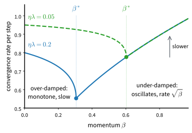
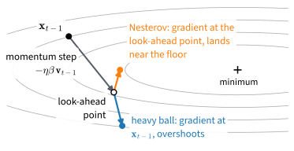

# Momentum
:label:`sec_momentum`

In :numref:`sec_gd`, we saw why plain gradient descent struggles on an ill-conditioned valley: the steepest curvature $\lambda_{\max}$ imposes the stability ceiling $\eta < 2/\lambda_{\max}$, forcing the flattest direction $\lambda_{\min}$ to contract by at most $O(1/\kappa)$ per step, where $\kappa = \lambda_{\max}/\lambda_{\min}$ is the condition number. Plain gradient descent is slow because each step relies solely on the instantaneous gradient $\mathbf{g}_t$. Yet the history of recent gradients carries clear geometric information: along the valley floor, successive gradients point consistently in the same direction, whereas across the steep walls they alternate in sign as the iterate overshoots from side to side.

:citet:`Polyak.1964` proposed stepping along an exponentially weighted sum of past gradients, called the **velocity**, so that persistent components along flat directions accumulate while oscillating components across steep directions cancel. Analogous to a heavy ball rolling down a trough against friction, **heavy-ball momentum** reduces the worst-case iteration count on a quadratic bowl from $O(\kappa)$ to $O(\sqrt{\kappa})$ at the cost of storing a single velocity buffer per parameter.

In this section, we analyze the velocity recursion, its effective step size and memory timescale, and the $\sqrt{\kappa}$ acceleration law via critical damping. We then test momentum on full-batch softmax regression and minibatch training of `FashionCNN`, introduce Nesterov look-ahead momentum, and establish practical rules for tuning $\beta$ and $\eta$.

```{.python .input #momentum}
%%tab pytorch
import math
import numpy as np
import torch
from torch import nn
from torch.nn import functional as F
from d2l import torch as d2l
```

```{.python .input #momentum}
%%tab jax
import math
import numpy as np
import jax
from jax import numpy as jnp
from flax import nnx
import optax
from d2l import jax as d2l
```

```{.python .input #momentum-1}
%%tab pytorch
import random
```

## The Momentum Method

### Velocity and Effective Step Size

Given gradient $\mathbf{g}_t$ at step $t$ (exact or minibatch), heavy-ball momentum maintains a velocity vector $\mathbf{v}_t$ initialized at $\mathbf{v}_0 = \mathbf{0}$ and updates:

$$
\begin{aligned}
\mathbf{v}_t &= \beta\, \mathbf{v}_{t-1} + \mathbf{g}_t, \\
\mathbf{x}_{t+1} &= \mathbf{x}_t - \eta\, \mathbf{v}_t,
\end{aligned}
$$
:eqlabel:`eq_momentum`

where $\beta \in [0, 1)$ is the momentum coefficient ($\beta = 0$ recovers gradient descent). Unrolling the recursion expresses the velocity as an exponentially weighted sum of all past gradients:

$$\mathbf{v}_t = \sum_{k=0}^{t-1} \beta^k \mathbf{g}_{t-k} = \mathbf{g}_t + \beta\, \mathbf{g}_{t-1} + \beta^2\, \mathbf{g}_{t-2} + \cdots + \beta^{t-1}\, \mathbf{g}_1.$$

Consider what this weighted sum does to the two coordinates of the valley $f(\mathbf{x}) = 0.1 x_1^2 + 2 x_2^2$ ($\lambda_1 = 0.2, \lambda_2 = 4$) at $\eta = 0.6$—above the plain gradient descent stability limit $2/\lambda_2 = 0.5$, where plain gradient descent diverges along $x_2$ by factor $1 - 4(0.6) = -1.4$ per step. Adding momentum $\beta = 0.5$ stabilizes the trajectory and brings both coordinates within $0.01$ of the origin in $20$ steps:

```{.python .input #momentum-the-momentum-method-1}
%%tab pytorch, jax
h1, h2 = d2l.VALLEY_CURVATURES
f_valley, valley_grad = d2l.f_valley, d2l.valley_grad

def momentum_2d(x1, x2, v1, v2, f_grad, eta, beta):
    g1, g2 = f_grad(x1, x2)
    v1, v2 = beta * v1 + g1, beta * v2 + g2
    return x1 - eta * v1, x2 - eta * v2, v1, v2

d2l.show_trace_2d(f_valley, d2l.train_2d(momentum_2d, valley_grad, eta=0.6,
                                         beta=0.5))
```

Two limiting cases explain why momentum simultaneously accelerates the flat coordinate and stabilizes the steep one:

* **Persistent gradients (flat floor):** When successive gradients remain nearly constant ($\mathbf{g}_{t-k} \approx \mathbf{g}$), the velocity builds up to $\mathbf{v}_t \approx (1 + \beta + \beta^2 + \cdots)\mathbf{g} = \frac{1}{1-\beta}\mathbf{g}$, yielding the **effective step size**
  $$\eta_\textrm{eff} = \frac{\eta}{1-\beta}.$$
* **Alternating gradients (steep walls):** When successive gradients alternate in sign ($\mathbf{g}_{t-k} \approx (-1)^k \mathbf{g}$), the geometric series sums to $1 - \beta + \beta^2 - \cdots = \frac{1}{1+\beta}$, damped to an effective step size of $\frac{\eta}{1+\beta}$.

:numref:`fig_opt_momentum_gain` shows both cases for gradients of unit size.


:label:`fig_opt_momentum_gain`

At $\eta = 0.6$ and $\beta = 0.5$, momentum amplifies progress along the valley floor to $\eta_{\text{eff}} = 0.6 / 0.5 = 1.2$ while damping oscillations across the steep wall to $0.6 / 1.5 = 0.4 < 0.5$. Consequently, the stability ceiling for curvature $\lambda$ rises from $\eta\lambda < 2$ to $\eta\lambda < 2(1 + \beta)$ (Exercise :exref:`ex_momentum-stability`).

### The Timescale of $\beta$ and Minibatch Noise
:label:`subsec_momentum-timescale`

Because the weights $1, \beta, \beta^2, \ldots$ sum to $1/(1-\beta)$, the velocity has an effective memory window of $\tau = 1/(1-\beta)$ steps and a half-life of $\log(1/2)/\log\beta$ steps:

```{.python .input #momentum-effective-sample-weight}
%%tab pytorch, jax
print('beta   window   half-life   weight inside the window')
for beta in [0.5, 0.9, 0.99]:
    window = 1 / (1 - beta)
    half_life = np.log(0.5) / np.log(beta)
    inside = 1 - beta ** window
    print(f'{beta:4}   {window:6.0f}   {half_life:9.1f}   {inside:24.2f}')
```

Increasing $\beta$ from $0.9$ to $0.99$ expands both the memory horizon and the effective step size $\eta_{\text{eff}} = \eta/(1-\beta)$ tenfold (from $10$ steps to $100$ steps).

Under stochastic gradients $\mathbf{g}_t = \nabla f(\mathbf{x}_t) + \boldsymbol{\xi}_t$, does averaging over $1/(1-\beta)$ steps shrink the stationary noise ball of :numref:`sec_sgd`? No: each noise perturbation $\boldsymbol{\xi}_t$ enters $\mathbf{v}_t$ with weight $1$ and decays as $\beta^k$ over subsequent steps, contributing a cumulative displacement of $\eta(1 + \beta + \beta^2 + \cdots)\boldsymbol{\xi}_t = \eta_{\text{eff}}\boldsymbol{\xi}_t$. Thus, at matched effective step size $\eta_{\text{eff}} = \eta/(1-\beta)$, SGD with and without momentum settle into stationary noise balls of nearly identical variance (Exercise :exref:`ex_momentum-momentum-under-minibatch-noise`). When increasing $\beta$ in a noise-limited run, $\eta$ should therefore be scaled proportional to $1 - \beta$ to hold $\eta_{\text{eff}}$ constant.

## Acceleration and Critical Damping
:label:`subsec_momentum_acceleration`

What choice of $(\eta, \beta)$ is optimal on a quadratic with eigenvalues $\lambda_{\min} \le \cdots \le \lambda_{\max}$ and condition number $\kappa = \lambda_{\max}/\lambda_{\min}$? :citet:`Polyak.1964` proved that setting

$$
\eta^\star = \frac{4}{\left(\sqrt{\lambda_{\max}} + \sqrt{\lambda_{\min}}\right)^2},
\qquad
\beta^\star = \left(\frac{\sqrt{\kappa} - 1}{\sqrt{\kappa} + 1}\right)^{2}
$$
:eqlabel:`eq_momentum-optimal`

achieves the worst-case per-step contraction factor

$$\rho^\star = \sqrt{\beta^\star} = \frac{\sqrt{\kappa} - 1}{\sqrt{\kappa} + 1} \approx 1 - \frac{2}{\sqrt{\kappa}},$$

reducing the steps needed to reach relative accuracy $\epsilon$ from $\frac{\kappa}{2}\log(1/\epsilon)$ to $\frac{\sqrt{\kappa}}{2}\log(1/\epsilon)$ (:numref:`subsec_mdl-momentum-acceleration`).

To see why the contraction factor equals $\sqrt{\beta^\star}$, substitute $\eta v_t = x_t - x_{t+1}$ into the 1D velocity update along an eigenvector of curvature $\lambda$ to obtain the second-order linear recurrence

$$x_{t+1} = (1 + \beta - \eta\lambda)\, x_t - \beta\, x_{t-1},$$
:eqlabel:`eq_momentum-recurrence`

whose characteristic polynomial is $z^2 - (1 + \beta - \eta\lambda)z + \beta = 0$. By Vieta's formulas, the product of the two roots is $z_1 z_2 = \beta$. Whenever the discriminant $\Delta = (1 + \beta - \eta\lambda)^2 - 4\beta$ is non-positive (which occurs for all $\beta \ge \beta_{\text{c}}(\lambda) = (1 - \sqrt{\eta\lambda})^2$), the roots form a complex-conjugate pair of identical modulus $|z_1| = |z_2| = \sqrt{\beta}$, independent of the curvature $\lambda$ (:numref:`fig_opt_critical_damping`).


:label:`fig_opt_critical_damping`

The optimal parameters :eqref:`eq_momentum-optimal` equate the critical damping thresholds of the flattest and steepest eigenvalues, $(1 - \sqrt{\eta^\star\lambda_{\min}})^2 = (\sqrt{\eta^\star\lambda_{\max}} - 1)^2 = \beta^\star$, critically damping both extreme modes while ensuring that every intermediate eigenvalue $\lambda \in [\lambda_{\min}, \lambda_{\max}]$ lies in the underdamped complex-root regime and contracts at rate $\sqrt{\beta^\star}$.

On our valley ($\kappa = 20$), :eqref:`eq_momentum-optimal` yields $\eta^\star \approx 0.668, \beta^\star \approx 0.403$, reducing the asymptotic contraction factor from $0.905$ to $\sqrt{\beta^\star} \approx 0.635$ and cutting the steps to reach $10^{-6}$ relative error from $139$ down to $40$:

```{.python .input #momentum-acceleration-and-damping-1}
%%tab pytorch, jax
def steps_to(tol, eta, beta, steps=400):
    """Steps after which |x1|, |x2| stay below tol times their start."""
    x1, x2, v1, v2, last = -5.0, -2.0, 0.0, 0.0, 0
    for t in range(1, steps + 1):
        x1, x2, v1, v2 = momentum_2d(x1, x2, v1, v2, valley_grad, eta, beta)
        if abs(x1) > 5 * tol or abs(x2) > 2 * tol:
            last = t
    return last + 1

def contraction(eta, beta):
    return max(abs(np.roots([1, -(1 + beta - eta * lam), beta])).max()
               for lam in (h1, h2))

eta_opt = 4 / (np.sqrt(h2) + np.sqrt(h1)) ** 2
beta_opt = ((np.sqrt(h2 / h1) - 1) / (np.sqrt(h2 / h1) + 1)) ** 2
print('  eta   beta   factor   steps to 1%   steps to 1e-6')
for eta, beta in [(2 / (h1 + h2), 0), (0.6, 0.5), (eta_opt, beta_opt),
                  (0.3, 0.8)]:
    print(f'{eta:5.3f}  {beta:5.3f}  {contraction(eta, beta):7.3f}  '
          f'{steps_to(1e-2, eta, beta):12d}  {steps_to(1e-6, eta, beta):14d}')
```

Notice the fourth row ($\eta = 0.3, \beta = 0.8$): choosing $\beta$ well above the critical threshold $\beta_{\text{c}}$ leaves both coordinates underdamped with modulus $\sqrt{0.8} \approx 0.894$, causing the trajectory to overshoot and ring around the origin:

```{.python .input #momentum-acceleration-and-damping}
%%tab pytorch, jax
d2l.show_trace_2d(f_valley, d2l.train_2d(momentum_2d, valley_grad, eta=0.3,
                                         beta=0.8))
```

## Momentum on Data

Our analysis predicts two distinct regimes when training on data:

1. **Curvature-limited regime (accurate gradients, large $\kappa$):** Momentum permits a larger effective step $\eta_{\text{eff}}$ and reduces the required iteration count by a large factor.
2. **Noise-limited regime (small minibatches):** The stationary noise floor is governed by $\eta_{\text{eff}} = \eta/(1-\beta)$, so adding $\beta = 0.9$ shifts the optimal learning rate down by a factor of $1 - \beta = 0.1$ while achieving comparable convergence speed.

We verify both regimes on Fashion-MNIST by comparing $\beta = 0$ and $\beta = 0.9$ on (1) full-batch softmax regression ($b = 60{,}000$, exact gradients, ill-conditioned due to non-negative pixel intensities) and (2) `FashionCNN` (:numref:`subsec_fashioncnn`) with small minibatches ($b = 32$). First we preload the normalized Fashion-MNIST tensors onto the accelerator inside an in-memory `Batches` loader:

```{.python .input #momentum-momentum-on-a-network-1}
%%tab pytorch
fashion = d2l.FashionMNIST()
X = fashion.train.data[:, None].to(d2l.try_gpu()) / 255  # NCHW
y = fashion.train.targets.to(d2l.try_gpu())

class Batches:
    """The examples X, y on the GPU, in a new random order on every pass."""
    def __init__(self, X, y, batch_size):
        self.X, self.y, self.batch_size = X, y, batch_size

    def train_dataloader(self):
        order = torch.randperm(len(self.y), device=self.y.device)
        return ((self.X[i], self.y[i])
                for i in order.view(-1, self.batch_size))
```

```{.python .input #momentum-momentum-on-a-network-1}
%%tab jax
fashion = d2l.FashionMNIST()
X = jnp.asarray(fashion.train[0][..., None], jnp.float32) / 255  # NHWC
y = jnp.asarray(fashion.train[1], jnp.int32)

class Batches:
    """The examples X, y on the device, in a new random order on every pass."""
    def __init__(self, X, y, batch_size):
        self.X, self.y, self.batch_size = X, y, batch_size
        self.key = d2l.get_key()  # Advanced on every pass

    def train_dataloader(self):
        self.key, key = jax.random.split(self.key)
        order = jax.random.permutation(key, len(self.y))
        return ((self.X[i], self.y[i])
                for i in order.reshape(-1, self.batch_size))
```

Next we define the zero-initialized linear `softmax_regression` model and the momentum-parameterized SGD constructor `make_sgd(beta)`:

```{.python .input #momentum-momentum-on-data-1}
%%tab pytorch
def softmax_regression():
    """A linear layer from the pixels to the logits, starting at zero."""
    net = nn.Sequential(nn.Flatten(), nn.Linear(28 * 28, 10))
    nn.init.zeros_(net[1].weight)
    nn.init.zeros_(net[1].bias)
    return net

make_sgd = lambda beta: lambda model, lr: torch.optim.SGD(
    model.parameters(), lr, momentum=beta)
new_seed = lambda: random.getrandbits(31)
```

```{.python .input #momentum-momentum-on-data-1}
%%tab jax
def softmax_regression(rngs):
    """A linear layer from the pixels to the logits, starting at zero."""
    return nnx.Sequential(lambda X: X.reshape(len(X), -1),
                          nnx.Linear(28 * 28, 10, rngs=rngs,
                                     kernel_init=nnx.initializers.zeros))

make_sgd = lambda beta: lambda lr: optax.sgd(lr, momentum=beta)
new_seed = d2l.get_seed
```

We now sweep `d2l.lr_sweep` across `grids` for both models at $\beta \in \{0.0, 0.9\}$, recording each configuration's best learning rate, steps to reach its target loss, and final loss:

```{.python .input #momentum-momentum-on-a-network-2}
%%tab pytorch, jax
# Model, batch size, steps, target loss
setups = {'softmax regression': (softmax_regression, 60000, 1000, 0.5),
          'FashionCNN': (d2l.FashionCNN, 32, 3000, 0.3)}
grids = {('softmax regression', 0.0): [0.0625, 0.125, 0.25, 0.5, 1],
         ('softmax regression', 0.9): [0.1, 0.2, 0.4, 0.8],
         ('FashionCNN', 0.0): [0.05, 0.1, 0.2, 0.4],
         ('FashionCNN', 0.9): [0.005, 0.01, 0.02, 0.04]}
best = {}
for (name, beta), lrs in grids.items():
    make_model, b, num_steps, target = setups[name]
    curves, _ = d2l.lr_sweep(make_model, make_sgd(beta), Batches(X, y, b),
                             lrs, new_seed(), num_steps, verbose=False)
    best[name, beta] = min(lrs, key=lambda lr: d2l.final_loss(curves[lr]))
    c = curves[best[name, beta]]
    print(f'{name:<18}  beta={beta}  best lr {best[name, beta]:<5g}  steps to '
          f'{target}: {d2l.steps_to_reach(c, target)}  final loss '
          f'{d2l.final_loss(c):.3f}')
```

Both predictions hold quantitatively:

* On full-batch **softmax regression**, adding momentum $\beta = 0.9$ increases the optimal learning rate from $\eta = 0.125$ to $\eta = 0.4$ ($\eta_{\text{eff}} = 4.0$, a $32\times$ larger effective step), cutting the steps needed to reach loss $0.5$ by more than $6\times$ ($625 \to 100$ steps) and lowering the final loss from $0.472$ to $0.365$.
* On small-batch **`FashionCNN`** ($b = 32$), the run is noise-limited: the optimal learning rate drops from $\eta \approx 0.1$–$0.2$ at $\beta = 0$ to $\eta \approx 0.02$–$0.04$ at $\beta = 0.9$ (a factor of $5$–$10$ that keeps the effective step $\eta_{\text{eff}}$ within one step of the factor-of-two grid of its $\beta = 0$ value), and both configurations reach loss $0.3$ and final losses of $0.26$–$0.30$ within the single-seed variation of :numref:`sec_test_models`.

## Nesterov Momentum

In the underdamped run ($\eta = 0.3, \beta = 0.8$), heavy-ball momentum overshot the minimum because it evaluated the gradient at the current position $\mathbf{x}_t$ rather than at the point where the velocity was about to carry it. :citet:`Nesterov.1983` proposed evaluating the gradient at the **look-ahead point** $\mathbf{x}_t - \eta\beta\mathbf{v}_{t-1}$ (:numref:`fig_opt_nesterov_lookahead`):

$$
\begin{aligned}
\mathbf{v}_t &= \beta\, \mathbf{v}_{t-1} + \nabla f(\mathbf{x}_t - \eta \beta\, \mathbf{v}_{t-1}), \\
\mathbf{x}_{t+1} &= \mathbf{x}_t - \eta\, \mathbf{v}_t.
\end{aligned}
$$
:eqlabel:`eq_nesterov`


:label:`fig_opt_nesterov_lookahead`

Evaluating the gradient at the look-ahead point introduces anticipatory damping that suppresses steep-direction oscillations. The guarantees are also broader than those of heavy-ball momentum. With the constant $\beta = (\sqrt{\kappa} - 1)/(\sqrt{\kappa} + 1)$, Nesterov momentum attains the $\sqrt{\kappa}$ rate on every smooth, strongly convex function, not only on quadratics. With the increasing schedule $\beta_t = (t-1)/(t+2)$, it achieves the optimal $O(1/t^2)$ convergence rate on general smooth convex objectives :cite:`Nesterov.2018` (:numref:`subsec_mdl-momentum-acceleration`). We use a constant $\beta$ here:

```{.python .input #momentum-nesterov-momentum-1}
%%tab pytorch, jax
def nesterov_2d(x1, x2, v1, v2, f_grad, eta, beta):
    g1, g2 = f_grad(x1 - eta * beta * v1,  # Gradient at the look-ahead
                    x2 - eta * beta * v2)  # point, not at (x1, x2)
    v1, v2 = beta * v1 + g1, beta * v2 + g2
    return x1 - eta * v1, x2 - eta * v2, v1, v2

d2l.show_trace_2d(f_valley, d2l.train_2d(nesterov_2d, valley_grad, eta=0.3,
                                         beta=0.8))
```

In practice, $\beta = 0.9$ is a robust default across most architectures, with the learning rate tuned via the effective step $\eta_{\text{eff}} = \eta/(1-\beta)$. However, momentum still applies a single scalar step size to all coordinates. When gradient scales differ by orders of magnitude across layers, as in Transformers, we need per-coordinate adaptive scaling (:numref:`sec_adam`).

## Summary

Heavy-ball momentum updates parameters along an exponentially decaying velocity $\mathbf{v}_t = \beta\mathbf{v}_{t-1} + \mathbf{g}_t$ with memory horizon $1/(1-\beta)$, amplifying persistent gradient directions to an effective step $\eta_{\text{eff}} = \eta/(1-\beta)$ while damping sign-alternating directions to $\eta/(1+\beta)$ and raising the stability ceiling to $\eta\lambda < 2(1+\beta)$. On a quadratic bowl with condition number $\kappa$, critically damping the extreme eigenvalues at $(\eta^\star, \beta^\star)$ lowers the iteration complexity from $O(\kappa)$ to $O(\sqrt{\kappa})$. Nesterov momentum evaluates the gradient at the look-ahead point $\mathbf{x}_t - \eta\beta\mathbf{v}_{t-1}$, providing anticipatory damping that suppresses underdamped ringing and extends acceleration to general smooth convex functions. Under minibatch noise, momentum preserves the stationary noise ball at matched effective step $\eta_{\text{eff}} = \eta/(1-\beta)$, yielding large speedups in curvature-limited regimes while requiring $\eta \propto 1 - \beta$ in noise-limited regimes.

## Exercises

1. [code] **Momentum and learning rate grid.** Run `momentum_2d` on `f_valley` across $\beta \in \{0, 0.25, 0.5, 0.8\}$ and $\eta \in \{0.1, 0.3, 0.6, 1.0\}$ for up to $1{,}000$ steps. Tabulate the steps required to reach $\|\mathbf{x}_t\| \le 10^{-3}$ (or divergence) and compare the empirical optimum at each $\eta$ against $\beta^\star$ :eqref:`eq_momentum-optimal` and $\beta_{\text{c}}(\lambda) = (1 - \sqrt{\eta\lambda})^2$.
   :exlabel:`ex_momentum-momentum-learning-rate-together`

1. **Velocity noise-to-signal ratio.** For $\mathbf{g}_t = \mathbf{g} + \boldsymbol{\xi}_t$ with i.i.d. zero-mean noise of variance $\sigma^2$ per coordinate, show that $\mathbf{v}_t$ in :eqref:`eq_momentum` has stationary mean $\mathbf{g}/(1-\beta)$ and stationary variance $\sigma^2/(1-\beta^2)$, reducing the velocity's noise-to-signal ratio by $\sqrt{(1-\beta)/(1+\beta)}$.
   :exlabel:`ex_momentum-velocity-noise`

1. **Equivalent forms of Nesterov momentum and stability.**
    1. Show by induction that the library form $\mathbf{v}_t = \beta\mathbf{v}_{t-1} + \nabla f(\mathbf{y}_t)$, $\mathbf{y}_{t+1} = \mathbf{y}_t - \eta(\nabla f(\mathbf{y}_t) + \beta\mathbf{v}_t)$ produces the exact same velocities as :eqref:`eq_nesterov` with $\mathbf{y}_t = \mathbf{x}_t - \eta\beta\mathbf{v}_{t-1}$.
       :exlabel:`ex_momentum-two-forms-nesterov-momentum`
    1. Prove from :eqref:`eq_momentum-recurrence` that both roots of $z^2 - (1 + \beta - \eta\lambda)z + \beta = 0$ lie strictly inside the unit circle for $0 \le \beta < 1$ if and only if $0 < \eta\lambda < 2(1+\beta)$.
       :exlabel:`ex_momentum-stability`

1. **The exponentially averaged momentum form.** Compare :eqref:`eq_momentum` against the normalized EMA form $\mathbf{m}_t = \beta\mathbf{m}_{t-1} + (1-\beta)\mathbf{g}_t$, $\mathbf{x}_{t+1} = \mathbf{x}_t - \alpha\mathbf{m}_t$ used in Adam (:numref:`sec_adam`). Show that $\mathbf{m}_t = (1-\beta)\mathbf{v}_t$, so both trajectories coincide when $\alpha = \eta/(1-\beta) = \eta_{\text{eff}}$.
   :exlabel:`ex_momentum-averaged-form`

1. [code] **Momentum under minibatch noise across batch sizes.** ●
    1. On $f(x) = \frac{\lambda}{2}x^2$ with noisy gradient $g_t = \lambda x_t + \xi_t$, compare the stationary iterate variance of plain SGD at step size $\alpha$ against momentum ($\beta = 0.9$) at $\eta = (1-\beta)\alpha$ for $\alpha\lambda \in \{0.05, 0.2\}$.
    1. Train `d2l.FashionCNN` for $1{,}000$ steps at batch sizes $b \in \{32, 500, 6000\}$ with $\beta \in \{0, 0.9\}$ at matched effective step $\eta/(1-\beta) = 0.2$, then sweep $\eta$ at $b = 6000$ to verify that momentum accelerates training once the batch size is large enough to enter the curvature-limited regime.
   :exlabel:`ex_momentum-momentum-under-minibatch-noise`

:begin_tab:`pytorch`
[Discussions](https://d2l.discourse.group/t/1070)
:end_tab:

:begin_tab:`jax`
[Discussions](https://d2l.discourse.group/t/1071)
:end_tab:

<!-- slides -->

::: {.slide}
::: {.cover}
[Dive into Deep Learning · §9.4]{.kicker}

Momentum and Nesterov Accelerated Gradient<br>**velocity recursion · effective step size · memory timescale · critical damping & √κ acceleration · Nesterov look-ahead**
:::
:::

::: {.slide title="Why Memoryless Gradient Descent Struggles on Valleys"}
[Motivation]{.kicker}

::: {.cols .vc}
::: {.col}
- **Memoryless $O(\kappa)$ bottleneck:** On $f(\mathbf{x}) = 0.1x_1^2 + 2x_2^2$ ($\kappa = 20$), plain GD takes $47$ steps to $1\%$ error ($139$ steps to $10^{-6}$) because it ignores temporal gradient alignment:
  - **Along the flat floor ($x_1$):** Gradients point **persistently in the same direction**.
  - **Across the steep walls ($x_2$):** Gradients **alternate in sign** on every step.
- **Polyak's heavy-ball idea (1964):** Accumulate an exponentially decaying velocity sum so floor gradients reinforce and wall oscillations cancel.
:::

::: {.col .fig .big}
@fig:ch09-opt-mom-persistent-vs-alt
:::
:::
:::

::: {.slide title="Heavy-Ball Momentum: The Velocity Recursion"}
[Update Equations]{.kicker}

::: {.cols .vc}
::: {.col}
- **Velocity update ($\beta \in [0, 1)$, $\mathbf{v}_0 = \mathbf{0}$):**
  $$\mathbf{v}_t = \beta\,\mathbf{v}_{t-1} + \mathbf{g}_t, \qquad \mathbf{x}_{t+1} = \mathbf{x}_t - \eta\,\mathbf{v}_t$$
- **Unrolled geometric history:**
  $$\mathbf{v}_t = \sum_{k=0}^{t-1} \beta^k \mathbf{g}_{t-k}$$
- **Physical analogy:** A heavy ball rolling down $f(\mathbf{x})$ with inertia $\beta$ and viscous friction $1 - \beta$ over memory window $\tau = \frac{1}{1-\beta}$.
:::

::: {.col .fig}
@fig:ch09-opt-mom-velocity-unroll
:::
:::
:::

::: {.slide title="Momentum Stabilizes a Divergent Learning Rate (η = 0.6)"}
[Valley Trajectory]{.kicker}

::: {.cols .vc}
::: {.col}
- At $\eta = 0.6 > 2/\lambda_2 = 0.5$, plain gradient descent diverges violently across the steep wall because $x_2$ multiplies by $1 - 4(0.6) = -1.4$ on every step ($1.4^{20} \approx 837$).
- Adding heavy-ball momentum with **$\beta = 0.5$** at the *exact same* $\eta = 0.6$ damps the transverse wall oscillation and drives both coordinates within $1\%$ of the origin in **$20$ steps**.
- **Apparent paradox:** Summing past gradients increases total step length along the valley floor—how does it *stabilize* the steep wall at the same time?

@!momentum-the-momentum-method-1[out=1]
:::

::: {.col .fig}
@!momentum-the-momentum-method-1[out=2]
:::
:::
:::

::: {.slide title="Persistent Amplification vs. Alternating Cancellation"}
[The Effective Step Size]{.kicker}

::: {.cols .vc}
::: {.col}
- **Persistent floor mode ($\mathbf{g}_{t-k} \approx \mathbf{g}$):** Geometric sum $\sum_{k \ge 0}\beta^k = \frac{1}{1-\beta}$ yields effective step **$\eta_{\text{eff}} = \frac{\eta}{1-\beta}$** ($1.2$ at $\eta=0.6, \beta=0.5$).
- **Alternating wall mode ($\mathbf{g}_{t-k} \approx (-1)^k\mathbf{g}$):** Alternating sum $\sum_{k \ge 0}(-\beta)^k = \frac{1}{1+\beta}$ damps step to **$\eta_{\text{alt}} = \frac{\eta}{1+\beta}$** ($0.4 < 0.5$, stable).
- **Expanded stability ceiling:** $\eta\lambda_{\max} < 2(1+\beta)$, unlocking $\frac{1+\beta}{1-\beta}$ times larger floor steps than plain GD.
:::

::: {.col .fig .big}
@fig:ch09-opt-mom-dual-filter
:::
:::
:::

::: {.slide title="How Momentum Expands the Stability Ceiling"}
[Stability & Maximum Speedup]{.kicker}

Because a sign-flipping mode $x_t \propto (-1)^t$ experiences the damped step size $\frac{\eta}{1+\beta}$, the stability threshold $\frac{\eta}{1+\beta}\lambda < 2$ rises by a factor of $1 + \beta$:

| Optimizer | Sign-Flipping Step Size | Stability Ceiling for Curvature $\lambda$ | Ceiling on Valley ($\lambda_{\max} = 4$) | Maximum Stable Floor Step $\eta_{\text{eff}}$ |
| :--- | :---: | :---: | :---: | :---: |
| **Plain Gradient Descent ($\beta = 0$)** | $\eta$ | $\eta\lambda < 2$ | $\eta < 0.50$ | $0.50$ |
| **Heavy-Ball Momentum ($\beta$)** | $\frac{\eta}{1 + \beta}$ | **$\eta\lambda < 2(1 + \beta)$** | $\eta < 0.75$ (at $\beta = 0.5$) | **$\frac{2(1+\beta)}{(1-\beta)\lambda_{\max}} = 1.50$** (at $\beta = 0.5$) |

- At $\beta = 0.5$, momentum can take an effective step along the valley floor up to $\frac{1+\beta}{1-\beta} = 3\times$ larger than the maximum stable step of plain gradient descent.
:::

::: {.slide title="The Memory Timescale and Half-Life of β"}
[Exponential Horizon]{.kicker}

::: {.cols .vc}
::: {.col}
- Because the geometric weights $1, \beta, \beta^2, \ldots$ sum to $\frac{1}{1-\beta}$, the velocity averages gradients over a characteristic **memory window**:
  $$\tau = \frac{1}{1 - \beta} \text{ steps}$$
- **Half-life:** A gradient's weight $\beta^k$ drops to $0.5$ after $k_{1/2} = \frac{\ln 0.5}{\ln\beta} \approx 0.693\,\tau$ steps, and the first $\tau$ steps always capture $1 - \beta^{1/(1-\beta)} \approx 1 - e^{-1} \approx 63\text{--}75\%$ of the total weight.
- Shifting $\beta$ from $0.9 \to 0.99$ expands both $\tau$ and $\eta_{\text{eff}}$ **tenfold** ($10 \to 100$ steps).
:::

::: {.col .fig}
@!momentum-effective-sample-weight
:::
:::
:::

::: {.slide title="Momentum Under Minibatch Noise: Same Noise Floor"}
[Interaction with Stochastic Noise]{.kicker}

::: {.cols .vc}
::: {.col}
- **Integrated impulse of a single noise kick $\boldsymbol{\xi}_t$:** Persists in $\mathbf{v}_{t+k}$ with weight $\beta^k$, contributing total cumulative displacement:
  $$-\eta\,(1 + \beta + \beta^2 + \cdots)\,\boldsymbol{\xi}_t = -\frac{\eta}{1 - \beta}\,\boldsymbol{\xi}_t = -\eta_{\text{eff}}\,\boldsymbol{\xi}_t$$
- **No free noise-ball reduction at matched $\eta_{\text{eff}}$:** Momentum spreads each noise kick across $\tau = \frac{1}{1-\beta}$ steps, settling into the same stationary variance as plain SGD at step size $\eta_{\text{eff}}$.
- **Tuning rule:** When enabling $\beta = 0.9$ in a noise-limited run, scale $\eta$ down by $1 - \beta = 0.1$.
:::

::: {.col .fig}
@fig:ch09-opt-mom-noise-impulse
:::
:::
:::

::: {.slide title="Optimal Quadratic Acceleration: From O(κ) to O(√κ)"}
[Polyak's Acceleration Law]{.kicker}

::: {.cols .vc}
::: {.col}
- **Polyak's optimal tuning (1964):**
  $$\eta^\star = \frac{4}{\left(\sqrt{\lambda_{\max}} + \sqrt{\lambda_{\min}}\right)^2}, \qquad \beta^\star = \left(\frac{\sqrt{\kappa} - 1}{\sqrt{\kappa} + 1}\right)^2$$
- **From $O(\kappa)$ to $O(\sqrt{\kappa})$ steps:** Contraction improves from $\frac{\kappa-1}{\kappa+1} \approx 1 - \frac{2}{\kappa}$ (plain GD) to **$\sqrt{\beta^\star} = \frac{\sqrt{\kappa}-1}{\sqrt{\kappa}+1} \approx 1 - \frac{2}{\sqrt{\kappa}}$** ($37\times$ fewer steps at $\kappa = 1{,}400$).
- **Why $\sqrt{\beta}$?** For $\beta \ge \beta_{\text{c}}(\lambda) = (1-\sqrt{\eta\lambda})^2$, characteristic roots $z_1, z_2$ are complex conjugates with $z_1 z_2 = \beta \implies |z| = \sqrt{\beta}$.
:::

::: {.col .fig}
@fig:ch09-opt-mom-sqrt-kappa
:::
:::
:::

::: {.slide title="Second-Order Recurrence and the √β Complex-Root Law"}
[Why Contraction Equals √β]{.kicker}

Why do *all* intermediate eigenmodes contract at the exact same rate $\sqrt{\beta^\star}$ independent of their curvature $\lambda$?

- Along an eigenvector of curvature $\lambda$ ($g_t = \lambda x_t$), substituting $\eta v_{t-1} = x_{t-1} - x_t$ into $x_{t+1} = x_t - \eta(\beta v_{t-1} + \lambda x_t)$ yields a second-order linear recurrence:
  $$x_{t+1} - (1 + \beta - \eta\lambda)\,x_t + \beta\,x_{t-1} = 0$$
- **Characteristic polynomial:** Trying $x_t = z^t$ gives $z^2 - (1 + \beta - \eta\lambda)z + \beta = 0$, whose two roots satisfy Vieta's product formula **$z_1 z_2 = \beta$**.
- **The complex-conjugate regime:** Whenever the discriminant $\Delta = (1 + \beta - \eta\lambda)^2 - 4\beta \le 0$ (which holds for all $\beta \ge \beta_{\text{c}}(\lambda) = (1 - \sqrt{\eta\lambda})^2$), the roots $z_1, z_2 = z_1^*$ are complex conjugates with identical modulus:
  $$|z_1| = |z_2| = \sqrt{z_1 z_2} = \sqrt{\beta}$$
:::

::: {.slide title="Overdamped, Critically Damped, and Underdamped Modes"}
[Critical Damping Geometry]{.kicker}

::: {.cols .vc}
::: {.col}
- **Three damping regimes for a mode of curvature $\lambda$:**
  - **Overdamped ($\beta < \beta_{\text{c}}$):** Two distinct real roots; the larger root creeps slowly toward zero without oscillating.
  - **Critically damped ($\beta = \beta_{\text{c}} = (1 - \sqrt{\eta\lambda})^2$):** Roots collide at $z_1 = z_2 = \sqrt{\beta_{\text{c}}}$, giving the fastest possible contraction for that mode.
  - **Underdamped ($\beta > \beta_{\text{c}}$):** Complex roots oscillate and decay at envelope rate $\sqrt{\beta}$.
- **Polyak's optimal tuning $(\eta^\star, \beta^\star)$** equates the critical thresholds of $\lambda_{\min}$ and $\lambda_{\max}$: $(1 - \sqrt{\eta^\star\lambda_{\min}})^2 = (\sqrt{\eta^\star\lambda_{\max}} - 1)^2 = \beta^\star$.
:::

::: {.col .fig}
{.nostretch width=100%}
:::
:::
:::

::: {.slide title="Quantitative Verification on the κ = 20 Valley"}
[40 Steps vs. 139 Steps]{.kicker}

::: {.cols .vc}
::: {.col}
- On our valley ($\lambda_1 = 0.2, \lambda_2 = 4.0, \kappa = 20$):
  - Optimal tuning gives $\eta^\star \approx 0.668$ and $\beta^\star \approx 0.403$.
  - The per-step contraction factor drops from $0.905$ (plain GD) to $\sqrt{\beta^\star} \approx 0.635$.
  - Steps to reach $10^{-6}$ relative error fall **$3.5\times$** from **$139$ steps to $40$ steps**.
:::

::: {.col .fig}
@!momentum-acceleration-and-damping-1
:::
:::
:::

::: {.slide title="Underdamped Ringing When β Exceeds Critical Damping"}
[Overshoot Hazard]{.kicker}

::: {.cols .vc}
::: {.col}
- What happens if we set $\beta = 0.8$ at $\eta = 0.3$—well above the critical damping thresholds of both coordinates ($\beta_{\text{c}}(\lambda_1) = 0.57, \beta_{\text{c}}(\lambda_2) = 0.01$)?
- Both coordinates lie deep in the underdamped complex-root regime with modulus $\sqrt{0.8} \approx 0.894$ (barely faster than plain GD's $0.905$).
- Because the velocity remembers $\tau = \frac{1}{1-0.8} = 5$ steps of downhill push, the iterate overshoots the origin and rings back and forth along both axes.
:::

::: {.col .fig}
@!momentum-acceleration-and-damping
:::
:::
:::

::: {.slide title="Two Regimes on Real Data: Curvature vs. Noise"}
[Empirical Test on Fashion-MNIST]{.kicker}

::: {.cols .vc}
::: {.col}
Our theory predicts two contrasting outcomes when comparing $\beta = 0$ and $\beta = 0.9$ on Fashion-MNIST:

- **1. Curvature-limited (full-batch softmax regression, $b = 60{,}000$):** Exact gradients, ill-conditioned pixel covariance. Adding $\beta = 0.9$ raises the optimal effective step $32\times$ ($\eta_{\text{eff}}: 0.125 \to 4.0$) and cuts steps to loss $0.5$ by **$6.25\times$** ($625 \to 100$ steps).
- **2. Noise-limited (`FashionCNN`, small batch $b = 32$):** Optimal $\eta$ drops by $\sim 10\times$ ($0.2 \to 0.02$) to preserve $\eta_{\text{eff}} = \frac{\eta}{1-\beta}$, finishing at comparable step counts and losses.
:::

::: {.col .fig}
@!momentum-momentum-on-a-network-2
:::
:::
:::

::: {.slide title="Nesterov Accelerated Gradient: Look-Ahead Correction"}
[Anticipatory Damping]{.kicker}

::: {.cols .vc}
::: {.col}
- Why did underdamped heavy-ball momentum overshoot? Because it evaluated $\nabla f(\mathbf{x}_t)$ at the current position rather than where the momentum step $-\eta\beta\mathbf{v}_{t-1}$ was about to carry it.
- **Nesterov momentum (1983)** evaluates the gradient at the **look-ahead point** $\tilde{\mathbf{x}}_t = \mathbf{x}_t - \eta\beta\,\mathbf{v}_{t-1}$:
  $$\mathbf{v}_t = \beta\,\mathbf{v}_{t-1} + \nabla f(\mathbf{x}_t - \eta\beta\,\mathbf{v}_{t-1})$$
- Look-ahead curvature evaluation brakes the velocity *before* the overshoot occurs and, with the schedule $\beta_t = (t-1)/(t+2)$, achieves the optimal $O(1/t^2)$ rate on general smooth convex functions.
:::

::: {.col .fig}
{.nostretch width=100%}
:::
:::
:::

::: {.slide title="Nesterov Look-Ahead Suppresses Underdamped Ringing"}
[Heavy-Ball vs. Nesterov]{.kicker}

::: {.cols .vc}
::: {.col}
- Running Nesterov momentum at the exact same underdamped hyperparameters ($\eta = 0.3, \beta = 0.8$) on the valley demonstrates immediate anticipatory damping:
  - Steep wall oscillation along $x_2$ decays below $|x_2| < 10^{-4}$ within $20$ steps (versus $-0.25$ under heavy-ball).
  - Longitudinal overshoot along $x_1$ is reduced by nearly half.
- In practice, $\beta = 0.9$ (with heavy-ball or Nesterov look-ahead) is a standard default, tuned via $\eta_{\text{eff}} = \frac{\eta}{1-\beta}$.
:::

::: {.col .fig}
@!momentum-nesterov-momentum-1
:::
:::
:::

::: {.slide title="Concept Check: Effective Step, Timescales, and √κ"}
[Check Your Understanding]{.kicker}

Work out the quantitative answer for each momentum scenario:

1. **Adjusting $\eta$ when changing $\beta$:** A minibatch SGD run trains well at $\eta = 0.02$ with $\beta = 0.9$. If you increase momentum to $\beta = 0.98$, what learning rate $\eta$ preserves the effective step size $\eta_{\text{eff}}$ and stationary noise ball, and how does the memory window $\tau$ change?
2. **$\sqrt{\kappa}$ acceleration:** For a quadratic with condition number $\kappa = 10{,}000$, what is the optimal momentum $\beta^\star$, and by what factor does optimal momentum reduce the steps needed to shrink error by $10^{-2}$ compared to optimal plain gradient descent?
3. **Batch size transition:** Why did adding $\beta = 0.9$ cut the step count by $6\times$ on full-batch softmax regression ($b = 60{,}000$) but not on `FashionCNN` at $b = 32$?
:::

::: {.slide title="Concept Check: Effective Step, Timescales, and √κ (answers)"}
[Check Your Understanding]{.kicker}

::: {.d2l-note}
**Answers:**

1. At $\beta = 0.9$, $\eta_{\text{eff}} = \frac{0.02}{1 - 0.9} = 0.2$ and $\tau = 10$ steps. At $\beta = 0.98$ ($1 - \beta = 0.02$), keeping $\eta_{\text{eff}} = 0.2$ requires **$\eta = 0.2 \times 0.02 = 0.004$** ($5\times$ smaller), while the memory window expands **$5\times$ from $10 \to 50$ steps**.
2. Since $\sqrt{\kappa} = 100$, **$\beta^\star = (99/101)^2 \approx 0.9608$**, reducing the required step count by **$\frac{\kappa}{\sqrt{\kappa}} = \sqrt{\kappa} = 100\times$** ($\approx 230$ steps vs. $23{,}000$ steps).
3. At $b = 32$, training is **noise-limited** ($b \ll b_{\text{crit}}$), so $\eta_{\text{eff}}$ is capped by the noise ball; at full batch ($b = 60{,}000$), gradient noise is zero and training is **curvature-limited**, unlocking momentum's $32\times$ larger $\eta_{\text{eff}}$.
:::
:::

::: {.slide title="Summary: Heavy-Ball and Nesterov Momentum"}
[Key Takeaways]{.kicker}

| Concept / Rule | Mathematical Expression | Key Property | Practical Guideline |
| :--- | :--- | :--- | :--- |
| **Heavy-Ball Velocity** | $\mathbf{v}_t = \beta\mathbf{v}_{t-1} + \mathbf{g}_t,\; \mathbf{x}_{t+1} = \mathbf{x}_t - \eta\mathbf{v}_t$ | Unrolls to $\sum_{k=0}^{t-1} \beta^k \mathbf{g}_{t-k}$ | Default $\beta = 0.9$; adds 1 state buffer per parameter |
| **Effective Step & Window** | $\eta_{\text{eff}} = \frac{\eta}{1-\beta},\quad \tau = \frac{1}{1-\beta}$ | Damps alternating steps to $\frac{\eta}{1+\beta}$; ceiling $\eta\lambda < 2(1+\beta)$ | Scale $\eta \propto (1-\beta)$ when changing $\beta$ under noise |
| **Critical Damping & $\sqrt{\kappa}$** | $\beta_{\text{c}}(\lambda) = (1 - \sqrt{\eta\lambda})^2,\; \rho^\star = \frac{\sqrt{\kappa}-1}{\sqrt{\kappa}+1}$ | Complex roots for $\beta \ge \beta_{\text{c}}$ have modulus $|z| = \sqrt{\beta}$ | Cuts curvature-limited step complexity from $O(\kappa)$ to $O(\sqrt{\kappa})$ |
| **Nesterov Look-Ahead** | $\mathbf{v}_t = \beta\mathbf{v}_{t-1} + \nabla f(\mathbf{x}_t - \eta\beta\mathbf{v}_{t-1})$ | Evaluates curvature at predicted position $\tilde{\mathbf{x}}_t$ | Suppresses underdamped ringing; forms the base of Muon (§{sec_muon}) |
:::

