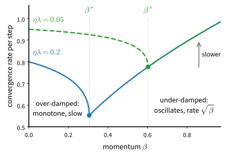
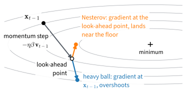

# Momentum
:label:`sec_momentum`

Gradient descent on the valley $f(\mathbf{x}) = 0.1 x_1^2 + 2 x_2^2$ needs
47 steps to shrink both coordinates to 1% of their starting values, and that
is at its best learning rate (:numref:`sec_optimization-intro`). The steep
direction, with curvature 4, keeps the learning rate below $2/4 = 0.5$. At
such a rate the flat direction, with curvature 0.2, shrinks by less than a
tenth per step. The number of steps grows in proportion to the condition
number, here $\kappa = 20$, and the condition numbers of deep networks run
into the hundreds and beyond.

Gradient descent is this slow because it looks only at the current
gradient. The gradients of the last few steps say more. Along the floor of
the valley they point the same way, step after step; across the valley
they alternate in sign, because each step overshoots the opposite wall.
*Momentum* keeps a running average of past gradients and steps along the
average instead. The average grows along the floor and cancels across the
walls. With well-chosen settings it needs 40 steps on the valley where
gradient descent needs 139 to reach a millionth of the starting distance,
and in general a number of steps proportional to $\sqrt{\kappa}$ rather
than $\kappa$. Momentum needs one extra buffer per parameter and one more
hyperparameter.

This section derives the method on the valley, works out how to set its
hyperparameter, and implements it for the minibatch
training of :numref:`sec_sgd`. Momentum is part of almost every optimizer
in deep learning, including the SGD with `momentum=0.9` of
:numref:`sec_training_recipes` and Adam in the next section.

```{.python .input #momentum}
%%tab pytorch
%matplotlib inline
from d2l import torch as d2l
import numpy as np
import torch
```

```{.python .input #momentum}
%%tab jax
%matplotlib inline
from d2l import jax as d2l
import numpy as np
import optax
```

## An Ill-Conditioned Valley

The valley curves gently along $x_1$, with second derivative $h_1 = 0.2$,
and steeply along $x_2$, with $h_2 = 4$. Its gradient is
$(h_1 x_1, h_2 x_2)$. As in :numref:`sec_gd`, an update rule for
`d2l.train_2d` receives the two coordinates, two state variables, the
gradient function, and the hyperparameters, and returns the new coordinates
and state; `train_2d` runs it from $(-5, -2)$ and `d2l.show_trace_2d` draws
the path over the contour lines. Gradient descent ignores the state. We run
it at $\eta = 0.4$:

```{.python .input #momentum-an-ill-conditioned-problem-1}
h1, h2 = 0.2, 4.0  # Curvatures of the valley along x1 and x2

def f_valley(x1, x2):
    return h1 / 2 * x1 ** 2 + h2 / 2 * x2 ** 2

def valley_grad(x1, x2):
    return h1 * x1, h2 * x2

def gd_2d(x1, x2, s1, s2, f_grad, eta):
    g1, g2 = f_grad(x1, x2)
    return x1 - eta * g1, x2 - eta * g2, 0, 0

d2l.show_trace_2d(f_valley, d2l.train_2d(gd_2d, f_grad=valley_grad, eta=0.4))
```

In each coordinate a step of gradient descent multiplies the distance to
the minimum by $1 - \eta h$. At $\eta = 0.4$ the factor is $0.92$ along
$x_1$, so after 20 steps $x_1$ has only shrunk from $-5$ to about $-0.94$.
Along $x_2$ the factor is $1 - 1.6 = -0.6$: the iterate overshoots the
floor and lands on the opposite wall, closer to the minimum each time. A
larger learning rate would speed up $x_1$, but it would push the factor of
$x_2$ below $-1$. At $\eta = 0.6$ it is $1 - 2.4 = -1.4$, and every step
throws $x_2$ farther up the opposite wall than the last:

```{.python .input #momentum-an-ill-conditioned-problem-2}
d2l.train_2d(gd_2d, f_grad=valley_grad, eta=0.6);
```

After 20 steps $x_2$ has grown from $-2$ to about $-1673$, while $x_1$
reached $-0.39$, more than twice as close as at $\eta = 0.4$. The history
of gradients separates the two directions. Along $x_1$ successive
gradients agree: they are small, but they all point the same way. Along
$x_2$ they alternate in sign, and each step undoes most of the last. An
average over past gradients would amplify the first and cancel the second.

## The Momentum Method

### Leaky Averages

A minibatch averages gradients over *examples* (:numref:`sec_sgd`).
Momentum also averages them over *time*, with an average that leaks: each
past gradient is discounted by a factor $\beta$ per step. The update
replaces the gradient by a *velocity* $\mathbf{v}_t$,

$$
\begin{aligned}
\mathbf{v}_t &\leftarrow \beta \mathbf{v}_{t-1} + \mathbf{g}_{t}, \\
\mathbf{x}_t &\leftarrow \mathbf{x}_{t-1} - \eta\, \mathbf{v}_t,
\end{aligned}
$$
:eqlabel:`eq_momentum`

where $\beta \in [0, 1)$, the velocity starts at $\mathbf{v}_0 = \mathbf{0}$,
and $\mathbf{g}_t$ is the gradient at $\mathbf{x}_{t-1}$: exact, from one
example, or from a minibatch. For $\beta = 0$ the update is gradient
descent. Unrolling the first line shows what the velocity holds,

$$\mathbf{v}_t = \sum_{\tau = 0}^{t-1} \beta^{\tau} \mathbf{g}_{t-\tau}.$$

The velocity is an exponentially weighted sum of all past gradients, in
which the gradient of $\tau$ steps ago counts with weight $\beta^\tau$. The
name comes from mechanics. A heavy ball rolling down the objective
accumulates the forces acting on it instead of following the slope of the
moment, and $1 - \beta$ plays the role of friction. The method is
*heavy-ball momentum* :cite:`Polyak.1964`. :citet:`Sutskever.Martens.Dahl.ea.2013`
showed how much it matters for training deep networks.

### Momentum on the Valley

The update rule `momentum_2d` keeps the velocity in the two state variables
of `train_2d`. At learning rate $0.6$, where gradient descent diverged, we
add momentum $\beta = 0.5$:

```{.python .input #momentum-the-momentum-method-1}
def momentum_2d(x1, x2, v1, v2, f_grad, eta, beta):
    g1, g2 = f_grad(x1, x2)
    v1, v2 = beta * v1 + g1, beta * v2 + g2
    return x1 - eta * v1, x2 - eta * v2, v1, v2

d2l.show_trace_2d(f_valley, d2l.train_2d(momentum_2d, f_grad=valley_grad,
                                         eta=0.6, beta=0.5))
```

The first steps still swing across the valley, but the swings die out
within about ten steps, and the iterate then runs down the floor. After 20
steps both coordinates are within $0.01$ of the minimum. The velocity did
what the history of gradients suggested: the alternating components along
$x_2$ partly cancel, which tames the overshoot, while the persistent
components along $x_1$ add up.

Nothing in :eqref:`eq_momentum` requires the gradient to be exact. With
minibatch gradients the same average also smooths the sampling noise over
steps, without any extra gradient evaluations, so the velocity is less
noisy than a single minibatch gradient. Whether the iterates become less
noisy too depends on how $\eta$ changes along with $\beta$, the question
of Exercise :exref:`ex_momentum-momentum-under-minibatch-noise`.

### The Timescale of $\beta$
:label:`subsec_momentum-timescale`

How much history does the velocity hold? The weights
$1, \beta, \beta^2, \ldots$ sum to $1/(1-\beta)$, so momentum $\beta$
averages over roughly the last $1/(1-\beta)$ gradients. We compute this
window for three common values, together with the half-life
$\log \frac{1}{2} / \log \beta$, the number of steps after which a
gradient's weight has halved, and the share of the total weight that falls
on the gradients inside the window.

```{.python .input #momentum-effective-sample-weight}
print('beta   window   half-life   weight inside the window')
for beta in [0.5, 0.9, 0.99]:
    window = 1 / (1 - beta)
    half_life = np.log(0.5) / np.log(beta)
    inside = 1 - beta ** window
    print(f'{beta:4}   {window:6.0f}   {half_life:9.1f}   {inside:24.2f}')
```

The value $\beta = 0.9$, the `momentum=0.9` that we have passed to
optimizers since :numref:`sec_training_recipes`, looks back about 10 steps,
and $\beta = 0.99$ about 100. The gradients inside the window carry
between 63% and 75% of the total weight. As $\beta$
approaches 1 the share approaches $1 - e^{-1} \approx 0.63$, because
$\beta^{1/(1-\beta)} \to e^{-1}$.

The same sum fixes the length of a step. When successive gradients agree,
the velocity builds up to $1/(1-\beta)$ times a typical gradient, so in
persistent directions momentum takes steps of effective size

$$\eta_\textrm{eff} = \frac{\eta}{1-\beta}.$$

Raising $\beta$ from $0.9$ to $0.99$ at a fixed $\eta$ therefore makes the
steps ten times longer, not only smoother. When $\beta$ goes up, $\eta$ has
to come down, a rule we test on real data below.

### Acceleration and Damping
:label:`subsec_momentum_acceleration`

On an ill-conditioned quadratic, momentum is not only more stable than
gradient descent but provably faster. Let the Hessian have eigenvalues
between $\lambda_{\min}$ and $\lambda_{\max}$, with condition number
$\kappa = \lambda_{\max} / \lambda_{\min}$. At its best learning rate,
gradient descent shrinks the error by the factor
$(\kappa - 1)/(\kappa + 1)$ per step (:numref:`sec_optimization-intro`),
and so needs about $\frac{\kappa}{2} \log \frac{1}{\epsilon}$ steps to
reduce it by a factor $\epsilon$. Heavy-ball momentum with the settings

$$
\eta^\star = \frac{4}{\left(\sqrt{\lambda_{\max}} + \sqrt{\lambda_{\min}}\right)^2},
\qquad
\beta^\star = \left(\frac{\sqrt{\kappa} - 1}{\sqrt{\kappa} + 1}\right)^{2}
$$
:eqlabel:`eq_momentum-optimal`

shrinks it by the factor $\sqrt{\beta^\star} = (\sqrt{\kappa} - 1)/(\sqrt{\kappa} + 1)$
per step, and so needs about $\frac{\sqrt{\kappa}}{2} \log \frac{1}{\epsilon}$
steps :cite:`Polyak.1964`. The square root of the condition number takes
the place of the condition number. For $\kappa = 100$ that saves a factor
of 10 with $\beta^\star \approx 0.67$; for $\kappa = 10^4$ a factor of 100
with $\beta^\star \approx 0.96$. The worse the conditioning, the closer the
best $\beta$ moves to 1. Since $\beta^\star \approx 1 - 4/\sqrt{\kappa}$
for large $\kappa$, the timescale reading of
:numref:`subsec_momentum-timescale` says that the best average spans about
$\sqrt{\kappa}/4$ steps: 25 steps for $\kappa = 10^4$.

On the valley, $\kappa = 20$ gives $\eta^\star \approx 0.67$ and
$\beta^\star \approx 0.40$. We check the prediction by counting steps. For
each setting the code below runs `momentum_2d` and counts the steps after
which both coordinates stay within 1%, and within $10^{-6}$, of their
starting distance from the minimum. It also computes the contraction
factor, the largest factor by which a mode of the valley shrinks per step.
In a mode of curvature $\lambda$ the
coordinate obeys $x_{t+1} = (1 + \beta - \eta\lambda)\, x_t - \beta x_{t-1}$,
a recurrence whose solutions are powers $z^t$ of the roots $z$ of
$z^2 - (1 + \beta - \eta\lambda) z + \beta = 0$; the factor is the largest
root in absolute value over the two curvatures.

```{.python .input #momentum-acceleration-and-damping-1}
def steps_to(tol, eta, beta, steps=400):
    """Steps after which |x1|, |x2| stay below tol times their start."""
    x1, x2, v1, v2, last = -5.0, -2.0, 0.0, 0.0, 0
    for t in range(1, steps + 1):
        x1, x2, v1, v2 = momentum_2d(x1, x2, v1, v2, valley_grad, eta, beta)
        if abs(x1) > 5 * tol or abs(x2) > 2 * tol:
            last = t
    return last + 1

def contraction(eta, beta):
    return max(abs(np.roots([1, -(1 + beta - eta * lam), beta])).max()
               for lam in (h1, h2))

eta_opt = 4 / (np.sqrt(h2) + np.sqrt(h1)) ** 2
beta_opt = ((np.sqrt(h2 / h1) - 1) / (np.sqrt(h2 / h1) + 1)) ** 2
print('  eta   beta   factor   steps to 1%   steps to 1e-6')
for eta, beta in [(2 / (h1 + h2), 0), (0.6, 0.5), (eta_opt, beta_opt),
                  (0.3, 0.8)]:
    print(f'{eta:5.3f}  {beta:5.3f}  {contraction(eta, beta):7.3f}  '
          f'{steps_to(1e-2, eta, beta):12d}  {steps_to(1e-6, eta, beta):14d}')
```

The first row is gradient descent at its best rate $2/(h_1 + h_2)$, with
factor $0.905$. Tuned momentum shrinks the error by $0.635$ per step and
needs 40 steps to reach $10^{-6}$ where gradient descent needs 139. Per
step, the logarithm of its factor is $\log 0.635 / \log 0.905 \approx 4.5$
times larger, which is $\sqrt{\kappa}$; the step counts differ by a
smaller ratio, 3.5, because the factor describes the error only after the
first few steps. The setting $(0.6, 0.5)$ of the plot above is nearly as
fast, and to reach 1% it is even faster.

The last row raises $\beta$ to $0.8$ and halves the learning rate to a
value at which gradient descent alone would be stable. Its factor $0.894$
is barely better than that of gradient descent.

A model of the iteration explains why. In each eigendirection of the Hessian, the recurrence above
is a mass on a spring with friction $1 - \beta$. With too little momentum
the system is *overdamped*: both roots are real and one of them is close to
1, so the iterate creeps down the valley as gradient descent does. With too
much momentum it is *underdamped*: the roots are complex, both have size
$\sqrt{\beta}$, and the iterate overshoots and rings around the minimum.
The fastest setting sits between the two, at *critical damping*, where the
two roots coincide. For a mode of curvature $\lambda$ at a fixed $\eta$
this happens at the critical value
$\beta_\textrm{c} = (1 - \sqrt{\eta\lambda})^2$. At $\eta^\star$ the
critical values of the flattest and of the steepest mode both equal
$\beta^\star$, which is why :eqref:`eq_momentum-optimal` is the best
setting for all modes at once. At $\eta = 0.3$ the two critical values of
the valley are $0.57$ and $0.01$, so $\beta = 0.8$ is underdamped in
both. We plot the run.

```{.python .input #momentum-acceleration-and-damping}
d2l.show_trace_2d(f_valley, d2l.train_2d(momentum_2d, f_grad=valley_grad,
                                         eta=0.3, beta=0.8))
```

The iterate swings across the valley for many steps, and along the floor
it overshoots the minimum and swings back before it settles. This is a
different failure from the divergence of gradient descent at $\eta = 0.6$:
the iterates stay bounded and converge, only slowly. :numref:`fig_opt_critical_damping`
draws the trade-off for a single mode. The contraction factor falls as
$\beta$ grows, is smallest at the critical value $\beta_\textrm{c}$, and
past it rises again as $\sqrt{\beta}$.

![Convergence rate per step, the contraction factor of the error, of heavy-ball momentum on a single quadratic mode, as a function of the momentum $\beta$. Below the critical value $\beta_\textrm{c} = (1 - \sqrt{\eta\lambda})^2$ the iteration is overdamped and slow; at $\beta_\textrm{c}$ it is fastest; beyond it the rate degrades gently as $\sqrt{\beta}$. Worse conditioning (smaller $\eta\lambda$, dashed) pushes $\beta_\textrm{c}$ toward one, which is why large momentum values are the common default.](../img/mdl-opt-critical-damping.svg)
:label:`fig_opt_critical_damping`

The $\sqrt{\kappa}$ law is a statement about quadratics. On general
objectives it holds near a minimum, where the quadratic approximation of
the loss applies, and the evidence that momentum speeds up the training of
deep networks is empirical :cite:`Sutskever.Martens.Dahl.ea.2013`.
:numref:`subsec_mdl-momentum-acceleration` proves the law, together with
a lower bound showing that no method built from gradients does better on
quadratics.

## Implementation

### From Scratch

Compared with minibatch SGD, momentum keeps one buffer per parameter, the
velocity, of the same shape as the parameter. The training function
`d2l.train_ch11` of :numref:`subsec_sgd-airfoil` provides the `states`
argument for it. That function trains a linear regression model on the
airfoil data with a given update rule and returns the loss over the
examples processed.

```{.python .input #momentum-implementation-from-scratch-1}
%%tab pytorch
def init_momentum_states(feature_dim):
    device = d2l.try_gpu()  # where get_data_ch11 puts the data
    return (d2l.zeros((feature_dim, 1), device=device),
            d2l.zeros(1, device=device))
```

```{.python .input #momentum-implementation-from-scratch-1}
%%tab jax
def init_momentum_states(feature_dim):
    return [d2l.zeros((feature_dim, 1)), d2l.zeros(1)]
```

```{.python .input #momentum-implementation-from-scratch-2}
%%tab pytorch
def sgd_momentum(params, states, hyperparams):
    for p, v in zip(params, states):
        with torch.no_grad():
            v[:] = hyperparams['momentum'] * v + p.grad
            p[:] -= hyperparams['lr'] * v
        p.grad.zero_()
```

```{.python .input #momentum-implementation-from-scratch-2}
%%tab jax
def sgd_momentum(params, grads, states, hyperparams):
    for i, g in enumerate(grads):
        states[i] = hyperparams['momentum'] * states[i] + g
    return [p - hyperparams['lr'] * v for p, v in zip(params, states)]
```

:begin_tab:`pytorch`
The update changes each velocity and each parameter in place and clears
the gradient for the next minibatch, as `sgd` of :numref:`sec_sgd` does.
:end_tab:

:begin_tab:`jax`
The update writes the new velocities into the list `states`, which
`train_ch11` passes back at the next step, and returns new parameters.
:end_tab:

The effective step $\eta/(1-\beta)$ predicts how momentum interacts with
the learning rate. We train with minibatches of 10 examples for two epochs
in three configurations: plain SGD at $\eta = 0.05$; momentum
$\beta = 0.9$ at $\eta = 0.005$, the same effective step; and
$\beta = 0.9$ at $\eta = 0.05$, ten times the effective step.

```{.python .input #momentum-implementation-from-scratch-3}
def train_momentum(lr, momentum, num_epochs=2):
    data_iter, feature_dim = d2l.get_data_ch11(batch_size=10)
    return d2l.train_ch11(sgd_momentum, init_momentum_states(feature_dim),
                          {'lr': lr, 'momentum': momentum}, data_iter,
                          feature_dim, num_epochs, plot=False)

runs = {r'$\beta = 0$, $\eta = 0.05$': train_momentum(0.05, 0),
        r'$\beta = 0.9$, $\eta = 0.005$': train_momentum(0.005, 0.9),
        r'$\beta = 0.9$, $\eta = 0.05$': train_momentum(0.05, 0.9)}
d2l.plot([h['examples'] for h in runs.values()],
         [h['loss'] for h in runs.values()], 'examples processed', 'loss',
         legend=list(runs), ylim=[0.22, 0.4])
```

The two runs with the same effective step are almost indistinguishable.
On this small, noisy problem momentum brings no speedup: the loss is
limited by the noise of the minibatch gradients, and momentum at a matched
effective step leaves the iterates about as noisy as plain SGD
(Exercise :exref:`ex_momentum-momentum-under-minibatch-noise` shows why).
The third run keeps $\eta$ and adds momentum, which multiplies the
effective step by ten, and its loss stays higher and fluctuates more. The
rule of :numref:`subsec_momentum-timescale` holds: when $\beta$ goes up,
$\eta$ comes down by the factor $1 - \beta$.

### Concise Implementation

Momentum is a single argument of the SGD optimizer in every framework.
`d2l.train_concise_ch11` of :numref:`sec_sgd` trains the same linear model
with a framework optimizer. At $\eta = 0.005$ and $\beta = 0.9$ it
reproduces the from-scratch run.

```{.python .input #momentum-concise-implementation}
%%tab pytorch
data_iter, _ = d2l.get_data_ch11(batch_size=10)
d2l.train_concise_ch11(torch.optim.SGD, {'lr': 0.005, 'momentum': 0.9},
                       data_iter)
```

```{.python .input #momentum-concise-implementation}
%%tab jax
data_iter, _ = d2l.get_data_ch11(batch_size=10)
d2l.train_concise_ch11(optax.sgd, {'learning_rate': 0.005, 'momentum': 0.9},
                       data_iter)
```

:begin_tab:`pytorch`
`torch.optim.SGD` implements :eqref:`eq_momentum` as written: with its
default `dampening=0` it adds each gradient to $\beta$ times the stored
velocity.
:end_tab:

:begin_tab:`jax`
`optax.sgd` with `momentum=0.9` chains `optax.trace`, which keeps the
velocity of :eqref:`eq_momentum`, with a scaling by $-\eta$.
:end_tab:

## Nesterov Momentum

The ringing at $\beta = 0.8$ has a cause we can name. The velocity carries
the iterate past the minimum, and the gradient computed at the current
point only notices the overshoot one step after it has happened.
:citet:`Nesterov.1983` proposed to evaluate the gradient at the point the
velocity is about to carry the iterate to:

$$
\begin{aligned}
\mathbf{v}_t &\leftarrow \beta \mathbf{v}_{t-1} + \nabla f(\mathbf{x}_{t-1} - \eta \beta\, \mathbf{v}_{t-1}), \\
\mathbf{x}_t &\leftarrow \mathbf{x}_{t-1} - \eta\, \mathbf{v}_t.
\end{aligned}
$$
:eqlabel:`eq_nesterov`

The point $\mathbf{x}_{t-1} - \eta \beta\, \mathbf{v}_{t-1}$ is where the
old velocity alone would take the iterate. If that point lies past the
floor of the valley, the gradient there already points back, and the
velocity is corrected before the overshoot rather than after it.
:numref:`fig_opt_nesterov_lookahead` shows one step of each method from the
same point and velocity.


:label:`fig_opt_nesterov_lookahead`

In code the change is the point at which the gradient is taken:

```{.python .input #momentum-nesterov-momentum-1}
def nesterov_2d(x1, x2, v1, v2, f_grad, eta, beta):
    g1, g2 = f_grad(x1 - eta * beta * v1,  # Gradient at the look-ahead
                    x2 - eta * beta * v2)  # point, not at (x1, x2)
    v1, v2 = beta * v1 + g1, beta * v2 + g2
    return x1 - eta * v1, x2 - eta * v2, v1, v2

d2l.show_trace_2d(f_valley, d2l.train_2d(nesterov_2d, f_grad=valley_grad,
                                         eta=0.3, beta=0.8))
```

At the same $\eta = 0.3$ and $\beta = 0.8$ as the underdamped heavy-ball
run, the zigzag across the valley dies out after the first steps, and the
overshoot along the floor is smaller. The look-ahead acts as extra damping,
strongest in the steep direction, where the overshoot is largest. Nesterov's
method also has guarantees that heavy-ball momentum lacks. On smooth convex
functions, with a momentum that grows toward 1 over the steps, its error
after $k$ steps falls as $\mathcal{O}(1/k^2)$, against $\mathcal{O}(1/k)$
for gradient descent, and no method built from gradients does better in
the worst case. On strongly convex functions a constant momentum
$\beta = (\sqrt{\kappa} - 1)/(\sqrt{\kappa} + 1)$ achieves the
$\sqrt{\kappa}$ rate, with a proof that is not confined to quadratics
:cite:`Nesterov.2018`. :numref:`subsec_mdl-momentum-acceleration`
gives the statements and proofs.

The SGD optimizer of each framework offers Nesterov momentum as the flag
`nesterov=True`, which is off by default. The implementation is a rewrite
of :eqref:`eq_nesterov` that takes the gradient at the parameters it
stores, so the look-ahead needs no extra gradient evaluation. Exercise
:exref:`ex_momentum-two-forms-nesterov-momentum` works out how these
parameters relate to the iterates of :eqref:`eq_nesterov`.

```{.python .input #momentum-nesterov-momentum-2}
%%tab pytorch
d2l.train_concise_ch11(
    torch.optim.SGD,
    {'lr': 0.005, 'momentum': 0.9, 'nesterov': True}, data_iter)
```

```{.python .input #momentum-nesterov-momentum-2}
%%tab jax
d2l.train_concise_ch11(
    optax.sgd,
    {'learning_rate': 0.005, 'momentum': 0.9, 'nesterov': True}, data_iter)
```

On the airfoil data the loss curve is nearly the same as with plain
momentum. At a batch size of 10 the sampling noise is much larger than the
correction from the look-ahead. The correction matters when curvature
rather than noise limits progress, as in full-batch or large-batch training
with $\beta$ close to 1.

Momentum fixes the slow progress along the flat directions of a valley,
but it does so with one learning rate for all coordinates, and that rate
is still capped by the steepest direction. The next section gives each
coordinate a step size of its own.

## Summary

Momentum replaces the gradient with a leaky average of past gradients, the
velocity, using one buffer per parameter and one hyperparameter
$\beta$. On an ill-conditioned valley the components of the gradient that
persist from step to step accumulate up to $1/(1-\beta)$-fold, while those
that alternate cancel. With tuned $\eta$ and $\beta$ the number of steps
falls from order $\kappa$ to order $\sqrt{\kappa}$: on the valley with
$\kappa = 20$, 40 steps instead of 139 to reach $10^{-6}$. The parameter
$\beta$ is a timescale, an average over about $1/(1-\beta)$ gradients, and
a damping knob: past critical damping the iterate rings around the
minimum. The effective step is $\eta/(1-\beta)$, so raising
$\beta$ requires lowering $\eta$. Nesterov's look-ahead damps the ringing
and carries guarantees beyond quadratics without extra work per step. What
momentum cannot do is give different coordinates different step sizes.

## Exercises

1. [code] **Momentum and learning rate together.** On the valley
   `f_valley` with `momentum_2d`, run a grid of
   $\beta \in \{0, 0.25, 0.5, 0.8\}$ and
   $\eta \in \{0.1, 0.3, 0.6, 1.0\}$ for up to 1000 steps each.
    1. Record for every cell the number of steps until
       $\|\mathbf{x}_t\| \leq 10^{-3}$, or the fact that the iterates
       diverged, and display the grid as a table or heatmap.
    1. Compare the fastest $\beta$ at each stable $\eta$ with the
       $\beta^\star$ of :eqref:`eq_momentum-optimal` for $\kappa = 20$,
       and explain each learning rate at which they differ.
   :exlabel:`ex_momentum-momentum-learning-rate-together`

1. **Velocity noise.** Let
   $\mathbf{g}_t = \mathbf{g} + \boldsymbol{\xi}_t$, where the noise
   $\boldsymbol{\xi}_t$ is independent across steps, has zero mean, and has
   variance $\sigma^2$ per coordinate. Show that the stationary mean of
   $\mathbf{v}_t$ in :eqref:`eq_momentum` is $\mathbf{g}/(1-\beta)$ and its
   stationary variance is $\sigma^2/(1-\beta^2)$. Conclude that the
   noise-to-signal ratio of the velocity is $\sqrt{(1-\beta)/(1+\beta)}$
   times that of a single gradient.
   :exlabel:`ex_momentum-velocity-noise`

1. **Two forms of Nesterov momentum.** Library implementations of Nesterov
   momentum store a parameter vector $\mathbf{y}_t$ and evaluate the
   gradient there, $\mathbf{g}_t = \nabla f(\mathbf{y}_{t-1})$. Starting
   from $\mathbf{y}_0 = \mathbf{x}_0$ and $\mathbf{v}_0 = \mathbf{0}$, they
   update
   $$\mathbf{v}_t = \beta \mathbf{v}_{t-1} + \mathbf{g}_t, \qquad
   \mathbf{y}_t = \mathbf{y}_{t-1} - \eta\,(\mathbf{g}_t + \beta \mathbf{v}_t),$$
   so that no extra gradient evaluation is needed.
    1. Express $\mathbf{y}_t$ through the $\mathbf{x}_t$ and $\mathbf{v}_t$
       of :eqref:`eq_nesterov` so that both recurrences produce the same
       velocities, and prove the relation by induction over $t$.
    1. A checkpoint saves the library's parameters $\mathbf{y}_t$. Which
       point of :eqref:`eq_nesterov` does it store, and what else must be
       saved to recover $\mathbf{x}_t$?
   :exlabel:`ex_momentum-two-forms-nesterov-momentum`

1. **Stability of momentum.** ● The effective-step reading of
   :numref:`subsec_momentum-timescale` suggests that raising $\beta$ forces
   $\eta$ down. Does the largest stable $\eta$ in the grid of
   problem :exref:`ex_momentum-momentum-learning-rate-together` behave that
   way? Derive the stability condition of :eqref:`eq_momentum` for a single
   eigendirection with curvature $\lambda$ and reconcile the two.

1. [code] **Many eigenvalues.** ● Consider
   $f(\mathbf{x}) = \frac{1}{2} \sum_{i=1}^{10} \lambda_i x_i^2$ with
   $\lambda_i = 2^{-i}$, started from $x_i = 1$, and let
   $\kappa = \lambda_{\max} / \lambda_{\min}$.
    1. Run gradient descent at $\eta = 2/(\lambda_{\max} + \lambda_{\min})$,
       the learning rate that minimizes its worst-case contraction factor
       $\max_i |1 - \eta\lambda_i|$. Run heavy-ball momentum at the
       $\eta^\star$ and $\beta^\star$ of :eqref:`eq_momentum-optimal`.
       Plot $|x_{i,t}|$ for every coordinate on a logarithmic scale.
    1. Which coordinates limit the convergence of each method? Compare the
       ratio of the iteration counts until $\|\mathbf{x}_t\| \leq 10^{-6}$
       with $\sqrt{\kappa}$.

1. [code] **Momentum under minibatch noise.** ● Keep the noise model of
   problem :exref:`ex_momentum-velocity-noise`, but let the gradient depend
   on the iterate: on $f(x) = \frac{\lambda}{2} x^2$, take
   $g_t = \lambda x_{t-1} + \xi_t$.
    1. Compare plain SGD at learning rate $\alpha$ with momentum
       $\beta = 0.9$ at $\eta = \alpha (1-\beta)$, which keeps the
       effective step $\eta/(1-\beta)$ equal to $\alpha$. Compute the
       ratio of the two stationary variances of $x_t$ for
       $\alpha\lambda \in \{0.05, 0.2\}$, by simulation or by solving for
       the stationary covariance of $(x_t, v_t)$. Does the reduction of the
       velocity's noise-to-signal ratio from problem
       :exref:`ex_momentum-velocity-noise` carry over to the iterate?
       Explain the result.
    1. On the airfoil data, rebuild `data_iter` and `feature_dim` with
       `d2l.get_data_ch11(batch_size=b)` for $b \in \{1, 10, 100\}$. Run
       `d2l.train_ch11` with `sgd_momentum` and `num_epochs=10` at
       $\beta \in \{0, 0.9\}$, choosing $\eta$ so that
       $\eta/(1-\beta) = 0.05$. Report the final loss of each run and the
       spread of the recorded losses over its last epoch, and compare the
       effect of momentum with the prediction of the first item.
   :exlabel:`ex_momentum-momentum-under-minibatch-noise`

:begin_tab:`pytorch`
[Discussions](https://d2l.discourse.group/t/1070)
:end_tab:

:begin_tab:`jax`
[Discussions](https://d2l.discourse.group/t/1071)
:end_tab:

<!-- slides -->

::: {.slide}
::: {.cover}
[Dive into Deep Learning · §9.4]{.kicker}

Momentum<br>**leaky averages · the timescale of β · acceleration · Nesterov's look-ahead**
:::
:::

::: {.slide title="Gradient Descent Needs 139 Steps on a Valley with κ = 20"}
[The problem]{.kicker}

The valley $f(\mathbf{x}) = 0.1x_1^2 + 2x_2^2$, from $(-5, -2)$, at the
best learning rate $\eta = 2/(0.2 + 4) \approx 0.476$:

| target | steps |
|:--|--:|
| both coordinates below 1% of their start | 47 |
| both coordinates below $10^{-6}$ of their start | 139 |

::: {.d2l-note .warn}
The steep wall caps $\eta$ below 0.5; at that rate the flat floor shrinks
by less than 10% per step. The step count grows like $\kappa$.
:::
:::

::: {.slide title="By the End of This Deck You Can"}
[Goals]{.kicker}

- write the heavy-ball update and unroll it into an average of gradients;
- read $\beta$ as a timescale and convert it to an effective step;
- compute the optimal $\eta^\star$, $\beta^\star$ and the contraction
  factor for a quadratic;
- tell overdamped from underdamped momentum;
- explain Nesterov's look-ahead.

**Running example:** the valley, curvatures $0.2$ and $4$, $\kappa = 20$;
then the airfoil regression data.
**The idea:** average gradients over time.
:::

::: {.slide title="Momentum Is the Fourth Stop of the Chapter"}
[Where this fits]{.kicker}

::: {.cols .vc}
::: {.col}
| section | adds |
|---|---|
| Landscapes | curvature and noise make training slow |
| Gradient Descent | step size against curvature |
| Stochastic and Minibatch GD | sampled gradients, noise ball, batching |
| **Momentum** | **averaging over time** |
| Adam and AdamW | a step size per coordinate, decoupled decay |
| Schedules | warmup and decay |
| Muon | orthogonalized updates for matrices |
| Batch Size | how many examples per step |
| Scaling Up | learning rates across widths |
| Practice | clipping, averaging, fair comparisons |
:::

::: {.col .narrow}
- **Uses:** gradient descent on the valley; minibatch SGD on the airfoil
  data.
- **Skips:** proofs of the rates (math appendix); momentum inside Adam
  (next deck).
:::
:::
:::

::: {.slide title="Across the Valley Gradients Alternate; Along It They Agree"}
[The valley]{.kicker}

Gradient descent, $\eta = 0.4$, 20 steps: factor $1 - \eta h$ is $0.92$
along $x_1$ and $-0.6$ along $x_2$.

@!momentum-an-ill-conditioned-problem-1
:::

::: {.slide title="At η = 0.6 Gradient Descent Diverges Along the Steep Wall"}
[The valley]{.kicker}

@!momentum-an-ill-conditioned-problem-2

- Along $x_2$: $1 - 0.6 \cdot 4 = -1.4$; each step throws the iterate
  farther up the opposite wall.
- Along $x_1$: $1 - 0.6 \cdot 0.2 = 0.88$; twice as close as at
  $\eta = 0.4$.

::: {.d2l-note}
An average of past gradients would keep the agreeing $x_1$ components and
cancel the alternating $x_2$ ones.
:::
:::

::: {.slide title="The Velocity Is a Leaky Sum of Past Gradients"}
[The momentum method]{.kicker}

$$\mathbf{v}_t = \beta \mathbf{v}_{t-1} + \mathbf{g}_t,\qquad
\mathbf{x}_t = \mathbf{x}_{t-1} - \eta\, \mathbf{v}_t,\qquad
\mathbf{v}_0 = \mathbf{0}$$

Unrolled: $\mathbf{v}_t = \sum_{\tau=0}^{t-1} \beta^{\tau}\, \mathbf{g}_{t-\tau}$.

- Components that agree accumulate, up to $\frac{1}{1-\beta}$ times.
- Components that alternate cancel.
- $\beta = 0$ is gradient descent; $1 - \beta$ acts as friction on a
  heavy ball.

[Polyak, 1964]{.small}
:::

::: {.slide title="With β = 0.5, the Divergent Learning Rate Converges"}
[The momentum method]{.kicker}

$\eta = 0.6$, $\beta = 0.5$, 20 steps:

@!momentum-the-momentum-method-1
:::

::: {.slide title="β = 0.9 Averages About the Last 10 Gradients"}
[The timescale of β]{.kicker}

@!momentum-effective-sample-weight

- Window $\frac{1}{1-\beta}$; the gradients inside it carry 63–75% of
  the weight.
- Effective step in persistent directions: $\eta_\textrm{eff} = \frac{\eta}{1-\beta}$.
:::

::: {.slide title="Check: Raise β from 0.9 to 0.99"}
[Check]{.kicker}

A run trains well at $\eta = 0.01$, $\beta = 0.9$. You switch to
$\beta = 0.99$. What learning rate keeps the effective step, and how far
back does the velocity now look?

::: {.fragment .fade-up}
::: {.d2l-note}
**Answer.** $\eta_\textrm{eff} = 0.01/0.1 = 0.1$, so
$\eta = 0.1 \cdot 0.01 = 0.001$, ten times smaller. The window grows from
about 10 to about 100 steps (half-life 6.6 → 69).
:::
:::
:::

::: {.slide title="Tuned Momentum Needs √κ Steps Instead of κ"}
[Acceleration]{.kicker}

Hessian eigenvalues in $[\lambda_{\min}, \lambda_{\max}]$,
$\kappa = \lambda_{\max}/\lambda_{\min}$:

$$\eta^\star = \frac{4}{(\sqrt{\lambda_{\max}} + \sqrt{\lambda_{\min}})^2},
\qquad \beta^\star = \left(\frac{\sqrt{\kappa}-1}{\sqrt{\kappa}+1}\right)^2$$

| | factor per step | steps for $\epsilon$ |
|:--|:--:|:--:|
| gradient descent | $\frac{\kappa - 1}{\kappa + 1}$ | $\frac{\kappa}{2}\log\frac{1}{\epsilon}$ |
| heavy ball | $\frac{\sqrt{\kappa} - 1}{\sqrt{\kappa} + 1}$ | $\frac{\sqrt{\kappa}}{2}\log\frac{1}{\epsilon}$ |

[Polyak, 1964; proofs in the math appendix]{.small}
:::

::: {.slide title="On the Valley, Tuned Momentum Needs 40 Steps Instead of 139"}
[Acceleration]{.kicker}

$\kappa = 20$: $\eta^\star \approx 0.67$, $\beta^\star \approx 0.40$,
factor $\sqrt{\beta^\star} \approx 0.635$.

@!momentum-acceleration-and-damping-1

Mode with curvature $\lambda$: $x_{t+1} = (1 + \beta - \eta\lambda)x_t - \beta x_{t-1}$;
the factor is the largest root of $z^2 - (1 + \beta - \eta\lambda)z + \beta$.
:::

::: {.slide title="Past Critical Damping the Iterate Rings Around the Minimum"}
[Acceleration]{.kicker}

$\eta = 0.3$ (stable for gradient descent), $\beta = 0.8$: complex roots of
size $\sqrt{0.8} \approx 0.894$ in both modes.

@!momentum-acceleration-and-damping
:::

::: {.slide title="Critical Damping Is the Fastest Setting"}
[Acceleration]{.kicker}

{width=55%}

Critical value of one mode: $\beta_\textrm{c} = (1 - \sqrt{\eta\lambda})^2$.
Below: overdamped, creeps like gradient descent. Above: underdamped, rate
$\sqrt{\beta}$. At $\eta^\star$ both extreme modes are critical at $\beta^\star$.
:::

::: {.slide title="Check: A Condition Number of 10,000"}
[Check]{.kicker}

For $\kappa = 10^4$, what is $\beta^\star$, and how many steps do gradient
descent and tuned momentum need per factor of 100?

::: {.fragment .fade-up}
::: {.d2l-note}
**Answer.** $\sqrt{\kappa} = 100$, so $\beta^\star = (99/101)^2 \approx 0.96$.
Factors $0.9998$ and $0.980$ per step: about 23,000 steps against about
230.
:::
:::
:::

::: {.slide title="Momentum Needs One Buffer per Parameter"}
[Implementation]{.kicker}

@momentum-implementation-from-scratch-2

The velocity has the shape of its parameter; `train_ch11` carries it in
`states`.
:::

::: {.slide title="At a Matched Effective Step, Momentum and SGD Train Alike"}
[Implementation]{.kicker}

Airfoil data, minibatches of 10, two epochs:

@!momentum-implementation-from-scratch-3

Same $\eta/(1-\beta)$: same curve. Ten times the effective step: higher,
noisier loss.
:::

::: {.slide title="Nesterov Takes the Gradient Where the Velocity Is Headed"}
[Nesterov momentum]{.kicker}

$$\mathbf{v}_t = \beta \mathbf{v}_{t-1} + \nabla f(\mathbf{x}_{t-1} - \eta \beta\, \mathbf{v}_{t-1}),\qquad
\mathbf{x}_t = \mathbf{x}_{t-1} - \eta\, \mathbf{v}_t$$

{width=52%}

The velocity is corrected before the overshoot, not one step after it.

[Nesterov, 1983]{.small}
:::

::: {.slide title="The Look-Ahead Damps the Ringing"}
[Nesterov momentum]{.kicker}

Same $\eta = 0.3$, $\beta = 0.8$ as the underdamped heavy-ball run:

@!momentum-nesterov-momentum-1

- Libraries store the look-ahead point: no extra gradient evaluation.
- Convex, with $\beta$ growing toward 1: error $\mathcal{O}(1/k^2)$
  against $\mathcal{O}(1/k)$, optimal among gradient methods.
:::

::: {.slide title="Nesterov Is One Flag, Off by Default"}
[Nesterov momentum]{.kicker}

@momentum-nesterov-momentum-2

At batch size 10 the curve matches plain momentum: noise dwarfs the look-ahead.
:::

::: {.slide title="Momentum Turns κ into √κ"}
[Wrap-up]{.kicker}

- $\mathbf{v}_t = \beta \mathbf{v}_{t-1} + \mathbf{g}_t$,
  $\mathbf{x}_t = \mathbf{x}_{t-1} - \eta \mathbf{v}_t$: agreeing gradient
  components add up, alternating ones cancel.
- $\beta$ is a window of $\frac{1}{1-\beta}$ steps; the effective step is
  $\frac{\eta}{1-\beta}$.
- Tuned on the valley: factor $0.635$ instead of $0.905$, 40 steps instead
  of 139.
- Past critical damping: ringing at rate $\sqrt{\beta}$; Nesterov's
  look-ahead damps it.

**Next:** Adam, a step size for each coordinate.
:::
