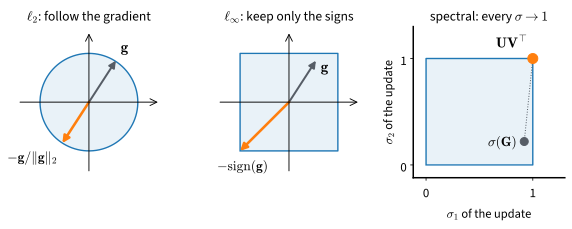
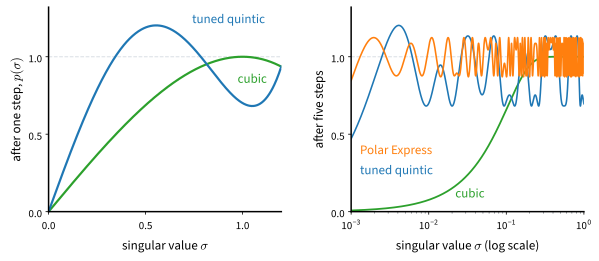

# Muon
:label:`sec_muon`

Every optimizer so far treats the parameters as one long vector of
coordinates. The networks we train are not built that way. Most of their
parameters sit in weight matrices that multiply activation vectors, and a
step changes what each matrix does to its inputs. This section asks what
the best step for such a matrix is.

In `TinyLM`, the two-block transformer language model of
:numref:`subsec_tinylm`, 393,216 of the 470,784 parameters, about 84%, sit
in eight such matrices. Adam rescales each entry of those matrices on its
own and never uses the fact that they form a matrix. The gradient of such a
matrix is typically dominated by a few directions
:cite:`Jordan.Jin.Boza.ea.2024`, so a step along the gradient moves the
layer a long way along those few directions and hardly at all along the
others. Adam's per-entry rescaling does not fix this, because it equalizes
coordinates, not directions.

The best step for a matrix depends on how we measure the size of a step.
Measured by the Euclidean norm, the best direction is the negative gradient,
as in SGD. Measured by the largest change of any single coordinate, it is
the sign of the gradient, the direction Adam approximates. Measured by the
largest change the step can make to a layer's output, it is the gradient
with all of its singular values set to one. Computing that matrix with a
handful of matrix multiplications gives Muon
:cite:`Jordan.Jin.Boza.ea.2024`, which in under a year went from a record on
a training-speed competition to the pretraining of a trillion-parameter
model. We derive Muon, implement it, and compare it with AdamW on `TinyLM`
and on a CNN. We then relate it to Shampoo and look at variants that change
its per-neuron step sizes and its communication cost.

```{.python .input #muon}
%%tab pytorch
%matplotlib inline
from d2l import torch as d2l
import math
import random
import torch
from torch import nn
```

```{.python .input #muon}
%%tab jax
%matplotlib inline
from d2l import jax as d2l
from flax import nnx
import jax
from jax import numpy as jnp
import math
import optax
import random
```

## Norms and Steepest Descent

### Steepest Descent Under a Ball

What does it mean for a direction to be "steepest"? Linearize the loss around
the current iterate, $f(\mathbf{x} + \mathbf{d}) \approx f(\mathbf{x}) +
\langle \mathbf{g}, \mathbf{d} \rangle$, and ask for the step that decreases
the linearization most among all steps of a given size $\eta$:

$$
\mathbf{d}^\star = \operatorname*{argmin}_{\|\mathbf{d}\| \leq \eta} \; \langle \mathbf{g}, \mathbf{d} \rangle.
$$
:eqlabel:`eq_muon-ball`

The problem is not posed until we say which norm defines the ball
$\|\mathbf{d}\| \leq \eta$, and different norms give different answers
:cite:`Bernstein.Newhouse.2024`. Under the Euclidean norm the ball is round,
and the minimizer points straight along the negative gradient,
$-\eta\,\mathbf{g}/\|\mathbf{g}\|_2$. This is the direction of SGD. SGD itself
takes a step whose length grows with $\|\mathbf{g}\|_2$: it solves the
penalized problem $\min_{\mathbf{d}} \langle \mathbf{g}, \mathbf{d} \rangle +
\|\mathbf{d}\|_2^2 / (2\eta)$ rather than the problem over a fixed ball. In
this section the ball fixes the direction, and the rule for the step length
is a separate choice. Following the gradient thus assumes Euclidean
geometry, and each method of this chapter can be read as a different answer
to the same question.

Now take the $\ell_\infty$ norm, $\|\mathbf{d}\|_\infty = \max_i |d_i|$. The
ball becomes a box, and a step has size $\eta$ as long as no single
coordinate moves by more than $\eta$. To make $\langle \mathbf{g}, \mathbf{d}
\rangle$ as negative as possible we push every coordinate to its wall, so
the minimizer is $\mathbf{d}^\star = -\eta\, \mathrm{sign}(\mathbf{g})$: sign
descent. We met this direction in :numref:`sec_adam`. With both of Adam's
averages switched off ($\beta_1 = \beta_2 = 0$) and $\epsilon \to 0$, Adam's
update is exactly $\eta\,\mathrm{sign}(\mathbf{g}_t)$, and on language models
Adam's advantage over SGD tracks the advantage of sign descent
:cite:`Kunstner.Chen.Lavington.ea.2023`. Read geometrically, Adam is a
smoothed steepest descent under $\ell_\infty$. The box moves every coordinate
by the same amount whatever the scale of its gradient, and the moment
estimates keep the signs stable under minibatch noise. This geometry suits
problems whose coordinates have gradients of very different sizes, as the
rare and frequent tokens of a language model do.

### Matrices and the Spectral Norm

Both norms treat a parameter as an unstructured vector. A hidden matrix of
`TinyLM`, however, transforms activations, $\mathbf{y} =
\mathbf{W}\mathbf{x}$. For such a parameter a natural measure of a step's
size is the largest change it can cause in the layer's output. That change
is governed by the *spectral norm* $\|\Delta \mathbf{W}\|_2$, the largest
singular value of $\Delta \mathbf{W}$:

$$
\|\Delta \mathbf{W} \mathbf{x}\|_2 \leq \|\Delta \mathbf{W}\|_2\, \|\mathbf{x}\|_2,
$$

with equality for the worst-case input. The spectral norm is thus the
largest factor by which the update can stretch any activation vector that
passes through the layer. The Euclidean norm of the flattened matrix, the
Frobenius norm, instead adds up the energy in all $\min(m, n)$ singular
directions. It can call an update large even when its effect on every
activation is small. Controlling the spectral norm of updates is also what
keeps features learning at a steady rate as networks grow wider
:cite:`Yang.Simon.Bernstein.2023`.

So let the ball be spectral and solve :eqref:`eq_muon-ball` for a matrix
parameter with gradient $\mathbf{G}$. Write the reduced singular value
decomposition $\mathbf{G} = \mathbf{U} \boldsymbol{\Sigma} \mathbf{V}^\top$.
The steepest step is the *orthogonalized gradient*:

$$
\Delta \mathbf{W}^\star = \operatorname*{argmin}_{\|\Delta \mathbf{W}\|_2 \leq \eta} \; \langle \mathbf{G}, \Delta \mathbf{W} \rangle = -\eta\, \mathbf{U} \mathbf{V}^\top.
$$
:eqlabel:`eq_muon-spectral-step`

The proof is one line of duality. For any $\mathbf{A}$ with
$\|\mathbf{A}\|_2 \leq 1$ we have $\langle \mathbf{G}, \mathbf{A} \rangle =
\mathrm{tr}(\boldsymbol{\Sigma}\, \mathbf{U}^\top \mathbf{A} \mathbf{V}) =
\sum_i \sigma_i\, (\mathbf{U}^\top \mathbf{A} \mathbf{V})_{ii} \leq \sum_i
\sigma_i$, since no entry of a matrix with unit spectral norm exceeds one in
absolute value. The choice $\mathbf{A} = \mathbf{U}\mathbf{V}^\top$ attains
the bound, and its negative attains the minimum. (The diagonal-entry claim is
an exercise. :numref:`subsec_mdl-preconditioning-ladder` places this result
among the classical preconditioners.)

Equation :eqref:`eq_muon-spectral-step` equalizes singular directions. The
gradient $\mathbf{U}\boldsymbol{\Sigma}\mathbf{V}^\top$ names a set of
directions and weights them by singular values, of which a few are large.
The steepest spectral step keeps the singular vectors and replaces every
nonzero singular value by one, so every direction that the gradient
identifies moves at the same rate. This is per-direction equalization in the
basis the gradient supplies. Adam equalizes only per coordinate, in the
basis of the parameter axes.

The same reasoning tells us where the spectral norm does not apply. An
embedding table never multiplies a dense activation vector. Its input is
one-hot, so each row is looked up on its own, and the natural measure of a
step is the largest change of any single row :cite:`Bernstein.2025`. The
output head and the one-dimensional vectors (biases and normalization
scales) do not transform activations through a dense matrix product either.
These parameters stay with AdamW. :numref:`tab_muon_norms` summarizes the
three geometries.

:Steepest descent under three norms. Each ball yields a closed-form step and
suits a different group of parameters.
:label:`tab_muon_norms`

| ball on the step | steepest step | suited to |
|:--|:--|:--|
| Euclidean, $\|\mathbf{d}\|_2 \leq \eta$ | $-\eta\, \mathbf{g} / \|\mathbf{g}\|_2$ | no structure assumed (SGD direction) |
| box, $\|\mathbf{d}\|_\infty \leq \eta$ | $-\eta\, \mathrm{sign}(\mathbf{g})$ | coordinates of very different scale (Adam family) |
| spectral, $\|\Delta \mathbf{W}\|_2 \leq \eta$ | $-\eta\, \mathbf{U}\mathbf{V}^\top$ | hidden matrices acting on activations (Muon) |

:numref:`fig_opt_norm_balls` draws the three choices for one gradient.

![Steepest descent depends on the ball. Under $\ell_2$ the best step within the ball follows the gradient, which gives normalized gradient descent. Under $\ell_\infty$ it moves to a corner and keeps only the signs. Under the spectral norm, drawn in singular-value coordinates where the ball is the unit square, the best matrix update sits at the corner where every singular value equals one, whatever the spectrum $\sigma(\mathbf{G})$ of the gradient: that corner is the orthogonalization $\mathbf{U}\mathbf{V}^{\top}$.](../img/mdl-opt-norm-balls.svg)
:label:`fig_opt_norm_balls`

## Orthogonalization by Newton--Schulz
:label:`subsec_muon-newton-schulz`

### Odd Matrix Polynomials

Equation :eqref:`eq_muon-spectral-step` asks for $\mathbf{U}\mathbf{V}^\top$,
and an SVD of every matrix at every step is out of the question. An SVD is
expensive, parallelizes poorly on accelerators, and is not available in the
low-precision arithmetic in which training runs. Muon computes
$\mathbf{U}\mathbf{V}^\top$ approximately with matrix multiplications alone.
The key fact is that an *odd* polynomial applied to a matrix acts on its
singular values and leaves its singular vectors alone:

$$
p(\mathbf{X}) = a\mathbf{X} + b\,(\mathbf{X}\mathbf{X}^\top)\mathbf{X} + c\,(\mathbf{X}\mathbf{X}^\top)^2\mathbf{X} = \mathbf{U}\, p(\boldsymbol{\Sigma})\, \mathbf{V}^\top.
$$
:eqlabel:`eq_muon-odd-poly`

Each factor $\mathbf{X}\mathbf{X}^\top$ equals
$\mathbf{U}\boldsymbol{\Sigma}^2\mathbf{U}^\top$, and the orthogonal factors
cancel in the product. So a polynomial of the matrix is the same polynomial
applied to each singular value, with $\mathbf{U}$ and $\mathbf{V}$
untouched. We can therefore drive every nonzero singular value toward $1$
without ever computing one, by iterating a scalar polynomial for which $1$
is an attracting fixed point. Dividing $\mathbf{X}$ by its Frobenius norm
first puts every singular value in $[0, 1]$, since the Frobenius norm is at
least the largest singular value. Exact zeros are fixed points of any odd
polynomial, so a rank-deficient matrix stays rank-deficient, as it should.

### The Tuned Quintic

Which polynomial should we iterate? A training step can afford only a few
iterations, so the polynomial must move small singular values toward $1$
quickly. The classical Newton--Schulz iteration uses the cubic $p(x) =
\tfrac{3}{2}x - \tfrac{1}{2}x^3$. It converges to $1$, but slowly from
below: near zero its slope is $1.5$, so a small singular value grows by only
half its size per step. A singular value of $0.01$ needs ten steps to pass
$0.5$. :citet:`Jordan.Jin.Boza.ea.2024` instead tuned a quintic for speed,

$$
p(x) = 3.4445\,x - 4.7750\,x^3 + 2.0315\,x^5,
$$
:eqlabel:`eq_muon-quintic`

whose slope at the origin is $3.4445$. The same singular value of $0.01$
passes $0.5$ in four steps. Because of the steep slope, the iteration no
longer converges to $1$: it overshoots and oscillates in a band around it.
An optimizer needs all directions to move at roughly the same rate, not
orthogonality to machine precision, so the band is close enough.
:numref:`fig_opt_ns_maps` draws both maps, one step at a time and composed
five times.

![Newton--Schulz as a map on each singular value. Left: one step of the classical cubic and of the tuned quintic :eqref:`eq_muon-quintic`; the quintic rises more than twice as steeply near zero and overshoots $1$. Right: five steps of each, composed, for singular values from $10^{-3}$ to $1$ on a log scale. The quintic maps every input above $0.01$ into a band from about $0.68$ to $1.13$; the cubic brings only inputs above about $0.2$ close to $1$; the Polar Express polynomials of :numref:`subsec_muon-polar-express` map the whole range from $10^{-3}$ to $1$ into the narrower band from $0.85$ to $1.12$.](../img/mdl-opt-ns-maps.svg)
:label:`fig_opt_ns_maps`

The implementation below takes a list of coefficient triples $(a, b, c)$, one
per iteration, and repeats the last triple once the list runs out. Muon's
choice is the single quintic :eqref:`eq_muon-quintic`. A tall matrix is
transposed first, so that the Gram factor $\mathbf{X}\mathbf{X}^\top$ is the
smaller of the two possible squares.

```{.python .input #muon-orthogonalization-by-newton-schulz-1}
%%tab pytorch
QUINTIC = [(3.4445, -4.7750, 2.0315)]  # Jordan et al.'s tuned quintic

def newton_schulz(M, num_iters=5, coeffs=QUINTIC, eps=1e-7):
    """Approximate the orthogonalization U V^T of M by odd polynomials."""
    tall = M.shape[0] > M.shape[1]
    X = M.T if tall else M  # Keep the Gram factor X @ X.T small
    X = X / (X.norm() + eps)
    for t in range(num_iters):
        a, b, c = coeffs[min(t, len(coeffs) - 1)]  # The last triple repeats
        A = X @ X.T
        X = a * X + (b * A + c * A @ A) @ X
    return X.T if tall else X
```

```{.python .input #muon-orthogonalization-by-newton-schulz-1}
%%tab jax
QUINTIC = [(3.4445, -4.7750, 2.0315)]  # Jordan et al.'s tuned quintic

def newton_schulz(M, num_iters=5, coeffs=QUINTIC, eps=1e-7):
    """Approximate the orthogonalization U V^T of M by odd polynomials."""
    tall = M.shape[0] > M.shape[1]
    X = M.T if tall else M  # Keep the Gram factor X @ X.T small
    X = X / (jnp.linalg.norm(X) + eps)
    for t in range(num_iters):
        a, b, c = coeffs[min(t, len(coeffs) - 1)]  # The last triple repeats
        A = X @ X.T
        X = a * X + (b * A + c * A @ A) @ X
    return X.T if tall else X
```

How close to orthogonal is the result? We draw a random $96 \times 64$
Gaussian matrix, whose singular values after normalization span about an
order of magnitude, and plot its spectrum after 0, 1, 3, and 5 iterations.
The SVD in this cell only measures the result; the iteration never computes
one.

```{.python .input #muon-orthogonalization-by-newton-schulz-2}
%%tab pytorch
G = torch.randn(96, 64)
sigmas = [torch.linalg.svdvals(newton_schulz(G, num_iters=k))
          for k in (0, 1, 3, 5)]
d2l.plot(torch.arange(1, 65), sigmas, 'index', 'singular value',
         legend=[f'k = {k}' for k in (0, 1, 3, 5)], yscale='log')
print(f'singular values after 5 iterations: '
      f'[{sigmas[-1].min():.2f}, {sigmas[-1].max():.2f}]')
```

```{.python .input #muon-orthogonalization-by-newton-schulz-2}
%%tab jax
G = jax.random.normal(d2l.get_key(), (96, 64))
sigmas = [jnp.linalg.svd(newton_schulz(G, num_iters=k), compute_uv=False)
          for k in (0, 1, 3, 5)]
d2l.plot(jnp.arange(1, 65), sigmas, 'index', 'singular value',
         legend=[f'k = {k}' for k in (0, 1, 3, 5)], yscale='log')
print(f'singular values after 5 iterations: '
      f'[{sigmas[-1].min():.2f}, {sigmas[-1].max():.2f}]')
```

One iteration lifts the whole spectrum, and three compress it to within a
factor of a few. After five, every singular value lies in a band around $1$,
from about $0.7$ to $1.13$, for essentially every random draw. That is
$\mathbf{U}\mathbf{V}^\top$ for an optimizer's purposes, and it takes
fifteen matrix multiplications. A singular value below about 1% of the
Frobenius norm, at the left end of the right panel of
:numref:`fig_opt_ns_maps`, needs a few more iterations to climb into the
band. A random Gaussian matrix has no such singular values, but we will see
that real gradients have many.

How expensive are fifteen multiplications next to an elementwise Adam
update? For an $m \times n$ matrix with $m \leq n$, one iteration
costs $4m^2n + 2m^3$ floating-point operations: $2m^2n$ for the Gram factor,
$2m^3$ for its square, and $2m^2n$ for the final product. For a square
matrix that is $6m^3$, or $30m^3$ for five iterations. The forward and
backward passes through the same matrix cost about $6m^2$ operations per
token, or $6m^2B$ for a minibatch of $B$ tokens. The ratio is $5m/B$
:cite:`Jordan.Jin.Boza.ea.2024`. For a GPT-2-small layer ($m = 768$) and a
batch of 524,288 tokens it is 0.7%. The hidden matrices of `TinyLM` are not
square: each has $m = 128$ and $n$ between 128 and 512. Counting their
operations in the same way, with $6mnB$ for the forward and backward passes
and a minibatch of $B = 64 \times 64 = 4{,}096$ tokens, gives about 12%.
On our small model the orthogonalization is a noticeable share of the
work. At scale it is nearly free.

### Optimized Polynomials
:label:`subsec_muon-polar-express`

The tuned quintic uses the same polynomial at every step. It cannot
converge, because $p(1) = 0.701$ for the coefficients in
:eqref:`eq_muon-quintic`, so the iterate keeps bouncing between about
$0.7$ and $1.13$. Nothing forces us to repeat one polynomial, however. Early
steps should lift small singular values as fast as possible, and late steps
should pull the whole band tight around $1$. *Polar Express*
:cite:`Amsel.Persson.Musco.ea.2026` chooses a different quintic $p_t$ for
each step $t$. Suppose that before step $t$ every singular value lies in an
interval $[\ell_t, u_t]$, starting from $[10^{-3}, 1]$. The step-$t$
polynomial is the odd quintic that stays closest to $1$ in the worst case
over that interval:

$$
p_t = \operatorname*{argmin}_{p \textrm{ odd quintic}} \; \max_{x \in [\ell_t, u_t]} |1 - p(x)|,
\qquad \ell_{t+1} = p_t(\ell_t), \quad u_{t+1} = 2 - \ell_{t+1}.
$$
:eqlabel:`eq_muon-polar-express`

Each $p_t$ thus maps the current interval into the narrowest possible band
around $1$, and that band is the interval for the next step. The update of
the upper end comes from a property of minimax polynomials: the error of the
optimal $p_t$ reaches its largest value $E$ both below $1$ (at $\ell_t$) and
above it, so $p_t$ maps the interval onto $[1 - E, 1 + E] = [\ell_{t+1}, 2 -
\ell_{t+1}]$. The authors prove that this greedy choice is optimal for the
composition as a whole: no other sequence of $T$ odd quintics has a smaller
worst-case error after $T$ steps. The coefficients depend only on $\ell_1$,
so they are computed once, offline, and hard-coded. Two practical changes
make the published table differ slightly from the exact recursion. The first
few polynomials are deliberately a little less aggressive than the optimal
ones, which keeps the iteration stable in low precision, and each
polynomial's argument is divided by $1.01$ to guard against round-off in
`bfloat16`. The rounded coefficients below include that factor in all but
the last triple. From the seventh step on, the optimal polynomial is the
classical quintic $(15x - 10x^3 + 3x^5)/8$, which converges to $1$; the last
triple repeats it without the safety factor.

We measure the distance of the iterate from $\mathbf{U}\mathbf{V}^\top$ in
the spectral norm, which by :eqref:`eq_muon-odd-poly` is $\max_i |1 -
p(\sigma_i)|$. Besides the Gaussian matrix `G` we build an ill-conditioned
matrix `H` with the same singular vectors and singular values spread
evenly on a log scale from $1$ to $10^{-3}$, a condition number of $1000$.

```{.python .input #muon-optimized-polynomials}
%%tab pytorch
POLAR_EXPRESS = [(8.2052, -22.9019, 16.4607), (4.0664, -2.8612, 0.5184),
                 (3.9096, -2.8234, 0.5250), (3.2856, -2.4153, 0.4853),
                 (2.2779, -1.6198, 0.3985), (1.8726, -1.2307, 0.3585),
                 (1.8564, -1.2132, 0.3568), (1.875, -1.25, 0.375)]

def distance(M, k, coeffs):  # Spectral distance from U V^T after k steps
    sigma = torch.linalg.svdvals(newton_schulz(M, k, coeffs))
    return float((1 - sigma).abs().max())

U, _, Vt = torch.linalg.svd(G, full_matrices=False)
H = U @ torch.diag(torch.logspace(0, -3, 64)) @ Vt  # Condition number 1000
d2l.plot(list(range(11)), [[distance(M, k, c) for k in range(11)]
                           for M in (G, H) for c in (QUINTIC, POLAR_EXPRESS)],
         'iterations', 'distance from orthogonal',
         legend=['G, quintic', 'G, Polar Express', 'H, quintic',
                 'H, Polar Express'], yscale='log')
```

```{.python .input #muon-optimized-polynomials}
%%tab jax
POLAR_EXPRESS = [(8.2052, -22.9019, 16.4607), (4.0664, -2.8612, 0.5184),
                 (3.9096, -2.8234, 0.5250), (3.2856, -2.4153, 0.4853),
                 (2.2779, -1.6198, 0.3985), (1.8726, -1.2307, 0.3585),
                 (1.8564, -1.2132, 0.3568), (1.875, -1.25, 0.375)]

def distance(M, k, coeffs):  # Spectral distance from U V^T after k steps
    sigma = jnp.linalg.svd(newton_schulz(M, k, coeffs), compute_uv=False)
    return float(jnp.abs(1 - sigma).max())

with jax.default_matmul_precision('highest'):  # float32, not TF32
    U, _, Vt = jnp.linalg.svd(G, full_matrices=False)
    H = U @ jnp.diag(jnp.logspace(0, -3, 64)) @ Vt  # Condition number 1000
    curves = [[distance(M, k, c) for k in range(11)]
              for M in (G, H) for c in (QUINTIC, POLAR_EXPRESS)]
d2l.plot(list(range(11)), curves, 'iterations', 'distance from orthogonal',
         legend=['G, quintic', 'G, Polar Express', 'H, quintic',
                 'H, Polar Express'], yscale='log')
```

:begin_tab:`jax`
On recent GPUs, JAX multiplies `float32` matrices in the faster but less
precise TF32 format by default. The cell above runs under
`jax.default_matmul_precision('highest')`, because in TF32 the distance
would stop falling near $10^{-3}$, the round-off of that format.
:end_tab:

The tuned quintic stalls at a distance of about $0.32$ on both matrices,
set by the bottom of its band at $0.68$. Polar Express keeps going: after
five steps its distance on `G` is about $0.13$, and after seven it reaches
the round-off floor of single precision, near $10^{-6}$. The plot also shows
what "optimal" means here. On the well-conditioned `G` the
tuned quintic is ahead at steps two to four, because Polar Express
spends its early polynomials on lifting singular values as small as
$10^{-3}$ and overshoots the large ones on the way. Polar Express is optimal
for the worst case over $[10^{-3}, 1]$, not on every matrix, and on the
ill-conditioned `H`, whose smallest singular values sit near that worst
case, it leads at every step.

Does a more accurate polar factor train better? In GPT-2 runs of 124M and
774M parameters, :citet:`Amsel.Persson.Musco.ea.2026` find Polar Express
slightly ahead of the tuned quintic in validation loss at every learning
rate they tried, at the same five iterations and the same cost per step.
They also find that more than six iterations, or even an exact SVD, do not
lower the final loss any further, although five iterations leave the
smallest singular values far from $1$. The authors trace this to those small
singular values: directions whose singular values lie far below the largest
one barely affect training, so leaving them unconverged costs little.

## Muon from Scratch

### The Update

Muon combines momentum, Nesterov look-ahead, and approximate
orthogonalization. Gradients are noisy, so we do not orthogonalize the raw
gradient. We keep a momentum buffer, the leaky average
$\mathbf{M}_t = \beta\,\mathbf{M}_{t-1} + \mathbf{G}_t$ of
:numref:`sec_momentum`, with the same $\beta = 0.95$ used by its authors. We
then hand Newton--Schulz the Nesterov blend $\mathbf{G}_t + \beta
\mathbf{M}_t$, the gradient plus a look ahead along the freshly updated
buffer, and rescale the result once per matrix shape. For an $m \times n$
matrix the update is

$$
\mathbf{M}_t = \beta\, \mathbf{M}_{t-1} + \mathbf{G}_t,
\qquad
\mathbf{W}_{t+1} = \mathbf{W}_t - \eta \cdot 0.2 \sqrt{\max(m, n)}\; \mathrm{NS}_5(\mathbf{G}_t + \beta\, \mathbf{M}_t),
$$
:eqlabel:`eq_muon-update`

where $\mathrm{NS}_5$ denotes five steps of the tuned quintic.

The scale factor makes Muon a drop-in partner for AdamW. An orthogonalized
$m \times n$ matrix has $\min(m, n)$ singular values equal to $1$, hence
Frobenius norm $\sqrt{\min(m, n)}$ and root-mean-square (RMS) entry
$1 / \sqrt{\max(m, n)}$. Without a correction, a wide matrix would take
smaller steps per entry than a square one. Multiplying by $0.2\sqrt{\max(m,
n)}$ gives every matrix's update an entrywise RMS of $0.2\,\eta$, whatever
its shape. For a $512 \times 128$ matrix, for example, the orthogonalized
entries have RMS $1/\sqrt{512} \approx 0.044$, and the factor $0.2 \sqrt{512}
\approx 4.5$ brings them to $0.2$, a typical RMS for the update of an
AdamW step. With this convention, introduced for the Moonlight model, a learning
rate and weight decay tuned for AdamW carry over to Muon
:cite:`Liu.Su.Yao.ea.2025`, so the hybrid optimizer below needs a single
learning rate. (The original Muon used a different shape factor, and the
spectral-norm view suggests $\sqrt{d_\textrm{out} / d_\textrm{in}}$
:cite:`Bernstein.2025`. The difference matters when transferring
hyperparameters across widths, which :numref:`sec_scaling` takes up.)

The implementation is short. `reshape` handles one wrinkle that we will need
later: a convolution kernel is a matrix in disguise, with one row per output
channel and one column per input channel and kernel position, so flattening
it lets the same code precondition CNNs. Orthogonalization commutes with
transposition, so it does not matter which of the two dimensions ends up as
rows.

```{.python .input #muon-the-update}
%%tab pytorch
class Muon(torch.optim.Optimizer):
    """Steepest descent under the spectral norm: orthogonalized momentum."""
    def __init__(self, params, lr, momentum=0.95):
        super().__init__(params, dict(lr=lr, momentum=momentum))

    @torch.no_grad()
    def step(self):
        for group in self.param_groups:
            for p in group['params']:
                if p.grad is None:  # A parameter that received no gradient
                    continue
                state = self.state[p]
                if not state:  # First step: allocate the momentum buffer
                    state['buf'] = torch.zeros_like(p)
                buf = state['buf'].mul_(group['momentum']).add_(p.grad)
                G = p.grad + group['momentum'] * buf  # Nesterov momentum
                M = G.reshape(len(G), -1)             # Flattens conv kernels
                O = newton_schulz(M).reshape(p.shape)
                rms_scale = 0.2 * math.sqrt(max(M.shape))  # AdamW's RMS
                p.add_(O, alpha=-group['lr'] * rms_scale)
```

```{.python .input #muon-the-update}
%%tab jax
def scratch_muon(learning_rate, momentum=0.95):
    def init(params):
        return jax.tree.map(jnp.zeros_like, params)
    def update(grads, bufs, params=None):
        bufs = jax.tree.map(lambda b, g: momentum * b + g, bufs, grads)
        def step(g, b):
            G = g + momentum * b            # Nesterov momentum
            M = G.reshape(-1, G.shape[-1])  # Flattens conv kernels
            O = newton_schulz(M).reshape(G.shape)
            rms_scale = 0.2 * math.sqrt(max(M.shape))  # AdamW's RMS
            return -learning_rate * rms_scale * O
        return jax.tree.map(step, grads, bufs), bufs
    return optax.GradientTransformation(init, update)
```

:begin_tab:`pytorch`
`Muon` subclasses `torch.optim.Optimizer`, so it plugs into any training loop
that calls `zero_grad` and `step`. PyTorch stores a weight as (out, in) and a
convolution kernel as (out, in, height, width), so `G.reshape(len(G), -1)`
keeps one row per output channel.
:end_tab:

:begin_tab:`jax`
`scratch_muon` is an `optax.GradientTransformation`: a pair of pure functions
that create the momentum buffers and turn gradients into updates. Flax
stores a kernel as (in, out), or as (height, width, in, out) for a
convolution, so `G.reshape(-1, G.shape[-1])` keeps one column per output
channel.
:end_tab:

### Parameter Groups
:label:`subsec_muon-census`

Muon is an optimizer for hidden matrices only, so a real training run is a
*hybrid*. We split the parameters into groups, as for weight decay in
:numref:`sec_adamw`, and give each group its own optimizer. Hidden matrices
go to Muon. Embeddings, the output head, and every one-dimensional tensor go
to AdamW. We count both groups in `TinyLM`.

```{.python .input #muon-dividing-the-census-1}
%%tab pytorch
data = d2l.WikiText103(batch_size=64, num_steps=64)

def split_lm(model):
    hidden, rest = [], []
    for name, p in model.named_parameters():
        is_hidden = p.ndim == 2 and 'emb' not in name and 'head' not in name
        (hidden if is_hidden else rest).append(p)
    return hidden, rest

hidden, rest = split_lm(d2l.TinyLM(len(data.vocab)))
print(f'Muon:  {len(hidden):>2} tensors, '
      f'{sum(p.numel() for p in hidden):>7} parameters')
print(f'AdamW: {len(rest):>2} tensors, '
      f'{sum(p.numel() for p in rest):>7} parameters')
```

```{.python .input #muon-dividing-the-census-1}
%%tab jax
data = d2l.WikiText103(batch_size=64, num_steps=64)

def muon_labels(params, exclude=('emb', 'head')):
    """'muon' for the hidden matrices, 'adamw' for every other parameter."""
    def label(path, p):
        name = jax.tree_util.keystr(path)
        is_hidden = p.ndim >= 2 and not any(s in name for s in exclude)
        return 'muon' if is_hidden else 'adamw'
    return jax.tree_util.tree_map_with_path(label, params)

model = d2l.TinyLM(len(data.vocab), rngs=nnx.Rngs(d2l.get_key()))
params = nnx.state(model, nnx.Param)
labels = jax.tree.leaves(muon_labels(params))
for group, name in (('muon', 'Muon'), ('adamw', 'AdamW')):
    sizes = [p.size for p, label in zip(jax.tree.leaves(params), labels)
             if label == group]
    print(f'{name + ":":<6} {len(sizes):>2} tensors, {sum(sizes):>7} '
          'parameters')
```

The eight hidden matrices hold about 84% of the parameters. Most of the
rest sits in the token embedding and the output head, one row or column for
each of the 256 byte values. The split also shrinks the optimizer state.
AdamW keeps two buffers per parameter, its first and second moment
estimates, while Muon keeps one, the momentum buffer. With 84% of the
parameters on Muon, the hybrid's state is about 58% of all-AdamW's. The
factory below builds the hybrid. Because of the RMS matching in
:eqref:`eq_muon-update`, both halves share one learning rate.

```{.python .input #muon-dividing-the-census-2}
%%tab pytorch
class MultiOptimizer:
    """Apply independent optimizers to disjoint parameter groups."""
    def __init__(self, *optimizers):
        self.optimizers = optimizers

    def step(self):
        for opt in self.optimizers:
            opt.step()

    def zero_grad(self):
        for opt in self.optimizers:
            opt.zero_grad()

def muon_adamw(hidden, rest, lr):
    return MultiOptimizer(Muon(hidden, lr=lr),
                          torch.optim.AdamW(rest, lr=lr, weight_decay=0.0))
```

```{.python .input #muon-dividing-the-census-2}
%%tab jax
def muon_adamw(lr, exclude=('emb', 'head'), muon=scratch_muon):
    return optax.multi_transform(
        {'muon': muon(lr), 'adamw': optax.adamw(lr, weight_decay=0.0)},
        lambda params: muon_labels(params, exclude))
```

:begin_tab:`pytorch`
`MultiOptimizer` steps two independent optimizers, one per parameter group.
A single `torch.optim.Optimizer` with two parameter groups cannot do this,
because all of its groups share one update rule.
:end_tab:

:begin_tab:`jax`
`optax.multi_transform` gives each leaf of the parameter tree a label, here
from `muon_labels` of the census, and routes it to the transformation with
that label. The `muon` argument lets us
swap in another orthogonalizing transformation later, such as the library
version.
:end_tab:

### Comparison on the Language Model
:label:`subsec_muon-lm-race`

The protocol follows :numref:`sec_adam`. Each optimizer trains `TinyLM` on
the bytes of WikiText-103 for 2,000 steps at a constant learning rate, on a
five-point grid of learning rates from $10^{-3}$ to $10^{-1}$. Every 250
steps `val_loss` computes the mean cross-entropy per byte over the whole
validation split, text the model never trains on, and the lowest
validation loss at step 2,000 speaks for the optimizer. Scoring on held-out
text keeps an optimizer from winning by memorizing the training text
faster. "Tuned" in what follows means the best point of this coarse grid
and nothing finer. Within each comparison every run starts from the same
random initialization, drawn anew each time the notebook runs. Weight
decay is off in both arms, so the only difference between them is the
direction of the update on the hidden matrices. First the baseline, with
every parameter on AdamW:

```{.python .input #muon-the-race-on-the-language-model-1}
%%tab pytorch
def val_loss(model):
    """Mean cross-entropy per byte over the validation split."""
    return math.log(d2l.lm_perplexity(model, data.val_dataloader()))

def run_lm(make_optimizer, lrs, seed):
    """d2l.lr_sweep of TinyLM, validated every 250 steps."""
    return d2l.lr_sweep(lambda: d2l.TinyLM(len(data.vocab)), make_optimizer,
                        data, lrs, seed, evaluate=val_loss,
                        metric='validation loss', every=250)

seed = random.getrandbits(32)  # One draw, shared by every run below
lrs = [1e-3, 3e-3, 1e-2, 3e-2, 1e-1]
adamw_lm, adamw_val = run_lm(
    lambda model, lr: torch.optim.AdamW(model.parameters(), lr,
                                        weight_decay=0.0), lrs, seed)
```

```{.python .input #muon-the-race-on-the-language-model-1}
%%tab jax
def val_loss(model):
    """Mean cross-entropy per byte over the validation split."""
    return math.log(d2l.lm_perplexity(model, data.val_dataloader()))

def run_lm(make_tx, lrs, seed):
    """d2l.lr_sweep of TinyLM, validated every 250 steps."""
    return d2l.lr_sweep(lambda rngs: d2l.TinyLM(len(data.vocab), rngs=rngs),
                        make_tx, data, lrs, seed, evaluate=val_loss,
                        metric='validation loss', every=250)

seed = d2l.get_seed()  # One draw, shared by every run below
lrs = [1e-3, 3e-3, 1e-2, 3e-2, 1e-1]
adamw_lm, adamw_val = run_lm(lambda lr: optax.adamw(lr, weight_decay=0.0),
                             lrs, seed)
```

The hybrid runs over the same grid from the same initialization:

```{.python .input #muon-the-race-on-the-language-model-2}
%%tab pytorch
muon_lm, muon_val = run_lm(
    lambda model, lr: muon_adamw(*split_lm(model), lr), lrs, seed)
```

```{.python .input #muon-the-race-on-the-language-model-2}
%%tab jax
muon_lm, muon_val = run_lm(muon_adamw, lrs, seed)
```

```{.python .input #muon-the-race-on-the-language-model-3}
%%tab pytorch, jax
best_adamw = min(adamw_val, key=lambda lr: adamw_val[lr][-1])
best_muon = min(muon_val, key=lambda lr: muon_val[lr][-1])
d2l.plot([list(range(0, 2000, 25))] * 2 + [list(range(250, 2001, 250))] * 2,
         [d2l.smooth(adamw_lm[best_adamw]), d2l.smooth(muon_lm[best_muon]),
          adamw_val[best_adamw], muon_val[best_muon]], 'step', 'loss',
         legend=['AdamW, training', 'Muon + AdamW, training',
                 'AdamW, validation', 'Muon + AdamW, validation'],
         fmts=('C0-', 'C1-', 'C0o--', 'C1o--'), ylim=(1.4, 2.6),
         figsize=(5, 3.5))
for name, lr, vals in [('AdamW', best_adamw, adamw_val[best_adamw]),
                       ('Muon+AdamW', best_muon, muon_val[best_muon])]:
    print(f'{name:<10} lr {lr:g}: validation {vals[1]:.3f} at step 500, '
          f'{vals[-1]:.3f} at 2000 ({vals[-1] / math.log(2):.2f} bits)')
```

Both optimizers have their best rate inside the grid, so the comparison is
between two tuned methods. The validation loss falls at every checkpoint
and stays slightly below the training loss: a run reads only a few percent
of the training text and rarely sees the same text twice, so there is
nothing to memorize. The tuned hybrid's validation loss is lower at every
checkpoint. At step 500 it is about 1.7 nats per byte against about 1.9
for AdamW. The hybrid reaches 1.6 after 1,000 to 1,250 steps, AdamW after
1,500 to 2,000, and the hybrid matches AdamW's final validation loss after
1,250 to 1,500 of the 2,000 steps. At step 2,000 the hybrid is a few
hundredths of a nat ahead, at about 1.52 to 1.55 nats per byte (about 2.2
bits per byte) against about 1.56 to 1.58 for AdamW (about 2.26 bits per
byte). The gap narrows as training continues but
does not close, and the hybrid needs only 58% of AdamW's optimizer state.

A model of 0.47 million parameters demonstrates the mechanism but cannot
rank optimizers. :citet:`Wen.Hall.Ma.ea.2025` tuned ten
optimizers separately at each of four model sizes, from 0.1B to 1.2B
parameters. The fastest methods all precondition with matrices, Muon among
them, but their speedup over a well-tuned AdamW falls from about $1.4\times$
at 0.1B parameters to about $1.1\times$ at 1.2B. The same study found no
significant speedup below 0.5B parameters for Sophia, a second-order method
for which an overlapping group of authors had reported $2\times$
:cite:`Liu.Li.Hall.ea.2023`.
Claims about optimizers therefore need matched tuning and a stated model
scale, and a real gain for Muon is measured in tens of percent, not in
multiples.

### Comparison on a CNN

A transformer is one workload. The second is the compact Fashion-MNIST CNN
`d2l.FashionCNN` of :numref:`subsec_fashioncnn`, with two convolution and pooling
stages, `conv1` and `conv2`, followed by two linear layers, `fc1` and
`fc2`. The convolution kernels and `fc1` go to Muon, flattened as described
above. The output layer `fc2` and the biases stay with AdamW. We record the
training loss and the accuracy on the test set.

```{.python .input #muon-the-same-race-on-a-cnn-1}
%%tab pytorch
fashion = d2l.FashionMNIST(batch_size=256)

def split_cnn(model):
    is_hidden = lambda name, p: p.ndim >= 2 and not name.startswith('fc2')
    params = list(model.named_parameters())
    return ([p for n, p in params if is_hidden(n, p)],
            [p for n, p in params if not is_hidden(n, p)])

def run_cnn(make_optimizer, lrs, seed):
    """d2l.lr_sweep of FashionCNN, with the test accuracy at the end."""
    return d2l.lr_sweep(d2l.FashionCNN, make_optimizer, fashion, lrs, seed,
                        evaluate=lambda model: d2l.evaluate_accuracy(
                            model, fashion.val_dataloader()),
                        metric='test accuracy')

adamw_cnn, adamw_acc = run_cnn(
    lambda model, lr: torch.optim.AdamW(model.parameters(), lr,
                                        weight_decay=0.0),
    [3e-4, 1e-3, 3e-3, 1e-2], seed)
```

```{.python .input #muon-the-same-race-on-a-cnn-1}
%%tab jax
fashion = d2l.FashionMNIST(batch_size=256)

def run_cnn(make_tx, lrs, seed):
    """d2l.lr_sweep of FashionCNN, with the test accuracy at the end."""
    return d2l.lr_sweep(d2l.FashionCNN, make_tx, fashion, lrs, seed,
                        evaluate=lambda model: d2l.evaluate_accuracy(
                            model, fashion.val_dataloader()),
                        metric='test accuracy')

adamw_cnn, adamw_acc = run_cnn(lambda lr: optax.adamw(lr, weight_decay=0.0),
                               [3e-4, 1e-3, 3e-3, 1e-2], seed)
```

```{.python .input #muon-the-same-race-on-a-cnn-2}
%%tab pytorch
muon_cnn, muon_acc = run_cnn(
    lambda model, lr: muon_adamw(*split_cnn(model), lr),
    [3e-4, 1e-3, 3e-3, 1e-2], seed)
```

```{.python .input #muon-the-same-race-on-a-cnn-2}
%%tab jax
muon_cnn, muon_acc = run_cnn(lambda lr: muon_adamw(lr, exclude=('fc2',)),
                             [3e-4, 1e-3, 3e-3, 1e-2], seed)
```

```{.python .input #muon-the-same-race-on-a-cnn-3}
%%tab pytorch, jax
best_adamw_cnn = min(adamw_cnn, key=lambda lr: d2l.final_loss(adamw_cnn[lr]))
best_muon_cnn = min(muon_cnn, key=lambda lr: d2l.final_loss(muon_cnn[lr]))
d2l.plot(list(range(0, 2000, 25)),
         [d2l.smooth(adamw_cnn[best_adamw_cnn]),
          d2l.smooth(muon_cnn[best_muon_cnn])],
         'step', 'training loss',
         legend=[f'AdamW, lr {best_adamw_cnn:g}',
                 f'Muon + AdamW, lr {best_muon_cnn:g}'])
print(f'test accuracy: AdamW {adamw_acc[best_adamw_cnn][-1]:.3f}, '
      f'Muon+AdamW {muon_acc[best_muon_cnn][-1]:.3f}')
```

The two metrics disagree. On training loss the hybrid descends faster and
ends several times lower: orthogonalized updates drive this small CNN into
memorizing its training set much sooner. On test accuracy, the metric we
would deploy on, the two land within a point of each other. Optimizing
faster and predicting better are different claims, and on a small task that
saturates quickly the second changes little. Which of the two optimizers is
better on this CNN depends on which of the two numbers we report.

### Library Implementations

We rerun the tuned hybrid with the library version of Muon on the hidden
matrices and the same AdamW on the rest, from the same initialization.

:begin_tab:`pytorch`
PyTorch has included `torch.optim.Muon` since version 2.9. Unlike our
scratch version, it accepts only 2-D matrices, so convolution kernels would
need reshaping. Its documentation directs embeddings, biases, and heads to
AdamW. Like ours, it applies Nesterov momentum before orthogonalizing, and
it offers the RMS-matched scale of :eqref:`eq_muon-update` as
`adjust_lr_fn='match_rms_adamw'`. Its Newton--Schulz iteration runs in
`bfloat16`. Its default weight decay is 0.1, so we switch it off to match the
protocol above.
:end_tab:

:begin_tab:`jax`
Optax ships Muon as `optax.contrib.muon`, and `consistent_rms=0.2` selects
the RMS-matched scale of :eqref:`eq_muon-update`. Used on its own, it sends
every parameter that it does not orthogonalize to an internal AdamW, which
uses Nesterov momentum whenever the Muon part does. To keep the comparison
exact we pass `optax.contrib.muon` to `muon_adamw`, so it sees only the
hidden matrices and the rest goes to the same `optax.adamw` as before.
Optax keeps the momentum as a moving average with Adam's bias correction.
Newton--Schulz ignores the overall scale of its input, so the result differs
from :eqref:`eq_muon-update` only in the first few dozen steps, while the
bias correction is still far from one.
:end_tab:

```{.python .input #muon-library-implementations}
%%tab pytorch
torch.manual_seed(seed)
model = d2l.TinyLM(len(data.vocab))
hidden, rest = split_lm(model)
optimizer = MultiOptimizer(
    torch.optim.Muon(hidden, lr=best_muon, momentum=0.95, nesterov=True,
                     weight_decay=0.0, adjust_lr_fn='match_rms_adamw'),
    torch.optim.AdamW(rest, lr=best_muon, weight_decay=0.0))
losses = d2l.train_lm(model, data, optimizer, 2000)
print(f'validation loss {val_loss(model):.3f}, '
      f'scratch {muon_val[best_muon][-1]:.3f}')
```

```{.python .input #muon-library-implementations}
%%tab jax
def optax_muon(lr):
    return optax.contrib.muon(learning_rate=lr, consistent_rms=0.2,
                              beta=0.95, nesterov=True, weight_decay=0.0)

model = d2l.TinyLM(len(data.vocab), rngs=nnx.Rngs(seed))
optimizer = nnx.Optimizer(model, muon_adamw(best_muon, muon=optax_muon),
                          wrt=nnx.Param)
losses = d2l.train_lm(model, data, optimizer, 2000)
print(f'validation loss {val_loss(model):.3f}, '
      f'scratch {muon_val[best_muon][-1]:.3f}')
```

The library version lands within about 0.02 of the scratch result, no
more than the spread between runs: both compute the update
:eqref:`eq_muon-update`.

## Relatives and Variants

### Shampoo Without Memory

Muon belongs to a family of methods that precondition each weight matrix as a
matrix rather than coordinate by coordinate. All of them answer the question
raised in :numref:`sec_gd`: gradient descent assumes round level sets, real
losses have elongated ones, and some matrix should reshape the gradient
accordingly. Adam estimates a *diagonal* such matrix from the gradient
history. Shampoo :cite:`Gupta.Koren.Singer.2018` estimates one small matrix
for each side of a weight matrix, built the AdaGrad way from accumulated
gradients. It preconditions each gradient matrix as $\mathbf{L}_t^{-1/4} \mathbf{G}_t
\mathbf{R}_t^{-1/4}$, with $\mathbf{L}_t = \sum_{s \leq t} \mathbf{G}_s
\mathbf{G}_s^\top$ and $\mathbf{R}_t = \sum_{s \leq t} \mathbf{G}_s^\top
\mathbf{G}_s$. Muon is Shampoo with the memory removed. Switch off the
accumulators, keep only the current gradient
$\mathbf{G} = \mathbf{U}\boldsymbol{\Sigma}\mathbf{V}^\top$, and

$$
(\mathbf{G}\mathbf{G}^\top)^{-1/4}\, \mathbf{G}\, (\mathbf{G}^\top\mathbf{G})^{-1/4} = \mathbf{U}\boldsymbol{\Sigma}^{-1/2}\mathbf{U}^\top \cdot \mathbf{U}\boldsymbol{\Sigma}\mathbf{V}^\top \cdot \mathbf{V}\boldsymbol{\Sigma}^{-1/2}\mathbf{V}^\top = \mathbf{U}\mathbf{V}^\top,
$$
:eqlabel:`eq_muon-shampoo`

the orthogonalized gradient again :cite:`Bernstein.Newhouse.2024`. Muon
discards the preconditioner state and the matrix inverse roots, and keeps
the geometry. In their place it uses the momentum buffer, which averages the
gradient itself rather than its outer products. The same reading places
Lion :cite:`Chen.Liang.Huang.ea.2023` in the sign branch: one momentum buffer
and a sign, steepest descent under $\ell_\infty$ with even less state than
Adam. You will implement it in the exercises.
:numref:`subsec_mdl-preconditioning-ladder` derives the whole ladder, from
diagonal through Kronecker to spectral preconditioners.

### Per-Neuron Normalization
:label:`subsec_muon-normuon`

Muon equalizes singular directions, but it does not equalize *neurons*. A
neuron is one output unit of a layer. Write the update with one row per
output; then a neuron's share of the update is the norm of its row. For an
exact $\mathbf{U}\mathbf{V}^\top$ of a full-rank matrix with no more rows
than columns, every row has unit norm (an exercise asks you to show it). For a
*tall* $m \times n$ matrix, with more output neurons than inputs, the
squared row norms of $\mathbf{U}\mathbf{V}^\top$ average $n/m$, and
individual rows can differ a lot. Five Newton--Schulz steps add a second
source of spread, since small singular values have not yet reached $1$. We
measure both on one gradient of a freshly initialized `TinyLM`, for the four
hidden matrices of its first block, and report the smallest and largest
neuron norm, together with the gradient's rank and the share
$\sigma_1 / \|\mathbf{G}\|_F$ of its Frobenius norm that its largest
singular value carries. The exact orthogonalization keeps only the nonzero
singular values and sets them to $1$. Newton--Schulz does the same, since
it leaves zeros at zero.

```{.python .input #muon-per-neuron-normalization-1}
%%tab pytorch
def neuron_norms(O):  # PyTorch weights are (out, in): one row per neuron
    return O.norm(dim=1)

model = d2l.TinyLM(len(data.vocab))
X, Y = next(iter(data.train_dataloader()))
logits = model(X)
nn.functional.cross_entropy(logits.reshape(-1, logits.shape[-1]),
                            Y.reshape(-1)).backward()
blk = model.blks[0]
grads = {'qkv': blk['qkv'].weight.grad, 'proj': blk['proj'].weight.grad,
         'mlp1': blk['mlp'][0].weight.grad, 'mlp2': blk['mlp'][2].weight.grad}
for name, grad in grads.items():
    U_g, s, Vt_g = torch.linalg.svd(grad, full_matrices=False)
    r = torch.linalg.matrix_rank(grad)  # Drop the zero singular values
    exact = neuron_norms(U_g[:, :r] @ Vt_g[:r])
    ns = neuron_norms(newton_schulz(grad))
    print(f'{name:<4} {grad.shape[0]:>3} x {grad.shape[1]:<3}  rank {r:>3}  '
          f'sigma_1/norm {s[0] / grad.norm():.2f}  '
          f'exact {exact.min():.2f}-{exact.max():.2f}  '
          f'NS_5 {ns.min():.2f}-{ns.max():.2f}')
```

```{.python .input #muon-per-neuron-normalization-1}
%%tab jax
def neuron_norms(O):  # Flax kernels are (in, out): one column per neuron
    return jnp.linalg.norm(O, axis=0)

def loss_fn(model, X, Y):
    logits = model(X)
    return optax.softmax_cross_entropy_with_integer_labels(
        logits.reshape(-1, logits.shape[-1]), Y.reshape(-1)).mean()

model = d2l.TinyLM(len(data.vocab), rngs=nnx.Rngs(d2l.get_key()))
X, Y = (jnp.asarray(a) for a in next(iter(data.train_dataloader())))
with jax.default_matmul_precision('highest'):  # float32, not TF32
    blk = nnx.grad(loss_fn)(model, X, Y)['blks'][0]
grads = {name: blk[name]['kernel'][...]
         for name in ('qkv', 'proj', 'mlp1', 'mlp2')}
for name, grad in grads.items():
    U_g, s, Vt_g = jnp.linalg.svd(grad, full_matrices=False)
    r = int(jnp.linalg.matrix_rank(grad))  # Drop the zero singular values
    exact = neuron_norms(U_g[:, :r] @ Vt_g[:r])
    ns = neuron_norms(newton_schulz(grad))
    print(f'{name:<4} {grad.shape[1]:>3} x {grad.shape[0]:<3}  rank {r:>3}  '
          f'sigma_1/norm {s[0] / jnp.linalg.norm(grad):.2f}  '
          f'exact {exact.min():.2f}-{exact.max():.2f}  '
          f'NS_5 {ns.min():.2f}-{ns.max():.2f}')
```

The rows are the projection to queries, keys, and values (`qkv`), the
attention output (`proj`), and the two MLP layers (`mlp1`, `mlp2`), with
shapes written as outputs by inputs. No gradient has full rank. LayerNorm
subtracts the mean of each vector, which removes one direction: at
initialization, where LayerNorm adds no shift, the inputs of `qkv` and `mlp1`
lie in a subspace of 127 dimensions, and so do the
gradients that flow back into the outputs of `proj` and `mlp2`, because
every path from the loss to the residual stream passes through a LayerNorm.
Each gradient therefore has rank at most 127, and the square `proj` falls
further short, at about 120. For the wide `mlp2` the missing direction is
the vector of all ones, which takes the same small share from every row,
so its neuron norms under exact orthogonalization all equal
$\sqrt{127/128} \approx 0.996$, as close to $1$ as one lost direction
allows. Those of `proj` stay within about 10% of each other. Five
Newton--Schulz steps leave both spread over a factor of about 1.2 to 1.7.
The two tall matrices are uneven even under exact orthogonalization: their
busiest neurons move about 1.7 to 3 times as far as their quietest.

After five steps the neuron norms are also well below $1$, between about
$0.2$ and $0.9$. A fresh gradient is close to rank one: for `qkv` and `proj`
the largest singular value carries about 0.99 of the Frobenius norm. After
the division by that norm, most of the other singular values start below
$0.01$, at the left end of :numref:`fig_opt_ns_maps`, and five steps do not
lift them into the band around $1$. On real gradients, then,
the band from $0.7$ to $1.13$ holds only for the singular values above
about 1% of the Frobenius norm.

*NorMuon* :cite:`Li.Liu.Liang.ea.2026` equalizes neurons with the tool of
:numref:`sec_adam`: a running average of squared updates, kept per neuron
instead of per coordinate. Let $\mathbf{O}_t$ be the orthogonalized update of
an $m \times n$ matrix with neurons as rows. NorMuon keeps one number per
neuron,

$$
v_{t,i} = \beta_2\, v_{t-1,i} + (1 - \beta_2)\, \frac{1}{n} \sum_{j=1}^n O_{t,ij}^2,
\qquad
\hat{O}_{t,ij} = \frac{O_{t,ij}}{\sqrt{v_{t,i}} + \epsilon},
$$
:eqlabel:`eq_muon-normuon`

and rescales $\hat{\mathbf{O}}_t$ to the Frobenius norm of $\mathbf{O}_t$
before it enters :eqref:`eq_muon-update`. Each neuron's step is thus divided
by the recent RMS of that neuron's updates, as Adam divides each
coordinate's step by the RMS of its gradients. The rescaling keeps Muon's
overall step size, so the learning rates found above still apply. (The paper
instead rescales to an entrywise RMS of $0.2\,\eta$ directly, which differs
only by the factor by which Newton--Schulz falls short of unit singular
values.) The extra state is $m$ numbers for an $m \times n$ matrix, a
negligible addition to Muon's momentum buffer. NorMuon is the last step of a
progression through this chapter: Adam equalizes coordinates, Muon
equalizes singular directions, and NorMuon equalizes neurons on top of it.

```{.python .input #muon-per-neuron-normalization-2}
%%tab pytorch
def normalize_neurons(O, v, beta2=0.95, eps=1e-8):
    """Divide each neuron's update by its running RMS; keep the norm of O."""
    v = beta2 * v + (1 - beta2) * (O * O).mean(dim=1)
    O_hat = O / (v.sqrt()[:, None] + eps)
    return O_hat * (O.norm() / O_hat.norm()), v

O = newton_schulz(grads['mlp1'])  # 512 x 128, a tall matrix
O_hat, v = normalize_neurons(O, torch.zeros(O.shape[0]))
print(f'neuron norms {neuron_norms(O_hat).min():.3f}-'
      f'{neuron_norms(O_hat).max():.3f}; Frobenius norm {O.norm():.2f} '
      f'before, {O_hat.norm():.2f} after')
```

```{.python .input #muon-per-neuron-normalization-2}
%%tab jax
def normalize_neurons(O, v, beta2=0.95, eps=1e-8):
    """Divide each neuron's update by its running RMS; keep the norm of O."""
    v = beta2 * v + (1 - beta2) * (O * O).mean(axis=0)
    O_hat = O / (jnp.sqrt(v) + eps)
    return O_hat * (jnp.linalg.norm(O) / jnp.linalg.norm(O_hat)), v

O = newton_schulz(grads['mlp1'])  # 128 x 512 (in, out): a neuron per column
O_hat, v = normalize_neurons(O, jnp.zeros(O.shape[1]))
print(f'neuron norms {neuron_norms(O_hat).min():.3f}-'
      f'{neuron_norms(O_hat).max():.3f}; Frobenius norm '
      f'{jnp.linalg.norm(O):.2f} before, {jnp.linalg.norm(O_hat):.2f} after')
```

On the first step the running average is proportional to each neuron's
current mean square, so every neuron ends up with the same norm while the
total size of the update is unchanged. Later, the average spans roughly the
last $1/(1 - \beta_2) = 20$ steps, so a neuron that keeps receiving large
updates is slowed down, while one that moves a lot only once is slowed less:
its single large step enters the average with weight $1 - \beta_2 = 0.05$.

:begin_tab:`pytorch`
A PyTorch weight is stored as (out, in), so a neuron is a row and the
average runs over `dim=1`.
:end_tab:

:begin_tab:`jax`
A Flax kernel is stored as (in, out), so a neuron is a column and the average
runs over `axis=0`. Averaging over rows instead would normalize per *input*,
a different method with a different result.
:end_tab:

How much does this help? The NorMuon paper reports that plain Muon needs 6%
to 15% more steps than NorMuon to reach the same loss on GPT-2-style models
of 124M and 350M parameters, and larger savings against AdamW at 1B to 5B
parameters, where all optimizers shared one learning rate. A public
benchmark, the modded-NanoGPT optimization track :cite:`Jordan.2026`, fixes
the model, the data, and the batch size, and counts the steps to a target
loss over 10 to 20 runs per entry. There NorMuon and a Muon with a retuned
auxiliary AdamW reach the target in the same number of steps. The idea
adds almost no memory or computation, but its gain is small and depends on
how carefully the baseline is tuned. AdaMuon :cite:`Si.Zhang.Shen.2025`
instead keeps a full elementwise second moment after orthogonalization,
which needs as much memory as Adam's. In the NorMuon paper's ablation, an
AdaMuon-like variant (without AdaMuon's sign step) trails the per-neuron
version.

### Muon at Scale

AdamW updates each parameter on its own. When the parameters and optimizer
state of a large model are split, or *sharded*, across many devices, each
device can update its own shard without talking to the others.
Newton--Schulz needs the *whole* matrix, because
$\mathbf{X}\mathbf{X}^\top$ couples all of its rows. Every sharded hidden
matrix must therefore be gathered on some device,
orthogonalized there, and scattered back. The Moonlight implementation of
Muon :cite:`Liu.Su.Yao.ea.2025` gathers the momentum shards in `bfloat16`,
orthogonalizes, and keeps the local slice of the result. Per parameter and
step this adds 2 bytes of communication to AdamW's 8 (4 bytes to
reduce-scatter the gradient and 4 to all-gather the updated parameters),
so communication grows by at most a quarter. Moonlight runs the full
Newton--Schulz iteration on every device of the data-parallel group, so the
same work is repeated on each. The NorMuon implementation instead assigns
each matrix to one device, which orthogonalizes it and scatters the result
back, so the work is spread across the devices
:cite:`Li.Liu.Liang.ea.2026`.

Dion :cite:`Ahn.Xu.Abreu.ea.2025` avoids reassembling the matrix altogether.
It replaces Newton--Schulz with a rank-$r$ approximation of
$\mathbf{U}\mathbf{V}^\top$, computed by one step of power iteration on the
momentum buffer and warm-started from the previous step's result. Dion
shrinks only the part of the buffer that this approximation captures; the
rest stays in the buffer and is picked up in later steps. The power
iteration needs only products with thin $m \times r$ and $n \times r$
matrices, so the devices exchange $O((m + n) r)$ numbers per matrix instead
of $mn$. The authors report that a rank of a quarter to a half of the
dimension matches full Muon for models with a few billion parameters, and
that larger models tolerate lower ranks.

Kimi K2, a mixture-of-experts model with a trillion parameters, was
pretrained with Muon on 15.5 trillion tokens :cite:`Kimi.Team.2025`. In
smaller test runs with plain Muon, the largest attention logits of some
heads grew past 1,000, a level at which training usually becomes unstable.
K2 therefore added *QK-clip*: after each optimizer step, for every
attention head whose largest logit $S$ on the batch exceeds a threshold
$\tau = 100$, it multiplies that head's query and key projections by
$\sqrt{\tau / S}$ each, which scales all of the head's logits by $\tau / S$.
The report describes the whole run without a single loss spike.

## Summary

The direction of steepest descent depends on the norm that measures the
step. The Euclidean ball gives the SGD direction, and the $\ell_\infty$ box
gives sign descent, which Adam smooths. The spectral norm, which bounds the
change of a layer's output, gives the orthogonalized gradient
$\mathbf{U}\mathbf{V}^\top$ for hidden matrices. Muon computes it without an
SVD, with five steps of a tuned quintic polynomial that uses only matrix
multiplications. It applies the result to the Nesterov blend of gradient and
momentum, and rescales it so that one learning rate serves both Muon and the
AdamW that handles embeddings, the head, and vectors. Per-step optimal
polynomials such as Polar Express make the orthogonalization more accurate
at the same cost, and NorMuon adds Adam's per-unit normalization at the
level of neurons. On `TinyLM` the tuned hybrid reaches a lower validation
loss than tuned AdamW at every checkpoint, with under 60% of the optimizer
state, and on a CNN it optimizes faster while generalizing about as well.
Matched-tuning studies put Muon's gain over AdamW at tens of percent,
shrinking with model size. All of these comparisons held the batch size
fixed, and the next section asks how large it should be.

## Exercises

1. **Diagonal-entry bound.** The duality argument for
   :eqref:`eq_muon-spectral-step` uses the claim that no entry of a matrix
   with unit spectral norm exceeds one in absolute value.
    1. Show that $\|\mathbf{A}\|_2 \leq 1$ implies
       $|(\mathbf{U}^\top \mathbf{A} \mathbf{V})_{ii}| \leq 1$ for every
       $i$.
    1. Identify when equality holds for all $i$ simultaneously, and hence
       when the minimizer in :eqref:`eq_muon-spectral-step` is unique.

1. [code] **The RMS-matching factor.** The update :eqref:`eq_muon-update`
   rescales the orthogonalized matrix by $0.2\sqrt{\max(m, n)}$ so that
   its entries have root-mean-square size $0.2\,\eta$.
    1. `newton_schulz` leaves the singular values in a band around $1$
       rather than exactly at $1$. Bound the ratio between the Frobenius
       norm of its output and $\sqrt{\min(m, n)}$ in terms of the band's
       endpoints, and measure the ratio on the $96 \times 64$ example
       of :numref:`subsec_muon-newton-schulz`.
    1. Instrument a short AdamW run of `TinyLM` to measure the entrywise
       RMS of its actual updates, per parameter tensor, over the first few
       hundred steps. Does the constant $0.2$ fit the hidden matrices, the
       embeddings, or both?

1. [code] **How many iterations.** Rerun the tuned hybrid of
   :numref:`subsec_muon-lm-race` with `num_iters=1`, `3`, and `10` in
   `newton_schulz`, measuring the validation loss and the wall-clock time
   per step.
    1. Where does quality saturate, and how does the time per step grow
       with the iteration count? Compare the growth with the operation
       count of :numref:`subsec_muon-newton-schulz`, which adds about $m/B$
       of the forward and backward cost per iteration for a square
       matrix.
    1. Now pass `coeffs=POLAR_EXPRESS` at five iterations. Does the more
       accurate polar factor of :numref:`subsec_muon-polar-express` change
       the validation loss by more than the difference between two runs of
       the tuned quintic from different initializations?

1. **The Polar Express guarantee.** The recursion
   :eqref:`eq_muon-polar-express` starts from $[\ell_1, u_1] = [10^{-3},
   1]$.
    1. Apply the first three triples of `POLAR_EXPRESS` in turn to
       $\ell_1 = 10^{-3}$ to obtain $\ell_2$, $\ell_3$, and $\ell_4$. How many
       steps of the classical cubic $\tfrac{3}{2}x - \tfrac{1}{2}x^3$ lift
       $10^{-3}$ to the same value as $\ell_4$?
    1. Show that if $p$ is an odd polynomial with $|1 - p(x)| \leq \delta$
       on $[\ell, u]$, then $p(\mathbf{X})$ is within $\delta$ of
       $\mathbf{U}\mathbf{V}^\top$ in the spectral norm for every matrix
       $\mathbf{X}$ whose nonzero singular values lie in $[\ell, u]$. Why
       does this make a worst-case design over an interval the right
       criterion for an optimizer that sees a different matrix at every
       step?

1. [code] **Embeddings in the Muon group.** The split in
   :numref:`subsec_muon-census` keeps the token embedding table
   `token_emb` with AdamW. Its input is one-hot, so row $i$ of its
   gradient collects contributions only from the positions where token $i$
   occurs.
    1. Let $\mathbf{M}$ be a matrix with fewer rows than columns and full
       row rank. Show that every row of its orthogonalization
       $\mathbf{U}\mathbf{V}^\top$ has unit Euclidean norm. What does this
       do to the update of a rare token's row of `token_emb`, compared
       with that of a frequent token's row?
    1. Move `token_emb` into the Muon group, keeping `pos_emb` and the
       output head with AdamW, and rerun the sweep
       of :numref:`subsec_muon-lm-race`. Compare the best validation loss
       with that in `muon_val`, and explain the difference with your answer
       to the previous sub-item.

1. [code] **NorMuon.** Add the per-neuron normalization of
   :eqref:`eq_muon-normuon` to Muon, using `normalize_neurons` from
   :numref:`subsec_muon-normuon` with one vector `v` per hidden matrix in
   the optimizer state (in PyTorch, inside `Muon.step`; in JAX, as a second
   `optax.GradientTransformation` chained after `scratch_muon`).
    1. Race NorMuon against Muon on `TinyLM` with the protocol of
       :numref:`subsec_muon-lm-race`, three times with different
       initializations. Does NorMuon win in every run, and is its margin
       larger than the spread between runs?
    1. The tall matrices of `TinyLM` showed the largest spread of neuron
       norms. Apply the normalization only to them and repeat. What does
       the result say about where NorMuon's gain, if any, comes from?

1. [code] **Lion.** Implement Lion :cite:`Chen.Liang.Huang.ea.2023` in about
   six lines: with buffer $\mathbf{m}_t$, update
   $$\mathbf{x}_{t+1} = \mathbf{x}_t - \eta\,\mathrm{sign}(\beta_1 \mathbf{m}_{t-1} + (1 - \beta_1)\, \mathbf{g}_t),
   \qquad \mathbf{m}_t = \beta_2 \mathbf{m}_{t-1} + (1 - \beta_2)\, \mathbf{g}_t,$$
   with $(\beta_1, \beta_2) = (0.9, 0.99)$.
    1. Compare it with AdamW and the hybrid on `TinyLM` at matched
       five-point tuning, shifting Lion's grid down by a factor of three to
       ten relative to AdamW's, since every coordinate of its update has
       magnitude exactly $\eta$.
    1. Lion takes the sign of an interpolation weighted by $\beta_1$, not
       of its buffer $\mathbf{m}_t$. Show that the two coincide when
       $\beta_1 = \beta_2$. For $(\beta_1, \beta_2) = (0.9, 0.99)$, find the
       weight that each of them places on $\mathbf{g}_t$ and on
       $\mathbf{g}_{t-k}$ for $k \geq 1$, and explain how the choice
       $\beta_1 < \beta_2$ changes how quickly the update direction follows
       a change in the gradient.

1. **Damped orthogonalization.** The derivation of
   :eqref:`eq_muon-shampoo` keeps only the current gradient $\mathbf{G}$.
   Let $\mathbf{G}$ be $m \times n$ with $m > n$ and rank $n$. Then
   $\mathbf{G}\mathbf{G}^\top$ is singular, and its inverse fourth root
   exists only as a pseudo-inverse. Shampoo :cite:`Gupta.Koren.Singer.2018`
   starts both accumulators at $\epsilon \mathbf{I}$ with $\epsilon > 0$,
   so without memory its update direction becomes
   $$(\mathbf{G}\mathbf{G}^\top + \epsilon \mathbf{I})^{-1/4}\, \mathbf{G}\, (\mathbf{G}^\top\mathbf{G} + \epsilon \mathbf{I})^{-1/4}.$$
    1. Show that this matrix has the singular vectors of $\mathbf{G}$, and
       find the function that it applies to each singular value $\sigma$.
    1. Unlike $\mathbf{U}\mathbf{V}^\top$, this update changes when
       $\mathbf{G}$ is multiplied by a positive constant. Find the singular
       values that it maps to within 1% of $1$, and compare the role of
       $\epsilon$ with that of the $\epsilon$ in Adam's denominator
       $\sqrt{\hat{\mathbf{v}}_t} + \epsilon$.

1. **Adam without momentum.** ● With $\beta_1 = \beta_2 = 0$ and
   $\epsilon \to 0$, Adam's update is $\eta\,\mathrm{sign}(\mathbf{g}_t)$,
   the steepest step under the $\ell_\infty$ ball of :eqref:`eq_muon-ball`.
   With $\beta_1 = 0$ but $\beta_2 > 0$ the update is no longer a sign.
   Show that its magnitude in a coordinate is
   $\eta\,|g_t| / \sqrt{\hat{v}_t}$. Show further that its expectation is
   at most $\eta$ when $\hat{v}_{t-1}$ equals the stationary mean of the
   squared gradients, and find how large a single step can become.

1. [code] **Spectral concentration of gradients.** ● Equation
   :eqref:`eq_muon-spectral-step` equalizes singular directions on the
   grounds that a training gradient's singular values are dominated by a
   few large ones, the case :citet:`Jordan.Jin.Boza.ea.2024` make for
   orthogonalizing. Measure this concentration on `TinyLM`.
    1. For one hidden matrix, record the singular values of the Nesterov
       blend $\mathbf{G}_t + \beta \mathbf{M}_t$ at initialization, after
       200 steps, and at the end of a 2,000-step hybrid run. Report the
       fraction of the squared Frobenius norm carried by the top 10% of
       singular values at each point.
    1. Compare your three fractions with the same fraction for an
       orthogonalized matrix and for a Gaussian random matrix of the same
       shape. Does the concentration grow or shrink over training, and do
       your measurements support the premise that a few large singular
       values dominate?

[Discussions](https://d2l.discourse.group/t/36764)

<!-- slides -->

::: {.slide}
::: {.cover}
[Dive into Deep Learning · §9.9]{.kicker}

Muon<br>
**steepest descent under the spectral norm · Newton–Schulz · Polar Express · per-neuron normalization**
:::
:::

::: {.slide title="84% of TinyLM's Parameters Sit in Eight Matrices"}
[The problem]{.kicker}

TinyLM, a two-block transformer on the bytes of WikiText-103: 393,216 of
its 470,784 parameters sit in eight matrices that transform activations,
$\mathbf{y} = \mathbf{W}\mathbf{x}$.

- Adam rescales each entry on its own: it never uses that they form a
  matrix.
- A gradient matrix is dominated by a few singular directions, so a
  gradient step moves the layer far along those and barely along the rest.

::: {.d2l-note}
What is the best step for a *matrix* parameter?
:::
:::

::: {.slide title="By the End of This Deck You Can"}
[Goals]{.kicker}

- derive the steepest step under the Euclidean, $\ell_\infty$, and spectral
  norms;
- orthogonalize a matrix with five matrix-polynomial steps, and say why
  Polar Express converges where the tuned quintic stalls;
- write Muon's update and its RMS-matching factor;
- split a model's parameters between Muon and AdamW;
- explain what per-neuron normalization and distributed Muon change.

**Running example:** TinyLM, 2,000 steps, Muon + AdamW against AdamW.
:::

::: {.slide title="Muon Is the Chapter's Matrix-Shaped Direction"}
[Where this fits]{.kicker}

::: {.cols .vc}
::: {.col}
| section | adds |
|---|---|
| Landscapes | curvature and noise slow training |
| Gradient Descent | step size against curvature |
| Stochastic and Minibatch GD | sampled gradients, noise ball, batching |
| Momentum | averaging over time |
| Adam and AdamW | a step size per coordinate, decoupled decay |
| Schedules | warmup and decay |
| **Muon** | **orthogonalized updates for matrices** |
| Batch Size | how many examples per step |
| Scaling Up | learning rates across widths |
| Practice | clipping, averaging, fair comparisons |
:::

::: {.col .narrow}
- **Uses:** momentum and Nesterov; Adam's moments; AdamW parameter
  groups; the SVD.
- **Skips:** K-FAC and Shampoo details, convergence theory.
:::
:::
:::

::: {.slide title="The Steepest Direction Depends on the Norm"}
[Norms and steepest descent]{.kicker}

Linearize, $f(\mathbf{x} + \mathbf{d}) \approx f(\mathbf{x}) + \langle
\mathbf{g}, \mathbf{d}\rangle$, and ask for the best step of size $\eta$:

$$\mathbf{d}^\star = \operatorname*{argmin}_{\|\mathbf{d}\| \leq \eta} \langle \mathbf{g}, \mathbf{d} \rangle.$$

- Euclidean ball: $-\eta\,\mathbf{g}/\|\mathbf{g}\|_2$, the **SGD
  direction**.
- Box, $\|\mathbf{d}\|_\infty \leq \eta$: $-\eta\,\mathrm{sign}(\mathbf{g})$,
  every coordinate moves equally; Adam with $\beta_1 = \beta_2 = 0$.

::: {.d2l-note}
The norm sets the direction; the step-length rule is a separate choice.
:::
:::

::: {.slide title="Under the Spectral Norm the Steepest Step Is UVᵀ"}
[Norms and steepest descent]{.kicker}

A hidden matrix acts on activations:
$\|\Delta\mathbf{W}\mathbf{x}\|_2 \leq \|\Delta\mathbf{W}\|_2\,
\|\mathbf{x}\|_2$. With $\mathbf{G} =
\mathbf{U}\boldsymbol{\Sigma}\mathbf{V}^\top$,

$$\operatorname*{argmin}_{\|\Delta\mathbf{W}\|_2 \leq \eta} \langle \mathbf{G}, \Delta\mathbf{W}\rangle = -\eta\, \mathbf{U}\mathbf{V}^\top.$$

{width=68%}

Keep the singular vectors, set every singular value to one.
:::

::: {.slide title="Embeddings, Head, and Vectors Need a Different Norm"}
[Norms and steepest descent]{.kicker}

| ball on the step | steepest step | parameters |
|:--|:--|:--|
| Euclidean | $-\eta\, \mathbf{g} / \|\mathbf{g}\|_2$ | no structure assumed |
| box ($\ell_\infty$) | $-\eta\, \mathrm{sign}(\mathbf{g})$ | coordinates of different scale |
| spectral | $-\eta\, \mathbf{U}\mathbf{V}^\top$ | hidden matrices |

An embedding table sees one-hot inputs: each row is looked up alone, so the
natural size of a step is the largest change of one row, not the spectral
norm.

::: {.d2l-note}
Hidden matrices go to Muon; embeddings, head, and vectors stay with AdamW.
:::
:::

::: {.slide title="Odd Matrix Polynomials Act on Singular Values Alone"}
[Newton–Schulz]{.kicker}

$$p(\mathbf{X}) = a\mathbf{X} + b\,(\mathbf{X}\mathbf{X}^\top)\mathbf{X} + c\,(\mathbf{X}\mathbf{X}^\top)^2\mathbf{X} = \mathbf{U}\,p(\boldsymbol{\Sigma})\,\mathbf{V}^\top$$

{width=66%}

Normalize by $\|\mathbf{X}\|_F$, then iterate a map with fixed point 1.
Tuned quintic $(3.4445, -4.7750, 2.0315)$: slope 3.44 at 0, no convergence.
:::

::: {.slide title="Check: How Fast Do Small Singular Values Grow?"}
[Check]{.kicker}

A normalized singular value starts at $\sigma = 0.01$. Near zero the cubic
$\tfrac{3}{2}x - \tfrac{1}{2}x^3$ has slope 1.5, the tuned quintic 3.44.
Roughly how many steps does each need to pass $0.5$?

::: {.fragment .fade-up}
::: {.d2l-note}
**Answer.** Cubic: $0.01 \cdot 1.5^k > 0.5$ needs about $k = 10$ (slower
once $x$ grows). Quintic: $0.01 \cdot 3.44^3 \approx 0.41$, so four steps.
:::
:::
:::

::: {.slide title="Five Quintic Steps Put a Gaussian Spectrum in [0.7, 1.13]"}
[Newton–Schulz]{.kicker}

A random $96 \times 64$ Gaussian matrix, spectrum after $k$ steps:

@!muon-orthogonalization-by-newton-schulz-2

Fifteen matrix multiplications. Cost relative to the forward and backward
pass: $5m/B$, about 0.7% for $m = 768$ and $B = 524{,}288$ tokens.
:::

::: {.slide title="Polar Express Picks the Best Quintic for Each Step"}
[Newton–Schulz]{.kicker}

$$p_t = \operatorname*{argmin}_{p \textrm{ odd quintic}} \max_{x \in [\ell_t, u_t]} |1 - p(x)|,\quad [\ell_1, u_1] = [10^{-3}, 1]$$

@!muon-optimized-polynomials

- The quintic stalls at distance 0.32; Polar Express reaches round-off
  after 7 steps on G, 9 on the ill-conditioned H.
- On G the quintic leads at steps 2–4; on H, Polar Express leads at every
  step.
:::

::: {.slide title="Muon Orthogonalizes Nesterov Momentum, Rescaled to AdamW's RMS"}
[Muon from scratch]{.kicker}

$$\mathbf{M}_t = \beta \mathbf{M}_{t-1} + \mathbf{G}_t, \qquad \mathbf{W}_{t+1} = \mathbf{W}_t - \eta\cdot 0.2\sqrt{\max(m,n)}\;\mathrm{NS}_5(\mathbf{G}_t + \beta \mathbf{M}_t)$$

- $\beta = 0.95$; $\mathrm{NS}_5$: five steps of the tuned quintic.
- $\mathbf{U}\mathbf{V}^\top$ of an $m \times n$ matrix has entry RMS
  $1/\sqrt{\max(m, n)}$; the factor makes it $0.2\,\eta$, AdamW's typical
  update RMS.

::: {.d2l-note}
AdamW-tuned learning rates carry over (Moonlight, 2025).
:::
:::

::: {.slide title="Muon Is a Few Lines of Optimizer"}
[Muon from scratch]{.kicker}

@muon-the-update
:::

::: {.slide title="Hidden Matrices to Muon, Everything Else to AdamW"}
[Muon from scratch]{.kicker}

@!muon-dividing-the-census-1

- 8 hidden matrices hold 84% of the parameters; embeddings and head
  most of the rest.
- Muon keeps one buffer, AdamW two: the hybrid's state is about 58% of
  all-AdamW's.
- RMS matching lets both halves share one learning rate.
:::

::: {.slide title="Check: The RMS-Matching Factor"}
[Check]{.kicker}

TinyLM's first MLP layer is $512 \times 128$. What is the RMS of an entry of
its exact $\mathbf{U}\mathbf{V}^\top$, and what does Muon's factor turn it
into?

::: {.fragment .fade-up}
::: {.d2l-note}
**Answer.** 128 unit singular values: $\|\mathbf{U}\mathbf{V}^\top\|_F^2 =
128$ over $65{,}536$ entries, so RMS $= 1/\sqrt{512} \approx 0.044$. Times
$0.2\sqrt{512} \approx 4.5$: exactly $0.2$.
:::
:::
:::

::: {.slide title="On TinyLM the Tuned Hybrid Leads Tuned AdamW Throughout"}
[Muon from scratch]{.kicker}

::: {.cols .vc}
::: {.col}
Same initialization, 2,000 steps, constant rate, grid $10^{-3}$ to
$10^{-1}$, no weight decay, scored by validation loss.

- Validation loss 1.6: hybrid after 1,000–1,250 steps, AdamW 1,500–2,000.
- Step 2,000: about 1.52–1.55 against 1.56–1.58 nats per byte; the gap
  narrows.
- Matched tuning at 0.1B–1.2B parameters: about 1.4×, shrinking to 1.1×
  (Wen et al., 2025).
:::

::: {.col}
@!muon-the-race-on-the-language-model-3
:::
:::
:::

::: {.slide title="On a CNN Muon Optimizes Faster but Predicts the Same"}
[Muon from scratch]{.kicker}

@!muon-the-same-race-on-a-cnn-3

- Training loss: several times lower with the hybrid.
- Test accuracy: within a point.

::: {.d2l-note}
A verdict depends on the workload and on the metric.
:::
:::

::: {.slide title="Muon Is Shampoo Without Memory"}
[Relatives and variants]{.kicker}

Shampoo: $\mathbf{L}_t^{-1/4}\mathbf{G}_t\mathbf{R}_t^{-1/4}$ with
accumulated $\mathbf{L}_t = \sum_s \mathbf{G}_s\mathbf{G}_s^\top$,
$\mathbf{R}_t = \sum_s \mathbf{G}_s^\top\mathbf{G}_s$. Keep only the
current gradient:

$$(\mathbf{G}\mathbf{G}^\top)^{-1/4}\mathbf{G}(\mathbf{G}^\top\mathbf{G})^{-1/4} = \mathbf{U}\boldsymbol{\Sigma}^{-1/2}\mathbf{U}^\top\,\mathbf{U}\boldsymbol{\Sigma}\mathbf{V}^\top\,\mathbf{V}\boldsymbol{\Sigma}^{-1/2}\mathbf{V}^\top = \mathbf{U}\mathbf{V}^\top.$$

::: {.d2l-note}
Muon drops the accumulated factors and their inverse roots, and keeps the
geometry.
:::
:::

::: {.slide title="Orthogonalized Updates Still Move Some Neurons More"}
[Relatives and variants]{.kicker}

Neuron norms (rows of the update) for one TinyLM gradient, block 1:

@!muon-per-neuron-normalization-1

- LayerNorm removes one direction: every gradient has rank ≤ 127.
- Exact: norms all 0.996 for wide mlp2; uneven for tall mlp1 and qkv.
- Five Newton–Schulz steps (NS_5) add spread everywhere.
- A fresh gradient is nearly rank one ($\sigma_1 / \|\mathbf{G}\|_F
  \approx 0.99$ for qkv and proj): most σ start below 0.01, so five
  steps leave every neuron norm below 1.
:::

::: {.slide title="NorMuon Divides Each Neuron by Its Running RMS"}
[Relatives and variants]{.kicker}

$$v_{t,i} = \beta_2 v_{t-1,i} + (1-\beta_2)\tfrac{1}{n}\textstyle\sum_j O_{t,ij}^2, \qquad \hat O_{t,ij} = O_{t,ij}/(\sqrt{v_{t,i}} + \epsilon)$$

then rescale to $\|\mathbf{O}_t\|_F$. One number per neuron.

- Adam equalizes coordinates, Muon directions, NorMuon neurons.
- Reported: Muon needs 6–15% more steps than NorMuon at 124M–350M (Li et
  al.); a tuned Muon ties it on the modded-NanoGPT optimization track.
:::

::: {.slide title="Sharding Forces Muon to Gather Each Matrix"}
[Relatives and variants]{.kicker}

Newton–Schulz couples all rows through $\mathbf{X}\mathbf{X}^\top$:

| per parameter, per step | AdamW | Muon (Moonlight) |
|:--|--:|--:|
| reduce-scatter gradient (fp32) | 4 B | 4 B |
| gather momentum (bf16) | — | 2 B |
| all-gather parameters (fp32) | 4 B | 4 B |

- Dion: rank-$r$ power iteration with error feedback, $O((m+n)r)$ traffic.
- Kimi K2 (1T parameters, 15.5T tokens): Muon plus QK-clip, no loss spike.
:::

::: {.slide title="Muon in One Slide"}
[Wrap-up]{.kicker}

- Steepest descent under the spectral norm: $-\eta\,\mathbf{U}\mathbf{V}^\top$.
- Five quintic Newton–Schulz steps put every σ above 1% of
  $\|\mathbf{G}\|_F$ in $[0.7, 1.13]$; Polar Express converges.
- $0.2\sqrt{\max(m, n)}$ matches AdamW's RMS: one rate for the hybrid.
- TinyLM: lower validation loss than tuned AdamW throughout, with 58% of
  the state; CNN: about the same test accuracy.
- Matched tuning: gains of tens of percent, shrinking with scale.

**Next:** how many examples per step, the batch size.
:::
